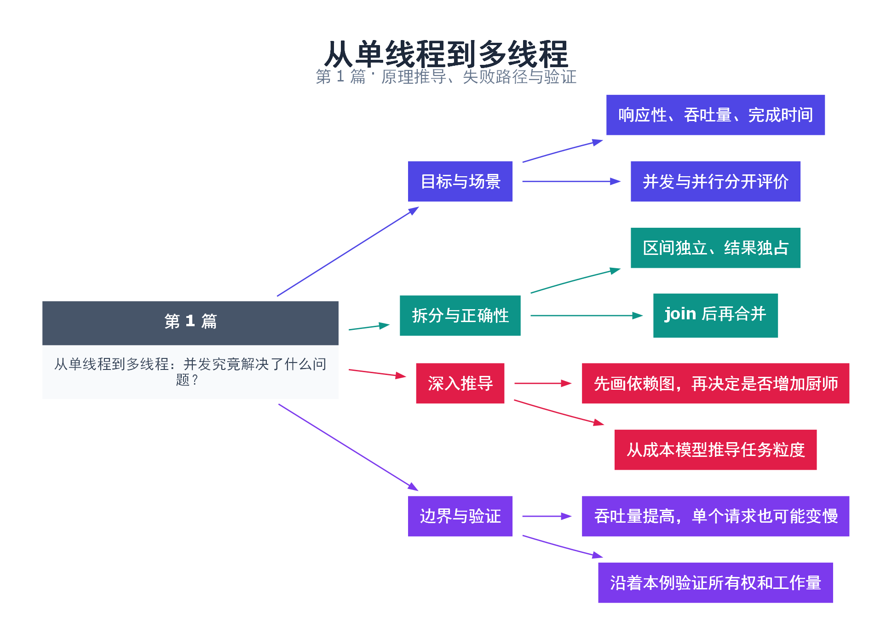

# 01｜从单线程到多线程：并发究竟解决了什么问题？

[返回总目录](README.md) · 最低标准：C++11

一句话总结：多线程让多个任务能够交错推进，并可能利用多个核心同时计算，但收益取决于任务之间能否独立执行。

**本文目录**

- [1. 为什么一个线程会成为瓶颈](#section-1)
- [2. 把求和任务拆成互不重叠的区间](#section-2)
- [3. 什么时候值得拆分](#section-3)
- [4. 实践检查](#section-4)
- [5. 深入推导、反例与工程取舍](#section-5)
  - [5.1 先画依赖图，再决定是否增加厨师](#depth-1)
  - [5.2 从成本模型推导任务粒度](#depth-2)
  - [5.3 吞吐量提高，单个请求也可能变慢](#depth-3)
  - [5.4 沿着本例验证所有权和工作量](#depth-4)
- [6. 完整示例与复现](#section-6)
  - [6.1 如何判断运行结果](#section-6-1)
- [7. Q&A（常见问题与解答）](#section-7)
  - [7.1 Q：两线程一定同时开始吗？](#section-7-1)
  - [7.2 Q：为什么结果变量不用 atomic？](#section-7-2)
  - [7.3 Q：任务很小怎么办？](#section-7-3)
- [8. 引用与延伸阅读](#section-8)
- [9. 思维导图总结](#section-9)

---

<a id="section-1"></a>

## 1. 为什么一个线程会成为瓶颈

设想一家只有一位厨师的餐馆：他切菜、等待烤箱、装盘，全按顺序做。如果等待烤箱时什么都不做，增加一位厨师可能提高出餐速度；如果只有一个灶台且每道菜都必须占用它，增加十位厨师也不能让灶台同时炒十道菜。线程像厨师，核心像可同时工作的工位，共享资源像唯一的灶台。这个类比只用于建立直觉，操作系统调度和缓存开销仍需单独分析。

并发描述多个任务在一段时间内都取得进展；并行描述多个任务在同一时刻执行。单核机器也可以通过时间片实现并发。多核机器具备并行条件，但锁争用、任务依赖和调度仍可能让程序串行运行。

典型目标有三个：让界面在后台工作时仍能响应；在网络或磁盘等待期间处理其他任务；缩短可以拆分的计算任务的总时间。三者的评价指标分别可能是响应延迟、吞吐量和完成时间，不能把“线程数量增加”当成成功指标。

<a id="section-2"></a>

## 2. 把求和任务拆成互不重叠的区间

本篇把 1 到 1,000,000 拆成两段，各线程只写自己的结果变量。两段计算之间没有依赖，主线程等待二者结束后再合并。算法总工作量仍是 O(N)，理想情况下关键路径接近 O(N/2)，额外成本包括创建线程、调度、等待和结果合并。

正确性的关键不是“两个变量地址不同”这一条：输入在运行期间保持不变；两个结果对象的寿命覆盖工作线程；主线程在 join 返回后才读取结果。join 建立完成线程与等待线程之间的同步关系，所以这里不需要为最终读取另外加锁。

若把两个线程都改为累加同一个普通整数，问题立即改变：原来独占的数据变成共享修改的数据，需要同步。最好的第一步通常是保留局部计算和最后合并，而不是给每一次加法加互斥锁。

<a id="section-3"></a>

## 3. 什么时候值得拆分

| 工作类型 | 可能收益 | 首先检查 |
|---|---|---|
| 大量独立计算 | 使用多个核心 | 任务粒度、核心数、内存带宽 |
| 阻塞式 I/O | 等待期间执行其他工作 | 并发连接上限、队列容量 |
| 强依赖的串行步骤 | 收益有限 | 能否改算法或流水线 |
| 极短小任务 | 可能更慢 | 调度开销是否高于计算量 |

不要用这个小例子的单次运行时间宣布“两线程快一倍”。优化器可能化简计算，系统也可能把两个线程调度到同一核心。先验证结果，再用第 45 篇的多轮测量方法比较足够大的、输入受控的工作负载。

<a id="section-4"></a>

## 4. 实践检查

划分任务前先写出输入、输出和依赖；标注每个输出由谁写；说明何时允许读取；最后确定失败时谁回收线程。若这些问题不能明确回答，增加线程会扩大问题而不会自动解决问题。

<!-- depth:chapter -->
<a id="section-5"></a>

## 5. 深入推导、反例与工程取舍

<!-- depth:start -->
<a id="depth-1"></a>

### 5.1 先画依赖图，再决定是否增加厨师

餐馆里“多雇一个厨师”只有在两个人有可以独立推进的工作时才有意义。把程序看成有向无环图：节点是任务，边表示“必须等前一个结果”。所有节点耗时之和叫总工作量 W；从起点到终点最长依赖链的耗时叫跨度 D。P 个执行核心的完成时间至少是 max(W/P, D)。这是忽略调度和同步成本的下界，不是实际运行时间的承诺。

例如四个任务各需 10 ms：四个互不依赖，理想情况下四核用 10 ms；排成一条链，四核仍需 40 ms；先做一个、并行做两个、最后汇总，则关键路径为 30 ms。线程数量相同，收益完全不同。遇到“CPU 还有空闲但程序不快”，先检查依赖链和串行资源，不要立即增加线程。

本篇求和把区间拆开，相当于把一条长链变成两条独立链。两个线程分别完成自己的局部累加，最后一次合并。每一步都加锁虽然也能避免数据竞争，却会把大部分计算重新串成一条链。

<a id="depth-2"></a>

### 5.2 从成本模型推导任务粒度

设单线程计算耗时为 C，创建与回收线程耗时为 H，划分与归并耗时为 M，双线程的额外争用为 K。粗略模型是 T₂≈C/2+H+M+K。想比单线程快，必须满足 C/2>H+M+K。这里假定负载均匀、两核可用，且计算没有遇到带宽上限；任何一个假定不成立，都应修正模型。

假设 C=100 μs，H+M+K=80 μs，则双线程约为 130 μs，比单线程慢。这是用来理解阈值的假设数据，并非本机实测。线程池能摊薄 H，却不能消除排队、分发和缓存迁移成本；批量提交能进一步摊薄分发成本，但批次太大又增加等待时间。

<a id="depth-3"></a>

### 5.3 吞吐量提高，单个请求也可能变慢

两名厨师可以每分钟完成更多订单，但一份订单可能先在队列里等很久。端到端延迟应拆成“排队时间 + 执行时间 + 合并或返回时间”。只测工作线程里的计算部分，会把最容易恶化的排队时间遗漏掉。

| 目标 | 该测什么 | 常见错误改法 |
|---|---|---|
| 界面响应 | 事件被处理前的等待时间 | 后台线程持有界面需要的锁 |
| I/O 吞吐 | 每秒完成量、在途数、排队长度 | 无限制地为每个请求创建线程 |
| 计算加速 | 同一输入的总完成时间 | 把初始化移出并行计时却留在串行计时 |

<a id="depth-4"></a>

### 5.4 沿着本例验证所有权和工作量

先手算两个区间的并集是否恰好是 [1,1000000]，交集是否为空，再检查结果类型能否容纳 N(N+1)/2。最后从工作线程写结果画箭头到 join 返回，再到主线程读取。这样分别证明了“算了正确的数据”和“在正确的时刻读取”。

练习时把分界点改成 1、N−1，再验证总和不变；若扩展为空区间，应明确 first>last 返回零的语义。不要直接把上界扩展到 uint64_t 的最大值：循环变量自增会回绕，求和本身也可能溢出。测量粒度交叉点使用第 45 篇基准，而不是用本例中容易被优化器化简的等差求和作性能结论。
<!-- depth:end -->

<a id="section-6"></a>

## 6. 完整示例与复现

源文件：[examples/01.cpp](examples/01.cpp)。在本系列目录运行以下命令；环境准备见 [实验环境](实验环境与验证.md)。

```bash
g++ -std=c++11 -O2 -Wall -Wextra -pedantic -pthread examples/01.cpp -o demo01
./demo01
```

```cpp
#include <cassert>
#include <cstdint>
#include <iostream>
#include <thread>

std::uint64_t sum(std::uint64_t first, std::uint64_t last) {
    std::uint64_t result = 0;
    for (auto i = first; i <= last; ++i) result += i;
    return result;
}
int main() {
    std::uint64_t left = 0, right = 0;
    std::thread a([&] { left = sum(1, 500000); });
    // 若第二次创建失败，也必须回收已启动的线程。
    try {
        std::thread b([&] { right = sum(500001, 1000000); });
        b.join();
    } catch (...) { a.join(); throw; }
    a.join();
    assert(left + right == 500000500000ULL);
    std::cout << left + right << '\n';
}
```

<a id="section-6-1"></a>

### 6.1 如何判断运行结果

输出 `500000500000`，断言通过。这个数验证任务划分与合并，不能验证加速比。

<a id="section-7"></a>

## 7. Q&A（常见问题与解答）

<a id="section-7-1"></a>

### 7.1 Q：两线程一定同时开始吗？

A：不一定。构造线程后它成为可调度的执行流，具体开始时间由实现和调度器决定。

<a id="section-7-2"></a>

### 7.2 Q：为什么结果变量不用 atomic？

A：每个结果只有一个写入线程，主线程在对应 join 返回后读取，不存在无序的冲突访问。

<a id="section-7-3"></a>

### 7.3 Q：任务很小怎么办？

A：先用单线程；若应用有大量短任务，可在第 25 篇所述线程池中复用线程并适当合并任务。

<a id="section-8"></a>

## 8. 引用与延伸阅读

- [C++20 工作草案：线程支持库](https://timsong-cpp.github.io/cppwp/n4861/thread)

规范链接采用固定的 C++20 工作草案 N4861；对较早标准的差异以正文标注为准。示例和分析为本系列自编，规范用于核对接口契约。

<a id="section-9"></a>

## 9. 思维导图总结

```text
从单线程到多线程：并发究竟解决了什么问题？
├── 目标与场景
│   ├── 响应性、吞吐量、完成时间
│   └── 并发与并行分开评价
├── 拆分与正确性
│   ├── 区间独立、结果独占
│   └── join 后再合并
├── 深入推导
│   ├── 先画依赖图，再决定是否增加厨师
│   └── 从成本模型推导任务粒度
└── 边界与验证
    ├── 吞吐量提高，单个请求也可能变慢
    └── 沿着本例验证所有权和工作量
```



[Graphviz 源文件](images/01.dot)
