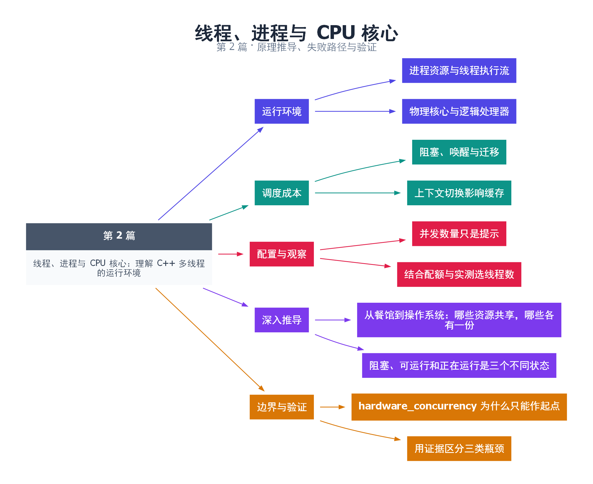

# 02｜线程、进程与 CPU 核心：理解 C++ 多线程的运行环境

[返回总目录](README.md) · 最低标准：C++11

一句话总结：进程提供资源隔离，线程提供执行流，CPU 核心提供运行能力；三者不是一一对应的关系。

**本文目录**

- [1. 从办公室理解资源和执行者](#section-1)
- [2. 从线程创建到真正执行](#section-2)
- [3. hardware_concurrency 只是提示](#section-3)
- [4. 如何观察而不是猜测](#section-4)
- [5. 深入推导、反例与工程取舍](#section-5)
  - [5.1 从餐馆到操作系统：哪些资源共享，哪些各有一份](#depth-1)
  - [5.2 阻塞、可运行和正在运行是三个不同状态](#depth-2)
  - [5.3 hardware_concurrency 为什么只能作起点](#depth-3)
  - [5.4 用证据区分三类瓶颈](#depth-4)
- [6. 完整示例与复现](#section-6)
  - [6.1 如何判断运行结果](#section-6-1)
- [7. Q&A（常见问题与解答）](#section-7)
  - [7.1 Q：线程数能大于核心数吗？](#section-7-1)
  - [7.2 Q：栈上的变量天然线程安全吗？](#section-7-2)
  - [7.3 Q：应该默认绑核吗？](#section-7-3)
- [8. 引用与延伸阅读](#section-8)
- [9. 思维导图总结](#section-9)

---

<a id="section-1"></a>

## 1. 从办公室理解资源和执行者

一个进程像一间办公室：拥有自己的地址空间和资源；线程像办公室里的员工，共享文件柜，但各自有当前工作进度。CPU 核心像实际可使用的工作台。员工可能比工作台多，操作系统负责安排谁先工作。

同一进程的线程通常共享堆、全局变量以及进程级资源，各自拥有调用栈和线程局部存储。不过“栈私有”不意味着其他线程无法访问栈中的对象：把局部变量的地址传出去，就可能发生跨线程访问。隔离由地址可达性和程序协议决定，不能靠存储位置推断线程安全。

<a id="section-2"></a>

## 2. 从线程创建到真正执行

std::thread 是标准库对执行线程的抽象，具体可能映射到 pthread 或 Windows 原生线程。线程就绪后进入调度系统；阻塞等待时通常不消耗整个 CPU 核心；再次被唤醒后可能在另一个核心上继续执行。线程迁移会影响缓存热度，但 C++ 不要求线程固定在某个核心。

上下文切换需要保存和恢复部分执行状态，还可能伴随缓存和地址转换结构的扰动。它不等于“每次都清空全部缓存”，也没有适用于所有机器的固定纳秒数。代码应尽量减少无意义唤醒，而不是依赖一个从别处抄来的切换时间估算。

物理核心、逻辑处理器也不同。SMT 让一个物理核心提供多个逻辑执行上下文，这些上下文共享部分硬件资源；因此 16 个逻辑处理器不代表任何工作负载都能得到 16 倍吞吐量。

<a id="section-3"></a>

## 3. hardware_concurrency 只是提示

下面的程序显示线程标识以及实现给出的并发提示，并把返回 0 当作“未知”。这个值不能可靠替代容器 CPU 配额、进程亲和性或服务端的资源预算。部署在限额环境时，应允许配置覆盖，不能盲目据此启动几十个线程。

| 概念 | 主要作用 | 常见误判 |
|---|---|---|
| 进程 | 资源与地址空间隔离 | 不同进程永远不能共享内存 |
| 线程 | 独立执行流 | 一个线程永久绑定一个核心 |
| 逻辑处理器 | 调度可用的执行上下文 | 与完整物理核心性能相同 |
| 并发提示值 | 初步配置参考 | 等于应用实际可用 CPU 配额 |

<a id="section-4"></a>

## 4. 如何观察而不是猜测

在 Linux 上可查看 `lscpu`、`ps -L -p PID`，并使用 `taskset -pc PID` 查看亲和性；Windows 可在任务管理器查看逻辑处理器，在性能分析工具中观察线程。观察时记录操作系统、CPU 型号、进程配额与负载。线程 ID 适合日志关联，不适合当连续数组下标，也不能假定它永不复用。

<!-- depth:chapter -->
<a id="section-5"></a>

## 5. 深入推导、反例与工程取舍

<!-- depth:start -->
<a id="depth-1"></a>

### 5.1 从餐馆到操作系统：哪些资源共享，哪些各有一份

把进程看成一家餐馆，线程看成店员。地址空间、打开的资源和大部分全局数据类似共同使用的仓库；线程的寄存器状态、栈和线程局部存储类似各自手上的工作记录。线程切换时操作系统必须保存、恢复足够的执行状态，才能让被暂停的函数从原处继续。

“每个线程有自己的栈”不表示栈里的对象不能被其他线程访问。把局部变量地址交给另一线程后，它就成了跨线程可达对象；生命周期仍由原作用域决定。反过来，堆对象也不必天然共享：unique_ptr 移交后可以只由一个线程访问。判断同步需求应看可达性和访问关系，而不是只看栈、堆标签。

<a id="depth-2"></a>

### 5.2 阻塞、可运行和正在运行是三个不同状态

一个线程可能正在核心上执行，也可能已经就绪却等待调度，还可能在等待锁、I/O 或条件变量而无法继续。CPU 利用率低既可能表示任务以 I/O 为主，也可能表示所有线程都堵在一把锁上。这两种原因需要完全不同的修复。

线程切换的代价也不只是一次内核调用：迁移到另一个核心后，原先热的数据可能不在本核心缓存中；线程数远多于可用核心时，轮流运行会增加调度和缓存扰动。具体开销依赖内核、架构和工作集，不能把某个固定微秒数写成通用常量。

Linux 上可用 `ps -L -p PID -o pid,tid,psr,stat,comm` 观察线程与处理器编号，用 `pidstat -t -w -p PID 1` 观察上下文切换。后者由 sysstat 提供；容器权限和采样间隔会影响可见信息。观察到迁移只是线索，还需与延迟和缓存指标关联。

<a id="depth-3"></a>

### 5.3 hardware_concurrency 为什么只能作起点

本例返回的是实现提供的并发能力提示，可能是 0，也不一定等于程序可独占的物理核心数。SMT 逻辑处理器共享部分执行资源；容器 CPU 配额、进程亲和性和其他负载又会进一步限制可用算力。因此“提示值为 8”不能推导八线程必定比四线程快两倍。

若一个任务平均计算 C 秒、阻塞 W 秒，希望让 P 个核心忙起来，可以先用 P×(1+W/C) 估算线程数量级。这个模型假定等待可以独立重叠，且没有其他资源瓶颈。数据库只有 20 个连接时，即使公式得到 100 个线程，也不能凭空多出 80 个可用连接。

<a id="depth-4"></a>

### 5.4 用证据区分三类瓶颈

| 观测组合 | 优先假设 | 下一步验证 |
|---|---|---|
| 核心持续忙、增加线程无收益 | 计算或内存带宽达到上限 | 比较工作集大小、采样热点 |
| CPU 低、大量线程等待同一锁 | 串行临界区限制吞吐 | 记录持锁时间和等待时间 |
| CPU 低、I/O 等待明显 | 外部服务或设备成为瓶颈 | 测服务时间、队列深度和超时 |

本篇示例只验证线程标识和并发提示的获取，不会测出调度公平性、核心拓扑或 NUMA 距离。需要亲和性或 NUMA 优化时，先记录平台和部署限制，再使用对应操作系统接口；这些能力不由 std::thread 的可移植接口统一提供。
<!-- depth:end -->

<a id="section-6"></a>

## 6. 完整示例与复现

源文件：[examples/02.cpp](examples/02.cpp)。在本系列目录运行以下命令；环境准备见 [实验环境](实验环境与验证.md)。

```bash
g++ -std=c++11 -O2 -Wall -Wextra -pedantic -pthread examples/02.cpp -o demo02
./demo02
```

```cpp
#include <iostream>
#include <thread>
int main() {
    unsigned hint = std::thread::hardware_concurrency();
    std::cout << "concurrency hint=" << hint << '\n';
    std::cout << "fallback=" << (hint ? hint : 1) << '\n';
    std::cout << "main=" << std::this_thread::get_id() << '\n';
    std::thread worker([] {
        std::cout << "worker=" << std::this_thread::get_id() << '\n';
    });
    worker.join();
}
```

<a id="section-6-1"></a>

### 6.1 如何判断运行结果

输出并发提示、回退值、主线程与工作线程标识。具体数字因机器而异；提示值允许为 0。

<a id="section-7"></a>

## 7. Q&A（常见问题与解答）

<a id="section-7-1"></a>

### 7.1 Q：线程数能大于核心数吗？

A：能，尤其阻塞式 I/O 工作负载常见。但过多线程会增加栈内存、调度和资源争用，应通过测量设置上限。

<a id="section-7-2"></a>

### 7.2 Q：栈上的变量天然线程安全吗？

A：不天然安全。只要指针或引用逃逸到其他线程，就要分析寿命和同步。

<a id="section-7-3"></a>

### 7.3 Q：应该默认绑核吗？

A：先测量线程迁移是否确实造成问题；绑核是平台相关策略，也可能降低调度灵活性和整体利用率。

<a id="section-8"></a>

## 8. 引用与延伸阅读

- [C++20 工作草案：线程支持库](https://timsong-cpp.github.io/cppwp/n4861/thread)

规范链接采用固定的 C++20 工作草案 N4861；对较早标准的差异以正文标注为准。示例和分析为本系列自编，规范用于核对接口契约。

<a id="section-9"></a>

## 9. 思维导图总结

```text
线程、进程与 CPU 核心：理解 C++ 多线程的运行环境
├── 运行环境
│   ├── 进程资源与线程执行流
│   └── 物理核心与逻辑处理器
├── 调度成本
│   ├── 阻塞、唤醒与迁移
│   └── 上下文切换影响缓存
├── 配置与观察
│   ├── 并发数量只是提示
│   └── 结合配额与实测选线程数
├── 深入推导
│   ├── 从餐馆到操作系统：哪些资源共享，哪些各有一份
│   └── 阻塞、可运行和正在运行是三个不同状态
└── 边界与验证
    ├── hardware_concurrency 为什么只能作起点
    └── 用证据区分三类瓶颈
```



[Graphviz 源文件](images/02.dot)
