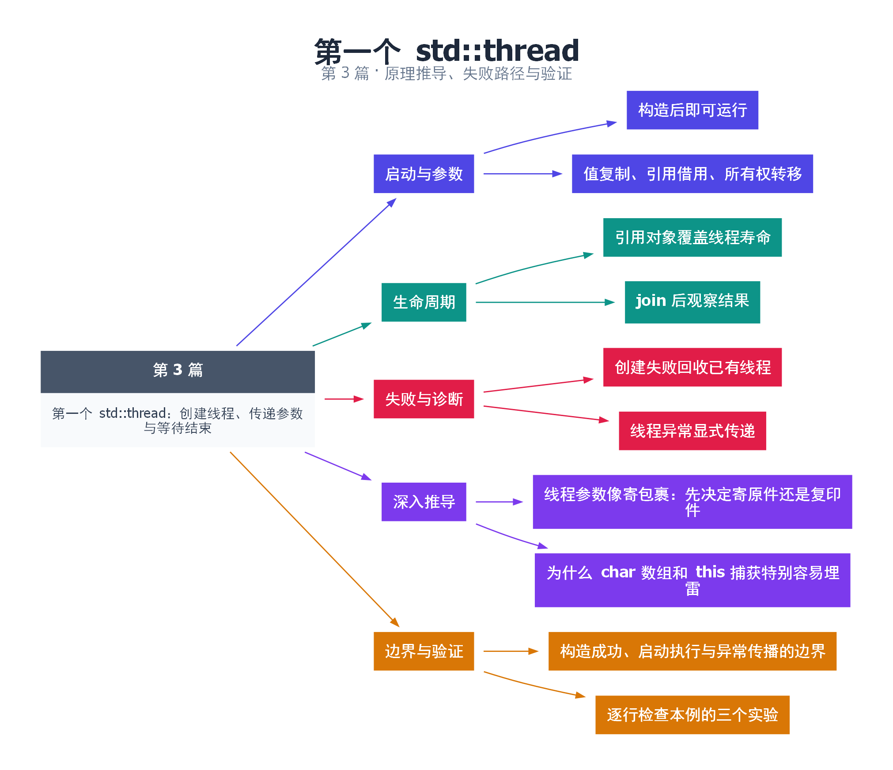

# 03｜第一个 std::thread：创建线程、传递参数与等待结束

[返回总目录](README.md) · 最低标准：C++11

一句话总结：std::thread 在构造成功后便可以开始执行，参数默认按值保存；显式共享引用时必须同时管理寿命和同步。

**本文目录**

- [1. 参数传递像交接任务材料](#section-1)
- [2. 三种参数交接方式](#section-2)
- [3. 异常与失败路径](#section-3)
- [4. 可操作的检查顺序](#section-4)
- [5. 深入推导、反例与工程取舍](#section-5)
  - [5.1 线程参数像寄包裹：先决定寄原件还是复印件](#depth-1)
  - [5.2 为什么 char 数组和 this 捕获特别容易埋雷](#depth-2)
  - [5.3 构造成功、启动执行与异常传播的边界](#depth-3)
  - [5.4 逐行检查本例的三个实验](#depth-4)
- [6. 完整示例与复现](#section-6)
  - [6.1 如何判断运行结果](#section-6-1)
- [7. Q&A（常见问题与解答）](#section-7)
  - [7.1 Q：std::ref 会加锁吗？](#section-7-1)
  - [7.2 Q：为什么传 unique_ptr 要 std::move？](#section-7-2)
  - [7.3 Q：join 能接住线程函数抛出的异常吗？](#section-7-3)
- [8. 引用与延伸阅读](#section-8)
- [9. 思维导图总结](#section-9)

---

<a id="section-1"></a>

## 1. 参数传递像交接任务材料

给同事一份文件复印件，他修改自己的副本；把同一份原件交给他，你们就必须约定谁在何时使用。std::thread 默认保存可调用对象和参数的衰变副本，再把它们交给新线程；`std::ref` 则明确表达“使用原对象”。这种默认复制有助于隔离寿命，但并不意味着被复制的对象内部没有共享指针。

构造函数不是等待任务结束的函数。主线程可能在工作线程开始前继续运行，也可能被工作线程抢先。不要根据某次终端输出的顺序推断启动顺序。

<a id="section-2"></a>

## 2. 三种参数交接方式

示例依次展示值、引用和 move-only 所有权。第一个线程接收值 10，在内部加到 11，但原变量保持 10。第二个线程使用 `std::ref` 把原变量加到 15，主线程通过 join 等待后观察。第三个线程取得 unique_ptr 的所有权，原指针变空，资源随新线程中的局部参数销毁。

使用引用时，join 不会替你延长对象寿命；是代码结构让引用对象一直存活到 join 返回。若把创建线程的函数提早返回，返回一个仍引用该函数局部对象的线程，程序仍会出现悬空引用。

成员函数还需要一个对象参数，例如把对象指针传给线程。指针复制只复制地址，不复制对象；对象必须存活，且并发调用的成员函数必须自行遵循同步协议。

<a id="section-3"></a>

## 3. 异常与失败路径

创建线程可能因资源不足抛出 `std::system_error`；已经创建的其他线程必须回收。工作线程内未捕获异常不会自动从主线程的 join 抛出，而会导致 `std::terminate`。要跨线程传播异常，需要捕获后保存 exception_ptr，或使用第 21 篇的 future。

本篇逐个创建、等待，避免多个线程创建过程中出现已启动线程无人回收的问题。实际并行启动多个线程时，应使用 RAII 守卫、明确的 catch 清理，或 C++20 jthread。

<a id="section-4"></a>

## 4. 可操作的检查顺序

先问参数需要复制、借用还是转移；再检查借用对象寿命；然后列出并发读写；最后规定异常如何传回。遇到模板报错时，先检查函数参数是否要求左值引用、是否缺少 `std::ref`，以及传入对象是否不可复制。

<!-- depth:chapter -->
<a id="section-5"></a>

## 5. 深入推导、反例与工程取舍

<!-- depth:start -->
<a id="depth-1"></a>

### 5.1 线程参数像寄包裹：先决定寄原件还是复印件

创建线程包含两件不同的事：构造供新线程调用的可调用对象及参数，再由新线程执行调用。以本篇使用的 C++11 语义理解，参数会经过 decay-copy；引用属性不会自动保留。把 int 直接传进去，相当于寄一份副本，线程修改它不会改变外面的原变量。

`std::ref(value)` 放入的是引用包装器，调用时才还原为引用；它不延长 value 的生命周期，也不增加互斥。传 unique_ptr 时使用 std::move，则把管理对象的责任转交给新线程。移动后源指针为空，主线程不能继续通过它解引用。

<a id="depth-2"></a>

### 5.2 为什么 char 数组和 this 捕获特别容易埋雷

数组作为线程参数常会退化为指针。假设局部 char 缓冲区被传给一个接收 std::string 的线程函数，若只传缓冲区地址，字符串转换可能到新线程执行调用时才发生。此时缓冲区可能已经失效。应在创建线程的表达式中显式构造拥有数据的 std::string，让线程保存这个对象，而不是依赖后续隐式转换。

成员函数任务里的 `[this]` 同样只保存指针。它不会复制整个对象。把后台任务放进成员函数后就返回，随后调用者销毁对象，线程依旧可能访问原地址。解决方向是由外部拥有者保证 join，或传入独立的值快照；确实需要共享所有权时再显式使用 shared_ptr，并分析引用环。

<a id="depth-3"></a>

### 5.3 构造成功、启动执行与异常传播的边界

线程构造完成和新线程函数开始之间有标准规定的同步关系，因此在启动前准备好的输入可以交给工作线程。但构造成功并不表示任务已经执行到了某一行；若必须等待“初始化完成”，需要 promise/future 等显式握手。

参数复制或线程资源分配失败会在创建方抛异常；线程函数体内未捕获的异常则不会自动传回创建方，而会导致 terminate。主线程给 thread 构造套一层 try/catch，抓不到另一个线程里稍后抛出的业务异常。需要工作线程 catch 后保存 exception_ptr，或者使用 packaged_task/async 的共享状态机制。

| 传递方式 | 适合的数据 | 必须履行的责任 |
|---|---|---|
| 按值 | 小型输入、独立快照 | 接受复制开销和快照时效 |
| std::ref | 需要修改的共享对象 | 保活并同步全部冲突访问 |
| std::move | 独占资源 | 移交后原线程停止使用旧所有权 |

<a id="depth-4"></a>

### 5.4 逐行检查本例的三个实验

第一段原值为 10，线程内副本变成 11，join 后原值仍为 10；第二段通过 ref 修改原对象，join 后为 15；第三段移动 unique_ptr，工作线程输出 42，原指针变空。三个断言分别验证复制、借用、移交，不能相互替代。

编译提示“thread arguments must be invocable after conversion to rvalues”时，先检查函数要的是 int&，实际却传了普通 int；只有确实想借用时才加 ref。出现 use-after-free 时，则检查引用目标是否活到 join；给错误的指针再套 ref 不会修复生命周期。
<!-- depth:end -->

<a id="section-6"></a>

## 6. 完整示例与复现

源文件：[examples/03.cpp](examples/03.cpp)。在本系列目录运行以下命令；环境准备见 [实验环境](实验环境与验证.md)。

```bash
g++ -std=c++11 -O2 -Wall -Wextra -pedantic -pthread examples/03.cpp -o demo03
./demo03
```

```cpp
#include <cassert>
#include <functional>
#include <iostream>
#include <memory>
#include <thread>
int main() {
    int value = 10;
    std::thread a([](int x) { ++x; std::cout << "copy=" << x << '\n'; }, value);
    a.join();
    assert(value == 10);
    std::thread b([](int& x) { x += 5; }, std::ref(value));
    b.join();
    assert(value == 15);
    std::unique_ptr<int> ptr(new int(42));
    std::thread c([](std::unique_ptr<int> p) {
        std::cout << "owned=" << *p << '\n';
    }, std::move(ptr));
    c.join();
    assert(!ptr);
    std::cout << "original=" << value << '\n';
}
```

<a id="section-6-1"></a>

### 6.1 如何判断运行结果

依次输出 `copy=11`、`owned=42`、`original=15`；所有断言通过。

<a id="section-7"></a>

## 7. Q&A（常见问题与解答）

<a id="section-7-1"></a>

### 7.1 Q：std::ref 会加锁吗？

A：不会。它只包装引用，不提供同步，也不延长被引用对象的寿命。

<a id="section-7-2"></a>

### 7.2 Q：为什么传 unique_ptr 要 std::move？

A：unique_ptr 不可复制，必须显式转移所有权。转移后原指针不能再被当成拥有对象的指针使用。

<a id="section-7-3"></a>

### 7.3 Q：join 能接住线程函数抛出的异常吗？

A：不能。工作线程要在自身边界捕获异常，再通过明确的共享状态传回。

<a id="section-8"></a>

## 8. 引用与延伸阅读

- [std::thread 构造与成员规范](https://timsong-cpp.github.io/cppwp/n4861/thread.thread.class)

规范链接采用固定的 C++20 工作草案 N4861；对较早标准的差异以正文标注为准。示例和分析为本系列自编，规范用于核对接口契约。

<a id="section-9"></a>

## 9. 思维导图总结

```text
第一个 std::thread：创建线程、传递参数与等待结束
├── 启动与参数
│   ├── 构造后即可运行
│   └── 值复制、引用借用、所有权转移
├── 生命周期
│   ├── 引用对象覆盖线程寿命
│   └── join 后观察结果
├── 失败与诊断
│   ├── 创建失败回收已有线程
│   └── 线程异常显式传递
├── 深入推导
│   ├── 线程参数像寄包裹：先决定寄原件还是复印件
│   └── 为什么 char 数组和 this 捕获特别容易埋雷
└── 边界与验证
    ├── 构造成功、启动执行与异常传播的边界
    └── 逐行检查本例的三个实验
```



[Graphviz 源文件](images/03.dot)
