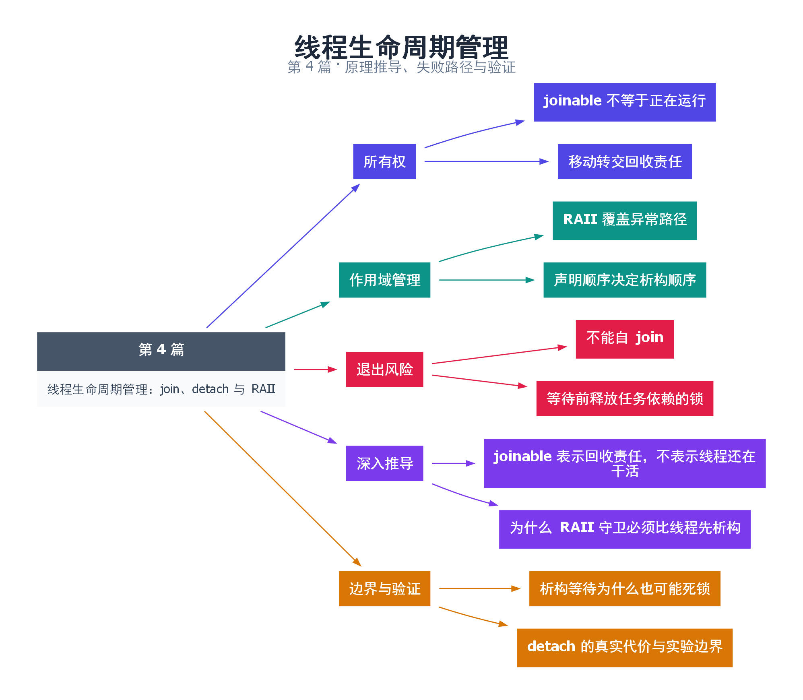

# 04｜线程生命周期管理：join、detach 与 RAII

[返回总目录](README.md) · 最低标准：C++11

一句话总结：每个拥有执行线程的 std::thread 对象，都必须在析构前通过 join、detach 或所有权转移完成明确交接。

**本文目录**

- [1. 谁负责把员工接回来](#section-1)
- [2. 为什么作用域守卫很重要](#section-2)
- [3. join、detach、move 的选择](#section-3)
- [4. 验证异常路径](#section-4)
- [5. 深入推导、反例与工程取舍](#section-5)
  - [5.1 joinable 表示回收责任，不表示线程还在干活](#depth-1)
  - [5.2 为什么 RAII 守卫必须比线程先析构](#depth-2)
  - [5.3 析构等待为什么也可能死锁](#depth-3)
  - [5.4 detach 的真实代价与实验边界](#depth-4)
- [6. 完整示例与复现](#section-6)
  - [6.1 如何判断运行结果](#section-6-1)
- [7. Q&A（常见问题与解答）](#section-7)
  - [7.1 Q：线程已经结束，为何析构仍会 terminate？](#section-7-1)
  - [7.2 Q：守卫析构可以无条件保证安全退出吗？](#section-7-2)
  - [7.3 Q：detach 的线程能访问局部变量吗？](#section-7-3)
- [8. 引用与延伸阅读](#section-8)
- [9. 思维导图总结](#section-9)

---

<a id="section-1"></a>

## 1. 谁负责把员工接回来

启动线程就像派人外出办理事务。join 是等待他回来并确认交接完成；detach 是解除这个管理句柄与执行线程的关联。detach 不是“后台线程自动安全”的承诺，它只是让你无法再通过这个对象等待完成。

std::thread 析构时若仍 joinable，会调用 std::terminate。joinable 表示对象关联着一个执行线程，不表示线程此刻仍在运行。一个早已执行完但尚未 join 的线程，仍然 joinable。

<a id="section-2"></a>

## 2. 为什么作用域守卫很重要

如果在线程构造和 join 之间出现异常，手写的末尾 join 可能根本执行不到。RAII 守卫把回收绑定到作用域退出，正常返回和异常展开都会触发。下面的守卫借用 thread，禁止复制；因此 thread 必须比守卫更早构造、更晚销毁。

守卫不是所有场景的通用解。它要求在拥有者线程上销毁，不能在线程自己内部 join 自己；还要求工作线程能够最终结束。若主线程拿着工作线程需要的锁进入析构，join 会一直等待，形成死锁。线程管理与任务停止协议要配套设计。

<a id="section-3"></a>

## 3. join、detach、move 的选择

| 操作 | 含义 | 应用条件 |
|---|---|---|
| join | 等待关联线程结束并回收关联 | 能明确等待时机，最容易验证 |
| detach | 解除关联，线程独立继续 | 存在其他寿命与完成管理机制 |
| move | 把关联所有权交给另一对象 | 接收方明确承担回收责任 |

向一个已经 joinable 的 thread 做移动赋值同样危险，会导致 terminate。不要把 thread 当作可以随便覆盖的任务槽位。重复 join 或对不可 join 的对象 join 也是错误，调用前应根据明确的状态机管理，而不只在各处随意判断。

<a id="section-4"></a>

## 4. 验证异常路径

示例在工作线程启动后主动抛出异常。守卫先等待工作线程把 done 设为 true，然后主线程进入 catch。这证明局部对象的销毁顺序有效。不能把这个验证替换成 sleep：sleep 只能改变时间，不能保证线程完成或同步内存。

<!-- depth:chapter -->
<a id="section-5"></a>

## 5. 深入推导、反例与工程取舍

<!-- depth:start -->
<a id="depth-1"></a>

### 5.1 joinable 表示回收责任，不表示线程还在干活

把 thread 看成一张需要结清的工单。工作已经完成，工单也可能仍未结清；这就是线程函数返回了但 thread 仍然 joinable。默认构造或被移走的 thread 不可 join；成功 join 或 detach 后也不可 join。

| 操作 | 之前的责任 | 之后的责任 |
|---|---|---|
| 创建 thread | 无线程 | 当前对象必须安排 join/detach |
| move 构造 | 源对象持有责任 | 目标接管，源变为不可 join |
| join | 当前对象持有责任 | 等待完成并解除关联 |
| detach | 当前对象持有责任 | 解除关联，程序另行保证资源寿命 |

销毁一个仍可 join 的 std::thread 会 terminate；向一个仍可 join 的 thread 做移动赋值也会 terminate。后一种情况常见于“循环里复用变量保存新线程”，旧线程并不会因为赋值而被自动回收。

<a id="depth-2"></a>

### 5.2 为什么 RAII 守卫必须比线程先析构

本例先构造 worker，再构造 guard。异常展开时局部对象逆序销毁，所以 guard 先 join，随后 worker 析构看到的已经是不可 join 状态。若守卫只引用 thread，那么 thread 对象本身必须一直活着，且不能被其他代码移动走或并发 join。

守卫让“所有离开作用域的路径都回收线程”更容易成立，却不证明线程一定能结束。若工作线程一直等主线程发信号，而主线程因异常直接进入 guard 析构，join 仍会永久等待。完整的 RAII 关闭协议应先让阻塞条件可解除，再等待退出。

<a id="depth-3"></a>

### 5.3 析构等待为什么也可能死锁

考虑主线程持有 mutex，开始销毁线程守卫；工作线程必须获取同一 mutex 才能退出。主线程等工作线程完成，工作线程等主线程释放锁，形成闭环。即使两个线程各自只拿一把锁，也照样会死锁。

因此“先加锁保护对象，再在锁里 join”不是通用安全做法。应在锁内改变关闭状态，在锁外通知和 join，最后释放共享资源。不要从工作线程调用回收自己的 join；这种自等待会报错，放在不允许异常逸出的析构路径里可能导致终止。

<a id="depth-4"></a>

### 5.4 detach 的真实代价与实验边界

detach 只解除 thread 对象与执行线程的关联，不等于把变量自动搬到堆上，也不保证进程退出前后台任务完成。后台线程写文件、访问单例或引用栈对象时，都必须另有生命周期方案。

本例主动抛出主任务异常，断言 done 为真，验证了异常展开先 join 再进入 catch 的顺序。它没有验证“任意线程函数都能安全回收”。扩展测试应让线程等待可控的停止信号，再在正常与异常路径都先置位、通知、join。若无法明确说出谁发送退出信号和谁等最后一条线程，优先采用明确所有者管理的 join，而不是 detach。
<!-- depth:end -->

<a id="section-6"></a>

## 6. 完整示例与复现

源文件：[examples/04.cpp](examples/04.cpp)。在本系列目录运行以下命令；环境准备见 [实验环境](实验环境与验证.md)。

```bash
g++ -std=c++11 -O2 -Wall -Wextra -pedantic -pthread examples/04.cpp -o demo04
./demo04
```

```cpp
#include <cassert>
#include <iostream>
#include <stdexcept>
#include <thread>
class join_guard {
    std::thread& thread_;
public:
    explicit join_guard(std::thread& t) noexcept : thread_(t) {}
    join_guard(const join_guard&) = delete;
    join_guard& operator=(const join_guard&) = delete;
    ~join_guard() { if (thread_.joinable()) thread_.join(); }
};
int main() {
    bool done = false;
    try {
        std::thread worker([&] { done = true; });
        join_guard guard(worker);
        throw std::runtime_error("main task failed");
    } catch (const std::exception& e) {
        assert(done);
        std::cout << e.what() << "; worker joined\n";
    }
}
```

<a id="section-6-1"></a>

### 6.1 如何判断运行结果

输出 `main task failed; worker joined`。done 的读取发生在守卫完成 join 之后。

<a id="section-7"></a>

## 7. Q&A（常见问题与解答）

<a id="section-7-1"></a>

### 7.1 Q：线程已经结束，为何析构仍会 terminate？

A：执行结束和管理对象解除关联是两个状态。未 join 或 detach 的对象仍然 joinable。

<a id="section-7-2"></a>

### 7.2 Q：守卫析构可以无条件保证安全退出吗？

A：不能。必须排除自 join、锁依赖死锁和任务永不返回；有效 join 若发生系统级失败，析构中的异常也不能安全传播。

<a id="section-7-3"></a>

### 7.3 Q：detach 的线程能访问局部变量吗？

A：只有在其他机制严格保证变量存活且访问同步时才行，普通离开作用域的局部引用通常不满足。

<a id="section-8"></a>

## 8. 引用与延伸阅读

- [C++20 工作草案：线程支持库](https://timsong-cpp.github.io/cppwp/n4861/thread)

规范链接采用固定的 C++20 工作草案 N4861；对较早标准的差异以正文标注为准。示例和分析为本系列自编，规范用于核对接口契约。

<a id="section-9"></a>

## 9. 思维导图总结

```text
线程生命周期管理：join、detach 与 RAII
├── 所有权
│   ├── joinable 不等于正在运行
│   └── 移动转交回收责任
├── 作用域管理
│   ├── RAII 覆盖异常路径
│   └── 声明顺序决定析构顺序
├── 退出风险
│   ├── 不能自 join
│   └── 等待前释放任务依赖的锁
├── 深入推导
│   ├── joinable 表示回收责任，不表示线程还在干活
│   └── 为什么 RAII 守卫必须比线程先析构
└── 边界与验证
    ├── 析构等待为什么也可能死锁
    └── detach 的真实代价与实验边界
```



[Graphviz 源文件](images/04.dot)
