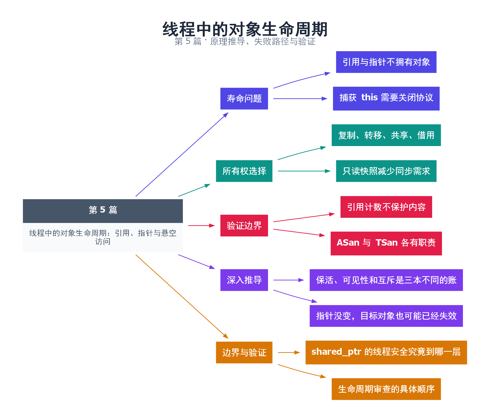

# 05｜线程中的对象生命周期：引用、指针与悬空访问

[返回总目录](README.md) · 最低标准：C++11

一句话总结：线程安全同时要求对象活着、访问有序、业务不变量成立；智能指针只能解决其中一部分问题。

**本文目录**

- [1. 借钥匙不等于延长房屋租期](#section-1)
- [2. 按值捕获也需要看内部结构](#section-2)
- [3. 选择所有权策略](#section-3)
- [4. 排错与验证](#section-4)
- [5. 深入推导、反例与工程取舍](#section-5)
  - [5.1 保活、可见性和互斥是三本不同的账](#depth-1)
  - [5.2 指针没变，目标对象也可能已经失效](#depth-2)
  - [5.3 shared_ptr 的线程安全究竟到哪一层](#depth-3)
  - [5.4 生命周期审查的具体顺序](#depth-4)
- [6. 完整示例与复现](#section-6)
  - [6.1 如何判断运行结果](#section-6-1)
- [7. Q&A（常见问题与解答）](#section-7)
  - [7.1 Q：捕获 this 是复制整个对象吗？](#section-7-1)
  - [7.2 Q：shared_ptr 能使 vector 并发 push_back 安全吗？](#section-7-2)
  - [7.3 Q：如何避免循环引用？](#section-7-3)
- [8. 引用与延伸阅读](#section-8)
- [9. 思维导图总结](#section-9)

---

<a id="section-1"></a>

## 1. 借钥匙不等于延长房屋租期

指针像钥匙，引用像约定好的房间编号。拿到钥匙不代表房子不会被拆除。把 `this`、局部变量引用、迭代器或 string_view 交给线程，都只是提供访问路径，没有自动延长底层对象的生命。

最典型错误是函数创建线程捕获 `[&]`，随后返回，线程继续访问函数局部变量。另一个隐蔽版本是对象析构时未停止后台线程，线程仍用捕获的 this 访问已经销毁的成员。将变量改成 atomic 也无法修复对象已不存在的问题。

<a id="section-2"></a>

## 2. 按值捕获也需要看内部结构

复制 std::string 通常得到独立字符存储；复制 string_view 仍借用原字符；复制 shared_ptr 共享同一个被管理对象。对持有指针的结构体做按值捕获，并不意味着深拷贝它指向的资源。

示例使用 shared_ptr<const string> 传递只读快照。工作线程捕获一个 shared_ptr 副本，主线程随后 reset 自己的副本。控制块仍有工作线程持有者，因此字符串直到线程结束才会被销毁。const 接口进一步阻止这个访问路径修改字符串。

shared_ptr 的引用计数可以由不同 shared_ptr 实例并发操作，不等于其指向对象可任意并发修改，也不等于同一个 shared_ptr 变量可无同步地 reset 与复制。若要并发替换一个共享快照指针，应使用相应原子接口或互斥锁。

<a id="section-3"></a>

## 3. 选择所有权策略

| 策略 | 适用场景 | 必须检查 |
|---|---|---|
| 值复制 | 小数据、独立任务 | 复制成本、是否真正拥有数据 |
| unique_ptr 转移 | 唯一工作者接手资源 | 原拥有者不能继续使用 |
| shared_ptr 共享 | 多任务延长同一对象寿命 | 内容同步与循环引用 |
| 引用借用 | 有明确 join 边界 | 对象寿命和访问顺序 |

实践中优先让线程不依赖拥有者的可变内部状态。确实需要时，把关闭过程规定为“停止接收新任务 → 请求停止 → 唤醒阻塞 → join → 销毁成员”。声明成员时也要考虑反向析构顺序，不能让工作线程依赖的互斥量先被销毁。

<a id="section-4"></a>

## 4. 排错与验证

AddressSanitizer 更适合找已释放内存和栈寿命问题，ThreadSanitizer 更适合找数据竞争；二者不能互相替代，通常分开构建运行。即使没有工具告警，也应画出拥有关系与退出时序，特别检查异常路径和对象被提前销毁的场景。

<!-- depth:chapter -->
<a id="section-5"></a>

## 5. 深入推导、反例与工程取舍

<!-- depth:start -->
<a id="depth-1"></a>

### 5.1 保活、可见性和互斥是三本不同的账

共享房间钥匙可以让多个人进门，但不保证两个人同时搬同一件家具不会撞上。shared_ptr 解决的是对象何时释放；锁或原子协议解决访问顺序；发布机制解决初始化结果如何传给另一线程。三者不能互相替代。

本例将 shared_ptr<const string> 按值捕获进线程。闭包拥有独立的 shared_ptr 实例，因此主线程 reset 自己的实例不会销毁仍被闭包持有的字符串。字符串在发布后不可修改，这又消除了共享修改的需求。这里是“共享所有权 + 不可变数据 + 启动同步”一起构成安全性。

<a id="depth-2"></a>

### 5.2 指针没变，目标对象也可能已经失效

悬空不只来自函数返回。vector 扩容可能使已有元素指针和引用失效；拥有对象被 move 后，先前保存的内部地址是否有效取决于类型契约；任务捕获迭代器时，另一个线程删除元素也可能使它失效。给容器本身套 shared_ptr，只保证容器对象活着，不保证每个元素地址始终稳定。

排查时画两层关系：第一层是谁拥有容器，第二层任务持有的是容器、元素副本、元素指针还是迭代器。锁必须覆盖使用地址的整个期间，或者在锁内复制需要的数据到独立快照后再解锁。只在“取得指针”那一行加锁通常不够。

<a id="depth-3"></a>

### 5.3 shared_ptr 的线程安全究竟到哪一层

不同 shared_ptr 实例共享控制块时，分别复制、销毁各自实例不会破坏引用计数。但两个线程同时修改同一个普通 shared_ptr 变量，仍需同步；指向的非 const 对象也不因引用计数安全就允许无序读写。C++20 atomic<shared_ptr<T>> 可以用于原子替换共享指针，仍需决定对象内容是否可变。

weak_ptr::lock 成功会取得临时所有权，应保存这个 shared_ptr 并通过它访问对象。先调用 expired 再通过另一个裸指针访问存在检查与使用之间的窗口；检查时对象活着，不代表下一行还活着。用 shared_ptr 捕获 this 所在对象时，也应检查“对象持有线程或任务，任务又持有对象”的引用环。

<a id="depth-4"></a>

### 5.4 生命周期审查的具体顺序

| 审查点 | 要回答的问题 | 对本例的回答 |
|---|---|---|
| 创建 | 初始化完成后才启动线程吗 | 是，字符串先构造 |
| 使用 | 工作期间谁持有强引用 | 线程闭包 |
| 修改 | 是否存在可变别名 | 示例没有 |
| 回收 | 最后一次访问如何结束 | join 等到工作线程完成 |

本例 join 后检查 weak_ptr 过期，验证闭包持有的资源已经释放。练习可在主线程 reset 后、join 前尝试 weak_ptr::lock，但结果不能写死为一定成功：工作线程可能已经完成。要稳定验证某一阶段的引用数或保活，应加 promise 握手控制阶段，而不是 sleep 后猜测时间。
<!-- depth:end -->

<a id="section-6"></a>

## 6. 完整示例与复现

源文件：[examples/05.cpp](examples/05.cpp)。在本系列目录运行以下命令；环境准备见 [实验环境](实验环境与验证.md)。

```bash
g++ -std=c++11 -O2 -Wall -Wextra -pedantic -pthread examples/05.cpp -o demo05
./demo05
```

```cpp
#include <cassert>
#include <iostream>
#include <memory>
#include <string>
#include <thread>
int main() {
    auto snapshot = std::make_shared<const std::string>("immutable config");
    std::weak_ptr<const std::string> observer = snapshot;
    std::thread worker([snapshot] {
        assert(*snapshot == "immutable config");
        std::cout << *snapshot << '\n';
    });
    snapshot.reset();
    worker.join();
    // join 后线程的调用对象已结束使用快照。
    assert(observer.expired());
}
```

<a id="section-6-1"></a>

### 6.1 如何判断运行结果

输出 `immutable config`，join 后 weak_ptr 过期断言通过。

<a id="section-7"></a>

## 7. Q&A（常见问题与解答）

<a id="section-7-1"></a>

### 7.1 Q：捕获 this 是复制整个对象吗？

A：不是，通常只是复制 this 指针，原对象必须继续存活。C++17 的 [*this] 是另一种语法，也仍要分析内部成员的所有权。

<a id="section-7-2"></a>

### 7.2 Q：shared_ptr 能使 vector 并发 push_back 安全吗？

A：不能。引用计数与 vector 内部数据是不同同步对象，后者仍需要锁或改成线程独占。

<a id="section-7-3"></a>

### 7.3 Q：如何避免循环引用？

A：观察者可使用 weak_ptr，并在访问前 lock 成临时 shared_ptr；还要规定对象失效时任务应如何退出。

<a id="section-8"></a>

## 8. 引用与延伸阅读

- [C++20 工作草案：线程支持库](https://timsong-cpp.github.io/cppwp/n4861/thread)

规范链接采用固定的 C++20 工作草案 N4861；对较早标准的差异以正文标注为准。示例和分析为本系列自编，规范用于核对接口契约。

<a id="section-9"></a>

## 9. 思维导图总结

```text
线程中的对象生命周期：引用、指针与悬空访问
├── 寿命问题
│   ├── 引用与指针不拥有对象
│   └── 捕获 this 需要关闭协议
├── 所有权选择
│   ├── 复制、转移、共享、借用
│   └── 只读快照减少同步需求
├── 验证边界
│   ├── 引用计数不保护内容
│   └── ASan 与 TSan 各有职责
├── 深入推导
│   ├── 保活、可见性和互斥是三本不同的账
│   └── 指针没变，目标对象也可能已经失效
└── 边界与验证
    ├── shared_ptr 的线程安全究竟到哪一层
    └── 生命周期审查的具体顺序
```



[Graphviz 源文件](images/05.dot)
