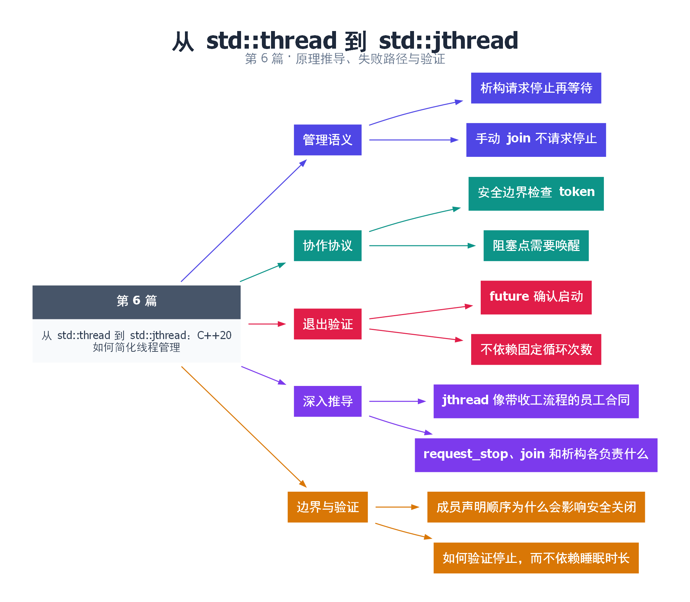

# 06｜从 std::thread 到 std::jthread：C++20 如何简化线程管理

[返回总目录](README.md) · 最低标准：C++20

一句话总结：jthread 把请求停止和等待结束纳入 RAII，但任务必须主动响应停止，阻塞点也必须有退出路径。

**本文目录**

- [1. 自动回收不等于强行终止](#section-1)
- [2. stop_token 的传递方式](#section-2)
- [3. 与 thread 的取舍](#section-3)
- [4. 本例为什么不用 sleep 等启动](#section-4)
- [5. 深入推导、反例与工程取舍](#section-5)
  - [5.1 jthread 像带收工流程的员工合同](#depth-1)
  - [5.2 request_stop、join 和析构各负责什么](#depth-2)
  - [5.3 成员声明顺序为什么会影响安全关闭](#depth-3)
  - [5.4 如何验证停止，而不依赖睡眠时长](#depth-4)
- [6. 完整示例与复现](#section-6)
  - [6.1 如何判断运行结果](#section-6-1)
- [7. Q&A（常见问题与解答）](#section-7)
  - [7.1 Q：析构时一定很快吗？](#section-7-1)
  - [7.2 Q：request_stop 返回就说明任务结束吗？](#section-7-2)
  - [7.3 Q：token 会自动打断系统调用吗？](#section-7-3)
- [8. 引用与延伸阅读](#section-8)
- [9. 思维导图总结](#section-9)

---

<a id="section-1"></a>

## 1. 自动回收不等于强行终止

把 jthread 想成带有“请收工”对讲机的工作人员。管理者离开时会发出收工请求并等人回来，但不会把正在运行的代码强制从中间切断。这样可以避免资源只改了一半、锁未释放等问题，代价是任务不响应时管理者仍会一直等。

若 jthread 析构时 joinable，会先 request_stop 再 join。手动调用 join 不会自动先请求停止。这个差异会让一个无限轮询任务在显式 join 处永远等待，因此示例先 request_stop，再 join。

<a id="section-2"></a>

## 2. stop_token 的传递方式

当可调用对象能以 stop_token 加用户参数调用时，jthread 会把 token 作为前置参数传入。工作线程定期检查 stop_requested，在安全边界退出。停止状态本身由标准库安全共享，但业务数据依然要采用自己的同步方式。

停止检查的粒度决定最坏响应延迟。每处理一条短任务检查一次通常容易理解；一次调用长时间阻塞的第三方函数，则外层再频繁检查也没有用。线程睡眠不会因为 request_stop 自动提前结束，普通 condition_variable 的 wait 也不会仅因请求停止自动返回。第 28 篇会用可停止等待展示完整协议。

<a id="section-3"></a>

## 3. 与 thread 的取舍

| 需求 | thread | jthread |
|---|---|---|
| 作用域回收 | 自己写守卫 | 默认析构等待 |
| 协作停止 | 自建状态 | stop_source / stop_token |
| 强制结束任意代码 | 不提供 | 不提供 |
| 标准版本 | C++11 | C++20 |

自动等待也可能引起界面卡顿或死锁。若拥有者持锁销毁 jthread，而工作线程退出前需要同一把锁，就会互相等待。因此关闭动作最好在可见的位置执行，并把析构作为兜底，而不是把全部退出逻辑藏进析构函数。

<a id="section-4"></a>

## 4. 本例为什么不用 sleep 等启动

主线程通过 promise/future 等待工作线程明确宣告已启动，再请求停止。这样没有“睡一毫秒应该够了”的时间假设。实际进度数取决于调度，只要求停止之后线程可以返回，不应对循环次数写固定断言。

<!-- depth:chapter -->
<a id="section-5"></a>

## 5. 深入推导、反例与工程取舍

<!-- depth:start -->
<a id="depth-1"></a>

### 5.1 jthread 像带收工流程的员工合同

std::thread 要求外部明确回收；jthread 在仍 joinable 的析构路径中先请求停止，再 join。这里的“请求”是给协作线程发信号，不是操作系统强制杀线程。若线程函数忽略 stop_token，析构仍要等它自己返回。

本例的循环每轮检查 token，所以停止延迟大致受“一次循环剩余时间 + 获得调度的延迟”影响。把循环体改为一个耗时十分钟的不可中断调用，即使 request_stop 立即返回，join 也可能等十分钟。C++ 接口不提供自动的硬实时退出上界。

<a id="depth-2"></a>

### 5.2 request_stop、join 和析构各负责什么

| 动作 | 改变停止状态 | 等到线程结束 |
|---|---|---|
| request_stop | 首次成功请求会改变 | 不负责等待线程函数返回 |
| join | 不会主动请求停止 | 会 |
| 可 join 的 jthread 析构 | 先请求 | 随后等待 |

这一区分解释了一个常见挂起：主线程直接调用 worker.join，而线程只在收到停止请求后才退出。join 不等同于析构，必须先 request_stop。停止状态一旦请求就不会复位；重新启动一项独立任务通常需要新的停止状态。

<a id="depth-3"></a>

### 5.3 成员声明顺序为什么会影响安全关闭

若类中工作线程访问 mutex、条件变量和队列，把线程成员声明在这些资源之后，可使逆序析构时线程先析构。但“先析构线程”只是基础：如果线程阻塞在普通 condition_variable 上且谓词没有停止条件，jthread 发出的停止请求不会自动唤醒它。

更稳妥的是显式析构流程：在资源仍然存在时置关闭状态，唤醒相关等待者，再 join；之后成员才逐一销毁。构造时也不要让新线程读取尚未构造完成的后续成员。第 28 篇会用支持 stop_token 的等待接口把停止接入阻塞路径。

<a id="depth-4"></a>

### 5.4 如何验证停止，而不依赖睡眠时长

本例用 promise 通知主线程“工作线程已经进入函数”，主线程再请求停止。输出 steps 可以是 0，因为发出启动通知后，停止请求可能先于第一次循环检查生效。把断言写成 steps>0 会误判一个合法执行。

正确的可验证目标是：线程最终退出、所有资源在退出前可用、主线程在 join 后读取统计。如果业务要求至少执行一批任务，应把“至少完成一批”写成另一条明确状态和握手，不能把它隐含在 jthread 的创建顺序里。回收多个互相等待的线程时，先向所有线程广播停止，再逐个 join，避免等第一个时其余线程尚未收到停止请求。
<!-- depth:end -->

<a id="section-6"></a>

## 6. 完整示例与复现

源文件：[examples/06.cpp](examples/06.cpp)。在本系列目录运行以下命令；环境准备见 [实验环境](实验环境与验证.md)。

```bash
g++ -std=c++20 -O2 -Wall -Wextra -pedantic -pthread examples/06.cpp -o demo06
./demo06
```

```cpp
#include <atomic>
#include <future>
#include <iostream>
#include <thread>
int main() {
    std::promise<void> started;
    auto ready = started.get_future();
    std::atomic<unsigned> steps{0};
    std::jthread worker([&](std::stop_token token) {
        started.set_value();
        while (!token.stop_requested()) {
            steps.fetch_add(1, std::memory_order_relaxed);
            std::this_thread::yield();
        }
    });
    ready.wait();
    worker.request_stop();
    worker.join();
    std::cout << "stopped, steps=" << steps.load() << '\n';
}
```

<a id="section-6-1"></a>

### 6.1 如何判断运行结果

输出 `stopped, steps=...`，数字允许为 0 或更大；程序正常退出。

<a id="section-7"></a>

## 7. Q&A（常见问题与解答）

<a id="section-7-1"></a>

### 7.1 Q：析构时一定很快吗？

A：不一定。析构会等待线程结束，退出耗时受任务长度、阻塞调用和停止检查粒度影响。

<a id="section-7-2"></a>

### 7.2 Q：request_stop 返回就说明任务结束吗？

A：不是，只说明请求状态的处理结果，线程结束仍要通过 join 等机制确认。

<a id="section-7-3"></a>

### 7.3 Q：token 会自动打断系统调用吗？

A：不会。必须使用可取消接口、超时或专门唤醒机制，具体取决于阻塞资源。

<a id="section-8"></a>

## 8. 引用与延伸阅读

- [jthread 规范](https://timsong-cpp.github.io/cppwp/n4861/thread.jthread.class)
- [停止令牌规范](https://timsong-cpp.github.io/cppwp/n4861/thread.stoptoken)

规范链接采用固定的 C++20 工作草案 N4861；对较早标准的差异以正文标注为准。示例和分析为本系列自编，规范用于核对接口契约。

<a id="section-9"></a>

## 9. 思维导图总结

```text
从 std::thread 到 std::jthread：C++20 如何简化线程管理
├── 管理语义
│   ├── 析构请求停止再等待
│   └── 手动 join 不请求停止
├── 协作协议
│   ├── 安全边界检查 token
│   └── 阻塞点需要唤醒
├── 退出验证
│   ├── future 确认启动
│   └── 不依赖固定循环次数
├── 深入推导
│   ├── jthread 像带收工流程的员工合同
│   └── request_stop、join 和析构各负责什么
└── 边界与验证
    ├── 成员声明顺序为什么会影响安全关闭
    └── 如何验证停止，而不依赖睡眠时长
```



[Graphviz 源文件](images/06.dot)
