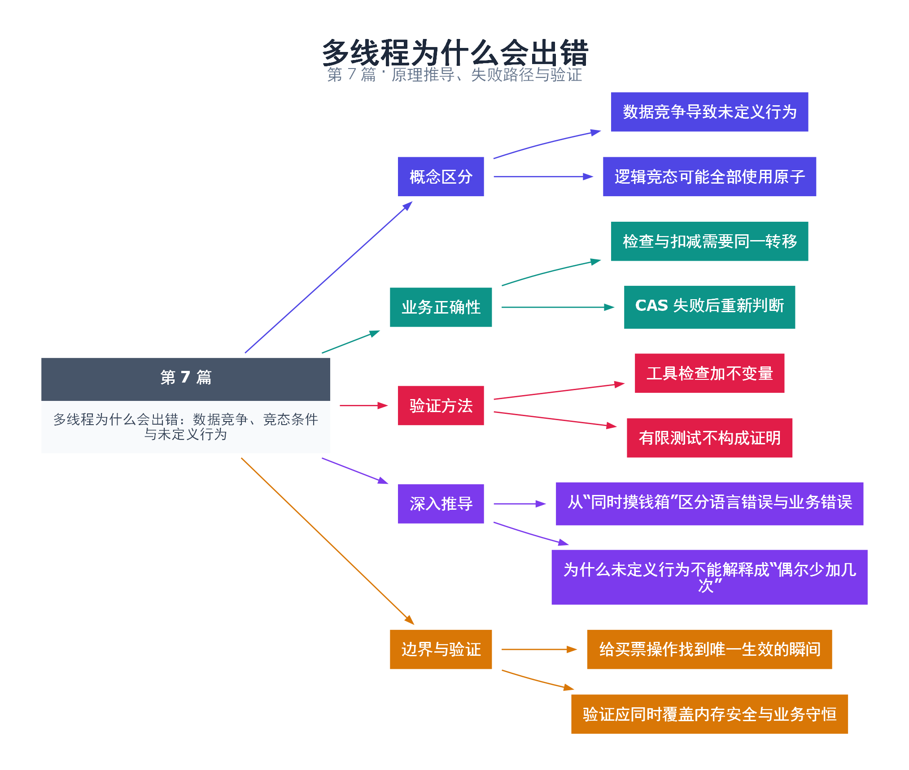

# 07｜多线程为什么会出错：数据竞争、竞态条件与未定义行为

[返回总目录](README.md) · 最低标准：C++20

一句话总结：数据竞争是语言层面的未定义行为，竞态条件是业务结果依赖时序；使用 atomic 只能自动消除前者中的部分问题。

**本文目录**

- [1. 两个售票员和最后一张票](#section-1)
- [2. 用 CAS 把检查和修改合成状态转移](#section-2)
- [3. 三类问题分开查](#section-3)
- [4. 深入推导、反例与工程取舍](#section-4)
  - [4.1 从“同时摸钱箱”区分语言错误与业务错误](#depth-1)
  - [4.2 为什么未定义行为不能解释成“偶尔少加几次”](#depth-2)
  - [4.3 给买票操作找到唯一生效的瞬间](#depth-3)
  - [4.4 验证应同时覆盖内存安全与业务守恒](#depth-4)
- [5. 完整示例与复现](#section-5)
  - [5.1 如何判断运行结果](#section-5-1)
- [6. Q&A（常见问题与解答）](#section-6)
  - [6.1 Q：全换成 atomic 就不会有并发 bug 吗？](#section-6-1)
  - [6.2 Q：volatile 能修复数据竞争吗？](#section-6-2)
  - [6.3 Q：测试一万次结果正确代表没有竞争吗？](#section-6-3)
- [7. 引用与延伸阅读](#section-7)
- [8. 思维导图总结](#section-8)

---

<a id="section-1"></a>

## 1. 两个售票员和最后一张票

两名售票员同时看到余票为 1，都向顾客承诺可以买，再各自执行扣减。即使查询和扣减每一步都不会撕裂，整体业务也可能售出两张票。这个例子说明：操作单独安全，不等于“检查并修改”整体安全。

在 C++ 内存模型中，跨线程的冲突访问至少有一方是写入，至少有一方不是原子操作，且没有规定的 happens-before 顺序，便可能构成数据竞争；有数据竞争的执行具有未定义行为。不能把它描述成“最多丢几次加法”。编译器不必保留你凭机器指令想象的行为。

竞态条件是更宽的概念。把余票改成 atomic，先 load 判断再 fetch_sub，两次操作各自原子，但检查和扣减之间仍可穿插其他线程，因此逻辑上可能扣成负数。默认 seq_cst 也不会把两条操作合并成一个事务。

<a id="section-2"></a>

## 2. 用 CAS 把检查和修改合成状态转移

本例读取当前余票；若大于 0，尝试把它从 expected 更新成 expected-1。CAS 成功意味着本次购买获得该状态转移；失败时 expected 被写回当前观察值，循环重新检查是否还有票。业务不变量是余票不小于 0，成功次数与初始库存一致。

这里默认顺序一致内存序，先把逻辑讲清楚。第 36 篇再分析成功和失败的内存序。若需要同时修改订单列表、付款状态和库存，单个整数 CAS 已不足以覆盖全部业务不变量，互斥锁或更高层事务通常更清楚。

<a id="section-3"></a>

## 3. 三类问题分开查

| 现象 | 问题类型 | 合适手段 |
|---|---|---|
| 普通计数器并发 ++ | 数据竞争 | TSan、互斥或原子 RMW |
| atomic 检查后再扣减 | 逻辑竞态 | 不变量断言、状态机审查 |
| 引用已销毁对象 | 生命周期错误 | ASan、所有权审查 |

不要在此示例中用故意产生未定义行为的版本作为默认测试。安全反例可以在纸上列出交错：A 读 1 → B 读 1 → A 扣 1 → B 扣 1。这个推演已经足以说明独立原子操作不保证业务正确。

<!-- depth:chapter -->
<a id="section-4"></a>

## 4. 深入推导、反例与工程取舍

<!-- depth:start -->
<a id="depth-1"></a>

### 4.1 从“同时摸钱箱”区分语言错误与业务错误

数据竞争关注内存访问是否合法；竞态条件关注结果是否依赖不受控制的时序。两个线程对普通 tickets 无同步地读写，会产生数据竞争，程序具有未定义行为。把 tickets 改成 atomic，只解决单次访问的合法性；若“检查库存”和“扣库存”分开，仍可能超卖。

| 步骤 | 线程 A | 线程 B |
|---|---|---|
| 1 | 原子读库存，得到 1 | |
| 2 | | 原子读库存，得到 1 |
| 3 | 根据旧值判断可卖，写 0 | |
| 4 | | 根据旧值判断可卖，写 0 |

最终库存没有变成负数，却卖出了两张票。只断言 tickets>=0 会漏掉这个错误；应同时检查 sold+remaining=initial。第 44 篇利用 barrier 强制两次读发生在两次写之前，稳定复现这一合法但业务错误的执行。

<a id="depth-2"></a>

### 4.2 为什么未定义行为不能解释成“偶尔少加几次”

普通整数自增常可在直觉上拆成读、加、写，但出现数据竞争后，语言不再保证只是这三个步骤交错。编译器可能合并循环中的读取、把值保留在寄存器或进行依赖于无竞争假设的变换。一次观察到少加几次，不构成该程序所有行为的范围。

volatile 不提供跨线程原子性或同步关系；sleep 也不建立 happens-before。调试版本正常、加日志后正常，只能说明执行和优化条件变了，不能说明漏洞消失。纠错应回到共享对象及同步边，而不是加入更长的延迟。

<a id="depth-3"></a>

### 4.3 给买票操作找到唯一生效的瞬间

本篇 CAS 方案把“库存仍是 expected”与“替换为 expected−1”合成一个不可分割的读改写步骤。成功的 CAS 是买票的线性化点：可以把并发的成功调用解释成按这些瞬间排队执行。失败时 expected 被更新，下一轮必须基于新值重新判断还有没有库存。

互斥锁也能解决：同一把锁覆盖检查、扣减及相应状态更新。若库存和订单表必须一起满足复杂不变量，单变量 CAS 未必合适；可能需要锁保护整个事务，或采用有明确回滚协议的设计。不能先 CAS 扣款，再假定随后可能抛异常的订单插入必定成功。

<a id="depth-4"></a>

### 4.4 验证应同时覆盖内存安全与业务守恒

本例只有一张票，两个尝试者，join 后检查 sold=1、tickets=0。将初始库存改为 K、尝试次数改为 M 时，期望 sold=min(K,M)，剩余为 K−sold，前提是不补票且每次只购一张。计数类型还要容纳全部尝试次数。

ThreadSanitizer 用于寻找已执行路径上的数据竞争；业务守恒由断言检查；可控调度用于稳定触发关键交错。三者关注不同问题。若一个全 atomic 程序在 TSan 下无报告，却破坏库存守恒，优先检查复合操作的线性化边界。
<!-- depth:end -->

<a id="section-5"></a>

## 5. 完整示例与复现

源文件：[examples/07.cpp](examples/07.cpp)。在本系列目录运行以下命令；环境准备见 [实验环境](实验环境与验证.md)。

```bash
g++ -std=c++20 -O2 -Wall -Wextra -pedantic -pthread examples/07.cpp -o demo07
./demo07
```

```cpp
#include <atomic>
#include <cassert>
#include <iostream>
#include <thread>
bool buy(std::atomic<int>& tickets) {
    int expected = tickets.load();
    while (expected > 0) {
        if (tickets.compare_exchange_weak(expected, expected - 1)) return true;
    }
    return false;
}
int main() {
    std::atomic<int> tickets{1};
    std::atomic<int> sold{0};
    std::jthread a([&] { if (buy(tickets)) ++sold; });
    std::jthread b([&] { if (buy(tickets)) ++sold; });
    a.join(); b.join();
    assert(tickets == 0 && sold == 1);
    std::cout << "tickets=" << tickets << " sold=" << sold << '\n';
}
```

<a id="section-5-1"></a>

### 5.1 如何判断运行结果

输出 `tickets=0 sold=1`。示例使用 jthread 管理寿命，CAS 原理自 C++11 即可使用。

<a id="section-6"></a>

## 6. Q&A（常见问题与解答）

<a id="section-6-1"></a>

### 6.1 Q：全换成 atomic 就不会有并发 bug 吗？

A：不会，跨多个操作的不变量、死锁、饥饿、寿命错误和退出协议都仍需设计。

<a id="section-6-2"></a>

### 6.2 Q：volatile 能修复数据竞争吗？

A：不能。volatile 不是线程同步原语，不建立所需的跨线程顺序。

<a id="section-6-3"></a>

### 6.3 Q：测试一万次结果正确代表没有竞争吗？

A：不代表，测试只覆盖有限调度；必须结合语言规则、工具和不变量推导。

<a id="section-7"></a>

## 7. 引用与延伸阅读

- [深化实验与验证](深化实验与验证.md)：完整协议测试、运行命令、预期断言和未覆盖边界。

- [数据竞争定义](https://timsong-cpp.github.io/cppwp/n4861/intro.races)
- [原子比较交换](https://timsong-cpp.github.io/cppwp/n4861/atomics.types.operations)

规范链接采用固定的 C++20 工作草案 N4861；对较早标准的差异以正文标注为准。示例和分析为本系列自编，规范用于核对接口契约。

<a id="section-8"></a>

## 8. 思维导图总结

```text
多线程为什么会出错：数据竞争、竞态条件与未定义行为
├── 概念区分
│   ├── 数据竞争导致未定义行为
│   └── 逻辑竞态可能全部使用原子
├── 业务正确性
│   ├── 检查与扣减需要同一转移
│   └── CAS 失败后重新判断
├── 验证方法
│   ├── 工具检查加不变量
│   └── 有限测试不构成证明
├── 深入推导
│   ├── 从“同时摸钱箱”区分语言错误与业务错误
│   └── 为什么未定义行为不能解释成“偶尔少加几次”
└── 边界与验证
    ├── 给买票操作找到唯一生效的瞬间
    └── 验证应同时覆盖内存安全与业务守恒
```



[Graphviz 源文件](images/07.dot)
