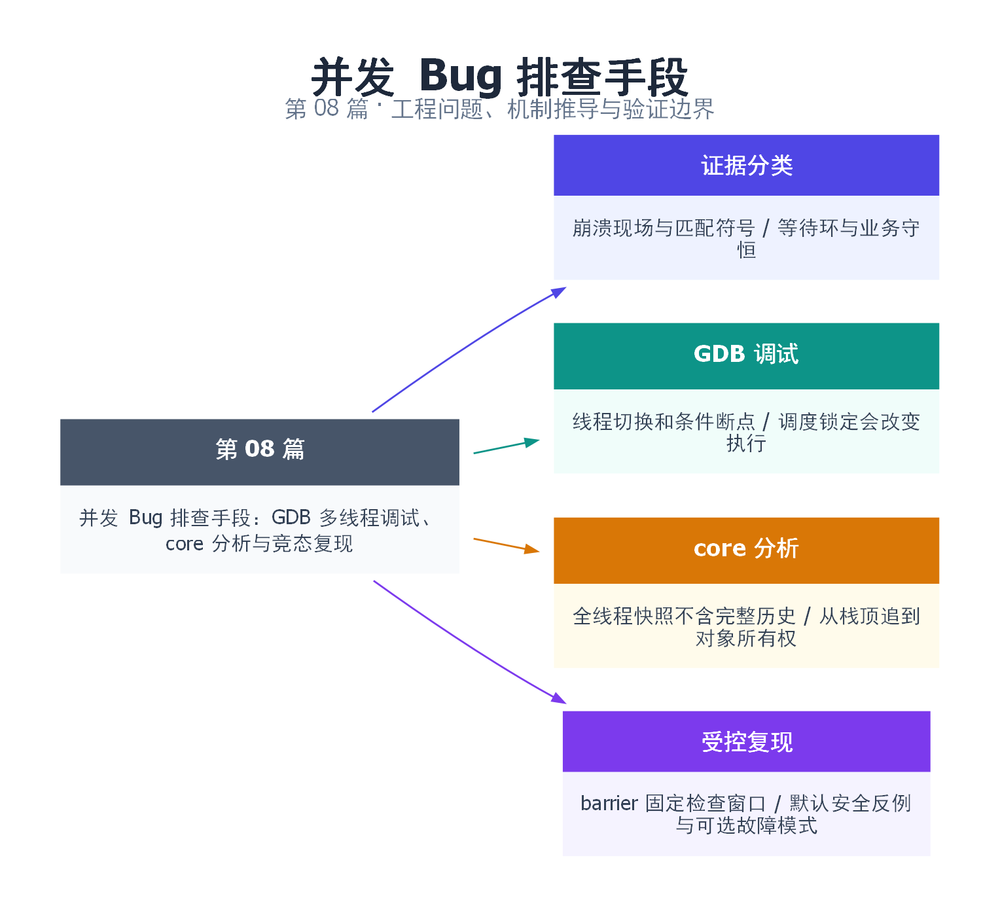

# 08｜并发 Bug 排查手段：GDB 多线程调试、core 分析与竞态复现

[返回总目录](README.md) · 最低标准：C++20

一句话总结：用线程现场提出假设，用受控交错复现，再用同步与所有权证明修复。

快速阅读：先看问题、方案对比和运行结果；深入阅读：按顺序推演边界，再运行完整示例及失败实验。

**本文目录**

- [1. 先把故障分成三类，再决定看什么证据](#section-1)
- [2. 用完整程序固定一个竞态，而不是靠 sleep 猜测](#section-2)
- [3. 多线程断点、切换和单步为什么会改变现象](#section-3)
- [4. 看锁持有者：从等待图出发，而非依赖一个字段](#section-4)
- [5. core 分析：先匹配现场，再谈源代码行](#section-5)
- [6. 如何将一次偶现转成回归实验](#section-6)
- [7. Q&A 与操作清单](#section-7)
- [8. 引用与延伸阅读](#section-8)
- [9. 思维导图总结](#section-9)

---

<a id="section-1"></a>

## 1. 先把故障分成三类，再决定看什么证据

并发排错像调查交通事故：现场照片能看到车辆停在哪里，监控录像才能还原怎样相撞。GDB/core 更像现场照片，受控复现、事件记录与动态检测器用于补足过程证据。**core 中出现损坏指针，不等于已经证明数据竞争；所有线程都停在锁上，也不等于一定死锁。**

| 现象 | 首先保存 | 要证明的事 |
|---|---|---|
| 崩溃：SIGSEGV、SIGABRT | 匹配二进制、符号、core、输入 | 哪条访问/终止路径失败，谁拥有对象 |
| 卡住：请求没有完成 | 两次全线程堆栈、等待对象、任务队列 | 是否存在等待环，或只是合法慢 I/O |
| 算错：超卖、重复、遗漏 | 业务守恒断言、关键事件顺序 | 操作在哪个边界被并发穿插 |

上一篇区分数据竞争和业务竞态。本篇补上从症状到证据的实际工作流；第 44 篇再讨论 TSan 与更系统的验证。

<a id="section-2"></a>

## 2. 用完整程序固定一个竞态，而不是靠 sleep 猜测

本例提供三个模式：默认 `--race` 稳定制造全 atomic 的逻辑超卖，正常退出；`--hang` 故意构造两锁死锁；`--crash` 用工作线程的 abort 生成崩溃现场。后两个只在独立实验进程中运行，不属于默认成功测试。

完整源文件：[examples/08.cpp](examples/08.cpp)。

```cpp
#include <atomic>
#include <barrier>
#include <cassert>
#include <cstdlib>
#include <iostream>
#include <mutex>
#include <string>
#include <thread>

std::atomic<int> tickets{1}, sold{0};
// Named functions are stable breakpoint locations in an -O0 -g build.
void before_commit(int seen) { (void)seen; }
void before_second_lock() {}
void reproduce_race() {
    std::barrier both_read(2);
    auto buy = [&] {
        int seen = tickets.load();
        before_commit(seen);
        both_read.arrive_and_wait();
        if (seen > 0) { tickets.store(seen - 1); sold.fetch_add(1); }
    };
    std::jthread worker(buy);
    buy();
    worker.join();
    assert(tickets == 0 && sold == 2);
    std::cout << "logical race reproduced: tickets=0 sold=2\n";
}
void reproduce_deadlock() {
    std::mutex first, second;
    std::barrier each_has_one(2);
    std::jthread worker([&] {
        std::lock_guard a(first);
        each_has_one.arrive_and_wait();
        before_second_lock();
        std::lock_guard b(second);
    });
    std::lock_guard b(second);
    each_has_one.arrive_and_wait();
    before_second_lock();
    std::lock_guard a(first); // intentional wait cycle: requires debugger/timeout
}
int main(int argc, char** argv) {
    std::string mode = argc > 1 ? argv[1] : "--race";
    if (mode == "--race") reproduce_race();
    else if (mode == "--hang") reproduce_deadlock();
    else if (mode == "--crash") {
        // An intentional crash snapshot, NOT proof of a data race.
        std::jthread worker([] { std::abort(); });
    } else return 2;
}
```

在 Linux 上安装并记录版本，所有命令从仓库根目录运行：

```bash
sudo apt update
sudo apt install build-essential gdb python3
g++ --version
gdb --version
mkdir -p build/debug08
g++ -std=c++20 -O0 -g -fno-omit-frame-pointer -pthread examples/08.cpp -o build/debug08/demo
./build/debug08/demo --race
```

预期输出 `logical race reproduced: tickets=0 sold=2`。barrier 位于“读旧库存”之后、“提交售出”之前，保证两方都读到 1。若 barrier 放在函数入口，只能同步开始时间，无法保证触发检查与修改之间的窗口。这里没有故意引入普通内存的数据竞争，因而结果是合法 C++ 执行中的业务错误。

<a id="section-3"></a>

## 3. 多线程断点、切换和单步为什么会改变现象

```text
gdb --args build/debug08/demo --race
(gdb) set pagination off
(gdb) break before_commit
(gdb) run
(gdb) info threads
(gdb) thread apply all bt
(gdb) info args
(gdb) up
(gdb) info locals
(gdb) thread 1
(gdb) bt
(gdb) continue
```

`info threads` 的第一列是 GDB 自己的线程编号，Linux LWP 是内核线程 ID，不能混用。示例里的 `thread 1` 应按实际列表替换；断点每次命中的是哪条线程并不固定。想只停某一条已存在的线程，可用 `break before_commit thread 2`；限制 seen 时可用 `break before_commit if seen == 1`。参数和线程 ID 都应以当前运行的符号与列表为准。[GDB 多线程手册](https://www.sourceware.org/gdb/current/onlinedocs/gdb.html/Threads.html)

默认 all-stop 模式中，一条线程命中断点通常会把整个被调试进程停住；继续/单步时哪些线程运行还受调度锁定设置影响。暂停改变了交错和超时，所以“加断点后不再复现”不是修复。

```text
(gdb) set scheduler-locking step
(gdb) next
(gdb) set scheduler-locking off
(gdb) continue
```

step 模式有助于检查当前线程的短代码段，但在 `wait`、barrier 或 `join` 前必须想清楚：它可能需要被你暂停的线程推进。scheduler-locking on 后自己单步走进等待，制造出的挂起可能只是调试器造成的。它不是固定所有并发时序的录制器，部分目标也不支持同样能力。

硬件观察点可用来查找谁改了某个地址，但数量有限，对象搬迁或释放后地址含义会改变。观察点与 atomic 的内部实现、优化级别也有关系；先找到实际对象地址和寿命，再设置 `watch`，不要把访问次数等同于业务提交次数。

<a id="section-4"></a>

## 4. 看锁持有者：从等待图出发，而非依赖一个字段

运行 `gdb --args build/debug08/demo --hang`，`run` 后按 Ctrl-C，再执行 `thread apply all bt full`。一个线程持 first 等 second，另一个持 second 等 first；把资源与线程画成环，才能解释为什么它们都无法退出。连续取两次堆栈，检查等待对象是否一致，以及外部 I/O、定时器或第三方线程是否还可能解除条件。

**std::mutex 没有可移植的 owner 查询接口。** 在特定 Linux/glibc/GDB 调试符号组合中，可以观察底层 pthread_mutex_t 的实现字段，例如普通 mutex 的内部 owner 信息；字段名、含义和适用 mutex 类型都属于实现细节。先查看 `ptype`、native_handle 的实际类型及 glibc 源码，不能把某个 `__owner` 路径抄成所有系统通用命令，更不要在 core 上调用 lock/unlock 来“验证”。

更稳定的工程办法是给锁命名、记录获取/释放事件与线程 ID，或在调试构建里维护独立的原子 owner 诊断值。诊断值的更新与真实加锁可能存在窗口，应视为辅助线索，不让它参与业务互斥；日志系统也不能在持锁路径上反过来获取同一把锁。

<a id="section-5"></a>

## 5. core 分析：先匹配现场，再谈源代码行

core 记录崩溃时内存和线程寄存器等现场。它通常没有完整的历史写入轨迹，因此可以定位崩溃线程和可能的对象损坏，却无法仅凭最后一次栈判断最早的竞争写发生在哪里。使用**发生崩溃的同一构建产物**，同时保存共享库与调试符号的版本/build ID。

```bash
ulimit -c unlimited
cat /proc/sys/kernel/core_pattern
./build/debug08/demo --crash
# 如果系统写普通 core 文件，用实际文件名：
gdb build/debug08/demo /实际路径/core文件
# 如果由 systemd-coredump 收集，先列出再选择本次 PID：
coredumpctl list
coredumpctl debug 本次PID
```

```text
(gdb) info files
(gdb) info threads
(gdb) thread apply all bt full
(gdb) frame 0
(gdb) info registers
```

本例 abort 的顶部通常在 C 运行库中，沿栈向上找到工作线程 lambda，才能知道是主动终止。栈顶库函数不是自动的根因。对于生产 SIGSEGV，继续追问对象在哪创建、由谁释放、指针是否跨线程逃逸；有假设后再用 ASan/TSan 或受控暂停验证。

没有 core 时检查 `ulimit`、core_pattern 是否管道收集、写入权限、磁盘空间、进程 dumpable 状态及服务管理器配置，不要反复运行只盯当前目录。core 可能含令牌和业务数据，应按事故材料保存与授权分享。[Linux core 手册](https://man7.org/linux/man-pages/man5/core.5.html)

<a id="section-6"></a>

## 6. 如何将一次偶现转成回归实验

先把业务不变量写出来，例如 sold+remaining=initial；再找会破坏它的两个操作边界；最后用 promise/barrier 固定“双方都读完、尚未提交”的状态。不要把错误程序改成更强内存序后就宣布修复，seq_cst 也不能把两条语句合成事务。

| 方案 | 优点 | 局限 |
|---|---|---|
| GDB 实时调试 | 看线程、局部变量、锁等待关系 | 暂停会改变时间和调度 |
| core | 无需在线附加，保留崩溃快照 | 缺少历史，依赖匹配符号 |
| TSan | 检查已执行路径的访问冲突 | 不能替代业务守恒与死锁分析 |
| 可控交错测试 | 确定复现指定窗口 | 未覆盖的交错仍需证明/探索 |

复现包至少保存输入、命令、二进制标识、版本、全线程堆栈、失败断言和超时。默认验证只运行 --race；用 Linux 的 `timeout 3s ... --hang` 检查预期挂起时，124 是 timeout 的结果，不是“死锁自动被证明”的错误码。本机 Windows 可测试 C++ 逻辑反例；Linux core 流程须在 Linux 执行。

<a id="section-7"></a>

## 7. Q&A 与操作清单

**看见 mutex::lock 就说明这条线程持有该锁吗？** 不一定，它可能只是正在等待。需要沿调用路径找已经获取但尚未释放的锁，再与其他线程的等待关联。

**Release 构建没有变量怎么办？** 保留带符号的发布二进制，理解内联和 optimized out；另外构建 -O0/-Og 最小复现，不能把不同优化构建的 core 与可执行文件混配。

**catch(...) 能截住 SIGSEGV 吗？** 不能把普通 C++ 异常处理当成 POSIX 信号恢复方案。下一篇相关专题在第 20 篇讲信号边界。

检查顺序：确认故障类别 → 固定输入与构建 → 保存全线程现场 → 画等待/所有权图 → 提出具体交错 → 构造最小复现 → 修复协议 → 保留回归断言。

<a id="section-8"></a>

## 8. 引用与延伸阅读

- [GDB 线程调试](https://www.sourceware.org/gdb/current/onlinedocs/gdb.html/Threads.html)：线程编号、线程专属断点和全线程命令。
- [GDB 调度与多线程运行](https://www.sourceware.org/gdb/current/onlinedocs/gdb.html/Thread-Stops.html)：单步期间其他线程的运行控制。
- [Linux core(5)](https://man7.org/linux/man-pages/man5/core.5.html)：core 收集条件与存储机制。
- [Clang ThreadSanitizer](https://clang.llvm.org/docs/ThreadSanitizer.html)：与现场调试互补的动态检测。

<a id="section-9"></a>

## 9. 思维导图总结

```text
并发 Bug 排查手段：GDB 多线程调试、core 分析与竞态复现
├── 证据分类
│   ├── 崩溃现场与匹配符号
│   └── 等待环与业务守恒
├── GDB 调试
│   ├── 线程切换和条件断点
│   └── 调度锁定会改变执行
├── core 分析
│   ├── 全线程快照不含完整历史
│   └── 从栈顶追到对象所有权
└── 受控复现
    ├── barrier 固定检查窗口
    └── 默认安全反例与可选故障模式
```



[Graphviz 图源](images/08.dot)
