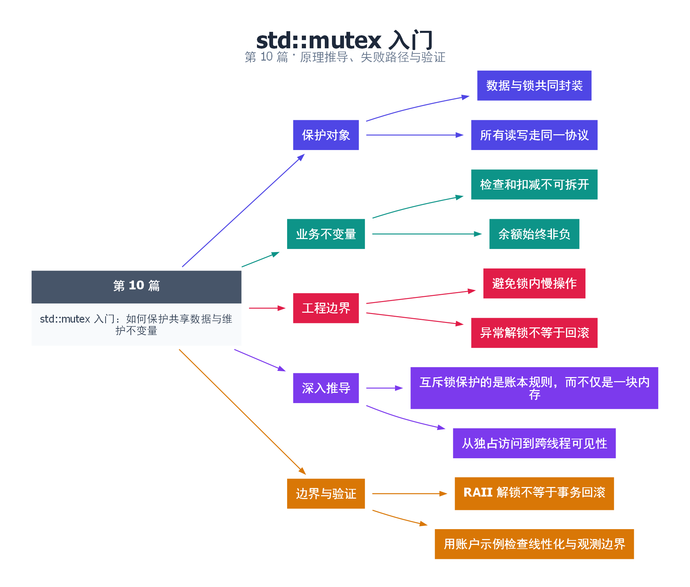

# 10｜std::mutex 入门：如何保护共享数据与维护不变量

[返回总目录](README.md) · 最低标准：C++20

一句话总结：互斥锁应保护完整的不变量及其所有访问路径，而不只是保护某一条赋值语句。

**本文目录**

- [1. 给账本加锁，而不是给笔加锁](#section-1)
- [2. 不变量应该如何定义](#section-2)
- [3. 原理到实现](#section-3)
- [4. 检查和选择](#section-4)
- [5. 深入推导、反例与工程取舍](#section-5)
  - [5.1 互斥锁保护的是账本规则，而不仅是一块内存](#depth-1)
  - [5.2 从独占访问到跨线程可见性](#depth-2)
  - [5.3 RAII 解锁不等于事务回滚](#depth-3)
  - [5.4 用账户示例检查线性化与观测边界](#depth-4)
- [6. 完整示例与复现](#section-6)
  - [6.1 如何判断运行结果](#section-6-1)
- [7. Q&A（常见问题与解答）](#section-7)
  - [7.1 Q：只有写入要锁吗？](#section-7-1)
  - [7.2 Q：锁能自动回滚修改吗？](#section-7-2)
  - [7.3 Q：每个线程使用自己的 mutex 可以吗？](#section-7-3)
- [8. 引用与延伸阅读](#section-8)
- [9. 思维导图总结](#section-9)

---

<a id="section-1"></a>

## 1. 给账本加锁，而不是给笔加锁

两个出纳共享一本账本，借走唯一的钥匙才能查账和记账，归还钥匙后下一个人才能继续。mutex 提供类似的排他进入机制。若一个人用钥匙，另一个人直接从窗户读账本，前者锁得再认真也不能构成完整保护。

互斥包含两个重要作用：同一时刻只有一个线程持有同一把 mutex；一次 unlock 与后续成功取得该锁的 lock 之间形成同步。后者使前一个临界区中的修改可以按语言规则被后一个临界区观察。锁不是简单的“暂停其他线程”，不访问这把锁的线程仍可以运行。

<a id="section-2"></a>

## 2. 不变量应该如何定义

本例账户初始 1000 元，两个线程各尝试 800 次取 1 元。账户应始终非负，最终成功取款共 1000 次，余额为 0。读取余额、判断是否足够、扣款必须位于同一临界区。只给扣减语句加锁仍有检查与执行之间的逻辑竞态。

互斥量和数据封装在同一类中，对外只提供完整操作，不返回余额的可变引用。查询函数也加锁，因为读写冲突同样需要同步。const 成员函数中的 mutable mutex 只表达同步状态可变，不表示业务余额在查询中被修改。

<a id="section-3"></a>

## 3. 原理到实现

lock_guard 构造时获得锁、析构时释放锁，因此 return 和抛异常也不会跳过解锁。`try_withdraw` 的成功扣减是本操作的线性化点：外部可以把整个并发历史理解为一系列按某个顺序执行的取款。查询所得余额只是查询瞬间的快照，不能凭此保证稍后的取款必定成功。

常见 mutex 实现可能先使用用户态原子操作，再在竞争时进入操作系统等待，但 C++ 并未要求某个固定实现。不要从“这次看起来没有系统调用”推断临界区可以无限加长。

<a id="section-4"></a>

## 4. 检查和选择

单个独立计数可用原子 RMW；多个字段需要一起保持关系时，互斥锁通常更清楚。锁内避免网络 I/O、未知回调和长时间计算。异常安全还要看业务修改顺序：锁自动释放不意味着已经修改了一半的两个字段会自动回滚。

<!-- depth:chapter -->
<a id="section-5"></a>

## 5. 深入推导、反例与工程取舍

<!-- depth:start -->
<a id="depth-1"></a>

### 5.1 互斥锁保护的是账本规则，而不仅是一块内存

银行柜员查余额、判断是否足够、扣款，这三步属于一次业务操作。若只在读取余额时上锁，解锁后再决定扣款，另一柜员可以在间隙改变余额。每行访问都曾经拿过锁，也不代表复合操作不可分割。

本例的不变量是 balance_>=0，且每次成功取款恰好减少 amount。锁覆盖参数检查、余额检查和扣减，失败返回前余额保持不变。所有访问 balance_ 的路径，包括 const 的 balance()，都使用同一 mutex。const 表示接口不修改业务可见状态，不表示函数天生线程安全；mutable mutex 用于允许 const 查询同步。

<a id="depth-2"></a>

### 5.2 从独占访问到跨线程可见性

互斥锁同时提供两类效果：同一时刻最多一个线程持有它；前一个线程 unlock 与随后取得该锁的 lock 建立规定的同步关系。于是锁内写余额、unlock、另一线程 lock、读取余额构成 happens-before 链。

只满足“大家没有恰好同时进入”的时间现象不够。给写路径用 mutex A、读路径用 mutex B，不会建立同一个保护协议。排查时可以给每个字段写下“guarded by 哪把锁”；如果同一字段在不同函数里出现不同答案，就要重新设计。

<a id="depth-3"></a>

### 5.3 RAII 解锁不等于事务回滚

假设转账先减账户 A，再向可能扩容的日志容器插入记录，最后给账户 B 加钱。日志插入抛异常时 lock_guard 会解锁，却不会把 A 的余额恢复。资源管理正确，业务不变量仍然破坏。

处理方法是尽量先在锁外完成可能失败的准备，再在锁内执行不会抛异常的提交；如果无法做到，就设计回滚或明确降低异常保证。外部支付、网络请求等不可撤销动作更不能因为放在锁内就当作事务。锁只协调参与同一协议的线程，不负责远端状态的一致性。

<a id="depth-4"></a>

### 5.4 用账户示例检查线性化与观测边界

成功取款可把扣减那一步视为线性化点，余额不足的失败可把持锁检查那一步视为线性化点。balance() 返回的是某个持锁瞬间的快照，不保证调用者下一行操作时仍是这个余额。因此“先 balance()>=100，再调用另一个无检查 debit()”会重新引入窗口。

本例 join 后检查总成功次数恰好 1000，余额为 0。扩展到多种金额时应按金额求和，而非只数成功次数。还应覆盖零、负数和大于余额的请求，验证失败不改状态。对于只有一个计数器的累加，atomic 可以更直接；涉及多个字段共同满足约束时，优先把约束封装进持锁成员函数。
<!-- depth:end -->

<a id="section-6"></a>

## 6. 完整示例与复现

源文件：[examples/10.cpp](examples/10.cpp)。在本系列目录运行以下命令；环境准备见 [实验环境](实验环境与验证.md)。

```bash
g++ -std=c++20 -O2 -Wall -Wextra -pedantic -pthread examples/10.cpp -o demo10
./demo10
```

```cpp
#include <cassert>
#include <iostream>
#include <mutex>
#include <thread>
class Account {
    mutable std::mutex mutex_;
    int balance_ = 1000;
public:
    bool try_withdraw(int amount) {
        std::lock_guard<std::mutex> lock(mutex_);
        if (amount <= 0 || balance_ < amount) return false;
        balance_ -= amount;
        return true;
    }
    int balance() const {
        std::lock_guard<std::mutex> lock(mutex_);
        return balance_;
    }
};
int main() {
    Account account;
    int a = 0, b = 0;
    std::jthread t1([&] { for (int i=0;i<800;++i) a += account.try_withdraw(1); });
    std::jthread t2([&] { for (int i=0;i<800;++i) b += account.try_withdraw(1); });
    t1.join(); t2.join();
    assert(a+b == 1000 && account.balance() == 0);
    std::cout << "withdrawn=" << a+b << " balance=" << account.balance() << '\n';
}
```

<a id="section-6-1"></a>

### 6.1 如何判断运行结果

输出 `withdrawn=1000 balance=0`；使用 C++20 管理线程，mutex 与 lock_guard 自 C++11 提供。

<a id="section-7"></a>

## 7. Q&A（常见问题与解答）

<a id="section-7-1"></a>

### 7.1 Q：只有写入要锁吗？

A：当读取可能与写入并发时，读取也必须遵循同一个同步协议。

<a id="section-7-2"></a>

### 7.2 Q：锁能自动回滚修改吗？

A：不能。RAII 负责释放锁，业务层还要通过先准备后提交等方式保证异常安全。

<a id="section-7-3"></a>

### 7.3 Q：每个线程使用自己的 mutex 可以吗？

A：不能保护同一份共享数据，参与者必须通过同一个互斥协议协调。

<a id="section-8"></a>

## 8. 引用与延伸阅读

- [互斥锁要求](https://timsong-cpp.github.io/cppwp/n4861/thread.mutex.requirements)

规范链接采用固定的 C++20 工作草案 N4861；对较早标准的差异以正文标注为准。示例和分析为本系列自编，规范用于核对接口契约。

<a id="section-9"></a>

## 9. 思维导图总结

```text
std::mutex 入门：如何保护共享数据与维护不变量
├── 保护对象
│   ├── 数据与锁共同封装
│   └── 所有读写走同一协议
├── 业务不变量
│   ├── 检查和扣减不可拆开
│   └── 余额始终非负
├── 工程边界
│   ├── 避免锁内慢操作
│   └── 异常解锁不等于回滚
├── 深入推导
│   ├── 互斥锁保护的是账本规则，而不仅是一块内存
│   └── 从独占访问到跨线程可见性
└── 边界与验证
    ├── RAII 解锁不等于事务回滚
    └── 用账户示例检查线性化与观测边界
```



[Graphviz 源文件](images/10.dot)
