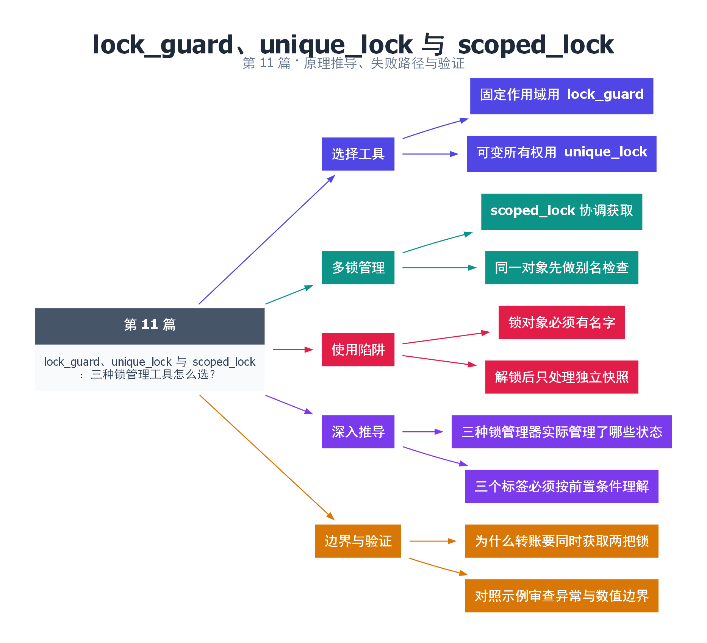

# 11｜lock_guard、unique_lock 与 scoped_lock：三种锁管理工具怎么选？

[返回总目录](README.md) · 最低标准：C++17

一句话总结：lock_guard 适合固定作用域，unique_lock 适合可转移或可提前释放的锁所有权，scoped_lock 适合一次管理多把锁。

**本文目录**

- [1. 三种不同的钥匙保管方式](#section-1)
- [2. 为什么条件变量使用 unique_lock](#section-2)
- [3. 多锁管理与异常](#section-3)
- [4. 实践规则](#section-4)
- [5. 深入推导、反例与工程取舍](#section-5)
  - [5.1 三种锁管理器实际管理了哪些状态](#depth-1)
  - [5.2 三个标签必须按前置条件理解](#depth-2)
  - [5.3 为什么转账要同时获取两把锁](#depth-3)
  - [5.4 对照示例审查异常与数值边界](#depth-4)
- [6. 完整示例与复现](#section-6)
  - [6.1 如何判断运行结果](#section-6-1)
- [7. Q&A（常见问题与解答）](#section-7)
  - [7.1 Q：unique_lock 会比 lock_guard 更安全吗？](#section-7-1)
  - [7.2 Q：adopt_lock 会帮我获取锁吗？](#section-7-2)
  - [7.3 Q：scoped_lock 保证整个程序无死锁吗？](#section-7-3)
- [8. 引用与延伸阅读](#section-8)
- [9. 思维导图总结](#section-9)

---

<a id="section-1"></a>

## 1. 三种不同的钥匙保管方式

lock_guard 像进门时拿钥匙、出门时自动归还的门禁牌；unique_lock 像可暂时存放、转交的钥匙袋，记录自己此刻是否持锁；scoped_lock 像协调多个房间的一组门禁。它们都不会让原本不支持递归的 mutex 变得可以重复加锁。

lock_guard 简单、不可复制，适合获取后直到作用域末尾都持有的场景。unique_lock 还支持 defer_lock、try_to_lock、adopt_lock，以及 unlock、lock、owns_lock 等操作。功能增加意味着状态也增加：调用 unlock 前必须确实持锁，adopt_lock 则要求调用者已经正确持有锁。

<a id="section-2"></a>

## 2. 为什么条件变量使用 unique_lock

等待条件变量时，需要“释放互斥量并进入等待”，醒来后重新持锁。unique_lock 能表达这种所有权变化；lock_guard 不能临时失去锁所有权。不要为了绕过接口而自己先 unlock 再 wait，这会在检查条件和睡眠之间制造竞态窗口。

<a id="section-3"></a>

## 3. 多锁管理与异常

两个账户转账需要同时保护两份余额。C++17 scoped_lock 可以在同一作用域管理多个 mutex，并使用避免获取过程死锁的算法。本例先对来源和目标是否相同做检查，避免把同一把非递归锁作为两个不同实参传入。

该机制只能处理传入锁的获取过程；若代码此前已持有另一把锁，或锁内调用回调再次取锁，仍可能形成更大范围的死锁。锁顺序和层级仍然是设计要求。

| 包装器 | 默认获得锁 | 能手动解锁或转移 | 多锁 |
|---|---|---|---|
| lock_guard | 是 | 否 | 单把 |
| unique_lock | 是，可选延迟 | 是 | 每个对象单把，可配合 std::lock |
| scoped_lock | 是 | 否 | 支持 |

<a id="section-4"></a>

## 4. 实践规则

每个锁对象必须命名。写一个瞬时临时对象可能导致语句结束就解锁，后续代码完全未受保护。提前 unlock 后不要继续访问刚才保护的数据；如果需要慢处理，先在锁内取出独立快照，然后再解锁处理。

<!-- depth:chapter -->
<a id="section-5"></a>

## 5. 深入推导、反例与工程取舍

<!-- depth:start -->
<a id="depth-1"></a>

### 5.1 三种锁管理器实际管理了哪些状态

lock_guard 像进门就拿钥匙、出门就还钥匙的简单门禁；unique_lock 还允许临时还钥匙、稍后再拿；scoped_lock 则协调一组门锁。它们管理的是锁的所有权，不拥有 mutex 对象本身，mutex 必须比管理器活得久。

| 类型 | 是否可移动 | 可延迟加锁/手动解锁 | 典型用途 |
|---|---|---|---|
| lock_guard | 否 | 否 | 一个固定临界区 |
| unique_lock | 是 | 是 | 条件变量、分阶段持锁 |
| scoped_lock | 否 | 否 | 一个或多个 mutex 的作用域管理 |

unique_lock 需要记录“关联哪把锁”和“当前是否持有”，因此比简单守卫多一层状态语义。选择它通常是因为需要这些能力，而不是它名字看起来更通用。

<a id="depth-2"></a>

### 5.2 三个标签必须按前置条件理解

defer_lock 表示先关联 mutex，不立即获取；try_to_lock 表示尝试一次，随后必须检查 owns_lock；adopt_lock 表示当前线程已经持有锁，让管理器接管后续解锁责任。adopt_lock 不会验证调用者说的是否属实，更不会帮忙获取锁。

对未持有的锁使用 adopt_lock，或让两个管理器都认为自己负责同一次所有权，会导致违反锁契约。移动 unique_lock 会转移责任，移动后的源不再拥有锁；而 release() 只是解除管理器关联并返回指针，不会解锁。把 release 当 unlock 使用，会留下无人回收的持锁状态。

<a id="depth-3"></a>

### 5.3 为什么转账要同时获取两把锁

若线程一先锁 A 后锁 B，线程二先锁 B 后锁 A，二者可能互相等待。scoped_lock 用标准规定的死锁规避方式获取多把锁；可以把它理解成允许尝试、退让和重试，具体算法由实现决定，不应假定一定按参数顺序逐个阻塞获取。

本例先判断 from 与 to 是否同一对象，避免把同一非递归 mutex 交给多锁获取。所有参与转账的路径也必须遵守兼容的协议。scoped_lock 不能消除线程拿到这些锁之后调用回调、等待 future 或再拿其他锁造成的新等待环。

<a id="depth-4"></a>

### 5.4 对照示例审查异常与数值边界

transfer 在两锁持有期间检查并修改两个余额，因此别的正确加锁查询不会看到只扣未加的中间状态。示例金额很小；扩展到通用账户时，还要在提交前检查目标余额加法是否溢出，不能把有符号整数溢出当成合法业务结果。

unique_lock 的示例先 defer，再 lock、复制余额、unlock，最后断言不再 owns_lock。若复制的是指向账户内部的引用，解锁后使用仍可能不安全；这里复制 int 才形成独立快照。练习可加入同账户转账、负金额、余额不足三个断言，验证失败路径不改变两个账户。
<!-- depth:end -->

<a id="section-6"></a>

## 6. 完整示例与复现

源文件：[examples/11.cpp](examples/11.cpp)。在本系列目录运行以下命令；环境准备见 [实验环境](实验环境与验证.md)。

```bash
g++ -std=c++17 -O2 -Wall -Wextra -pedantic -pthread examples/11.cpp -o demo11
./demo11
```

```cpp
#include <cassert>
#include <iostream>
#include <mutex>
struct Account { std::mutex mutex; int balance = 100; };
bool transfer(Account& from, Account& to, int amount) {
    if (&from == &to || amount <= 0) return false;
    std::scoped_lock locks(from.mutex, to.mutex);
    if (from.balance < amount) return false;
    from.balance -= amount;
    to.balance += amount;
    return true;
}
int main() {
    Account a, b;
    assert(transfer(a,b,30));
    int snapshot;
    {
        std::unique_lock<std::mutex> lock(a.mutex, std::defer_lock);
        lock.lock();
        snapshot = a.balance;
        lock.unlock();
        assert(!lock.owns_lock());
    }
    assert(snapshot == 70);
    std::cout << "snapshot=" << snapshot << '\n';
}
```

<a id="section-6-1"></a>

### 6.1 如何判断运行结果

输出 `snapshot=70`，演示多锁操作与提前解锁后的快照处理。

<a id="section-7"></a>

## 7. Q&A（常见问题与解答）

<a id="section-7-1"></a>

### 7.1 Q：unique_lock 会比 lock_guard 更安全吗？

A：它只是表达更多状态；简单作用域通常用 lock_guard 更容易审查，需要条件变量等功能时再用 unique_lock。

<a id="section-7-2"></a>

### 7.2 Q：adopt_lock 会帮我获取锁吗？

A：不会。它接管已经获得的锁，前置条件不满足就是错误用法。

<a id="section-7-3"></a>

### 7.3 Q：scoped_lock 保证整个程序无死锁吗？

A：不能，它只协调本次传入的锁，无法消除其他锁、join、回调或外部资源造成的循环等待。

<a id="section-8"></a>

## 8. 引用与延伸阅读

- [C++20 工作草案：线程支持库](https://timsong-cpp.github.io/cppwp/n4861/thread)

规范链接采用固定的 C++20 工作草案 N4861；对较早标准的差异以正文标注为准。示例和分析为本系列自编，规范用于核对接口契约。

<a id="section-9"></a>

## 9. 思维导图总结

```text
lock_guard、unique_lock 与 scoped_lock：三种锁管理工具怎么选？
├── 选择工具
│   ├── 固定作用域用 lock_guard
│   └── 可变所有权用 unique_lock
├── 多锁管理
│   ├── scoped_lock 协调获取
│   └── 同一对象先做别名检查
├── 使用陷阱
│   ├── 锁对象必须有名字
│   └── 解锁后只处理独立快照
├── 深入推导
│   ├── 三种锁管理器实际管理了哪些状态
│   └── 三个标签必须按前置条件理解
└── 边界与验证
    ├── 为什么转账要同时获取两把锁
    └── 对照示例审查异常与数值边界
```



[Graphviz 源文件](images/11.dot)
