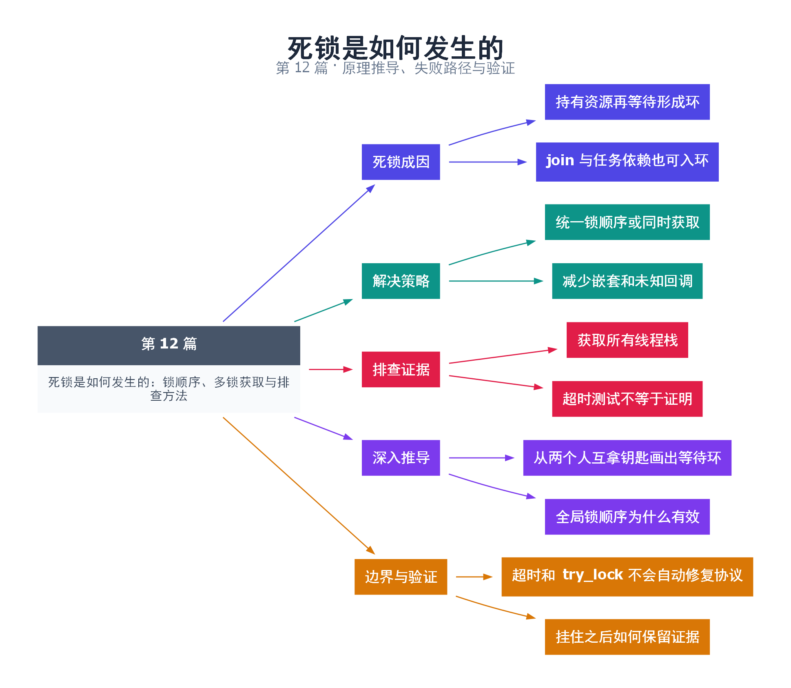

# 12｜死锁是如何发生的：锁顺序、多锁获取与排查方法

[返回总目录](README.md) · 最低标准：C++20

一句话总结：死锁来自资源等待环，解决方案需要覆盖锁、线程等待、任务依赖和回调，而不仅是调整某两行代码。

**本文目录**

- [1. 两人各拿一把钥匙](#section-1)
- [2. std::lock 的能力和边界](#section-2)
- [3. 排查时先抓证据](#section-3)
- [4. 验证](#section-4)
- [5. 深入推导、反例与工程取舍](#section-5)
  - [5.1 从两个人互拿钥匙画出等待环](#depth-1)
  - [5.2 全局锁顺序为什么有效](#depth-2)
  - [5.3 超时和 try_lock 不会自动修复协议](#depth-3)
  - [5.4 挂住之后如何保留证据](#depth-4)
- [6. 完整示例与复现](#section-6)
  - [6.1 如何判断运行结果](#section-6-1)
- [7. Q&A（常见问题与解答）](#section-7)
  - [7.1 Q：加超时就消除死锁了吗？](#section-7-1)
  - [7.2 Q：recursive_mutex 能解决所有嵌套锁吗？](#section-7-2)
  - [7.3 Q：如何区分饥饿和死锁？](#section-7-3)
- [8. 引用与延伸阅读](#section-8)
- [9. 思维导图总结](#section-9)

---

<a id="section-1"></a>

## 1. 两人各拿一把钥匙

A 拿着仓库钥匙等待办公室钥匙，B 拿着办公室钥匙等待仓库钥匙；双方都不归还手中的钥匙，等待便无法结束。经典死锁条件包括互斥、持有并等待、不可抢占和循环等待。工程中最常用的是打破循环等待或避免持有部分资源时等待其他资源。

如果转账 A→B 先锁 A 再锁 B，反向转账先锁 B 再锁 A，两条路径便可以成环。统一按稳定的账户编号排序获取锁是一种方案；同时用 std::lock 或 scoped_lock 获取全部所需锁是另一种。不能用对任意对象原始指针的内建 `<` 作为普遍可靠的业务顺序，应使用明确 ID 或适用的标准比较器。

<a id="section-2"></a>

## 2. std::lock 的能力和边界

本例两条线程以相反方向搬运资金，每次用 scoped_lock 同时取得两个账户锁。即使传参顺序反向，也不采用简单固定的“先拿第一把再等第二把”方式，所以避免这两个锁的经典获取死锁。

这不保证无饥饿，也不解决逻辑上无法完成的等待。单工作线程的线程池任务提交子任务后等待子任务，就是没有 mutex 等待环也可能发生的资源死锁。拿锁 join 一个需要该锁退出的线程也是常见模式。

<a id="section-3"></a>

## 3. 排查时先抓证据

进程停滞时先获取所有线程栈，找线程停在哪个 lock、wait、join 或 I/O。Linux 可在调试器中使用 `thread apply all bt`；Windows 可抓取转储并查看各线程等待。把“线程 → 等待资源 → 持有者”画成图，寻找环。CPU 很高且状态不断变化可能是活锁，CPU 低只是等待的线索，不是死锁证明。

| 策略 | 优点 | 限制 |
|---|---|---|
| 全局锁顺序 | 容易推理与文档化 | 新路径必须遵守 |
| 同时获取多锁 | 局部实现简洁 | 不能覆盖外部资源 |
| try_lock + 回退 | 可主动让出部分资源 | 可能活锁、饥饿 |
| 减少嵌套锁 | 降低等待图复杂度 | 可能需要改数据模型 |

<a id="section-4"></a>

## 4. 验证

示例检查总余额保持 2000，且对称次数的反向转账使两边回到初始值。运行时超时可发现卡死，但没超时不等于证明无死锁；还必须审查所有获取路径与关闭路径。

<!-- depth:chapter -->
<a id="section-5"></a>

## 5. 深入推导、反例与工程取舍

<!-- depth:start -->
<a id="depth-1"></a>

### 5.1 从两个人互拿钥匙画出等待环

死锁分析最直接的工具是等待图：线程指向它正在等待的资源，资源指向当前持有者。A 持有 L1 等 L2，B 持有 L2 等 L1，就构成 A→L2→B→L1→A。互斥、持有并等待、不可强行剥夺与循环等待同时出现，给出了经典死锁条件。

不必出现两把 mutex 才会死锁。线程池任务等待排在自己之后的子任务、主线程持锁 join、回调重新进入当前不可重入接口，都能产生同样的闭环。把“资源”扩展到工作线程名额、future 结果和队列空位，才能看到完整依赖。

<a id="depth-2"></a>

### 5.2 全局锁顺序为什么有效

给每种锁或每个稳定资源分配一个全局一致的次序，要求线程只能从小到大获取。若存在等待环，就意味着沿环次序严格递增，最后又回到起点，这是矛盾，因此循环等待被排除。证明依赖于所有路径遵守同一顺序，包括错误处理、日志和回调。

动态账户可用稳定唯一 ID 确定顺序；若按指针排序，应使用提供严格全序的适当比较方式，如 std::less，而不是依赖无关对象裸指针关系比较的可移植含义。资源本身的寿命也必须覆盖排序和获取过程。两把已知锁的场景直接用 scoped_lock 往往更易审查。

<a id="depth-3"></a>

### 5.3 超时和 try_lock 不会自动修复协议

try_lock 失败后若保留已有锁并原地重试，等待环仍可能存在；释放后立即以相同节奏重试，多个线程还可能不断礼让形成活锁。超时只是让调用者重新获得控制权，之后仍要明确释放哪些资源、回滚哪些状态、是否允许重试及如何退避。

死锁、活锁、饥饿需要区分：死锁是相关线程都无法推进；活锁是持续执行但业务不完成；饥饿是系统有进展但某个线程长期得不到机会。标准 mutex 不承诺每个等待者按 FIFO 获得锁，因此“程序没死锁”也不等于延迟有上界。

<a id="depth-4"></a>

### 5.4 挂住之后如何保留证据

在 Linux 的 GDB 中用 `thread apply all bt` 查看所有线程堆栈，把每个阻塞点对应到等待资源，并记录资源持有者。连续两次堆栈停在相同等待点是线索，但仍需区分合法长时间 I/O 与循环等待。复现测试应由外部超时限制总运行时间，避免整个测试流水线被拖死。

本篇正常测试检查两个账户最终恢复原值；其中允许临时负余额，因此不适合作为银行业务正确性的证明。要构造错误反例，应在两个线程各自拿到第一把锁后用 barrier 会合，再去拿第二把锁；这样能稳定展示闭环，但必须作为独立、预期超时的实验运行，不能混入默认通过测试。
<!-- depth:end -->

<a id="section-6"></a>

## 6. 完整示例与复现

源文件：[examples/12.cpp](examples/12.cpp)。在本系列目录运行以下命令；环境准备见 [实验环境](实验环境与验证.md)。

```bash
g++ -std=c++20 -O2 -Wall -Wextra -pedantic -pthread examples/12.cpp -o demo12
./demo12
```

```cpp
#include <cassert>
#include <iostream>
#include <mutex>
#include <thread>
struct Account { std::mutex mutex; int balance = 1000; };
void move_one(Account& a, Account& b) {
    if (&a == &b) return;
    std::scoped_lock lock(a.mutex,b.mutex);
    --a.balance; ++b.balance; // 本例允许暂时负数，只验证锁顺序和总额。
}
int main() {
    Account a,b;
    std::jthread x([&] { for(int i=0;i<10000;++i) move_one(a,b); });
    std::jthread y([&] { for(int i=0;i<10000;++i) move_one(b,a); });
    x.join(); y.join();
    assert(a.balance == 1000 && b.balance == 1000);
    std::cout << "total=" << a.balance+b.balance << '\n';
}
```

<a id="section-6-1"></a>

### 6.1 如何判断运行结果

输出 `total=2000`，两个账户各为 1000。这里只测试互斥和总额，不实现银行透支政策。

<a id="section-7"></a>

## 7. Q&A（常见问题与解答）

<a id="section-7-1"></a>

### 7.1 Q：加超时就消除死锁了吗？

A：超时提供脱离等待的机会，但必须设计回滚和重试协议，否则可能把死锁变成活锁或错误状态。

<a id="section-7-2"></a>

### 7.2 Q：recursive_mutex 能解决所有嵌套锁吗？

A：不能，它只允许同一线程重复获取同一递归互斥量，不能消除不同线程之间的资源环。

<a id="section-7-3"></a>

### 7.3 Q：如何区分饥饿和死锁？

A：死锁环中的任务都无法继续；饥饿可能是其他任务持续进展，某个任务长期得不到资源。

<a id="section-8"></a>

## 8. 引用与延伸阅读

- [GDB 多线程调试](https://www.sourceware.org/gdb/current/onlinedocs/gdb.html/Threads.html)：所有线程回溯与线程选择。

- [C++20 工作草案：线程支持库](https://timsong-cpp.github.io/cppwp/n4861/thread)

规范链接采用固定的 C++20 工作草案 N4861；对较早标准的差异以正文标注为准。示例和分析为本系列自编，规范用于核对接口契约。

<a id="section-9"></a>

## 9. 思维导图总结

```text
死锁是如何发生的：锁顺序、多锁获取与排查方法
├── 死锁成因
│   ├── 持有资源再等待形成环
│   └── join 与任务依赖也可入环
├── 解决策略
│   ├── 统一锁顺序或同时获取
│   └── 减少嵌套和未知回调
├── 排查证据
│   ├── 获取所有线程栈
│   └── 超时测试不等于证明
├── 深入推导
│   ├── 从两个人互拿钥匙画出等待环
│   └── 全局锁顺序为什么有效
└── 边界与验证
    ├── 超时和 try_lock 不会自动修复协议
    └── 挂住之后如何保留证据
```



[Graphviz 源文件](images/12.dot)
