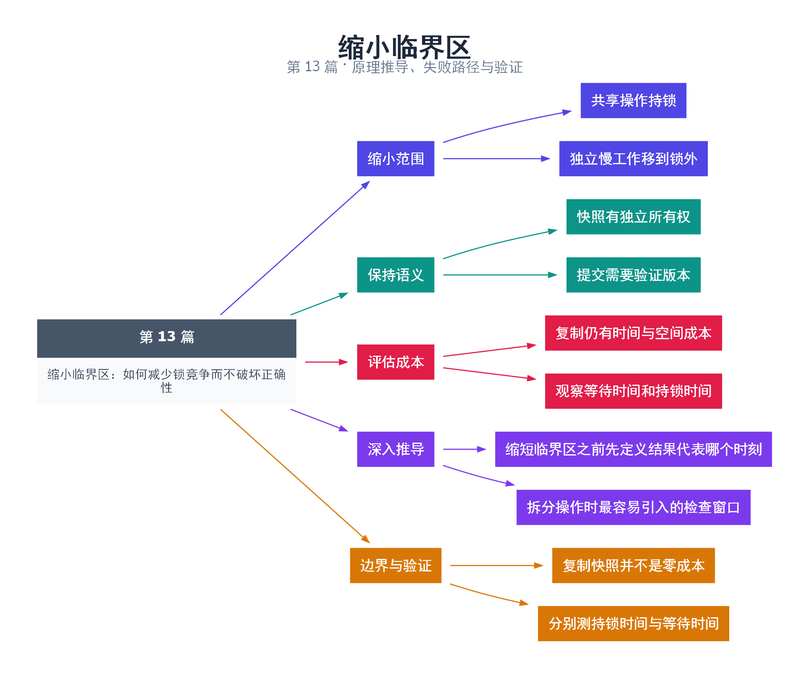

# 13｜缩小临界区：如何减少锁竞争而不破坏正确性

[返回总目录](README.md) · 最低标准：C++11

一句话总结：缩短临界区的前提是保留不变量的原子边界；先复制快照再慢处理，是常用且可验证的优化。

**本文目录**

- [1. 不要把会议室占着写报告](#section-1)
- [2. 不要拆开必须一起提交的操作](#section-2)
- [3. 成本模型](#section-3)
- [4. 验证如何做](#section-4)
- [5. 深入推导、反例与工程取舍](#section-5)
  - [5.1 缩短临界区之前先定义结果代表哪个时刻](#depth-1)
  - [5.2 拆分操作时最容易引入的检查窗口](#depth-2)
  - [5.3 复制快照并不是零成本](#depth-3)
  - [5.4 分别测持锁时间与等待时间](#depth-4)
- [6. 完整示例与复现](#section-6)
  - [6.1 如何判断运行结果](#section-6-1)
- [7. Q&A（常见问题与解答）](#section-7)
  - [7.1 Q：锁外使用指向容器元素的指针可以吗？](#section-7-1)
  - [7.2 Q：复制越多一定越快吗？](#section-7-2)
  - [7.3 Q：锁内调用用户回调有什么风险？](#section-7-3)
- [8. 引用与延伸阅读](#section-8)
- [9. 思维导图总结](#section-9)

---

<a id="section-1"></a>

## 1. 不要把会议室占着写报告

共享会议室只用于讨论需要所有人一致确认的事项，个人整理笔记可以离开后完成。锁也是如此：把序列化、格式化、网络发送等独立工作搬出去，能减少别人等待，但“看一眼数据就放锁”不等于之后仍可以任意访问原数据。

本例维护一组整数。增加元素需要独占访问，计算快照总和则先锁住容器并复制，随后解锁计算。复制后的 vector 拥有自己的元素，不会因原 vector 扩容而失效。这与解锁后继续持有原 vector 的迭代器有本质差别。

<a id="section-2"></a>

## 2. 不要拆开必须一起提交的操作

如果操作是“读取余额 → 计算新值 → 写回”，直接把计算移到锁外可能覆盖别人的更新。可以用版本号进行乐观检查：锁内取得数据与版本；锁外计算；重新加锁，确认版本未变后提交，否则重新计算。该方案需要限制重试成本，并保证计算没有不可回滚的外部副作用。

若只是生成展示报表，旧一点但内部一致的快照通常可接受；若是交易扣款，则过时结果不能直接提交。因此优化必须从一致性需求出发。

<a id="section-3"></a>

## 3. 成本模型

单把排他锁保护的临界区平均服务时间为 L，在持续竞争且忽略其他成本的简单模型下，临界区完成速率上限约为 1/L。这个上限是估算，不包含调度和队列效应。复制快照把计算移出锁，但复制本身 O(N) 仍在锁内，且额外占用 O(N) 内存；数据很大时可考虑不可变快照、分片或批处理。

| 方式 | 一致性 | 代价 |
|---|---|---|
| 全程持锁计算 | 计算期间数据不变 | 长时间阻塞其他线程 |
| 锁内复制再计算 | 得到某一时刻的快照 | 复制时间与内存 |
| 版本检查后提交 | 提交时验证未过时 | 冲突重试与设计复杂度 |

<a id="section-4"></a>

## 4. 验证如何做

测量锁等待时间和持锁时间，分清瓶颈是竞争还是计算。本例只演示结构，不声称优化幅度。测试还应验证快照内部一致性，不能只看“速度变快了”，忽略返回了指向已失效内存的引用。

<!-- depth:chapter -->
<a id="section-5"></a>

## 5. 深入推导、反例与工程取舍

<!-- depth:start -->
<a id="depth-1"></a>

### 5.1 缩短临界区之前先定义结果代表哪个时刻

把账本拿出来复印，再慢慢计算，可以减少别人等待账本的时间。本例在锁内复制 vector，锁外求和，得到的是复制期间受锁保护的一致快照。它不保证求和返回那一刻仍包含最新追加的数据；这是接口语义，而不是计算错误。

若业务要求“检查总额后立即扣款，且总额仍有效”，就不能只拿快照算完再无条件写回。正确性首先取决于是否允许陈旧快照；只有语义允许时，移出临界区的计算才是合法优化。

<a id="depth-2"></a>

### 5.2 拆分操作时最容易引入的检查窗口

假设锁内读出库存 10，锁外计算折扣订单，重新加锁后直接扣 8。期间另一个线程已经扣了 5，之前的检查失效。修复可以是在提交时重新检查库存，或者记录版本号，重新加锁后验证版本未变；验证失败就重算或返回冲突。

版本方案要求每个影响计算结果的写操作都更新版本，且必须考虑计数回绕和重试饥饿。它适合锁外计算很贵、冲突相对少的场景。如果几乎每次计算后版本都变化，重算成本可能超过一直持锁的方案。

<a id="depth-3"></a>

### 5.3 复制快照并不是零成本

本例锁内复制 N 个元素，时间和临时内存都是 O(N)，所以只是把后续计算移出，并未让临界区变为 O(1)。当计算也是一次简单求和时，复制可能比直接在锁内求和更贵。示例用于展示安全的拆分边界，不承诺所有负载下更快。

| 方案 | 锁内代价 | 适用前提 |
|---|---|---|
| 原地计算 | 随计算复杂度增长 | 数据小、计算短 |
| 复制快照 | O(N) 复制 | 后续计算昂贵、允许快照 |
| 交换整批数据 | 容器交换通常较短 | 消费者可以取得独占批次 |
| 不可变共享快照 | 取得共享所有权 | 更新方可承担复制和发布成本 |

<a id="depth-4"></a>

### 5.4 分别测持锁时间与等待时间

获取锁之前记 t0，获取后记 t1，释放前记 t2。t1−t0 是等待时间，t2−t1 近似持锁时间。计时本身会扰动短临界区，适合采样或分批统计；不要在锁里用控制台输出记录每次时间。

本例默认仅单线程调用 Samples，断言 5050 只验证快照结果。若要验证并发快照，可让生产者按 1、2、3…追加，消费者重复求和：每个观察值应对应某个完整前缀的和，且在只追加正数的前提下不下降。不要要求每次都等于最终总和；那违反快照契约。测试代码可以先计算全部允许的前缀和，再逐次检查观测是否属于集合。
<!-- depth:end -->

<a id="section-6"></a>

## 6. 完整示例与复现

源文件：[examples/13.cpp](examples/13.cpp)。在本系列目录运行以下命令；环境准备见 [实验环境](实验环境与验证.md)。

```bash
g++ -std=c++11 -O2 -Wall -Wextra -pedantic -pthread examples/13.cpp -o demo13
./demo13
```

```cpp
#include <cassert>
#include <iostream>
#include <mutex>
#include <numeric>
#include <vector>
class Samples {
    mutable std::mutex mutex_;
    std::vector<int> data_;
public:
    void append(int n) {
        std::lock_guard<std::mutex> lock(mutex_);
        data_.push_back(n);
    }
    long long snapshot_sum() const {
        std::vector<int> copy;
        {
            std::lock_guard<std::mutex> lock(mutex_);
            copy = data_;
        }
        return std::accumulate(copy.begin(),copy.end(),0LL);
    }
};
int main() {
    Samples s;
    for(int i=1;i<=100;++i) s.append(i);
    const auto result=s.snapshot_sum();
    assert(result==5050);
    std::cout << result << '\n';
}
```

<a id="section-6-1"></a>

### 6.1 如何判断运行结果

输出 `5050`。这验证快照求和结果，性能收益应在真实并发负载下另测。

<a id="section-7"></a>

## 7. Q&A（常见问题与解答）

<a id="section-7-1"></a>

### 7.1 Q：锁外使用指向容器元素的指针可以吗？

A：只有另有协议保证元素存活且不被冲突修改时才行。普通 vector 的扩容和删除足以使这种做法失效。

<a id="section-7-2"></a>

### 7.2 Q：复制越多一定越快吗？

A：不一定。复制也占带宽和分配时间，必须比较锁竞争收益与额外开销。

<a id="section-7-3"></a>

### 7.3 Q：锁内调用用户回调有什么风险？

A：回调耗时不可控，可能重新进入本对象或获取其他锁，扩大死锁和延迟风险。

<a id="section-8"></a>

## 8. 引用与延伸阅读

- [C++20 工作草案：线程支持库](https://timsong-cpp.github.io/cppwp/n4861/thread)

规范链接采用固定的 C++20 工作草案 N4861；对较早标准的差异以正文标注为准。示例和分析为本系列自编，规范用于核对接口契约。

<a id="section-9"></a>

## 9. 思维导图总结

```text
缩小临界区：如何减少锁竞争而不破坏正确性
├── 缩小范围
│   ├── 共享操作持锁
│   └── 独立慢工作移到锁外
├── 保持语义
│   ├── 快照有独立所有权
│   └── 提交需要验证版本
├── 评估成本
│   ├── 复制仍有时间与空间成本
│   └── 观察等待时间和持锁时间
├── 深入推导
│   ├── 缩短临界区之前先定义结果代表哪个时刻
│   └── 拆分操作时最容易引入的检查窗口
└── 边界与验证
    ├── 复制快照并不是零成本
    └── 分别测持锁时间与等待时间
```



[Graphviz 源文件](images/13.dot)
