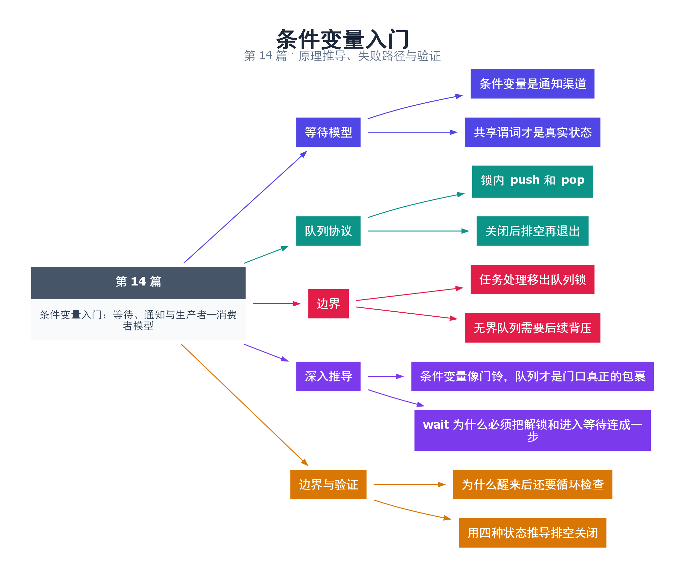

# 14｜条件变量入门：等待、通知与生产者—消费者模型

[返回总目录](README.md) · 最低标准：C++20

一句话总结：条件变量负责让线程等待和被唤醒，共享谓词负责决定是否真的可以继续。

**本文目录**

- [1. 门铃不保存包裹](#section-1)
- [2. 生产者—消费者状态机](#section-2)
- [3. 为什么修改谓词也必须遵守锁协议](#section-3)
- [4. 使用边界](#section-4)
- [5. 深入推导、反例与工程取舍](#section-5)
  - [5.1 条件变量像门铃，队列才是门口真正的包裹](#depth-1)
  - [5.2 wait 为什么必须把解锁和进入等待连成一步](#depth-2)
  - [5.3 为什么醒来后还要循环检查](#depth-3)
  - [5.4 用四种状态推导排空关闭](#depth-4)
- [6. 完整示例与复现](#section-6)
  - [6.1 如何判断运行结果](#section-6-1)
- [7. Q&A（常见问题与解答）](#section-7)
  - [7.1 Q：notify_one 会把任务交给某个线程吗？](#section-7-1)
  - [7.2 Q：可以不用谓词吗？](#section-7-2)
  - [7.3 Q：先通知后开始等待会怎样？](#section-7-3)
- [8. 引用与延伸阅读](#section-8)
- [9. 思维导图总结](#section-9)

---

<a id="section-1"></a>

## 1. 门铃不保存包裹

快递员把包裹放进柜子，再按门铃。门铃响不代表柜子里一定还有包裹，没听见门铃也不代表柜子为空。condition_variable 是门铃，队列和关闭标志才是事实。等待者必须在同一把互斥锁保护下检查这些事实。

正确等待写成 `cv.wait(lock, predicate)`。它先检查谓词，不满足时原子地释放关联互斥量并进入等待；被唤醒后重新获得锁，再检查谓词。谓词重检既处理虚假唤醒，也处理另一个消费者先把任务取走的情况。

<a id="section-2"></a>

## 2. 生产者—消费者状态机

示例使用无界队列传输 1 到 100。生产者锁内 push，锁外 notify_one；最后锁内置 closed=true，再 notify_all。消费者等待 `closed || !queue.empty()`，醒来若队列非空就继续取，只有“已关闭且为空”才结束。这是排空关闭：关闭不会丢弃已经接受的任务。

如果改成一看到 closed 就退出，会丢失积压任务；如果退出只看 empty，消费者可能在生产者尚未提交前结束。完整终止条件必须表达业务状态，而不是某一次临时观察。

<a id="section-3"></a>

## 3. 为什么修改谓词也必须遵守锁协议

通知本身不携带队列内容。把 push 放在锁外会造成容器数据竞争；把 closed 改成 atomic 后仍随意在锁外更新，也可能使条件检查和进入睡眠之间出现遗漏唤醒的窗口。最容易验证的方案是所有影响等待谓词的修改都在同一互斥量下完成。

本例 notify 在解锁后调用，减少被唤醒者马上又被锁阻塞的机会；在锁内通知通常也可以正确工作，选择要结合状态和对象寿命。通知之后仍不能立即销毁正在被线程使用的条件变量。

<a id="section-4"></a>

## 4. 使用边界

本例队列无界，仅适合演示基础协议；生产速度持续高于消费速度会占满内存。第 27 篇增加容量和背压，第 46 篇把协议用于日志。实际处理应在弹出后解锁执行，避免把整个任务处理过程串行化在队列锁内。

<!-- depth:chapter -->
<a id="section-5"></a>

## 5. 深入推导、反例与工程取舍

<!-- depth:start -->
<a id="depth-1"></a>

### 5.1 条件变量像门铃，队列才是门口真正的包裹

门铃响过不表示包裹还在，门铃没响也不表示门口没有包裹。condition_variable 通知等待线程“现在值得重新检查”，持久保存业务事实的是 queue 和 closed。谓词 `closed || !queue.empty()` 才决定能不能继续。

如果生产者先入队并通知，消费者稍后才开始等待，消费者在锁内看到队列非空，就根本不睡眠。通知本身没有被保存，但工作没有丢；因为队列保存了事实。这个区别正是条件变量能容忍早到通知的原因。

<a id="depth-2"></a>

### 5.2 wait 为什么必须把解锁和进入等待连成一步

如果消费者先解锁，再单独调用一个不具备原子衔接的睡眠操作，生产者可能在两步之间入队并通知；消费者随后睡下，再也没有人叫它。condition_variable::wait 在协议层面把解锁与阻塞衔接为原子步骤，醒来后还会重新获取锁。

前提是生产者改变谓词所依赖的状态时，也持有同一把 mutex。消费者持锁检查为空时，生产者无法偷偷把它改为非空；消费者进入 wait 释放锁后，生产者才能更新并通知。这里同步共享数据的基础是 mutex，notify 负责唤醒，不代替发布与保护。

<a id="depth-3"></a>

### 5.3 为什么醒来后还要循环检查

即使没有实现允许的虚假唤醒，也可能出现真实通知后条件又变假的情况：两个消费者被唤醒，一个先拿到锁取走唯一元素，另一个拿到锁时已经为空。如果只用 if 检查一次，第二个消费者会在空队列上取元素。

带谓词 wait 等价于持锁反复检查条件，不满足就继续等待。`queue.front()` 和 `queue.pop()` 必须在同一个持锁区间完成；若先解锁再 pop，其他消费者可改变队首。真正处理 item 则在解锁后进行，避免一条慢任务阻塞全部入队出队。

<a id="depth-4"></a>

### 5.4 用四种状态推导排空关闭

| closed | queue | 消费者动作 |
|---|---|---|
| false | 空 | 等待 |
| false | 非空 | 取走一个元素 |
| true | 非空 | 继续处理存量 |
| true | 空 | 退出 |

因此本例醒来后只判断 queue.empty() 就能退出：谓词已经保证此时空队列意味着 closed。若改成一见 closed 就退出，会丢弃已入队任务，变成取消而非排空语义。关闭时用 notify_all，让所有空闲消费者都有机会看到关闭状态。

默认示例的生产者在主线程中，正常路径关闭后 join。若 queue.push 因分配失败抛异常，而未设置 closed，消费者可能永远等待，jthread 析构也会等住。工程版应以作用域清理器保证异常路径同样置 closed 并通知；不要因为正常路径有 join 就宣称异常安全。第 46 篇把关闭流程封装进拥有者对象。
<!-- depth:end -->

<a id="section-6"></a>

## 6. 完整示例与复现

源文件：[examples/14.cpp](examples/14.cpp)。在本系列目录运行以下命令；环境准备见 [实验环境](实验环境与验证.md)。

```bash
g++ -std=c++20 -O2 -Wall -Wextra -pedantic -pthread examples/14.cpp -o demo14
./demo14
```

```cpp
#include <cassert>
#include <condition_variable>
#include <iostream>
#include <mutex>
#include <queue>
#include <thread>
int main() {
    std::mutex mutex;
    std::condition_variable cv;
    std::queue<int> queue;
    bool closed=false;
    int total=0;
    std::jthread consumer([&] {
        for (;;) {
            std::unique_lock<std::mutex> lock(mutex);
            cv.wait(lock,[&]{return closed || !queue.empty();});
            if(queue.empty()) break; // 谓词为真且为空，只能是已关闭。
            int item=queue.front(); queue.pop();
            lock.unlock();
            total+=item;
        }
    });
    for(int i=1;i<=100;++i) {
        { std::lock_guard<std::mutex> lock(mutex); queue.push(i); }
        cv.notify_one();
    }
    { std::lock_guard<std::mutex> lock(mutex); closed=true; }
    cv.notify_all();
    consumer.join();
    assert(total==5050);
    std::cout << total << '\n';
}
```

<a id="section-6-1"></a>

### 6.1 如何判断运行结果

输出 `5050`，即关闭后已提交的 100 个元素均被处理。

<a id="section-7"></a>

## 7. Q&A（常见问题与解答）

<a id="section-7-1"></a>

### 7.1 Q：notify_one 会把任务交给某个线程吗？

A：不会，通知只使等待者有机会重新检查共享状态，实际取任务仍由互斥下的队列操作决定。

<a id="section-7-2"></a>

### 7.2 Q：可以不用谓词吗？

A：无谓词 wait 必须由手写循环包围并检查状态，通常带谓词版本更清楚。

<a id="section-7-3"></a>

### 7.3 Q：先通知后开始等待会怎样？

A：通知本身不会保存；若共享状态已满足且在正确锁协议下检查，后来者会直接通过谓词，无需那次通知。

<a id="section-8"></a>

## 8. 引用与延伸阅读

- [深化实验与验证](深化实验与验证.md)：完整协议测试、运行命令、预期断言和未覆盖边界。

- [条件变量规范](https://timsong-cpp.github.io/cppwp/n4861/thread.condition)

规范链接采用固定的 C++20 工作草案 N4861；对较早标准的差异以正文标注为准。示例和分析为本系列自编，规范用于核对接口契约。

<a id="section-9"></a>

## 9. 思维导图总结

```text
条件变量入门：等待、通知与生产者—消费者模型
├── 等待模型
│   ├── 条件变量是通知渠道
│   └── 共享谓词才是真实状态
├── 队列协议
│   ├── 锁内 push 和 pop
│   └── 关闭后排空再退出
├── 边界
│   ├── 任务处理移出队列锁
│   └── 无界队列需要后续背压
├── 深入推导
│   ├── 条件变量像门铃，队列才是门口真正的包裹
│   └── wait 为什么必须把解锁和进入等待连成一步
└── 边界与验证
    ├── 为什么醒来后还要循环检查
    └── 用四种状态推导排空关闭
```



[Graphviz 源文件](images/14.dot)
