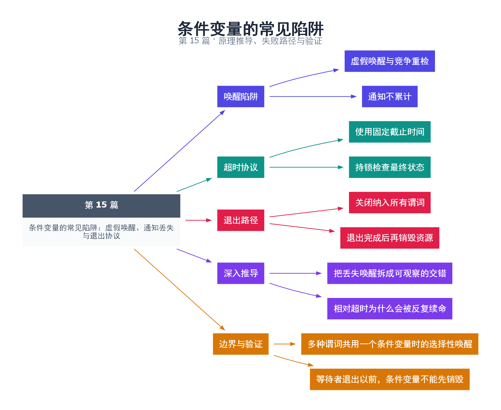

# 15｜条件变量的常见陷阱：虚假唤醒、通知丢失与退出协议

[返回总目录](README.md) · 最低标准：C++11

一句话总结：可靠等待依赖谓词、统一互斥协议和明确的截止时间；通知次数不能当作任务数量。

**本文目录**

- [1. 被叫醒不等于轮到你](#section-1)
- [2. 相对超时为何会被不断延长](#section-2)
- [3. 示例的两个确定性路径](#section-3)
- [4. 关闭必须唤醒所有需要退出的人](#section-4)
- [5. 深入推导、反例与工程取舍](#section-5)
  - [5.1 把丢失唤醒拆成可观察的交错](#depth-1)
  - [5.2 相对超时为什么会被反复续命](#depth-2)
  - [5.3 多种谓词共用一个条件变量时的选择性唤醒](#depth-3)
  - [5.4 等待者退出以前，条件变量不能先销毁](#depth-4)
- [6. 完整示例与复现](#section-6)
  - [6.1 如何判断运行结果](#section-6-1)
- [7. Q&A（常见问题与解答）](#section-7)
  - [7.1 Q：虚假唤醒可以关闭吗？](#section-7-1)
  - [7.2 Q：notify_all 总比 notify_one 安全吗？](#section-7-2)
  - [7.3 Q：已用 atomic 标志为何仍会漏唤醒？](#section-7-3)
- [8. 引用与延伸阅读](#section-8)
- [9. 思维导图总结](#section-9)

---

<a id="section-1"></a>

## 1. 被叫醒不等于轮到你

候诊室广播后，某个病人可能发现自己的号码还没到，或者别人已先进入诊室。条件变量允许虚假唤醒；即使没有虚假唤醒，多个消费者竞争也会让醒来后的状态不再满足。应把唤醒理解为“请重新检查”，而不是“条件已保证成立”。

通知不排队。错误协议常表现为：消费者检查状态为假，生产者修改并通知，消费者才进入 wait，于是再也没有新通知。用同一互斥量保护检查和修改，并借助 wait 的原子解锁等待动作，可以消除这个窗口。

<a id="section-2"></a>

## 2. 相对超时为何会被不断延长

如果在循环中每次都 `wait_for(lock, 100ms)`，每次无效唤醒都重新获得完整 100ms，总等待可能远超预算。解决办法是先计算一次 steady_clock 截止时间，再用 wait_until；或者使用带谓词的 wait_for，由其按整体等待语义处理重复唤醒。

返回 timeout 也不意味着你可以在锁外断言状态仍为假。必须在持锁状态下读取最终谓词，并按协议处理。steady_clock 适合持续时间与截止预算，因为它不受系统墙上时钟校准的同类影响。

<a id="section-3"></a>

## 3. 示例的两个确定性路径

第一个等待使用已经过去的截止时间和假谓词，因此无需依赖调度速度就会超时。第二个等待在 ready 已经设为真以后开始，虽然之前的 notify 没有保存，谓词仍让它立即完成。这样测试的不是某个毫秒级调度偶然性，而是状态协议。

<a id="section-4"></a>

## 4. 关闭必须唤醒所有需要退出的人

队列关闭时应修改关闭标志并通知全部可能等待的消费者和生产者。如果消费者等“非空”、生产者等“非满”，双方等待谓词都应包含关闭状态，否则部分线程可能永远睡在队列条件上。只有所有线程退出后才能销毁 mutex 和 condition_variable。

排查清单：列出所有等待谓词；找出谁能使谓词变真；确认每个状态修改都遵守锁协议；确认对应通知覆盖等待者；最后验证异常和关闭也能触发退出。

<!-- depth:chapter -->
<a id="section-5"></a>

## 5. 深入推导、反例与工程取舍

<!-- depth:start -->
<a id="depth-1"></a>

### 5.1 把丢失唤醒拆成可观察的交错

最危险的窗口不是 notify 发生在 wait 前，而是“检查状态”与“真正等待”之间缺乏协议。错误设计让消费者检查 ready=false 后释放锁，生产者改 ready=true 并通知，消费者再无条件等待。此时状态为真，线程却睡着了。

正确协议让谓词检查发生在 wait 持有的锁下，并由 wait 原子地释放锁进入等待。生产者修改 ready 也使用该锁。即使 ready 本身改成 atomic，如果通知与等待之间没有合适的握手，也不能单凭“没有数据竞争”就保证不会漏唤醒。

<a id="depth-2"></a>

### 5.2 相对超时为什么会被反复续命

假设总等待预算是 100 ms。若循环中每次都调用 wait_for(100ms)，每次在第 90 ms 收到通知但条件仍不满足，总等待时间就可能无限延长。预算应在循环外转成一次绝对截止点，用 steady_clock 计算，再以同一个 deadline 等待。

带谓词的 wait_for 重载内部按一次调用的固定截止时间处理重复唤醒；问题常出现在调用者自己循环重启整段相对等待。超时也不是硬实时保证：线程重新被调度和重新取得 mutex 可能晚于截止点。返回时必须根据持锁后的最终谓词决定结果，不能仅凭“被叫醒过”认定条件满足。

<a id="depth-3"></a>

### 5.3 多种谓词共用一个条件变量时的选择性唤醒

设生产者等“队列未满”，消费者等“队列非空”，却全用一个 cv。某次 notify_one 可能叫醒了条件不满足的那一类线程，它重新睡下，而真正能推进的线程没有醒。复杂协议里这会导致停滞。

常见修复是分成 not_empty 与 not_full，状态转移后通知对应的一组等待者；关闭和失败则唤醒所有相关等待者。notify_all 较易保证正确性，但可能制造很多无效抢锁，因此应先证明通知覆盖，再根据实测减少唤醒。

<a id="depth-4"></a>

### 5.4 等待者退出以前，条件变量不能先销毁

关闭一个等待系统需要三个阶段：在锁内发布关闭状态；通知所有可能睡眠的参与者；等待它们离开等待和访问区间，然后销毁 cv、mutex 和数据。仅通知一次就销毁对象并不安全，线程可能仍在尝试重新加锁。

本例的“早到通知安全”使用已置真的谓词验证消费者不会睡眠；“超时”使用已经过去的 steady_clock 截止点，避免把测试依赖在脆弱的几毫秒调度上。它不是多消费者压力测试。深化实验可使用 `examples/deep_protocols.cpp` 中的有界队列，验证关闭后消费者排空、阻塞生产者被释放以及异常输出通道的边界。
<!-- depth:end -->

<a id="section-6"></a>

## 6. 完整示例与复现

源文件：[examples/15.cpp](examples/15.cpp)。在本系列目录运行以下命令；环境准备见 [实验环境](实验环境与验证.md)。

```bash
g++ -std=c++11 -O2 -Wall -Wextra -pedantic -pthread examples/15.cpp -o demo15
./demo15
```

```cpp
#include <cassert>
#include <chrono>
#include <condition_variable>
#include <iostream>
#include <mutex>
int main() {
    std::mutex mutex;
    std::condition_variable cv;
    bool ready=false;
    {
        std::unique_lock<std::mutex> lock(mutex);
        const auto past=std::chrono::steady_clock::now()-std::chrono::seconds(1);
        bool ok=cv.wait_until(lock,past,[&]{return ready;});
        assert(!ok);
    }
    { std::lock_guard<std::mutex> lock(mutex); ready=true; }
    cv.notify_all();
    std::unique_lock<std::mutex> lock(mutex);
    cv.wait(lock,[&]{return ready;});
    std::cout << "timeout checked; early notification safe\n";
}
```

<a id="section-6-1"></a>

### 6.1 如何判断运行结果

输出 `timeout checked; early notification safe`，不依赖固定调度延迟。

<a id="section-7"></a>

## 7. Q&A（常见问题与解答）

<a id="section-7-1"></a>

### 7.1 Q：虚假唤醒可以关闭吗？

A：没有可移植的关闭选项，代码必须通过谓词循环正确处理它。

<a id="section-7-2"></a>

### 7.2 Q：notify_all 总比 notify_one 安全吗？

A：它不能修复错误谓词或数据竞争，还可能造成惊群；关闭等所有等待者需重新判断的事件通常用 notify_all。

<a id="section-7-3"></a>

### 7.3 Q：已用 atomic 标志为何仍会漏唤醒？

A：原子性不保证条件检查与进入条件变量等待构成一个协议；必须与等待使用的互斥或另一套可靠机制配合。

<a id="section-8"></a>

## 8. 引用与延伸阅读

- [深化实验与验证](深化实验与验证.md)：完整协议测试、运行命令、预期断言和未覆盖边界。

- [C++20 工作草案：线程支持库](https://timsong-cpp.github.io/cppwp/n4861/thread)

规范链接采用固定的 C++20 工作草案 N4861；对较早标准的差异以正文标注为准。示例和分析为本系列自编，规范用于核对接口契约。

<a id="section-9"></a>

## 9. 思维导图总结

```text
条件变量的常见陷阱：虚假唤醒、通知丢失与退出协议
├── 唤醒陷阱
│   ├── 虚假唤醒与竞争重检
│   └── 通知不累计
├── 超时协议
│   ├── 使用固定截止时间
│   └── 持锁检查最终状态
├── 退出路径
│   ├── 关闭纳入所有谓词
│   └── 退出完成后再销毁资源
├── 深入推导
│   ├── 把丢失唤醒拆成可观察的交错
│   └── 相对超时为什么会被反复续命
└── 边界与验证
    ├── 多种谓词共用一个条件变量时的选择性唤醒
    └── 等待者退出以前，条件变量不能先销毁
```



[Graphviz 源文件](images/15.dot)
