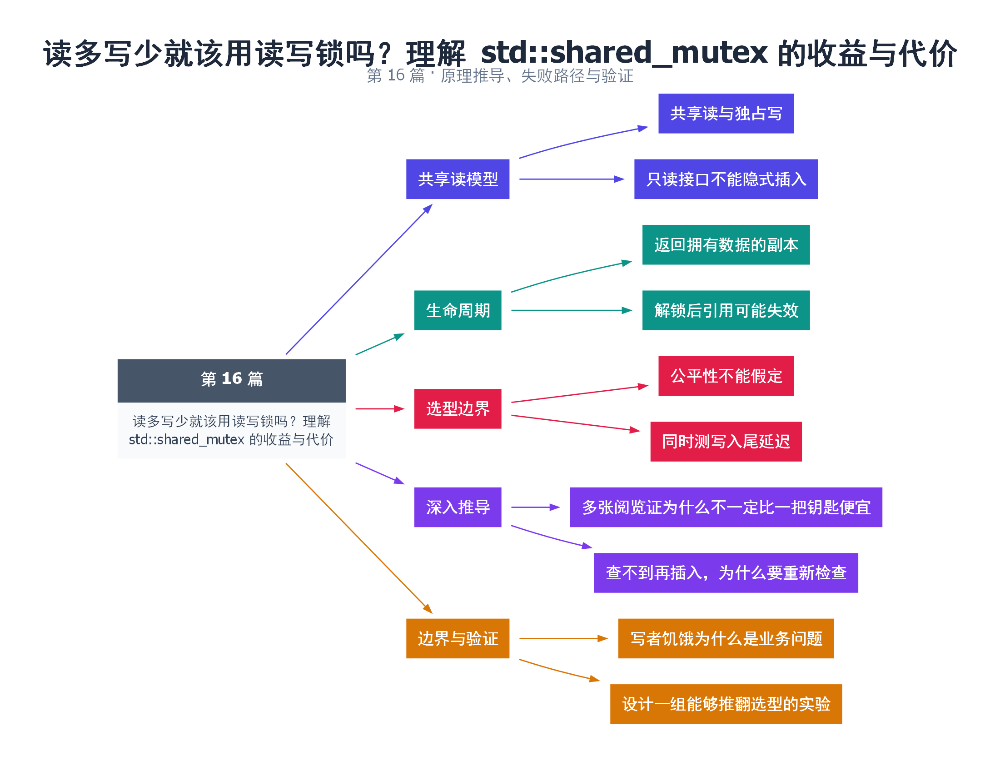

# 16｜读多写少就该用读写锁吗？理解 std::shared_mutex 的收益与代价

[返回总目录](README.md) · 最低标准：C++17

一句话总结：读写锁允许多个只读临界区并行，但只有当读操作足够重、写入适度且实现合适时，才可能优于普通 mutex。

**本文目录**

- [1. 图书馆的多人阅览与独占整理](#section-1)
- [2. 本例的缓存查询](#section-2)
- [3. 不能直接把共享锁升级为独占锁](#section-3)
- [4. 深入推导、反例与工程取舍](#section-4)
  - [4.1 多张阅览证为什么不一定比一把钥匙便宜](#depth-1)
  - [4.2 查不到再插入，为什么要重新检查](#depth-2)
  - [4.3 写者饥饿为什么是业务问题](#depth-3)
  - [4.4 设计一组能够推翻选型的实验](#depth-4)
- [5. 完整示例与复现](#section-5)
  - [5.1 如何判断运行结果](#section-5-1)
- [6. Q&A（常见问题与解答）](#section-6)
  - [6.1 Q：读写比例 99:1 就应该选 shared_mutex 吗？](#section-6-1)
  - [6.2 Q：多个 shared_lock 下能改不同键吗？](#section-6-2)
  - [6.3 Q：如何做读取后按需插入？](#section-6-3)
- [7. 引用与延伸阅读](#section-7)
- [8. 思维导图总结](#section-8)

---

<a id="section-1"></a>

## 1. 图书馆的多人阅览与独占整理

读者可以同时看一本公开索引，管理员修改索引时则需要让所有读者暂时离开。shared_mutex 的共享模式允许多个读者，独占模式排斥其他读者和写者。前提是“读者”确实不修改受保护数据，包括缓存更新、惰性初始化和隐式插入。

例如 map 的 `operator[]` 可能插入元素，不能当作共享锁下的只读查询；应使用 find、at 等合适接口。函数声明为 const 也不能自动证明内部不修改共享状态，mutable 成员和指针指向对象都需要检查。

<a id="section-2"></a>

## 2. 本例的缓存查询

缓存用 shared_lock 保护 find，用 unique_lock 保护 insert_or_assign。get 返回 optional<string> 的副本，保证返回值不依赖已经释放的读锁。若返回原容器中元素的引用，调用者稍后访问时可能遇到替换或删除，即使查找时上了锁也不安全。

一次读锁获取和释放仍需要维护共享状态。极短的读临界区、写较频繁、核心较少或竞争激烈时，额外 bookkeeping 可能超过并行收益。标准没有规定读者优先或写者优先，不能依赖某种公平性来保证写延迟。

<a id="section-3"></a>

## 3. 不能直接把共享锁升级为独占锁

持有 shared_lock 后再尝试获取同一 shared_mutex 的独占锁不是标准升级协议。常见做法是释放读锁、获取写锁、重新检查条件，因为这段间隙可能已由其他线程完成更新。若不愿承受重检复杂度，可直接用独占锁处理整个操作。

| 方案 | 适用条件 | 主要代价 |
|---|---|---|
| mutex | 短临界区、写入不稀少 | 所有读者串行 |
| shared_mutex | 重读操作、多个真实只读者 | 读写协调和公平性不确定 |
| 不可变快照 | 写少、可复制发布 | 更新时复制与旧版本回收 |

性能测试应同时报告读吞吐、写吞吐和写入尾延迟。只测大量读操作的平均耗时，容易掩盖写者长时间饥饿的服务风险。

<!-- depth:chapter -->
<a id="section-4"></a>

## 4. 深入推导、反例与工程取舍

<!-- depth:start -->
<a id="depth-1"></a>

### 4.1 多张阅览证为什么不一定比一把钥匙便宜

shared_mutex 允许多个读者同时持有共享所有权，写者需要独占。但登记和注销每位读者本身也需要协调；若读操作只是读取一个很小的字段，管理共享状态的开销可能占主要部分。读多写少只是候选条件，不能单独证明性能更好。

本例 get 查找并复制 string，复制完成才释放 shared_lock；返回的是独立值。如果返回容器内部 string&，调用者可能在锁已释放后与 put 并发访问它。读锁保护的是持锁期间，不能附着在引用上自动跟着返回。

<a id="depth-2"></a>

### 4.2 查不到再插入，为什么要重新检查

常见缓存逻辑是共享锁查询未命中，释放共享锁，获取独占锁，再插入。在两次加锁之间，另一个线程可能已经插入同一 key，因此独占锁内必须再次查询。否则既可能覆盖新值，也可能重复完成昂贵的初始化。

std::shared_mutex 不提供通用的原子共享转独占升级操作；持有共享锁时直接申请同一对象的独占锁不符合预期使用协议，不能用它实现“无缝升级”。若希望锁外加载资源再提交，可以容许重复加载并只接纳一个结果，或引入每 key 的 in-flight 状态，让等待者共享同一个 future。

<a id="depth-3"></a>

### 4.3 写者饥饿为什么是业务问题

标准接口没有承诺统一的读优先、写优先或 FIFO 公平策略。具体实现中持续到来的读者可能影响写者等待；换操作系统或标准库后，读写延迟分布也可能改变。如果配置更新必须在 50 ms 内生效，只测平均读取吞吐无法证明需求满足。

| 设计 | 优点 | 主要代价 |
|---|---|---|
| 普通 mutex | 协议简单、易审查 | 读操作相互排队 |
| shared_mutex | 较长读操作可重叠 | 读者管理及写者尾延迟 |
| 分片锁 | 不同 key 可独立访问 | 跨分片操作更复杂 |
| 不可变快照 | 读方取得快照后少协调 | 更新复制成本与旧版本内存 |

<a id="depth-4"></a>

### 4.4 设计一组能够推翻选型的实验

分别测试 100% 读、99% 读、90% 读，并变化读取内容大小和线程数；保持数据规模与输入分布相同。记录总吞吐，同时单独记录读和写的 p50、p99 等待时间。若数据已全部命中缓存，结果不能推广到需要磁盘或网络加载的场景。

默认示例只做顺序 put/get，并未证明共享锁在本机更快，也未覆盖线程交错。并发验证可让写者交替发布两个完整字符串，读者取得的每个快照只能等于其中之一；同时检查不存在缺失结尾或混合内容。若改用引用返回，这个验证目标就需要把锁生命周期一并暴露给调用者。
<!-- depth:end -->

<a id="section-5"></a>

## 5. 完整示例与复现

源文件：[examples/16.cpp](examples/16.cpp)。在本系列目录运行以下命令；环境准备见 [实验环境](实验环境与验证.md)。

```bash
g++ -std=c++17 -O2 -Wall -Wextra -pedantic -pthread examples/16.cpp -o demo16
./demo16
```

```cpp
#include <cassert>
#include <iostream>
#include <map>
#include <mutex>
#include <optional>
#include <shared_mutex>
#include <string>
class Cache {
    mutable std::shared_mutex mutex_;
    std::map<int,std::string> data_;
public:
    void put(int key,std::string value) {
        std::unique_lock<std::shared_mutex> lock(mutex_);
        data_.insert_or_assign(key,std::move(value));
    }
    std::optional<std::string> get(int key) const {
        std::shared_lock<std::shared_mutex> lock(mutex_);
        auto it=data_.find(key);
        if(it==data_.end()) return std::nullopt;
        return it->second;
    }
};
int main() {
    Cache cache; cache.put(1,"config");
    auto value=cache.get(1);
    assert(value && *value=="config" && !cache.get(2));
    std::cout << *value << '\n';
}
```

<a id="section-5-1"></a>

### 5.1 如何判断运行结果

输出 `config`，缺失键返回空 optional。示例验证接口语义，不宣称读写锁性能优势。

<a id="section-6"></a>

## 6. Q&A（常见问题与解答）

<a id="section-6-1"></a>

### 6.1 Q：读写比例 99:1 就应该选 shared_mutex 吗？

A：还要看读操作长度、竞争和写延迟要求，比例本身不能决定收益。

<a id="section-6-2"></a>

### 6.2 Q：多个 shared_lock 下能改不同键吗？

A：这里不允许，普通容器结构和接口并未因此获得任意并发修改保证；共享锁应只用于真正只读访问。

<a id="section-6-3"></a>

### 6.3 Q：如何做读取后按需插入？

A：释放读锁，获取独占锁，再次查找并决定是否插入，或者从开始就使用独占锁。

<a id="section-7"></a>

## 7. 引用与延伸阅读

- [shared_mutex 规范](https://timsong-cpp.github.io/cppwp/n4861/thread.sharedmutex.requirements)

规范链接采用固定的 C++20 工作草案 N4861；对较早标准的差异以正文标注为准。示例和分析为本系列自编，规范用于核对接口契约。

<a id="section-8"></a>

## 8. 思维导图总结

```text
读多写少就该用读写锁吗？理解 std::shared_mutex 的收益与代价
├── 共享读模型
│   ├── 共享读与独占写
│   └── 只读接口不能隐式插入
├── 生命周期
│   ├── 返回拥有数据的副本
│   └── 解锁后引用可能失效
├── 选型边界
│   ├── 公平性不能假定
│   └── 同时测写入尾延迟
├── 深入推导
│   ├── 多张阅览证为什么不一定比一把钥匙便宜
│   └── 查不到再插入，为什么要重新检查
└── 边界与验证
    ├── 写者饥饿为什么是业务问题
    └── 设计一组能够推翻选型的实验
```



[Graphviz 源文件](images/16.dot)
