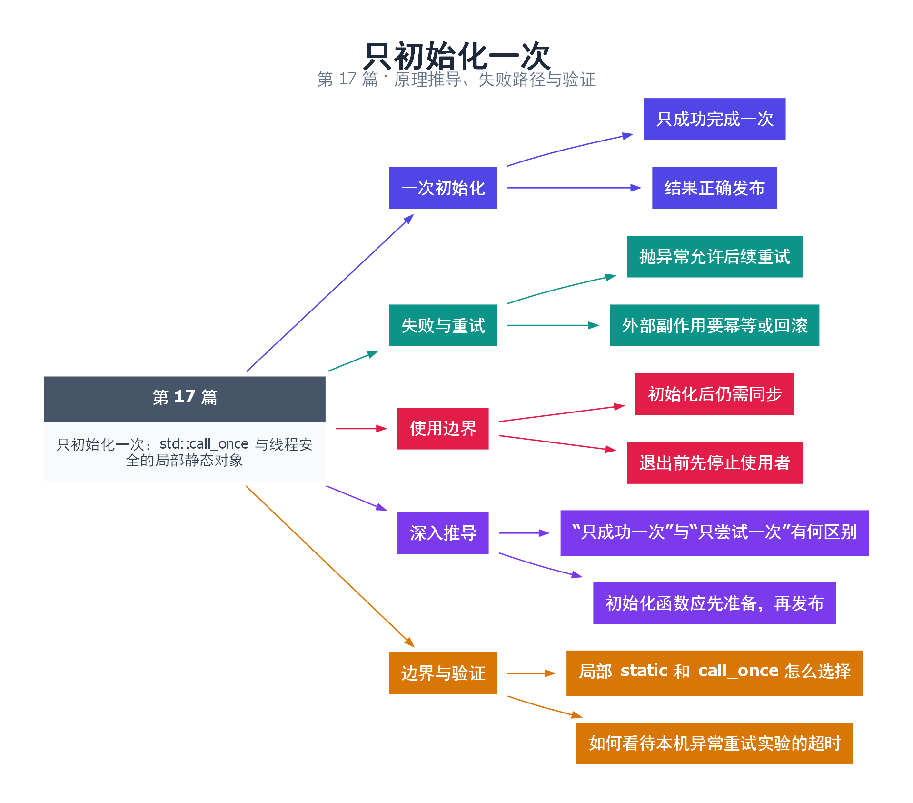

# 17｜只初始化一次：std::call_once 与线程安全的局部静态对象

[返回总目录](README.md) · 最低标准：C++11

一句话总结：一次初始化需要“恰有一次成功完成”和“所有使用者看到完整结果”，局部静态对象与 call_once 都能表达这类协议。

**本文目录**

- [1. 开店前只需挂一次招牌](#section-1)
- [2. call_once 适合拆分初始化过程](#section-2)
- [3. 失败会留下什么](#section-3)
- [4. 深入推导、反例与工程取舍](#section-4)
  - [4.1 “只成功一次”与“只尝试一次”有何区别](#depth-1)
  - [4.2 初始化函数应先准备，再发布](#depth-2)
  - [4.3 局部 static 和 call_once 怎么选择](#depth-3)
  - [4.4 如何看待本机异常重试实验的超时](#depth-4)
- [5. 完整示例与复现](#section-5)
  - [5.1 如何判断运行结果](#section-5-1)
- [6. Q&A（常见问题与解答）](#section-6)
  - [6.1 Q：once_flag 可以重置吗？](#section-6-1)
  - [6.2 Q：初始化抛异常后其他调用会自动失败吗？](#section-6-2)
  - [6.3 Q：线程安全的 static 意味着单例所有方法安全？](#section-6-3)
- [7. 引用与延伸阅读](#section-7)
- [8. 思维导图总结](#section-8)

---

<a id="section-1"></a>

## 1. 开店前只需挂一次招牌

多个员工同时到店，不能每个人都挂一遍招牌，也不能有人看到招牌挂了一半就开始营业。初始化包含选出执行者与发布初始化结果两个问题。普通 `bool initialized` 加一次 if 检查，既可能数据竞争，也不能防止重复执行。

C++11 起，函数局部静态对象的初始化支持并发调用：其他进入初始化点的线程等待成功完成。若初始化抛出异常，本次未完成，后续进入可以重试。递归重新进入同一尚未完成初始化的局部静态对象是错误模式，不应把它当成递归锁。

<a id="section-2"></a>

## 2. call_once 适合拆分初始化过程

once_flag 配合 call_once，可以把一次性动作放到已有对象或多个步骤中。使用同一 flag 的调用中，成功返回的那次执行发布结果，其他调用在返回后可观察初始化写入；异常执行不会把 flag 标记为成功，后续可以重试。

本例默认验证成功初始化只执行一次，attempts 最终为 1；使用 `./demo17 --retry` 可启用第一次抛异常、第二次成功的规范实验，预期 attempts 为 2。这个计数在本例串行驱动，因此不需要 atomic；实际并发调用中的业务状态仍必须由一次初始化协议保护，不能在外部无序访问中间状态。

实际验证中，本机 MSYS2 UCRT64 GCC 16.1.0 的异常重试路径在 30 秒限制内未结束，默认成功路径正常。这里如实保留环境差异，不把超时解释成标准允许的行为，也不宣称重试路径已验证通过。读者可在目标环境用进程超时运行可选实验，并记录具体标准库和线程运行库版本。

<a id="section-3"></a>

## 3. 失败会留下什么

call_once 不自动回滚初始化函数的外部副作用。如果先注册回调、再分配资源，而分配失败，下一次重试可能重复注册。应在局部对象里完成可失败的准备，成功后再提交状态；无法回滚的动作要设计幂等性。

| 方式 | 适用场景 | 注意点 |
|---|---|---|
| 局部 static | 一个对象的惰性构造 | 析构时序、递归初始化 |
| call_once | 一次性初始化多个已有资源 | 失败后的残留副作用 |
| 手写双重检查 | 特殊发布需求 | 原子与寿命推导复杂 |

初始化线程安全不代表初始化后的可变使用也安全。单例内部的计数、缓存和连接仍然可能需要锁。程序退出时也要先停止工作线程，再销毁它们使用的静态资源。

<!-- depth:chapter -->
<a id="section-4"></a>

## 4. 深入推导、反例与工程取舍

<!-- depth:start -->
<a id="depth-1"></a>

### 4.1 “只成功一次”与“只尝试一次”有何区别

初始化像为工厂开机：失败尝试不能被登记成正式完成。call_once 只有在一次活动调用正常返回后才把该 once_flag 关联的初始化视为成功；抛异常的尝试会把异常交还该调用者，其他调用仍有机会再次尝试。

等待成功初始化的被动调用返回时，能够观察成功初始化产生的结果。这同时解决竞争执行和发布可见性。手写普通 bool initialized 既不能安全协调并发写，也不能表达“进行中、失败、成功”这些状态。

<a id="depth-2"></a>

### 4.2 初始化函数应先准备，再发布

若初始化函数先向全局 vector 推入一半数据再抛异常，下次重试不会自动撤销已经推入的元素。call_once 负责调用协议，不负责事务回滚。因此可在局部临时对象中完成全部准备，只有成功后才以合适的提交操作替换共享状态。

本例先构造 prepared，再赋给 data。更复杂对象要检查提交本身是否可能抛异常；如果提交由多个字段组成，应保持失败后仍能重试的不变量。向外部服务注册、创建文件等副作用还要考虑重复执行是否幂等，不能把“最多成功一次”误当成“外部请求只发一次”。

<a id="depth-3"></a>

### 4.3 局部 static 和 call_once 怎么选择

| 需求 | 更自然的工具 | 原因 |
|---|---|---|
| 函数内构造一个长期对象 | 局部 static | 初始化和生命周期集中 |
| 多个已有对象需要共同初始化 | call_once | 可用函数组织初始化流程 |
| 配置反复重载 | mutex/快照发布 | once_flag 不是可复位状态机 |

局部 static 动态初始化失败时也允许后续进入重试；但初始化期间递归重新进入同一声明是危险边界，不能作为可重入工厂使用。成功初始化的线程安全不等于随后对象的所有成员操作都线程安全，也不解决进程退出时其他线程仍访问已析构单例的问题。

<a id="depth-4"></a>

### 4.4 如何看待本机异常重试实验的超时

默认路径只验证一次成功初始化以及后续调用不重复执行。`--retry` 才覆盖首轮抛异常、第二轮成功的路径；现有报告记录它在本机工具链超时，所以不能把默认通过写成重试也通过，更不能把超时归纳成语言不允许重试。

复现时对程序设置外部超时，保留编译器、标准库和运行库版本，取得阻塞线程的堆栈，并在另一独立工具链做最小程序对照。可能原因需要证据区分，不能只凭一次挂起断言标准库缺陷。若业务必须依赖异常重试，应把该路径列为目标平台的发布前检查项。
<!-- depth:end -->

<a id="section-5"></a>

## 5. 完整示例与复现

源文件：[examples/17.cpp](examples/17.cpp)。在本系列目录运行以下命令；环境准备见 [实验环境](实验环境与验证.md)。

```bash
g++ -std=c++11 -O2 -Wall -Wextra -pedantic -pthread examples/17.cpp -o demo17
./demo17
```

```cpp
#include <cassert>
#include <iostream>
#include <mutex>
#include <stdexcept>
#include <string>
const std::string& label() {
    static const std::string value="ready";
    return value;
}
int main(int argc,char** argv) {
    std::once_flag flag;
    const bool test_retry=argc>1 && std::string(argv[1])=="--retry";
    int attempts=0;
    std::string data;
    auto initialize=[&] {
        ++attempts;
        if(test_retry && attempts==1) throw std::runtime_error("retry");
        std::string prepared="complete";
        data=std::move(prepared);
    };
    try { std::call_once(flag,initialize); }
    catch(const std::runtime_error&) {}
    std::call_once(flag,initialize);
    std::call_once(flag,initialize);
    assert(attempts==(test_retry?2:1) && data=="complete");
    std::cout << label() << " attempts=" << attempts << '\n';
}
```

<a id="section-5-1"></a>

### 5.1 如何判断运行结果

默认输出 `ready attempts=1`。可选 `--retry` 按规范预期输出 `ready attempts=2`，但本机该可选路径超时，详见正文与验证报告。

<a id="section-6"></a>

## 6. Q&A（常见问题与解答）

<a id="section-6-1"></a>

### 6.1 Q：once_flag 可以重置吗？

A：没有普通 reset 接口，它表达一个生命周期中的一次成功初始化；重复重载配置需要另外的状态协议。

<a id="section-6-2"></a>

### 6.2 Q：初始化抛异常后其他调用会自动失败吗？

A：不必然，其他调用可以继续尝试初始化，直到某次成功或它自己的调用遇到异常。

<a id="section-6-3"></a>

### 6.3 Q：线程安全的 static 意味着单例所有方法安全？

A：不意味着，它只保证初始化协议，后续可变操作仍需同步。

<a id="section-7"></a>

## 7. 引用与延伸阅读

- [call_once 规范](https://timsong-cpp.github.io/cppwp/n4861/thread.once)
- [局部静态初始化](https://timsong-cpp.github.io/cppwp/n4861/stmt.dcl)

规范链接采用固定的 C++20 工作草案 N4861；对较早标准的差异以正文标注为准。示例和分析为本系列自编，规范用于核对接口契约。

<a id="section-8"></a>

## 8. 思维导图总结

```text
只初始化一次：std::call_once 与线程安全的局部静态对象
├── 一次初始化
│   ├── 只成功完成一次
│   └── 结果正确发布
├── 失败与重试
│   ├── 抛异常允许后续重试
│   └── 外部副作用要幂等或回滚
├── 使用边界
│   ├── 初始化后仍需同步
│   └── 退出前先停止使用者
├── 深入推导
│   ├── “只成功一次”与“只尝试一次”有何区别
│   └── 初始化函数应先准备，再发布
└── 边界与验证
    ├── 局部 static 和 call_once 怎么选择
    └── 如何看待本机异常重试实验的超时
```



[Graphviz 源文件](images/17.dot)
