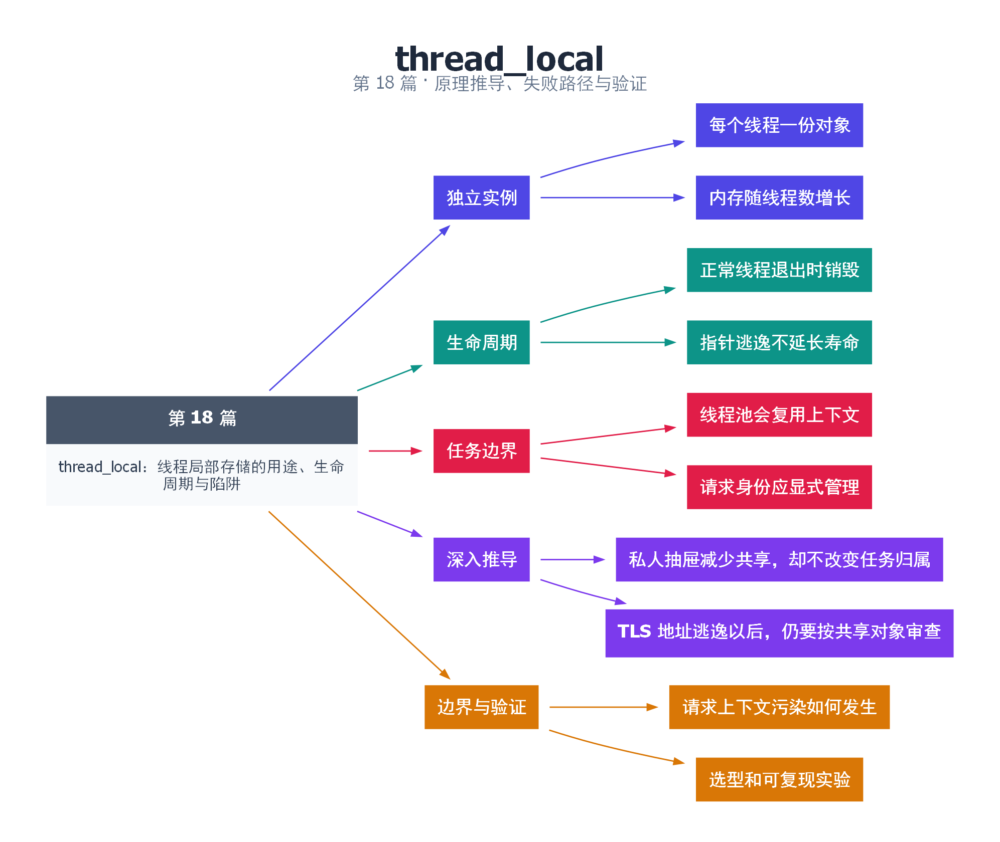

# 18｜thread_local：线程局部存储的用途、生命周期与陷阱

[返回总目录](README.md) · 最低标准：C++20

一句话总结：thread_local 为每个线程提供独立实例，适合线程级缓存和上下文，但在线程池里不等于任务级变量。

**本文目录**

- [1. 每位员工自己的工具抽屉](#section-1)
- [2. 初始化与销毁](#section-2)
- [3. 线程池中的上下文污染](#section-3)
- [4. 深入推导、反例与工程取舍](#section-4)
  - [4.1 私人抽屉减少共享，却不改变任务归属](#depth-1)
  - [4.2 TLS 地址逃逸以后，仍要按共享对象审查](#depth-2)
  - [4.3 请求上下文污染如何发生](#depth-3)
  - [4.4 选型和可复现实验](#depth-4)
- [5. 完整示例与复现](#section-5)
  - [5.1 如何判断运行结果](#section-5-1)
- [6. Q&A（常见问题与解答）](#section-6)
  - [6.1 Q：thread_local 变量永远不需要锁吗？](#section-6-1)
  - [6.2 Q：能保存每个请求的鉴权信息吗？](#section-6-2)
  - [6.3 Q：线程局部计数怎么汇总？](#section-6-3)
- [7. 引用与延伸阅读](#section-7)
- [8. 思维导图总结](#section-8)

---

<a id="section-1"></a>

## 1. 每位员工自己的工具抽屉

普通全局变量像公共抽屉，所有线程看到同一个对象；thread_local 像每个人自己的抽屉，同名变量在不同线程对应不同实例。这样可以避免某些共享写入，但内存开销也按线程数增长。

示例让两个线程分别累加本线程的 counter。每个线程从 0 开始，各得到 3；主线程有自己的实例，只调用一次后为 1。两个工作线程把各自结果写入不同变量，主线程 join 后再检查，这些结果变量的同步仍来自 join，而不是 thread_local。

<a id="section-2"></a>

## 2. 初始化与销毁

带构造函数的线程局部对象有自身初始化规则，正常线程退出时已初始化对象会被销毁。实现可能在需要使用时才初始化，因此不要依赖其他线程一定已经构造了它们自己的对象。异常终止或强制结束进程也不能指望完成普通析构清理。

把线程局部对象的指针传给另一个线程，会重新引入跨线程访问。原线程退出后该对象寿命结束；接收线程持有的指针不会延长寿命。某些线程局部资源还依赖创建线程身份，跨线程使用可能违反第三方库契约。

<a id="section-3"></a>

## 3. 线程池中的上下文污染

线程池复用工作线程，连续任务 A 和 B 可能在同一线程执行。如果 A 设置了 request_id 而没有清除，B 就可能继承错误值。必须在每个任务边界保存和恢复上下文，使用作用域守卫，即使任务抛异常也清理。

协程进一步说明线程身份不等于业务身份：一个逻辑任务可能在不同线程恢复。因此请求级上下文通常应该随任务显式传递，而不是默认放在线程局部存储中。

| 用途 | 合理性 | 风险 |
|---|---|---|
| 小型临时缓冲区 | 避免重复分配 | 线程多时累计内存大 |
| 线程统计 | 降低共享计数争用 | 汇总需要安全协议 |
| 请求身份 | 需要任务边界管理 | 池复用导致残留 |

排错时记录任务 ID 与线程 ID 两者，不要用线程 ID 替代请求 ID。测试应覆盖同一工作线程连续执行不同任务和任务异常退出。

<!-- depth:chapter -->
<a id="section-4"></a>

## 4. 深入推导、反例与工程取舍

<!-- depth:start -->
<a id="depth-1"></a>

### 4.1 私人抽屉减少共享，却不改变任务归属

thread_local 像每位员工的私人抽屉：同一个名字在不同线程对应不同对象。同一线程连续处理十个请求时，十个请求用的却是同一个抽屉，因此线程局部不等于请求局部。

本例两个工作线程分别把自己的 counter 增到 3，主线程首次调用得到 1。这里没有共享计数器争用；若需要全局总计，必须在安全的汇总时机合并每个线程的结果。读取某一个线程的 counter 不能得到整个进程的完成量。

<a id="depth-2"></a>

### 4.2 TLS 地址逃逸以后，仍要按共享对象审查

线程局部对象可以有地址，其他线程拿到指针后并不会被语言自动禁止访问。但拥有线程结束时对象会被销毁，指针可能悬空；并发修改同一实例也仍需同步。TLS 只是默认存储实例的划分方式，不是不可穿透的保护边界。

非平凡 TLS 对象还有初始化与析构成本。每个线程都缓存一份大缓冲区时，总内存约为“线程数×单份容量”，线程池长期存活会让高水位内存一直保留。评估这种缓存时应同时观察线程数、缓存命中率和驻留内存，而不是只比较一次分配的耗时。

<a id="depth-3"></a>

### 4.3 请求上下文污染如何发生

任务 A 在线程 1 设置用户 ID，异常退出前忘记清空；线程 1 随后执行任务 B，B 读到了 A 的身份。数据没有跨线程竞争，业务隔离仍然失效。修复可用作用域守卫保存旧值并在所有退出路径恢复；对于必须显式传递的身份数据，直接作为任务参数往往更容易审计。

协程还可能挂起后在线程 2 恢复。逻辑上是同一请求，读取到的 TLS 却换成线程 2 的实例。因此不能把 thread_local 当作通用的协程上下文或分布式跟踪上下文容器，除非调度框架明确负责保存和恢复。

<a id="depth-4"></a>

### 4.4 选型和可复现实验

| 数据 | 可考虑的归属 | 需要验证 |
|---|---|---|
| 线程内临时格式化缓冲 | TLS | 峰值容量与释放时机 |
| 请求身份与事务信息 | 显式任务上下文 | 异常、嵌套调用和任务迁移 |
| 全局业务统计 | 分片计数后汇总 | 汇总一致性与退出回收 |

扩展本例时，可在同一工作线程连续执行两项任务，验证第二项 increment 接着累加，而不是重新从 1 开始。再新建另一线程验证它有独立初值。线程 ID 可复用，因此不能只凭两个时期相同的 ID 推断 TLS 对象连续存活；任务阶段应通过明确的线程作用域来区分。
<!-- depth:end -->

<a id="section-5"></a>

## 5. 完整示例与复现

源文件：[examples/18.cpp](examples/18.cpp)。在本系列目录运行以下命令；环境准备见 [实验环境](实验环境与验证.md)。

```bash
g++ -std=c++20 -O2 -Wall -Wextra -pedantic -pthread examples/18.cpp -o demo18
./demo18
```

```cpp
#include <cassert>
#include <iostream>
#include <thread>
thread_local int counter=0;
int increment() { return ++counter; }
int main() {
    int a=0,b=0;
    std::jthread x([&]{for(int i=0;i<3;++i) a=increment();});
    std::jthread y([&]{for(int i=0;i<3;++i) b=increment();});
    x.join(); y.join();
    int main_value=increment();
    assert(a==3 && b==3 && main_value==1);
    std::cout << a << ' ' << b << ' ' << main_value << '\n';
}
```

<a id="section-5-1"></a>

### 5.1 如何判断运行结果

输出 `3 3 1`，thread_local 功能本身自 C++11 可用。

<a id="section-6"></a>

## 6. Q&A（常见问题与解答）

<a id="section-6-1"></a>

### 6.1 Q：thread_local 变量永远不需要锁吗？

A：仅被所属线程使用时通常不需要；若泄露引用到其他线程，仍要分析同步与寿命。

<a id="section-6-2"></a>

### 6.2 Q：能保存每个请求的鉴权信息吗？

A：必须保证任务入口设置、退出恢复，并处理线程迁移；显式任务上下文通常更清楚。

<a id="section-6-3"></a>

### 6.3 Q：线程局部计数怎么汇总？

A：可在线程结束前提交局部结果，或通过专门同步协议读取，不能无序扫描其他线程仍在修改的数据。

<a id="section-7"></a>

## 7. 引用与延伸阅读

- [C++20 工作草案：线程支持库](https://timsong-cpp.github.io/cppwp/n4861/thread)

规范链接采用固定的 C++20 工作草案 N4861；对较早标准的差异以正文标注为准。示例和分析为本系列自编，规范用于核对接口契约。

<a id="section-8"></a>

## 8. 思维导图总结

```text
thread_local：线程局部存储的用途、生命周期与陷阱
├── 独立实例
│   ├── 每个线程一份对象
│   └── 内存随线程数增长
├── 生命周期
│   ├── 正常线程退出时销毁
│   └── 指针逃逸不延长寿命
├── 任务边界
│   ├── 线程池会复用上下文
│   └── 请求身份应显式管理
├── 深入推导
│   ├── 私人抽屉减少共享，却不改变任务归属
│   └── TLS 地址逃逸以后，仍要按共享对象审查
└── 边界与验证
    ├── 请求上下文污染如何发生
    └── 选型和可复现实验
```



[Graphviz 源文件](images/18.dot)
