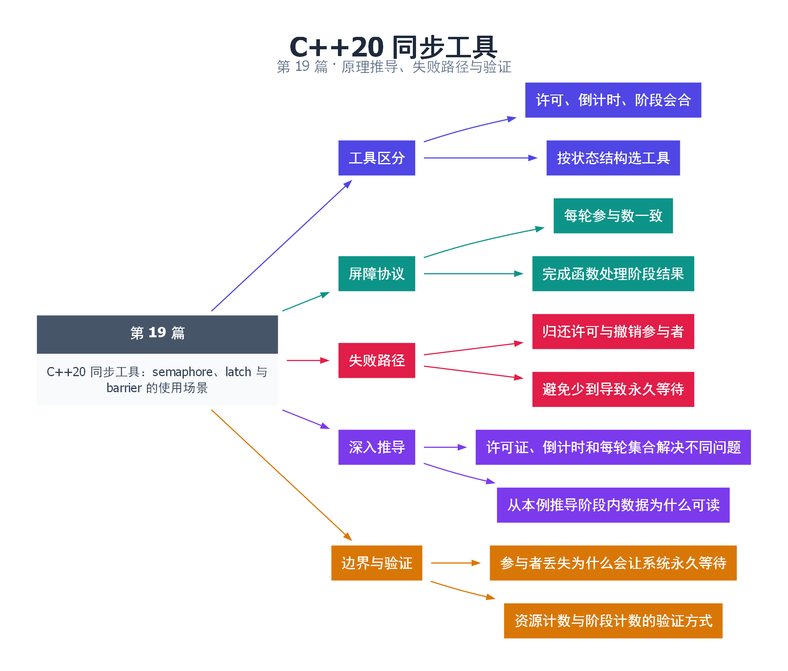

# 19｜C++20 同步工具：semaphore、latch 与 barrier 的使用场景

[返回总目录](README.md) · 最低标准：C++20

一句话总结：信号量管理可用许可，latch 管理一次性倒计时，barrier 管理可重复的阶段会合，应按状态结构选工具。

**本文目录**

- [1. 停车位、开工名单和分轮比赛](#section-1)
- [2. 一次性和可重复等待](#section-2)
- [3. 选择依据与验证](#section-3)
- [4. 深入推导、反例与工程取舍](#section-4)
  - [4.1 许可证、倒计时和每轮集合解决不同问题](#depth-1)
  - [4.2 从本例推导阶段内数据为什么可读](#depth-2)
  - [4.3 参与者丢失为什么会让系统永久等待](#depth-3)
  - [4.4 资源计数与阶段计数的验证方式](#depth-4)
- [5. 完整示例与复现](#section-5)
  - [5.1 如何判断运行结果](#section-5-1)
- [6. Q&A（常见问题与解答）](#section-6)
  - [6.1 Q：信号量可以代替 mutex 吗？](#section-6-1)
  - [6.2 Q：latch 完成后还能重用吗？](#section-6-2)
  - [6.3 Q：某个参与者中途抛异常怎么办？](#section-6-3)
- [7. 引用与延伸阅读](#section-7)
- [8. 思维导图总结](#section-8)

---

<a id="section-1"></a>

## 1. 停车位、开工名单和分轮比赛

信号量像停车场剩余车位，有许可才能进入，离开归还；latch 像开工前的签到表，人数归零后门永远打开；barrier 像分轮比赛，每轮所有参赛者到齐才进入下一轮。它们解决不同协议，不能因为都能“阻塞”就互换。

semaphore 的 release 可以由不同于 acquire 的线程执行，所以它不是具有线程所有权的 mutex。若把许可用于保护数据，还必须明确每个许可代表哪份资源以及如何转交。计数不能超出实现允许的最大值，异常退出也不能遗漏归还许可。

<a id="section-2"></a>

## 2. 一次性和可重复等待

latch 的计数只向下减，不能重置；适合等待若干独立初始化任务完成。barrier 每个阶段重新建立计数，并可执行完成函数。永久退出后续阶段的参与者可用 arrive_and_drop，错误地少到一次会使其他参与者一直等待。

本例两条线程分别写数组的不同元素，先通过 latch 让主线程确认第一次写入完成，再用 barrier 进行两个阶段。第一个 barrier 确保彼此初始写入结束；第二个 barrier 的完成函数看到翻倍后的数据，并计算总和。完成函数使用 noexcept，避免把异常逃逸带入屏障协议。

带固定参与数的协议在部分线程创建失败时需要撤销参与者或使用全局启动门，否则已经启动的参与者可能永久等待。本例捕获第二条线程的创建失败，减少对应 latch 份额，并用 arrive_and_drop 撤销未启动的屏障参与者，再回收第一条线程。更复杂的分阶段算法还需要确定失败发生在哪一阶段，不能盲目减少计数。

<a id="section-3"></a>

## 3. 选择依据与验证

| 需求 | 工具 | 退出要点 |
|---|---|---|
| 最多 N 个并发访问 | counting_semaphore | 每次成功获取对应归还 |
| 等一次批任务完成 | latch | 计数必须最终归零 |
| 多轮并行计算 | barrier | 所有阶段参与数一致 |
| 等任意业务谓词 | 条件变量 | 谓词包含关闭状态 |

示例包含一个初始许可为 1 的 binary_semaphore，演示 acquire/release。它并不尝试实现资源池。真实资源池还需要对象分配、资源身份与关闭协议，不能只用一个计数代表全部正确性。

<!-- depth:chapter -->
<a id="section-4"></a>

## 4. 深入推导、反例与工程取舍

<!-- depth:start -->
<a id="depth-1"></a>

### 4.1 许可证、倒计时和每轮集合解决不同问题

semaphore 像停车场剩余车位，可以反复领取和归还；latch 像开幕前的准备事项计数，减到零后永久开放；barrier 像接力训练中每一轮的集合点，所有参与者完成本轮后一起进入下一轮。

选择时先问状态是否要重复使用，再问计数表示“资源数量”还是“参与者到达”。把 semaphore 当 mutex 时，要自行保证 acquire/release 成对；它没有 mutex 的同线程所有权限制，因此允许一个线程获取、另一个线程释放，这既是能力，也增加了记账责任。

<a id="depth-2"></a>

### 4.2 从本例推导阶段内数据为什么可读

两个工作线程分别修改 values[0] 和 values[1]，不同 int 元素属于不同内存位置，可以独立写。第一轮 barrier 阻止快线程在慢线程尚未完成第一轮时就把阶段推进；第二轮 completion 读取两项已经翻倍的值，得到 2+4=6。

这里尤其要区分 latch 的保证：initialized.wait 返回意味着每个线程已经到达 count_down，但线程随后还可能继续修改 values。主线程不能因为初始化 latch 已归零，就在工作线程第二轮修改期间任意读取数组。本例在 join 后才读取最终 total，避免这个窗口。

<a id="depth-3"></a>

### 4.3 参与者丢失为什么会让系统永久等待

barrier 期待两个参与者，如果第二个线程创建失败而不调整计数，第一个线程会一直等一个永远不存在的人。本例 catch 中补偿 latch 计数，并调用 arrive_and_drop 撤销未启动参与者在当前及后续阶段的份额，再回收已启动线程。

运行中的任务异常也有同类问题：若它在到达屏障前退出，其他参与者会等住。工程设计要明确异常是否转成共享错误并继续到达，还是调用 drop 退出后续轮次。drop 不是通用取消广播；其他线程仍需在阶段边界检查错误状态并走一致的关闭流程。

<a id="depth-4"></a>

### 4.4 资源计数与阶段计数的验证方式

| 原语 | 关键不变量 | 错误症状 |
|---|---|---|
| semaphore | 领取数不能超过已提供许可证 | 永久等待或超额释放 |
| latch | 计数不能减成负数，归零后不重置 | 前置条件被破坏 |
| barrier | 每轮到达份额与预期一致 | 某一轮一直无法结束 |

本例 semaphore 的单次 acquire/release 仅展示接口，不证明并发限流。可扩展为 K 个许可、M 个线程，持许可期间更新“同时在场人数”，记录峰值并断言不超过 K；更新峰值本身也需原子或锁。把初始许可设为 0 且没有 release 方，会永久等待，不是调度器失效。
<!-- depth:end -->

<a id="section-5"></a>

## 5. 完整示例与复现

源文件：[examples/19.cpp](examples/19.cpp)。在本系列目录运行以下命令；环境准备见 [实验环境](实验环境与验证.md)。

```bash
g++ -std=c++20 -O2 -Wall -Wextra -pedantic -pthread examples/19.cpp -o demo19
./demo19
```

```cpp
#include <array>
#include <cassert>
#include <barrier>
#include <iostream>
#include <latch>
#include <semaphore>
#include <thread>
int main() {
    std::binary_semaphore permit(1);
    permit.acquire(); permit.release();
    std::array<int,2> values{0,0};
    std::latch initialized(2);
    int phase=0,total=0;
    std::barrier sync(2,[&]() noexcept {
        ++phase;
        if(phase==2) total=values[0]+values[1];
    });
    auto work=[&](int i) {
        values[i]=i+1;
        initialized.count_down();
        sync.arrive_and_wait();
        values[i]*=2;
        sync.arrive_and_wait();
    };
    std::jthread a(work,0);
    std::jthread b;
    try { b=std::jthread(work,1); }
    catch (...) {
        // 撤销未启动参与者的 latch 和 barrier 份额。
        initialized.count_down();
        sync.arrive_and_drop();
        a.join();
        throw;
    }
    initialized.wait();
    a.join(); b.join();
    assert(total==6 && phase==2);
    std::cout << "phases=" << phase << " total=" << total << '\n';
}
```

<a id="section-5-1"></a>

### 5.1 如何判断运行结果

输出 `phases=2 total=6`，展示两次屏障阶段的可见性。

<a id="section-6"></a>

## 6. Q&A（常见问题与解答）

<a id="section-6-1"></a>

### 6.1 Q：信号量可以代替 mutex 吗？

A：某些协议可用单许可实现排他，但它没有同样的所有权语义，优先选能直接表达意图的 mutex。

<a id="section-6-2"></a>

### 6.2 Q：latch 完成后还能重用吗？

A：不能，重复阶段应考虑 barrier 或建立新的 latch。

<a id="section-6-3"></a>

### 6.3 Q：某个参与者中途抛异常怎么办？

A：必须保证该参与者按协议退出并减少后续参与数，或设计统一故障关闭；不能让其悄悄消失。

<a id="section-7"></a>

## 7. 引用与延伸阅读

- [信号量规范](https://timsong-cpp.github.io/cppwp/n4861/thread.sema)
- [latch 规范](https://timsong-cpp.github.io/cppwp/n4861/thread.latch)
- [barrier 规范](https://timsong-cpp.github.io/cppwp/n4861/thread.barrier)

规范链接采用固定的 C++20 工作草案 N4861；对较早标准的差异以正文标注为准。示例和分析为本系列自编，规范用于核对接口契约。

<a id="section-8"></a>

## 8. 思维导图总结

```text
C++20 同步工具：semaphore、latch 与 barrier 的使用场景
├── 工具区分
│   ├── 许可、倒计时、阶段会合
│   └── 按状态结构选工具
├── 屏障协议
│   ├── 每轮参与数一致
│   └── 完成函数处理阶段结果
├── 失败路径
│   ├── 归还许可与撤销参与者
│   └── 避免少到导致永久等待
├── 深入推导
│   ├── 许可证、倒计时和每轮集合解决不同问题
│   └── 从本例推导阶段内数据为什么可读
└── 边界与验证
    ├── 参与者丢失为什么会让系统永久等待
    └── 资源计数与阶段计数的验证方式
```



[Graphviz 源文件](images/19.dot)
