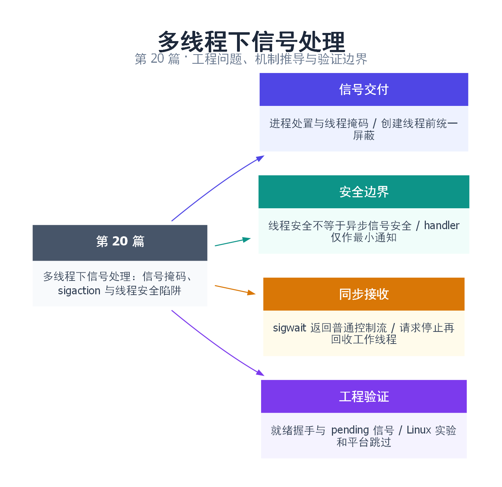

# 20｜多线程下信号处理：信号掩码、sigaction 与线程安全陷阱

[返回总目录](README.md) · 最低标准：C++20 · Linux/POSIX

一句话总结：将退出信号集中同步接收，把复杂清理留在普通线程上下文。

快速阅读：先看问题、方案对比和运行结果；深入阅读：按顺序推演边界，再运行完整示例及失败实验。

**本文目录**

- [1. 为什么在线程里正常的函数，放进 handler 就可能死锁](#section-1)
- [2. 信号处置是进程级，掩码是线程级](#section-2)
- [3. 异步信号安全是白名单，不是“函数很短”](#section-3)
- [4. 主方案：先统一屏蔽，再用 sigwait 转回普通控制流](#section-4)
- [5. sigaction 补例：handler 只通知，工作回到 main](#section-5)
- [6. 退出状态机、方案对比与失败路径](#section-6)
- [7. Q&A、验证矩阵与上线清单](#section-7)
- [8. 引用与延伸阅读](#section-8)
- [9. 思维导图总结](#section-9)

---

<a id="section-1"></a>

## 1. 为什么在线程里正常的函数，放进 handler 就可能死锁

把信号想成店员正在收银时响起的紧急广播。广播回调可能打断收银机内部操作；如果回调也去操作同一台尚未完成更新的收银机，就可能重入内部锁或破坏状态。普通“多线程安全”假定多个正常调用可以协调，并不意味着函数能在自己被中断的任意位置再次进入。

例如线程被打断时正在 malloc 内部持有分配器锁，handler 又构造 std::string，可能再次进入分配器并永远等自己释放锁。类似风险存在于 printf、iostream、mutex、容器操作及复杂日志接口。后端退出处理最常见的错误是“收到 SIGTERM，就在 handler 里调用整个服务的 close/join”。

本篇区分三件事：信号如何选择接收线程；异步 handler 的能力边界；如何把退出处理搬回普通线程上下文。范围是 Linux/POSIX，多线程主例使用 C++20；不是 Windows 控制台事件教程。

<a id="section-2"></a>

## 2. 信号处置是进程级，掩码是线程级

sigaction 安装某信号的处置方式，对进程生效；每条线程却有自己的 blocked mask。新线程继承创建者的掩码。**进程定向信号不是随意打断任何线程，而是在有资格接收的线程中选择；线程定向信号和硬件同步异常又有不同来源。**[signal(7)](https://man7.org/linux/man-pages/man7/signal.7.html)

| 来源 | 典型例子 | 理解方式 |
|---|---|---|
| 进程定向 | kill(pid,SIGTERM) | 通常交给未屏蔽它的合适线程，或等待同步接收 |
| 线程定向 | pthread_kill(thread,SIGUSR1) | 指向指定线程，但默认终止等处置仍可影响整个进程 |
| 同步异常 | 非法地址触发 SIGSEGV | 通常由触发异常的线程接收，不能当作普通退出事件转走 |

屏蔽不是忽略：被屏蔽信号可以保持 pending，解除屏蔽后按规则处理。普通非实时信号通常不会按发送次数排队计数，连续发十次不等于回调十次；需要事件计数时使用明确的队列或适合的实时信号协议。SIGKILL、SIGSTOP 不能被捕获或屏蔽。

若服务要集中接收 SIGTERM，必须在创建任何工作线程前阻塞它。只在信号线程里屏蔽，其他线程仍可能收到默认终止信号；主线程先启动库内后台线程，再设置掩码也可能太晚。多线程程序用 pthread_sigmask，并注意它直接返回错误码。[pthread_sigmask(3)](https://man7.org/linux/man-pages/man3/pthread_sigmask.3.html)

<a id="section-3"></a>

## 3. 异步信号安全是白名单，不是“函数很短”

POSIX 明确列出 async-signal-safe 接口；write 是常见通知手段，但 cout、printf、malloc/free、mutex.lock 和绝大多数 C++ 库操作不能因为“平时线程安全”就搬进去。handler 中不应抛 C++ 异常，也不应通过不受支持的跨栈跳转跳过 C++ 析构。[signal-safety(7)](https://man7.org/linux/man-pages/man7/signal-safety.7.html)

一个仅做通知的 handler 可以保存 errno，进行允许的最小操作，再恢复 errno。write 安全不代表不会阻塞：向满的阻塞管道或慢设备写，仍可能让程序停住。self-pipe 通常设置非阻塞，且要设计满管道时的处理；“字节写不进去就丢掉”只能在持久状态另有保存、后续一定会复查时成立。

volatile sig_atomic_t 可用于特定信号访问模式下的简单标志，但它不是通用跨线程原子。主线程读、另一条线程 handler 写这样的共享不能靠 volatile 修复。下面补例只在同一线程 raise 后读标志；真实多线程退出优先使用下一节的同步接收。

<a id="section-4"></a>

## 4. 主方案：先统一屏蔽，再用 sigwait 转回普通控制流

像安排专职接线员，把紧急广播变成可排队处理的服务请求。所有工作线程继承阻塞掩码，主控制线程调用 sigwait 接受 pending 信号。sigwait 返回之后已经是普通线程控制流，可以获取锁、请求停止、记录日志并 join；这里没有安装该信号的异步业务 handler。[sigwait(3)](https://man7.org/linux/man-pages/man3/sigwait.3.html)

完整源文件：[examples/20.cpp](examples/20.cpp)。

```cpp
// Linux/POSIX example. Default self-test; --serve waits for external SIGTERM.
#include <signal.h>
#include <pthread.h>
#include <unistd.h>
#include <cassert>
#include <cerrno>
#include <condition_variable>
#include <iostream>
#include <mutex>
#include <stdexcept>
#include <string>
#include <system_error>
#include <thread>

int main(int argc, char** argv) {
    bool serve = argc == 2 && std::string(argv[1]) == "--serve";
    if (argc > 1 && !serve) return 2;
    sigset_t set;
    sigemptyset(&set);
    sigaddset(&set, SIGINT);
    sigaddset(&set, SIGTERM);
    int error = pthread_sigmask(SIG_BLOCK, &set, nullptr);
    if (error) throw std::system_error(error, std::generic_category(), "pthread_sigmask");
    // Construct EVERY worker after blocking. New threads inherit this mask.
    std::mutex mutex;
    std::condition_variable_any cv;
    bool stopped = false;
    std::jthread worker([&](std::stop_token token) {
        std::unique_lock lock(mutex);
        cv.wait(lock, token, [] { return false; });
        stopped = token.stop_requested();
    });
    std::cout << "pid=" << getpid() << " waiting for SIGINT/SIGTERM" << std::endl;
    if (!serve && kill(getpid(), SIGTERM) == -1)
        throw std::system_error(errno, std::generic_category(), "kill");
    int received = 0;
    error = sigwait(&set, &received);
    if (error) throw std::system_error(error, std::generic_category(), "sigwait");
    assert(received == SIGINT || received == SIGTERM);
    // Ordinary thread context: locks, C++ I/O and request_stop are allowed here.
    worker.request_stop();
    worker.join();
    assert(stopped);
    std::cout << "signal received; worker joined\n";
    // This standalone process exits with termination signals still blocked.
}
```

```bash
sudo apt update
sudo apt install build-essential python3
mkdir -p build/signals20
g++ -std=c++20 -O2 -Wall -Wextra -pthread examples/20.cpp -o build/signals20/demo
./build/signals20/demo
```

默认自测对本进程发送一次 SIGTERM。它可以在进入 sigwait 前到达，因为已经屏蔽，信号会等待接收。预期先显示 PID，最后显示 `signal received; worker joined`，正常退出；PID 不固定。

服务模式与外部终止的完整实验：

```bash
# 终端一：保持运行，等它打印带 PID 的就绪行
./build/signals20/demo --serve
# 终端二：用就绪行中的 PID 替换下方示例值
kill -TERM 12345
```

必须等 `pid=... waiting...` 就绪行后再发送信号。不能承诺进程启动的第一条指令就已设置掩码：后台启动后立刻 kill，可能发生在初始化前而导致默认终止。自动脚本应以就绪输出来握手，不要把固定 sleep 当作就绪证明。

工作线程阻塞在支持 stop_token 的 condition_variable_any 上，因此请求停止也能解除等待。如果只换成普通 cv.wait，必须另行置关闭谓词并 notify_all。主例是独立进程，退出前不恢复掩码；嵌入库函数时应由进程级拥有者决定恢复时机，考虑尚未消费的 pending 信号，不能偷偷改宿主信号策略。

<a id="section-5"></a>

## 5. sigaction 补例：handler 只通知，工作回到 main

这是独立的单线程信号访问实验，不是主方案的另一个必须线程。完整源码：[signal_handler.cpp](examples/signal_handler.cpp)。

```cpp
// Linux/POSIX, single-thread handler demonstration; not a cross-thread flag.
#include <signal.h>
#include <unistd.h>
#include <cerrno>
#include <cassert>
#include <iostream>

volatile sig_atomic_t observed = 0;
extern "C" void on_signal(int) {
    const int saved_errno = errno;
    observed = 1;
    const char message[] = "handler: notification only\n";
    // write is async-signal-safe; errors/short writes are deliberately ignored.
    (void)write(STDERR_FILENO, message, sizeof(message)-1);
    errno = saved_errno;
}
int main() {
    struct sigaction action{};
    action.sa_handler = on_signal;
    sigemptyset(&action.sa_mask);
    action.sa_flags = 0;
    if (sigaction(SIGUSR1, &action, nullptr) == -1) return 2;
    if (raise(SIGUSR1) != 0) return 3;
    assert(observed == 1);
    std::cout << "main: handler returned\n";
}
```

```bash
g++ -std=c++11 -O2 -Wall -Wextra examples/signal_handler.cpp -o build/signals20/handler
./build/signals20/handler
```

预期 stderr 有通知行，stdout 有 `main: handler returned`。sa_mask 指定 handler 执行期间额外阻塞的信号；通常当前信号也暂时被阻塞，除非使用改变重入规则的标志。复杂场景可通过 SA_SIGINFO 接收 siginfo_t，但这不会放宽异步安全要求。

SA_RESTART 也不是“所有系统调用自动重试”。哪些调用可重启依接口而定，网络超时、部分读写和 EINTR 都需要按对应 API 处理。重试写入时若已经写出部分字节，应推进缓冲区偏移，不能盲目从头发送。不要为了隐藏 EINTR 给整个 handler 随意增加重启标志。

<a id="section-6"></a>

## 6. 退出状态机、方案对比与失败路径

| 方案 | 适合场景 | 代价和限制 |
|---|---|---|
| sigwait/sigwaitinfo | 独立控制线程处理退出信号 | 需要进程统一管理掩码 |
| signalfd | Linux epoll 事件循环 | Linux 专属，同样要求正确屏蔽 |
| sigaction + self-pipe | 需要兼容事件通知方式 | 非阻塞写、溢出及描述符寿命需设计 |
| handler 直接 close/join | 不作为本篇可行设计 | 异步安全、重入和自等待风险 |

服务退出可拆为 RUNNING→STOP_ACCEPTING→DRAINING→STOPPED。接收到退出信号后，先让入口停止接单，再唤醒工作线程，决定排空还是取消，等待线程结束，最后销毁队列、锁和输出端。多个 SIGTERM 不意味着可以重复并发析构；关闭应由单一拥有者串行推进。

若业务要求二次信号强制退出，需要明确可能丢数据，并采用单独的、可审查的升级策略。SIGSEGV 后进程内状态可能已损坏，不应尝试从信号点继续普通业务；可交由系统保留 core，再由外部监督器重启。信号线程不是崩溃恢复万能通道。

<a id="section-7"></a>

## 7. Q&A、验证矩阵与上线清单

**为什么主例没有 sigaction？** 因为它同步接收退出信号；混用同一信号的 handler 与 sigwait 会让职责不清，需查平台契约再设计。

**stop_token 可以直接在 handler 请求吗？** 不应假定 request_stop 是 async-signal-safe；它还可能同步执行用户回调。本例在 sigwait 返回后调用。

**如何验证屏蔽顺序？** 在创建工作线程前设置掩码，检查所有可能提前启动线程的库；Linux 可检查 `/proc/PID/task/TID/status` 的 SigBlk 等字段，结合实际信号编号解释，不能把一次正常退出当作完整证明。

检查项：启动前设掩码；默认自测信号先到；就绪后外部 SIGINT/SIGTERM；空闲等待者可退出；忙任务取消点明确；重复关闭不重入；文件错误可观察；记录哪些测试没有在目标部署环境执行。本机没有可用 Linux 环境，主例与 handler 补例列为平台跳过，不宣称已实测。

<a id="section-8"></a>

## 8. 引用与延伸阅读

- [signal(7)](https://man7.org/linux/man-pages/man7/signal.7.html)、[sigaction(2)](https://man7.org/linux/man-pages/man2/sigaction.2.html)：处置方式、掩码、交付及标志。
- [signal-safety(7)](https://man7.org/linux/man-pages/man7/signal-safety.7.html)：异步信号安全接口清单。
- [pthread_sigmask(3)](https://man7.org/linux/man-pages/man3/pthread_sigmask.3.html)、[sigwait(3)](https://man7.org/linux/man-pages/man3/sigwait.3.html)：同步接收方案。

<a id="section-9"></a>

## 9. 思维导图总结

```text
多线程下信号处理：信号掩码、sigaction 与线程安全陷阱
├── 信号交付
│   ├── 进程处置与线程掩码
│   └── 创建线程前统一屏蔽
├── 安全边界
│   ├── 线程安全不等于异步信号安全
│   └── handler 仅作最小通知
├── 同步接收
│   ├── sigwait 返回普通控制流
│   └── 请求停止再回收工作线程
└── 工程验证
    ├── 就绪握手与 pending 信号
    └── Linux 实验和平台跳过
```



[Graphviz 图源](images/20.dot)
