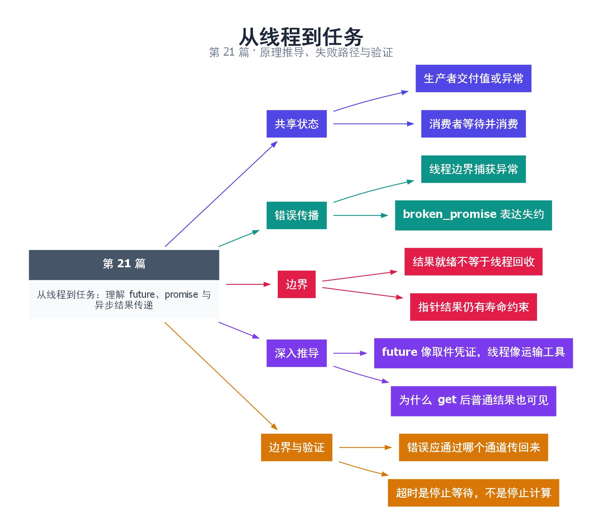

# 21｜从线程到任务：理解 future、promise 与异步结果传递

[返回总目录](README.md) · 最低标准：C++20

一句话总结：promise 负责交付结果或异常，future 负责等待和取回，它们通过共享状态把任务完成协议显式化。

**本文目录**

- [1. 取餐凭证和后厨交付窗口](#section-1)
- [2. 从线程异常到调用方异常](#section-2)
- [3. 可见性与共享方式](#section-3)
- [4. 深入推导、反例与工程取舍](#section-4)
  - [4.1 future 像取件凭证，线程像运输工具](#depth-1)
  - [4.2 为什么 get 后普通结果也可见](#depth-2)
  - [4.3 错误应通过哪个通道传回来](#depth-3)
  - [4.4 超时是停止等待，不是停止计算](#depth-4)
- [5. 完整示例与复现](#section-5)
  - [5.1 如何判断运行结果](#section-5-1)
- [6. Q&A（常见问题与解答）](#section-6)
  - [6.1 Q：future 本身会创建线程吗？](#section-6-1)
  - [6.2 Q：get 抛异常后还能再 get 吗？](#section-6-2)
  - [6.3 Q：promise 没赋值就析构会永久等待吗？](#section-6-3)
- [7. 引用与延伸阅读](#section-7)
- [8. 思维导图总结](#section-8)

---

<a id="section-1"></a>

## 1. 取餐凭证和后厨交付窗口

promise 像后厨的交付入口，future 像顾客手里的取餐凭证。顾客不需要知道哪位厨师工作，只需要等结果就绪。共享状态可以处于未就绪、已存值或已存异常；它不是一个能够不断收发消息的队列。

promise.get_future 通常只调用一次。promise.set_value 和 set_exception 也只能成功满足共享状态一次。future.get 等待就绪并取得值，若状态中存的是异常则重新抛出；普通 future 的 get 通常只能消费一次，之后不再持有有效共享状态。

<a id="section-2"></a>

## 2. 从线程异常到调用方异常

工作线程必须在入口内部 catch，把 current_exception 交给 promise。主线程对 future.get 使用普通 try/catch，就可以处理任务错误。这里异常传播和线程回收是两件事：future 就绪不代表线程管理对象已完成 join，仍必须回收线程。

本例创建一个返回 42 的任务和一个抛异常的任务。两者都用相同的交付协议，避免失败时只打印日志却让调用者一直等待。promise 若在未交付时销毁，会使关联状态以 broken_promise 异常就绪，这比静默悬挂更可诊断。

<a id="section-3"></a>

## 3. 可见性与共享方式

共享状态从结果存储到等待者成功观察就绪提供同步，使构建好的结果可安全交接。但返回的若是指针或引用，仍要管理目标对象的寿命和后续修改。future 不能把一个悬空指针变安全。

多个消费者需要观察同一结果时可以使用 shared_future。它允许多个持有者等待和读取共享结果，但若结果内部指向可变对象，内容同步依然由业务保证。

| 工具 | 擅长解决 | 不负责 |
|---|---|---|
| promise/future | 一次结果与异常交付 | 选择执行线程 |
| shared_future | 多个等待者观察一次结果 | 任意共享内容并发修改 |
| 条件变量 | 等待可重复业务状态 | 自动保存异常 |

排查时先检查是否忘记所有分支都满足 promise、是否重复 get、是否生产者提前销毁。等待结果不要在持有任务完成所需锁时执行，否则会制造依赖死锁。

<!-- depth:chapter -->
<a id="section-4"></a>

## 4. 深入推导、反例与工程取舍

<!-- depth:start -->
<a id="depth-1"></a>

### 4.1 future 像取件凭证，线程像运输工具

promise 持有交付结果的权利，future 持有等待和取结果的权利，它们通过共享状态关联。创建 future 不会自动启动线程；同一线程也可以先 set_value 再 get。把执行机制和结果传递分开，才可以将同一任务放到独立线程、线程池或事件循环中执行。

共享状态可理解为“尚未就绪 → 保存值或异常 → 已就绪”。普通 future 的 get 会取得结果并使这个 future 不再有效，不能把它当成可重复读取的缓存。wait 只等就绪，不消费值；需要多个读取者时考虑 shared_future，并另行保证返回对象的访问方式安全。

<a id="depth-2"></a>

### 4.2 为什么 get 后普通结果也可见

生产者在完成共享状态前执行的相关写入，可通过使状态就绪与等待方成功观察就绪的同步关系传递。本例 promise 保存整数或异常，主线程 get 等待并接收。若额外共享一个普通结构，应保证发布后不再无同步修改它；future 不是覆盖生产者全部后续工作的锁。

同样，拿到结果不一定表示执行线程已经结束。线程可能 set_value 后继续清理或做其他工作；如果主线程随后销毁这些工作要用的资源，仍需 join 或其他明确生命周期协议。

<a id="depth-3"></a>

### 4.3 错误应通过哪个通道传回来

| 情况 | 接收方可见结果 | 排查方向 |
|---|---|---|
| set_value | 正常值 | 数据本身是否满足业务不变量 |
| set_exception | get 重抛保存的异常 | 生产者业务失败 |
| promise 未交付就销毁 | broken_promise | 生产路径提前退出或任务取消 |
| 重复交付 | 提供方抛 future_error | 是否存在多个完成路径 |

在工作线程中只 catch 然后打印，会让主线程无法区分失败与成功；若 promise 还存活且从未完成，get 甚至可能一直等。建议把任务结果设计为恰好完成一次，每条成功、失败、取消路径都有明确终点。

<a id="depth-4"></a>

### 4.4 超时是停止等待，不是停止计算

wait_for 返回 timeout 后，任务仍可能继续运行。调用者不能立刻销毁被任务引用的输入，也不能假定超时任务没有副作用。若要取消，必须另有 stop_token 或业务取消协议，且要规定已提交动作能否撤销。

本例用 success/fail 两轮验证值和异常两条通道；任务在 catch 中 set_exception，jthread 在作用域结束时回收。可以再增加“未调用 set_value 就销毁 promise”的独立测试，检查错误码 broken_promise。不要对已经 get 过的同一 future 再 get 来测试重复读取；应使用有效状态检查来维护接口前置条件。
<!-- depth:end -->

<a id="section-5"></a>

## 5. 完整示例与复现

源文件：[examples/21.cpp](examples/21.cpp)。在本系列目录运行以下命令；环境准备见 [实验环境](实验环境与验证.md)。

```bash
g++ -std=c++20 -O2 -Wall -Wextra -pedantic -pthread examples/21.cpp -o demo21
./demo21
```

```cpp
#include <cassert>
#include <future>
#include <iostream>
#include <stdexcept>
#include <thread>
int main() {
    for(bool fail : {false,true}) {
        std::promise<int> promise;
        auto result=promise.get_future();
        std::jthread worker([p=std::move(promise),fail]() mutable {
            try {
                if(fail) throw std::runtime_error("task failed");
                p.set_value(42);
            } catch (...) { p.set_exception(std::current_exception()); }
        });
        try { int value=result.get(); assert(value==42); std::cout<<value<<'\n'; }
        catch(const std::runtime_error& e) { std::cout<<e.what()<<'\n'; }
    }
}
```

<a id="section-5-1"></a>

### 5.1 如何判断运行结果

依次输出 `42` 和 `task failed`，异常在 future.get 所在线程处理。

<a id="section-6"></a>

## 6. Q&A（常见问题与解答）

<a id="section-6-1"></a>

### 6.1 Q：future 本身会创建线程吗？

A：不会，它是结果通道；本例由 jthread 创建执行流，其他生产者也可以在当前线程交付结果。

<a id="section-6-2"></a>

### 6.2 Q：get 抛异常后还能再 get 吗？

A：普通 future 的结果已消费，不能再次作为有效结果使用；需要多次观察时考虑 shared_future。

<a id="section-6-3"></a>

### 6.3 Q：promise 没赋值就析构会永久等待吗？

A：关联 future 通常会收到 broken_promise；若 promise 仍存活却永远不交付，等待确实可能一直持续。

<a id="section-7"></a>

## 7. 引用与延伸阅读

- [深化实验与验证](深化实验与验证.md)：完整协议测试、运行命令、预期断言和未覆盖边界。

- [future 与 promise 规范](https://timsong-cpp.github.io/cppwp/n4861/futures)

规范链接采用固定的 C++20 工作草案 N4861；对较早标准的差异以正文标注为准。示例和分析为本系列自编，规范用于核对接口契约。

<a id="section-8"></a>

## 8. 思维导图总结

```text
从线程到任务：理解 future、promise 与异步结果传递
├── 共享状态
│   ├── 生产者交付值或异常
│   └── 消费者等待并消费
├── 错误传播
│   ├── 线程边界捕获异常
│   └── broken_promise 表达失约
├── 边界
│   ├── 结果就绪不等于线程回收
│   └── 指针结果仍有寿命约束
├── 深入推导
│   ├── future 像取件凭证，线程像运输工具
│   └── 为什么 get 后普通结果也可见
└── 边界与验证
    ├── 错误应通过哪个通道传回来
    └── 超时是停止等待，不是停止计算
```



[Graphviz 源文件](images/21.dot)
