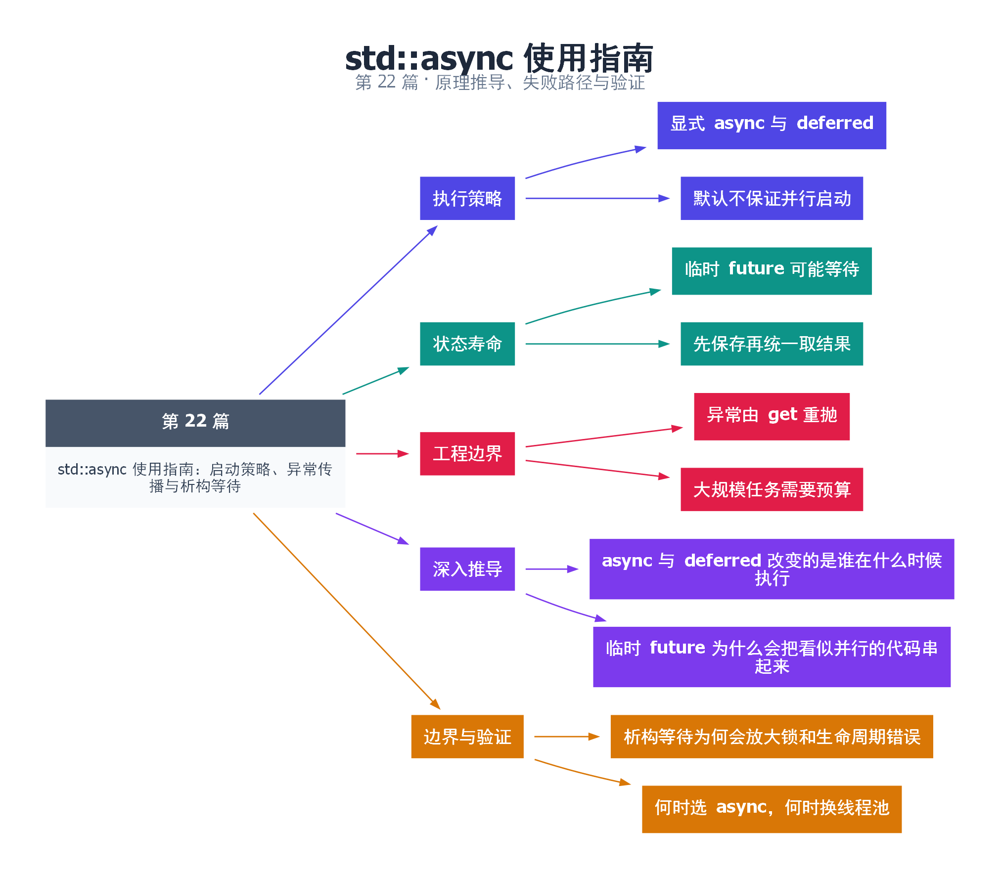

# 22｜std::async 使用指南：启动策略、异常传播与析构等待

[返回总目录](README.md) · 最低标准：C++11

一句话总结：std::async 同时创建任务执行与结果通道，但默认策略可延迟执行，返回 future 的释放也可能等待任务结束。

**本文目录**

- [1. 现在做还是取结果时再做](#section-1)
- [2. 析构等待为何容易让并行变串行](#section-2)
- [3. 异常和资源上限](#section-3)
- [4. 深入推导、反例与工程取舍](#section-4)
  - [4.1 async 与 deferred 改变的是谁在什么时候执行](#depth-1)
  - [4.2 临时 future 为什么会把看似并行的代码串起来](#depth-2)
  - [4.3 析构等待为何会放大锁和生命周期错误](#depth-3)
  - [4.4 何时选 async，何时换线程池](#depth-4)
- [5. 完整示例与复现](#section-5)
  - [5.1 如何判断运行结果](#section-5-1)
- [6. Q&A（常见问题与解答）](#section-6)
  - [6.1 Q：future 析构都会阻塞吗？](#section-6-1)
  - [6.2 Q：默认策略为什么不可靠地并行？](#section-6-2)
  - [6.3 Q：async 有线程池大小参数吗？](#section-6-3)
- [7. 引用与延伸阅读](#section-7)
- [8. 思维导图总结](#section-8)

---

<a id="section-1"></a>

## 1. 现在做还是取结果时再做

向服务台交任务，有两种安排：立即派人处理，或者先记在待办本上，等你真正需要结果时由你当前所在的执行流处理。`launch::async` 和 `launch::deferred` 分别表达这两类行为。默认策略允许实现选择，不能把不带策略的 async 当作“必然启动新线程”。

deferred 调用在首次非定时等待或取结果时执行；如果从来没有这类等待，函数可能根本不运行。wait_for 可以返回 deferred，不能把它当作普通 timeout 再一直轮询，否则任务永远没有机会被执行。

<a id="section-2"></a>

## 2. 析构等待为何容易让并行变串行

对于 async 策略创建的共享状态，最后一个释放状态的操作可能等待关联任务完成。如果把返回 future 作为临时对象立即丢弃，该语句末尾可能就等完任务；连续两条这样的语句便可能串行执行。

应把所有 future 保存下来，先提交独立任务，再依次 get。get 的顺序不必等于执行顺序，但若先等待很慢的任务，会推迟处理其他已经完成结果。若要“谁先完成先处理”，需要额外完成队列，而非假定 future 数组自动提供这个能力。

<a id="section-3"></a>

## 3. 异常和资源上限

用户函数异常存入共享状态，并在 get 重抛。显式 async 启动也可能因为无法创建执行资源而失败。大量细粒度任务逐个 async 不提供固定线程预算；需要限制资源时，用有容量和工作线程上限的执行器更合适。

| 策略 | 何时执行 | 常见用途 |
|---|---|---|
| async | 异步执行 | 少量独立耗时任务 |
| deferred | 首次非定时等待时 | 惰性求值 |
| 默认组合 | 由实现选择 | 不要求确定并行语义的场景 |

本例显式测试 deferred 的状态，并提交两个 async 任务后再取结果。不要把输出 42 视为已经证明两个任务同时运行；它只验证结果通道与策略用法。并行度与资源消耗需要另行测量。

<!-- depth:chapter -->
<a id="section-4"></a>

## 4. 深入推导、反例与工程取舍

<!-- depth:start -->
<a id="depth-1"></a>

### 4.1 async 与 deferred 改变的是谁在什么时候执行

launch::async 请求异步执行；launch::deferred 保存任务，等首次非定时等待触发时在等待方线程执行。默认策略允许实现选择，不能据此保证每次都会创建新线程。deferred 的 future 若从未被触发，任务可以根本不执行。

本例先用 wait_for(0) 观察 deferred，再 get 得到 7。对于 deferred，反复调用定时等待不会把任务推进成后台任务；如果只写循环 wait_for，可能一直得到 deferred 而永远不调用函数。处理状态时应区分 ready、timeout 和 deferred 三种结果。

<a id="depth-2"></a>

### 4.2 临时 future 为什么会把看似并行的代码串起来

两个独立表达式各调用一次 `std::async(std::launch::async, f)`，却不保存返回的 future，第一条表达式结束时临时对象释放共享状态。满足 async 共享状态的相关条件时，这次释放可能等待异步线程完成，于是第二个任务直到第一个完成后才开始创建。

本例把 a 和 b 都保存下来，先启动两个任务，再分别 get，才为重叠执行提供机会。所有 future 的析构都阻塞这个说法也不正确：promise 或 packaged_task 产生的状态、deferred 状态以及非最后持有者的释放，都不能简单套用同一结论。

<a id="depth-3"></a>

### 4.3 析构等待为何会放大锁和生命周期错误

设主线程持有 mutex，把最后一个 async future 销毁；异步任务正等同一 mutex 才能完成。主线程等待任务，任务等待锁，再次形成死锁。因为等待藏在析构里，堆栈看起来可能停在一个不起眼的变量作用域结束位置。

另一方面，如果异步任务引用局部对象，不能把“future 常常在析构等待”当成普遍生命周期方案。应该让结果句柄与输入的作用域关系清晰，显式 get/wait 后再销毁输入，并审查异常展开顺序。任务异常应通过 get 观察；只是 wait 或销毁句柄不会自动把业务异常送到调用者的 catch。

<a id="depth-4"></a>

### 4.4 何时选 async，何时换线程池

| 工作特征 | 倾向选择 | 需要明确的限制 |
|---|---|---|
| 少量独立任务、需要结果 | 显式策略 async | 并发数和析构等待 |
| 明确希望按需计算 | deferred | 哪个线程触发计算 |
| 高频、大量短任务 | 有界线程池 | 排队、拒绝和关闭协议 |

验证是否重叠，应用显式握手或任务时间线，而不是要求两个 cout 行一定交错。测开销应包含任务创建和结果回收；只测函数体会掩盖 async 的调度成本。资源耗尽时显式 async 可能抛 system_error，应像线程构造失败一样处理，不能只捕获函数体异常。
<!-- depth:end -->

<a id="section-5"></a>

## 5. 完整示例与复现

源文件：[examples/22.cpp](examples/22.cpp)。在本系列目录运行以下命令；环境准备见 [实验环境](实验环境与验证.md)。

```bash
g++ -std=c++11 -O2 -Wall -Wextra -pedantic -pthread examples/22.cpp -o demo22
./demo22
```

```cpp
#include <cassert>
#include <chrono>
#include <future>
#include <iostream>
int main() {
    auto lazy=std::async(std::launch::deferred,[]{return 7;});
    assert(lazy.wait_for(std::chrono::seconds(0))==std::future_status::deferred);
    assert(lazy.get()==7);
    auto a=std::async(std::launch::async,[]{return 20;});
    auto b=std::async(std::launch::async,[]{return 22;});
    int total=a.get()+b.get();
    assert(total==42);
    std::cout << total << '\n';
}
```

<a id="section-5-1"></a>

### 5.1 如何判断运行结果

输出 `42`，deferred 状态断言通过。

<a id="section-6"></a>

## 6. Q&A（常见问题与解答）

<a id="section-6-1"></a>

### 6.1 Q：future 析构都会阻塞吗？

A：不是，重点是关联 async 启动共享状态的特殊完成要求，不能把这条规则泛化到所有 promise 创建的 future。

<a id="section-6-2"></a>

### 6.2 Q：默认策略为什么不可靠地并行？

A：接口明确允许选择 deferred，代码若要求并行启动应显式指定 async。

<a id="section-6-3"></a>

### 6.3 Q：async 有线程池大小参数吗？

A：没有标准化的线程预算接口，固定预算和背压要由其他执行器设计提供。

<a id="section-7"></a>

## 7. 引用与延伸阅读

- [std::async 规范](https://timsong-cpp.github.io/cppwp/n4861/futures.async)

规范链接采用固定的 C++20 工作草案 N4861；对较早标准的差异以正文标注为准。示例和分析为本系列自编，规范用于核对接口契约。

<a id="section-8"></a>

## 8. 思维导图总结

```text
std::async 使用指南：启动策略、异常传播与析构等待
├── 执行策略
│   ├── 显式 async 与 deferred
│   └── 默认不保证并行启动
├── 状态寿命
│   ├── 临时 future 可能等待
│   └── 先保存再统一取结果
├── 工程边界
│   ├── 异常由 get 重抛
│   └── 大规模任务需要预算
├── 深入推导
│   ├── async 与 deferred 改变的是谁在什么时候执行
│   └── 临时 future 为什么会把看似并行的代码串起来
└── 边界与验证
    ├── 析构等待为何会放大锁和生命周期错误
    └── 何时选 async，何时换线程池
```



[Graphviz 源文件](images/22.dot)
