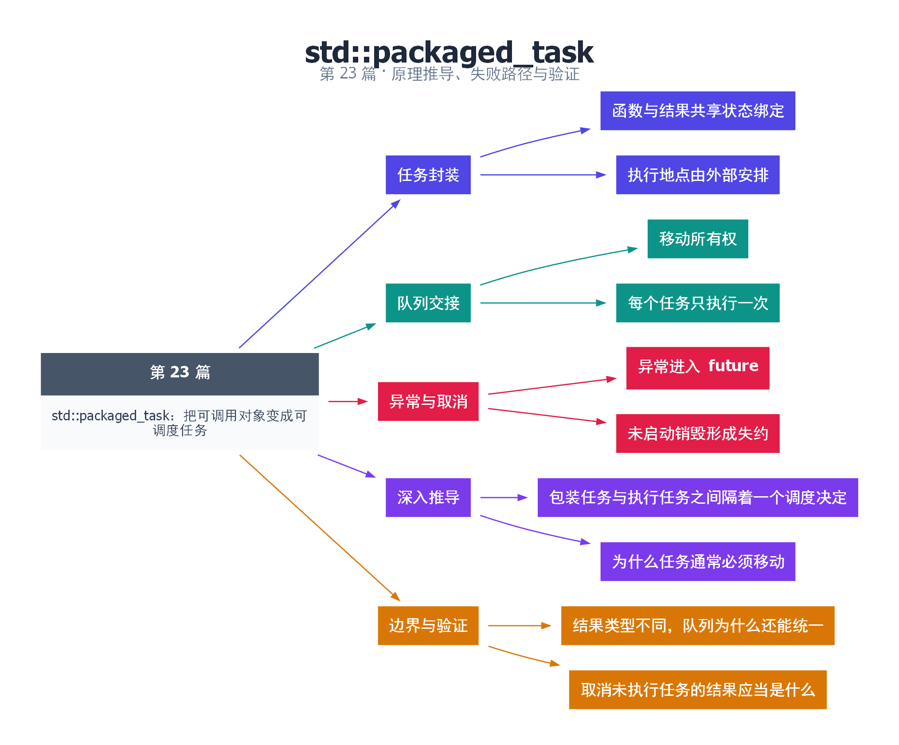

# 23｜std::packaged_task：把可调用对象变成可调度任务

[返回总目录](README.md) · 最低标准：C++11

一句话总结：packaged_task 把可调用对象与一次结果共享状态绑定，使任务可以移动到队列中，执行时自动保存返回值或异常。

**本文目录**

- [1. 带回执的工作单](#section-1)
- [2. 队列取出和执行必须分开](#section-2)
- [3. 取消意味着什么](#section-3)
- [4. 深入推导、反例与工程取舍](#section-4)
  - [4.1 包装任务与执行任务之间隔着一个调度决定](#depth-1)
  - [4.2 为什么任务通常必须移动](#depth-2)
  - [4.3 结果类型不同，队列为什么还能统一](#depth-3)
  - [4.4 取消未执行任务的结果应当是什么](#depth-4)
- [5. 完整示例与复现](#section-5)
  - [5.1 如何判断运行结果](#section-5-1)
- [6. Q&A（常见问题与解答）](#section-6)
  - [6.1 Q：创建 packaged_task 后函数就开始了吗？](#section-6-1)
  - [6.2 Q：能把任务复制到两条线程各执行一次吗？](#section-6-2)
  - [6.3 Q：为何线程池里用 shared_ptr？](#section-6-3)
- [7. 引用与延伸阅读](#section-7)
- [8. 思维导图总结](#section-8)

---

<a id="section-1"></a>

## 1. 带回执的工作单

普通函数像一张只有工作内容的纸，packaged_task 还附上结果回执。你可以先拿走 future，再把工作单交给任意执行者；执行者调用工作单，结果自动放进共享状态。它本身不会选择线程或自动运行。

packaged_task 通常不可复制但可以移动。这与唯一的一次执行责任相匹配。std::function 在 C++17 中要求被包装目标可复制，因此直接捕获 move-only packaged_task 的 lambda 不能随意放进这样的队列。第 25 篇使用 shared_ptr 包装任务，使外层调度对象可复制；另一种方向是使用支持 move-only 的任务容器。

<a id="section-2"></a>

## 2. 队列取出和执行必须分开

示例用 deque 保存 packaged_task，取出时 move 给局部变量，移除队首，再执行。这里故意在主线程执行，说明任务封装与线程调度独立。未来把取出过程放在互斥锁内、执行过程放在锁外，就构成线程池工作循环。

调用任务时用户异常被封装进状态，future.get 再抛出。任务对象本身的误用，例如无状态任务或重复满足状态，仍可能报告 future_error。队列必须保证每个接受的任务只被取出并调用一次。

<a id="section-3"></a>

## 3. 取消意味着什么

若任务在开始前从队列移除并销毁，其 future 会因未交付而获得 broken_promise。它表示任务没有正常交付，不是一个细分完备的业务取消码。生产系统往往需要额外的任务状态，把“主动取消”“执行器故障”“业务异常”区分开。

已经开始执行的函数不能靠销毁队列元素强行取消，因为它的执行者已经拥有任务。需要停止令牌让函数在安全边界自行结束。

| 封装 | 主要职责 | 使用负担 |
|---|---|---|
| promise | 手动交付 | 自己捕获异常并设置状态 |
| packaged_task | 调用后自动交付 | 自己安排执行地点 |
| async | 执行安排加结果通道 | 资源策略控制较少 |

<!-- depth:chapter -->
<a id="section-4"></a>

## 4. 深入推导、反例与工程取舍

<!-- depth:start -->
<a id="depth-1"></a>

### 4.1 包装任务与执行任务之间隔着一个调度决定

packaged_task 像装有回执单的工作包：包里有可调用对象和交付结果的共享状态，但没有自己的工作线程。本例在主线程把任务放进 deque，再取出调用，仍然得到 future=42，说明结果传递与异步执行是两层机制。

调用 packaged_task 时，用户函数正常返回的值或抛出的异常被保存到共享状态中。因此线程池工作线程可以调用它，再继续接下一个任务；接收者通过 future::get 观察错误。包装器自身的无效状态或重复调用等使用错误仍有自己的接口异常，不能假定任何误用都只是被存入 future。

<a id="depth-2"></a>

### 4.2 为什么任务通常必须移动

packaged_task 具有唯一执行包装器的所有权语义，可移动而不可复制。队列 push_back 必须移入，取出时也移动到局部变量，再把空壳从队列删除。此后局部 next 拥有调用责任，队列里的旧位置不再管理任务。

C++17 的 std::function 要求保存的可调用目标可复制，直接捕获 move-only 的 packaged_task 会遇到约束。本系列线程池使用 shared_ptr 持有 packaged_task，让队列中的 lambda 可以复制；代价是分配和引用计数。另一种设计是使用专门的可移动任务包装器；若采用 C++23 move_only_function，最低标准也必须同步升级。

<a id="depth-3"></a>

### 4.3 结果类型不同，队列为什么还能统一

线程池最终只需要“执行一次”的操作，因此外层队列可以存 void() 包装器。内部 packaged_task<R()> 负责具体 R 的存储，submit 返回 future<R> 给调用者。这是类型擦除发生的位置：调度层看不到结果类型，结果通道仍保持类型安全。

本篇 deque<packaged_task<int()>> 只容纳 int 返回值，适合展示移动和调用；它不是可直接支持任意返回类型的完整线程池。扩展时不要仅把 int 改成 auto，容器元素类型仍然需要统一表示。

<a id="depth-4"></a>

### 4.4 取消未执行任务的结果应当是什么

尚未交付结果的 packaged_task 被销毁，会放弃共享状态，等待方会通过 broken_promise 得知没有正常结果。它可以作为教学线程池的取消信号，但工程接口往往希望区分用户取消、关闭取消和内部丢弃，因而会定义显式错误类型。

实验可将本例 next() 调用去掉，并在 next 销毁后调用 answer.get，捕获 future_error 并核对错误码。不能在 next 仍活着且无人执行它时直接 get，否则只会等待。若复用包装器的 reset，要先理解它创建的是新的共享状态；旧 future 的完成关系不会自动转接到新一轮任务。
<!-- depth:end -->

<a id="section-5"></a>

## 5. 完整示例与复现

源文件：[examples/23.cpp](examples/23.cpp)。在本系列目录运行以下命令；环境准备见 [实验环境](实验环境与验证.md)。

```bash
g++ -std=c++11 -O2 -Wall -Wextra -pedantic -pthread examples/23.cpp -o demo23
./demo23
```

```cpp
#include <cassert>
#include <deque>
#include <future>
#include <iostream>
#include <utility>
int main() {
    std::packaged_task<int()> task([]{return 6*7;});
    auto answer=task.get_future();
    std::deque<std::packaged_task<int()>> queue;
    queue.push_back(std::move(task));
    auto next=std::move(queue.front());
    queue.pop_front();
    next();
    int value=answer.get();
    assert(value==42 && queue.empty());
    std::cout << value << '\n';
}
```

<a id="section-5-1"></a>

### 5.1 如何判断运行结果

输出 `42`，本例没有创建线程，用于验证任务封装与调度的分离。

<a id="section-6"></a>

## 6. Q&A（常见问题与解答）

<a id="section-6-1"></a>

### 6.1 Q：创建 packaged_task 后函数就开始了吗？

A：没有，必须显式调用任务对象或交给执行器调用。

<a id="section-6-2"></a>

### 6.2 Q：能把任务复制到两条线程各执行一次吗？

A：packaged_task 不可复制，一次共享状态也不能交付两次，重复计算应创建两个任务。

<a id="section-6-3"></a>

### 6.3 Q：为何线程池里用 shared_ptr？

A：这里是为了适配可复制的 std::function 调度包装器，不意味着业务任务应执行多次。

<a id="section-7"></a>

## 7. 引用与延伸阅读

- [深化实验与验证](深化实验与验证.md)：完整协议测试、运行命令、预期断言和未覆盖边界。

- [C++20 工作草案：线程支持库](https://timsong-cpp.github.io/cppwp/n4861/thread)

规范链接采用固定的 C++20 工作草案 N4861；对较早标准的差异以正文标注为准。示例和分析为本系列自编，规范用于核对接口契约。

<a id="section-8"></a>

## 8. 思维导图总结

```text
std::packaged_task：把可调用对象变成可调度任务
├── 任务封装
│   ├── 函数与结果共享状态绑定
│   └── 执行地点由外部安排
├── 队列交接
│   ├── 移动所有权
│   └── 每个任务只执行一次
├── 异常与取消
│   ├── 异常进入 future
│   └── 未启动销毁形成失约
├── 深入推导
│   ├── 包装任务与执行任务之间隔着一个调度决定
│   └── 为什么任务通常必须移动
└── 边界与验证
    ├── 结果类型不同，队列为什么还能统一
    └── 取消未执行任务的结果应当是什么
```



[Graphviz 源文件](images/23.dot)
