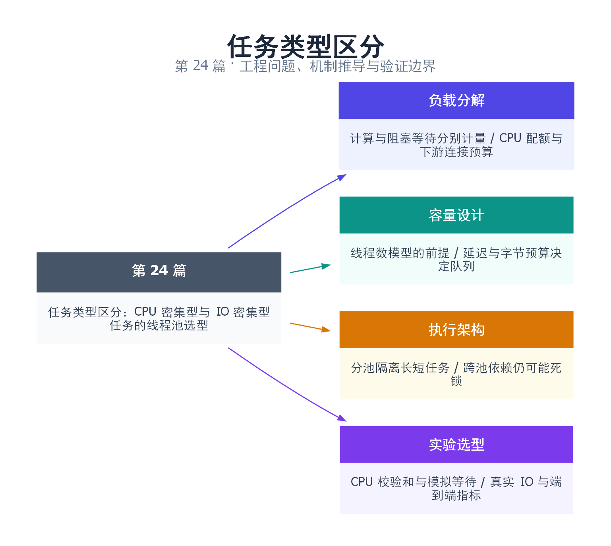

# 24｜任务类型区分：CPU 密集型与 IO 密集型任务的线程池选型

[返回总目录](README.md) · 最低标准：C++17

一句话总结：先分解计算与等待，再按核心、连接、内存和延迟预算选择执行架构。

快速阅读：先看问题、方案对比和运行结果；深入阅读：按顺序推演边界，再运行完整示例及失败实验。

**本文目录**

- [1. 线程池之前，先问工人是在干活还是在等材料](#section-1)
- [2. 两个模型推导线程数，但不要把估算当保证](#section-2)
- [3. 队列容量来自延迟和内存预算，不来自随意的常量](#section-3)
- [4. 为什么需要分池，以及分池不能解决什么](#section-4)
- [5. 完整对照实验：可计算校验和与模拟等待](#section-5)
- [6. 如何从生产指标识别任务类型](#section-6)
- [7. 选型模板与常见失败路径](#section-7)
- [8. 引用与延伸阅读](#section-8)
- [9. 思维导图总结](#section-9)

---

<a id="section-1"></a>

## 1. 线程池之前，先问工人是在干活还是在等材料

CPU 密集任务像持续切菜的厨师，IO 密集任务像大部分时间等待烤箱或送货的店员。前者受计算资源、缓存和内存带宽限制，后者可能通过重叠等待提高吞吐。实际请求常是混合流水线：网络读取→解压→业务计算→数据库→序列化，不能因为入口是网络请求，就把所有阶段统一标成 IO 密集。

下一篇会实现线程池；本篇先确定池应承担什么。线程数、队列容量和拒绝策略是资源预算的一部分，不能从 hardware_concurrency 取一个数字就结束设计。还要看 CPU 配额、上游连接数、任务依赖和尾延迟目标。

<a id="section-2"></a>

## 2. 两个模型推导线程数，但不要把估算当保证

设每项平均实际计算 C 秒、等待 W 秒，P 是可以使用的处理能力。在没有其他瓶颈且等待可独立重叠的假设下，一个线程忙于计算的比例为 C/(C+W)，让 P 个计算资源保持忙碌需要线程数量级 N≈P(1+W/C)。

假设 P=8、C=2ms、W=18ms，公式给出约 80 个线程。这是解释模型的假设数据，不是“服务该配 80”。如果数据库只允许 16 个连接，80 个线程可能只是 16 个执行、64 个等待连接，并未提高数据库能力；还会增加栈、调度和上下文内存。

CPU 工作的基线通常从可用核心数附近测起；但内存带宽密集型任务可能在更少线程就达到上限，SMT 逻辑核心也不等于完整独立算力。对 IO 工作，W 必须区分真正外部等待、排队等待和锁等待：把严重锁竞争算成“需要更多线程的 IO 等待”，常会让情况恶化。

<a id="section-3"></a>

## 3. 队列容量来自延迟和内存预算，不来自随意的常量

假设稳定处理能力 μ=1000 项/秒，允许排队时间预算为 50ms，粗略容量尺度约为 μ×0.05=50 项。这个推算只提供平均尺度；任务时长波动、批量到达和公平性会改变尾部，不能据此保证每项排队小于 50ms。

还要算内存：每个排队闭包捕获 1MB，容量 1000 就可能持有约 1GB 输入，另有正在执行任务、future 共享状态和提交临时对象。最好限制字节或资源权重；如果仅按任务数限流，要明确最大输入尺寸。

当到达率持续超过处理能力，无界队列只是推迟失败。拒绝/超时、上游限速、按 key 合并可替代任务、降级都属于可选策略。无预算的快速重试把过载重新送回来；阻塞式 submit 则可能让请求线程或工作线程池自身全部耗尽。

<a id="section-4"></a>

## 4. 为什么需要分池，以及分池不能解决什么

一个 4 线程共享池里，四个长数据库调用占满工人后，几百微秒的 CPU 解码也只能排队。这是资源竞争带来的队头阻塞。将受控阻塞 IO 与计算阶段分到不同池，有助于使一类外部停顿不耗尽另一类执行名额。

但分池不会增加数据库连接，也不自动消除依赖死锁：CPU 池全部任务阻塞等待 IO 池，而 IO 池全部任务又同步等待 CPU 池，仍会形成跨池闭环。更合适的是结果就绪后提交后续阶段，或使用能够挂起等待而不占线程的异步模型，同时限制在途任务。

| 方案 | 适合 | 主要代价 |
|---|---|---|
| 固定计算池 + 有界队列 | 独立计算、可预测 CPU 预算 | 小任务分发成本、长任务占位 |
| 有上限的阻塞 IO 池 | 现有同步 API、可控连接数 | 栈和调度开销、取消依赖底层 API |
| 事件循环/异步 IO | 大量同时等待的连接 | 生命周期、背压、回调/协程复杂度 |
| 混合池/阶段拆分 | 计算与等待交织 | 跨阶段排队、依赖图管理 |

工作窃取可以改善不均匀的计算负载，不能自动让阻塞网络调用不占线程；协程可以降低等待期间的线程占用，也不代表无限请求没有内存成本。

<a id="section-5"></a>

## 5. 完整对照实验：可计算校验和与模拟等待

本例使用下一篇的 [pool.hpp](examples/pool.hpp)，先把它当成可提交任务、可返回 future 的执行器。cpu 模式进行有确定结果的无符号迭代；io 模式用 sleep 模拟不可用来计算的等待。**sleep 不是网络 benchmark**：没有 socket、内核协议栈、连接池、超时或服务端竞争。

完整源文件：[examples/24.cpp](examples/24.cpp)。

```cpp
#include "pool.hpp"
#include <cassert>
#include <chrono>
#include <cstdint>
#include <iostream>
#include <string>
#include <thread>
#include <vector>

std::uint64_t compute(unsigned seed) {
    std::uint64_t x = seed + 1;
    for (unsigned i = 0; i < 200000; ++i) x = x * 6364136223846793005ULL + 1;
    return x; // unsigned arithmetic has defined wraparound
}
int main(int argc, char** argv) {
    unsigned workers = argc > 1 ? static_cast<unsigned>(std::stoul(argv[1])) : 4;
    std::string mode = argc > 2 ? argv[2] : "cpu";
    if (workers == 0 || workers > 64 || (mode != "cpu" && mode != "io")) return 2;
    constexpr unsigned tasks = 32;
    ThreadPool pool(workers, tasks);
    std::vector<std::future<std::uint64_t>> results;
    auto task = [&](unsigned i) -> std::uint64_t {
        if (mode == "io") { std::this_thread::sleep_for(std::chrono::milliseconds(2)); return i+1; }
        return compute(i);
    };
    std::uint64_t expected = 0;
    for (unsigned i = 0; i < tasks; ++i) expected += mode == "cpu" ? compute(i) : i+1;
    auto start = std::chrono::steady_clock::now();
    for (unsigned i = 0; i < tasks; ++i) results.push_back(pool.submit([&, i] { return task(i); }));
    std::uint64_t sum = 0;
    for (auto& f : results) sum += f.get();
    auto end = std::chrono::steady_clock::now();
    assert(sum == expected);
    pool.shutdown();
    std::cout << "mode=" << mode << " workers=" << workers << " tasks=" << tasks
              << " checksum=" << sum << " elapsed_us="
              << std::chrono::duration<double,std::micro>(end-start).count() << '\n';
}
```

```bash
mkdir -p build/workload24
g++ -std=c++17 -O2 -Wall -Wextra -pthread examples/24.cpp -o build/workload24/demo
for mode in cpu io; do
  for workers in 1 2 4 8; do
    ./build/workload24/demo "$workers" "$mode"
  done
done
```

输出包含 mode、workers、tasks、checksum 和 elapsed_us。每个模式中，不同线程数的 checksum 必须相同；io 模式为 1+…+32=528。计时从提交开始到所有结果取回，不包含线程池构造，也不包含最后 shutdown；因此它测的是已存在池上的一批任务，不能直接与每请求创建线程的时间比较。

没有断言线程越多越快。若 cpu 在某个数量后不再下降，检查核心配额、频率和带宽；若 io 也不近似线性下降，注意睡眠定时精度、任务数量有限以及启动调度成本。完整测量应增加多轮、交替顺序、原始样本和实际 IO 工作负载。

<a id="section-6"></a>

## 6. 如何从生产指标识别任务类型

同时记录队列等待、真正运行的 CPU 时间、墙钟服务时间、外部调用时间和锁等待。墙钟 100ms、线程 CPU 时间 2ms，说明大部分时间没有执行计算，但具体原因可能是调度饥饿、IO、锁或资源池等待，仍需堆栈和分阶段埋点定位。

| 现象 | 下一步实验 | 不应立即做的事 |
|---|---|---|
| CPU 配额打满、吞吐平台 | 固定工作量扫线程数，测限流与热点 | 无限增加计算线程 |
| 数据库连接池满 | 测连接等待与查询服务时间 | 只扩大应用工作池 |
| 短任务尾延迟很高 | 分离长短任务或设调度权重 | 仅看平均吞吐 |
| 队列增长但 CPU 很低 | 全线程堆栈、外部资源指标 | 认定为“线程数不够” |

先做负载分解，再设硬上限，最后在真实到达分布下压测。闭环客户端会随服务变慢自动减小压力，可能掩盖排队问题；第 45 篇解释开环与端到端计时。

<a id="section-7"></a>

## 7. 选型模板与常见失败路径

为每类任务填写：输入上限、C/W 测量口径、最大执行数、最大排队数、超时起点、是否可取消、拒绝行为、对其他池的等待关系。任何一项“无限”都应说明由哪个外部预算约束。

**为什么不自动创建到数百线程？** 即使 IO 等待多，也受连接数、内存和系统调度限制；需要显式预算和过载动作。

**为什么把线程池开到 0 不表示自动选择？** 本系列实现将 0 视为无效参数，调用者必须在 hardware_concurrency 返回 0 时选择合理回退。

**同一池里等待子任务合法吗？** C++ 语法允许，不表示依赖图能推进；所有工人被父任务占用时，子任务无法执行。拆成 continuation、改变执行结构或采用明确的帮助执行机制，而不是盲目把容量调大。

<a id="section-8"></a>

## 8. 引用与延伸阅读

- [C++20 thread 硬件并发提示](https://timsong-cpp.github.io/cppwp/n4861/thread.thread.static)：提示值与接口契约。
- [Linux sched(7)](https://man7.org/linux/man-pages/man7/sched.7.html)：线程调度环境。
- [本系列线程池实现](examples/pool.hpp)：容量只计算队列元素，工作线程在锁外调用任务。
- [性能测量与验证环境](实验环境与验证.md)：工具链、断言和实测限制。

<a id="section-9"></a>

## 9. 思维导图总结

```text
任务类型区分：CPU 密集型与 IO 密集型任务的线程池选型
├── 负载分解
│   ├── 计算与阻塞等待分别计量
│   └── CPU 配额与下游连接预算
├── 容量设计
│   ├── 线程数模型的前提
│   └── 延迟与字节预算决定队列
├── 执行架构
│   ├── 分池隔离长短任务
│   └── 跨池依赖仍可能死锁
└── 实验选型
    ├── CPU 校验和与模拟等待
    └── 真实 IO 与端到端指标
```



[Graphviz 图源](images/24.dot)
