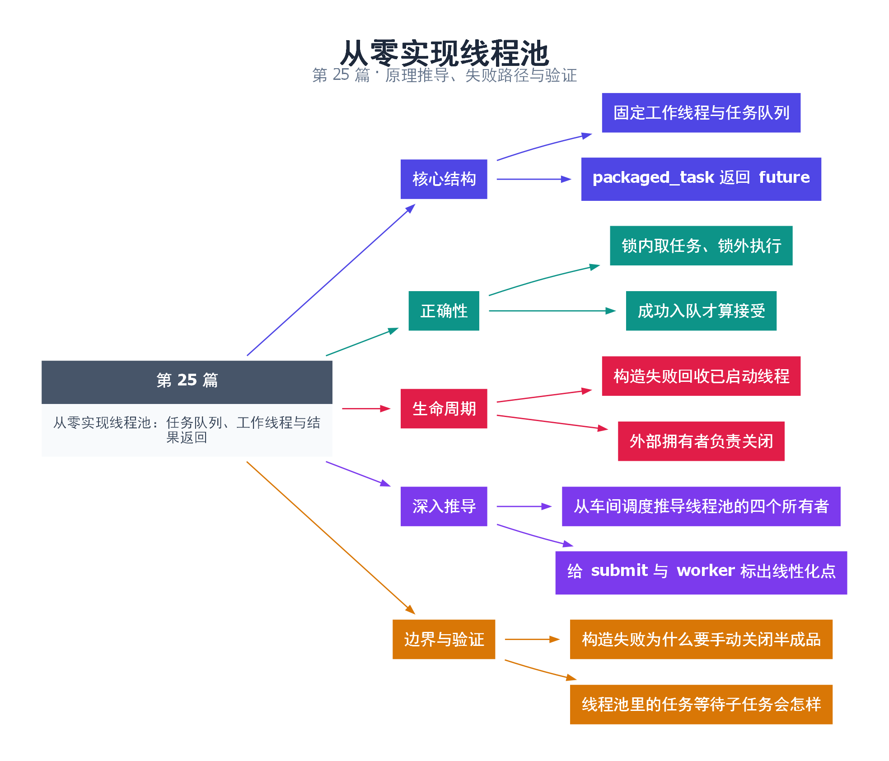

# 25｜从零实现线程池：任务队列、工作线程与结果返回

[返回总目录](README.md) · 最低标准：C++17

一句话总结：线程池的核心是工作线程、受保护的任务队列和明确关闭协议，返回 future 让调用者观察完成和异常。

**本文目录**

- [1. 固定员工处理不断到来的工作单](#section-1)
- [2. 工作循环与不变量](#section-2)
- [3. 管理边界是接口的一部分](#section-3)
- [4. 完整公共实现](#section-4)
- [5. 验证范围](#section-5)
- [6. 深入推导、反例与工程取舍](#section-6)
  - [6.1 从车间调度推导线程池的四个所有者](#depth-1)
  - [6.2 给 submit 与 worker 标出线性化点](#depth-2)
  - [6.3 构造失败为什么要手动关闭半成品](#depth-3)
  - [6.4 线程池里的任务等待子任务会怎样](#depth-4)
- [7. 完整示例与复现](#section-7)
  - [7.1 如何判断运行结果](#section-7-1)
- [8. Q&A（常见问题与解答）](#section-8)
  - [8.1 Q：为什么执行任务必须解锁？](#section-8-1)
  - [8.2 Q：子任务提交后在池里 get 安全吗？](#section-8-2)
  - [8.3 Q：可以从工作线程销毁池吗？](#section-8-3)
- [9. 引用与延伸阅读](#section-9)
- [10. 思维导图总结](#section-10)

---

<a id="section-1"></a>

## 1. 固定员工处理不断到来的工作单

每来一个任务就雇一个人，创建与交接成本可能超过任务本身。线程池固定一组员工，不断从任务箱取工作单。需要保护的是任务箱和开关状态，真正执行工作时不应继续占着任务箱的锁。

本实现只接受无参数可调用对象；参数可通过 lambda 捕获，既简化接口，也让所有权显式。submit 创建 packaged_task，获得 future，再在锁内检查停止状态和队列容量，最后入队并通知一个工作线程。成功入队是接受任务的线性化点。

<a id="section-2"></a>

## 2. 工作循环与不变量

工作者等待 stopping 或队列非空。队列非空时取出一个任务，解锁后运行；只有队列为空且停止已发生时才退出。默认 shutdown 先拒绝新任务，再让已接受任务排空。由此得到三个不变量：同一队列元素只被取出一次；用户代码不在队列锁内执行；已接受任务在正常排空关闭时不会被静默遗弃。

用户函数抛出的异常由 packaged_task 保存，不会逃出 worker 入口。队列分配失败则使 submit 抛异常，任务未被接受。构造多个线程时若中途失败，构造函数显式设置停止、唤醒并 join 已创建线程，避免 vector 中 joinable thread 在异常展开中终止进程。

<a id="section-3"></a>

## 3. 管理边界是接口的一部分

submit 支持多个生产者；shutdown 和析构由外部拥有者串行调用，不能由池中任务调用，也不能在池中任务里销毁池。否则自 join 或对象提前销毁会破坏协议。关闭可以与 submit 竞争，但拥有者必须确保调用者不在对象析构后继续调用成员。

这里不实现工作窃取、优先级、线程亲和性或自适应扩容。它们是后续架构选择，不是基本线程池正确性的前提。容量 0 表示无界，仅用于基础示例；第 27 篇展示有限容量拒绝。

<a id="section-4"></a>

## 4. 完整公共实现

以下实现保存在 [examples/pool.hpp](examples/pool.hpp)，第 25—27 篇共用。编译本篇 cpp 时编译器会从同目录找到这个头文件，不需要安装第三方库。

```cpp
#pragma once
#include <condition_variable>
#include <cstddef>
#include <functional>
#include <future>
#include <memory>
#include <mutex>
#include <queue>
#include <stdexcept>
#include <thread>
#include <type_traits>
#include <utility>
#include <vector>

// submit 可并发；shutdown 和析构只能由外部拥有者串行调用。
// 不能从池中任务调用 shutdown，任务也不能销毁所属池。
class ThreadPool {
    std::mutex mutex_;
    std::condition_variable ready_;
    std::queue<std::function<void()>> tasks_;
    std::vector<std::thread> workers_;
    bool stopping_ = false;
    std::size_t capacity_; // 0 表示不限制排队数量。
    void worker() {
        for (;;) {
            std::function<void()> task;
            {
                std::unique_lock<std::mutex> lock(mutex_);
                ready_.wait(lock,[this]{return stopping_ || !tasks_.empty();});
                if(tasks_.empty()) return;
                task=std::move(tasks_.front());
                tasks_.pop();
            }
            task(); // packaged_task 将用户异常存入 future。
        }
    }
public:
    explicit ThreadPool(std::size_t count, std::size_t capacity=0)
        : capacity_(capacity) {
        if(count==0) throw std::invalid_argument("zero workers");
        try {
            for(std::size_t i=0;i<count;++i)
                workers_.emplace_back([this]{worker();});
        } catch (...) {
            { std::lock_guard<std::mutex> lock(mutex_); stopping_=true; }
            ready_.notify_all();
            for(auto& t:workers_) if(t.joinable()) t.join();
            throw;
        }
    }
    ThreadPool(const ThreadPool&)=delete;
    ThreadPool& operator=(const ThreadPool&)=delete;
    template<class F>
    auto submit(F&& f) -> std::future<std::invoke_result_t<std::decay_t<F>&>> {
        using R=std::invoke_result_t<std::decay_t<F>&>;
        auto packaged=std::make_shared<std::packaged_task<R()>>(std::forward<F>(f));
        auto future=packaged->get_future();
        {
            std::lock_guard<std::mutex> lock(mutex_);
            if(stopping_) throw std::runtime_error("pool stopped");
            if(capacity_ && tasks_.size()>=capacity_)
                throw std::runtime_error("queue full");
            tasks_.emplace([packaged]{(*packaged)();});
        }
        ready_.notify_one();
        return future;
    }
    void shutdown(bool drain=true) {
        std::queue<std::function<void()>> abandoned;
        {
            std::lock_guard<std::mutex> lock(mutex_);
            stopping_=true;
            if(!drain) tasks_.swap(abandoned);
        }
        ready_.notify_all();
        // 在锁外销毁未启动任务，使关联 future 以 broken_promise 就绪。
        while(!abandoned.empty()) abandoned.pop();
        for(auto& t:workers_) if(t.joinable()) t.join();
    }
    ~ThreadPool() { shutdown(); }
};
```

<a id="section-5"></a>

## 5. 验证范围

示例提交 20 个平方任务和一个抛异常任务，检查平方和 2470 与异常传回。线程池析构等待剩余任务。进一步验证必须包含空池关闭、零线程参数拒绝、停止后提交拒绝和积压取消，第 26—27 篇补充这些路径。

<!-- depth:chapter -->
<a id="section-6"></a>

## 6. 深入推导、反例与工程取舍

<!-- depth:start -->
<a id="depth-1"></a>

### 6.1 从车间调度推导线程池的四个所有者

线程池像固定工人数量的车间。提交者构造任务并持有 future；队列保存尚未领取的任务；工作线程领取后独占执行包装器；共享状态连接结果提供方和接收方。把这四类所有权区分开，才能解释为什么任务出队后仍然能返回结果。

在 pool.hpp 中，mutex_ 保护 tasks_ 和 stopping_。工作线程只在等待、检查和出队期间持锁；task() 在锁外执行。若把用户函数留在锁内，一个慢任务会阻止其他工作线程出队，多个工作线程就退化成串行车间，而且回调 submit 可能重入同一把锁。

<a id="depth-2"></a>

### 6.2 给 submit 与 worker 标出线性化点

submit 在锁内检查 stopping_ 与容量，然后 emplace 成功，这时任务才被池接受。future 在这之前已经构造，但函数只有入队成功后才把它返回给调用者。若队列分配失败，异常直接交还提交者，不应该报告“已接受”。

worker 在同一把锁内把队首移动到局部并 pop，任务从“可被取消的排队任务”转为“已被领取的运行任务”。notify_one 不定义接受顺序，锁内的状态变更才定义顺序；通知即使晚于另一个提交，也不会让队列丢失元素。

<a id="depth-3"></a>

### 6.3 构造失败为什么要手动关闭半成品

创建第 k 个工作线程时可能抛异常；此前 k−1 个线程已运行并可能等待 ready_。因为构造函数未完成，ThreadPool 自身析构不会按完整对象的方式替你执行 shutdown。catch 必须发布 stopping_、notify_all、join 已创建线程，再让异常继续传播。

这也是不能只用 vector<thread> 自动析构来兜底的原因：其中任何 joinable thread 析构都会 terminate。构造的异常安全不仅是回收已分配内存，还包括解除已经启动的执行流对半成品 this 的访问。

<a id="depth-4"></a>

### 6.4 线程池里的任务等待子任务会怎样

池只有一个工作线程，任务 A 提交任务 B 后调用 B 的 future.get。B 在队列里等工作线程，唯一工作线程却卡在 A 中，形成资源死锁。扩到 P 个线程后，P 个父任务都这样等待也一样会死锁。

| 策略 | 可以解决什么 | 新增成本 |
|---|---|---|
| 禁止池内阻塞等待子任务 | 简化依赖图 | 调用者需调整结构 |
| 完成后续接任务 | 不占着线程等 | continuation 生命周期管理 |
| 等待时帮助执行任务 | 某些依赖可前进 | 重入、栈深度和调度语义 |

本实现选择简单固定线程池，没有帮助执行与工作窃取。验证重点是任务恰好执行一次、异常可从 future 取回、关闭后拒绝提交；不能把示例总和正确当作任意嵌套任务依赖都安全。
<!-- depth:end -->

<a id="section-7"></a>

## 7. 完整示例与复现

源文件：[examples/25.cpp](examples/25.cpp)。在本系列目录运行以下命令；环境准备见 [实验环境](实验环境与验证.md)。

```bash
g++ -std=c++17 -O2 -Wall -Wextra -pedantic -pthread examples/25.cpp -o demo25
./demo25
```

```cpp
#include "pool.hpp"
#include <cassert>
#include <iostream>
int main() {
    ThreadPool pool(3);
    std::vector<std::future<int>> results;
    for(int i=0;i<20;++i) results.push_back(pool.submit([i]{return i*i;}));
    auto failed=pool.submit([]()->int {throw std::runtime_error("task error");});
    int sum=0; for(auto& f:results) sum+=f.get();
    assert(sum==2470);
    bool caught=false;
    try { (void)failed.get(); } catch(const std::runtime_error&) { caught=true; }
    assert(caught);
    std::cout << "sum=" << sum << " exception propagated\n";
}
```

<a id="section-7-1"></a>

### 7.1 如何判断运行结果

输出 `sum=2470 exception propagated`。公共头文件须与 cpp 保持在同一 examples 目录。

<a id="section-8"></a>

## 8. Q&A（常见问题与解答）

<a id="section-8-1"></a>

### 8.1 Q：为什么执行任务必须解锁？

A：用户代码可能很慢、再次提交任务或获取其他锁，持有队列锁执行会串行化工作并增加死锁风险。

<a id="section-8-2"></a>

### 8.2 Q：子任务提交后在池里 get 安全吗？

A：有限工作线程可能全部等待排队子任务而死锁；应避免这种依赖或使用支持帮助执行的专门调度设计。

<a id="section-8-3"></a>

### 8.3 Q：可以从工作线程销毁池吗？

A：本实现不允许。池的管理者应在外部停止提交并关闭，避免自 join 和访问已销毁对象。

<a id="section-9"></a>

## 9. 引用与延伸阅读

- [C++20 工作草案：线程支持库](https://timsong-cpp.github.io/cppwp/n4861/thread)

规范链接采用固定的 C++20 工作草案 N4861；对较早标准的差异以正文标注为准。示例和分析为本系列自编，规范用于核对接口契约。

<a id="section-10"></a>

## 10. 思维导图总结

```text
从零实现线程池：任务队列、工作线程与结果返回
├── 核心结构
│   ├── 固定工作线程与任务队列
│   └── packaged_task 返回 future
├── 正确性
│   ├── 锁内取任务、锁外执行
│   └── 成功入队才算接受
├── 生命周期
│   ├── 构造失败回收已启动线程
│   └── 外部拥有者负责关闭
├── 深入推导
│   ├── 从车间调度推导线程池的四个所有者
│   └── 给 submit 与 worker 标出线性化点
└── 边界与验证
    ├── 构造失败为什么要手动关闭半成品
    └── 线程池里的任务等待子任务会怎样
```



[Graphviz 源文件](images/25.dot)
