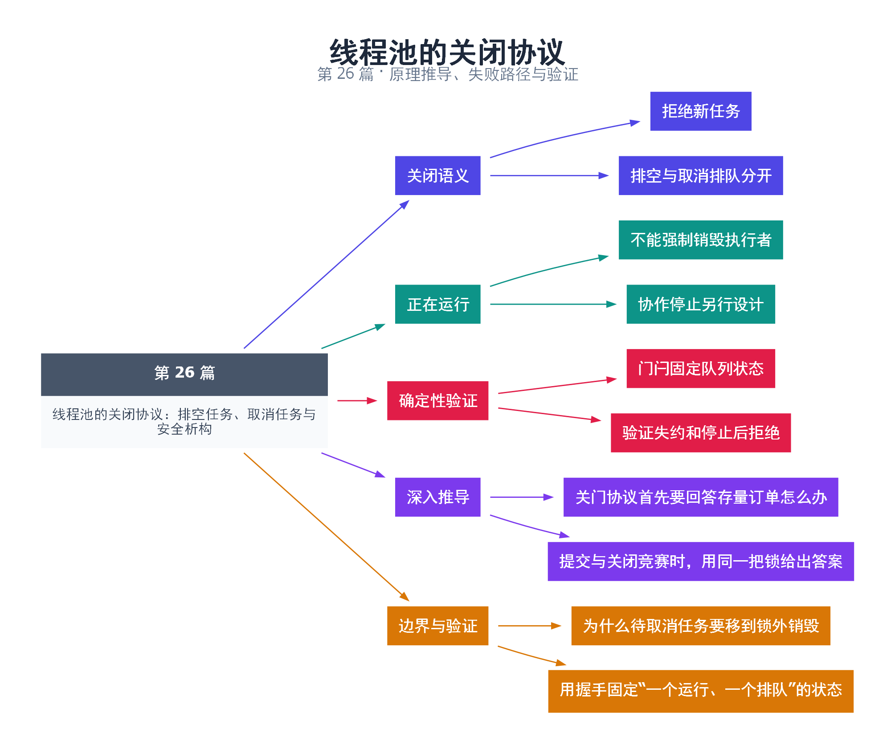

# 26｜线程池的关闭协议：排空任务、取消任务与安全析构

[返回总目录](README.md) · 最低标准：C++20

一句话总结：排空、取消排队和停止正在运行的任务是三种不同动作，线程池关闭必须明确它们各自的效果。

**本文目录**

- [1. 餐馆打烊时怎样处理订单](#section-1)
- [2. 为什么在锁外销毁被取消任务](#section-2)
- [3. 用门闩构造确定性的取消测试](#section-3)
- [4. 状态与接口契约](#section-4)
- [5. 深入推导、反例与工程取舍](#section-5)
  - [5.1 关门协议首先要回答存量订单怎么办](#depth-1)
  - [5.2 提交与关闭竞赛时，用同一把锁给出答案](#depth-2)
  - [5.3 为什么待取消任务要移到锁外销毁](#depth-3)
  - [5.4 用握手固定“一个运行、一个排队”的状态](#depth-4)
- [6. 完整示例与复现](#section-6)
  - [6.1 如何判断运行结果](#section-6-1)
- [7. Q&A（常见问题与解答）](#section-7)
  - [7.1 Q：取消排队能阻止刚刚被取出的任务吗？](#section-7-1)
  - [7.2 Q：broken_promise 是否等于业务取消？](#section-7-2)
  - [7.3 Q：shutdown 返回后还能 submit 吗？](#section-7-3)
- [8. 引用与延伸阅读](#section-8)
- [9. 思维导图总结](#section-9)

---

<a id="section-1"></a>

## 1. 餐馆打烊时怎样处理订单

打烊首先停止接新单；已经接的单可以全部做完，也可以撤销尚未开做的单；锅里正在炒的菜不能靠撕掉点菜单就自动停止。线程池 shutdown 的设计应同样区分接受、排队、运行和完成四个状态。

本系列池的 `shutdown(true)` 拒绝新提交并排空；`shutdown(false)` 清空尚在队列里的任务，但等待已经取出的任务完成。清空边界由队列互斥锁决定：关闭线程拿锁前已被工作者取出的任务属于运行集合，不能算取消成功。

<a id="section-2"></a>

## 2. 为什么在锁外销毁被取消任务

取消时将队列与局部 abandoned 交换，解锁后再销毁。这样 packaged_task 的共享状态进入 broken_promise，不需要长时间持队列锁；被捕获对象的析构也可能包含业务逻辑，不应在内部锁下执行未知代码。

用户函数主动响应停止令牌是另一层协议。本实现没有把取消运行中任务伪装成已经支持的功能；若运行任务永不返回，shutdown 也不会返回。超时只能改变等待策略，不能让仍在使用池对象的线程安全地消失。

<a id="section-3"></a>

## 3. 用门闩构造确定性的取消测试

示例用单工作线程。第一个任务先报告已开始，再等待 release future；这时第二个任务必定停留在队列。外部关闭线程执行取消，第二个 future 的 get 收到 broken_promise；随后主线程释放第一个任务，关闭才完成。

这个测试不靠 sleep 猜“第二个任务应该还没开始”，而是构造确定依赖。release 的异常路径也要考虑：若测试提前抛异常而不释放门闩，关闭线程析构就可能一直等待。本例关键路径使用断言确认预期，不用可恢复异常来跳过释放。

<a id="section-4"></a>

## 4. 状态与接口契约

| 状态 | submit | 队列任务 | 已运行任务 |
|---|---|---|---|
| 运行中 | 接受 | 等待调度 | 执行 |
| 排空关闭 | 拒绝 | 执行完 | 等待结束 |
| 取消排队关闭 | 拒绝 | 销毁并通知结果失约 | 仍等待结束 |
| 已关闭 | 拒绝 | 空 | 已回收 |

对象寿命仍由调用者保证：析构前应停止所有生产者，不能让线程拿着裸指针在池已经销毁后继续 submit。

<!-- depth:chapter -->
<a id="section-5"></a>

## 5. 深入推导、反例与工程取舍

<!-- depth:start -->
<a id="depth-1"></a>

### 5.1 关门协议首先要回答存量订单怎么办

关闭餐馆有两种语义：停止接单但做完已接订单，或撤掉尚未开做的订单。映射到线程池，排空关闭保留队列，让工人执行完；取消关闭移除排队任务，但已出队的任务继续执行。两种方式都不能凭空中断正在运行的 C++ 函数。

| 阶段 | 新提交 | 排队任务 | 已领取任务 |
|---|---|---|---|
| 运行 | 接受或因满而拒绝 | 等待工作线程 | 执行 |
| 排空关闭 | 拒绝 | 继续领取 | 执行完再退出 |
| 取消关闭 | 拒绝 | 销毁并完成错误通道 | 执行完再退出 |

<a id="depth-2"></a>

### 5.2 提交与关闭竞赛时，用同一把锁给出答案

如果 submit 先拿到 mutex 并成功入队，再轮到 shutdown，那么该任务已被接受，由选择的关闭策略处理。若 shutdown 先设置 stopping_，后来的 submit 就抛 pool stopped。这里不以调用开始的墙上时间判定，而以受锁保护的状态转移判定。

把 stopping_ 改成 atomic 后在锁外检查，并不能自动保持这个边界：提交者可能读到 false，关闭方完成清理，提交者随后又入队，任务再无人执行。若为了性能调整锁范围，必须重新证明“检查停止”和“加入任务”之间没有关闭窗口。

<a id="depth-3"></a>

### 5.3 为什么待取消任务要移到锁外销毁

任务析构会销毁它捕获的对象；这些对象的析构可能很慢，甚至调用其他持锁代码。pool.hpp 在锁内只把任务队列 swap 给局部 abandoned，随后在锁外释放各任务，既缩短临界区，也避免在内部锁下执行不可控析构逻辑。

被丢弃的 packaged_task 使 future 以 broken_promise 就绪。取消方应完成这一步，而不是让外部等待者永久卡住。对于已被 worker 领取的任务，关闭方已经没有排队所有权；即使函数体尚未真正开始执行，也属于本实现不再取消的集合。

<a id="depth-4"></a>

### 5.4 用握手固定“一个运行、一个排队”的状态

本例只有一个工人。第一个任务用 started 报告已进入，再等 release；主线程收到 started 后提交第二个任务，因此第二个必定排队。关闭线程调用 shutdown(false)，主线程确认 pending.get 得到 broken_promise 后才 release 第一个任务，最后检查运行结果和拒绝提交。

这个顺序比 sleep(100ms) 后猜测任务在哪个阶段可靠。还要注意 shutdown 并发调用不受支持：两个外部线程同时 join 同一个 thread 对象并不安全。本例要求关闭和析构由外部拥有者串行管理；析构前停止所有提交者，不能用 stopping_ 标志替代对象存活协议。
<!-- depth:end -->

<a id="section-6"></a>

## 6. 完整示例与复现

源文件：[examples/26.cpp](examples/26.cpp)。在本系列目录运行以下命令；环境准备见 [实验环境](实验环境与验证.md)。

```bash
g++ -std=c++20 -O2 -Wall -Wextra -pedantic -pthread examples/26.cpp -o demo26
./demo26
```

```cpp
#include "pool.hpp"
#include <cassert>
#include <iostream>
int main() {
    ThreadPool pool(1);
    std::promise<void> started,release;
    auto entered=started.get_future();
    auto gate=release.get_future().share();
    auto running=pool.submit([&started,gate]{started.set_value(); gate.wait(); return 1;});
    entered.wait();
    auto pending=pool.submit([]{return 2;});
    std::jthread closer([&]{pool.shutdown(false);});
    bool canceled=false;
    try { (void)pending.get(); }
    catch(const std::future_error& e) {
        canceled=e.code()==std::make_error_code(std::future_errc::broken_promise);
    }
    release.set_value();
    closer.join();
    assert(canceled && running.get()==1);
    bool rejected=false;
    try { (void)pool.submit([]{}); } catch(const std::runtime_error&) { rejected=true; }
    assert(rejected);
    std::cout << "queued canceled; running completed; submit rejected\n";
}
```

<a id="section-6-1"></a>

### 6.1 如何判断运行结果

输出 `queued canceled; running completed; submit rejected`。第 25 篇公共头文件实现关闭逻辑。

<a id="section-7"></a>

## 7. Q&A（常见问题与解答）

<a id="section-7-1"></a>

### 7.1 Q：取消排队能阻止刚刚被取出的任务吗？

A：不能，取出与清空由同一锁确定顺序，已取出的任务属于运行状态。

<a id="section-7-2"></a>

### 7.2 Q：broken_promise 是否等于业务取消？

A：本实现用它表达未执行就销毁，生产接口可提供更明确的取消结果类型，避免与生产者意外失效混淆。

<a id="section-7-3"></a>

### 7.3 Q：shutdown 返回后还能 submit 吗？

A：本实现会拒绝；需要重新启动应创建新的池，而不是重置内部停止标志。

<a id="section-8"></a>

## 8. 引用与延伸阅读

- [深化实验与验证](深化实验与验证.md)：完整协议测试、运行命令、预期断言和未覆盖边界。

- [C++20 工作草案：线程支持库](https://timsong-cpp.github.io/cppwp/n4861/thread)

规范链接采用固定的 C++20 工作草案 N4861；对较早标准的差异以正文标注为准。示例和分析为本系列自编，规范用于核对接口契约。

<a id="section-9"></a>

## 9. 思维导图总结

```text
线程池的关闭协议：排空任务、取消任务与安全析构
├── 关闭语义
│   ├── 拒绝新任务
│   └── 排空与取消排队分开
├── 正在运行
│   ├── 不能强制销毁执行者
│   └── 协作停止另行设计
├── 确定性验证
│   ├── 门闩固定队列状态
│   └── 验证失约和停止后拒绝
├── 深入推导
│   ├── 关门协议首先要回答存量订单怎么办
│   └── 提交与关闭竞赛时，用同一把锁给出答案
└── 边界与验证
    ├── 为什么待取消任务要移到锁外销毁
    └── 用握手固定“一个运行、一个排队”的状态
```



[Graphviz 源文件](images/26.dot)
