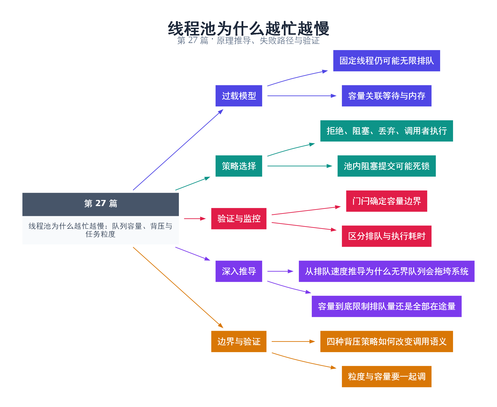

# 27｜线程池为什么越忙越慢：队列容量、背压与任务粒度

[返回总目录](README.md) · 最低标准：C++17

一句话总结：线程池必须限制排队量并把过载反馈给上游，否则固定线程数仍可能带来无限内存和不可接受的排队延迟。

**本文目录**

- [1. 固定厨师不代表订单可以无限堆](#section-1)
- [2. 本实现采用立即拒绝](#section-2)
- [3. 确定性验证容量](#section-3)
- [4. 任务粒度与监控](#section-4)
- [5. 深入推导、反例与工程取舍](#section-5)
  - [5.1 从排队速度推导为什么无界队列会拖垮系统](#depth-1)
  - [5.2 容量到底限制排队量还是全部在途量](#depth-2)
  - [5.3 四种背压策略如何改变调用语义](#depth-3)
  - [5.4 粒度与容量要一起调](#depth-4)
- [6. 完整示例与复现](#section-6)
  - [6.1 如何判断运行结果](#section-6-1)
- [7. Q&A（常见问题与解答）](#section-7)
  - [7.1 Q：队列容量应等于线程数吗？](#section-7-1)
  - [7.2 Q：无限重试被拒任务可行吗？](#section-7-2)
  - [7.3 Q：排队任务数低就代表健康吗？](#section-7-3)
- [8. 引用与延伸阅读](#section-8)
- [9. 思维导图总结](#section-9)

---

<a id="section-1"></a>

## 1. 固定厨师不代表订单可以无限堆

三位厨师每秒只能完成固定数量订单，门口无限接单不会提高出餐能力，只会延长等待并堆积食材。线程池把线程数限制住，却仍可能因为无界任务队列耗尽内存。任务捕获的大对象也会占内存，不能只看队列节点大小。

稳定系统中 Little 定律可写成 L=λW：平均在系统内任务数等于平均到达率乘平均停留时间。它需要统计区间与系统边界一致，并不意味着过载增长阶段也可以盲目套用稳态公式。持续到达率超过处理率时，应减少接受量或扩展真正瓶颈。

<a id="section-2"></a>

## 2. 本实现采用立即拒绝

第 25 篇 ThreadPool 的 capacity 限制的是排队任务数量，不包含已经运行的任务。submit 发现队列满便抛出 queue full。这样调用方可以降级、限流或稍后重试，而不是在内部无限等待。

阻塞提交也是一种策略，但若池中任务提交子任务时队列已满，所有工作者可能堵在提交上，再也没人消费队列。Caller-runs 把任务交给提交者执行，能施加自然背压，却改变调用线程和延迟语义，持锁调用尤其危险。

| 满队列策略 | 效果 | 必须说明 |
|---|---|---|
| 立即拒绝 | 延迟可控、上游可决策 | 错误如何处理 |
| 等待空间 | 限制生产速度 | 超时、停止和重入 |
| 丢弃 | 保护系统容量 | 哪类任务允许丢、如何计数 |
| 调用者执行 | 把负载回传上游 | 执行线程语义改变 |

<a id="section-3"></a>

## 3. 确定性验证容量

示例固定一个正在等待门闩的运行任务，队列容量为 1；第二个任务填满队列，第三个提交必然被拒绝。释放门闩后，前两个任务完成。这样验证的是容量定义，而不是一次随机压力下“似乎有拒绝”。

<a id="section-4"></a>

## 4. 任务粒度与监控

任务太小，队列锁与 future 分配占比高；任务太大，又会使负载不均和取消响应变差。应记录队列深度、接受率、拒绝率、排队时间和执行时间分布。按业务可接受等待倒推容量，不能只按机器内存选一个巨大的数字。

<!-- depth:chapter -->
<a id="section-5"></a>

## 5. 深入推导、反例与工程取舍

<!-- depth:start -->
<a id="depth-1"></a>

### 5.1 从排队速度推导为什么无界队列会拖垮系统

设任务到达率为 λ，平均完成能力为 μ，持续 λ>μ 时，积压量大致按 (λ−μ)t 增长。若每秒到达 1200 项，只能处理 1000 项，十秒就净增约 2000 项。这是忽略随机波动的说明性模型，不是本机测量。

在稳定系统且统计口径一致时，Little 定律 L=λW 关联平均在途数量、有效到达率和平均停留时间。例如稳定完成 1000 项/秒、平均端到端 0.1 秒，对应平均在途约 100 项。它不直接给出 p99，也不能套在无限积压的非稳态区间里预测稳定延迟。

<a id="depth-2"></a>

### 5.2 容量到底限制排队量还是全部在途量

本实现 capacity_ 只检查 tasks_.size，不含已经领取的任务。P 个工人、容量 K 时，系统内已经接受但未完成的任务最多可达 K+P，前提是不计任务自己派生的外部工作。每项捕获一个巨大对象时，仅限制数量仍可能吃掉很多内存。

如果服务真正受内存预算约束，应考虑按估计字节数或资源权重计费；对无法估计大小的任务，至少限制输入大小，并记录队列高水位。任务在成功入队前构造的临时对象，也会在多个并发提交者之间占用额外内存。

<a id="depth-3"></a>

### 5.3 四种背压策略如何改变调用语义

| 策略 | 好处 | 需要承担的失败模式 |
|---|---|---|
| 立即拒绝 | 内存和响应时间易控制 | 上游必须处理失败 |
| 阻塞提交 | 把压力传回生产者 | 池内提交可能耗尽全部工人 |
| 调用者执行 | 利用提交线程消化负载 | 延迟、重入和线程亲和性改变 |
| 丢弃/合并 | 适合可替代的统计或刷新 | 必须明确哪些信息可丢 |

重试必须有预算和退避；收到 queue full 就无限快速重试，会把过载变成 CPU 消耗，并制造更多竞争。本系列采用立即抛异常的简单策略，调用者可以据此拒绝请求或减速。

<a id="depth-4"></a>

### 5.4 粒度与容量要一起调

设一次排队分发成本为 h，一批处理 B 个元素、每元素成本 c，则分发摊销比例约为 h/(Bc+h)。增加 B 可降低该比例，却让其他任务更久拿不到工人，并增大取消响应间隔。不要只看平均吞吐，还要记录最长批次和尾延迟。

本例用握手让唯一工人被占用，再填满一个队列槽，第三次提交必须被拒绝。这验证的是容量边界，而非长期稳定吞吐。负载实验应逐渐提高到达率，记录接受率、拒绝率、队列深度和端到端延迟；只统计成功请求的低延迟，会掩盖大量拒绝的事实。
<!-- depth:end -->

<a id="section-6"></a>

## 6. 完整示例与复现

源文件：[examples/27.cpp](examples/27.cpp)。在本系列目录运行以下命令；环境准备见 [实验环境](实验环境与验证.md)。

```bash
g++ -std=c++17 -O2 -Wall -Wextra -pedantic -pthread examples/27.cpp -o demo27
./demo27
```

```cpp
#include "pool.hpp"
#include <cassert>
#include <iostream>
int main() {
    ThreadPool pool(1,1);
    std::promise<void> started,release;
    auto entered=started.get_future();
    auto gate=release.get_future().share();
    auto a=pool.submit([&started,gate]{started.set_value(); gate.wait(); return 1;});
    entered.wait();
    auto b=pool.submit([]{return 2;});
    bool rejected=false;
    try { (void)pool.submit([]{return 3;}); }
    catch(const std::runtime_error& e) { rejected=std::string(e.what())=="queue full"; }
    release.set_value();
    assert(rejected && a.get()+b.get()==3);
    pool.shutdown();
    std::cout << "capacity enforced\n";
}
```

<a id="section-6-1"></a>

### 6.1 如何判断运行结果

输出 `capacity enforced`；容量 1 表示一个排队任务，另有一个可正在运行。

<a id="section-7"></a>

## 7. Q&A（常见问题与解答）

<a id="section-7-1"></a>

### 7.1 Q：队列容量应等于线程数吗？

A：没有通用关系，应依据到达突发、任务耗时、内存和等待预算共同决定。

<a id="section-7-2"></a>

### 7.2 Q：无限重试被拒任务可行吗？

A：可能放大过载。重试要有次数、退避和总截止时间，并避免同一请求重复执行副作用。

<a id="section-7-3"></a>

### 7.3 Q：排队任务数低就代表健康吗？

A：也可能全部线程卡在长任务，必须同时看执行时长、完成率和尾延迟。

<a id="section-8"></a>

## 8. 引用与延伸阅读

- [深化实验与验证](深化实验与验证.md)：完整协议测试、运行命令、预期断言和未覆盖边界。

- [C++20 工作草案：线程支持库](https://timsong-cpp.github.io/cppwp/n4861/thread)

规范链接采用固定的 C++20 工作草案 N4861；对较早标准的差异以正文标注为准。示例和分析为本系列自编，规范用于核对接口契约。

<a id="section-9"></a>

## 9. 思维导图总结

```text
线程池为什么越忙越慢：队列容量、背压与任务粒度
├── 过载模型
│   ├── 固定线程仍可能无限排队
│   └── 容量关联等待与内存
├── 策略选择
│   ├── 拒绝、阻塞、丢弃、调用者执行
│   └── 池内阻塞提交可能死锁
├── 验证与监控
│   ├── 门闩确定容量边界
│   └── 区分排队与执行耗时
├── 深入推导
│   ├── 从排队速度推导为什么无界队列会拖垮系统
│   └── 容量到底限制排队量还是全部在途量
└── 边界与验证
    ├── 四种背压策略如何改变调用语义
    └── 粒度与容量要一起调
```



[Graphviz 源文件](images/27.dot)
