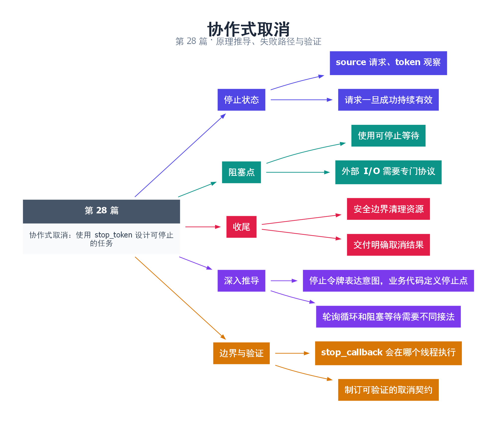

# 28｜协作式取消：使用 stop_token 设计可停止的任务

[返回总目录](README.md) · 最低标准：C++20

一句话总结：可取消任务需要共享停止状态、可中断等待和清理边界，stop_token 只是这套协议中的信号载体。

**本文目录**

- [1. 停止请求像交接通知](#section-1)
- [2. 停止必须覆盖阻塞点](#section-2)
- [3. 取消和正常完成之间的竞争](#section-3)
- [4. 深入推导、反例与工程取舍](#section-4)
  - [4.1 停止令牌表达意图，业务代码定义停止点](#depth-1)
  - [4.2 轮询循环和阻塞等待需要不同接法](#depth-2)
  - [4.3 stop_callback 会在哪个线程执行](#depth-3)
  - [4.4 制订可验证的取消契约](#depth-4)
- [5. 完整示例与复现](#section-5)
  - [5.1 如何判断运行结果](#section-5-1)
- [6. Q&A（常见问题与解答）](#section-6)
  - [6.1 Q：停止请求早于 wait 会丢失吗？](#section-6-1)
  - [6.2 Q：stop_callback 可以获取锁吗？](#section-6-2)
  - [6.3 Q：取消后应抛异常还是返回状态？](#section-6-3)
- [7. 引用与延伸阅读](#section-7)
- [8. 思维导图总结](#section-8)

---

<a id="section-1"></a>

## 1. 停止请求像交接通知

主管要求收工，员工可以完成手中不可拆分的小步骤，再归还工具退出。协作式取消允许程序在保持不变量的位置停下；强行终止可能把事务、锁和资源留在不一致状态。

stop_source 发出请求，stop_token 观察请求，stop_callback 在请求发生时执行通知逻辑。第一次成功请求后，状态保持为已请求，不能撤销。回调可能在发出请求的线程中同步执行，因此不应做长时间工作，也要避免在持锁 request_stop 时回调又获取同一锁。

<a id="section-2"></a>

## 2. 停止必须覆盖阻塞点

普通循环检查适合短计算块，但线程睡在条件变量时不会主动回来检查。C++20 condition_variable_any 提供带 stop_token 的等待重载，使等待可以因停止请求结束。返回的布尔值对应业务谓词是否满足，不能把“返回”一律等同于成功取到工作。

本例谓词恒为 false，表示没有业务工作；线程声明已启动后进入可停止等待。主线程请求停止，不论请求发生在进入等待前还是之后，等待都能观察停止状态并返回 false。这里故意覆盖“停止先发生”的时序，而不使用 sleep 伪造保证。

<a id="section-3"></a>

## 3. 取消和正常完成之间的竞争

若业务谓词在停止同时变真，应明确政策：优先处理已就绪工作，还是优先退出。本例无业务工作，不涉及这个选择。队列应用可以选择先检查停止并取消，也可以选择排空；协议要在文档和实现中一致。

| 工作形态 | 取消方式 | 最坏延迟来源 |
|---|---|---|
| 分块计算 | 每块检查 token | 单块耗时 |
| 可停止等待 | token 重载或回调唤醒 | 调度和清理 |
| 外部阻塞 I/O | 超时、取消接口、关闭通道 | 外部接口保证 |

结束前要释放锁、关闭拥有的资源并交付结果状态。被取消应有明确结果，不能让 future 永远未就绪。共享停止源还可用于一组任务，但传播策略要避免无关任务被过度取消。

<!-- depth:chapter -->
<a id="section-4"></a>

## 4. 深入推导、反例与工程取舍

<!-- depth:start -->
<a id="depth-1"></a>

### 4.1 停止令牌表达意图，业务代码定义停止点

让厨师停止接下一道菜，比在挥刀中途强行冻结他更容易保持安全。协作取消也是如此：线程在能够保持不变量的位置检查令牌，完成必要清理后返回。停止请求不可撤销，也不保证所有任务同时退出。

若一次工作包含准备、提交、清理三个阶段，可在准备前或提交前检查停止；一旦不可逆提交已完成，不能把结果简单报告为“什么都没发生”。接口应区分未开始取消、处理中取消和已完成，避免调用者因超时重试而重复产生副作用。

<a id="depth-2"></a>

### 4.2 轮询循环和阻塞等待需要不同接法

计算循环可以每处理一批检查 stop_requested，取消延迟由批次长度和调度决定。阻塞在普通 cv.wait、文件读取或第三方库内部时，循环没有机会检查令牌。必须把停止接入该阻塞机制，例如使用本例 condition_variable_any 的 stop_token 重载，或底层 I/O 的取消接口。

本例谓词始终为 false，返回 false 且 token 已停止表明等待被取消；真实队列里谓词可能恰好同时变为 true，必须根据接口返回值和业务优先级决定先处理工作还是退出，不能把任意返回都解释为“收到一条任务”。

<a id="depth-3"></a>

### 4.3 stop_callback 会在哪个线程执行

已经登记的回调可由成功请求停止的线程同步调用；若登记时停止已请求，回调可能在登记方线程立即执行。因此 request_stop 看起来只是“改标志”，却可能执行用户回调并花费时间。

回调应短小、避免抛异常，不要获取请求者正持有的同一把锁。回调对象析构还可能等待其他线程中已启动的回调结束；因此持锁销毁 callback、而 callback 正等这把锁，也会死锁。把回调当作普通异步通知而忽略其执行上下文，是常见误区。

<a id="depth-4"></a>

### 4.4 制订可验证的取消契约

| 问题 | 必须明确的答案 |
|---|---|
| 谁能请求停止 | 外部拥有者或共享 stop_source 的指定参与者 |
| 什么使阻塞解除 | 带停止令牌的等待或显式取消 I/O |
| 已入队工作怎么办 | 排空、取消或按类型分别处理 |
| 结果如何表示 | 正常值、明确取消状态或异常 |

本例用 promise 确认工作线程已进入持锁区域，再发停止请求；支持令牌的 wait 负责处理请求与入睡相互交错的情况。不能把它替换成“检查一次 stop_requested，然后普通 wait”，后者会重新产生检查与入睡之间的漏唤醒窗口。最后 join 才证明工作线程不再使用相关资源。
<!-- depth:end -->

<a id="section-5"></a>

## 5. 完整示例与复现

源文件：[examples/28.cpp](examples/28.cpp)。在本系列目录运行以下命令；环境准备见 [实验环境](实验环境与验证.md)。

```bash
g++ -std=c++20 -O2 -Wall -Wextra -pedantic -pthread examples/28.cpp -o demo28
./demo28
```

```cpp
#include <cassert>
#include <condition_variable>
#include <future>
#include <iostream>
#include <mutex>
#include <thread>
int main() {
    std::mutex mutex;
    std::condition_variable_any cv;
    std::promise<void> started;
    auto ready=started.get_future();
    bool interrupted=false;
    std::jthread worker([&](std::stop_token token) {
        std::unique_lock<std::mutex> lock(mutex);
        started.set_value();
        bool has_work=cv.wait(lock,token,[]{return false;});
        interrupted=!has_work && token.stop_requested();
    });
    ready.wait();
    worker.request_stop();
    worker.join();
    assert(interrupted);
    std::cout << "wait interrupted by stop\n";
}
```

<a id="section-5-1"></a>

### 5.1 如何判断运行结果

输出 `wait interrupted by stop`，在停止请求先于或晚于等待注册时均应结束。

<a id="section-6"></a>

## 6. Q&A（常见问题与解答）

<a id="section-6-1"></a>

### 6.1 Q：停止请求早于 wait 会丢失吗？

A：停止状态会保留，可停止等待会检查它，因此不是只依赖一次瞬时通知。

<a id="section-6-2"></a>

### 6.2 Q：stop_callback 可以获取锁吗？

A：必须分析调用线程和锁顺序；request_stop 可能同步执行回调，持同一锁发请求会导致重入死锁。

<a id="section-6-3"></a>

### 6.3 Q：取消后应抛异常还是返回状态？

A：两者都可，取决于业务接口，但必须明确区分正常结果、取消和故障，并完成结果交付。

<a id="section-7"></a>

## 7. 引用与延伸阅读

- [可停止条件变量等待](https://timsong-cpp.github.io/cppwp/n4861/thread.condition.condvarany)
- [停止令牌](https://timsong-cpp.github.io/cppwp/n4861/thread.stoptoken)

规范链接采用固定的 C++20 工作草案 N4861；对较早标准的差异以正文标注为准。示例和分析为本系列自编，规范用于核对接口契约。

<a id="section-8"></a>

## 8. 思维导图总结

```text
协作式取消：使用 stop_token 设计可停止的任务
├── 停止状态
│   ├── source 请求、token 观察
│   └── 请求一旦成功持续有效
├── 阻塞点
│   ├── 使用可停止等待
│   └── 外部 I/O 需要专门协议
├── 收尾
│   ├── 安全边界清理资源
│   └── 交付明确取消结果
├── 深入推导
│   ├── 停止令牌表达意图，业务代码定义停止点
│   └── 轮询循环和阻塞等待需要不同接法
└── 边界与验证
    ├── stop_callback 会在哪个线程执行
    └── 制订可验证的取消契约
```



[Graphviz 源文件](images/28.dot)
