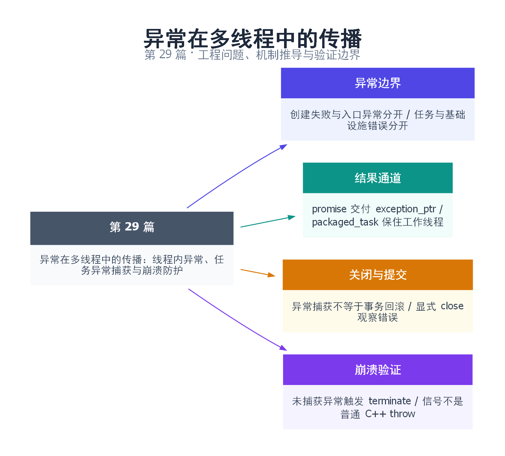

# 29｜异常在多线程中的传播：线程内异常、任务异常捕获与崩溃防护

[返回总目录](README.md) · 最低标准：C++17

一句话总结：在线程与任务边界交付错误，同时保证状态不变量和资源回收。

快速阅读：先看问题、方案对比和运行结果；深入阅读：按顺序推演边界，再运行完整示例及失败实验。

**本文目录**

- [1. 异常不会沿着线程创建关系自动飞回父线程](#section-1)
- [2. 四种失败发生在不同层，不能只写一个 catch](#section-2)
- [3. 裸线程桥接：exception_ptr 与 promise 是结果通道](#section-3)
- [4. 通用工作线程为何不能被一项任务带走](#section-4)
- [5. 捕获异常不等于回滚，也不等于保住全部数据](#section-5)
- [6. 故意验证 terminate，同时避免把它混入成功测试](#section-6)
- [7. 验证矩阵与上线前检查](#section-7)
- [8. Q&A 与延伸阅读](#section-8)
- [9. 思维导图总结](#section-9)

---

<a id="section-1"></a>

## 1. 异常不会沿着线程创建关系自动飞回父线程

线程像独立接单的工人，try/catch 像每人自己的接单窗口。主线程在门口登记工人，并不意味着工人在车间抛出的异常能穿过另一条调用栈回到登记处。**从线程入口逸出的 C++ 异常会触发 std::terminate；创建方包住 thread 构造的 catch，处理的是创建阶段失败，不是稍后的任务失败。**[C++ 线程构造与入口调用契约](https://timsong-cpp.github.io/cppwp/n4861/thread.thread.constr)

前面的 async/future 章节介绍了自动存储异常的共享状态。本篇把失败边界扩展到裸线程、通用线程池、析构关闭和服务崩溃，核心目标是让每项任务恰好有一个可观察的结束结果，并确保错误路径仍回收线程。

<a id="section-2"></a>

## 2. 四种失败发生在不同层，不能只写一个 catch

| 失败位置 | 谁能观察 | 必须安排的动作 |
|---|---|---|
| thread 构造/参数复制 | 创建方调用栈 | 关闭已创建线程，释放半成品 |
| 任务函数体 | 当前工作线程 | 捕获并完成结果通道，或明确终止 |
| 入队/分配共享状态 | submit 调用者 | 不报告已接受，给出失败结果 |
| 文件/网络/关闭阶段 | 资源拥有者 | 停止接单、唤醒等待者、保存错误 |

还要区分线程运行异常与 join 使用错误：重复 join、自 join、对象被并发操作等不是普通业务任务失败，应修复生命周期协议。把所有错误 catch 后继续循环，会把程序置于更难诊断的半关闭状态。

`std::bad_alloc` 也不能被简单处理成“打印一条动态字符串日志再重试”。异常处理本身可能再分配、拿锁或阻塞。诊断路径应有最低限度的失败方案，监控“异常处理失败”与“错误被吞掉”的次数。

<a id="section-3"></a>

## 3. 裸线程桥接：exception_ptr 与 promise 是结果通道

exception_ptr 可以保存当前异常并在另一条线程重抛；对象的跨线程交接仍需同步。用普通共享 exception_ptr 让一个线程写、另一个在线读取是不安全的；可以在 join 后读取，或用锁/共享状态交付。

promise::set_exception 把错误存入 future 对应的共享状态，接收方 get 时重抛。任务只要完成一次：正常返回 set_value，失败 set_exception，取消则完成显式取消结果或通过明确的放弃语义结束。等待方不能因为错误路径漏了完成动作而永久挂起。

完整源文件：[examples/29.cpp](examples/29.cpp)。

```cpp
#include "pool.hpp"
#include <cassert>
#include <cstdlib>
#include <exception>
#include <future>
#include <iostream>
#include <stdexcept>
#include <string>
#include <thread>

int main(int argc, char** argv) {
    if (argc == 2 && std::string(argv[1]) == "--terminate") {
        std::set_terminate([] { std::_Exit(86); });
        std::thread worker([] { throw std::runtime_error("uncaught worker error"); });
        worker.join(); // unreachable normal completion
        return 1;
    }
    std::promise<int> promise;
    auto future = promise.get_future();
    std::thread worker([p=std::move(promise)]() mutable {
        try { throw std::runtime_error("raw thread task failed"); }
        catch (...) { p.set_exception(std::current_exception()); }
    });
    worker.join(); // reclaim even when future.get() will throw
    bool raw_caught = false;
    try { (void)future.get(); }
    catch (const std::runtime_error&) { raw_caught = true; }
    assert(raw_caught);
    ThreadPool pool(1);
    auto failed = pool.submit([]() -> int { throw std::runtime_error("pool task failed"); });
    auto next = pool.submit([] { return 42; });
    bool task_caught = false;
    try { (void)failed.get(); }
    catch (const std::runtime_error&) { task_caught = true; }
    assert(task_caught && next.get() == 42);
    pool.shutdown();
    std::cout << "raw exception delivered; pool worker survived; next=42\n";
}
```

```bash
mkdir -p build/errors29
g++ -std=c++17 -O2 -Wall -Wextra -pthread examples/29.cpp -o build/errors29/demo
./build/errors29/demo
```

预期 `raw exception delivered; pool worker survived; next=42`。本例先 join 裸线程，再调用会抛异常的 future.get，所以接收异常不会跳过线程回收。也可用 RAII 管理线程，但仍要保证任务有退出路径。

这里 promise 只交付异常且只调用一次，set_exception 的状态前置条件成立。如果业务代码已经完成 promise 后又走入统一 catch 再次交付，就可能抛 future_error；结果完成协议要围绕任务状态设计，不能机械地在任何 catch 中再次 set_exception。

<a id="section-4"></a>

## 4. 通用工作线程为何不能被一项任务带走

本系列 [pool.hpp](examples/pool.hpp) 将用户 callable 包入 packaged_task，队列外层只调一次包装器。用户函数抛出时，包装器把异常写入共享状态，工作线程继续下一轮。本例只有一个工人：失败任务之后的任务仍返回 42，说明这个失败没有杀掉唯一工人。[packaged_task 契约](https://timsong-cpp.github.io/cppwp/n4861/futures.task)

如果你改成存任意 std::function<void()> 并直接 `task()`，就失去了 packaged_task 这层保障。一个设计方向是在每项任务边界 catch(...)，通过该任务专属的错误通道交付；另一个是确保队列只允许遵守结果封装契约的任务进入。基础设施自身的破坏性异常，则应使池进入故障关闭并完成剩余结果，而非假装仅一项任务失败。

工作线程内部不要在持有队列 mutex 时调用错误回调。回调可能再次 submit、写日志或等待 future，产生重入和锁顺序问题。错误元数据可在锁内记录，用户回调和昂贵析构放在锁外，并决定回调再次抛出如何处理。

<a id="section-5"></a>

## 5. 捕获异常不等于回滚，也不等于保住全部数据

任务先扣库存，再插入订单；插入失败后，catch 只能拦住控制流，库存不会自动补回。RAII 自动释放锁和内存，也不会撤销已经提交的远端支付。要先写出失败后必须保持的不变量，再设计提交点和补偿。

| 操作性质 | 可考虑的失败策略 | 要防止的误用 |
|---|---|---|
| 纯计算、可重试 | 保存异常，按预算重试 | 无限制重试导致饥饿 |
| 内存状态更新 | 先准备再不抛异常地提交，或回滚 | 只解锁不恢复状态 |
| 外部副作用 | 幂等键、事务/补偿、查询结果 | 超时就认定未发生并重复执行 |
| 关闭过程 | 记录首个错误，继续必要回收 | 早抛导致其他线程无法退出 |

当异常正在展开栈时，析构函数再次抛出可能导致 terminate。析构通常只做不向外传播的回收兜底；文件写出错误等应提供显式 close，让调用者在正常控制流里处理。第 46 篇日志器因此将 close 的错误观察与析构的线程回收分开。

<a id="section-6"></a>

## 6. 故意验证 terminate，同时避免把它混入成功测试

```bash
./build/errors29/demo --terminate
echo $?
```

预期退出码 86。程序安装仅执行 `_Exit(86)` 的 terminate handler，再让裸线程抛出未捕获异常。该 handler 立即终止进程，不展开普通 C++ 栈，也不承诺 flush；这只是让终止路径有可测试退出码，不是生产崩溃处理模板。默认批量验证不会主动运行这一模式。

如果要生成 core，可使用第 08 篇的 `--crash` 或独立的 abort 策略。不要在 terminate handler 里尝试复杂格式化、申请大量内存、等待工作线程或恢复业务，因为触发原因可能正是资源或状态已经不可靠。

SIGSEGV、SIGBUS 等 POSIX 信号不是普通 C++ throw；catch(...) 不能作为统一的崩溃防护网。面对不可恢复故障，保留可诊断现场、使用外部监督进程重启并恢复持久状态，通常比试图跳过损坏现场继续运行更可控。信号处理的异步安全要求见第 20 篇。

<a id="section-7"></a>

## 7. 验证矩阵与上线前检查

正常完成、用户异常、取消未启动任务、提交时失败、构造部分成功、关闭时 IO 错误，应分别验证，不能只用一项“抛异常后进程没死”的测试替代。

本例验证了裸线程错误交付、线程池用户异常和后续任务存活；已有生命周期补测覆盖关闭与未执行任务放弃。内存分配故障、任意系统 API 失败、硬件信号不在这些通过项中。若要测试第 k 次分配或 sink 写入失败，使用可控依赖注入，让失败点和预期状态都明确。

检查清单：线程入口是否有适当边界；每项任务是否恰好完成一次；get 抛出后是否仍 join；错误回调是否可能重入；析构是否抛出；队列被取消后 future 是否就绪；失败是否破坏外部幂等性；错误是否能够被调用者观察。

<a id="section-8"></a>

## 8. Q&A 与延伸阅读

**所有异常都应该吞掉继续运行吗？** 不应。能够恢复的任务错误和破坏池不变量的基础设施错误应分开，后者需要故障状态、停止接单和可观察的关闭结果。

**只调用 future.wait 能得到异常吗？** wait 只等待就绪，get 才取值或重抛。丢弃 future 可能让任务错误无人观察，需为 fire-and-forget 定义错误接收者。

- [C++20 thread 入口异常](https://timsong-cpp.github.io/cppwp/n4861/thread.thread.constr)
- [C++20 packaged_task](https://timsong-cpp.github.io/cppwp/n4861/futures.task)
- [C++20 异常终止机制](https://timsong-cpp.github.io/cppwp/n4861/except.terminate)
- [深化实验与验证](深化实验与验证.md)：区分业务异常、broken_promise 与关闭。

<a id="section-9"></a>

## 9. 思维导图总结

```text
异常在多线程中的传播：线程内异常、任务异常捕获与崩溃防护
├── 异常边界
│   ├── 创建失败与入口异常分开
│   └── 任务与基础设施错误分开
├── 结果通道
│   ├── promise 交付 exception_ptr
│   └── packaged_task 保住工作线程
├── 关闭与提交
│   ├── 异常捕获不等于事务回滚
│   └── 显式 close 观察错误
└── 崩溃验证
    ├── 未捕获异常触发 terminate
    └── 信号不是普通 C++ throw
```



[Graphviz 图源](images/29.dot)
