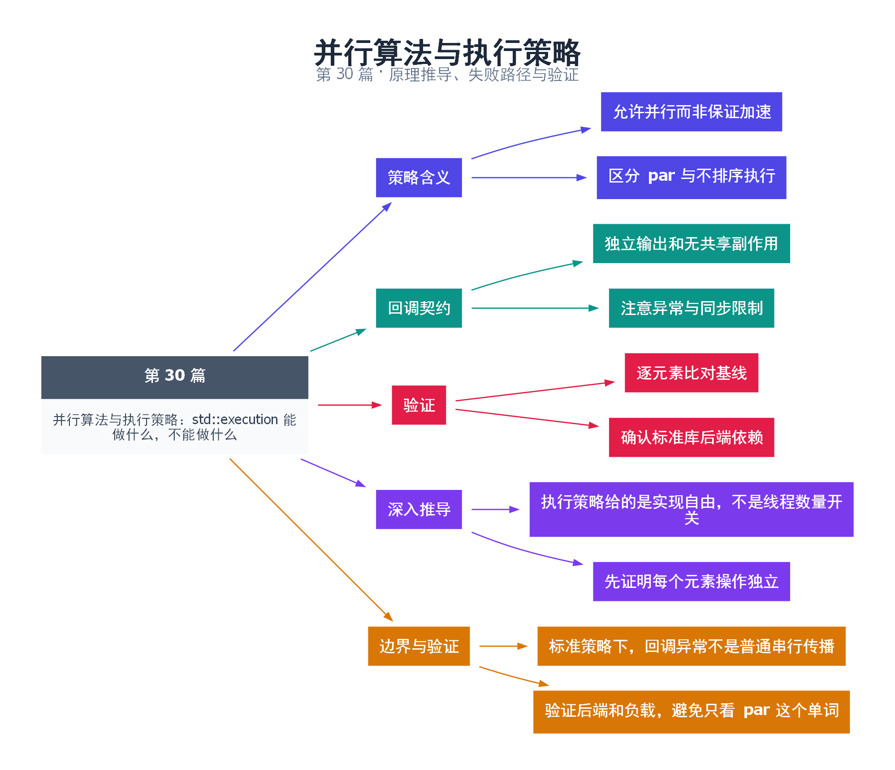

# 30｜并行算法与执行策略：std::execution 能做什么，不能做什么

[返回总目录](README.md) · 最低标准：C++17

一句话总结：标准执行策略放宽算法的执行方式，要求调用者满足更严格的并发契约，但不承诺一定并行或一定加速。

**本文目录**

- [1. 给工厂许可，不是指定工人数](#section-1)
- [2. 回调必须适合对应策略](#section-2)
- [3. 异常语义不能沿用普通算法直觉](#section-3)
- [4. 顺序和数值结果](#section-4)
- [5. 深入推导、反例与工程取舍](#section-5)
  - [5.1 执行策略给的是实现自由，不是线程数量开关](#depth-1)
  - [5.2 先证明每个元素操作独立](#depth-2)
  - [5.3 标准策略下，回调异常不是普通串行传播](#depth-3)
  - [5.4 验证后端和负载，避免只看 par 这个单词](#depth-4)
- [6. 完整示例与复现](#section-6)
  - [6.1 如何判断运行结果](#section-6-1)
- [7. Q&A（常见问题与解答）](#section-7)
  - [7.1 Q：par 保证多核执行吗？](#section-7-1)
  - [7.2 Q：为什么示例不用并行 reduce 求和？](#section-7-2)
  - [7.3 Q：回调里记录日志是否安全？](#section-7-3)
- [8. 引用与延伸阅读](#section-8)
- [9. 思维导图总结](#section-9)

---

<a id="section-1"></a>

## 1. 给工厂许可，不是指定工人数

调用普通算法像要求按通常方式处理；传入 par 像允许工厂分给多名工人，但工厂仍可以选择顺序执行。执行策略表达允许的行为与约束，不是一个可控制线程数的线程池配置接口。

seq、par、par_unseq 自 C++17 提供，unseq 自 C++20 提供。par 允许多线程执行；par_unseq 还允许同一线程中不按顺序交错调用元素操作，例如利用向量化；unseq 强调单线程中的不排序执行。不同实现的后端与构建依赖可能不同，应查目标标准库文档。

<a id="section-2"></a>

## 2. 回调必须适合对应策略

本例对每个元素平方并写入独立输出位置，回调只读自己的输入，不访问共享可变状态，没有依赖调用顺序。这比在回调中 push_back 到一个共享 vector 更适合并行算法。即使 vector 已 reserve，也不能让多个无同步 push_back 自动安全，因为大小状态仍被共同修改。

对 par 使用正确同步的回调有时可以成立，但会降低收益并引入调度约束；对于 unseq/par_unseq，不应调用互斥锁这类不适合向量化交错的同步操作。一个等待另一个回调取得进展的回调，也可能破坏执行策略允许的调度假设。

<a id="section-3"></a>

## 3. 异常语义不能沿用普通算法直觉

对标准执行策略，元素访问函数抛出未捕获异常通常导致 std::terminate；资源分配失败有专门的 bad_alloc 规则。不要以为外层 try/catch 一定可以像无策略版本那样处理每个元素的业务异常。若每项操作可能失败，应在回调内部转成独立的结果状态，并在算法结束后统一检查。

<a id="section-4"></a>

## 4. 顺序和数值结果

并行归约可能改变组合顺序。整数在不溢出时较容易验证，浮点加法不满足严格结合律，结果可能与串行 accumulate 有细微差异。排序和转换也应遵循各自算法的别名、迭代器和比较器要求。

| 需求 | 合适方向 |
|---|---|
| 独立元素纯转换 | 先尝试 par 并实测 |
| 明确线程预算与取消 | 自建执行器 |
| 回调有复杂锁和 I/O | 通常不选 unseq/par_unseq |
| 要求固定浮点顺序 | 保留确定的归约顺序 |

先使用顺序实现建立正确基线，再测并行策略；链接错误可能来自缺失并行后端依赖，不能只靠更换 -std 参数解决。

<!-- depth:chapter -->
<a id="section-5"></a>

## 5. 深入推导、反例与工程取舍

<!-- depth:start -->
<a id="depth-1"></a>

### 5.1 执行策略给的是实现自由，不是线程数量开关

给算法标 par，类似允许工厂自行分配工人：实现可以并行，也可以顺序完成。接口没有承诺创建多少线程或使用所有核心。默认示例即使只用一个线程，也完全可以满足算法契约。

seq、par、par_unseq 以及 C++20 的 unseq，对并行和同线程内交错/向量化给出不同许可。尤其 unsequenced 执行可能把多个元素操作交错在同一线程；在这类回调中使用依赖阻塞互斥的逻辑，不是“加锁就安全”的场景。

<a id="depth-2"></a>

### 5.2 先证明每个元素操作独立

本例 transform 第 i 个输入只计算 output[i]，预先分配 output，回调不做 push_back，因此没有多个线程竞争容器结构。若改成对同一 vector push_back，即使先 reserve 足够容量，size 等共享元数据仍会被并发修改，reserve 不提供同步。

归约也不能通过让 lambda 共同修改普通 sum 来伪造。应使用具有合适组合操作的 reduce/transform_reduce，或者分块局部累加再汇总。浮点加法不满足严格结合律，分组顺序改变可能改变末位；要求逐位一致时，必须明确使用固定归约树或其他数值策略。

<a id="depth-3"></a>

### 5.3 标准策略下，回调异常不是普通串行传播

使用标准执行策略的算法，用户提供操作逸出的异常有规定的 terminate 行为；不能假定外面包一层 try/catch 就能像普通无策略算法那样接住每个元素的业务异常。算法自身分配失败等情况另有规范规定，要区分错误来源。

若元素计算可能失败，可以在回调内捕获，写入该元素独占的错误结果槽，再在算法结束后统一处理。回调内部的错误记录也不能引入新的共享竞争，且不要调用不符合 unsequenced 限制的阻塞设施。

<a id="depth-4"></a>

### 5.4 验证后端和负载，避免只看 par 这个单词

| 现象 | 可能原因 | 核实方法 |
|---|---|---|
| 编译通过但未加速 | 顺序后端、数据太少 | 查看标准库后端配置，扩大受控输入 |
| 链接出现 TBB 符号 | 当前后端需要 TBB | 安装匹配库并按工具链要求链接 |
| 并行结果略有数值差 | 浮点重分组 | 检查误差范围和算法需求 |

本例逐元素检查平方结果，再检查总和，证明输入输出映射正确；不靠输出线程 ID 证明后端能力，因为在回调里打印会扰动执行，还可能违反所选策略的限制。性能测量应将输入生成置于两种路径相同的位置，记录编译器、标准库、后端及数据规模，并比较同一问题的串行实现。
<!-- depth:end -->

<a id="section-6"></a>

## 6. 完整示例与复现

源文件：[examples/30.cpp](examples/30.cpp)。在本系列目录运行以下命令；环境准备见 [实验环境](实验环境与验证.md)。

```bash
g++ -std=c++17 -O2 -Wall -Wextra -pedantic -pthread examples/30.cpp -o demo30
./demo30
```

```cpp
#include <algorithm>
#include <cassert>
#include <execution>
#include <iostream>
#include <numeric>
#include <vector>
int main() {
    std::vector<int> input(1000),output(1000);
    std::iota(input.begin(),input.end(),1);
    std::transform(std::execution::par,input.begin(),input.end(),output.begin(),
                   [](int x) noexcept {return x*x;});
    for(std::size_t i=0;i<input.size();++i) assert(output[i]==input[i]*input[i]);
    auto sum=std::accumulate(output.begin(),output.end(),0LL);
    assert(sum==333833500);
    std::cout << sum << '\n';
}
```

<a id="section-6-1"></a>

### 6.1 如何判断运行结果

输出 `333833500`。若目标 libstdc++ 选择 TBB 后端，可能需要安装并链接 TBB；本地构建结果见验证报告。

<a id="section-7"></a>

## 7. Q&A（常见问题与解答）

<a id="section-7-1"></a>

### 7.1 Q：par 保证多核执行吗？

A：不保证，实现可以顺序执行；应通过测量或分析工具观察目标环境。

<a id="section-7-2"></a>

### 7.2 Q：为什么示例不用并行 reduce 求和？

A：本例集中验证独立转换，顺序 accumulate 提供简单结果校验；归约重排和浮点误差需要另外分析。

<a id="section-7-3"></a>

### 7.3 Q：回调里记录日志是否安全？

A：会引入共享状态、锁和 I/O；特别是 unseq/par_unseq 应避免这类操作，最好收集独立结果后统一记录。

<a id="section-8"></a>

## 8. 引用与延伸阅读

- [执行策略定义](https://timsong-cpp.github.io/cppwp/n4861/algorithms.parallel.exec)
- [并行算法异常](https://timsong-cpp.github.io/cppwp/n4861/algorithms.parallel.exceptions)

规范链接采用固定的 C++20 工作草案 N4861；对较早标准的差异以正文标注为准。示例和分析为本系列自编，规范用于核对接口契约。

<a id="section-9"></a>

## 9. 思维导图总结

```text
并行算法与执行策略：std::execution 能做什么，不能做什么
├── 策略含义
│   ├── 允许并行而非保证加速
│   └── 区分 par 与不排序执行
├── 回调契约
│   ├── 独立输出和无共享副作用
│   └── 注意异常与同步限制
├── 验证
│   ├── 逐元素比对基线
│   └── 确认标准库后端依赖
├── 深入推导
│   ├── 执行策略给的是实现自由，不是线程数量开关
│   └── 先证明每个元素操作独立
└── 边界与验证
    ├── 标准策略下，回调异常不是普通串行传播
    └── 验证后端和负载，避免只看 par 这个单词
```



[Graphviz 源文件](images/30.dot)
