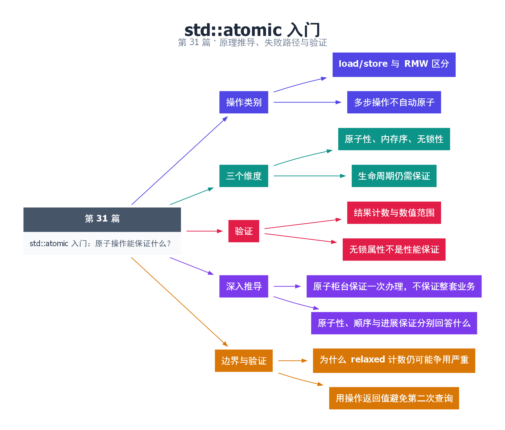

# 31｜std::atomic 入门：原子操作能保证什么？

[返回总目录](README.md) · 最低标准：C++20

一句话总结：原子对象保证相应操作不可分割并有规定的修改顺序，但多个原子操作组合起来仍然不自动成为事务。

**本文目录**

- [1. 单次盖章和完整审批流程](#section-1)
- [2. 原子性、顺序与无锁分开理解](#section-2)
- [3. 本例的正确性来源](#section-3)
- [4. 深入推导、反例与工程取舍](#section-4)
  - [4.1 原子柜台保证一次办理，不保证整套业务](#depth-1)
  - [4.2 原子性、顺序与进展保证分别回答什么](#depth-2)
  - [4.3 为什么 relaxed 计数仍可能争用严重](#depth-3)
  - [4.4 用操作返回值避免第二次查询](#depth-4)
- [5. 完整示例与复现](#section-5)
  - [5.1 如何判断运行结果](#section-5-1)
- [6. Q&A（常见问题与解答）](#section-6)
  - [6.1 Q：atomic<int> 的 ++ 与普通 ++ 一样吗？](#section-6-1)
  - [6.2 Q：两个 atomic 字段能得到一致快照吗？](#section-6-2)
  - [6.3 Q：无锁 atomic 一定比 mutex 快吗？](#section-6-3)
- [7. 引用与延伸阅读](#section-7)
- [8. 思维导图总结](#section-8)

---

<a id="section-1"></a>

## 1. 单次盖章和完整审批流程

atomic 像一台一次只盖一个完整编号的机器，别人不会看到半个编号；但“先查编号再决定盖哪个章”仍然是多步流程。`load` 后 `store(old+1)` 不等于 `fetch_add(1)`，两个线程可能读到相同 old 并覆盖同一更新。

fetch_add 是读—改—写操作，返回修改前的值。用它分配编号时，不同调用获得不同的旧值，直到数值范围和回绕规则开始影响业务。示例只做有限次加法，使用足够范围的 unsigned 计数器。

<a id="section-2"></a>

## 2. 原子性、顺序与无锁分开理解

原子性针对特定对象上的操作；内存序规定它与其他访问之间允许的顺序关系；is_lock_free 描述该类型在当前对象或实现上的无锁属性。atomic 不保证所有类型都不用内部锁，也不保证跨多个原子字段的联合快照一致。

默认操作通常使用 seq_cst，提供较强、较易推理的顺序。不要先把所有操作改成 relaxed 再期待测试兜底；应先明确是否需要发布其他数据，第 34 篇再分析弱化条件。

atomic 类型通常不可复制。要取得数值应 load，要初始化另一个原子对象可以用读取到的值，而不是复制原子对象本身。原子对象本身也必须在所有线程访问期间存活，并在启动使用者前完成初始化。

<a id="section-3"></a>

## 3. 本例的正确性来源

两个线程分别执行 100000 次 fetch_add。每次原子 RMW 对同一计数器形成不可分割的更新，最终由 join 确认线程结束，再读取 200000。这里特意使用 relaxed，因为该计数只统计事件数量，不承担任何其他数据的发布职责。

| 操作 | 保证 | 不能推导 |
|---|---|---|
| load/store | 单次访问原子 | 先读后写整体原子 |
| fetch_add | 加法 RMW 原子 | 其他对象已初始化 |
| CAS | 条件更新原子 | 整个复杂算法无锁 |

验证时检查最终计数和范围，但不要把 is_lock_free 输出当作性能结果。即使底层无锁，高竞争的同一缓存行也可能严重限制吞吐量。

<!-- depth:chapter -->
<a id="section-4"></a>

## 4. 深入推导、反例与工程取舍

<!-- depth:start -->
<a id="depth-1"></a>

### 4.1 原子柜台保证一次办理，不保证整套业务

把 atomic 看成一次只能完成一个不可分割动作的柜台。load 是查询，store 是覆盖，fetch_add 是把“读旧值、计算、写新值”打包成一次读改写。`x = x + 1` 即使 x 是 atomic，也包含独立的 load 与 store，两个线程仍可能根据同一个旧值覆盖彼此更新。

例如初始 x=0，A 和 B 都 load 得到 0，随后各自 store(1)，最终为 1；改成两次 fetch_add 后，原子对象修改顺序里必然包含两次加一，最终为 2。原子类型消除了这个对象单次操作的数据竞争，但复合表达式是否原子要单独分析。

<a id="depth-2"></a>

### 4.2 原子性、顺序与进展保证分别回答什么

| 属性 | 回答的问题 | 不能顺带推出 |
|---|---|---|
| 原子性 | 单次操作会否被观察为撕裂或交错 | 多字段事务正确 |
| 内存序 | 哪些其他访问被建立顺序 | 调度及时、等待时间有界 |
| lock-free 属性 | 此类型原子操作是否无锁实现 | 整个算法无锁或最快 |

一个较大的 atomic<T> 可能由库内锁实现，具体取决于类型、对齐和平台。is_lock_free 查询当前对象的实现属性；C++17 的 is_always_lock_free 是类型层面的编译期属性。某些工具链的大原子操作还需要链接 libatomic，链接失败不应通过删掉 atomic 来绕过。

<a id="depth-3"></a>

### 4.3 为什么 relaxed 计数仍可能争用严重

本例的 fetch_add(relaxed) 不承担其他数据的发布，所以不需要更强内存序。但每次递增仍修改同一个原子对象，多核心要协调这一共享位置的读改写顺序。relaxed 省去不需要的排序约束，不会让同一个计数器变成每核私有。

若性能热点是每请求一次的统计，可以按线程累加后批量归并。这样减少共享 RMW 次数，却使实时观测值变得滞后；如果计数器用于资源额度而非监控统计，滞后可能违反业务限制。优化前必须区分“显示一个大致进度”和“决定是否还能接一项任务”。

<a id="depth-4"></a>

### 4.4 用操作返回值避免第二次查询

fetch_add 返回修改前的值，可用于分配唯一序号；但有限位宽最终会回绕，唯一性需要限制生命周期内的分配总量。exchange 返回旧值，适合一次替换并拿走原状态；compare_exchange 在第 36 篇用于有条件地替换。

默认示例 join 两个线程后断言 count=200000，join 提供完成边界，RMW 保证更新不丢失。若在运行中读 count，它只是某次原子读取的结果，并非所有工作线程恰好同时推进到同一阶段的全局快照。对多个原子计数器分别读取，也可能拼出从未同时存在过的组合。
<!-- depth:end -->

<a id="section-5"></a>

## 5. 完整示例与复现

源文件：[examples/31.cpp](examples/31.cpp)。在本系列目录运行以下命令；环境准备见 [实验环境](实验环境与验证.md)。

```bash
g++ -std=c++20 -O2 -Wall -Wextra -pedantic -pthread examples/31.cpp -o demo31
./demo31
```

```cpp
#include <atomic>
#include <cassert>
#include <iostream>
#include <thread>
int main() {
    std::atomic<unsigned> count{0};
    auto work=[&]{for(unsigned i=0;i<100000;++i) count.fetch_add(1,std::memory_order_relaxed);};
    std::jthread a(work),b(work);
    a.join(); b.join();
    assert(count.load()==200000);
    std::cout << "count=" << count.load() << " lock_free=" << count.is_lock_free() << '\n';
}
```

<a id="section-5-1"></a>

### 5.1 如何判断运行结果

count 固定为 `200000`，lock_free 输出取决于平台。

<a id="section-6"></a>

## 6. Q&A（常见问题与解答）

<a id="section-6-1"></a>

### 6.1 Q：atomic<int> 的 ++ 与普通 ++ 一样吗？

A：原子整数的 ++ 是原子 RMW；普通整数的 ++ 在并发无序修改下会产生数据竞争。

<a id="section-6-2"></a>

### 6.2 Q：两个 atomic 字段能得到一致快照吗？

A：分别 load 不会自动形成联合快照，可能观察到来自不同更新阶段的组合。

<a id="section-6-3"></a>

### 6.3 Q：无锁 atomic 一定比 mutex 快吗？

A：不一定，竞争、缓存一致性流量和业务操作数量都会影响成本。

<a id="section-7"></a>

## 7. 引用与延伸阅读

- [原子库规范](https://timsong-cpp.github.io/cppwp/n4861/atomics)

规范链接采用固定的 C++20 工作草案 N4861；对较早标准的差异以正文标注为准。示例和分析为本系列自编，规范用于核对接口契约。

<a id="section-8"></a>

## 8. 思维导图总结

```text
std::atomic 入门：原子操作能保证什么？
├── 操作类别
│   ├── load/store 与 RMW 区分
│   └── 多步操作不自动原子
├── 三个维度
│   ├── 原子性、内存序、无锁性
│   └── 生命周期仍需保证
├── 验证
│   ├── 结果计数与数值范围
│   └── 无锁属性不是性能保证
├── 深入推导
│   ├── 原子柜台保证一次办理，不保证整套业务
│   └── 原子性、顺序与进展保证分别回答什么
└── 边界与验证
    ├── 为什么 relaxed 计数仍可能争用严重
    └── 用操作返回值避免第二次查询
```



[Graphviz 源文件](images/31.dot)
