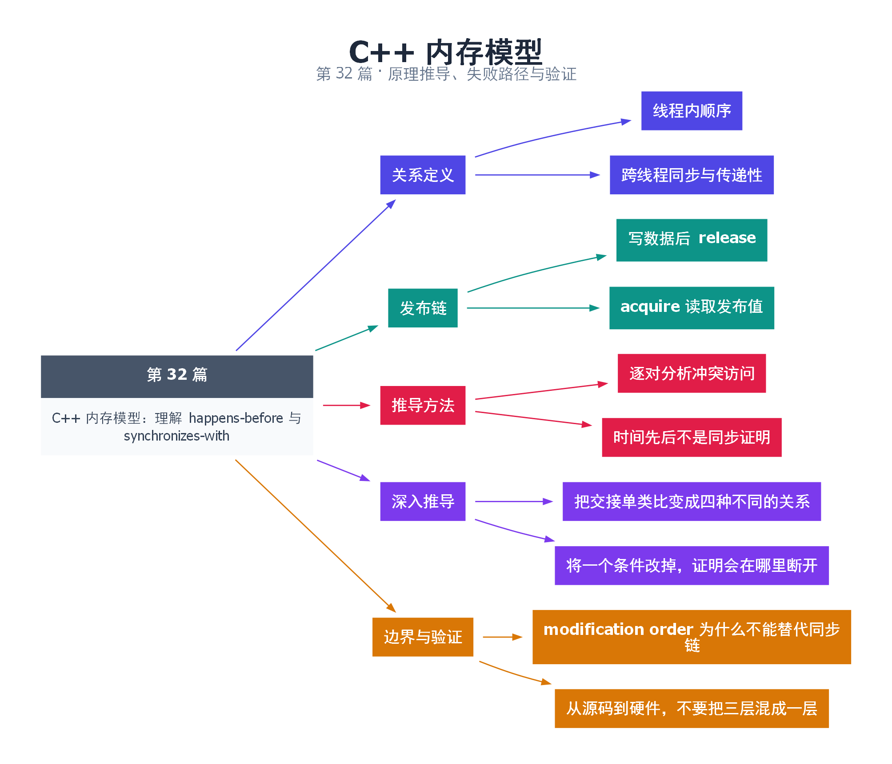

# 32｜C++ 内存模型：理解 happens-before 与 synchronizes-with

[返回总目录](README.md) · 最低标准：C++20

一句话总结：happens-before 是推导跨线程可见性和无数据竞争的逻辑关系，不是墙上时钟记录的先后顺序。

**本文目录**

- [1. 有回执的交接链](#section-1)
- [2. 本例的两条有效证明](#section-2)
- [3. modification order 不等于全局时间线](#section-3)
- [4. 推导清单](#section-4)
- [5. 深入推导、反例与工程取舍](#section-5)
  - [5.1 把交接单类比变成四种不同的关系](#depth-1)
  - [5.2 将一个条件改掉，证明会在哪里断开](#depth-2)
  - [5.3 modification order 为什么不能替代同步链](#depth-3)
  - [5.4 从源码到硬件，不要把三层混成一层](#depth-4)
- [6. 完整示例与复现](#section-6)
  - [6.1 如何判断运行结果](#section-6-1)
- [7. Q&A（常见问题与解答）](#section-7)
  - [7.1 Q：物理时间上先写后读还会有数据竞争吗？](#section-7-1)
  - [7.2 Q：acquire 只要执行就能看到所有写入吗？](#section-7-2)
  - [7.3 Q：join 能保护所有线程之间的访问吗？](#section-7-3)
- [8. 引用与延伸阅读](#section-8)
- [9. 思维导图总结](#section-9)

---

<a id="section-1"></a>

## 1. 有回执的交接链

A 写好文件，签交接单，B 收到对应交接单后读文件，这形成一条可证明的交接链。只说“A 大概先写完了”没有这样的证明。C++ 用 sequenced-before 描述线程内规定的求值顺序，用 synchronizes-with 描述特定同步操作之间的跨线程边，再组合出 happens-before。

本系列在不使用 consume 的常见场景下，主要按线程内顺序加同步边及其传递性推理。C++20 还有 simply/strongly happens-before 等精细定义，特别关系到顺序一致和 consume；不能把口头简化当成所有标准条款的替代。

<a id="section-2"></a>

## 2. 本例的两条有效证明

生产者写普通整数 data=42，然后对 ready 做 release store。消费者 acquire load 读到该 release 写入的 true，形成同步边。于是“写 data → release → acquire 读到 true → 读 data”构成完整链，普通整数访问有序，因此不需要把 data 也改成 atomic。

另一条证明来自线程结束与 join：生产者完成同步于主线程对应 join 成功返回。因此主线程在 join 后也能读取生产者结果。但不能因为主线程最后会 join，就忽略另一个消费者在线程运行期间的无序访问；每一对冲突访问都要分别证明。

<a id="section-3"></a>

## 3. modification order 不等于全局时间线

每个原子对象都有自己的修改顺序。两个不同原子对象上的 relaxed 操作不自动组合成所有线程一致观察的全局顺序。一个线程看到标志更新，若缺少正确发布协议，不能顺带推导其他普通对象已经可读。

| 常见说法 | 正确改写 |
|---|---|
| 写得早所以能读 | 存在规定的同步关系才可这样推理 |
| sleep 后缓存肯定更新 | sleep 不建立业务数据的同步边 |
| 一次运行没有问题 | 有限执行不能证明所有允许执行 |

<a id="section-4"></a>

## 4. 推导清单

先列出每个共享对象的读写事件；找到可能冲突的事件对；画线程内箭头；补上锁、join、future 或 release/acquire 同步边；检查写到读是否连通。若无法连通，先修正协议，再谈 CPU 指令和性能优化。

<!-- depth:chapter -->
<a id="section-5"></a>

## 5. 深入推导、反例与工程取舍

<!-- depth:start -->
<a id="depth-1"></a>

### 5.1 把交接单类比变成四种不同的关系

交接单不仅要存在，还要知道收件人拿到的是哪一张。内存模型推理中，先给事件编号，再区分线程内顺序 sequenced-before（sb）、读取来源 reads-from（rf）、跨线程同步 synchronizes-with（sw）和最终的 happens-before（hb）。其中 rf 描述读值来自哪次写，本身不必构成同步。

| 事件 | 所在线程 | 操作 |
|---|---|---|
| A | 生产者 | 普通写 data=42 |
| B | 生产者 | ready.store(true, release) |
| C | 消费者 | ready.load(acquire) 读到 B 的 true |
| D | 消费者 | 普通读 data |

先有 A sb B 和 C sb D；因为 C 从 B 取值且二者满足 release/acquire 条件，才有 B sw C。把这些边串起来，得到 A hb D。单次发布中没有其他 data 写入，因此 D 读到 42。若 C 读到初始 false，就没有这条 B→C 同步边，循环也不会读取 data。

<a id="depth-2"></a>

### 5.2 将一个条件改掉，证明会在哪里断开

把 C 改为 relaxed，虽然 ready 仍是原子对象，B sw C 不再由这组操作建立；A 与 D 之间缺少必要顺序，普通 data 的访问会有数据竞争。把 data 也改成 atomic 后，程序可以没有数据竞争，但“见到 ready=true 就保证 data=42”的业务推论仍不成立。

把 D 移到 C 之前同样不行：acquire 不是时间机器，不能把先前已经发生的普通读倒过来纳入发布证明。把生产者在 B 之后再写 data=43，也引入了新的冲突对；原本只证明 A hb D，并没有证明这次后续写与 D 有序。

这些反例说明不能只数“代码里有几个 release/acquire”。应逐个确认操作所在对象、读取来源，以及数据访问在同步操作前后的位置。

<a id="depth-3"></a>

### 5.3 modification order 为什么不能替代同步链

对每个原子对象，修改操作有各自的全序。例如 x 上有 x₀、x₁、x₂，y 上有 y₀、y₁、y₂；两个对象各自有序，不意味着所有线程必然把它们拼成同一条全局时间线。load 不是修改操作，其允许读值还受到一致性及 happens-before 等规则约束。

relaxed 也不是“任何值都能读”：它仍要求原子性和单对象一致性，不能凭空制造一个不允许的值。但它不负责把另一个普通对象的写入发布给消费者。反过来，seq_cst 给相关 SC 操作增加一个满足规则的全序，也不把缺乏同步的普通访问自动变成安全操作。

<a id="depth-4"></a>

### 5.4 从源码到硬件，不要把三层混成一层

源码表达式、编译器生成的指令、处理器对外可观察的执行效果是不同层次。编译器可以在不改变标准允许行为的前提下优化；处理器可能通过乱序执行和缓冲隐藏延迟；一致性协议解决缓存行相关的问题。C++ 程序正确性必须先在语言层证明，不能用“我的 x86 上看不到错误”代替证明。

join 提供另一种边：工作线程完成同步于对应 join 成功返回，因此工作线程写 observed，主线程 join 消费者后读 observed 是有序的。但主线程分别 join 生产者与消费者，并不会在二者此前的任意操作之间补一条追溯同步边。

实际审查时按以下顺序做：列共享对象及其寿命；找跨线程冲突对；画 sb；只在满足规范条件处画 sw；检查每对普通冲突访问是否沿 hb 连通；最后检查发布后的修改和对象回收。C++20 的 consume 及 strongly-happens-before 有额外细节，本篇证明限定在不使用 consume 的协议内，避免用简化图替代全部规范。
<!-- depth:end -->

<a id="section-6"></a>

## 6. 完整示例与复现

源文件：[examples/32.cpp](examples/32.cpp)。在本系列目录运行以下命令；环境准备见 [实验环境](实验环境与验证.md)。

```bash
g++ -std=c++20 -O2 -Wall -Wextra -pedantic -pthread examples/32.cpp -o demo32
./demo32
```

```cpp
#include <atomic>
#include <cassert>
#include <iostream>
#include <thread>
int main() {
    int data=0,observed=0;
    std::atomic<bool> ready{false};
    std::jthread producer([&]{data=42; ready.store(true,std::memory_order_release);});
    std::jthread consumer([&]{
        while(!ready.load(std::memory_order_acquire)) std::this_thread::yield();
        observed=data;
    });
    producer.join(); consumer.join();
    assert(observed==42);
    std::cout << observed << '\n';
}
```

<a id="section-6-1"></a>

### 6.1 如何判断运行结果

输出 `42`；这是一次发布，生产者在发布后不再修改 data。

<a id="section-7"></a>

## 7. Q&A（常见问题与解答）

<a id="section-7-1"></a>

### 7.1 Q：物理时间上先写后读还会有数据竞争吗？

A：语言规则要求有 happens-before 等规定关系；靠外部时间推测或 sleep 不能替代同步证明。

<a id="section-7-2"></a>

### 7.2 Q：acquire 只要执行就能看到所有写入吗？

A：不是，必须读到相应 release 或适用 release sequence 的值，才能建立相关同步。

<a id="section-7-3"></a>

### 7.3 Q：join 能保护所有线程之间的访问吗？

A：它只建立与被等待线程完成相关的顺序，不能追溯修复此前其他线程之间已经发生的数据竞争。

<a id="section-8"></a>

## 8. 引用与延伸阅读

- [深化实验与验证](深化实验与验证.md)：完整协议测试、运行命令、预期断言和未覆盖边界。

- [C++20 数据竞争与 happens-before](https://timsong-cpp.github.io/cppwp/n4861/intro.races)

规范链接采用固定的 C++20 工作草案 N4861；对较早标准的差异以正文标注为准。示例和分析为本系列自编，规范用于核对接口契约。

<a id="section-9"></a>

## 9. 思维导图总结

```text
C++ 内存模型：理解 happens-before 与 synchronizes-with
├── 关系定义
│   ├── 线程内顺序
│   └── 跨线程同步与传递性
├── 发布链
│   ├── 写数据后 release
│   └── acquire 读取发布值
├── 推导方法
│   ├── 逐对分析冲突访问
│   └── 时间先后不是同步证明
├── 深入推导
│   ├── 把交接单类比变成四种不同的关系
│   └── 将一个条件改掉，证明会在哪里断开
└── 边界与验证
    ├── modification order 为什么不能替代同步链
    └── 从源码到硬件，不要把三层混成一层
```



[Graphviz 源文件](images/32.dot)
