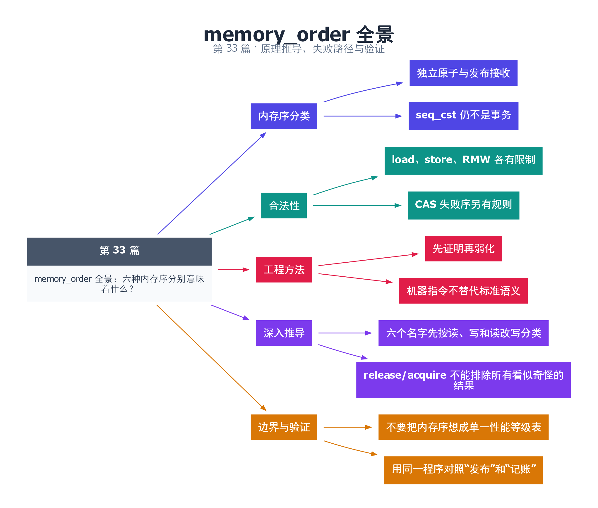

# 33｜memory_order 全景：六种内存序分别意味着什么？

[返回总目录](README.md) · 最低标准：C++20

一句话总结：内存序描述原子操作的排序和同步约束，应从协议需要推导，不能把它们简单排成适用于所有操作的强弱按钮。

**本文目录**

- [1. 交接手续有不同范围](#section-1)
- [2. 六种内存序与合法操作](#section-2)
- [3. 不要把 CPU 指令当作语言规则](#section-3)
- [4. 本例为什么同时出现三种内存序](#section-4)
- [5. 验证建议](#section-5)
- [6. 深入推导、反例与工程取舍](#section-6)
  - [6.1 六个名字先按读、写和读改写分类](#depth-1)
  - [6.2 release/acquire 不能排除所有看似奇怪的结果](#depth-2)
  - [6.3 不要把内存序想成单一性能等级表](#depth-3)
  - [6.4 用同一程序对照“发布”和“记账”](#depth-4)
- [7. 完整示例与复现](#section-7)
  - [7.1 如何判断运行结果](#section-7-1)
- [8. Q&A（常见问题与解答）](#section-8)
  - [8.1 Q：acq_rel 比 acquire 强，所以 load 用它行吗？](#section-8-1)
  - [8.2 Q：seq_cst 就是禁止一切重排吗？](#section-8-2)
  - [8.3 Q：为什么暂时不教 consume 实战？](#section-8-3)
- [9. 引用与延伸阅读](#section-9)
- [10. 思维导图总结](#section-10)

---

<a id="section-1"></a>

## 1. 交接手续有不同范围

relaxed 像只保证编号机自身操作完整；release 像交出此前准备好的材料；acquire 像接收对应交付后再使用材料；acq_rel 在一次 RMW 中同时承担接收和发布；seq_cst 进一步对顺序一致操作施加单一总序等要求。这个类比帮助记忆，正式正确性仍由标准关系决定。

<a id="section-2"></a>

## 2. 六种内存序与合法操作

| 内存序 | 常见用途 | 基本限制 |
|---|---|---|
| relaxed | 独立统计、无需发布 | 不提供跨对象同步 |
| consume | 依赖链读取，历史接口 | 推理和实现复杂，本系列不使用 |
| acquire | 接收已发布数据 | load 或 RMW，不能用于普通 store |
| release | 发布此前写入 | store 或 RMW，不能用于普通 load |
| acq_rel | RMW 同时接收与发布 | 不是普通 load/store 的内存序 |
| seq_cst | 易推理的默认原子协议 | 仍不把多条操作变成事务 |

表格按 C++20 六枚举讨论，不覆盖后续标准对 consume 的变更。工程中新代码通常避免基于 consume 构造依赖敏感协议，使用 acquire 更容易审核和移植。

<a id="section-3"></a>

## 3. 不要把 CPU 指令当作语言规则

在某个平台上 acquire load 与 relaxed load 可能生成相同机器指令，但编译器允许的重排和跨平台语义仍不同。反过来，一个 seq_cst 操作也未必总产生昂贵的全栅栏。应先证明程序，再看目标编译器生成的代码，最后做测量。

<a id="section-4"></a>

## 4. 本例为什么同时出现三种内存序

values 的初始化在 release store 前完成；消费者读到 ready 的 true 后通过 acquire 获得发布保证；visits 只统计读取次数，使用 relaxed。visits 不是就绪标志，也不会被拿来判断 values 是否安全可读。这种按职责区分，比所有对象用同一种弱序更清楚。

seq_cst 可作为初始实现，但不修复对象寿命、不保证锁自由，也不能把“load 检查后 store 更新”变成条件事务。弱化任何操作前，要在代码评审中写出失去的同步边是否仍由其他机制覆盖。

<a id="section-5"></a>

## 5. 验证建议

添加结果断言可发现实现错误，但不能通过“跑十亿次”证明弱内存模型正确；不同 CPU 与优化级别可能暴露不同执行。复杂协议应结合形式化 litmus 推演或模型工具，并保留具体标准版本说明。

<!-- depth:chapter -->
<a id="section-6"></a>

## 6. 深入推导、反例与工程取舍

<!-- depth:start -->
<a id="depth-1"></a>

### 6.1 六个名字先按读、写和读改写分类

内存序像交接规则，必须贴在能够承担该规则的操作上。单纯 load 只读取，不能用 release 发布；单纯 store 只写入，不能用 acquire 接收。RMW 同时读写，可以在一次操作里接收之前的发布并发布自己的前序工作。

| 操作类别 | 常用合法内存序 | 对应含义 |
|---|---|---|
| load | relaxed、consume、acquire、seq_cst | 只读；acquire 可接收发布 |
| store | relaxed、release、seq_cst | 只写；release 可发布前序写 |
| RMW | 六种均可按契约选用 | acq_rel 同时接收与发布 |

consume 在本系列不作为实现选项：它依赖数据依赖传播的专门规则，不能按“较便宜的 acquire”随意替换。这里以固定 C++20 草案讨论，不将后续标准的措辞变化混入推导。

<a id="depth-2"></a>

### 6.2 release/acquire 不能排除所有看似奇怪的结果

考虑初始 x=y=0，两者都是 atomic。线程 A 先 x.store(1, release)，再 r1=y.load(acquire)；线程 B 先 y.store(1, release)，再 r2=x.load(acquire)。r1=r2=0 是允许讨论的结果：两次读取都来自初值，因此没有读到对方 release，也没有建立彼此的同步边。

若这四个操作全部为 seq_cst，假设仍都读到 0：A 的读需要排在 B 的写之前，B 的读需要排在 A 的写之前，加上各线程的先写后读，会要求一个全序里出现环，因而不可能。这个小例子具体展示了 SC 全序增加的约束；它仍不证明任意多个操作组成一个不可分割事务。

<a id="depth-3"></a>

### 6.3 不要把内存序想成单一性能等级表

release 和 acquire 方向不同，不是谁全面强于谁。选择内存序应从信息流反推：我要发布什么数据，由哪次写发布；消费者通过哪次读取接收；是否需要对多个 SC 操作推导一致顺序。先写出证明，再挑选足够的约束。

某些架构上 acquire load 与 relaxed load 可生成相同机器指令，但对编译器变换的限制仍不同；其他架构则可能使用不同指令。不要从一个函数的一段汇编就宣布整个程序替换内存序后必定快多少。性能比较要保留相同的算法、布局与竞争程度。

<a id="depth-4"></a>

### 6.4 用同一程序对照“发布”和“记账”

本例 ready 承担发布 values 的工作，所以写端 release、读端 acquire；visits 只记录访问次数，使用 relaxed。消费者完成后主线程 join，再读取 sum 与 visits，生命周期和最终观测由 join 兜底。这些变量服务于不同语义，不需要统一设置为同一种内存序。

补充实验 `examples/deep_protocols.cpp` 包含全 SC 的双变量测试，并断言不出现双零；反复通过只是有限执行记录，真正排除双零的理由仍是上述全序矛盾。将测试改为 release/acquire 或 relaxed 后，不应断言一定出现双零；允许出现不等于每个平台和每次调度都能观测到。
<!-- depth:end -->

<a id="section-7"></a>

## 7. 完整示例与复现

源文件：[examples/33.cpp](examples/33.cpp)。在本系列目录运行以下命令；环境准备见 [实验环境](实验环境与验证.md)。

```bash
g++ -std=c++20 -O2 -Wall -Wextra -pedantic -pthread examples/33.cpp -o demo33
./demo33
```

```cpp
#include <array>
#include <atomic>
#include <cassert>
#include <iostream>
#include <thread>
int main() {
    std::array<int,2> values{0,0};
    std::atomic<bool> ready{false};
    std::atomic<int> visits{0};
    int sum=0;
    std::jthread producer([&]{values={20,22};ready.store(true,std::memory_order_release);});
    std::jthread reader([&]{
        while(!ready.load(std::memory_order_acquire)) std::this_thread::yield();
        sum=values[0]+values[1];
        visits.fetch_add(1,std::memory_order_relaxed);
    });
    producer.join();reader.join();
    assert(sum==42 && visits.load()==1);
    std::cout << "sum=" << sum << " visits=" << visits.load() << '\n';
}
```

<a id="section-7-1"></a>

### 7.1 如何判断运行结果

输出 `sum=42 visits=1`，访问计数不参与数据发布。

<a id="section-8"></a>

## 8. Q&A（常见问题与解答）

<a id="section-8-1"></a>

### 8.1 Q：acq_rel 比 acquire 强，所以 load 用它行吗？

A：不行，内存序有操作类别限制，普通 load 不能使用 release 或 acq_rel。

<a id="section-8-2"></a>

### 8.2 Q：seq_cst 就是禁止一切重排吗？

A：不是，它为相关原子操作规定强顺序约束，编译器仍可做保持可观察语义的优化。

<a id="section-8-3"></a>

### 8.3 Q：为什么暂时不教 consume 实战？

A：其依赖关系与实现实践复杂，入门发布协议用 acquire 更容易正确表达，且应区分标准版本。

<a id="section-9"></a>

## 9. 引用与延伸阅读

- [深化实验与验证](深化实验与验证.md)：完整协议测试、运行命令、预期断言和未覆盖边界。

- [C++20 memory_order](https://timsong-cpp.github.io/cppwp/n4861/atomics.order)

规范链接采用固定的 C++20 工作草案 N4861；对较早标准的差异以正文标注为准。示例和分析为本系列自编，规范用于核对接口契约。

<a id="section-10"></a>

## 10. 思维导图总结

```text
memory_order 全景：六种内存序分别意味着什么？
├── 内存序分类
│   ├── 独立原子与发布接收
│   └── seq_cst 仍不是事务
├── 合法性
│   ├── load、store、RMW 各有限制
│   └── CAS 失败序另有规则
├── 工程方法
│   ├── 先证明再弱化
│   └── 机器指令不替代标准语义
├── 深入推导
│   ├── 六个名字先按读、写和读改写分类
│   └── release/acquire 不能排除所有看似奇怪的结果
└── 边界与验证
    ├── 不要把内存序想成单一性能等级表
    └── 用同一程序对照“发布”和“记账”
```



[Graphviz 源文件](images/33.dot)
