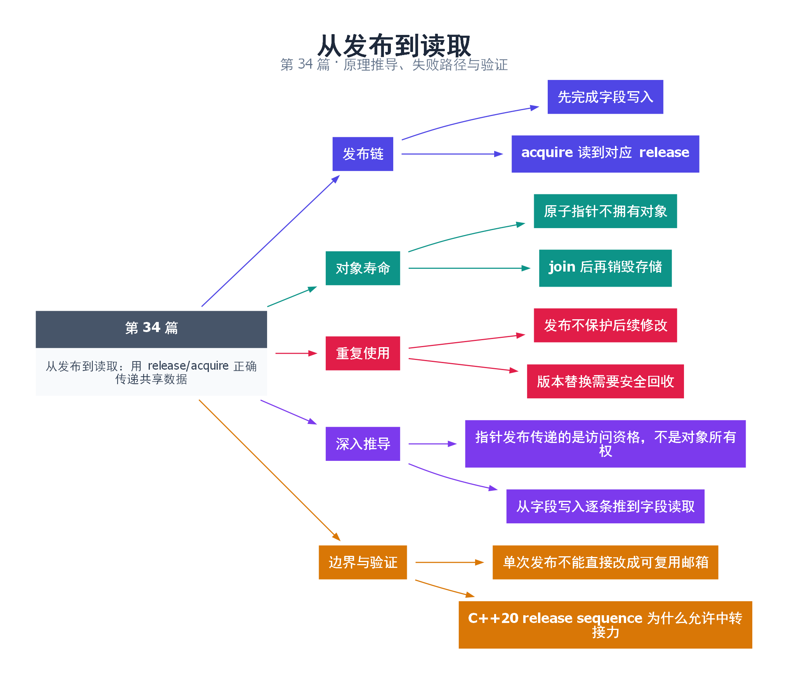

# 34｜从发布到读取：用 release/acquire 正确传递共享数据

[返回总目录](README.md) · 最低标准：C++20

一句话总结：release/acquire 能安全发布普通数据，但只覆盖发布前的写入，发布后继续修改需要新的所有权或同步协议。

**本文目录**

- [1. 装箱完成后封箱交接](#section-1)
- [2. 正确性分四步](#section-2)
- [3. 发布不是永久读写锁](#section-3)
- [4. 深入推导、反例与工程取舍](#section-4)
  - [4.1 指针发布传递的是访问资格，不是对象所有权](#depth-1)
  - [4.2 从字段写入逐条推到字段读取](#depth-2)
  - [4.3 单次发布不能直接改成可复用邮箱](#depth-3)
  - [4.4 C++20 release sequence 为什么允许中转接力](#depth-4)
- [5. 完整示例与复现](#section-5)
  - [5.1 如何判断运行结果](#section-5-1)
- [6. Q&A（常见问题与解答）](#section-6)
  - [6.1 Q：为什么 Payload 字段不用 atomic？](#section-6-1)
  - [6.2 Q：把指针变成 atomic 就能立即 delete 旧对象吗？](#section-6-2)
  - [6.3 Q：发布后再写一个字段能被保证看见吗？](#section-6-3)
- [7. 引用与延伸阅读](#section-7)
- [8. 思维导图总结](#section-8)

---

<a id="section-1"></a>

## 1. 装箱完成后封箱交接

生产者先装好箱子，再贴“可领取”标签；消费者看到对应标签才开箱。贴标签必须在装箱之后，看标签必须和随后读内容建立顺序。release store 与读到它的 acquire load 实现这个交接。

本例发布一个包含字符串和整数的 Payload。生产者先填写两个字段，再把指向它的指针 release store 到 published；消费者 acquire load 获得非空指针后，读取字段并形成结果。Payload 在 main 中构造，直到两条线程 join 后才销毁，所以发布与寿命同时满足。

<a id="section-2"></a>

## 2. 正确性分四步

第一，字段写入在生产者中 sequenced-before 发布。第二，消费者 load 读到了该 store 的指针值。第三，release/acquire 因此形成 synchronizes-with。第四，消费者读字段位于 acquire 后，因此字段写入 happens-before 读取。

缺少第二步时不能凭两个内存序名字就宣布同步成立。若消费者读到初始空指针，必须继续等待，不能读取尚未发布内容。若存在多次发布，还要分清读到的是哪个版本及其寿命。

<a id="section-3"></a>

## 3. 发布不是永久读写锁

生产者发布后再次改 name，而消费者仍在读它，就可能出现数据竞争。若需要重复使用同一槽位，应让消费者归还所有权，形成反向 release/acquire 握手；或者每次构造不可变新对象，并使用安全版本回收机制。

原子指针也不管理其指向对象寿命。`published.store(new Payload)` 后立即 delete 旧对象，可能使已经加载旧指针的读者悬空。shared_ptr 快照或专门回收协议解决的是另一层问题，第 39 篇会进一步讨论。

| 模式 | 是否足够 |
|---|---|
| 一次初始化后永不修改，读者寿命受控 | release/acquire 可表达发布 |
| 发布后继续原地修改 | 需要额外同步 |
| 多版本替换后立即删除旧版 | 需要安全回收 |
| 用 relaxed 标志发布普通数据 | 不提供所需同步链 |

检查代码时同时写下“哪个操作发布”“读到哪次写”“谁拥有对象”“何时允许回收”，不要只看 memory_order 标签。

<!-- depth:chapter -->
<a id="section-4"></a>

## 4. 深入推导、反例与工程取舍

<!-- depth:start -->
<a id="depth-1"></a>

### 4.1 指针发布传递的是访问资格，不是对象所有权

把指针比作仓库地址：release 公布地址前把货物摆好，acquire 读到该地址后可以按协议查看货物。但地址本身不会替你保管仓库。发布后对象是否继续存活，仍需要拥有者、引用计数、读者登记或其他生命周期机制。

本例 storage 在主线程栈上，先于两个 jthread 构造，两个线程 join 后才离开 main，因此寿命覆盖读者。生产者完成 name 和 value 的初始化后发布 &storage，消费者看到非空指针才解引用，之后生产者不再修改内容。三个前提一起成立才安全。

<a id="depth-2"></a>

### 4.2 从字段写入逐条推到字段读取

把写 name、写 value 分别记为 Wn、Wv，指针 release store 为 P，读到 P 的 acquire load 为 Q，字段读取为 Rn、Rv。有 Wn/Wv sb P，P sw Q，Q sb Rn/Rv，所以每个初始化写都 happens-before 对应读取。

指针的数值恰好相同不等于读到了所需的那次发布。若一个地址被反复使用并重新初始化，需要区分不同代对象，并证明没有旧读者仍在访问。只检查 p!=nullptr 无法识别当前读取对应哪次生命周期。

<a id="depth-3"></a>

### 4.3 单次发布不能直接改成可复用邮箱

错误扩展是消费者读完后 ready=false，生产者看见 false 就重写普通 payload，而消费者实际上还在处理 payload 的引用。原本单向发布只约束“先写后读”，重复使用还需要反向交接约束“旧读结束后才能再次写”。

安全的单槽邮箱可用两个阶段：生产者先 acquire 观察空槽，再写 payload，release 标记满；消费者 acquire 观察满槽，复制或处理完 payload，release 标记空。每轮都有正向发布和反向归还。若消费处理要保留引用到下一轮，这个两态协议仍不足，需复制或延长所有权。

<a id="depth-4"></a>

### 4.4 C++20 release sequence 为什么允许中转接力

设 A 写普通 data 后对 flag release-store 1；B 用 relaxed RMW 将 1 改为 2；C 的 acquire-load 读到这个 2。若 B 的操作在 A 所引出的连续 RMW 序列中，C 可以与头部 release 建立所需同步，从而读取 A 发布的数据。C++20 下，普通 store 不能随意当成这条 RMW 接力的一环。

中转线程是否还要发布自己的普通数据，必须另外分析：仅仅 relaxed RMW 接力并不自动发布中转线程的所有私有写入。补充实验将中转 CAS、读取来源和最终断言放在同一完整程序中，便于核对这条链。

选型时，单次不可变配置可用一次发布并保持寿命；频繁替换配置可考虑原子 shared_ptr 快照；固定单生产者单消费者传输可用第 41 篇环形队列。不要把 release/acquire 当成独立于数据所有权的通用补丁。
<!-- depth:end -->

<a id="section-5"></a>

## 5. 完整示例与复现

源文件：[examples/34.cpp](examples/34.cpp)。在本系列目录运行以下命令；环境准备见 [实验环境](实验环境与验证.md)。

```bash
g++ -std=c++20 -O2 -Wall -Wextra -pedantic -pthread examples/34.cpp -o demo34
./demo34
```

```cpp
#include <atomic>
#include <cassert>
#include <iostream>
#include <string>
#include <thread>
struct Payload { std::string name; int value=0; };
int main() {
    Payload storage;
    std::atomic<Payload*> published{nullptr};
    std::string result;
    std::jthread producer([&]{
        storage.name="answer"; storage.value=42;
        published.store(&storage,std::memory_order_release);
    });
    std::jthread consumer([&]{
        Payload* p;
        while(!(p=published.load(std::memory_order_acquire))) std::this_thread::yield();
        result=p->name+":"+std::to_string(p->value);
    });
    producer.join();consumer.join();
    assert(result=="answer:42");
    std::cout << result << '\n';
}
```

<a id="section-5-1"></a>

### 5.1 如何判断运行结果

输出 `answer:42`，一次发布后不再修改 Payload。

<a id="section-6"></a>

## 6. Q&A（常见问题与解答）

<a id="section-6-1"></a>

### 6.1 Q：为什么 Payload 字段不用 atomic？

A：所有写入通过发布边排在读取之前，且之后不再修改，因此没有无序冲突访问。

<a id="section-6-2"></a>

### 6.2 Q：把指针变成 atomic 就能立即 delete 旧对象吗？

A：不能，其他线程可能已加载旧指针并准备访问，原子性不提供对象回收保护。

<a id="section-6-3"></a>

### 6.3 Q：发布后再写一个字段能被保证看见吗？

A：不能由之前的 release 保证，必须增加新的同步或改变协议。

<a id="section-7"></a>

## 7. 引用与延伸阅读

- [深化实验与验证](深化实验与验证.md)：完整协议测试、运行命令、预期断言和未覆盖边界。

- [C++20 工作草案：线程支持库](https://timsong-cpp.github.io/cppwp/n4861/thread)

规范链接采用固定的 C++20 工作草案 N4861；对较早标准的差异以正文标注为准。示例和分析为本系列自编，规范用于核对接口契约。

<a id="section-8"></a>

## 8. 思维导图总结

```text
从发布到读取：用 release/acquire 正确传递共享数据
├── 发布链
│   ├── 先完成字段写入
│   └── acquire 读到对应 release
├── 对象寿命
│   ├── 原子指针不拥有对象
│   └── join 后再销毁存储
├── 重复使用
│   ├── 发布不保护后续修改
│   └── 版本替换需要安全回收
├── 深入推导
│   ├── 指针发布传递的是访问资格，不是对象所有权
│   └── 从字段写入逐条推到字段读取
└── 边界与验证
    ├── 单次发布不能直接改成可复用邮箱
    └── C++20 release sequence 为什么允许中转接力
```



[Graphviz 源文件](images/34.dot)
