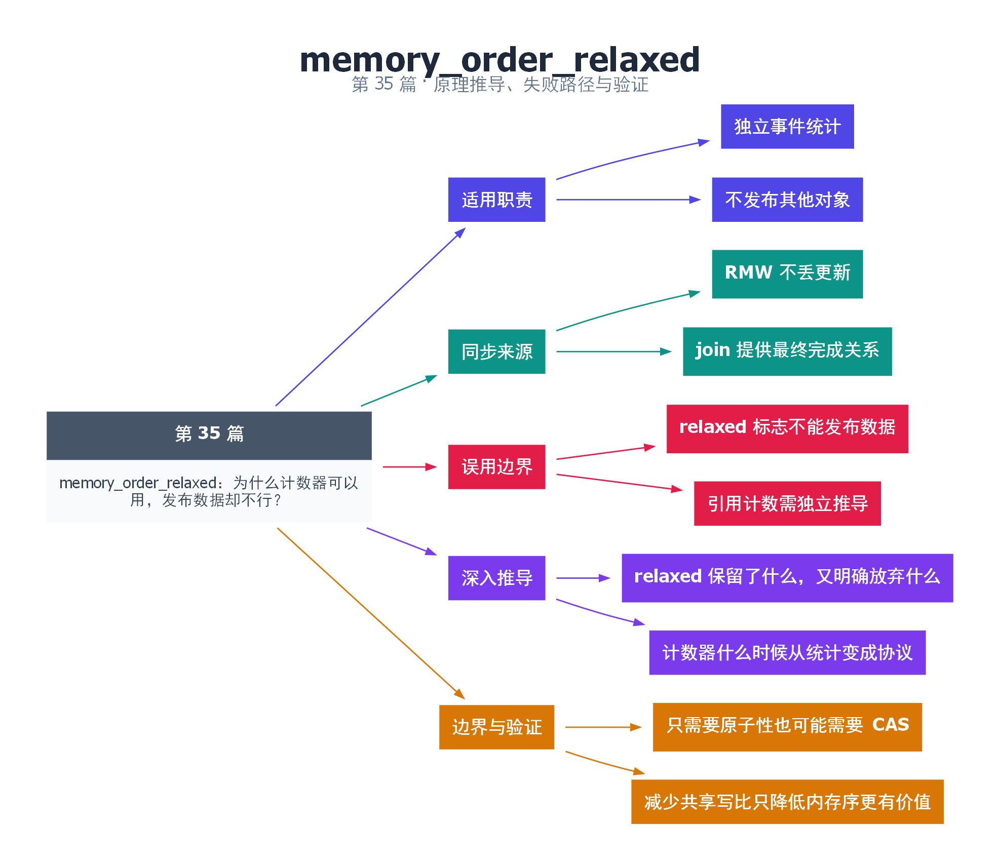

# 35｜memory_order_relaxed：为什么计数器可以用，发布数据却不行？

[返回总目录](README.md) · 最低标准：C++20

一句话总结：relaxed 适合不承担其他对象发布职责的独立原子状态，最终读取的可见性可以来自 join 等其他同步。

**本文目录**

- [1. 计数牌不等于开箱许可](#section-1)
- [2. 错误发布为什么危险](#section-2)
- [3. 引用计数为何不能照抄](#section-3)
- [4. 性能边界](#section-4)
- [5. 深入推导、反例与工程取舍](#section-5)
  - [5.1 relaxed 保留了什么，又明确放弃什么](#depth-1)
  - [5.2 计数器什么时候从统计变成协议](#depth-2)
  - [5.3 只需要原子性也可能需要 CAS](#depth-3)
  - [5.4 减少共享写比只降低内存序更有价值](#depth-4)
- [6. 完整示例与复现](#section-6)
  - [6.1 如何判断运行结果](#section-6-1)
- [7. Q&A（常见问题与解答）](#section-7)
  - [7.1 Q：relaxed 是随机读写吗？](#section-7-1)
  - [7.2 Q：最终 load 也能 relaxed 吗？](#section-7-2)
  - [7.3 Q：降低内存序能解决热点计数吗？](#section-7-3)
- [8. 引用与延伸阅读](#section-8)
- [9. 思维导图总结](#section-9)

---

<a id="section-1"></a>

## 1. 计数牌不等于开箱许可

博物馆门口计数器只告诉你累计进来多少人，不告诉你某个展柜是否已经布置好。relaxed 保证计数器更新本身原子并遵守该对象的修改顺序，却不会因为数值增加就自动发布另一块内存中的内容。

本例让四个线程分别执行 10000 次事件统计，最终主线程在所有 join 之后读取总数。每次 fetch_add 不丢失更新，join 又确认各线程完成，因此最终值应为 40000。线程运行中的一次 load 只是当时允许观察的一个值，不应无依据当成全局业务完成屏障。

<a id="section-2"></a>

## 2. 错误发布为什么危险

设生产者先写普通 data，再 relaxed store ready=true；消费者看到 ready 为 true 后读 data。ready 自身没有数据竞争，但不存在所需的跨对象同步边，data 仍可能发生数据竞争。这里错误不是简单的“缓存没刷及时”，而是整个访问协议不符合 C++ 规则。

若 ready 仅表示近似统计，不用于决定读取 data，就不存在同样的发布职责。选择内存序要看这个状态如何被使用，而不是变量名字叫 counter 还是 ready。

<a id="section-3"></a>

## 3. 引用计数为何不能照抄

引用计数的增加有时可以 relaxed，但减少到零的路径要与对象最后使用和销毁协调，通常需要更细致的 release/acquire 或栅栏协议。把网上的“引用计数可以 relaxed”浓缩成所有增减都 relaxed，可能导致销毁顺序错误。本系列不把简单统计代码当成通用引用计数实现。

<a id="section-4"></a>

## 4. 性能边界

relaxed 也可能需要原子 RMW 指令和缓存行所有权迁移。高频全局计数常常更适合线程局部累计后批量汇总；但批量统计会改变实时可见程度，需要业务接受。每线程统计还可能发生第 42 篇的伪共享。

| 需求 | 判断 |
|---|---|
| 最终计数，外部 join 确认完成 | relaxed RMW 常合适 |
| 看到标志后读取普通数据 | 需要发布接收或其他同步 |
| 多字段一致快照 | 单个 relaxed 计数不够 |

验证时记录计数定义：统计尝试、接受还是完成？把这三个阶段混在一起会导致即使完全无数据竞争，业务报表仍然错误。

<!-- depth:chapter -->
<a id="section-5"></a>

## 5. 深入推导、反例与工程取舍

<!-- depth:start -->
<a id="depth-1"></a>

### 5.1 relaxed 保留了什么，又明确放弃什么

想象一个只记录访客数量的电子计数器。每次按键都不会丢失，读数更新有它自己的顺序，但显示到 1000 并不自动证明旁边 1000 份报告都已可读取。relaxed 保留原子性和单对象修改顺序，不承担其他对象的跨线程发布。

本例四线程各做 10000 次 fetch_add，所有操作都在同一原子对象的修改顺序中，因而不会发生 load/store 分离的覆盖丢失。主线程 join 全部工作线程后再读取，最终 40000 的证明既用到了 RMW，也用到了线程完成边界。

<a id="depth-2"></a>

### 5.2 计数器什么时候从统计变成协议

如果主线程不 join，而是在 completed==4 后读取四个普通结果槽，completed 就不再只是统计。每个工作线程写槽后 relaxed 加一，观察者见到 4 并不能据此获得结果槽的可见性保证。这时要设计发布协议，例如使用 latch，或认真证明基于 release RMW 序列与 acquire 观察的方案。

同样，若计数用于决定“最后一个引用消失，可以销毁对象”，它直接参与生命周期。引用计数里某些增量可以 relaxed，并不表示减到零及析构路径也能随便 relaxed。具体优化依赖完整协议，不应把统计计数器的例子复制到内存回收代码。

<a id="depth-3"></a>

### 5.3 只需要原子性也可能需要 CAS

限制最多 K 个并发请求时，先 relaxed-load count<K，再 relaxed-fetch_add，会让多个线程同时越过检查。问题不是内存序太弱，而是条件与修改没有合成一个操作；把两步都换成 seq_cst 仍会存在检查窗口。

可用 CAS 循环尝试 count→count+1，只有当前 count<K 时才能成功；释放名额时再按资源发布需求选择减计数的内存序。若名额只是数字，和资源内容交接是两个独立协议；如果获得名额还表示可以复用某块内存，则必须额外证明访问顺序。

<a id="depth-4"></a>

### 5.4 减少共享写比只降低内存序更有价值

| 统计方式 | 共享操作次数 | 观测语义 |
|---|---|---|
| 每事件一个共享 RMW | 等于事件数 | 单计数器即时快照 |
| 本地累计 B 次再归并 | 大约事件数/B | 最多存在未归并尾数 |
| 每线程独立槽位 | 避免同址争用 | 汇总不是天然一致快照 |

最后一种还要避免伪共享，并决定在线读取每个槽是否需要 atomic。若主线程只在 join 后汇总普通槽，可以依赖 join；若在线读取，则不能边读边让工作线程无同步写普通整数。

验证时同时保留最终计数断言与中间统计的误差契约。不要在运行中要求多个分片求和恰好对应同一时刻的全局总量，除非已经实现快照协议。
<!-- depth:end -->

<a id="section-6"></a>

## 6. 完整示例与复现

源文件：[examples/35.cpp](examples/35.cpp)。在本系列目录运行以下命令；环境准备见 [实验环境](实验环境与验证.md)。

```bash
g++ -std=c++20 -O2 -Wall -Wextra -pedantic -pthread examples/35.cpp -o demo35
./demo35
```

```cpp
#include <atomic>
#include <cassert>
#include <iostream>
#include <thread>
#include <vector>
int main() {
    std::atomic<unsigned> completed{0};
    std::vector<std::jthread> workers;
    for(int k=0;k<4;++k) workers.emplace_back([&]{
        for(int i=0;i<10000;++i) completed.fetch_add(1,std::memory_order_relaxed);
    });
    for(auto& t:workers) t.join();
    auto count=completed.load(std::memory_order_relaxed);
    assert(count==40000);
    std::cout << count << '\n';
}
```

<a id="section-6-1"></a>

### 6.1 如何判断运行结果

输出 `40000`；最终读取在四个 join 之后。

<a id="section-7"></a>

## 7. Q&A（常见问题与解答）

<a id="section-7-1"></a>

### 7.1 Q：relaxed 是随机读写吗？

A：不是，它仍保证该对象原子性与规定的修改顺序和一致性约束，只是不提供常见的跨对象发布同步。

<a id="section-7-2"></a>

### 7.2 Q：最终 load 也能 relaxed 吗？

A：本例可以，因为 join 已经建立完成顺序；换成线程仍运行、计数触发读取其他数据的场景要重新推导。

<a id="section-7-3"></a>

### 7.3 Q：降低内存序能解决热点计数吗？

A：不一定，同一原子缓存行上的 RMW 仍可能串行竞争，可以考虑局部累计和批量汇总。

<a id="section-8"></a>

## 8. 引用与延伸阅读

- [深化实验与验证](深化实验与验证.md)：完整协议测试、运行命令、预期断言和未覆盖边界。

- [C++20 工作草案：线程支持库](https://timsong-cpp.github.io/cppwp/n4861/thread)

规范链接采用固定的 C++20 工作草案 N4861；对较早标准的差异以正文标注为准。示例和分析为本系列自编，规范用于核对接口契约。

<a id="section-9"></a>

## 9. 思维导图总结

```text
memory_order_relaxed：为什么计数器可以用，发布数据却不行？
├── 适用职责
│   ├── 独立事件统计
│   └── 不发布其他对象
├── 同步来源
│   ├── RMW 不丢更新
│   └── join 提供最终完成关系
├── 误用边界
│   ├── relaxed 标志不能发布数据
│   └── 引用计数需独立推导
├── 深入推导
│   ├── relaxed 保留了什么，又明确放弃什么
│   └── 计数器什么时候从统计变成协议
└── 边界与验证
    ├── 只需要原子性也可能需要 CAS
    └── 减少共享写比只降低内存序更有价值
```



[Graphviz 源文件](images/35.dot)
