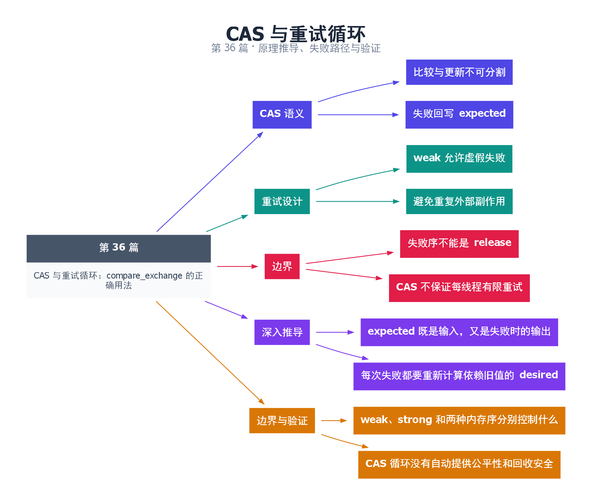

# 36｜CAS 与重试循环：compare_exchange 的正确用法

[返回总目录](README.md) · 最低标准：C++20

一句话总结：CAS 将比较与更新合成原子步骤，重试循环必须理解 expected 被修改、虚假失败和重复计算的副作用。

**本文目录**

- [1. 带版本前提的报价修改](#section-1)
- [2. 最大值更新的推导](#section-2)
- [3. 失败内存序的规则](#section-3)
- [4. 重试会重复执行什么](#section-4)
- [5. 深入推导、反例与工程取舍](#section-5)
  - [5.1 expected 既是输入，又是失败时的输出](#depth-1)
  - [5.2 每次失败都要重新计算依赖旧值的 desired](#depth-2)
  - [5.3 weak、strong 和两种内存序分别控制什么](#depth-3)
  - [5.4 CAS 循环没有自动提供公平性和回收安全](#depth-4)
- [6. 完整示例与复现](#section-6)
  - [6.1 如何判断运行结果](#section-6-1)
- [7. Q&A（常见问题与解答）](#section-7)
  - [7.1 Q：失败后 expected 为什么变了？](#section-7-1)
  - [7.2 Q：weak 一定比 strong 快吗？](#section-7-2)
  - [7.3 Q：把副作用放在成功之后就完全事务化了吗？](#section-7-3)
- [8. 引用与延伸阅读](#section-8)
- [9. 思维导图总结](#section-9)

---

<a id="section-1"></a>

## 1. 带版本前提的报价修改

你告诉系统“如果当前报价还是 100，就改成 110”。若别人已改成 105，系统拒绝并告诉你新的当前值，你再决定下一步。compare_exchange 的 expected 是输入输出参数，失败时会被更新为实际观察值，不是一个永远保持初值的比较常量。

compare_exchange_weak 允许虚假失败：即使值匹配也可以失败，适合本来就会重试的循环。strong 不因这种虚假原因失败，适合单次尝试或失败分支昂贵的场景，但复杂类型表示和算法条件仍需按标准分析。

<a id="section-2"></a>

## 2. 最大值更新的推导

本例实现 atomic_max。先 relaxed load 当前最大值；若候选值更大，CAS 尝试替换。失败后 observed 获得更新值，重新判断候选值是否仍有必要写入；若已被别人更新到更大值，直接结束。成功 CAS 或观察到不小于候选的值，就是操作完成依据。

这个最大值只作为数值聚合，不发布候选对应的其他对象，所以成功与失败都使用 relaxed。若 CAS 用来发布节点指针，成功路径可能需要 release，失败后读取节点可能需要 acquire，不能照搬本例内存序。

<a id="section-3"></a>

## 3. 失败内存序的规则

失败相当于一次读取，不能使用 release 或 acq_rel。对于 C++11/14，还要遵守失败序不能强于成功序的旧约束；本系列示例选择两边 relaxed，避开版本差异。单内存序重载会按规则为失败路径调整 release/acq_rel，不代表所有双参数组合都合法。

<a id="section-4"></a>

## 4. 重试会重复执行什么

循环中 desired 的计算可能做很多次。不要在 CAS 成功前扣款、发消息、写不可回滚日志，然后失败后再次执行这些副作用。最好让重试体只计算候选状态，成功后再安排可接受的后续动作；若外部动作必须与更新原子绑定，就已经超出单个 CAS 的事务能力。

CAS 失败不保证当前线程很快成功。系统可能整体推进而某线程长期重试，这与第 38 篇的进展保证有关。还要检查值是否可能经历 A→B→A，第 39 篇说明为什么比较相等不等于历史没变。

<!-- depth:chapter -->
<a id="section-5"></a>

## 5. 深入推导、反例与工程取舍

<!-- depth:start -->
<a id="depth-1"></a>

### 5.1 expected 既是输入，又是失败时的输出

CAS 像向柜员提交“只有余额仍为 100 才改成 80”的申请。成功则修改目标；失败则告诉你当前观察到的值，以便重新计算。compare_exchange 的 expected 参数因此必须是可修改对象，不能把它当成永远不变的常量。

以 atomic_max 为例，expected=100、candidate=150，而其他线程先写到 200。CAS 失败后 expected 更新成 200，循环条件 expected<candidate 不成立，于是退出。若每次失败都强行把 expected 重置为 100，就丢掉了观察到的新状态，可能反复做无意义重试。

<a id="depth-2"></a>

### 5.2 每次失败都要重新计算依赖旧值的 desired

本篇最大值更新的 desired 就是固定 candidate，不依赖 observed，所以循环内不必重算。若改为余额扣减，desired=expected−amount 必须在每次 expected 更新后重新计算，还要再次检查余额是否足够。把 desired 放在循环外计算一次，可能在竞争后写入过时结果。

CAS 成功是线性化点。在这个点之前做的准备可能被重复执行，因此不能把收费、发消息、弹出另一个队列元素等不可重试副作用放进重试循环。可重算的纯函数适合循环；外部副作用应放到成功之后，并另行处理成功后动作失败的补偿。

<a id="depth-3"></a>

### 5.3 weak、strong 和两种内存序分别控制什么

weak 允许比较值相等时也报告失败，适合本来就需要循环的算法；strong 不允许这种伪失败，但仍可能因真实竞争失败。某些架构上 weak 更贴合底层独占加载/条件存储循环，具体性能要测，不能断言 strong 永远更慢。

成功路径是 RMW，失败路径只完成读取。因此失败内存序不能是 release 或 acq_rel。常见发布/读取组合是成功 acq_rel、失败 acquire；仅更新独立数值可用 relaxed/relaxed。若失败后会解引用新 observed 指针，失败路径是否需要 acquire 必须纳入证明。关于失败序相对成功序的限制，应按所用标准版本核对，不把旧版规则笼统推广。

<a id="depth-4"></a>

### 5.4 CAS 循环没有自动提供公平性和回收安全

频繁竞争可能让同一个线程连续失败；即使每次失败意味着别人推进，也不保证这个线程在固定次数内成功。退避可以减少争用，却不自动把算法变成 wait-free。

指针 CAS 还面临 ABA：值从 A 变成 B 又变回 A，CAS 只看当前表示值，并不知道历史变化。即使 CAS 失败能检测竞争，也不能挽救 CAS 之前已经解引用的释放节点。版本标记、生命周期和回收是第 39 篇要分别解决的事。

默认 atomic_max 测试最终最大值 2000，同时允许任意中间更新顺序。扩展测试可加入比当前值小的候选，断言不会回退；若测试 CAS 失败分支，应先用握手使另一个线程改值，再进行比较，避免依赖运行次数碰运气。
<!-- depth:end -->

<a id="section-6"></a>

## 6. 完整示例与复现

源文件：[examples/36.cpp](examples/36.cpp)。在本系列目录运行以下命令；环境准备见 [实验环境](实验环境与验证.md)。

```bash
g++ -std=c++20 -O2 -Wall -Wextra -pedantic -pthread examples/36.cpp -o demo36
./demo36
```

```cpp
#include <atomic>
#include <cassert>
#include <iostream>
#include <thread>
void atomic_max(std::atomic<int>& target,int candidate) {
    int observed=target.load(std::memory_order_relaxed);
    while(observed<candidate &&
          !target.compare_exchange_weak(observed,candidate,
                  std::memory_order_relaxed,std::memory_order_relaxed)) {}
}
int main() {
    std::atomic<int> maximum{0};
    std::jthread a([&]{for(int i=1;i<=1000;++i) atomic_max(maximum,i);});
    std::jthread b([&]{for(int i=2000;i>=1001;--i) atomic_max(maximum,i);});
    a.join();b.join();
    assert(maximum==2000);
    std::cout << maximum << '\n';
}
```

<a id="section-6-1"></a>

### 6.1 如何判断运行结果

输出 `2000`，整个例子只聚合数值，不发布关联对象。

<a id="section-7"></a>

## 7. Q&A（常见问题与解答）

<a id="section-7-1"></a>

### 7.1 Q：失败后 expected 为什么变了？

A：接口用它返回当前观察值，方便下次重试重新计算；如果仍需要原始比较值，应另存一份。

<a id="section-7-2"></a>

### 7.2 Q：weak 一定比 strong 快吗？

A：不一定，取决于平台与循环结构，weak 的重点是允许实现使用适合重试的指令机制。

<a id="section-7-3"></a>

### 7.3 Q：把副作用放在成功之后就完全事务化了吗？

A：没有，CAS 成功和外部副作用之间仍可能失败，需要更高层幂等或事务协议。

<a id="section-8"></a>

## 8. 引用与延伸阅读

- [深化实验与验证](深化实验与验证.md)：完整协议测试、运行命令、预期断言和未覆盖边界。

- [原子比较交换及操作](https://timsong-cpp.github.io/cppwp/n4861/atomics.types.operations)

规范链接采用固定的 C++20 工作草案 N4861；对较早标准的差异以正文标注为准。示例和分析为本系列自编，规范用于核对接口契约。

<a id="section-9"></a>

## 9. 思维导图总结

```text
CAS 与重试循环：compare_exchange 的正确用法
├── CAS 语义
│   ├── 比较与更新不可分割
│   └── 失败回写 expected
├── 重试设计
│   ├── weak 允许虚假失败
│   └── 避免重复外部副作用
├── 边界
│   ├── 失败序不能是 release
│   └── CAS 不保证每线程有限重试
├── 深入推导
│   ├── expected 既是输入，又是失败时的输出
│   └── 每次失败都要重新计算依赖旧值的 desired
└── 边界与验证
    ├── weak、strong 和两种内存序分别控制什么
    └── CAS 循环没有自动提供公平性和回收安全
```



[Graphviz 源文件](images/36.dot)
