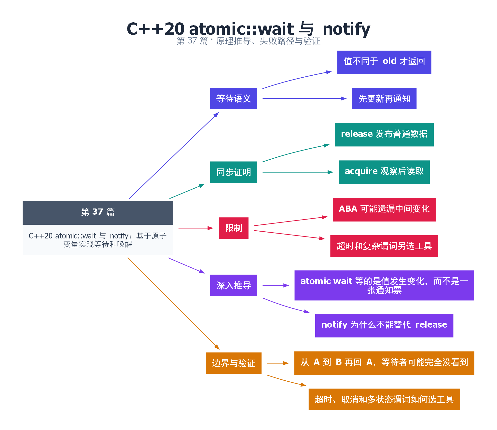

# 37｜C++20 atomic::wait 与 notify：基于原子变量实现等待和唤醒

[返回总目录](README.md) · 最低标准：C++20

一句话总结：atomic::wait 等待原子值不同于指定旧值，notify 负责唤醒等待者；正确发布仍取决于 store/load 的内存序。

**本文目录**

- [1. 看号码牌而不是一直敲门](#section-1)
- [2. 一次发布的完整顺序](#section-2)
- [3. 值变化不等于事件队列](#section-3)
- [4. 深入推导、反例与工程取舍](#section-4)
  - [4.1 atomic wait 等的是值发生变化，而不是一张通知票](#depth-1)
  - [4.2 notify 为什么不能替代 release](#depth-2)
  - [4.3 从 A 到 B 再回 A，等待者可能完全没看到](#depth-3)
  - [4.4 超时、取消和多状态谓词如何选工具](#depth-4)
- [5. 完整示例与复现](#section-5)
  - [5.1 如何判断运行结果](#section-5-1)
- [6. Q&A（常见问题与解答）](#section-6)
  - [6.1 Q：只 notify 不 store 会怎样？](#section-6-1)
  - [6.2 Q：wait 能保证看到每次变化吗？](#section-6-2)
  - [6.3 Q：notify_one 本身发布 data 吗？](#section-6-3)
- [7. 引用与延伸阅读](#section-7)
- [8. 思维导图总结](#section-8)

---

<a id="section-1"></a>

## 1. 看号码牌而不是一直敲门

忙等不断 load，会占用执行资源；atomic::wait 允许实现更高效地等待值改变。它围绕单个原子对象工作，适合简单状态或代数变化，不需要为了一个整数额外建 mutex 和 condition_variable。

wait(old) 会检查当前值，若与 old 相同则可能阻塞，被通知后继续检查；只有观察到不同的值才返回，因此接口对调用方隐藏了某些内部虚假唤醒。notify 本身不改变原子值，若值始终等于 old，单独 notify 不会让等待协议完成。

<a id="section-2"></a>

## 2. 一次发布的完整顺序

示例生产者先写普通 data，再 release store state=1，随后 notify_one。消费者 `wait(0, acquire)` 返回时已观察到不同于 0 的值；本例唯一非零值由对应 release 写入，所以读取 data 有同步保证。

如果 state 先被设置为 1，消费者才开始 wait，它会直接观察值不同而返回，不依赖那次通知是否被“记住”。如果等待者已经阻塞，仅 store 不 notify 则不能依赖它及时醒来，所以状态更新与通知都要写。

<a id="section-3"></a>

## 3. 值变化不等于事件队列

值可能 0→1→0，等待者未观察到中间的 1，最终仍看见 0，继续等待。这是 ABA 式的遗漏变化问题。若业务关心“自上次以后是否发生过事件”，可以用递增代数而不是布尔翻转，并分析回绕；若每个事件都必须处理，则应使用队列。

atomic::wait 没有标准的带超时成员，也没有内建 stop_token 参数。需要超时和复杂组合谓词时，条件变量可能更直接。关闭时仅 notify_all 而不改变等待值也可能让线程再次睡去，应把停止状态编码进被等待状态或使用其他协议。

| 工具 | 适合等待 |
|---|---|
| atomic::wait | 一个原子值或代数变化 |
| condition_variable | 多个受锁保护状态组成的谓词 |
| future | 一次结果或异常完成 |

检查时确认 store 在 notify 前、发布内容在 release 前、消费在 acquire 观察后，以及状态不会快速回到旧值掩盖必需事件。

<!-- depth:chapter -->
<a id="section-4"></a>

## 4. 深入推导、反例与工程取舍

<!-- depth:start -->
<a id="depth-1"></a>

### 4.1 atomic wait 等的是值发生变化，而不是一张通知票

把原子变量看成门口显示牌：显示值还是旧值就等待，显示已经改变就继续。notify 负责让等待者重新检查，牌上的值才保存状态。调用 notify_one 而不改变值，不能期待 wait(old) 必定返回；内部即使醒来，也会再次比较。

本例先把 state 从 0 release-store 为 1，再 notify_one。消费者 wait(0, acquire) 返回意味着比较观察到了不同于 0 的值；本例唯一不同值来自这次 release，因此后续读取 data 被正确发布。若先通知后存储，等待者可能在存储前复查到 0 后再次睡下，随后无人通知。

<a id="depth-2"></a>

### 4.2 notify 为什么不能替代 release

数据交接的链是“写 data → release 修改 state → acquire 观察修改 → 读 data”。notify 是唤醒机制，不在这里替你补出缺失的数据发布边。把 store/wait 都改成 relaxed，再保留 notify，不能因此安全读取普通 data。

wait 的 order 应按读取操作选择，不能传 release 或 acq_rel。底层实现可能先自旋，再通过操作系统等待设施休眠；标准不保证每个 atomic 类型都直接映射到一次 futex 或相同系统调用。性能取决于等待长度、竞争和库实现。

<a id="depth-3"></a>

### 4.3 从 A 到 B 再回 A，等待者可能完全没看到

如果状态迅速经历 0→1→0，消费者比较时仍为 0，就可能错过中间变化。这是等待接口的 ABA 边界；它不是保存每次历史事件的队列。把 notify 次数当作待消费事件数量也同样错误。

可用单调代数减少遗漏代次的风险，但计数回绕仍须考虑；若每个事件都必须被处理，应使用队列保存载荷，再用原子代数或条件变量提示有工作。容量和关闭协议不会因为换成 atomic::wait 就自动消失。

<a id="depth-4"></a>

### 4.4 超时、取消和多状态谓词如何选工具

| 需求 | 较自然的起点 |
|---|---|
| 单原子状态变化、无需超时 | atomic::wait |
| 多个字段构成条件 | mutex + condition_variable |
| 带 stop_token 的等待 | condition_variable_any 对应重载 |
| 每个事件都不能丢 | 队列或有计数语义的协议 |

C++20 atomic::wait 没有统一的定时等待和 stop_token 重载。若关闭时想唤醒等待者，应先把关闭编码成不同于旧值的可观察状态，再通知；仅 notify_all 不保证等待返回。默认例子只是一轮从 0 到 1 的发布，不能直接套用为多轮事件系统。
<!-- depth:end -->

<a id="section-5"></a>

## 5. 完整示例与复现

源文件：[examples/37.cpp](examples/37.cpp)。在本系列目录运行以下命令；环境准备见 [实验环境](实验环境与验证.md)。

```bash
g++ -std=c++20 -O2 -Wall -Wextra -pedantic -pthread examples/37.cpp -o demo37
./demo37
```

```cpp
#include <atomic>
#include <cassert>
#include <iostream>
#include <thread>
int main() {
    int data=0,result=0;
    std::atomic<int> state{0};
    std::jthread consumer([&]{
        state.wait(0,std::memory_order_acquire);
        result=data;
    });
    data=42;
    state.store(1,std::memory_order_release);
    state.notify_one();
    consumer.join();
    assert(result==42);
    std::cout << result << '\n';
}
```

<a id="section-5-1"></a>

### 5.1 如何判断运行结果

输出 `42`。消费者启动早晚均由原子值检查正确处理。

<a id="section-6"></a>

## 6. Q&A（常见问题与解答）

<a id="section-6-1"></a>

### 6.1 Q：只 notify 不 store 会怎样？

A：等待者会重查值，若仍等于 old 就不能完成 wait；通知不是状态本身。

<a id="section-6-2"></a>

### 6.2 Q：wait 能保证看到每次变化吗？

A：不能，值可能变走又变回；需要每个事件时使用队列或更明确的序号协议。

<a id="section-6-3"></a>

### 6.3 Q：notify_one 本身发布 data 吗？

A：不能替代正确的 release/acquire 发布链，应把内存序附在相关原子访问上。

<a id="section-7"></a>

## 7. 引用与延伸阅读

- [深化实验与验证](深化实验与验证.md)：完整协议测试、运行命令、预期断言和未覆盖边界。

- [原子等待操作](https://timsong-cpp.github.io/cppwp/n4861/atomics.wait)

规范链接采用固定的 C++20 工作草案 N4861；对较早标准的差异以正文标注为准。示例和分析为本系列自编，规范用于核对接口契约。

<a id="section-8"></a>

## 8. 思维导图总结

```text
C++20 atomic::wait 与 notify：基于原子变量实现等待和唤醒
├── 等待语义
│   ├── 值不同于 old 才返回
│   └── 先更新再通知
├── 同步证明
│   ├── release 发布普通数据
│   └── acquire 观察后读取
├── 限制
│   ├── ABA 可能遗漏中间变化
│   └── 超时和复杂谓词另选工具
├── 深入推导
│   ├── atomic wait 等的是值发生变化，而不是一张通知票
│   └── notify 为什么不能替代 release
└── 边界与验证
    ├── 从 A 到 B 再回 A，等待者可能完全没看到
    └── 超时、取消和多状态谓词如何选工具
```



[Graphviz 源文件](images/37.dot)
