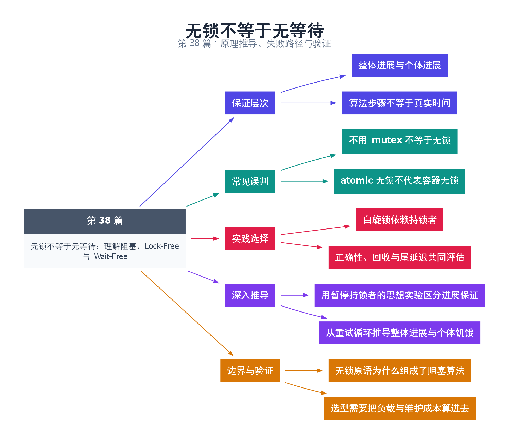

# 38｜无锁不等于无等待：理解阻塞、Lock-Free 与 Wait-Free

[返回总目录](README.md) · 最低标准：C++20

一句话总结：Lock-Free 描述系统整体进展，Wait-Free 描述每个操作的有界完成；不用 mutex 的代码并不自动满足任何一种。

**本文目录**

- [1. 车流畅通不代表每辆车都很快](#section-1)
- [2. is_lock_free 只回答局部问题](#section-2)
- [3. 本例刻意展示反例](#section-3)
- [4. 深入推导、反例与工程取舍](#section-4)
  - [4.1 用暂停持锁者的思想实验区分进展保证](#depth-1)
  - [4.2 从重试循环推导整体进展与个体饥饿](#depth-2)
  - [4.3 无锁原语为什么组成了阻塞算法](#depth-3)
  - [4.4 选型需要把负载与维护成本算进去](#depth-4)
- [5. 完整示例与复现](#section-5)
  - [5.1 如何判断运行结果](#section-5-1)
- [6. Q&A（常见问题与解答）](#section-6)
  - [6.1 Q：自旋锁为什么还叫阻塞？](#section-6-1)
  - [6.2 Q：CAS 失败说明别人成功，因此一定无锁吗？](#section-6-2)
  - [6.3 Q：Wait-Free 就满足实时截止时间吗？](#section-6-3)
- [7. 引用与延伸阅读](#section-7)
- [8. 思维导图总结](#section-8)

---

<a id="section-1"></a>

## 1. 车流畅通不代表每辆车都很快

路口持续有车通过，说明整体有进展；某辆车可能一直插不进去。Lock-Free 类似整体进展要求，Wait-Free 进一步要求每个参与操作在有界自身步骤内完成。现实操作系统调度仍可能暂停线程，因此算法步骤保证不等同于墙上时钟截止时间保证。

阻塞算法可能依赖某个特定线程释放锁才能继续。CAS 循环即使没有 mutex，也要分析失败是否意味着别的操作推进、是否包含分配或回收等隐藏阻塞，以及算法所有路径是否满足条件。

<a id="section-2"></a>

## 2. is_lock_free 只回答局部问题

atomic<T>::is_lock_free 描述该原子对象相关实现属性，不证明包含它的队列、分配器和日志都是 Lock-Free。某个容器内部用无锁原子指针，却在每次入队时调用一般堆分配，并不能仅凭指针原子性质就声称端到端无锁。

atomic_flag 保证相应原子操作无锁，但用它写成自旋锁后，其他线程仍依赖持锁线程释放：若持锁线程被暂停，等待者会一直转。因此“原语无锁”和“用它做出的算法无锁”不是同一个判断。

<a id="section-3"></a>

## 3. 本例刻意展示反例

示例用 atomic_flag 实现自旋锁，保护普通计数器。它在互斥与 release/acquire 关系上可以正确工作，但算法属于阻塞锁；test_and_set 失败者只能等持有者 clear。教学实现使用 yield 降低纯自旋压力，但 yield 不保证公平或立即调度持锁线程。

| 保证 | 谁必须取得进展 | 仍可能存在 |
|---|---|---|
| 阻塞 | 依赖锁拥有者等外部进展 | 持有者暂停导致整体等待 |
| Lock-Free | 系统中某些操作持续完成 | 个别操作饥饿 |
| Wait-Free | 每个操作在有界步骤内完成 | 调度暂停和较高常数成本 |

不要把无锁作为默认性能目标。短临界区、低竞争或操作可能被抢占时，成熟 mutex 常更稳妥。需要无锁时，应给出进展证明、内存回收方案和在真实负载下的尾延迟数据，而不仅是吞吐量一张图。

<!-- depth:chapter -->
<a id="section-4"></a>

## 4. 深入推导、反例与工程取舍

<!-- depth:start -->
<a id="depth-1"></a>

### 4.1 用暂停持锁者的思想实验区分进展保证

把某个线程在最不利时刻暂停：若它拿着自旋锁，其他线程即使一直执行 test_and_set 也无法进入临界区，整个相关操作集合可能不再完成。CPU 忙和算法有进展是两回事，所以自旋锁依然属于阻塞式算法。

lock-free 要求在通常的执行假设下系统整体持续有操作完成；wait-free 还要求每个操作在有界自身步骤内完成。两者都不是硬实时墙钟保证：线程若根本没被调度，或发生缺页与系统停顿，实际延迟仍可很长。

<a id="depth-2"></a>

### 4.2 从重试循环推导整体进展与个体饥饿

某些 CAS 算法中，一次真实竞争失败意味着另一个线程已经成功改变了状态，于是可以用于整体进展证明。但不能只看到 while(CAS) 就认定 lock-free：还要检查循环里的内存分配、回收扫描、回调和所有底层原子操作是否具备所需性质。

即使系统每秒完成很多操作，一个竞争不利的线程也可能一直重试。这就是整体 lock-free 与个体 wait-free 的差别。测量平均耗时无法识别这种尾部风险，需要记录每个线程的完成量、重试次数和最慢操作。

<a id="depth-3"></a>

### 4.3 无锁原语为什么组成了阻塞算法

atomic_flag 的原子操作具有无锁保证，但本例 SpinMutex 的协议要求所有后来者等待当前所有者 clear。原语属性没有传递成整体算法属性。类似地，一个无锁队列外围若先拿全局锁再入队，整个 API 也不能再以队列内部性质宣称 lock-free。

| 方案 | 等待成本 | 主要风险 |
|---|---|---|
| mutex | 可休眠，仍有唤醒成本 | 持锁者被调度暂停、锁顺序 |
| 自旋锁 | 消耗执行资源轮询 | 抢占、超额订阅时浪费严重 |
| CAS 数据结构 | 冲突后重试 | 饥饿、ABA、回收复杂 |

<a id="depth-4"></a>

### 4.4 选型需要把负载与维护成本算进去

临界区极短、核心充足且等待者很快能得到锁时，自旋可能有用；持锁区有 I/O、分配或长计算时，持续自旋通常很危险。yield 只是调度提示，不保证让出给目标持锁者，更不建立公平顺序。

本例检查计数为 20000，只证明受这个锁保护的计数更新完成，不能测得进展类别。若要观察暂停持锁者的影响，可用握手让它持锁等待外部释放，再观察另一线程无法完成；要给实验外部终止条件，避免测试本身永久挂起。更复杂的 wait-free 算法需提供步骤上界及适用模型，而不是用一次很快的 benchmark 作为定义。
<!-- depth:end -->

<a id="section-5"></a>

## 5. 完整示例与复现

源文件：[examples/38.cpp](examples/38.cpp)。在本系列目录运行以下命令；环境准备见 [实验环境](实验环境与验证.md)。

```bash
g++ -std=c++20 -O2 -Wall -Wextra -pedantic -pthread examples/38.cpp -o demo38
./demo38
```

```cpp
#include <atomic>
#include <cassert>
#include <iostream>
#include <mutex>
#include <thread>
class SpinMutex {
    std::atomic_flag flag_=ATOMIC_FLAG_INIT;
public:
    void lock() {
        while(flag_.test_and_set(std::memory_order_acquire)) std::this_thread::yield();
    }
    void unlock() {flag_.clear(std::memory_order_release);}
};
int main() {
    SpinMutex mutex;
    int counter=0;
    auto work=[&]{for(int i=0;i<10000;++i){std::lock_guard<SpinMutex> lock(mutex);++counter;}};
    std::jthread a(work),b(work);
    a.join();b.join();
    assert(counter==20000);
    std::cout << "counter=" << counter << "; algorithm uses a blocking spin lock\n";
}
```

<a id="section-5-1"></a>

### 5.1 如何判断运行结果

输出 counter=20000，并明确提示该算法使用阻塞式自旋锁。

<a id="section-6"></a>

## 6. Q&A（常见问题与解答）

<a id="section-6-1"></a>

### 6.1 Q：自旋锁为什么还叫阻塞？

A：这里的阻塞指进展依赖持锁者，而非是否进入内核睡眠。忙等仍然可能依赖一个暂停的持锁线程。

<a id="section-6-2"></a>

### 6.2 Q：CAS 失败说明别人成功，因此一定无锁吗？

A：还要分析虚假失败、整个算法路径、资源分配与回收，不能凭一个局部循环推广整个系统。

<a id="section-6-3"></a>

### 6.3 Q：Wait-Free 就满足实时截止时间吗？

A：不直接等价，还要考虑调度、硬件中断、内存分配和步骤成本等系统条件。

<a id="section-7"></a>

## 7. 引用与延伸阅读

- [前进保证](https://timsong-cpp.github.io/cppwp/n4861/intro.progress)
- [atomic_flag](https://timsong-cpp.github.io/cppwp/n4861/atomics.flag)

规范链接采用固定的 C++20 工作草案 N4861；对较早标准的差异以正文标注为准。示例和分析为本系列自编，规范用于核对接口契约。

<a id="section-8"></a>

## 8. 思维导图总结

```text
无锁不等于无等待：理解阻塞、Lock-Free 与 Wait-Free
├── 保证层次
│   ├── 整体进展与个体进展
│   └── 算法步骤不等于真实时间
├── 常见误判
│   ├── 不用 mutex 不等于无锁
│   └── atomic 无锁不代表容器无锁
├── 实践选择
│   ├── 自旋锁依赖持锁者
│   └── 正确性、回收与尾延迟共同评估
├── 深入推导
│   ├── 用暂停持锁者的思想实验区分进展保证
│   └── 从重试循环推导整体进展与个体饥饿
└── 边界与验证
    ├── 无锁原语为什么组成了阻塞算法
    └── 选型需要把负载与维护成本算进去
```



[Graphviz 源文件](images/38.dot)
