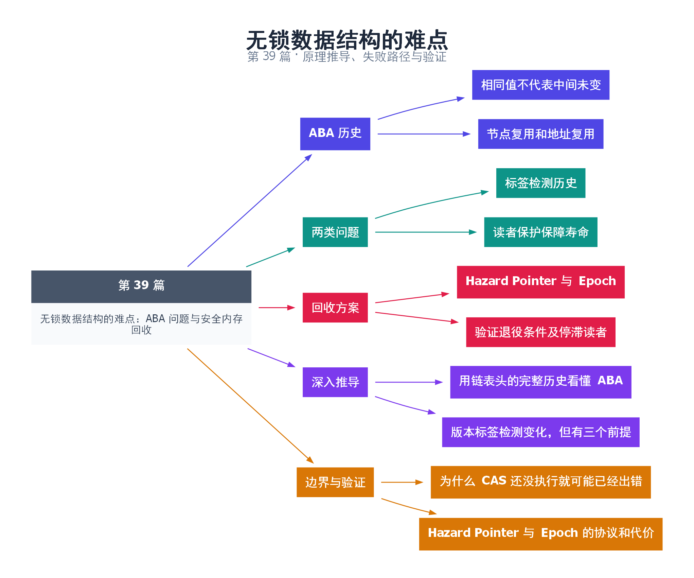

# 39｜无锁数据结构的难点：ABA 问题与安全内存回收

[返回总目录](README.md) · 最低标准：C++11

一句话总结：CAS 只比较当前表示，不记录中间历史；无锁节点删除还必须解决“什么时候没有读者会再访问它”的回收问题。

**本文目录**

- [1. 门牌号没变，住户可能已换](#section-1)
- [2. 标签能检测历史，不能保护寿命](#section-2)
- [3. 真正困难的是安全解引用](#section-3)
- [4. 深入推导、反例与工程取舍](#section-4)
  - [4.1 用链表头的完整历史看懂 ABA](#depth-1)
  - [4.2 版本标签检测变化，但有三个前提](#depth-2)
  - [4.3 为什么 CAS 还没执行就可能已经出错](#depth-3)
  - [4.4 Hazard Pointer 与 Epoch 的协议和代价](#depth-4)
- [5. 完整示例与复现](#section-5)
  - [5.1 如何判断运行结果](#section-5-1)
- [6. Q&A（常见问题与解答）](#section-6)
  - [6.1 Q：版本号足够大就能立即 delete 吗？](#section-6-1)
  - [6.2 Q：不释放节点就没有 ABA 吗？](#section-6-2)
  - [6.3 Q：shared_ptr 版本一定 Lock-Free 吗？](#section-6-3)
- [7. 引用与延伸阅读](#section-7)
- [8. 思维导图总结](#section-8)

---

<a id="section-1"></a>

## 1. 门牌号没变，住户可能已换

线程看到链表头地址 A，暂停后再检查仍是 A，便以为没有变化。但期间别人可能移除 A、移除后继 B，再把 A 放回；也可能释放 A 后分配器复用同一地址。数值相同不等于节点身份和链表结构未变，这就是 ABA 的核心。

经典栈弹出先读取 head=A 和 next=B，再 CAS head 从 A 改成 B。如果另一个线程已经让 B 离开结构，旧 CAS 成功就可能把无效或不应存在的 B 放回头部。即使没有释放内存，仅复用节点也可能造成逻辑错误。

<a id="section-2"></a>

## 2. 标签能检测历史，不能保护寿命

给指针或索引附加递增版本，可让 A(v1)→B(v2)→A(v3) 不再等于旧的 A(v1)。版本有限会回绕，必须分析允许的操作次数和停顿窗口；打包指针还涉及对齐、地址位宽和双字原子是否无锁等平台问题。

本例用 64 位整数把 32 位索引与 32 位版本打包，串行模拟一次 ABA 历史，再验证旧 CAS 失败。它不分配节点，故意只演示版本检测，不把它冒充完整无锁栈。

<a id="section-3"></a>

## 3. 真正困难的是安全解引用

线程 load 到一个指针后、读取 next 前，另一线程可能已经 delete 它。即使最后 CAS 因版本不匹配失败，之前那次 next 读取也已经是释放后访问。必须先获得某种读者保护，再解引用。

Hazard Pointer 的基本思路是读者发布自己即将访问的节点，重新验证头指针没有变化，再安全访问；删除者把节点放入退役集合，确认没有 hazard 指向它后才回收。精确内存序和扫描协议非常重要，不能用几句伪代码代替完整实现。

Epoch/RCU 类方案把回收延后到所有旧读者离开相应临界区之后。它们适合不同访问模式，但长时间不退出的读者可能拖延回收，导致内存增长。引用计数提供另一种寿命管理，但原子智能指针未必无锁，也有计数成本。

| 手段 | 主要解决 | 不能自动解决 |
|---|---|---|
| 版本标签 | 检测部分 ABA 历史 | 解引用前对象存活 |
| Hazard Pointer | 声明当前读者保护 | 任意算法的逻辑 ABA |
| Epoch/RCU | 延迟回收直到安全期 | 停滞读者造成的回收拖延 |

工程建议是优先使用经审核的实现。若自行编写，单独列出线性化点、节点所有权、退役条件和回收条件，测试地址快速复用与读者长时间暂停。

<!-- depth:chapter -->
<a id="section-4"></a>

## 4. 深入推导、反例与工程取舍

<!-- depth:start -->
<a id="depth-1"></a>

### 4.1 用链表头的完整历史看懂 ABA

设栈头指向 A，A.next=B。线程 T1 读到 head=A 和 next=B 后暂停；T2 弹出 A，再弹出 B，随后把 A 重新压回，此时 A.next 可能已经是 C。T1 恢复后 CAS(head, A, B) 只比较头指针，发现仍是 A 就成功，把已经不在栈中的 B 重新挂成头。

| 时刻 | T1 的局部认知 | 真实结构 |
|---|---|---|
| 起点 | head=A，next=B | A→B→C |
| T2 修改后 | 仍记着 A、B | A→C |
| 过时 CAS | A 相等，所以写 B | 可能恢复错误节点 |

ABA 是“值相同但历史不同”；即使节点从未释放，只是被重新连接，也可能发生逻辑 ABA，因此它不完全等同于内存分配器复用地址。

<a id="depth-2"></a>

### 4.2 版本标签检测变化，但有三个前提

把 head 表示成 (索引,版本)，每次更新递增版本；T1 看到 (A,0)，T2 完成后变成 (A,2)，过时 CAS 就失败。本例用两个 32 位字段打包进 uint64_t 演示这个判别，assert 验证失败时 expected 被更新。

首先，版本位宽有限，回绕后仍可能撞上旧值，必须证明旧观察不可能跨越完整回绕周期。其次，指针或索引和版本必须作为一个整体原子比较；分别放在两个 atomic 中不等价。最后，较宽原子类型是否 lock-free 要查实现，不能因算法使用标签就宣称整体无锁。

<a id="depth-3"></a>

### 4.3 为什么 CAS 还没执行就可能已经出错

T1 读取 head 指针 p 后，T2 弹出并 delete p；T1 随后为了构造 desired 而读取 p->next，此刻已经 use-after-free。即使未来的 CAS 必然因版本变化失败，也无法撤销这次非法解引用。回收安全必须在访问节点之前建立。

因此至少有两份证明：结构修改不会依据过时历史错误提交；读者在任何解引用期间对象都活着。标签主要处理第一份，hazard pointer、epoch 等策略处理第二份，某些方案还需要额外措施防止逻辑 ABA。

<a id="depth-4"></a>

### 4.4 Hazard Pointer 与 Epoch 的协议和代价

Hazard Pointer 的核心是读者先公布“我可能访问 p”，再重读 head 验证仍是 p，验证成功后才解引用；若变化则重试。删除者先把节点放进 retired 列表，扫描读者保护记录后才能回收不再受保护的节点。发布保护与扫描所需内存序是算法正确性的一部分，不能直接把这几步全设 relaxed。

Epoch/基于静止期的方案让读者登记进入受保护时期，退出时报告静止；删除者等所有可能观察旧节点的读者越过回收边界。读取路径通常较轻，但一个长时间不退出的读者可能让大量 retired 节点无法释放。

| 方案 | 读者成本 | 内存回收的关键风险 |
|---|---|---|
| Hazard Pointer | 保护发布、验证重试 | 保护记录管理与扫描开销 |
| Epoch | 进入/退出时期 | 停滞读者拖住回收 |
| 互斥锁下管理节点 | 加锁和等待 | 较简单但可能阻塞 |

本篇代码只演示标签，不实现可投产的无锁栈或安全回收。验证完整实现时必须注入暂停点：读头后、公布保护后、验证后、摘链后、回收前；记录退休节点量与最长保护时间。只测栈的最终元素个数，无法揭示暂停读者访问释放内存的问题。
<!-- depth:end -->

<a id="section-5"></a>

## 5. 完整示例与复现

源文件：[examples/39.cpp](examples/39.cpp)。在本系列目录运行以下命令；环境准备见 [实验环境](实验环境与验证.md)。

```bash
g++ -std=c++11 -O2 -Wall -Wextra -pedantic -pthread examples/39.cpp -o demo39
./demo39
```

```cpp
#include <atomic>
#include <cassert>
#include <cstdint>
#include <iostream>
std::uint64_t pack(std::uint32_t index,std::uint32_t version) {
    return (std::uint64_t(version)<<32)|index;
}
int main() {
    std::atomic<std::uint64_t> head{pack(1,0)};
    auto old=head.load();
    head.store(pack(2,1));
    head.store(pack(1,2)); // 索引再次为 1，版本已不同。
    bool changed=head.compare_exchange_strong(old,pack(3,1));
    assert(!changed && old==pack(1,2));
    std::cout << "stale CAS rejected; no reclamation implemented\n";
}
```

<a id="section-5-1"></a>

### 5.1 如何判断运行结果

输出 `stale CAS rejected; no reclamation implemented`。64 位原子是否无锁由平台决定，不影响本例语义。

<a id="section-6"></a>

## 6. Q&A（常见问题与解答）

<a id="section-6-1"></a>

### 6.1 Q：版本号足够大就能立即 delete 吗？

A：不能，版本检查发生之前读者就可能解引用旧地址，必须先解决读取期间的寿命保护。

<a id="section-6-2"></a>

### 6.2 Q：不释放节点就没有 ABA 吗？

A：仍可能因节点移除后重新插入而产生逻辑 ABA，只是避免了部分地址复用和释放后访问问题。

<a id="section-6-3"></a>

### 6.3 Q：shared_ptr 版本一定 Lock-Free 吗？

A：不保证，原子智能指针和引用计数实现都要按平台与整体路径分析进展性质。

<a id="section-7"></a>

## 7. 引用与延伸阅读

- [Maged M. Michael：Hazard Pointers（2004）](https://research.ibm.com/publications/hazard-pointers-safe-memory-reclamation-for-lock-free-objects)：原论文入口；配合正文区分结构更新与节点回收。

- [深化实验与验证](深化实验与验证.md)：完整协议测试、运行命令、预期断言和未覆盖边界。

- [原子库与比较交换](https://timsong-cpp.github.io/cppwp/n4861/atomics)
- [Hazard Pointers 原始论文 DOI](https://doi.org/10.1109/TPDS.2004.8)

规范链接采用固定的 C++20 工作草案 N4861；对较早标准的差异以正文标注为准。示例和分析为本系列自编，规范用于核对接口契约。

<a id="section-8"></a>

## 8. 思维导图总结

```text
无锁数据结构的难点：ABA 问题与安全内存回收
├── ABA 历史
│   ├── 相同值不代表中间未变
│   └── 节点复用和地址复用
├── 两类问题
│   ├── 标签检测历史
│   └── 读者保护保障寿命
├── 回收方案
│   ├── Hazard Pointer 与 Epoch
│   └── 验证退役条件及停滞读者
├── 深入推导
│   ├── 用链表头的完整历史看懂 ABA
│   └── 版本标签检测变化，但有三个前提
└── 边界与验证
    ├── 为什么 CAS 还没执行就可能已经出错
    └── Hazard Pointer 与 Epoch 的协议和代价
```



[Graphviz 源文件](images/39.dot)
