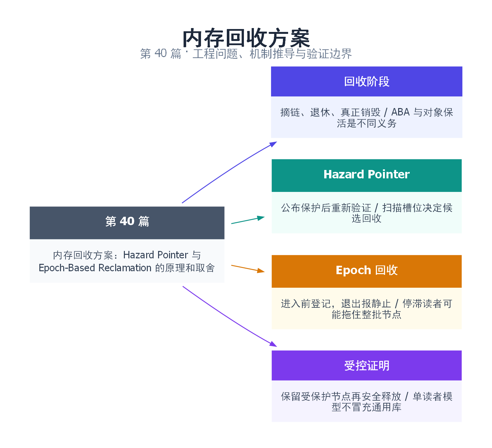

# 40｜内存回收方案：Hazard Pointer 与 Epoch-Based Reclamation 的原理和取舍

[返回总目录](README.md) · 最低标准：C++20

一句话总结：摘链不等于可释放；HP 保护具体节点，EBR 等待相关读者越过静止期。

快速阅读：先看问题、方案对比和运行结果；深入阅读：按顺序推演边界，再运行完整示例及失败实验。

**本文目录**

- [1. 节点已从队列摘除，为什么还不能 delete](#section-1)
- [2. Hazard Pointer：读者公布自己正在保护哪个地址](#section-2)
- [3. EBR：等待所有可能见过旧节点的读者跨过安全边界](#section-3)
- [4. 完整受控实验：让读者停在持有节点的时刻](#section-4)
- [5. 分别证明保活、安全释放与最终回收](#section-5)
- [6. 成本、停滞读者和选型](#section-6)
- [7. 失败注入、指标和工程接入清单](#section-7)
- [8. 引用与延伸阅读](#section-8)
- [9. 思维导图总结](#section-9)

---

<a id="section-1"></a>

## 1. 节点已从队列摘除，为什么还不能 delete

图书馆把一本书从目录下架，不表示每位读者都已经放下手里的书。无锁容器的“结构删除”只是让新读者不再从入口找到节点；旧读者可能还保存裸指针。现在 delete，就会让旧读者在解引用时访问已结束生命周期的对象。

第 39 篇讲 ABA：同一个地址出现两次，可能代表不同历史。本篇聚焦另一个证明义务——**每次解引用时节点仍然存活**。版本标签可以让过时 CAS 失败，但如果读取 next 时已经 use-after-free，后来 CAS 失败也无法挽救。

回收必须分成 unlink（从结构摘除）、retire（进入待回收集合）、reclaim（真正销毁）三个阶段。给 retire 加一把锁可以保护列表，但仍要证明没有读者持有节点；单纯“延迟几毫秒再 delete”没有任何线程进度保证。

<a id="section-2"></a>

## 2. Hazard Pointer：读者公布自己正在保护哪个地址

HP 像每位读者在登记板上写下手里那本书的编号。读者先读入口 p，再把 p 写入自己的保护槽，然后重新读入口验证仍为 p，只有验证成功后才解引用。若入口已改变，必须重新获取，不能继续使用第一次读到的节点。

为什么要第二次读取？窗口是：读者读到 p → 删除者摘链并扫描，尚未看见保护记录 → 回收 p → 读者才公布 p。单次“先读再登记”太晚了。重新验证让读者在这个窗口后发现入口变化并放弃解引用。

删除者将节点加入 retired 集合，扫描所有已注册保护槽；没有任何槽保护的候选才可回收。本篇为了减少内存序证明复杂度，让入口与保护元数据全部 seq_cst，并限制单读者、单写者、不重新插入地址。生产实现可优化，但不能只把元数据改为 release/acquire 或 relaxed 就沿用原证明。

| 关键位置 | 允许做什么 | 禁止做什么 |
|---|---|---|
| 第一次读入口后 | 公布可能访问的地址 | 立即读 p->next |
| 验证成功后 | 在保护有效期间解引用 | 先清空保护再用 p |
| 删除者摘链后 | retire、扫描 | 无条件 delete |

HP 保护的是节点寿命，不冻结节点内部可变字段。多个线程仍同时改 value 时，字段本身需要自己的原子或同步协议。一个读者同时解引用多个节点，就需要足够保护槽和转移保护的算法，不能用一个槽随意覆盖后还访问旧节点。

<a id="section-3"></a>

## 3. EBR：等待所有可能见过旧节点的读者跨过安全边界

EBR 像图书馆按轮次整理借阅区：读者进入时声明所属 epoch，离开时报告静止；节点退休时记录其所属代次。只有所有可能看过它的旧读者都结束，才能回收。

常见实现维护全局 epoch、每线程参与状态与分代 retired 列表。某些实现用三个循环桶组织推进；“三桶”是某种设计的组织方法，不是任意系统只等两次整数加一就安全。真正条件是所有相关读者已经跨过旧节点仍可达的临界区。

本篇用单调增长、无回绕的代数简化解释：读者先公布 epoch 再加载 head；写者先摘除节点，再推进 global_epoch；扫描到读者 inactive 或公布的 epoch 严格新于退休代次，才允许该候选回收。代码只演示一个读者的一轮交接，不处理线程动态注册、嵌套临界区和多写者批量退休。

这里的顺序尤其重要。若读者先取得 p、后宣布进入保护区，写者可能在两步之间把节点回收；若写者先推进代数、后摘链，新代读者仍可能获得旧节点，不能依据“代数较新”放行回收。设计必须把入口可达性和参与登记一起证明。

<a id="section-4"></a>

## 4. 完整受控实验：让读者停在持有节点的时刻

完整源文件：[examples/40.cpp](examples/40.cpp)。

```cpp
// Restricted teaching model: one reader, one writer, no address reuse/reinsert.
// All shared metadata uses seq_cst; not a general-purpose reclamation library.
#include <atomic>
#include <cassert>
#include <cstdint>
#include <future>
#include <iostream>
#include <memory>
#include <thread>

struct Node { const int value = 42; };
void hazard_demo() {
    auto owner = std::make_unique<Node>();
    std::atomic<Node*> head{owner.get()}, hazard{nullptr};
    std::promise<void> protected_now, release;
    auto ready = protected_now.get_future();
    auto gate = release.get_future();
    int observed = 0;
    std::jthread reader([&] {
        Node* p;
        do { p = head.load(); hazard.store(p); } while (p != head.load());
        // Only after revalidation may p be dereferenced.
        protected_now.set_value();
        gate.wait();
        assert(p != nullptr);
        observed = p->value;
        hazard.store(nullptr); // no access to p after releasing protection
    });
    ready.wait();
    Node* removed = head.exchange(nullptr);
    auto retired = std::move(owner);
    assert(removed == retired.get() && hazard.load() == removed);
    // scan sees protection: MUST retain retired ownership
    release.set_value();
    while (hazard.load() != nullptr) std::this_thread::yield();
    retired.reset(); // reclaimed before join, after protection has ended
    reader.join();
    assert(observed == 42);
    std::cout << "HP: protected node retained, then reclaimed\n";
}
void epoch_demo() {
    auto owner = std::make_unique<Node>();
    std::atomic<Node*> head{owner.get()};
    std::atomic<std::uint64_t> global_epoch{1}, announced{0}; // 0 = inactive
    std::promise<void> entered, release;
    auto ready = entered.get_future();
    auto gate = release.get_future();
    int observed = 0;
    std::jthread reader([&] {
        const auto e = global_epoch.load();
        announced.store(e); // announce BEFORE loading shared pointers
        Node* p = head.load();
        entered.set_value();
        gate.wait();
        assert(p != nullptr);
        observed = p->value;
        announced.store(0); // no protected-pointer use beyond this point
    });
    ready.wait();
    Node* removed = head.exchange(nullptr);
    auto retired = std::move(owner);
    const auto retired_epoch = global_epoch.fetch_add(1);
    auto can_reclaim = [&] {
        const auto e = announced.load();
        return e == 0 || e > retired_epoch;
    };
    assert(removed == retired.get() && !can_reclaim());
    release.set_value();
    while (!can_reclaim()) std::this_thread::yield();
    retired.reset();
    reader.join();
    assert(observed == 42);
    std::cout << "EBR: old reader delayed reclaim until quiescent\n";
}
int main() { hazard_demo(); epoch_demo(); }
```

```bash
mkdir -p build/reclaim40
g++ -std=c++20 -O2 -Wall -Wextra -pthread examples/40.cpp -o build/reclaim40/demo
./build/reclaim40/demo
```

预期两行：`HP: protected node retained, then reclaimed` 和 `EBR: old reader delayed reclaim until quiescent`。promise 把读者固定在已经取得保护、尚未读完的阶段。写者先验证不能回收，再允许读者完成，等保护结束后 reset retired；**实际释放安排在 join 之前**，让“可以释放”的依据明确来自回收协议，而不是所有线程已经结束。

两个示例保留 unique_ptr 作为退休节点的真实拥有者，atomic<Node*> 只表达可达性。节点值 const，避免把回收安全与字段竞争混在一起。示例没有内存池和地址复用，不能据此宣称解决全部逻辑 ABA。

<a id="section-5"></a>

## 5. 分别证明保活、安全释放与最终回收

对 HP，先看成功验证到清空保护之间：只要扫描遵循与公布/验证匹配的顺序协议，删除者就不能把仍受保护的节点释放。读者在清空保护后不再解引用，这是读者必须履行的责任。本例还用阶段握手确认扫描时槽里确实是目标节点，验证保留分支。

对本篇 EBR 简化模型，读取旧 head 的读者必须在摘链前完成相应的入口 load；其公布发生在 load 之前。若扫描看见 inactive，则这一轮读者已完成，或尚未进入且之后不能再从当前 head 得到旧节点。若扫描看见更新 epoch，则该读者的进入发生在推进后，而摘链已经完成。这个论证依赖所有元数据使用 SC、无地址重新插入和无代数回绕，不能无条件外推。

“不会过早释放”和“迟早能释放”仍是不同问题。HP 读者长时间停住可能保护有限槽中的节点，也会影响具体数据结构允许何时退休；EBR 读者一直处于旧临界区，可能把随后退休的大批节点都拖住。retired 队列继续增长时，即使 push/pop 仍在完成，进程也可能先耗尽内存。

<a id="section-6"></a>

## 6. 成本、停滞读者和选型

设 P 个参与线程、每线程 K 个 HP 槽，保护记录规模为 P×K。最直接地为 R 个候选逐一扫描所有槽，成本可达 O(RPK)；先收集保护地址建集合再检查候选，通常可把一轮工作组织得更好，但集合构建、排序或散列本身有内存与时间成本。

EBR 的读侧通常只需进入/退出登记，扫描关注参与线程的 epoch，而不是每个具体地址。代价转移到了全局推进和退休积压；某个线程在保护区里阻塞 IO、长期被抢占或异常退出未注销，会显著影响回收进度。

| 维度 | HP | EBR |
|---|---|---|
| 读者声明 | 具体受保护地址 | 参与某个时期 |
| 长读者影响 | 通常直接保护有限节点，具体上界依实现 | 可能阻止大量旧代退休节点回收 |
| 读侧操作 | 发布、验证，遍历时可能多次换保护 | 临界区进入/退出相对集中 |
| 管理难点 | 槽注册、保护转移、扫描和批次阈值 | 静止期、参与者停滞、嵌套与注销 |
| 倾向场景 | 读者可能暂停、需精细节点保活 | 临界区很短、退出可控的高频读 |

这不是普遍性能排名。若现有 mutex 满足延迟和吞吐需求，锁下回收更易审查；若选成熟库，仍需检查标准版本、平台、API 生命周期和维护成本。C++20 的这份示例不依赖后续标准中新引入的回收接口。

<a id="section-7"></a>

## 7. 失败注入、指标和工程接入清单

暂停点至少包括：读入口后、发布保护后、验证后、摘链后、扫描前、回收前。检查过程中每个观察值都必须有生命周期依据，不要把将要回收对象的调试读取本身变成 use-after-free。

记录 retired 数量/字节、高水位、最长保护区时间、每轮扫描耗时和实际回收数。给 EBR 加一个受控“读者不退出”实验时，应观察积压而不是期待系统自动判定读者死亡；回收其可能访问的节点会破坏安全。生产中需要限制保护区范围、监控停滞并制定降级策略，而不是超时强删节点。

**RAII guard 是否足够？** 它能让正常返回和 C++ 异常路径注销，但进程终止、线程永久阻塞及 guard 跨不受控挂起仍要处理。

**为什么 SPSC 不需要这套动态回收？** 下一篇固定数组槽位不被并发 delete，通过 head/tail 双向交接决定何时复用。对象生命周期仍要在队列销毁前等生产/消费结束；它规避的是动态节点回收，不是全部寿命问题。

<a id="section-8"></a>

## 8. 引用与延伸阅读

- [Maged M. Michael：Hazard Pointers（2004）](https://research.ibm.com/publications/hazard-pointers-safe-memory-reclamation-for-lock-free-objects)：保护指针方法的原始论文入口。
- [Keir Fraser：Practical lock-freedom，UCAM-CL-TR-579](https://www.cl.cam.ac.uk/techreports/UCAM-CL-TR-579.html)：epoch 回收与实际无锁结构的系统讨论。
- [C++20 内存模型](https://timsong-cpp.github.io/cppwp/n4861/intro.races)：把算法所需顺序映射到语言规则。
- [完整示例](examples/40.cpp)：单读者/单写者的受控实验；不作为通用回收库交付。

<a id="section-9"></a>

## 9. 思维导图总结

```text
内存回收方案：Hazard Pointer 与 Epoch-Based Reclamation 的原理和取舍
├── 回收阶段
│   ├── 摘链、退休、真正销毁
│   └── ABA 与对象保活是不同义务
├── Hazard Pointer
│   ├── 公布保护后重新验证
│   └── 扫描槽位决定候选回收
├── Epoch 回收
│   ├── 进入前登记，退出报静止
│   └── 停滞读者可能拖住整批节点
└── 受控证明
    ├── 保留受保护节点再安全释放
    └── 单读者模型不冒充通用库
```



[Graphviz 图源](images/40.dot)
