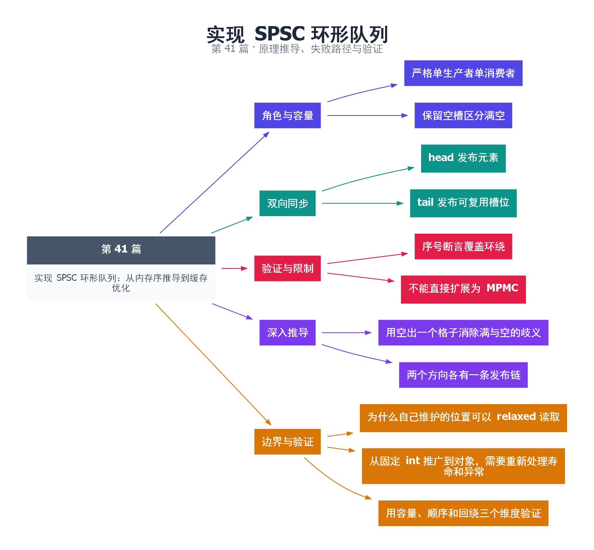

# 41｜实现 SPSC 环形队列：从内存序推导到缓存优化

[返回总目录](README.md) · 最低标准：C++20

一句话总结：SPSC 队列依靠单生产者、单消费者的所有权分工，加上两个方向的 release/acquire 交接，安全复用环形槽位。

**本文目录**

- [1. 单向传菜带](#section-1)
- [2. 第一条同步链：写入到读取](#section-2)
- [3. 第二条同步链：读取到复用](#section-3)
- [4. 为什么不能直接扩成 MPMC](#section-4)
- [5. 验证协议](#section-5)
- [6. 深入推导、反例与工程取舍](#section-6)
  - [6.1 用空出一个格子消除满与空的歧义](#depth-1)
  - [6.2 两个方向各有一条发布链](#depth-2)
  - [6.3 为什么自己维护的位置可以 relaxed 读取](#depth-3)
  - [6.4 从固定 int 推广到对象，需要重新处理寿命和异常](#depth-4)
  - [6.5 用容量、顺序和回绕三个维度验证](#depth-5)
- [7. 完整示例与复现](#section-7)
  - [7.1 如何判断运行结果](#section-7-1)
- [8. Q&A（常见问题与解答）](#section-8)
  - [8.1 Q：为什么自己游标 relaxed，另一端游标 acquire？](#section-8-1)
  - [8.2 Q：N 个槽为何只能放 N-1 个？](#section-8-2)
  - [8.3 Q：单次操作可以叫 Wait-Free 吗？](#section-8-3)
- [9. 引用与延伸阅读](#section-9)
- [10. 思维导图总结](#section-10)

---

<a id="section-1"></a>

## 1. 单向传菜带

只有一位厨师放盘子、一位服务员取盘子，双方只更新各自的游标。厨师发布“已经放好”的位置，服务员发布“已经取走”的位置。比起多人同时抢同一端，这种角色约束大幅简化算法，但也严格限制使用场景。

本实现固定存放 int，容量模板参数 N 至少为 2，保留一个空槽区分满与空，因此实际可用容量为 N-1。head 由生产者更新，tail 由消费者更新，索引在 [0,N) 内循环。

<a id="section-2"></a>

## 2. 第一条同步链：写入到读取

生产者 relaxed 读自己独占写入的 head，acquire 读消费者 tail 判断有没有空位，写入 slots[head] 后 release store 新 head。消费者 acquire load head 观察到已发布元素，才能读取对应普通 int。普通槽位不需要 atomic，因为拥有权交接建立了写入到读取的顺序。

<a id="section-3"></a>

## 3. 第二条同步链：读取到复用

消费者读完槽位后 release store 新 tail。生产者 acquire load tail，确认该槽已经消费后才允许覆盖。这条反向同步同样关键：若只保证生产者到消费者可见，却未保证消费结束后再复用，环绕时仍可能读写同一槽位。

try_push 与 try_pop 都只做有限次索引和原子操作，不在内部等待。返回 false 表示这次观察下没有可用空间或数据，调用者可重试或选择其他等待策略；不要承诺跨线程瞬时“绝对最新”的满空信息。循环重试和线程调度本身不因此获得固定墙上时钟完成上限。

<a id="section-4"></a>

## 4. 为什么不能直接扩成 MPMC

第二个生产者会与第一个生产者同时写 head 和同一槽位，原有独占写前提消失。把 head 改成 fetch_add 也不能自动处理槽位发布顺序、满队列和保留位置失败。MPMC 需要完全不同的竞争和每槽状态设计。

head 与 tail 使用 alignas(64) 分离是针对常见缓存行大小的实验选择，不是可移植的硬件保证。更通用实现需查询或配置干扰尺寸，并评估额外空间。为了把寿命推理限定在核心协议，示例不支持任意类型的异常构造和析构。

<a id="section-5"></a>

## 5. 验证协议

先用小队列验证容量 N-1、空取失败和先进先出，再传输 100000 个连续整数，消费者逐项断言序号相同，从而覆盖大量环绕。只检查总和不能排除某些丢失与重复互相抵消，序号验证更强。生产级测试还应加入不同速度、长暂停和工具检测。

<!-- depth:chapter -->
<a id="section-6"></a>

## 6. 深入推导、反例与工程取舍

<!-- depth:start -->
<a id="depth-1"></a>

### 6.1 用空出一个格子消除满与空的歧义

环形队列像环形传送带：生产者负责放货位置 head，消费者负责取货位置 tail。若两者相等表示空，那么满时不能再用同样表示。本实现保留一个空槽，next(head)==tail 表示满，所以数组大小 N 的可用容量为 N−1。

以 N=3 为例，初始 h=t=0；入 7 后 h=1；入 8 后 h=2；再入 9 的 next=0 等于 t，返回 false。取走 7 后 t=1，此时生产者可把下一项放入槽 2，再把 head 回绕到 0。位置回绕不表示顺序回退，而是下一圈的槽位复用。

<a id="depth-2"></a>

### 6.2 两个方向各有一条发布链

第一条是“发布数据”：生产者写 slots[h]，release-store head；消费者 acquire-load head 观察到可读范围后读取对应槽。第二条是“归还空间”：消费者读完 slots[t]，release-store tail；生产者 acquire-load tail 确认该槽已释放后才覆盖它。

只保留 head 的 release/acquire 而把 tail 两端都改 relaxed，会丢掉“上轮读取完成 → 下轮覆盖”的证明。槽位虽然是普通 int，但只要这两条交接链成立，跨线程的冲突访问就能按轮次排序。这是槽位不需要 atomic 的原因，而非“int 很小所以安全”。

<a id="depth-3"></a>

### 6.3 为什么自己维护的位置可以 relaxed 读取

只有生产者写 head，只有消费者写 tail。生产者读取自己的 head 不需要从别的线程接收信息，消费者读取自己的 tail 同理；因此本地索引读取用 relaxed。对方索引则承担跨线程交接，使用 acquire。

读取到较旧的对方位置，可能保守地报告满或空，因此 try 接口的调用者应允许稍后重试。正确性依赖单写者、原子对象一致性和槽位交接协议；不能从“读旧值只是保守”泛化到任意 MPMC 队列。

新增第二个生产者时，两者可能同时读到相同 head 并写同一个槽。只把更新 head 改成 fetch_add 仍不够：抢到位置与完成槽内容写入不是同一事件，消费者不能在初始化完成前读取。MPMC 通常需要每槽序号等独立就绪协议，是另一套算法。

<a id="depth-4"></a>

### 6.4 从固定 int 推广到对象，需要重新处理寿命和异常

当前 array<int,N> 的元素在队列创建时就存在，赋值不会抛业务异常。若换成原始存储加 placement new，需要明确构造成功后才能发布 head，消费完成后销毁对象并发布 tail；构造、移动或析构异常会改变协议，不能只把 int 文本替换成模板 T。

try_push/pop 的索引操作数量有界，但是否可称为整体 wait-free 还依赖底层原子和元素操作的进展属性；外层 `while(!try_push)` 等待另一方推进，本身没有单次墙钟延迟上界。示例中的 alignas(64) 是常见缓存行假设，不是 C++ 对所有硬件的保证，也不是正确性的必要条件。

<a id="depth-5"></a>

### 6.5 用容量、顺序和回绕三个维度验证

默认测试先验证空队列、N−1 容量和拒绝溢出，再传输 100000 个递增序号，逐项核对 FIFO，而不是只比较总和；相同总和可能掩盖丢失加重复。补充实验对 N=2、3、64 重复运行，让最小容量与非二次幂也充分回绕。

吞吐优化可缓存对方索引，在当前缓存表明满或空时才重新 acquire-load，降低缓存一致性流量，但每次真正复用槽位仍需可追溯到有效交接。批量发布能减少原子写，却会增加单条消息等待批次完成的延迟。应在保持顺序断言的同时测吞吐和延迟，避免优化后仅验证“大致传完了”。
<!-- depth:end -->

<a id="section-7"></a>

## 7. 完整示例与复现

队列类已抽到共享头文件：[队列完整实现](examples/spsc_queue.hpp)，下面主程序和补充测试都使用这一份实现。编译时保留头文件与 cpp 的目录关系。

#### 共享头文件的完整内容

```cpp
#pragma once
#include <array>
#include <atomic>
#include <cstddef>

template<std::size_t N>
class SpscQueue {
    static_assert(N>=2,"one slot is reserved");
    std::array<int,N> slots_{};
    alignas(64) std::atomic<std::size_t> head_{0};
    alignas(64) std::atomic<std::size_t> tail_{0};
public:
    bool try_push(int value) {
        auto head=head_.load(std::memory_order_relaxed);
        auto next=(head+1)%N;
        if(next==tail_.load(std::memory_order_acquire)) return false;
        slots_[head]=value;
        head_.store(next,std::memory_order_release);
        return true;
    }
    bool try_pop(int& value) {
        auto tail=tail_.load(std::memory_order_relaxed);
        if(tail==head_.load(std::memory_order_acquire)) return false;
        value=slots_[tail];
        tail_.store((tail+1)%N,std::memory_order_release);
        return true;
    }
};
```

#### 主程序与运行命令

源文件：[examples/41.cpp](examples/41.cpp)。在本系列目录运行以下命令；环境准备见 [实验环境](实验环境与验证.md)。

```bash
g++ -std=c++20 -O2 -Wall -Wextra -pedantic -pthread examples/41.cpp -o demo41
./demo41
```

```cpp
#include <array>
#include <atomic>
#include <cassert>
#include <cstddef>
#include <iostream>
#include <thread>
#include "spsc_queue.hpp"

int main() {
    SpscQueue<3> small;
    int value=0;
    assert(!small.try_pop(value));
    assert(small.try_push(7) && small.try_push(8) && !small.try_push(9));
    assert(small.try_pop(value) && value==7);
    assert(small.try_pop(value) && value==8);
    SpscQueue<64> queue;
    constexpr int count=100000;
    std::jthread producer([&]{
        for(int i=0;i<count;++i)
            while(!queue.try_push(i)) std::this_thread::yield();
    });
    // 消费直接在主线程进行，避免第二条线程创建失败留下生产者等待。
    for(int i=0;i<count;++i) {
        while(!queue.try_pop(value)) std::this_thread::yield();
        assert(value==i);
    }
    producer.join();
    assert(!queue.try_pop(value));
    std::cout << "100000 items in FIFO order\n";
}
```

<a id="section-7-1"></a>

### 7.1 如何判断运行结果

输出 `100000 items in FIFO order`，小容量满空测试及每项序号断言通过。

<a id="section-8"></a>

## 8. Q&A（常见问题与解答）

<a id="section-8-1"></a>

### 8.1 Q：为什么自己游标 relaxed，另一端游标 acquire？

A：自身游标只由本线程更新；另一端游标承担跨线程槽位交接，必须建立相应同步关系。

<a id="section-8-2"></a>

### 8.2 Q：N 个槽为何只能放 N-1 个？

A：本实现用 head==tail 表示空，保留一个槽避免满与空混淆；其他计数方案可以利用全部槽位但推导不同。

<a id="section-8-3"></a>

### 8.3 Q：单次操作可以叫 Wait-Free 吗？

A：在相应原子操作具有所需非阻塞性质的假设下，单次 try 路径是有界步骤；不能因此对所有平台或外部重试循环宣称严格实时保证。

<a id="section-9"></a>

## 9. 引用与延伸阅读

- [深化实验与验证](深化实验与验证.md)：完整协议测试、运行命令、预期断言和未覆盖边界。

- [C++20 工作草案：线程支持库](https://timsong-cpp.github.io/cppwp/n4861/thread)

规范链接采用固定的 C++20 工作草案 N4861；对较早标准的差异以正文标注为准。示例和分析为本系列自编，规范用于核对接口契约。

<a id="section-10"></a>

## 10. 思维导图总结

```text
实现 SPSC 环形队列：从内存序推导到缓存优化
├── 角色与容量
│   ├── 严格单生产者单消费者
│   └── 保留空槽区分满空
├── 双向同步
│   ├── head 发布元素
│   └── tail 发布可复用槽位
├── 验证与限制
│   ├── 序号断言覆盖环绕
│   └── 不能直接扩展为 MPMC
├── 深入推导
│   ├── 用空出一个格子消除满与空的歧义
│   └── 两个方向各有一条发布链
└── 边界与验证
    ├── 为什么自己维护的位置可以 relaxed 读取
    ├── 从固定 int 推广到对象，需要重新处理寿命和异常
    └── 用容量、顺序和回绕三个维度验证
```



[Graphviz 源文件](images/41.dot)
