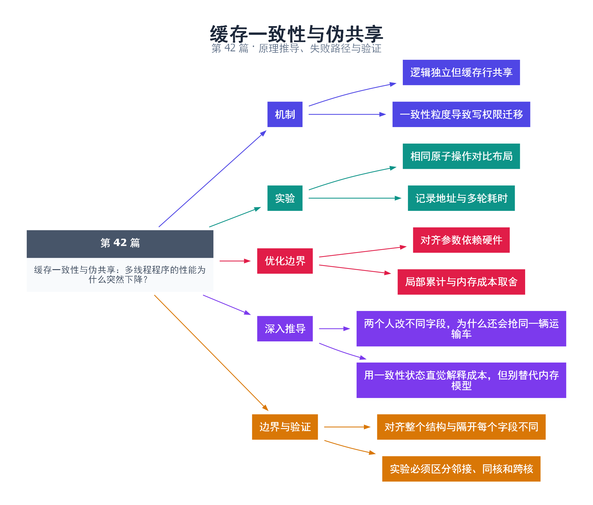

# 42｜缓存一致性与伪共享：多线程程序的性能为什么突然下降？

[返回总目录](README.md) · 最低标准：C++20

一句话总结：不同线程修改不同变量也可能争用同一缓存行，伪共享是性能问题，与语言层面的数据竞争是两回事。

**本文目录**

- [1. 不同账目写在同一张纸上](#section-1)
- [2. 实验的控制变量](#section-2)
- [3. 如何读结果](#section-3)
- [4. 深入推导、反例与工程取舍](#section-4)
  - [4.1 两个人改不同字段，为什么还会抢同一辆运输车](#depth-1)
  - [4.2 用一致性状态直觉解释成本，但别替代内存模型](#depth-2)
  - [4.3 对齐整个结构与隔开每个字段不同](#depth-3)
  - [4.4 实验必须区分邻接、同核和跨核](#depth-4)
- [5. 完整示例与复现](#section-5)
  - [5.1 如何判断运行结果](#section-5-1)
- [6. Q&A（常见问题与解答）](#section-6)
  - [6.1 Q：变量不同为什么还会互相影响？](#section-6-1)
  - [6.2 Q：填充 64 字节在所有机器都够吗？](#section-6-2)
  - [6.3 Q：伪共享会让结果错误吗？](#section-6-3)
- [7. 引用与延伸阅读](#section-7)
- [8. 思维导图总结](#section-8)

---

<a id="section-1"></a>

## 1. 不同账目写在同一张纸上

两人分别负责账本的左右两栏，逻辑数据独立，但如果每次写入必须拿到整页纸，两人仍会频繁传递纸张。缓存一致性常以缓存行为粒度维护写权限，因此相邻原子变量即使完全没有数据竞争，也可能因共享同一缓存行发生反复所有权转移。

这不是说每次访问都从主存重新读取，也不能把所有缓存性能问题都归为伪共享。真正共享是多个线程必须修改同一个业务对象；伪共享则是逻辑独立对象恰好落在同一一致性粒度内。二者优化方向不同。

<a id="section-2"></a>

## 2. 实验的控制变量

本例比较相邻计数器与分别 alignas(64) 的计数器，每个线程只操作自己的 atomic。两组都使用 relaxed fetch_add，循环次数一致，最终校验计数。为了增加重叠，工作线程通过原子门闩开始；计时包括发出开始信号与 join 的尾部开销，两组结构一致。

64 字节是常见硬件上的实验参数，不是 C++ 对缓存行大小的保证。连续两个原子对象也不能无条件保证落在同一行，本例通过 alignas(64) 的结构和地址输出帮助观察布局；最终硬件解释仍需要目标 CPU 信息和分析工具。

<a id="section-3"></a>

## 3. 如何读结果

程序多轮交替测量，输出每轮两种布局的微秒耗时。不要写固定的“隔离后一定快十倍”断言：线程可能运行在同一物理核心，系统负载、调度、频率和虚拟化都会影响结果。无显著差异也不推翻缓存机制，只说明这个实验条件没有显著体现它。

更深入的 Linux 实验可结合 CPU 亲和性、perf stat 或支持的缓存到缓存分析；必须记录具体硬件事件及其含义，不能把 cache-misses 一个总数等同于伪共享次数。Windows 同样可用性能分析工具观察调度和热点。

| 优化 | 收益方向 | 代价 |
|---|---|---|
| 对齐与填充 | 分离独立写热点 | 增加内存占用 |
| 线程局部累计 | 减少共享写次数 | 统计存在延迟 |
| 批量合并 | 降低一致性流量 | 批次与实时性取舍 |

本例不是完备微基准框架，主要让读者看到“无数据竞争仍可能慢”。正式结论应按第 45 篇的方法预热、多轮统计、控制输入并报告分布。

<!-- depth:chapter -->
<a id="section-4"></a>

## 4. 深入推导、反例与工程取舍

<!-- depth:start -->
<a id="depth-1"></a>

### 4.1 两个人改不同字段，为什么还会抢同一辆运输车

缓存一致性通常按缓存行而不是按 C++ 变量管理数据。两个独立计数器恰好落在同一行里，核心 A 修改其中一个，核心 B 修改另一个，仍可能反复争取这条行的写权限。业务数据没共享，缓存行却共享，这就是伪共享。

真正共享是多个线程修改同一计数器；伪共享是修改不同对象但它们位于同一一致性粒度。两者都可能导致缓存行在核心之间迁移，修复却不同：伪共享可以通过布局隔离，真正共享通常要减少共享更新或改变算法。

<a id="depth-2"></a>

### 4.2 用一致性状态直觉解释成本，但别替代内存模型

以常见 MESI 类协议作直觉：读取可让多个缓存持有共享副本，写入则需要取得合适的独占/修改权限，并让其他副本不再作为有效共享副本使用。不断交替写，会让权限在核心之间来回转移。具体处理器可采用扩展协议和不同互连，这里不是某台 CPU 的精确微架构描述。

缓存一致性不等于 C++ 同步正确性。即使硬件最终使某行更新可见，普通变量无同步的竞争访问仍可能在语言层构成未定义行为。反过来，本例用 atomic 避免数据竞争，仍会遭遇合法但昂贵的一致性流量。

<a id="depth-3"></a>

### 4.3 对齐整个结构与隔开每个字段不同

Packed 的 alignas(64) 只让结构起始地址满足对齐，不保证 a 和 b 分居不同缓存行。Cell 则让每个独立单元具有相应对齐与大小要求，Padded 中两个 Cell 的起始位置因此隔开。64 字节是实验假设，应结合目标机器核实。

可参考 C++17 的 hardware_destructive_interference_size 表达实现建议，但可用性与值依赖工具链，不应据此定义不受控的稳定跨模块 ABI。填充还会增大工作集：原来密集读取的数组若每项膨胀几十倍，可能增加缓存和 TLB 压力。所以布局应围绕访问模式，而不是给所有结构统一加填充。

<a id="depth-4"></a>

### 4.4 实验必须区分邻接、同核和跨核

本例打印地址并在五轮中交替测 packed/padded，断言每个计数都完成 300000 次更新。地址间隔提供布局线索；没有记录实际运行核心和缓存行大小，就不能宣称完全隔离了所有影响因素。

建议比较单线程、双线程在同一物理核心的 SMT 线程、不同物理核心三个条件，并记录机器拓扑。Linux 可在权限允许时用 perf stat 记录相关计数，使用 perf c2c 等工具分析共享缓存行；具体硬件事件支持情况必须核实。输出某轮 padded 更慢并不自动推翻机制，可能是调度、频率、测量噪声或当前负载根本不受伪共享限制。

更有价值的优化顺序是：确认热点共享写的位置，减少更新次数，再分离确实由不同线程频繁写入的字段，最后用相同负载重测。不要只展示一组最好看的耗时数字。
<!-- depth:end -->

<a id="section-5"></a>

## 5. 完整示例与复现

源文件：[examples/42.cpp](examples/42.cpp)。在本系列目录运行以下命令；环境准备见 [实验环境](实验环境与验证.md)。

```bash
g++ -std=c++20 -O2 -Wall -Wextra -pedantic -pthread examples/42.cpp -o demo42
./demo42
```

```cpp
#include <atomic>
#include <cassert>
#include <chrono>
#include <functional>
#include <iostream>
#include <thread>
struct alignas(64) Packed { std::atomic<unsigned> a{0},b{0}; };
struct alignas(64) Cell { std::atomic<unsigned> value{0}; };
struct Padded { Cell a,b; };
long long measure(std::atomic<unsigned>& a,std::atomic<unsigned>& b) {
    a.store(0);b.store(0);
    std::atomic<bool> go{false};
    std::atomic<unsigned> ready{0};
    auto work=[&](std::atomic<unsigned>& counter){
        ready.fetch_add(1);
        go.wait(false,std::memory_order_acquire);
        for(unsigned i=0;i<300000;++i) counter.fetch_add(1,std::memory_order_relaxed);
    };
    std::jthread first(work,std::ref(a));
    std::jthread second;
    try {second=std::jthread(work,std::ref(b));}
    catch (...) {go.store(true,std::memory_order_release);go.notify_all();first.join();throw;}
    while(ready.load()!=2) std::this_thread::yield();
    auto begin=std::chrono::steady_clock::now();
    go.store(true,std::memory_order_release);go.notify_all();
    first.join();second.join();
    auto end=std::chrono::steady_clock::now();
    assert(a.load()==300000 && b.load()==300000);
    return std::chrono::duration_cast<std::chrono::microseconds>(end-begin).count();
}
int main() {
    Packed packed; Padded padded;
    std::cout << "packed addresses=" << &packed.a << ' ' << &packed.b << '\n';
    std::cout << "padded addresses=" << &padded.a.value << ' ' << &padded.b.value << '\n';
    for(int i=0;i<5;++i) {
        long long x,y;
        if(i%2==0){x=measure(packed.a,packed.b);y=measure(padded.a.value,padded.b.value);}
        else {y=measure(padded.a.value,padded.b.value);x=measure(packed.a,packed.b);}
        std::cout << "round=" << i << " packed_us=" << x << " padded_us=" << y << '\n';
    }
}
```

<a id="section-5-1"></a>

### 5.1 如何判断运行结果

输出两组地址和 5 轮耗时；每轮最终计数必须正确，不对哪组更快作断言。

<a id="section-6"></a>

## 6. Q&A（常见问题与解答）

<a id="section-6-1"></a>

### 6.1 Q：变量不同为什么还会互相影响？

A：CPU 缓存一致性的管理粒度通常大于单个变量，独立写入可能争用同一缓存行。

<a id="section-6-2"></a>

### 6.2 Q：填充 64 字节在所有机器都够吗？

A：不保证，应依据目标硬件或配置选择；盲目填充还会增加缓存和内存占用。

<a id="section-6-3"></a>

### 6.3 Q：伪共享会让结果错误吗？

A：在访问协议原本正确的前提下，它影响性能而不是制造 C++ 数据竞争；不能与未定义行为混淆。

<a id="section-7"></a>

## 7. 引用与延伸阅读

- [perf c2c 手册](https://www.man7.org/linux/man-pages/man1/perf-c2c.1.html)：共享缓存行的记录与报告。

- [Intel 软件开发手册入口](https://www.intel.com/content/www/us/en/developer/articles/technical/intel-sdm.html)
- [C++ 原子库](https://timsong-cpp.github.io/cppwp/n4861/atomics)

规范链接采用固定的 C++20 工作草案 N4861；对较早标准的差异以正文标注为准。示例和分析为本系列自编，规范用于核对接口契约。

<a id="section-8"></a>

## 8. 思维导图总结

```text
缓存一致性与伪共享：多线程程序的性能为什么突然下降？
├── 机制
│   ├── 逻辑独立但缓存行共享
│   └── 一致性粒度导致写权限迁移
├── 实验
│   ├── 相同原子操作对比布局
│   └── 记录地址与多轮耗时
├── 优化边界
│   ├── 对齐参数依赖硬件
│   └── 局部累计与内存成本取舍
├── 深入推导
│   ├── 两个人改不同字段，为什么还会抢同一辆运输车
│   └── 用一致性状态直觉解释成本，但别替代内存模型
└── 边界与验证
    ├── 对齐整个结构与隔开每个字段不同
    └── 实验必须区分邻接、同核和跨核
```



[Graphviz 源文件](images/42.dot)
