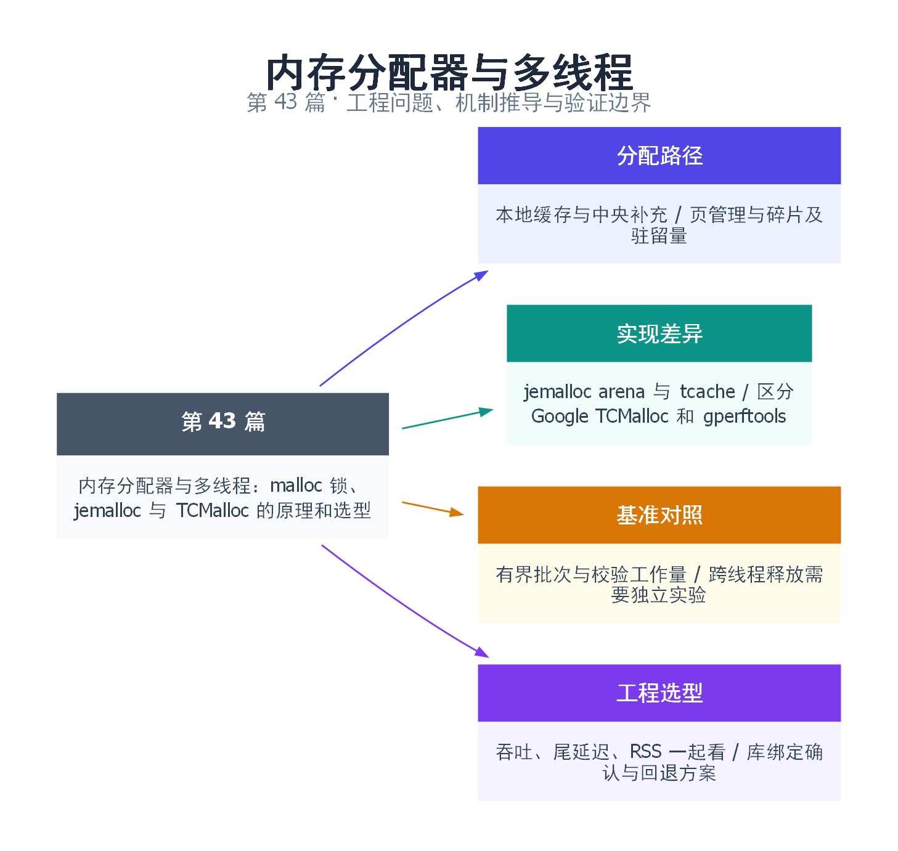

# 43｜内存分配器与多线程：malloc 锁、jemalloc 与 TCMalloc 的原理和选型

[返回总目录](README.md) · 最低标准：C++17

一句话总结：沿分配层次定位争用，用工作量、尾延迟与驻留内存共同选择方案。

快速阅读：先看问题、方案对比和运行结果；深入阅读：按顺序推演边界，再运行完整示例及失败实验。

**本文目录**

- [1. 没有业务大锁，为什么分配内存仍可能成为瓶颈](#section-1)
- [2. 沿着一次小对象分配走完快路径与慢路径](#section-2)
- [3. jemalloc：arena、tcache 与后台回收怎样配合](#section-3)
- [4. TCMalloc：不要把现代 Google 实现和 gperftools 混为一谈](#section-4)
- [5. 完整基准：有界批次、触碰内存、校验工作量](#section-5)
- [6. 在 Linux 对比实际加载的分配器](#section-6)
- [7. 生产者分配、消费者释放，为什么需要另一组实验](#section-7)
- [8. 选型表、回滚与验证边界](#section-8)
- [9. 引用与延伸阅读](#section-9)
- [10. 思维导图总结](#section-10)

---

<a id="section-1"></a>

## 1. 没有业务大锁，为什么分配内存仍可能成为瓶颈

把分配器看成仓库：每次 malloc 要找到合适货位，每次 free 要登记归还。若全部线程都向一个柜台领取，柜台会争用；给每个线程或 CPU 设置小仓库可以加速，但更多小仓库又会保留更多库存，并让跨仓库归还更复杂。

**现代 malloc 不能概括成所有分配共用一把全局锁。** 例如 glibc 可使用多个 arena 和线程缓存；jemalloc、TCMalloc 也有不同的缓存与分级管理。实际热点可能是缓存补充、中央结构、页获取、跨线程释放、碎片、页面故障或 NUMA 放置，要根据堆栈和指标定位。[glibc 内存分配 tunables](https://sourceware.org/glibc/manual/latest/html_node/Memory-Allocation-Tunables.html)

上一篇讨论伪共享，这一篇把焦点从对象布局扩展到对象怎样产生、移动和归还。换分配器是候选措施，减少分配次数、让所有权归属更清楚、控制内存高水位也可能更有效。

<a id="section-2"></a>

## 2. 沿着一次小对象分配走完快路径与慢路径

大小通常先映射到 size class，例如把请求归到某个可复用块规格。若本地缓存有空闲块，就可以从缓存领取，省去频繁的全局协调；缓存空了，再批量向更共享的一层补充；更下层最终管理页、span/extent 与操作系统内存。

这些层次解释了三个现象：热缓存上的一次 malloc 很快，不代表首次分配也快；批量补充可能让某些调用出现延迟尖峰；free 返回不表示 RSS 立即下降，释放的块可能仍在缓存或已提交页中等待复用/归还。

内存账可拆为活跃对象有效负载、size class 内部浪费、空闲缓存、页级碎片、元数据及其他映射。RSS 只是当前驻留页，不等于活跃业务数据，也不等于虚拟地址空间。负载高峰退去后 RSS 不降，应先检查这些组成，不能立刻下结论是泄漏。

<a id="section-3"></a>

## 3. jemalloc：arena、tcache 与后台回收怎样配合

jemalloc 把分配活动分散到 arena，并提供线程缓存以减少小对象路径上的协调。arena 多可降低某些争用，也可能提高保留内存和碎片；tcache 命中有益于速度，却使已 free 的对象暂时不回到更大的共享池。

dirty/muzzy 页、decay 和后台线程等机制影响内存多久回收给操作系统及由谁承担维护工作。具体配置和统计字段应以部署版本手册为准，不把一个版本的默认值写成所有平台常量。`mallctl` 等接口可观测和调整，但统计刷新、调用频率与成本也需要预算。[jemalloc 手册](https://jemalloc.net/jemalloc.3.html)

工程选型时同时观察吞吐、分配尾延迟、RSS 和高峰后的回落，而不只比较 malloc/free 每秒次数。为了降低 RSS 激进地回收页面，可能使下一次突发遭遇更多缺页和重新获取开销；为了速度大量缓存，也可能触发容器内存限制。

<a id="section-4"></a>

## 4. TCMalloc：不要把现代 Google 实现和 gperftools 混为一谈

现代 Google TCMalloc 文档描述前端缓存、中间层和后端页管理。前端可按 CPU 或线程组织；在支持的配置下，per-CPU 设计减少大量线程各自持有缓存的膨胀。中间层通过共享的空闲结构和批次交换补充前端，后端管理更大粒度的内存。[TCMalloc 设计文档](https://google.github.io/tcmalloc/design.html)

per-CPU 不意味着所有平台都启用同一种路径，也不表示迁移、批次交换、采样、回收完全免费。需要记录实际构建、运行模式和架构支持。NUMA 下谁第一次触页、对象后来被哪个线程访问，也可能比本地缓存的一次操作更影响总时间。

发行版中的 `libtcmalloc_minimal` 常来自 **gperftools**，与现代 Google TCMalloc 是不同项目和演进路线。把前者 LD_PRELOAD 的测试输出命名为“Google per-CPU TCMalloc 实测”会混淆对象。若比较两者，应记录各自版本、构建方式及实际链接到的库。[gperftools 项目](https://github.com/gperftools/gperftools)

<a id="section-5"></a>

## 5. 完整基准：有界批次、触碰内存、校验工作量

本例每条线程循环分配 256 个块，触碰每块首尾字节，然后下一轮释放上一批。std::async 创建线程与最终结果等待计入时间；每轮容器 reserve 在工作线程开头做一次。固定触碰用于保留真实访问，volatile 不承担线程同步，每个块只由所属线程访问。

完整源文件：[examples/43.cpp](examples/43.cpp)。

```cpp
// Allocator microbenchmark: identical bounded batches for each thread.
#include <cassert>
#include <chrono>
#include <cstdlib>
#include <future>
#include <iostream>
#include <memory>
#include <stdexcept>
#include <string>
#include <thread>
#include <vector>

using Block = std::unique_ptr<unsigned char, decltype(&std::free)>;
// Build with -fno-builtin-malloc -fno-builtin-free when comparing allocators.
// Volatile byte accesses retain real memory touches without claiming thread safety.
std::size_t batch_work(std::size_t rounds, std::size_t bytes) {
    constexpr std::size_t batch = 256;
    std::size_t checksum = 0;
    std::vector<Block> blocks;
    blocks.reserve(batch);
    for (std::size_t r = 0; r < rounds; ++r) {
        blocks.clear();
        for (std::size_t i = 0; i < batch; ++i) {
            auto* p = static_cast<unsigned char*>(std::malloc(bytes));
            if (!p) throw std::bad_alloc();
            Block block(p, &std::free);
            volatile unsigned char* touched = p;
            touched[0] = static_cast<unsigned char>(i);
            touched[bytes-1] = static_cast<unsigned char>(i);
            checksum += touched[0];
            blocks.push_back(std::move(block));
        }
    }
    return checksum;
}
int main(int argc, char** argv) {
    unsigned threads = argc > 1 ? static_cast<unsigned>(std::stoul(argv[1])) : 4;
    std::size_t bytes = argc > 2 ? std::stoull(argv[2]) : 64;
    std::size_t rounds = argc > 3 ? std::stoull(argv[3]) : 100;
    if (!threads || threads > 64 || !bytes || bytes > 1048576 || !rounds || rounds > 100000) return 2;
    std::vector<std::future<std::size_t>> results;
    auto begin = std::chrono::steady_clock::now();
    for (unsigned i=0; i<threads; ++i)
        results.push_back(std::async(std::launch::async, batch_work, rounds, bytes));
    std::size_t checksum = 0;
    for (auto& f : results) checksum += f.get();
    auto end = std::chrono::steady_clock::now();
    assert(checksum == static_cast<std::size_t>(threads)*rounds*32640);
    std::cout << "threads=" << threads << " bytes=" << bytes << " rounds=" << rounds
              << " allocations=" << static_cast<std::size_t>(threads)*rounds*256
              << " checksum=" << checksum << " elapsed_us="
              << std::chrono::duration<double,std::micro>(end-begin).count() << '\n';
}
```

```bash
mkdir -p build/allocator43
g++ -std=c++17 -O2 -Wall -Wextra -pthread -fno-builtin-malloc -fno-builtin-free \
  examples/43.cpp -o build/allocator43/demo
for threads in 1 2 4 8; do
  ./build/allocator43/demo "$threads" 64 1000
done
```

输出 threads、bytes、rounds、allocations、checksum 和 elapsed_us。四线程、100 轮时 allocations=102400、checksum=13056000。断言只检查做了预期工作，不宣称哪个分配器必定更快。计时包含页触碰、容器管理和线程启动，所以它是受控分配工作负载，不是纯单次 malloc 指令开销。

该实验主要覆盖同线程分配/释放的固定大小热路径，首尾字节不等于访问每一页。对大块内存只碰两处会低估完全使用对象时的驻留量；不要据此报告大对象真实业务的 RSS。线程数×256×块大小决定同时保留量的主要部分，较大参数会增加内存压力，按预算逐步扩大。

<a id="section-6"></a>

## 6. 在 Linux 对比实际加载的分配器

先测系统默认分配器，再只改变一项因素。下面示例在 Debian/Ubuntu 风格环境安装 jemalloc，并从动态链接缓存查到实际路径；不要硬编码另一架构的库目录。

```bash
sudo apt install libjemalloc2 time
jemalloc_so=$(ldconfig -p | awk '/libjemalloc.so.2/{print $NF; exit}')
test -n "$jemalloc_so" || { echo 'jemalloc shared library not found'; exit 1; }
/usr/bin/time -v ./build/allocator43/demo 4 64 1000
/usr/bin/time -v env LD_PRELOAD="$jemalloc_so" ./build/allocator43/demo 4 64 1000
```

保留 time 的 max RSS、程序原始时间和机器/库版本，重复并交替运行顺序。可通过 loader 的诊断或运行中 `/proc/PID/maps` 确认载入；看到库被映射仍需确认相关符号绑定，静态链接、特殊分配接口、链接顺序和符号封装都可能影响替换。

不要把仅加载了某个库的事实当作全部分配都被替换。跨模块分配与释放必须遵守兼容的分配器契约；C++ 对齐分配、自定义 operator new、第三方库私有堆都应检查。LD_PRELOAD 是 Linux 动态链接实验方法，不是适用于 Windows 的安装步骤。本机只运行系统默认分配器样例，未进行 jemalloc/TCMalloc 的 A/B 实测。

<a id="section-7"></a>

## 7. 生产者分配、消费者释放，为什么需要另一组实验

真实队列常在请求线程创建消息，在工作线程销毁。对象离开分配线程后，归还会走哪条缓存/共享路径，取决于分配器实现和配置。跨线程释放、短命线程不断退出、大小混合与长短寿命混合，都可能改变吞吐和保留内存。

下一组实验应让生产者只分配并填充，把所有权通过有界队列传给消费者，由消费者验证并 free；每个指针只能转交一次，队列满时也不能丢掉释放责任。记录请求大小分布、在途字节、跨线程释放比例和每阶段时间；固定大小的同线程微基准不足以选择服务分配器。

先统计分配热点，有些热点可以用批处理、预分配容器、按请求的 arena 或 PMR 资源减少次数。monotonic_buffer_resource 适合整批释放，但单个 deallocate 不归还内存；unsynchronized_pool_resource 不能直接让多线程无同步共用，synchronized_pool_resource 也仍有同步成本。对象池还需正确析构、处理异常和防止 ABA，不能只把 malloc 换成一个共享 freelist。

<a id="section-8"></a>

## 8. 选型表、回滚与验证边界

| 方向 | 先验证什么 | 主要风险 |
|---|---|---|
| 保持系统 malloc | 分配是否真是热点、arena/tcache 指标 | 错把 IO/锁问题归给分配器 |
| jemalloc | 混合尺寸吞吐、RSS、回收节奏 | 缓存/arena 保留内存，配置依版本 |
| Google TCMalloc | 实际 per-CPU/per-thread 模式与平台 | 平台/构建适配、尾延迟与驻留量 |
| gperftools TCMalloc | 明确项目与版本后独立比较 | 不能沿用另一实现的架构结论 |
| PMR/专用池 | 生命周期可成批管理、跨线程责任 | 回收粒度、线程安全和复杂度 |

上线前保留相同输入、相同 CPU/内存限制、同样的符号和采样配置；比较吞吐、p99、RSS峰值、退峰后驻留以及 OOM/拒绝率。一次平均耗时降低不等于整个服务更好。部署应保留可回退构建与配置，但回滚也要按进程重启和分配器兼容契约执行，不能在一组活跃对象生命周期中随意切换释放器。

<a id="section-9"></a>

## 9. 引用与延伸阅读

- [glibc 分配器调优接口](https://sourceware.org/glibc/manual/latest/html_node/Memory-Allocation-Tunables.html)
- [jemalloc 官方手册](https://jemalloc.net/jemalloc.3.html)
- [Google TCMalloc 设计](https://google.github.io/tcmalloc/design.html)
- [gperftools 项目](https://github.com/gperftools/gperftools)
- [Linux malloc(3)](https://man7.org/linux/man-pages/man3/malloc.3.html)：接口、失败返回与实现说明。

<a id="section-10"></a>

## 10. 思维导图总结

```text
内存分配器与多线程：malloc 锁、jemalloc 与 TCMalloc 的原理和选型
├── 分配路径
│   ├── 本地缓存与中央补充
│   └── 页管理与碎片及驻留量
├── 实现差异
│   ├── jemalloc arena 与 tcache
│   └── 区分 Google TCMalloc 和 gperftools
├── 基准对照
│   ├── 有界批次与校验工作量
│   └── 跨线程释放需要独立实验
└── 工程选型
    ├── 吞吐、尾延迟、RSS 一起看
    └── 库绑定确认与回退方案
```



[Graphviz 图源](images/43.dot)
