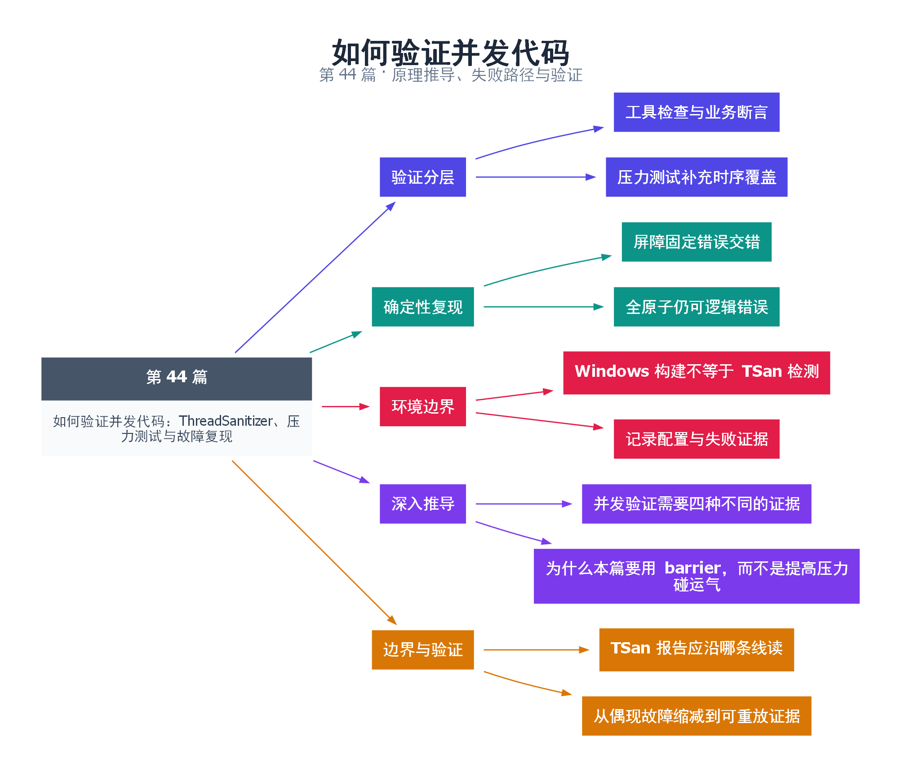

# 44｜如何验证并发代码：ThreadSanitizer、压力测试与故障复现

[返回总目录](README.md) · 最低标准：C++20

一句话总结：并发验证要把工具检测、业务不变量、确定性时序和压力测试结合起来，任何单项都不足以证明全部正确性。

**本文目录**

- [1. 检查交通规则、事故现场和极端天气](#section-1)
- [2. 构建方式](#section-2)
- [3. 不故意引入未定义行为也能复现错误](#section-3)
- [4. 分层测试清单](#section-4)
- [5. 深入推导、反例与工程取舍](#section-5)
  - [5.1 并发验证需要四种不同的证据](#depth-1)
  - [5.2 为什么本篇要用 barrier，而不是提高压力碰运气](#depth-2)
  - [5.3 TSan 报告应沿哪条线读](#depth-3)
  - [5.4 从偶现故障缩减到可重放证据](#depth-4)
- [6. 完整示例与复现](#section-6)
  - [6.1 如何判断运行结果](#section-6-1)
- [7. Q&A（常见问题与解答）](#section-7)
  - [7.1 Q：TSan 无告警可以上线了吗？](#section-7-1)
  - [7.2 Q：为什么不靠 sleep 复现？](#section-7-2)
  - [7.3 Q：工具报告怎样处理？](#section-7-3)
- [8. 引用与延伸阅读](#section-8)
- [9. 思维导图总结](#section-9)

---

<a id="section-1"></a>

## 1. 检查交通规则、事故现场和极端天气

ThreadSanitizer 像查找两辆车是否没有路权协调就驶入同一路段；业务断言检查是否真的把乘客送到正确目的地；压力测试则增加不同路况。没有报告不等于不存在问题，工具只能观察本次运行涉及的行为，并且有自己的支持范围。

TSan 通过编译插桩和运行库跟踪内存访问与同步关系，发现潜在数据竞争。它不是主要用于检测释放后访问，也不自动发现所有逻辑竞态、死锁或错误内存序。原子变量可能没有数据竞争，却仍因协议错误导致业务结果错误。

<a id="section-2"></a>

## 2. 构建方式

在支持的 Linux Clang 环境中，对本系列安全示例可使用：

```bash
clang++ -std=c++20 -O1 -g -fsanitize=thread -fno-omit-frame-pointer -pthread examples/44.cpp -o tsan38
./tsan38
```

这是读者复现命令，本地 Windows MinGW 构建不能据此宣称已经运行 TSan。具体支持平台和限制应查 [Clang 官方文档](https://clang.llvm.org/docs/ThreadSanitizer.html)。性能测试不能使用插桩版本的耗时冒充生产性能。ASan 与 TSan 通常分开构建，分别检查寿命与竞争。

<a id="section-3"></a>

## 3. 不故意引入未定义行为也能复现错误

本例用 atomic 保证语言层面访问安全，却故意把“余票检查”和“扣减”分开。两个线程分别读取同一个初始值 1，然后用 barrier 确保都完成读取，再都 store(0) 并记为售出。最终 sold=2、tickets=0，业务不变量被破坏，而 TSan 不应仅因这种原子交错就报告数据竞争。

这比用 sleep 放大概率更可重复，也说明为什么必须写业务断言。默认程序断言“确实复现了这个已知错误”，并输出 BUG reproduced；它不是一个可以用于生产的售票实现。正确版本见第 7 篇的 CAS 状态转移。

<a id="section-4"></a>

## 4. 分层测试清单

| 层次 | 验证内容 | 示例 |
|---|---|---|
| 单操作 | 边界和返回值 | 空队列、满队列、停止后提交 |
| 协议 | 确定性交错 | 通知先到、运行中取消 |
| 压力 | 调度与规模变化 | 多生产者、长暂停、随机工作量 |
| 工具 | 竞争和寿命 | 分开的 TSan / ASan 构建 |

失败时保存随机种子、线程数、输入、编译选项和日志。日志记录会改变时序，应优先把关键交错缩小为有门闩控制的复现。为可能卡死的测试设置进程级超时，并在超时前抓线程栈，避免只留下“超时”两个字。

<!-- depth:chapter -->
<a id="section-5"></a>

## 5. 深入推导、反例与工程取舍

<!-- depth:start -->
<a id="depth-1"></a>

### 5.1 并发验证需要四种不同的证据

像检查桥梁，材料检测、结构计算、载荷实验和长期监测解决不同问题。并发程序同样需要分层：规范推理检查允许的所有执行；动态工具寻找已执行路径的非法访问；业务断言检查结果；受控调度把危险交错变成可重复实验。

| 方法 | 能发现什么 | 不能单独证明什么 |
|---|---|---|
| happens-before/状态机推理 | 协议缺边、非法状态转移 | 实现完全按设计写对 |
| TSan | 已观测路径的数据竞争 | 无超卖、无死锁、无遗漏路径 |
| ASan | 多类越界和生命周期错误 | 业务一致性、全部并发时序 |
| 守恒和顺序断言 | 重复、丢失、超限、顺序错误 | 未执行路径都正确 |

<a id="depth-2"></a>

### 5.2 为什么本篇要用 barrier，而不是提高压力碰运气

超卖反例需要两个线程都先读到 tickets=1，再各自决定售出。barrier 被放在读取之后、写入之前，强制这个前提。于是两次 store 都是合法的原子操作，但 sold 最终为 2，稳定违反初始库存守恒。

若在整个买票操作之前加 barrier，只能让两个调用大致同时开始，不能保证它们都在第一次扣减前读到 1。测试同步点必须针对你想复现的窗口，而不是机械地放在函数入口。生产代码中的同步与测试夹具的同步还要区分，避免夹具恰好消除了想寻找的数据竞争。

<a id="depth-3"></a>

### 5.3 TSan 报告应沿哪条线读

先看涉及的内存地址和对象，再配对两段访问堆栈，判断至少一方是否写；随后检查双方使用了哪把锁、哪次发布，最后核对对象是否已销毁或复用。修复应让协议覆盖两次冲突访问，而不是给某一行加一个不被另一方使用的锁。

在支持的平台使用 `clang++ -std=c++20 -O1 -g -fsanitize=thread -fno-omit-frame-pointer -pthread examples/44.cpp -o race_demo`，再运行。此例全用原子，本就可能没有 TSan 数据竞争报告，输出的业务错误才是教学目标。不要把该命令的“安静”记录成售票协议正确。ASan 与 TSan 应分开构建，不把两个检测器混进同一二进制。

<a id="depth-4"></a>

### 5.4 从偶现故障缩减到可重放证据

记录输入、随机种子、线程数、编译选项、失败断言与超时堆栈；种子只能复现输入，不保证操作系统线程调度也一致。然后逐步减少任务数，在可疑位置引入 latch/promise 握手，寻找维持故障所需的最小交错。

本次补充的 deep_protocols 测试覆盖关闭与背压、SC 双变量结果约束、发布接力和多容量 SPSC 回绕。每项都有对应断言和总运行超时，但仍属于有限执行验证。建议把默认确定性测试作为每次修改的门槛，把多轮压力、工具检测和跨架构测试作为独立层，不用一项通过替代其他层。
<!-- depth:end -->

<a id="section-6"></a>

## 6. 完整示例与复现

源文件：[examples/44.cpp](examples/44.cpp)。在本系列目录运行以下命令；环境准备见 [实验环境](实验环境与验证.md)。

```bash
g++ -std=c++20 -O2 -Wall -Wextra -pedantic -pthread examples/44.cpp -o demo44
./demo44
```

```cpp
#include <atomic>
#include <barrier>
#include <cassert>
#include <iostream>
#include <thread>
int main() {
    std::atomic<int> tickets{1},sold{0};
    std::barrier both_read(2);
    auto flawed=[&]{
        const int seen=tickets.load();
        both_read.arrive_and_wait();
        if(seen>0){tickets.store(seen-1);sold.fetch_add(1);}
    };
    std::jthread a(flawed);
    // 主线程作为另一个参与者，避免第二条线程创建失败使屏障悬挂。
    flawed();
    a.join();
    assert(sold==2 && tickets==0);
    std::cout << "BUG reproduced: sold=2 with initial stock=1\n";
}
```

<a id="section-6-1"></a>

### 6.1 如何判断运行结果

明确输出 `BUG reproduced: sold=2 with initial stock=1`。这是有意演示的、无数据竞争但逻辑错误的原子协议。

<a id="section-7"></a>

## 7. Q&A（常见问题与解答）

<a id="section-7-1"></a>

### 7.1 Q：TSan 无告警可以上线了吗？

A：还需要业务不变量、退出协议、寿命和性能验证；TSan 不证明无逻辑竞态。

<a id="section-7-2"></a>

### 7.2 Q：为什么不靠 sleep 复现？

A：sleep 依赖调度概率，barrier、promise 或门闩可以把关键顺序固定，复现更稳定。

<a id="section-7-3"></a>

### 7.3 Q：工具报告怎样处理？

A：先定位冲突对象、访问栈和缺少的同步边，确认是不是程序错误；不要直接添加忽略规则压掉报告。

<a id="section-8"></a>

## 8. 引用与延伸阅读

- [深化实验与验证](深化实验与验证.md)：完整协议测试、运行命令、预期断言和未覆盖边界。

- [Clang ThreadSanitizer 文档](https://clang.llvm.org/docs/ThreadSanitizer.html)
- [Clang AddressSanitizer 文档](https://clang.llvm.org/docs/AddressSanitizer.html)

规范链接采用固定的 C++20 工作草案 N4861；对较早标准的差异以正文标注为准。示例和分析为本系列自编，规范用于核对接口契约。

<a id="section-9"></a>

## 9. 思维导图总结

```text
如何验证并发代码：ThreadSanitizer、压力测试与故障复现
├── 验证分层
│   ├── 工具检查与业务断言
│   └── 压力测试补充时序覆盖
├── 确定性复现
│   ├── 屏障固定错误交错
│   └── 全原子仍可逻辑错误
├── 环境边界
│   ├── Windows 构建不等于 TSan 检测
│   └── 记录配置与失败证据
├── 深入推导
│   ├── 并发验证需要四种不同的证据
│   └── 为什么本篇要用 barrier，而不是提高压力碰运气
└── 边界与验证
    ├── TSan 报告应沿哪条线读
    └── 从偶现故障缩减到可重放证据
```



[Graphviz 源文件](images/44.dot)
