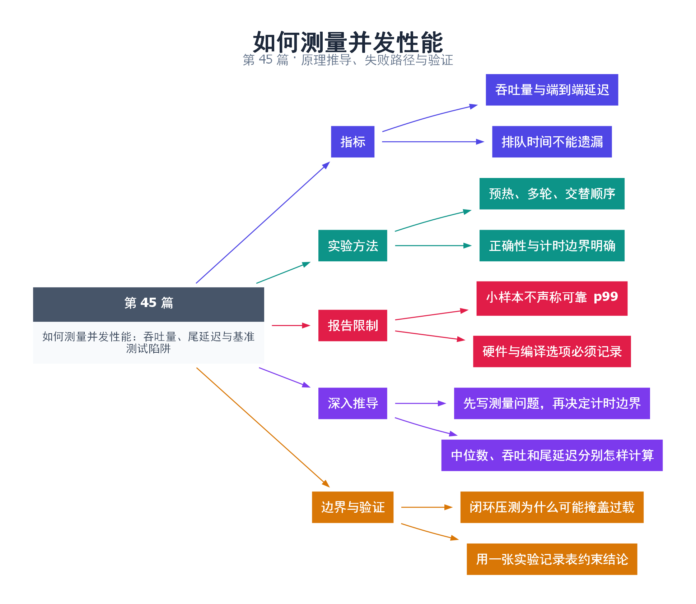

# 45｜如何测量并发性能：吞吐量、尾延迟与基准测试陷阱

[返回总目录](README.md) · 最低标准：C++17

一句话总结：并发性能必须同时观察吞吐量、请求延迟分布和资源成本，并明确测量是否包含排队、启动和关闭。

**本文目录**

- [1. 平均出餐快，不代表没人等很久](#section-1)
- [2. 微基准的几个陷阱](#section-2)
- [3. 本例测什么、不测什么](#section-3)
- [4. 深入推导、反例与工程取舍](#section-4)
  - [4.1 先写测量问题，再决定计时边界](#depth-1)
  - [4.2 中位数、吞吐和尾延迟分别怎样计算](#depth-2)
  - [4.3 闭环压测为什么可能掩盖过载](#depth-3)
  - [4.4 用一张实验记录表约束结论](#depth-4)
- [5. 完整示例与复现](#section-5)
  - [5.1 如何判断运行结果](#section-5-1)
- [6. Q&A（常见问题与解答）](#section-6)
  - [6.1 Q：为什么不报告 p99？](#section-6-1)
  - [6.2 Q：把创建线程移出计时会更公平吗？](#section-6-2)
  - [6.3 Q：正确性检查也会影响测量吗？](#section-6-3)
- [7. 引用与延伸阅读](#section-7)
- [8. 思维导图总结](#section-8)

---

<a id="section-1"></a>

## 1. 平均出餐快，不代表没人等很久

餐馆一小时出了很多菜是吞吐量，某位顾客从下单到拿到菜等多久是端到端延迟。只报告平均值可能掩盖少数顾客等待很久。p50、p95、p99 是分位数，但样本很少时高分位估计并不稳定，尤其不能用十次实验宣称可靠 p99。

一次请求的延迟可以拆为排队、实际执行和其他交接成本。只在工作线程开始执行时计时，会漏掉队列中最痛苦的等待。吞吐量则应以有效完成数量除以覆盖这些完成的时间窗口，并明确失败和取消是否计入。

<a id="section-2"></a>

## 2. 微基准的几个陷阱

优化器可能删除无人使用的计算，因此示例保留校验和。启动线程、分配内存、构建输入是否计时必须一致。冷缓存、频率变化、后台任务会改变结果，所以需要预热与重复。不能为了减少噪声只保留最好结果；应报告中位数、范围及异常值解释。

固定请求量下客户端“发一个、等一个”会在服务变慢时自动降低施压，掩盖过载排队，这类协调遗漏问题需要开放式到达或独立时间计划来分析。压力测试也要有停止条件，不能把客户端自身瓶颈误当作服务上限。

<a id="section-3"></a>

## 3. 本例测什么、不测什么

示例比较固定输入的串行与双线程整数求和，先预热，再运行 9 轮并交替顺序，输出中位数。并行计时包含线程创建和 join，因此代表一次完整调用成本，不代表复用线程后的稳定执行器吞吐。

输入是运行时生成的有符号整数，使用 long long 汇总，范围足够。两种结果每轮都与基线一致。这个任务很可能受内存带宽限制；即使双线程更慢也是有效观察，而不是测试“失败”。输出只保留本机实测，不预先填造加速数字。

| 报告字段 | 原因 |
|---|---|
| CPU、系统、编译器、优化选项 | 决定硬件与生成代码 |
| 输入规模、线程数、任务粒度 | 决定工作负载 |
| 计时边界和轮数 | 决定指标含义 |
| 正确结果校验 | 排除少做工作造成假加速 |
| 中位数与分布 | 避免单次巧合 |

正式服务基准还应输出到达率、完成率、拒绝率、队列长度和端到端延迟直方图。对同一目标做有限线程数扫描，找到资源成本与服务指标的平衡点。

<!-- depth:chapter -->
<a id="section-4"></a>

## 4. 深入推导、反例与工程取舍

<!-- depth:start -->
<a id="depth-1"></a>

### 4.1 先写测量问题，再决定计时边界

同一道菜，只计锅里翻炒的时间和计顾客从下单到拿到菜的时间，会得出不同答案。线程池的服务时间是 worker 开始到结束，端到端时间还包括提交和排队。若优化的是用户体验，应从请求到达开始计时；若比较算法内核，应明确排除哪些固定成本。

本例 parallel 每次新建一个线程，计时包括创建与 join，这是它的真实调用成本。若要测长期线程池，必须构建另一组复用工人的实验，不能把一方的创建成本删掉、另一方保留，再宣称算法优劣。

<a id="depth-2"></a>

### 4.2 中位数、吞吐和尾延迟分别怎样计算

吞吐量是测量区间内完成数除以区间时长，必须说明区间是否包含预热与排空。将 N 个延迟样本排序，最近秩定义的 p99 可取第 ceil(0.99N) 个样本；不同统计工具可能采用插值，比较时要统一口径。

九个样本的中位数是排序后第五项，所以本例使用 s[4]、p[4]。九个样本不足以稳定描述罕见尾延迟，不能把最大值包装成可靠的生产 p99。测尾部需要足够样本、独立运行、相同负载，以及报告样本数和误差来源。

<a id="depth-3"></a>

### 4.3 闭环压测为什么可能掩盖过载

闭环客户端完成一个请求才发下一个，服务变慢时客户端也自动减速，压力随之下降。开环负载按预定到达时间发请求，可以展示队列不断累积，但还需保证发生器本身能及时发出请求。

如果延迟只从请求实际发送时开始算，而忽略原本应当发送却因阻塞延后的时间，会漏掉一部分停顿，这类问题常称 coordinated omission。应保存计划到达、实际提交、开始执行、完成四个时间点，才能区分发生器延迟、排队和执行。

<a id="depth-4"></a>

### 4.4 用一张实验记录表约束结论

| 字段 | 必须记录的内容 |
|---|---|
| 环境 | CPU/核心拓扑、内存、操作系统、功耗状态 |
| 构建 | 编译器、标准库、优化和 sanitizer 选项 |
| 输入 | N、分布、工作集大小、随机种子 |
| 过程 | 预热、运行顺序、轮数、并发度、计时边界 |
| 输出 | 校验和、原始样本、中位数、范围、接受/拒绝数 |

优化器可能删除无可观察用途的计算，因此本例保留结果校验；不要用 volatile 改写整个工作负载来“防优化”，那可能改变本来要测的问题。测试性能时不要和编译、图像生成或 sanitizer 运行混在一起。

批量可复现入口是 `python tools/benchmark_notes.py --executable build/45/demo.exe`。脚本串行运行三个输入规模，每个规模三次，保留每次输出和进程退出码到 JSON。它报告原始记录，不自动宣称加速；本例是九轮函数测量，不会凭这批记录生成未经采集的 p99 或置信区间。
<!-- depth:end -->

<a id="section-5"></a>

## 5. 完整示例与复现

源文件：[examples/45.cpp](examples/45.cpp)。在本系列目录运行以下命令；环境准备见 [实验环境](实验环境与验证.md)。

```bash
g++ -std=c++17 -O2 -Wall -Wextra -pedantic -pthread examples/45.cpp -o demo45
./demo45
```

```cpp
#include <algorithm>
#include <cassert>
#include <chrono>
#include <cstddef>
#include <iostream>
#include <numeric>
#include <string>
#include <thread>
#include <vector>
using Clock=std::chrono::steady_clock;
long long serial(const std::vector<int>& v){return std::accumulate(v.begin(),v.end(),0LL);}
long long parallel(const std::vector<int>& v){
    auto mid=v.begin()+static_cast<std::ptrdiff_t>(v.size()/2);
    long long left=0;
    std::thread worker([&]{left=std::accumulate(v.begin(),mid,0LL);});
    auto right=std::accumulate(mid,v.end(),0LL);
    worker.join();return left+right;
}
int main(int argc,char** argv){
    std::size_t n=argc>1?std::stoull(argv[1]):1000000;
    if(n==0 || n>100000000) return 2;
    std::vector<int> data(n);
    for(std::size_t i=0;i<n;++i) data[i]=static_cast<int>(i%101);
    auto expected=serial(data);assert(parallel(data)==expected);
    std::vector<double> s,p;
    auto measure=[&](auto function){
        auto begin=Clock::now();auto value=function(data);auto end=Clock::now();
        assert(value==expected);
        return std::chrono::duration<double,std::micro>(end-begin).count();
    };
    for(int round=0;round<9;++round){
        if(round%2==0){s.push_back(measure(serial));p.push_back(measure(parallel));}
        else{p.push_back(measure(parallel));s.push_back(measure(serial));}
    }
    std::sort(s.begin(),s.end());std::sort(p.begin(),p.end());
    std::cout<<"n="<<n<<" checksum="<<expected<<'\n';
    std::cout<<"serial_median_us="<<s[4]<<" parallel_median_us="<<p[4]<<'\n';
    std::cout<<"serial_range="<<s.front()<<".."<<s.back()
             <<" parallel_range="<<p.front()<<".."<<p.back()<<'\n';
}
```

<a id="section-5-1"></a>

### 5.1 如何判断运行结果

输出输入规模、校验和、中位数和范围。数字由本机运行决定；不要求双线程一定更快。

<a id="section-6"></a>

## 6. Q&A（常见问题与解答）

<a id="section-6-1"></a>

### 6.1 Q：为什么不报告 p99？

A：本例只有 9 次独立耗时样本，不足以稳定估计高分位；应增加合适的请求样本并定义统计口径。

<a id="section-6-2"></a>

### 6.2 Q：把创建线程移出计时会更公平吗？

A：取决于目标场景，复用线程服务与一次性并行调用有不同边界，关键是明确口径并保持对比一致。

<a id="section-6-3"></a>

### 6.3 Q：正确性检查也会影响测量吗？

A：会，所以本例把结果断言放在停止计时之后，并保留结果使用以阻止无效计算被优化掉。

<a id="section-7"></a>

## 7. 引用与延伸阅读

- [steady_clock 规范](https://timsong-cpp.github.io/cppwp/n4861/time.clock.steady)
- [Google Benchmark 用户指南](https://google.github.io/benchmark/user_guide.html)

规范链接采用固定的 C++20 工作草案 N4861；对较早标准的差异以正文标注为准。示例和分析为本系列自编，规范用于核对接口契约。

<a id="section-8"></a>

## 8. 思维导图总结

```text
如何测量并发性能：吞吐量、尾延迟与基准测试陷阱
├── 指标
│   ├── 吞吐量与端到端延迟
│   └── 排队时间不能遗漏
├── 实验方法
│   ├── 预热、多轮、交替顺序
│   └── 正确性与计时边界明确
├── 报告限制
│   ├── 小样本不声称可靠 p99
│   └── 硬件与编译选项必须记录
├── 深入推导
│   ├── 先写测量问题，再决定计时边界
│   └── 中位数、吞吐和尾延迟分别怎样计算
└── 边界与验证
    ├── 闭环压测为什么可能掩盖过载
    └── 用一张实验记录表约束结论
```



[Graphviz 源文件](images/45.dot)
