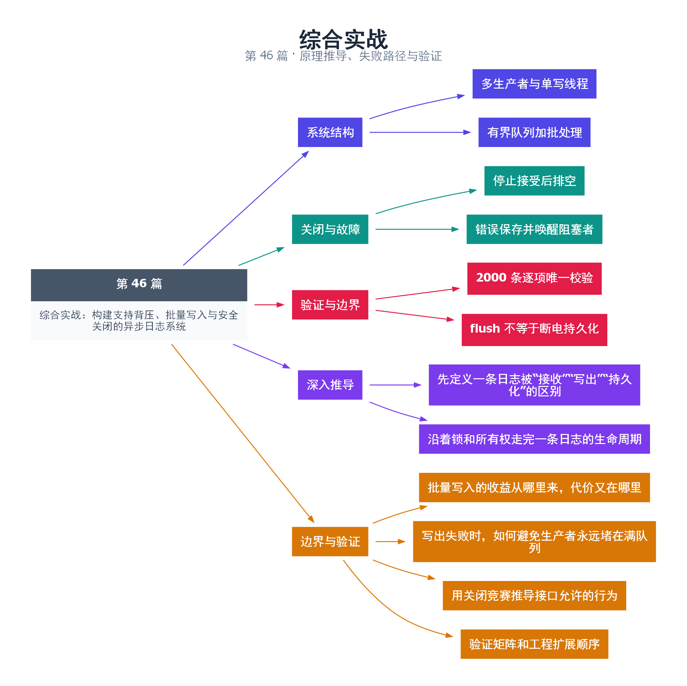

# 46｜综合实战：构建支持背压、批量写入与安全关闭的异步日志系统

[返回总目录](README.md) · 最低标准：C++17

一句话总结：异步日志把提交与写盘分开，但可靠实现必须同时定义容量、背压、批处理、错误传播和排空关闭。

**本文目录**

- [1. 从前台收据到后台记账](#section-1)
- [2. 状态机与不变量](#section-2)
- [3. 批处理为什么放在锁外](#section-3)
- [4. 关闭与错误路径](#section-4)
- [5. 顺序与持久性边界](#section-5)
- [6. 完整日志器](#section-6)
- [7. 验证方案](#section-7)
- [8. 深入推导、反例与工程取舍](#section-8)
  - [8.1 先定义一条日志被“接收”“写出”“持久化”的区别](#depth-1)
  - [8.2 沿着锁和所有权走完一条日志的生命周期](#depth-2)
  - [8.3 批量写入的收益从哪里来，代价又在哪里](#depth-3)
  - [8.4 写出失败时，如何避免生产者永远堵在满队列](#depth-4)
  - [8.5 用关闭竞赛推导接口允许的行为](#depth-5)
  - [8.6 验证矩阵和工程扩展顺序](#depth-6)
- [9. 完整示例与复现](#section-9)
  - [9.1 如何判断运行结果](#section-9-1)
- [10. Q&A（常见问题与解答）](#section-10)
  - [10.1 Q：log 返回 true 代表日志已落盘吗？](#section-10-1)
  - [10.2 Q：队列满时阻塞有什么风险？](#section-10-2)
  - [10.3 Q：为什么不在析构中抛出写盘异常？](#section-10-3)
  - [10.4 Q：怎样增加日志轮转？](#section-10-4)
- [11. 引用与延伸阅读](#section-11)
- [12. 思维导图总结](#section-12)

---

<a id="section-1"></a>

## 1. 从前台收据到后台记账

业务线程像收银员，只把一条拥有完整内容的记录交到有限大小收件箱；后台线程负责批量写账本。前台变快的代价是新增队列、等待和故障状态。不能把“已经入队”误称为“已经持久化”。

本实现采用多生产者、单消费者，队列容量按记录条数计，满时提交者阻塞，关闭或写入故障会唤醒它们。记录以 string 按值交接，避免调用者临时字符缓冲区在后台使用前失效。为了让校验清楚，每条记录禁止内嵌换行。

<a id="section-2"></a>

## 2. 状态机与不变量

运行状态允许提交；关闭状态拒绝新记录，但后台继续排空；故障状态拒绝提交并保存 exception_ptr，由显式 close 重新抛出。正常关闭完成后，accepted 应等于 written；发生 I/O 故障时不承诺这个等式，也不伪造成功。

生产者在同一 mutex 下等待 `closing || queue.size < capacity`，检查故障，再入队并增加 accepted。消费者等待 `closing || !queue.empty`，只在关闭且队列空时退出。这把第 14 篇的排空协议和第 27 篇的背压合成一个系统。

<a id="section-3"></a>

## 3. 批处理为什么放在锁外

消费者一次移动最多 batch_size 条记录到自己的 vector，然后释放锁并通知等待空间的生产者。写文件和 flush 在锁外执行，避免慢磁盘占住队列锁。局部批次 reserve 在循环外完成，分配失败会进入统一错误路径。

容量只限制排队数量，不包括消费者手里的一个批次，也不限制单条 string 长度，因此严格内存预算还需要记录字节上限。本实现内存规模大致与“队列容量 + 一个批次”的记录内容相关，不能仅凭条数宣称绝对内存上限。

<a id="section-4"></a>

## 4. 关闭与错误路径

close 设置 closing、唤醒生产者和消费者、join 写线程，然后检查故障并返回计数。析构负责兜底回收，但不能可靠地把 I/O 错误交给调用者，所以应用应显式 close。close 由外部拥有者串行调用；析构前必须停止并回收所有可能调用 log 的生产者。

后台捕获打开之后的写入、flush、close 错误，保存异常并唤醒被容量阻塞的提交者，防止磁盘故障变成所有前台永久等待。打开文件失败在构造时直接抛出，线程尚未启动。调用者必须处理这些异常，不能只在 worker 中打印一行然后继续报成功。

<a id="section-5"></a>

## 5. 顺序与持久性边界

输出顺序对应入队顺序，各生产者自己的顺序得以保留，但不同线程调用的墙上时间先后不等于获得队列锁的先后。需要业务全局顺序时，可以在接受点分配序号。

ofstream.flush 将用户态流缓冲提交给底层系统，不等同于断电持久化。严格持久化需要平台相关的 fsync、FlushFileBuffers 等策略及其错误处理；批量 flush 也不是“一批只调用一次系统写”。本例不包含日志轮转、跨进程写入、崩溃恢复和压缩，不能作为具备这些能力的产品承诺。

<a id="section-6"></a>

## 6. 完整日志器

公共头文件：[examples/async_logger.hpp](examples/async_logger.hpp)。示例会在当前运行目录创建或覆盖 `async-demo.log`，因此应在专门实验目录运行。

```cpp
#pragma once
#include <algorithm>
#include <condition_variable>
#include <cstddef>
#include <exception>
#include <fstream>
#include <mutex>
#include <queue>
#include <stdexcept>
#include <string>
#include <thread>
#include <utility>
#include <vector>

// log 可多生产者调用；close 由外部拥有者串行调用。
// 析构前必须停止并回收全部生产者。
class AsyncLogger {
    std::mutex mutex_;
    std::condition_variable not_empty_,not_full_;
    std::queue<std::string> queue_;
    const std::size_t capacity_,batch_size_;
    bool closing_=false;
    std::exception_ptr error_;
    std::size_t accepted_=0,written_=0;
    std::ofstream output_;
    std::thread worker_;
    void run() noexcept {
        try {
            std::vector<std::string> batch;
            batch.reserve(batch_size_);
            for (;;) {
                batch.clear();
                {
                    std::unique_lock<std::mutex> lock(mutex_);
                    not_empty_.wait(lock,[this]{return closing_ || !queue_.empty();});
                    if(queue_.empty()) break;
                    const auto count=std::min(batch_size_,queue_.size());
                    for(std::size_t i=0;i<count;++i){
                        batch.push_back(std::move(queue_.front()));queue_.pop();
                    }
                }
                not_full_.notify_all();
                for(const auto& line:batch) output_<<line<<'\n';
                output_.flush();
                written_+=batch.size(); // 只由写线程修改，join 后读取。
            }
            output_.flush();
            output_.close();
        } catch (...) {
            {
                std::lock_guard<std::mutex> lock(mutex_);
                error_=std::current_exception();closing_=true;
                // 写出失败后不能承诺排空；释放尚未处理的内存。
                std::queue<std::string> abandoned;
                queue_.swap(abandoned);
            }
            not_full_.notify_all();not_empty_.notify_all();
        }
    }
    void finish() {
        {std::lock_guard<std::mutex> lock(mutex_);closing_=true;}
        not_full_.notify_all();not_empty_.notify_all();
        if(worker_.joinable()) worker_.join();
    }
public:
    AsyncLogger(const std::string& path,std::size_t capacity,std::size_t batch_size)
        :capacity_(capacity),batch_size_(batch_size){
        if(!capacity || !batch_size) throw std::invalid_argument("zero capacity or batch");
        output_.exceptions(std::ios::badbit|std::ios::failbit);
        output_.open(path,std::ios::out|std::ios::trunc);
        worker_=std::thread([this]{run();});
    }
    AsyncLogger(const AsyncLogger&)=delete;
    AsyncLogger& operator=(const AsyncLogger&)=delete;
    bool log(std::string line){
        if(line.find_first_of("\r\n")!=std::string::npos)
            throw std::invalid_argument("one record must be one line");
        std::unique_lock<std::mutex> lock(mutex_);
        not_full_.wait(lock,[this]{return closing_ || queue_.size()<capacity_;});
        if(error_) std::rethrow_exception(error_);
        if(closing_) return false;
        queue_.push(std::move(line));++accepted_;
        lock.unlock();not_empty_.notify_one();
        return true;
    }
    std::pair<std::size_t,std::size_t> close(){
        finish();
        std::lock_guard<std::mutex> lock(mutex_);
        if(error_) std::rethrow_exception(error_);
        return {accepted_,written_};
    }
    ~AsyncLogger(){finish();} // 析构兜底；I/O 故障应通过显式 close 观察。
};
```

<a id="section-7"></a>

## 7. 验证方案

两个生产者各写 1000 条带唯一编号的记录，容量 32、每批最多 16 条；等待生产者完成后显式 close，校验 accepted=written=2000，再重新读取文件检查每个编号恰好一次、没有缺失和重复。随后验证关闭后提交返回 false。

这覆盖正常并发写入和排空，不等于验证所有磁盘故障。进一步实验应对输出层注入写失败、让消费者故意变慢、在队列满时发出关闭，并检查所有提交者是否结束。Linux 上可用 `/dev/full` 触发写失败；Windows 应使用可注入的输出接口或受控测试环境，而非随意填满真实磁盘。

<!-- depth:chapter -->
<a id="section-8"></a>

## 8. 深入推导、反例与工程取舍

<!-- depth:start -->
<a id="depth-1"></a>

### 8.1 先定义一条日志被“接收”“写出”“持久化”的区别

异步日志器像收件处与配送车：log 返回 true 表示包裹进入队列，后台线程写出表示已交给输出流，而断电后仍可恢复还需要更强的存储协议。本例 ofstream::flush 刷新语言流缓冲，不等价于 fsync 或系统的持久化确认，不能宣称抗断电丢失。

正常 close 返回时，所有已接收条目完成示例定义的写出流程，accepted==written。若输出失败，close 抛异常，不再承诺排空。析构只能兜底回收线程；要观测写入失败，调用者必须显式 close 并处理异常。

<a id="depth-2"></a>

### 8.2 沿着锁和所有权走完一条日志的生命周期

生产者在 not_full_ 上等待，谓词是 closing_ 或 queue_.size()<capacity_。取得空位后，queue_.push 成功才递增 accepted_；若分配失败，该次调用抛异常且不记为接受。释放锁后通知 not_empty_，后台线程锁内搬走一批，锁外执行慢 I/O。

后台出队释放的是队列容量，不表示这一批已经落到文件。因此内存中可能同时有 K 条排队记录、至多 B 条后台批次，以及多个阻塞提交者已经构造好的字符串。capacity=K 不是总字节数上限；大消息和大量调用者仍需要上游限制。

written_ 只由后台线程更新，close 在 join 后读取，依靠线程完成同步，不必为这个特定访问方式另加 atomic。若要新增运行中统计 API，就必须重新设计 written_ 的读取同步，不能直接复制 close 里的取值逻辑。

<a id="depth-3"></a>

### 8.3 批量写入的收益从哪里来，代价又在哪里

设每次输出固定成本为 F，每条记录增量成本为 c，一批 B 条的平均成本近似 F/B+c。增大批量可以摊薄固定成本，但若主动等待凑满一批，低流量时会增加日志延迟。本实现取当前已有记录中的至多 batch_size 条，不专门等待凑满。

每批都 flush 会减少用户态缓冲积压，却也提高 I/O 频率。若改成定时 flush，应明确 close 和严重错误日志是否强制刷新，以及计数 written 到底在写入缓冲、flush 成功还是持久化后增长。统计名称和对外承诺必须匹配。

<a id="depth-4"></a>

### 8.4 写出失败时，如何避免生产者永远堵在满队列

后台捕获异常后，在锁内记录 exception_ptr 并设置 closing_，丢弃尚未处理队列，随后唤醒 not_full_ 与 not_empty_ 上的等待者。生产者醒来后先检查 error_ 并重抛，再判断正常关闭。若仅让后台线程静默退出，满队列上的生产者将永远等不到空位。

错误可能发生在一批中途：文件中已经出现部分行，但 written_ 尚未加上整批，甚至最后一次 close 也可能失败。因此错误情况下不能通过 accepted−written 精确推断哪条日志一定不存在。自动重试可能产生重复，需要记录 ID、幂等写入或可恢复格式才可定义更强语义。

<a id="depth-5"></a>

### 8.5 用关闭竞赛推导接口允许的行为

close 在锁内设置 closing_ 后，新 log 返回 false；之前已经入队的记录继续排空。一个调用即使比 close 更早开始，若当时因队列满在等待，关闭时仍可能返回 false，因为它尚未被接受。线性化点是持锁入队成功，不是函数入口时间。

显式 close 可与仍存活对象上的 log 调用按协议交错，但析构前必须停止并回收全部生产者；否则后台 join 完成不表示其他调用者已停止访问 mutex。close/析构也由单个外部拥有者串行管理，不支持多个线程同时回收 worker_。

<a id="depth-6"></a>

### 8.6 验证矩阵和工程扩展顺序

| 场景 | 验证目标 | 本系列覆盖方式 |
|---|---|---|
| 正常双生产者 | 2000 条无遗漏、无重复 | 46.cpp 逐行检查 ID |
| 小容量背压 | 不超过队列容量，关闭能解除等待 | deep_protocols 的队列协议实验 |
| 关闭后提交 | 明确拒绝，不继续入队 | 46.cpp 与生命周期补测 |
| 输出流故障 | 错误可见、等待者被释放 | 需可注入输出端或受控故障环境 |
| 断电/进程崩溃 | 持久化与恢复语义 | 本实现不承诺，未验证 |

队列协议测试不能代替真实日志器的磁盘故障注入。下一步工程化应先把输出端抽象成可注入 sink，再测试第 k 次写或 flush 抛异常；随后才加入滚动文件、压缩、格式化和持久化策略。若应用线程不能因日志堵塞，应改成有明确丢弃计数或超时预算的策略，而不是悄悄把有界队列改成无界。
<!-- depth:end -->

<a id="section-9"></a>

## 9. 完整示例与复现

源文件：[examples/46.cpp](examples/46.cpp)。在本系列目录运行以下命令；环境准备见 [实验环境](实验环境与验证.md)。

```bash
g++ -std=c++17 -O2 -Wall -Wextra -pedantic -pthread examples/46.cpp -o demo46
./demo46
```

```cpp
#include "async_logger.hpp"
#include <cassert>
#include <future>
#include <iostream>
int main(){
    AsyncLogger logger("async-demo.log",32,16);
    auto produce=[&](int first){
        for(int i=0;i<1000;++i)
            if(!logger.log(std::to_string(first+i))) throw std::runtime_error("unexpected close");
    };
    auto a=std::async(std::launch::async,produce,0);
    auto b=std::async(std::launch::async,produce,1000);
    a.get();b.get();
    auto stats=logger.close();
    assert(stats.first==2000 && stats.second==2000);
    assert(!logger.log("after close"));
    std::ifstream input("async-demo.log");
    assert(input.is_open());
    std::vector<bool> seen(2000,false);
    std::string line;std::size_t count=0;
    while(std::getline(input,line)){
        int id=std::stoi(line);
        assert(id>=0 && id<2000 && !seen[static_cast<std::size_t>(id)]);
        seen[static_cast<std::size_t>(id)]=true;++count;
    }
    assert(input.eof() && count==2000);
    std::cout<<"accepted="<<stats.first<<" written="<<stats.second<<" unique="<<count<<'\n';
}
```

<a id="section-9-1"></a>

### 9.1 如何判断运行结果

在运行目录生成 async-demo.log，输出 `accepted=2000 written=2000 unique=2000`。测试会覆盖同名实验文件。

<a id="section-10"></a>

## 10. Q&A（常见问题与解答）

<a id="section-10-1"></a>

### 10.1 Q：log 返回 true 代表日志已落盘吗？

A：只代表已接受入队；显式 close 成功确认正常排空和流操作成功，也不等价于断电持久化。

<a id="section-10-2"></a>

### 10.2 Q：队列满时阻塞有什么风险？

A：提交延迟会上升，若调用者持有消费者或关闭路径所需资源还可能死锁；需要根据业务选择超时、拒绝或分级丢弃。

<a id="section-10-3"></a>

### 10.3 Q：为什么不在析构中抛出写盘异常？

A：析构尤其在异常展开中不能安全传播第二个异常，应显式 close 观察结果，析构仅作为线程回收兜底。

<a id="section-10-4"></a>

### 10.4 Q：怎样增加日志轮转？

A：由唯一写线程在批次边界操作文件，并明确新文件打开失败、旧文件关闭失败和记录归属；不要让多个生产者直接轮转文件。

<a id="section-11"></a>

## 11. 引用与延伸阅读

- [深化实验与验证](深化实验与验证.md)：完整协议测试、运行命令、预期断言和未覆盖边界。

- [条件变量规范](https://timsong-cpp.github.io/cppwp/n4861/thread.condition)
- [文件流规范](https://timsong-cpp.github.io/cppwp/n4861/file.streams)

规范链接采用固定的 C++20 工作草案 N4861；对较早标准的差异以正文标注为准。示例和分析为本系列自编，规范用于核对接口契约。

<a id="section-12"></a>

## 12. 思维导图总结

```text
综合实战：构建支持背压、批量写入与安全关闭的异步日志系统
├── 系统结构
│   ├── 多生产者与单写线程
│   └── 有界队列加批处理
├── 关闭与故障
│   ├── 停止接受后排空
│   └── 错误保存并唤醒阻塞者
├── 验证与边界
│   ├── 2000 条逐项唯一校验
│   └── flush 不等于断电持久化
├── 深入推导
│   ├── 先定义一条日志被“接收”“写出”“持久化”的区别
│   └── 沿着锁和所有权走完一条日志的生命周期
└── 边界与验证
    ├── 批量写入的收益从哪里来，代价又在哪里
    ├── 写出失败时，如何避免生产者永远堵在满队列
    ├── 用关闭竞赛推导接口允许的行为
    └── 验证矩阵和工程扩展顺序
```



[Graphviz 源文件](images/46.dot)
