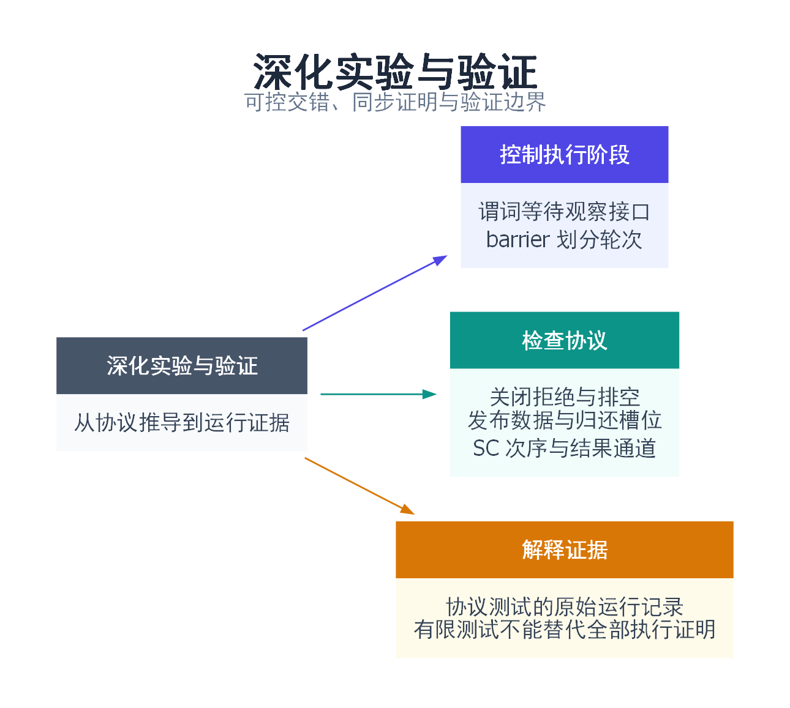

# 深化实验与验证

一句话总结：用可控的执行阶段验证关闭、发布、回收和结果传递，把“测试通过”与“协议证明”分开记录。

[返回目录](README.md) · C++20 · 2026-10-14 深化修订

## 1. 为什么不能只多跑几遍

并发错误像两辆车只有在特定路口时序下才会相撞。多开几圈可能发现问题，但最直接的复现方式是控制它们到达路口的顺序。这里用条件变量和 barrier 建立实验阶段，不用 sleep 猜测线程已经运行到哪里。

完整源码：[deep_protocols.cpp](examples/deep_protocols.cpp)；SPSC 共用实现：[spsc_queue.hpp](examples/spsc_queue.hpp)。后者也由第 41 篇使用，避免测试的是另一份近似算法。

快速阅读先看第 2 节命令与第 3 节断言；深入阅读把第 4 节中的同步链逐条对应到源码。不要定义 NDEBUG：本系列断言既用于检查，也包含教学实验中的操作调用。

## 2. 完整运行方法

需要具备 jthread、barrier 的 C++20 标准库。依赖和平台说明见[实验环境](实验环境与验证.md)。在仓库根目录执行：

```bash
g++ -std=c++20 -O2 -Wall -Wextra -pedantic -pthread examples/deep_protocols.cpp -o deep_protocols
./deep_protocols
# 建议通过统一入口运行，附带 30 秒超时与 JSON 记录：
python3 tools/verify.py --compiler g++ --only 47
```

本机 Windows / MSYS2 UCRT64：

```powershell
$env:PATH = 'D:\msys2\ucrt64\bin;' + $env:PATH
python tools/verify.py --compiler 'D:/msys2/ucrt64/bin/g++.exe' --only 47
```

批量验证全部 49 个目标（非 Linux 环境跳过两项）：

```bash
python3 tools/verify.py --compiler g++ --jobs 2
```

编号 00 是生命周期补测，01—46 是文章示例，47 是这里的协议实验，48 是 Linux 信号 handler 补例。独立运行目录避免日志文件覆盖源目录中的文件。

预期输出：

```text
queue: blocked producer rejected; consumer released; accepted item drained
mailbox: 20000 ordered handoffs, including slot return
release sequence: payload published through relaxed RMW
seq_cst: no double-zero result in 1000 rounds
SPSC N=2: 100000 items, capacity and FIFO checked
SPSC N=3: 100000 items, capacity and FIFO checked
SPSC N=64: 100000 items, capacity and FIFO checked
results: task exception and abandoned result distinguished
```

## 3. 每条断言对应哪个问题

| 实验 | 控制方式 | 必须满足的结果 | 关联章节 |
|---|---|---|---|
| 满队列关闭 | 观察生产者进入谓词等待 | 未接受项返回 false，原项仍可排空 | 14、15、26、27、46 |
| 空队列关闭 | 观察消费者进入谓词等待 | 消费者结束等待并得到空结果 | 14、15、26 |
| 可复用单槽 | 满/空双向 release/acquire | 连续 20000 项不覆盖、不跳序 | 32、34、35、37 |
| 发布接力 | relaxed CAS 连接 release sequence | acquire 后且 join 前读到 42 | 32—36 |
| SC 双变量 | 每轮 barrier 分隔复位和操作 | 1000 轮均不出现双零 | 33、44 |
| SPSC 回绕 | N=2、3、64，逐项序号核对 | 容量 N−1，100000 项 FIFO | 39、41 |
| 任务结果 | 显式执行或销毁包装器 | 区分业务异常与 broken_promise | 21、23、26 |

队列的 `wait_for_blocked` 是测试观察接口。它等待生产者/消费者在锁内登记等待状态，观察方获得同一把锁时，被观察线程已经进入相应等待阶段。计数只用于固定测试窗口，不是生产协议推进所必需的状态。

测试队列固定存 int；生产代码若存可抛异常的复杂对象，需要扩展异常保证。测试中的关闭与背压可解释日志器的队列规则，但不能代替日志器自身的文件系统故障注入。

## 4. 逐条检查同步证明

### 4.1 满槽不是一次通知，而是一份持久状态

生产者在锁内发现满队列，登记等待并进入 not_full 等待；关闭方取得锁后设置 closed，再通知。生产者重新取得锁，谓词因 closed 成立，返回 false。队列里先前的 7 仍存在，pop 在关闭后先排空，再返回 nullopt。

如果 close 只 notify 而不改变 closed，生产者醒来仍看到满队列，会再次睡下。若 closed 在锁外无同步写，既可能破坏数据访问规则，也失去了检查与等待之间的可靠交接。

### 4.2 单槽需要来回两张交接单

正向：生产者写 payload → release 写 full=true → 消费者 acquire 观察 true → 读 payload。

反向：消费者读完 payload → release 写 full=false → 生产者 acquire 观察 false → 下一轮写 payload。

第一条防止读取未发布内容，第二条防止覆盖尚未读完内容。若消费者把 payload 的引用保留到归还空槽之后，再在下一轮访问，这份证明就不再覆盖它，必须改成独立副本或延长占用期。

### 4.3 接力实验为什么把断言放在 join 前

生产者写 payload 并 release-store state=1；主线程 relaxed CAS 把 1 改成 2，随后 acquire-load 读到 2。这个 RMW 位于以 release 开头的连续修改序列中，acquire 可取得头部发布的可见性。

检查 payload 被刻意安排在 producer.join 之前。如果先 join 再断言，join 自己就能解释数据可见，实验便不能明确对应到要讲解的发布接力。这个例子让中转与读取在同一线程完成；不同线程中转也需要逐一核对读取来源，不可把普通 store 替换进去却保留原证明。

### 4.4 SC 实验允许什么，不允许什么

每轮开始前主线程复位 x/y；第一道 barrier 后双方各自先写自己的原子、再读另一原子；第二道 barrier 后主线程检查结果。结束 barrier 也使 r1 的写与检查有序，下一轮开始 barrier 则避免复位与上一轮操作混在一起。

测试排除 r1=r2=0，允许 (0,1)、(1,0)、(1,1)。不要求三种都出现。若将四个操作改弱，双零可能变成允许结果，但不保证本机一定观察到；不应编写“弱序版本必须出现错误”的脆弱断言。

## 5. 如何解释失败和超时

| 症状 | 优先检查 |
|---|---|
| 找不到 barrier/jthread | 编译选项和实际标准库版本 |
| Windows 找不到 DLL | 同一 UCRT64 bin 是否在 PATH |
| 编译器临时路径乱码 | 使用统一脚本的相对路径和 -save-temps=obj |
| 30 秒超时 | 取得所有线程堆栈，检查关闭状态和等待谓词 |
| FIFO 断言失败 | 单写者约束、两个方向内存序、满空判断 |
| SC 断言失败 | 是否误改了内存序或阶段屏障 |

超时表示该测试没有完成，不能算作通过，也不能在没有堆栈的情况下直接归因于算法或标准库。assert 失败应保留 stderr、命令和输入规模，不要只重复执行直到偶然成功。

## 6. 本次实测与未覆盖边界

2026-10-14 的上一轮 40 篇版本在 Windows / GCC 16.1.0 UCRT64 上通过 42 个默认目标；当前 46 篇版本的完整结果以验证报告为准，平台跳过项单独列出，原始命令、诊断和输出保存于[本次验证结果](验证结果.json)。这是协议实验的实际运行结果，不是吞吐性能基准。

本次没有执行 TSan、ASan、ARM 弱内存平台或磁盘故障注入；第 17 篇可选 `--retry` 曾在旧记录中超时，默认成功路径的通过不覆盖它。测试中的逻辑推导与有限执行证据分开保留。

第 45 篇新增串行收集脚本：

```bash
python3 tools/benchmark_notes.py --executable build/45/demo --output build/benchmark-notes.json
# Windows 把可执行文件改为 build/45/demo.exe
```

默认三个规模各运行三次，输出原始文本和退出码。一次输出内部已有九轮测量及中位数。脚本不虚构逐请求延迟、p99 或置信区间，读者应按第 45 篇要求记录自己的硬件和负载后解释结果。

## 7. 引用与延伸阅读

- [C++20 多线程执行与数据竞争](https://timsong-cpp.github.io/cppwp/n4861/intro.races)：同步关系与 release sequence 的定义。
- [C++20 原子内存序](https://timsong-cpp.github.io/cppwp/n4861/atomics.order)：SC 操作次序与发布规则。
- [Clang ThreadSanitizer](https://clang.llvm.org/docs/ThreadSanitizer.html)：检测范围、编译方式与平台限制。

## 8. 思维导图总结

```text
深化实验与验证
├── 控制执行阶段
│   ├── 谓词等待的观察接口
│   └── barrier 划分轮次
├── 检查协议
│   ├── 关闭拒绝与排空
│   ├── 发布数据与归还槽位
│   └── SC 次序与结果通道
└── 解释证据
    ├── 协议测试的原始运行记录
    └── 有限测试不能代替所有执行的证明
```



[Graphviz 图源](images/deep-protocols.dot)
