# 树数据结构面试指南：从基础原理到可运行的 C++ 实现

给你七个数 `8、3、12、1、6、10、14`。任务一是把它们全部打印出来，任务二是判断 6 在不在，任务三是不断取出剩下的最小值。三个任务用的数一样，值得保存的信息却不同。打印时要知道哪些数还没访问；找 6 时希望一次排除许多候选；取最小值时希望一伸手就拿到它。**学一种树，可以先问：它保存了什么，让我下一次少做哪一步？**

读前三节只需要会用数组，知道函数可以调用自己。正文用图和手算解释算法；动手时用 C++17，[编译命令和测试范围在第 16 节](#chapter-16)。第一次读不必从头背到尾，先用第 2 节那棵七结点树把“访问所有结点”和“只走一条查找路径”分清。

## 阅读导航

**第一次复习**，先读第 1～4 节，再做第 15 节的深度、路径和、验证 BST 三道题。能用那棵七结点树解释“遍历为什么要看七个结点，找 6 却只走三个”，就可以往下读。第 7、10、13、14 节可以先跳过，不影响这条路线。

**第二遍按面试方向补。** 问“搜索树为什么不会越长越高”，读第 5、6、8 节；问数据库索引，读第 9 节；问数组区间更新，读第 12 节。遇到多模式匹配、树上路径或子树统计的题，再回到对应章节。文中标为“选读”的小节讲思路，没有对应的附录实现。

<details>
<summary>展开章节目录与源码入口</summary>

- [1. 基础概念：先把“树”说清楚](#chapter-1)
- [2. 二叉树：结构性质与遍历](#chapter-2)
- [3. BST：通过大小关系缩小查找范围](#chapter-3)
- [4. 堆：只要求最重要的元素站在顶部](#chapter-4)
- [5. 旋转与 AVL：让左右高度差不超过 1](#chapter-5)
- [6. 红黑树：以颜色约束换取较宽松的平衡](#chapter-6)
- [7. Treap 与 Splay：另外两条控制成本的路线](#chapter-7)
- [8. 四种平衡查找树怎样比较？](#chapter-8)
- [9. B 树与 B+ 树：一次读取容纳更多路选择](#chapter-9)
- [10. Trie 与 AC 自动机：把字符前缀组织起来](#chapter-10)
- [11. 并查集、KD-Tree 与哈夫曼树：不同任务，不同规则](#chapter-11)
- [12. 区间数据结构：先把问题变成数组操作](#chapter-12)
- [13. LCA、DFS 序与树链剖分：把树上的关系转换成跳跃和区间](#chapter-13)
- [14. 重心、点分治与树形 DP](#chapter-14)
- [15. 经典题：先定义返回值，再写递归](#chapter-15)
- [16. 选型、运行方法与验证范围](#chapter-16)
- [参考与延伸阅读](#chapter-18)
- [完整源码附录](#source)
- [Q&A（常见问题与解答）](#tree-qa)
- [思维导图总结](#chapter-17)

</details>


| 你现在想弄懂什么 | 从哪里读 | 读完可以自己做什么 |
| --- | --- | --- |
| 同样是七个数，为什么有时要全看、有时只看三个？ | [二叉树与遍历](#chapter-2) → [搜索树](#chapter-3) → [堆](#chapter-4) | 画出找 6 的路线，说明换成堆后这条路线为什么失效 |
| 为什么按顺序插入，查找会越来越慢？ | [旋转与 AVL](#chapter-5) → [红黑树](#chapter-6) → [平衡策略比较](#chapter-8) | 手动把一条三结点长链变矮，核对三个键仍然有序 |
| 面试题给了具体任务，该选哪一种？ | [磁盘索引](#chapter-9)、[前缀匹配](#chapter-10)、[集合与空间查询](#chapter-11)、[区间查询](#chapter-12) | 先说清最频繁的操作，再解释为什么这种结构能省工作 |
| 输入本来就是一棵树，怎样在上面算答案？ | [祖先与路径](#chapter-13) → [分治与树形 DP](#chapter-14) → [经典递归题](#chapter-15) | 写递归前先说出“这个函数要交给父结点什么” |

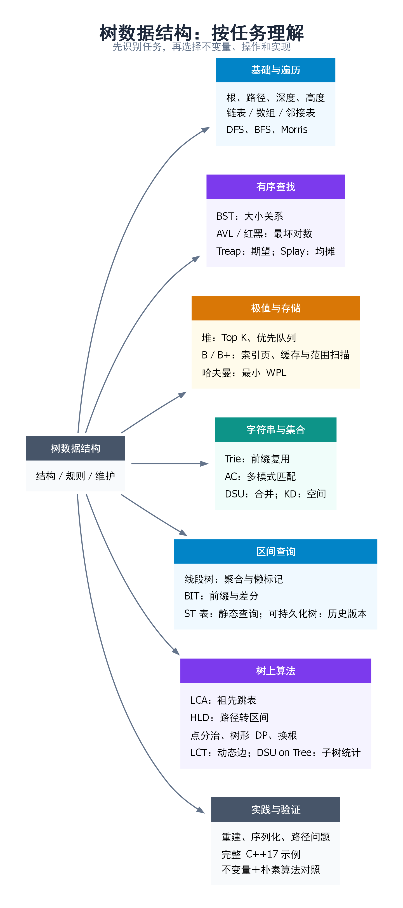

<a id="chapter-1"></a>

## 1. 基础概念：先把“树”说清楚

### 1.1 树、结点和森林

把一份组织架构画在纸上：总负责人 A 下有 B、C 两个组长，B 又带着 D。问“谁直接管理 D”，答案是 B；问“D 的上级有哪些”，答案还有 A。前一个问题只沿线走一步，后一个问题要一直向上走。树里的“父结点”和“祖先”就是这种区别。

先去掉职位和箭头，只保留四个点和三条连线。从任何一点都能走到其余三点，沿线不会绕一圈回到自己（不走回头路）。图论把这样**连通、没有环的无向图**叫树。选 A 当起点，A 就是根，这时才有“往上”和“往下”。后面的算法也会用树表示数字和区间，并不要求它们原本就有上下级关系。

| 名称 | 含义 | 注意 |
| --- | --- | --- |
| 根 | 选定的起点 | 没有父结点 |
| 双亲／父结点 | 当前结点的直接上级 | 不等于所有祖先 |
| 孩子 | 当前结点的直接下级 | 不等于所有后代 |
| 兄弟 | 具有相同父结点的结点 | 不一定只有两个 |
| 祖先／后代 | 沿父子关系向上／向下可到达的结点 | 是否包含自己，须看题目约定 |
| 子树 | 某个结点及其全部后代形成的树 | 子树也有自己的根 |
| 叶子 | 没有孩子的结点 | 图论中度为 1 的“叶子”定义与有根树语境略有区别 |
| 森林 | 多棵互不相交的树构成的集合 | 删除一棵树的某个结点后可得到森林 |
| 有序树 | 每个结点的孩子之间有固定先后次序 | 交换两个孩子可能得到不同的树 |
| 无序树 | 不考虑孩子的排列顺序 | 只看连接关系 |

**度有两种常见口径。** 有根树教材通常把结点的度解释为孩子数；图论把度解释为相连的边数。非根结点的图论度通常比孩子数多 1，因为还连着父亲。本文讲二叉树的度时采用“孩子数”。

一棵有 `n≥1` 个结点的树有 `n−1` 条边。原因是除了根，每个结点恰好贡献一条通向父亲的边。任意两点之间只有一条简单路径：若存在两条不同路径，就会形成环。

### 1.2 深度、高度和层数：本文的统一约定

- **深度**：从根到结点经过的边数，根的深度为 0。
- **层数**：深度加 1，根在第 1 层。
- **子树高度**：最长向下路径包含的结点数，叶子高度为 1，空树高度为 0。
- **整棵树高度**：根的子树高度，等于最大层数。

拿刚才的 D 数一遍：从 A 到 D 经过两条边，所以 D 的深度是 2，位于第 3 层；从 D 往下只有它自己，所以 D 的高度是 1。深度问“我离根多远”，高度问“从我往下最多有几层”。有的教材也按边数算高度。按本文的层数口径，高度为 `h` 的二叉树最多有 `2^h−1` 个结点；若按边数，高度 `H` 对应的上限是 `2^(H+1)−1`。

### 1.3 树在内存里怎样存？

| 存储方式 | 结构 | 适合场景 | 局限 |
| --- | --- | --- | --- |
| 二叉链表 | 每个结点存值、左孩子、右孩子 | 普通二叉树、BST | 指针与分配开销较大 |
| 顺序数组 | 用下标隐含父子关系 | 完全二叉树、二叉堆 | 稀疏树按此方式存会浪费空间 |
| 双亲数组 | `parent[u]` 存父亲 | 并查集、祖先关系 | 枚举孩子不直接 |
| 邻接表 | 每点存相邻结点 | 一般树、树形 DP | DFS 时要避免返回父亲 |
| 孩子兄弟表示 | 指向第一个孩子、下一个兄弟 | 任意多叉树 | “右指针”代表兄弟，不代表原树的孩子 |

完全二叉树使用从 0 开始的数组下标时：左孩子 `2i+1`，右孩子 `2i+2`；非根结点的父亲是 `floor((i−1)/2)`。计算出的孩子下标还要小于数组长度才有效。

附录 A 使用 `unique_ptr` 表达孩子的独占所有权；附录 B 使用结点池和整数下标，0 表示空结点。这两种表示法的原理相同，但所有权处理不同。

<a id="chapter-2"></a>

## 2. 二叉树：结构性质与遍历

### 2.1 “最多两个孩子”还不够

二叉树的每个结点最多有两个孩子，且明确区分左、右。只有一个孩子时，“只有左孩子”和“只有右孩子”是不同结构。

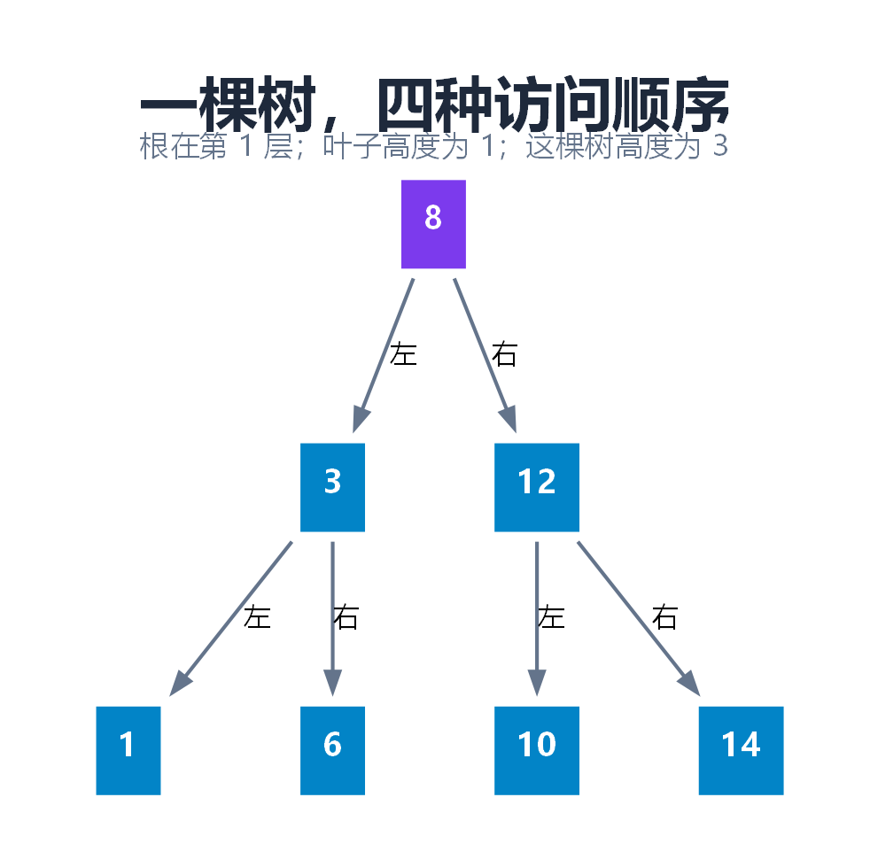

图中共有 7 个结点。根为 8，叶子为 1、6、10、14；高度为 3。以下遍历都使用这棵树，方便比较。

### 2.2 三条常考性质怎样推出来？

**第 `i` 层最多 `2^(i−1)` 个结点。** 根层最多 1 个；下一层每个结点最多贡献两个孩子，逐层翻倍。

**高度为 `h` 最多 `2^h−1` 个结点。** 把各层上限相加：`1+2+4+…+2^(h−1)=2^h−1`。

**非空二叉树中 `n₀=n₂+1`。** 设 `n₀、n₁、n₂` 分别是有 0、1、2 个孩子的结点数。一方面，总边数为 `n−1`；另一方面，每个有一个孩子的结点贡献一条边，有两个孩子的贡献两条边。因此：

```text
n − 1 = n₁ + 2n₂
n     = n₀ + n₁ + n₂
相减得到 n₀ = n₂ + 1
```

这条性质不要求树是满二叉树或完全二叉树，但要求非空。

### 2.3 满二叉树与完全二叉树

- 本文的**满二叉树**指每一层都达到最大结点数，即英文中的 perfect binary tree。所有叶子同层，每个非叶子有两个孩子。
- **完全二叉树**要求除最后一层外各层都满，最后一层从左到右连续排列，不能中间空位却在右边继续放结点。
- 英文 full/proper binary tree 常指“每个结点有 0 或 2 个孩子”，不要求叶子同层。阅读英文题目时不能只按“满”字套用。

“完全”约束形状，“搜索”约束键的大小；一棵 BST 不一定完全，一棵完全二叉树也不一定满足 BST 的大小关系。

### 2.4 DFS：同一条递归骨架，三个处理时机

沿图中的 `8 → 3 → 1` 一直往下，再回到 3 去看 6。这种先把一个分支走完再回来的办法叫**深度优先遍历**（DFS）。三种遍历走的路线可以完全相同；差别在于经过结点 3 时，什么时候把 3 写到纸上。刚到就记，左边这一小段是 `3,1,6`；看完左孩子才记，是 `1,3,6`；两个孩子都看完才记，是 `1,6,3`。把同一规则用到根 8，就得到下表。

| 遍历 | 处理位置 | 图中结果 | 常见用途 |
| --- | --- | --- | --- |
| 前序 | 进入后、递归左边之前 | 8, 3, 1, 6, 12, 10, 14 | 序列化、复制树 |
| 中序 | 左子树结束后、右子树开始前 | 1, 3, 6, 8, 10, 12, 14 | 有序输出 BST |
| 后序 | 两棵子树都结束后 | 1, 6, 3, 10, 14, 12, 8 | 计算高度、树形 DP、释放子树 |

递归可以看成运行时帮你维护了一个栈。迭代中序则自己维护这个栈：不断把左链入栈，弹出一个结点处理，再转到它的右子树。附录 A 的 `inorder()` 是完整实现。

### 2.5 BFS：一层一层地处理

如果问题是“第 2 层有哪些结点”，一路走到叶子再回来就绕远了。可以让结点排队，这叫**广度优先遍历**（BFS）。开始只有 8，取出 8 后队列变成 `[3,12]`。取出 3，把它的孩子排到队尾，队列变成 `[12,1,6]`。可见虽然发现了 1 和 6，下一位仍是本层的 12。若要分层输出，开始处理这一层时先记下队列长度，本轮只取这么多个。

图中层序结果为 `[[8], [3,12], [1,6,10,14]]`。在这个分层结果上：每层取最后一个就是右视图；把奇数下标的层反转，就是一种锯齿形层序。

DFS、BFS 都要访问所有结点，时间 `O(n)`。递归或显式栈 DFS 的辅助空间为 `O(h)`；BFS 为 `O(w)`，其中 `w` 是最大层宽。极端链上 DFS 可能用 `O(n)` 栈，宽树的 BFS 也可能用 `O(n)` 队列。

### 2.6 Morris：用临时线索代替栈

如果允许临时修改普通二叉链表，Morris 可以把“返回上层”的路线写进空的右指针。

1. 当前结点没有左子树：访问它，向右走。
2. 有左子树：找到左子树最右结点，即当前结点的中序前驱。
3. 前驱的右指针为空：临时指向当前结点，然后进入左子树。
4. 前驱已经指向当前结点：说明左子树遍历完了，恢复为空，访问当前结点，再进入右子树。

时间为 `O(n)`，辅助空间为 `O(1)`；如果把输出保存成数组，输出数组仍占 `O(n)`。必须保证临时指针最终恢复，不能随意提前退出，也不适合并发读同一棵树。

附录 A 使用 `unique_ptr` 表示所有权，不能拿它直接搭建指回祖先的临时拥有关系。附录 F 单独使用非拥有型裸指针演示 Morris，避免把遍历线索误写成所有权环。

<a id="chapter-3"></a>

## 3. BST：通过大小关系缩小查找范围

### 3.1 规则约束的是整棵子树

上一节要打印七个数，一个也不能漏。现在只问“6 在不在”。普通二叉树只规定左、右孩子的位置，看到根是 8，并不能断定该去哪里找。**二叉搜索树**（BST）多了一条约定：对每个结点，左子树里所有键都比它小，右子树里所有键都比它大。这里的键就是用来比较和查找的数，本文先假设没有重复键。

回到那张图。找 6 时先看到 8，6 比 8 小，整棵右子树都能跳过；到 3，6 又比 3 大，跳过左边的 1；下一步就找到 6。只比较了 `8 → 3 → 6`。若改找 7，走到 6 后还得向右，那里是空的，于是确定 7 不存在。插入 7 恰好就应填在这个空位。

为什么要强调“**整棵**左子树”？假设把图里的 6 换成 9。单看 3 和 9，右孩子比父结点大，似乎没错。但 9 在 8 的左边，查找 9 时第一步就会往右走，永远找不到它。因此验证 BST 时要把祖先留下的取值范围也传下去。

### 3.2 删除为什么有三种情况？

| 待删结点 | 做法 | 保持大小关系的原因 |
| --- | --- | --- |
| 没有孩子 | 把父结点对应孩子置空 | 不影响其他键的顺序 |
| 只有一个孩子 | 用这个孩子接替位置 | 整棵子树本来就在合法范围内 |
| 有两个孩子 | 用中序后继或前驱替换，再删除那个后继或前驱 | 后继是右子树最小值，恰好处在左右两侧之间 |

以删除根 8 为例，右子树最小值为 10。把根的键换成 10，再删除原来位置上的 10。后继不可能有左孩子，因此第二次删除至多处理一个孩子。

实际结点若存储 `key + value`，替换时需要一起移动对应记录，不能只改 key 却保留别人的 value。若外部保存结点引用，还要考虑引用与结点身份是否应保持不变。

### 3.3 退化与复杂度

顺序插入 `1,2,3,4,5` 会得到一条右链。BST 的查找、插入、删除都是 `O(h)`，不是天然 `O(log n)`。在接近平衡时高度为 `O(log n)`，最坏高度为 `n`。

这也是后面学习平衡树的原因：不改变 BST 的大小关系，而是限制树形恶化。

### 3.4 前驱、后继、第 K 小

- 前驱是严格小于目标的最大键；后继是严格大于目标的最小键。查找过程中保存最近一个满足条件的候选即可。
- 中序遍历第 K 个访问的结点，就是第 K 小。只查询一次时可用迭代中序，时间 `O(h+k)`。
- 经常查询排名时，为每个结点维护子树大小 `size`。左子树有 `s` 个结点，当前结点排名就是 `s+1`。根据 K 与 `s+1` 的关系向左或向右走，单次 `O(h)`；旋转后必须更新 size。

重复键可以采用“每结点一个计数”，也可以约定固定放一侧，但排名、删除和验证规则必须一起调整。本文的四种平衡查找树统一采用集合语义，重复插入不新增元素。

<a id="chapter-4"></a>

## 4. 堆：只要求最重要的元素站在顶部

现在把任务换成“每次取出剩下的最小值”。找任意键时，BST 需要维持左右两边的大小关系；只取最小值，其实只需保证从根向下走，数不会越来越小。这样，不管哪条路上的数，都不比根小。**小顶堆**利用的就是这一点。二叉堆还要求形状是完全二叉树，才能用一个紧凑的数组存下它。

- 小顶堆：父结点的键不大于孩子。
- 大顶堆：父结点的键不小于孩子。
- 左右子树之间没有整体大小顺序，堆的中序遍历不保证有序。

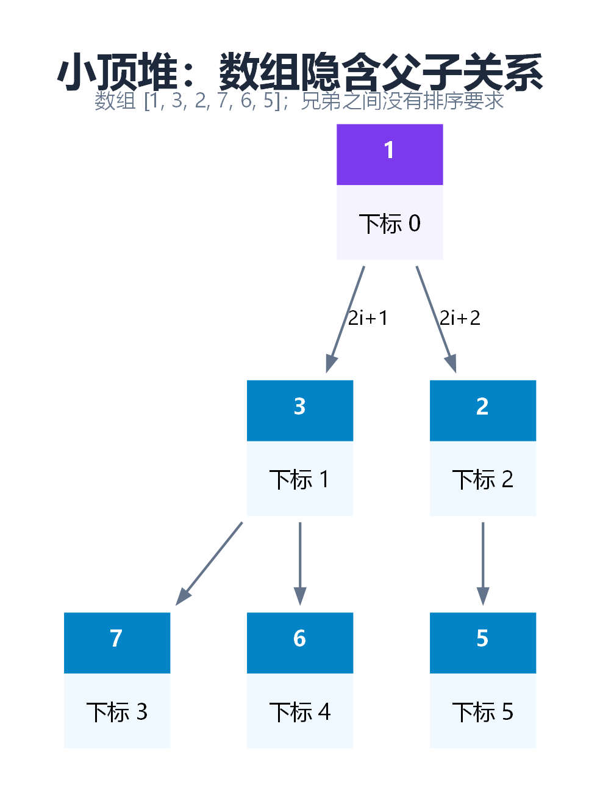

### 4.1 插入上浮，删除下沉

看图里的小顶堆 `[1,3,2,7,6,5]`。如果插入 0，把它放在末尾能保持树的形状，但 0 比父亲 2 小。先和 2 交换，再和 1 交换，数组就变成 `[0,3,1,7,6,5,2]`。这个过程叫**上浮**。新元素只可能破坏从自己到根的那一条路，其余分支不用动。

反过来，从图里的**原数组**删除 1。把末尾的 5 填到根，去掉末尾，暂时得到 `[5,3,2,7,6]`。两个孩子 3 和 2 中要选较小的 2 与 5 交换，得到 `[2,3,5,7,6]`。如果错选 3，根仍比另一个孩子 2 大。这就是**下沉**时要比较两个孩子的原因。

### 4.2 为什么整体建堆是 O(n)？

自底向上建堆从最后一个非叶子开始下沉。大约一半结点是叶子，不需要处理；约四分之一最多下沉一层；约八分之一最多下沉两层。总工作量受以下级数限制：

```text
n/4 × 1 + n/8 × 2 + n/16 × 3 + ... = O(n)
```

逐个插入建堆是 `O(n log n)` 上界，两种方法不能混为一谈。读取堆顶 `O(1)`，插入、删除堆顶 `O(log n)`，查找任意值通常 `O(n)`。

### 4.3 Top K 与堆排序

要选最大的 3 个数，为什么反而用**小**顶堆？假设目前入选的是 `4、7、9`。读到 6，要淘汰的是最弱的 4；读到 2，谁都不用换。把入选者中最小的放在堆顶，就能用一次比较作决定。推广到最大的 K 个数，维护容量为 K 的小顶堆即可。对 `2 ≤ K ≤ n`，时间上界为 `O(n log K)`，额外空间 `O(K)`；K 为 1 时直接扫描求最大值。

堆排序先建立大顶堆，再把堆顶与末尾交换，缩小有效堆区并下沉，最终得到升序数组。它的时间 `O(n log n)`，数组版本可用 `O(1)` 辅助空间，通常不稳定。

<a id="chapter-5"></a>

## 5. 旋转与 AVL：让左右高度差不超过 1

### 5.1 旋转改变结构，不改变中序顺序

第 3 节留下一个问题：按顺序插入 10、20、30，普通 BST 会长成 `10 → 20 → 30` 的右链。查 30 得看三次。能不能让 20 当根，10 和 30 做它的孩子？这样少看一层，而从小到大读仍是 `10,20,30`。把右孩子提上来、旧根放到它的左边，这一步叫**左旋**。图中画的是镜像动作：把左孩子提上来，叫**右旋**。

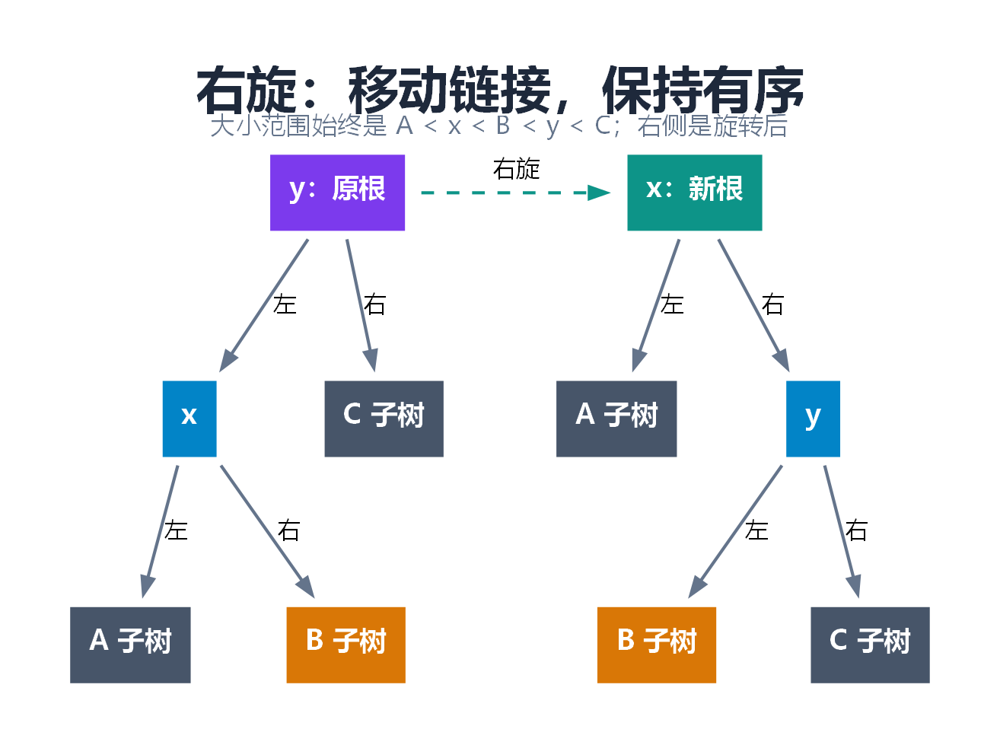

图中 `A < x < B < y < C` 表示整棵子树的键范围。右旋前 y 是根，x 是左孩子；右旋后 x 成为根，y 成为右孩子，B 从 x 的右子树转移为 y 的左子树。两边中序始终是 `A,x,B,y,C`。

旋转是局部常数时间操作。若维护高度或子树大小，必须先更新下降的旧根，再更新上升的新根，因为新根的信息依赖孩子的新状态。

### 5.2 AVL 的不变量

每个结点的平衡因子 `BF = height(left) − height(right)` 必须属于 `{-1,0,1}`。这个条件约束每个结点，而不仅是整棵树的根。

| 失衡情况 | 重的一侧如何延伸 | 修复 |
| --- | --- | --- |
| LL | 左孩子的左侧更高 | 对失衡根右旋 |
| RR | 右孩子的右侧更高 | 对失衡根左旋 |
| LR | 左孩子的右侧更高 | 先对子结点左旋，再对失衡根右旋 |
| RL | 右孩子的左侧更高 | 先对子结点右旋，再对失衡根左旋 |

LL/RR/LR/RL 是四种失衡类型；基本旋转只有左旋和右旋。

例如插入 `30,10,20`：30 左侧太高，但新增的 20 在左孩子 10 的右侧，是 LR。先把 10 左旋成以 20 为根，再把 30 右旋，结果为根 20、左 10、右 30。

### 5.3 插入与删除的修复范围

插入先按 BST 找位置，再沿递归返回路径更新高度、修复失衡。删除先按 BST 删除，再向上重新检查。删除可能让多层祖先的高度继续下降，所以不能修复一个结点就笼统认为全树恢复了。

为什么高度能控制在 `O(log n)`？反过来问：一棵高为 4 的 AVL 树，至少要放多少个结点？一边要达到高度 3，另一边至少也要达到 2，否则根就失衡了。记高度为 h 的最少结点数为 `N(h)`，那么 `N(0)=0`、`N(1)=1`，之后每层都满足 `N(h)=1+N(h−1)+N(h−2)`。于是高度从 1 到 5，至少需要 1、2、4、7、12 个结点。这个数列像斐波那契数列那样随高度指数增长，反过来，给定 n 个结点，高度最多是对数级。查找、插入、删除沿一条路径工作，最坏都是 `O(log n)`。附录 B 的 `fix()` 根据孩子高度决定怎样旋转。

<a id="chapter-6"></a>

## 6. 红黑树：以颜色约束换取较宽松的平衡

### 6.1 五条规则一起约束高度

AVL 通过比较左右高度来防止长链。红黑树采用另一种办法：把结点标成红、黑两色，规定任何一条从根到底的路线都要经过同样多的黑结点，也不许红结点挨着红结点。想象两条路线都有三个黑结点，其中一条可以多穿插几个红结点，却不可能凭空拉出一长串红结点。都按相同口径数，最长路线至多约为最短路线的两倍。具体规则如下。

1. 每个结点为红色或黑色。
2. 根为黑色。
3. 空孩子 NIL 视为黑色叶子。
4. 红结点的孩子不能是红结点。
5. 从任一结点到其后代 NIL 的所有路径，包含相同数量的黑结点。

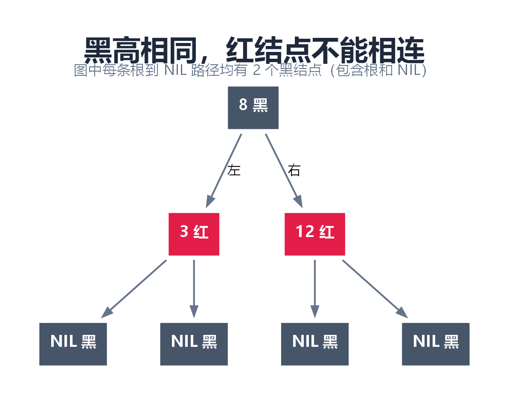

图中标出的 NIL 是不存在的数据孩子，不是值为 0 的记录。实现可以用专门哨兵，也可以像附录一样用下标 0 表示黑色空结点。

“黑高一致”本身不足以限制连续的红链，必须同时要求不能红红相连。由于两黑结点之间至多夹一个红结点，最长路径不会无限拉长；可推出高度为 `O(log n)`，常见边数高度上界为 `2 log₂(n+1)`。

### 6.2 插入为什么通常先染红？

新结点若直接染黑，会改变经过它的路径黑高；先染红不会增加黑高，主要风险变成父子连续红。

经典修复思路是：父黑则结束；父红且叔红时通过变色把冲突上推；父红、叔黑时根据内外侧结构旋转，并调整颜色。每一步都要同时照顾 BST 大小关系、红红冲突和黑高。

删除黑结点更复杂，因为某一路径少了一层黑色。经典算法会按兄弟和侄子的颜色分情况，借助旋转与变色消除这个差额。不能用“删完随便涂黑”替代修复。

### 6.3 本文源码采用左倾红黑树

附录 B 的 `RedBlack` 是 **LLRB（左倾红黑树）**，在普通红黑规则之上要求红链接向左。它借助以下动作组织修复：

- 右侧出现需要整理的红链接：左旋。
- 左边连续出现两层红链接：右旋。
- 两个孩子都红：翻转颜色，把临时合并的结构向上调整。
- 删除下降前用 `moveRedLeft` 或 `moveRedRight` 调整颜色和结构，使目标分支具备可删除条件；返回时再 `fix`。

源码完整提供插入、查找、删除和不变量检查，但这个修复顺序只适用于本文的 LLRB 变体，不应与经典父指针实现混用。红黑树与多路树的联系可进一步阅读 [Open Data Structures：红黑树](https://opendatastructures.org/ods-cpp/9_Red_Black_Trees.html)。

### 6.4 红黑树是否一定比 AVL 更新快？

不一定。两者操作最坏复杂度都是 `O(log n)`。AVL 高度约束更严格；红黑树允许更大的高度差，但实际速度还取决于结点大小、内存访问、旋转策略和数据分布。不能把“平衡更宽松”直接等同为“每一次插入删除都更快”。

C++ 的 `std::map`、`std::set` 常由红黑树实现，但标准规定的是接口和复杂度要求，不强制指定红黑树。学习红黑树有助于理解常见实现，业务代码无需因此自行替代标准容器。

<a id="chapter-7"></a>

## 7. Treap 与 Splay：另外两条控制成本的路线

### 7.1 Treap：键负责查找，随机优先级负责形状

如果用户总按 `10、20、30` 的顺序插入，普通 BST 的形状就被这个顺序定死了。Treap 给每个键另外抽一个随机优先级，用键决定去左边还是右边，用优先级决定谁更靠近根。比如 10 的优先级为 80，20 的优先级为 15。按键插入时 20 先落在 10 的右边；按本例“小数优先”的约定，再左旋一次，20 就到了根，10 在左边。键的顺序没有改变。

插入先按 key 放入，再通过旋转把违反优先级规则的结点上提。删除某个结点时，可以把它的左右子树合并：两边所有键已满足“左＜右”，比较根优先级，较小者作为新根，再递归合并剩余部分。

随机优先级使树形在适当独立随机假设下类似随机 BST，所以查找与更新具有**期望 `O(log n)`** 复杂度；这不是每次操作的最坏保证。极端形状仍可能退化为链。

附录使用固定种子便于复现实验，不是抗恶意输入的随机方案。实现仍保留整数 key，重复键按集合语义忽略。Treap 也常使用 split/merge 操作组织实现，进一步可扩展为维护序列的隐式 Treap。[Treap 的分裂与合并](https://cp-algorithms.com/data_structures/treap.html)

### 7.2 Splay：把刚访问的结点搬到根

如果连续十次都查同一个键，普通 BST 每次走的仍是同一条路。Splay（伸展树）在第一次找到它后，用旋转把它移到根。紧接着再查同一个键，一次比较就找到了。代价是第一次查找可能很慢，连查找操作也会更改树形。旋转方式由这个结点与父亲、祖父的位置决定。

| 情况 | 动作 |
| --- | --- |
| 父亲就是根 | 一次 zig 旋转 |
| 结点、父亲、祖父同方向 | zig-zig：先提升父亲，再提升当前结点 |
| 方向不同 | zig-zag：连续两次提升当前结点 |

不能把 zig-zig 写成只反复将当前点单旋上去，因为分析所依赖的结构调整不同。附录 `splay()` 明确区分了同向与异向。

Splay 的单次操作最坏可以是 `O(n)`；常用查找、插入、删除的**均摊复杂度为 `O(log n)`**。均摊讨论一段操作序列的总成本，不要求随机输入，也不承诺某一次请求延迟低。

“自适应缓存”只能作为访问局部性的类比，Splay 本身不是 CPU 缓存。其查找会修改树形，因此只读查询也可能需要写同步；对严格单次延迟要求较高的场景，要谨慎选择。

<a id="chapter-8"></a>

## 8. 四种平衡查找树怎样比较？

同一批键按升序插入，四种结构都希望避免把昂贵的查找一遍遍重做，但承诺不同。AVL 和红黑树约束每次操作最多走多远；Treap 的估计依赖随机优先级；Splay 允许某一次走得很远，靠后续操作摊薄成本。读表时，先问“我担心的是一笔请求，还是一整批请求？”

| 结构 | 平衡依据 | 查找／插入／删除 | 单次最坏情况 | 主要实现负担 |
| --- | --- | --- | --- | --- |
| AVL | 子树高度差不超过 1 | 最坏 `O(log n)` | `O(log n)` | 维护高度、旋转与删除回溯 |
| 红黑树 | 颜色、黑高、无连续红 | 最坏 `O(log n)` | `O(log n)` | 变色与修复规则 |
| Treap | BST＋随机堆优先级 | 期望 `O(log n)` | `O(n)` | 随机优先级、旋转或合并 |
| Splay | 访问后伸展到根 | 均摊 `O(log n)` | `O(n)` | 父指针与双旋；查找会写树 |

选型时先问是否必须保证单次最坏复杂度，再问是否需要自己维护排名、区间或序列操作。不要仅凭“代码短”或“某某最快”下结论。

<a id="chapter-9"></a>

## 9. B 树与 B+ 树：一次读取容纳更多路选择

### 9.1 为什么数据库索引常见多路树？

假设索引大到放不进内存：查一个编号，读出一个索引页，才能知道下一步该读哪一页。上节关心“比了几个键”，这里还要关心“为了比较这些键，读了几页”。同一页能装很多键，若只放一个键和两个孩子，就浪费了这次读取。

举个导航页的例子。页内放 `[20,40]` 两个分隔键，按本例约定，三个孩子分别负责 `<20`、`[20,40)`、`≥40`。找 35 时，只读取一次这个页就知道该去中间那个孩子。一个页能指向的孩子越多，树通常就越矮。这个孩子数叫**扇出**，受页面大小、键大小、指针大小和实际填充程度影响。

### 9.2 B 树：一个结点里可以有多条记录

用最小度数 `t` 定义 B 树：非根结点通常有 `t−1` 到 `2t−1` 个键；非叶子结点的孩子数等于键数加 1；所有叶子深度相同。根有例外，非空根可以只有一个键。

不同教材的“阶 m”可能指最大孩子数，不能不加转换就套用 t 的公式。本文示例固定 `t=2`，每个结点最多 3 个键。

查找在当前结点的有序键中定位：若命中当前记录就结束；否则进入对应孩子。叶子上仍找不到，才说明不存在。

插入遇到满结点 `[10,20,30]` 时，提升中间的 20，左右分别保留 `[10]`、`[30]`。父结点增加一个键和一个孩子；如果根满了，就建立新根，树高加一。

### 9.3 B+ 树：分隔键负责导航，叶子负责记录

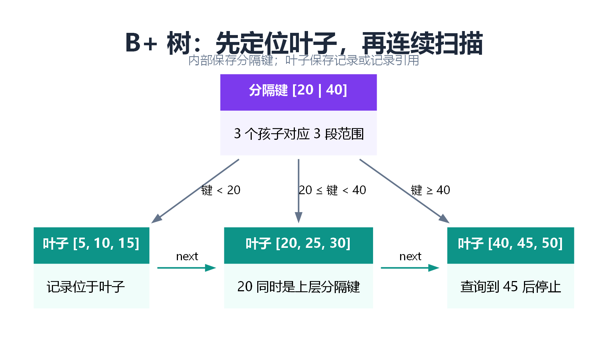

B+ 树的内部结点存储导航用的分隔键和孩子引用，记录或记录引用集中放在叶子。内部出现的分隔键也可能在叶子中出现，不能理解成“内部没有 key”。具体数据库的叶子可能存完整行，也可能存主键或记录定位信息。

叶子按键顺序链接。查找范围 `[15,45]` 时，先沿树找到起点所在叶子，再沿叶子链向后扫描，直到键超过 45。若匹配 k 条记录，CPU 模型中通常可概括为定位成本加顺序输出成本；磁盘模型还应按实际扫描叶页数计算。

叶子分裂时，要把新右叶子的最小键**复制**到父结点作为分隔键，数据记录仍保留在叶子。内部结点分裂则提升分隔键，处理方式与叶子不同。附录 `BPlusTree::put()` 将两种情况分别实现。

### 9.4 删除为什么需要借位和合并？

删除后结点可能低于最低占用率。通常先看相邻兄弟能否借出一个键或记录；不能借时，就与兄弟合并，并从父结点移除相应分隔键与引用。父结点也可能不足，问题继续向上处理。根只剩一个孩子时，可让孩子成为新根，树高下降。

B+ 树还需维护分隔键及叶链：删除了右孩子的最小记录后，其父分隔键可能需要更新；合并叶子时也要修复 next 链接。

**源码范围：**附录 E 的 B 树实现插入、查找与分裂；B+ 树实现插入、查找、分裂和范围扫描，不提供删除接口。删除机制在本节解释，但这两个内存示例不是具备事务、页缓存、并发锁和崩溃恢复的数据库索引实现。

| 比较 | B 树 | B+ 树 |
| --- | --- | --- |
| 记录位置 | 内部和叶子都可保存记录 | 记录或引用集中在叶子 |
| 单点命中 | 可能在内部结束 | 通常定位到叶子 |
| 范围扫描 | 需要树的有序遍历 | 常利用叶子链顺序扫描 |
| 内部扇出 | 受内部记录大小影响 | 只存导航信息，通常可提高扇出 |
| 适合关注 | 有序多路查找 | 页式存储、范围访问、索引扫描 |

### 9.5 选读：索引已经在内存里，B+ 树还可能省什么？

前面说“一层访问一个索引页”，考虑的是数据库从存储设备把页读进内存。现在假设这些页都已在内存里：CPU 读一个键时，通常还会把附近一小段内存一起取进缓存，这一小段叫**缓存行**。读过一个索引页，并不意味着整页已经进了 CPU 缓存。一页通常跨越许多缓存行。

还是查 35。假设当前结点把分隔键 20、40 紧挨着存，CPU 取 20 时，有机会连同 40 一起取进来，第二次比较就能用上已经取来的数据。一个结点里装着许多键，也意味着一次向下跳转能排除更多候选。相比之下，如果二叉搜索树的结点分别分配在相距很远的地址，每比较一个键再沿指针找孩子，就可能又要从内存取一块数据。这种优势来自**具体的存储布局和树高**，B 树和 B+ 树都可能受益。[Abseil 的内存 B 树设计](https://abseil.io/about/design/btree)

附录的 B+ 树把**同一个结点**的键放在 `vector<int>` 中，它们连续；下一个结点的键则可能在别处。叶子的 `next` 保证按键顺序扫描，却不保证相邻叶子的内存地址连续。因此不能仅凭树名断言缓存未命中一定更少。要验证自己的实现，应固定键、数据量和查询序列，在同一机器上分别测随机查找和范围扫描，再比较耗时及缓存未命中次数。本文的功能测试没有测这项性能。

<a id="chapter-10"></a>

## 10. Trie 与 AC 自动机：把字符前缀组织起来

### 10.1 Trie 中一条路径代表一个前缀

如果按普通 BST 保存字符串，每次比较可能重复检查公共前缀。Trie 把同一前缀只保存一次。例如 `he`、`her`、`hers` 共用 `h→e` 路径，随后继续延伸。

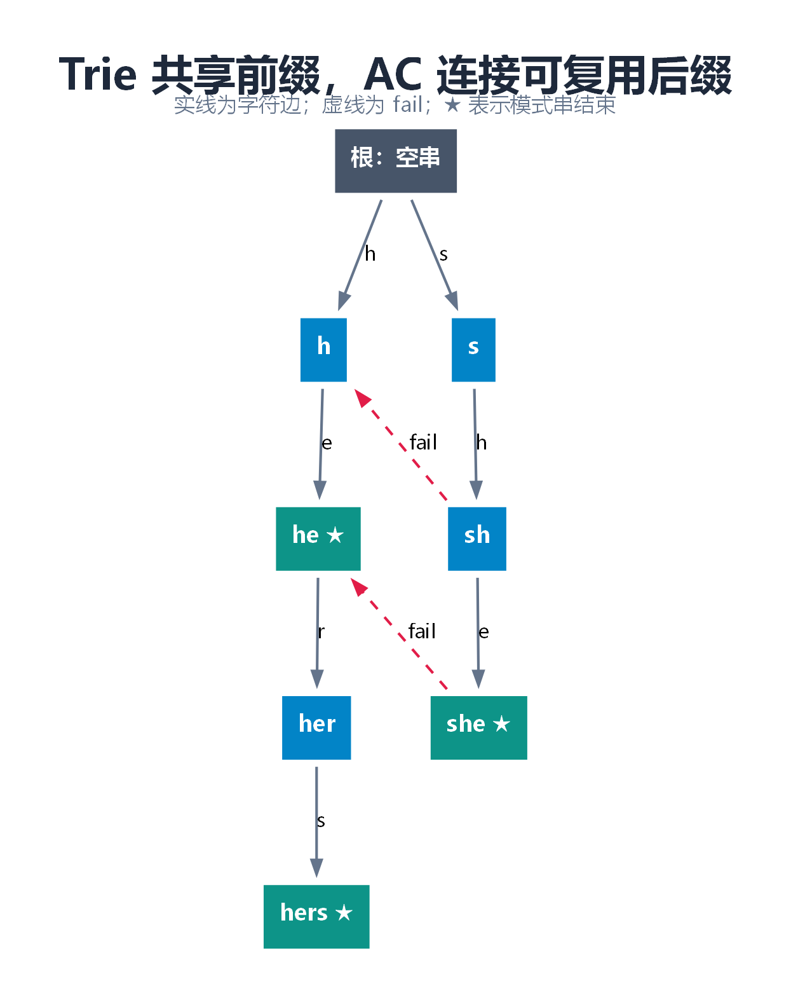

“路径存在”不等于“这个单词存在”。保存 `hers` 会创建 `h、he、her` 等前缀路径，但必须额外设置终止标记，才能表示是否单独插入过 `he`。

附录 Trie 用两个计数：`pass` 表示经过结点的有效单词数量，`end` 表示正好在此结束的数量。于是可以支持重复单词、前缀数量查询和删除一次出现。删除后结点池不回收，仅更新计数。

长度为 L 的字符串，固定字母表数组实现的插入、精确查询、前缀查询均为 `O(L)`。但空间可能很大：每个结点都保留 26 个转移，即使多数为空。字符集大或稀疏时，可用映射、压缩 Trie 等结构权衡时间与空间。

本文只接受小写英文字母，不把一个 UTF-8 字节当成完整汉字。处理 Unicode 时必须先决定按字节、码点还是业务字符单元匹配。

### 10.2 AC 自动机解决的是多模式匹配

Trie 更直接解决“这个词／前缀有没有”，AC 自动机解决“在一段长文本里，一次找出许多模式串的出现”。

假设词库里有 `he、she、hers`，扫描文本 `ushers`。读到 `she` 时已经找到一个词；刚读过的末尾两个字母又恰好是 `he`，还能报第二个词。接下来的 `r` 无法接在 `she` 后面，但能接在 `he` 后面组成 `her`，再读 `s` 就找到 `hers`。整个过程不用把文本倒回去重新读。

AC 自动机事先保存了这条退路，叫**失败链接**（fail）。从 `she` 退到 `he`，因为 `he` 是它最长的、在词库里仍走得通的真后缀。“真”表示不把整个 `she` 自己算作后缀。退过去后，已经读过的 `he` 可以直接接着用。更一般地，fail 指向当前路径的最长真后缀，且这个后缀必须是某个模式串的前缀。

构建通常按 BFS：先确定浅层 fail，再利用它们确定深层 fail。附录使用 26 路转移数组，缺失边直接补成沿 fail 后应到达的状态，并把 fail 状态的输出计数累计到当前结点。

在该固定字母表实现中，设 Trie 状态数为 S、文本长为 N：建自动机 `O(26S)`，扫描计数 `O(N)`；如果逐项输出所有匹配位置，还要加上输出条数的成本。模式串插入总成本与模式串总长度成正比。

源码必须先插入全部模式串，再 `build()` 一次；构建后不能再把补全的转移当成原始 Trie 边继续插入。重复模式按插入次数计数，重叠匹配也计数。[AC 自动机的状态与后缀链接](https://cp-algorithms.com/string/aho_corasick.html)

<a id="chapter-11"></a>

## 11. 并查集、KD-Tree 与哈夫曼树：不同任务，不同规则

### 11.1 并查集：维护“属于同一个集合吗”

假设系统先连通 A 和 B，又连通 B 和 C。现在问“A 和 C 通不通”，只需要一个是或否，不一定需要列出路线。**并查集**给每一组元素选一个代表，用父指针把组员连成树。沿指针走到根，就是这组的代表。A 和 C 找到同一个根，就属于同一组。

`find(x)` 做的正是沿指针找根。假如原来要走 `C → B → A`，查完后可以让 C 直接指向 A：代表没变，下次少走一步，这叫**路径压缩**。要合并两组，就把较小那组的根接到较大那组的根下，避免大树里的许多结点一起多走一层。

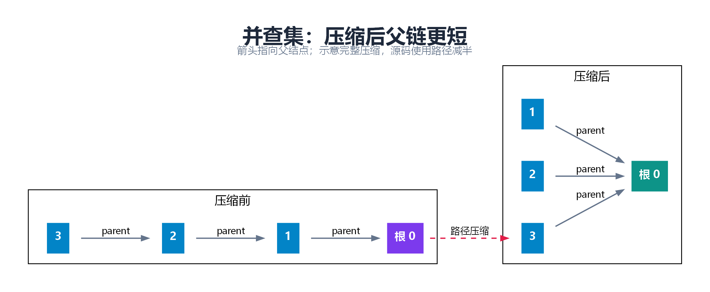

代表元只是一种内部标识，不保证是集合中的最小值。按秩合并中的秩也不应在路径压缩后直接解释成当前真实高度。

建好 n 个单元素集合后，结合路径压缩与按秩或大小合并，连续 m 次查找、合并的总时间可写为 `O(m α(n))`。`α` 是反阿克曼函数，增长极慢。这个界限说的是一批操作摊下来有多便宜；某一次查找仍可能先走一段父指针，替后面的查找把路缩短。

应用包括连通分量、动态加边后的连通判断、岛屿合并、Kruskal 最小生成树的判环。普通并查集不直接支持任意删边，也不保存两点间的实际路径。

### 11.2 KD-Tree：按不同坐标轴切开空间

假设你要从地图上的一批点里找离自己最近的点。只按横坐标排不够：横坐标相同的两个点，纵坐标可能相差很远。二维 KD-Tree 先按 x 把平面切成两半，再在每半里按 y 切，上下两种方向轮流用。这样查找时能先搜近侧，再判断远侧是否值得看。

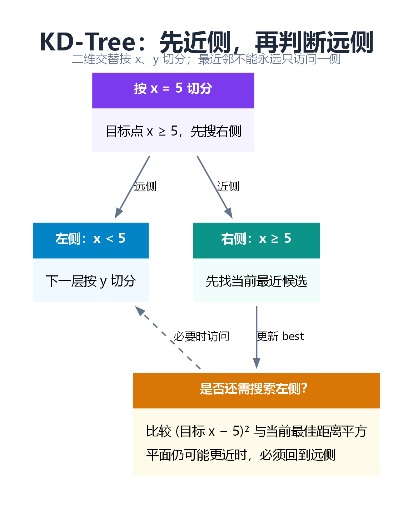

本文静态实现每层使用中位数，把点分成规模接近的两组。查询最近邻时，先进入目标点所在的近侧；取得候选距离之后，检查目标到切分平面的距离。

比如以竖线 `x=5` 分割，目标点的横坐标是 2。线另一侧的点，单是横向距离就至少有 3。如果近侧已经找到距离为 2 的点，远侧可以整片跳过；如果当前最好距离是 4，就还得去远侧找。这种“先证明确实不可能更好，再跳过整片区域”的做法叫**剪枝**。

示例全部比较距离平方，避免不必要的开方。它实现静态二维 **1 最近邻**，返回距离平方；空树返回正无穷。KNN 可改为维护大小为 K 的候选大顶堆；范围查询则可利用区域边界剪枝。

平衡形状不意味着最近邻查询最坏 `O(log n)`。维度高、点分布不利或查询区域大时，可能访问大量结点，最坏 `O(n)`。示例中位数构建的通常分析为期望 `O(n log n)`，查询只声明最坏线性，不作无条件对数保证。

### 11.3 哈夫曼树：补充一个经典贪心应用

给定每个符号的频率，让高频符号使用较短编码，可以降低总编码长度。目标是最小化叶子的带权路径长度 `WPL = Σ weight × depth`，这里 depth 按边数计算。

每次从小顶堆取出两个最小权值，合成权值为两者之和的新父结点，再放回堆。不断合并直到只剩一棵树。左右边分别标 0 和 1，根到叶子的路径就是对应符号编码。

例如 A、B、C 分别出现 5、2、1 次。先合并最少的 1 和 2，得到 3；再把 3 和 5 合并。A 在深度 1，B、C 在深度 2，总长度是 `5×1 + 2×2 + 1×2 = 11` 位。也可以直接把两次合并的权值相加：`3+8=11`。每次合并都会让这两棵子树的所有叶子多走一条边，因此加的恰好是它们的总权值。频率最低的两个符号可以放到最深的一对兄弟叶子上；合并成一个符号后，就得到规模更小的同类问题。

n 个符号建树 `O(n log n)`；实际生成全部编码还需输出总码长的成本。权重相同可能产生多种同样最优的树。仅一个符号时，树论 WPL 为 0；实际编码约定使用 `0`，必须区分这两个口径。

<a id="chapter-12"></a>

## 12. 区间数据结构：先把问题变成数组操作

现在手里只有数组 `[2,1,3,4]`，怎么又谈到“树”了？因为问题变成了：反复问“一段数的和是多少”，中途还可能改数。每次从头相加，区间越长越费时。可以预先保存一些**小段的答案**，查询时把它们拼起来。线段树、树状数组和 ST 表各自选择了不同的小段，适合的更新方式也不同。ST 表虽然没有树形外观，但回答的是同一类问题。

**本节接口统一采用从 0 开始的下标和半开区间 `[l,r)`。** 例如 `[1,4)` 包含下标 1、2、3，长度为 `r−l=3`。

### 12.1 线段树：每个结点管理一个区间

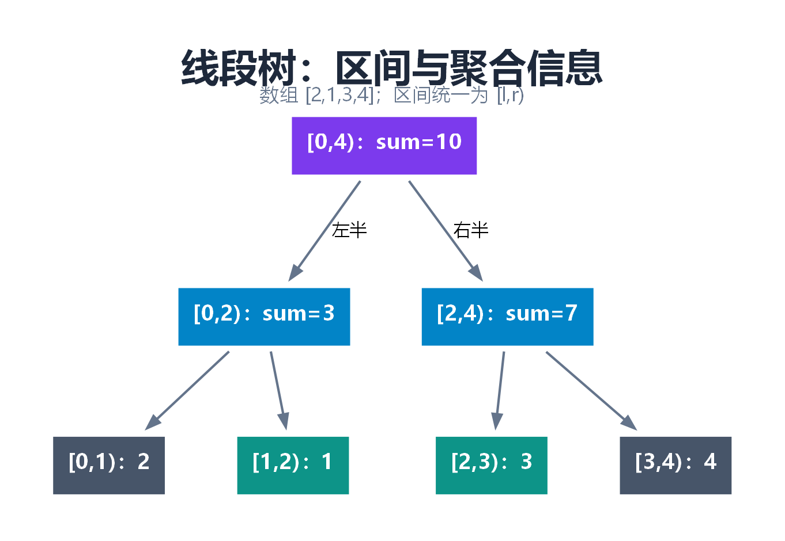

对数组 `[2,1,3,4]`，根管理 `[0,4)`，维护和 10；左右孩子管理 `[0,2)` 和 `[2,4)`，维护和 3、7。一直二分到单个元素。

根保存的 10 能回答“全部加起来多少”，却不能回答“中间两个数加起来多少”。要查 `[1,3)`，就从根往下拆。左半边只取 `[1,2)` 的 1，右半边只取 `[2,3)` 的 3，合起来是 4。遇到完全落在查询范围里的小段，就直接取它存的和，不再往叶子走。

如果下标 1 的值增加 2，只有包含它的那些区间需要重算，从叶子往上更新到根即可。每层最多两处查询边界需要继续拆，所以查一个区间或改一个点都只花 `O(log n)` 时间。建树时每个结点算一次，总时间 `O(n)`，常见数组实现预留 `4n` 个位置。

### 12.2 懒标记为什么能推迟修改？

假设对完整区间 `[0,4)` 每个数加 5。总和立即变成 `10+5×4=30`。此时无需立刻走到四片叶子，可以在根记 `lazy += 5`，表示这份加法已经体现在根的汇总中，但尚未传给孩子。

如果紧接着只查左半边，孩子里存的还是旧和 3，直接返回就错了。因此往下走之前要把根记着的 5 传给孩子：左半边的和从 3 变成 `3+5×2=13`，右半边从 7 变成 17。两个孩子各自记住这次加法，根的标记清零。这样根的 30 恰好等于 `13+17`。以后若只改其中一个孩子，回到父结点时再把两个孩子的和加起来。

三个函数各管一件事：

| 函数 | 含义 | 区间加与区间和中的操作 |
| --- | --- | --- |
| `apply` | 当前整段生效 | `sum += delta × length`；`lazy += delta` |
| `push` | 延迟操作传给孩子 | 分别 apply，再清空当前 lazy |
| `pull` | 从孩子重算父结点 | `sum = left.sum + right.sum` |

懒标记不是万能的“加个字段就好”。必须定义操作如何作用于聚合信息，以及多个标记如何复合。例如赋值后加法与加法后赋值的结果不同，不能沿用简单相加的标记组合。本源码只实现区间加与区间和。[线段树的区间更新](https://cp-algorithms.com/data_structures/segment_tree.html)

### 12.3 树状数组：利用二进制组织前缀

内部从 1 开始计数时，`lowbit(i)=i & -i`，表示 i 的最低有效 1 对应的数值。`bit[i]` 管理一个以 i 结尾、长度为 lowbit(i) 的片段。

例如 `6` 的二进制是 `110`，最右边的 1 代表 2，所以 `bit[6]` 存第 5～6 项的和。要算前 6 项，还缺前 4 项，正好由 `bit[4]` 一次提供。下标走的是 `6 → 4 → 0`，两段不重、不漏。一般地，查询时用 `i -= lowbit(i)` 跳过已经算入的那一段。反过来，第 5 项增加时，从 5 出发用 `i += lowbit(i)` 依次走到 6、8……，给所有包含它的片段更新总和，直到走出数组。

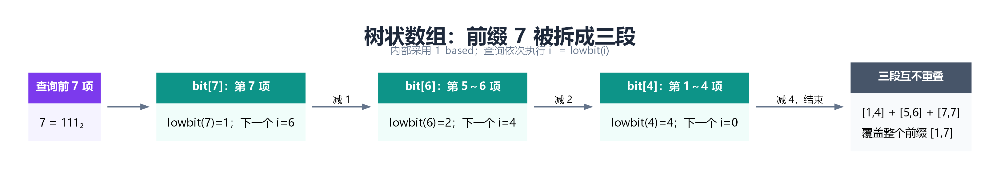

单点增加与前缀和查询均为 `O(log n)`，区间和为 `prefix(r)-prefix(l)`。附录把内部 1-based 转换隐藏在类里，对外仍使用 0-based 下标。

### 12.4 两个树状数组怎样支持区间加与区间和？

设差分 `d[0]=a[0]`，`d[i]=a[i]−a[i−1]`。给 `[l,r)` 加 v，只需令 `d[l]+=v`、`d[r]-=v`。当 r 等于 n，后一个变化位于数组外，不影响有效查询。

为什么需要两棵树状数组？把前 3 项展开：`a[0]=d[0]`，`a[1]=d[0]+d[1]`，`a[2]=d[0]+d[1]+d[2]`。三项相加，`d[0]` 出现三次，`d[1]` 两次，`d[2]` 一次。推广到前 r 项，`d[j]` 一共出现 `r−j` 次，于是有：

```text
Σ(i=0..r−1) a[i]
= Σ(j=0..r−1) (r−j) × d[j]
= r × Σd[j] − Σ(j × d[j])
```

所以用两个树状数组分别维护 `d[j]` 和 `j*d[j]`。这就是附录 `RangeFenwick::prefix()` 的公式来源。它支持区间加、区间和，不能笼统写成“树状数组不支持区间修改”。

### 12.5 ST 表：数据不变，就提前计算长度为 2 的幂的区间

`st[k][i]` 保存从 i 开始、长度 `2^k` 的区间最小值。它由两个长度 `2^(k−1)` 的相邻区间合并而来。

查询 `[l,r)`，令 `k=floor(log₂(r−l))`，取 `[l,l+2^k)` 和 `[r−2^k,r)` 两段。两段覆盖整个区间，可能重叠。对于 min，重复取同一元素不改变结果，因此只需两次取表和一次 min，查询 `O(1)`。

举个能算错的例子：查 `[0,3)`，两段可以选 `[0,2)` 和 `[1,3)`，中间那个数被看了两次。对数组 `[2,1,3]` 求最小值，两段的最小值都是 1，再取一次最小值仍是 1；但若把两段的和相加，会得到 `3+4=7`，正确答案只有 6。重复算同一个值也不影响结果，这个性质叫**幂等性**。它解释了为什么这里能用 min、max 或 gcd，却不能把运算直接换成加法。

预处理时间和空间 `O(n log n)`。本实现不支持更新，只接受非空查询区间。它适合数据静态且查询较多的场景，而不是任何区间问题都优先选择。

| 需求 | 线段树 | 树状数组 | 普通 ST 表 |
| --- | --- | --- | --- |
| 单点加、区间和 | 支持，`O(log n)` | 支持，`O(log n)` | 不适合动态更新 |
| 区间加、区间和 | 懒标记，`O(log n)` | 两棵 BIT，`O(log n)` | 不支持此动态接口 |
| 动态区间最值 | 可支持 | 需额外限制或特殊设计 | 不支持更新 |
| 静态区间最值 | `O(log n)` 查询 | 不是一般首选 | `O(1)` 查询 |
| 空间 | `O(n)` | `O(n)` | `O(n log n)` |
| 编码复杂度 | 聚合与标记需设计 | 基础版本较短 | 静态 RMQ 较直接 |

### 12.6 选读：改了一个数，还想查昨天的版本怎么办？

普通线段树会直接改写结点。若既要查修改前的和，又要查修改后的和，可以让每个版本保留一个根。仍用数组 `[2,1,3,4]`：把下标 1 的值从 1 改为 5，只有叶子 `[1,2)`、它的父区间 `[0,2)` 和根 `[0,4)` 的和变了。为这三个结点建立副本，其余孩子沿用旧结点。旧根查全段得到 10，新根得到 14，两边都没有改写对方能访问的结点。这种做法叫**路径复制**。有 n 个数时，单点修改沿一条根到叶子的路走，每次增加 `O(log n)` 个结点。

常见的“主席树”题还有一步变化：**按值建树，结点存出现次数**。例如在静态数组 `[4,1,4,2,3]` 里，求下标区间 `[1,4)` 的第 2 小。设 `root[t]` 记录前 t 个数的频次，每读入一个数，就从上一版本复制一条路径，把这个数的频次加一。查询时一起看 `root[4]` 和 `root[1]`，对应结点的次数相减，就只剩 `[1,4)` 中的 `1、4、2`。在值域 1～4 的左半边 1～2，次数差为 2，所以第 2 小在左边。再看值 1，次数差只有 1，于是跳过它，答案是 2。

一般地，若左半边有 c 个数，第 k 小在 `k ≤ c` 时去左边，否则去右边找第 `k−c` 小。重复值要保留次数。键很大时先把不同键按大小映射成连续编号；若有 U 种不同值，每次查询只走 `O(1 + log U)` 层。第 k 大可换算成第 `区间长度−k+1` 小，前提是 k 在有效范围内。这里用前缀版本相减，针对的是静态数组；修改历史位置会改变后续前缀的含义。[可持久化线段树与区间第 k 小](https://cp-algorithms.com/data_structures/segment_tree.html#finding-the-k-th-smallest-number-in-a-range)

<a id="chapter-13"></a>

## 13. LCA、DFS 序与树链剖分：把树上的关系转换成跳跃和区间

### 13.1 最近公共祖先 LCA

回到第 2 节那棵树。结点 1 往上走会遇到 3、8，结点 6 往上走也会遇到 3、8。问“最近的共同上级是谁”，答案是 3，因为它比 8 更靠近这两个结点。这个结点叫**最近公共祖先**（LCA）。这里允许结点是自己的祖先，所以问 3 和 6 的 LCA，答案仍是 3。

普通二叉树单次查询可递归：当前结点等于任一目标就返回当前结点；左右子树都返回非空时，当前结点就是交会点；只有一边非空就向上传递该边。附录 A 的实现要求两个目标都在树中，否则必须额外验证是否确实找全。

BST 中可以利用大小关系：两个键都小于当前键就往左，都大于就往右；一左一右或命中当前键时，当前结点就是 LCA。前提仍然是键存在，并采用一致的重复键规则。

### 13.2 倍增：预先存“往上走 1、2、4、8 步”

`up[j][u]` 表示 u 的第 `2^j` 个祖先。递推式为：

```text
up[j][u] = up[j−1][ up[j−1][u] ]
```

为什么这个表能帮忙？往上走 8 步，可以先走 4 步，再从到达的祖先走 4 步。上面的式子正是把两个小跳接成一个大跳。要升 13 层，就把 `13=8+4+1` 拆成三次查表，无须沿父指针走 13 次。

查询先把更深的点抬到同一深度；如果两点相等，直接返回。否则从大步到小步，若两点对应祖先不同，就一起跳到那两个祖先。最后两点位于 LCA 下方，其父亲就是答案。

预处理 `O(n log n)`，空间 `O(n log n)`，单次查询 `O(log n)`。无权树的距离为 `depth[u]+depth[v]−2depth[LCA(u,v)]`。若是带权树，需要改用根到结点的权重距离。

### 13.3 DFS 序：子树变成连续区间

还用根为 8 的七结点树，按“先自己、再左、再右”访问，依次得到 `8,3,1,6,12,10,14`。从 0 开始编号，3 的编号是 1，它的两个孩子占位置 2 和 3。访问完这三个点，才会去根的右边。这就是为什么一整棵子树在**进入顺序**里必定连在一起。

若 `size[u]` 是子树结点数，则子树对应 `[pos[u],pos[u]+size[u])`。这让“子树求和”“子树加值”直接变成数组区间操作。

但两个任意结点之间的路径通常不会在普通 DFS 序里形成一段连续区间，需要继续引入树链剖分。

### 13.4 HLD：把任意路径拆成少量重链区间

图里的路径 `5 → 3 → 1 → 0 → 2 → 6` 跨过两条链。若每个点都单独处理，长路径会很慢。树链剖分（HLD）想让**一长串相邻的点**在数组里也相邻，从而一次就能处理一段。做法是每个结点选择子树最大的孩子作为“重孩子”，沿这样的边一路往下形成重链。编号时总是先访问重孩子，于是同一条重链一定连续。

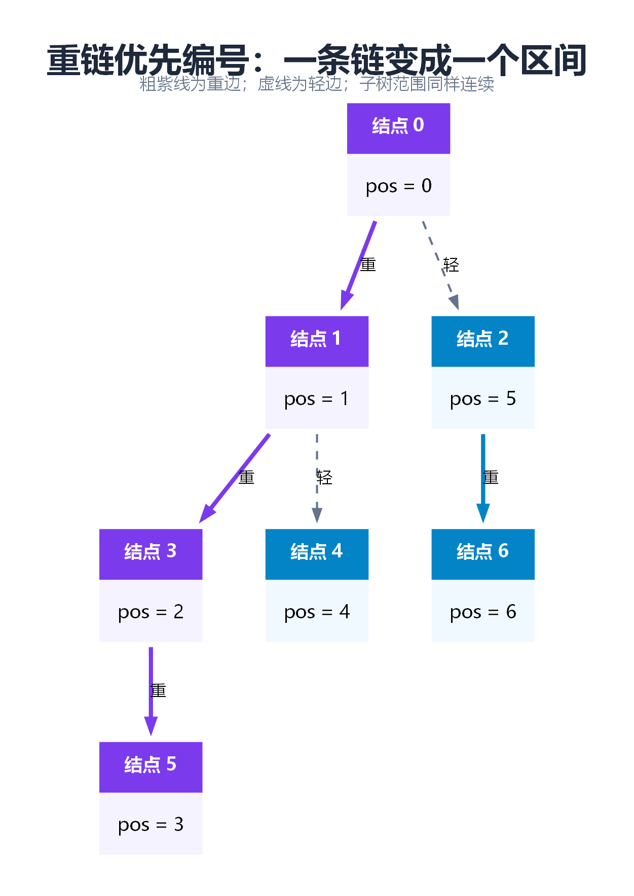

维护 `parent、depth、size、heavy、head、pos`：父亲、深度、子树大小、重孩子、链头和编号。

比如查图里从 5 到 6 的路径。5 属于以 0 开头的链，6 属于以 2 开头的链。先取链头更深的那段 `2 → 6`，它们的数组位置是 5、6，对应半开区间 `[5,7)`。再从链头 2 跳到它的父亲 0，此时 0 和 5 已在同一条链，取 `0 → 1 → 3 → 5` 对应的 `[0,4)`。两段加起来，恰好覆盖路径上的六个点，第 4 号位置上的旁支没有被算进去。

为什么段数少？从父亲向下走一条轻边，轻孩子的子树至多占父亲子树的一半：否则至少同样大的重孩子就装不下了。因此从根到一个点最多经过 `O(log n)` 条轻边。任意路径可分成通向公共祖先的两半，所以总共只需处理 `O(log n)` 段。每段交给线段树用 `O(log n)` 时间求和或修改，总时间为 `O(log² n)`。预处理和建树都用 `O(n)` 时间。

本文维护**点权**，所以最后一段包含 LCA；若把边权存到较深端点，需要排除最后一段 LCA 对应的位置，不能原样复制点权代码。一般非交换运算还要维护路径方向，本文的加法与求和没有这个问题。[HLD 的路径分解](https://cp-algorithms.com/graph/hld.html)

### 13.5 选读：边也会变，还能一直用原来的重链吗？

上节允许改**点的值**，但默认边固定。假设原来是链 `A—B—C`，后来删掉 `B—C`，再连上 `A—C`。此后 B 到 C 要经过 A，按旧重链查询就会得到错误路径。偶尔改一次边，可以重新剖分；若频繁连边、断边，又要随时查路径和，就值得考虑 **Link-Cut Tree（LCT，动态树）**。

可以把 LCT 理解为按当前查询重新整理路径。常见的 Splay 实现先用 `makeroot(B)` 把 B 当作根，再用 `access(C)` 整理根到 C 的路径，最后把 C 伸展到辅助树的根。此时辅助树保存的正是 B 到 C 的路径，若它维护的是点权和，读根上的和即可。`makeroot` 改的是根的方向；真正改边的是 `link` 和 `cut`。连边前两端须属于不同的树，断边时须确认这条边存在，否则会破坏森林的前提。

常用伸展树版本的这些操作是**均摊** `O(log n)`，某一次操作可能更慢。如果题目仅改变“从哪个点看作根”，实际连边从来不变，也不必仅为换根就引入 LCT。[Sleator 与 Tarjan 的动态树论文](https://www.cs.cmu.edu/~sleator/papers/dynamic-trees.pdf)

<a id="chapter-14"></a>

## 14. 重心、点分治与树形 DP

### 14.1 重心不是“离根最近的中间点”

假设树是一条五结点链 `A—B—C—D—E`。拿掉 B，两侧还剩 1 个和 3 个结点；拿掉 C，两侧各剩 2 个。要把后续工作分成规模相近的小问题，就该选 C。一般地，删除某个点后，看**最大那一块**还有多大；让这块尽可能小的点叫**重心**。删掉重心后，每一块至多有原来一半的结点。

计算时不仅要看各孩子子树大小，还要看“父亲那一侧”，大小为 `n−size[u]`。漏掉这一侧会把任意选根产生的子树信息误当成整棵树的信息。

重心可能有一个或两个；两个重心相邻。它与树的中心不同：中心关注到最远结点的距离，重心关注删除后各部分的规模。

### 14.2 点分治：先统计经过重心的路径

以“无权树上距离恰好为 K 的不同点无序点对数”为例：选择当前分量重心 c，所有点对分两类：路径经过 c，或者完全在某一剩余分量内。前一类现在统计，后一类递归处理。

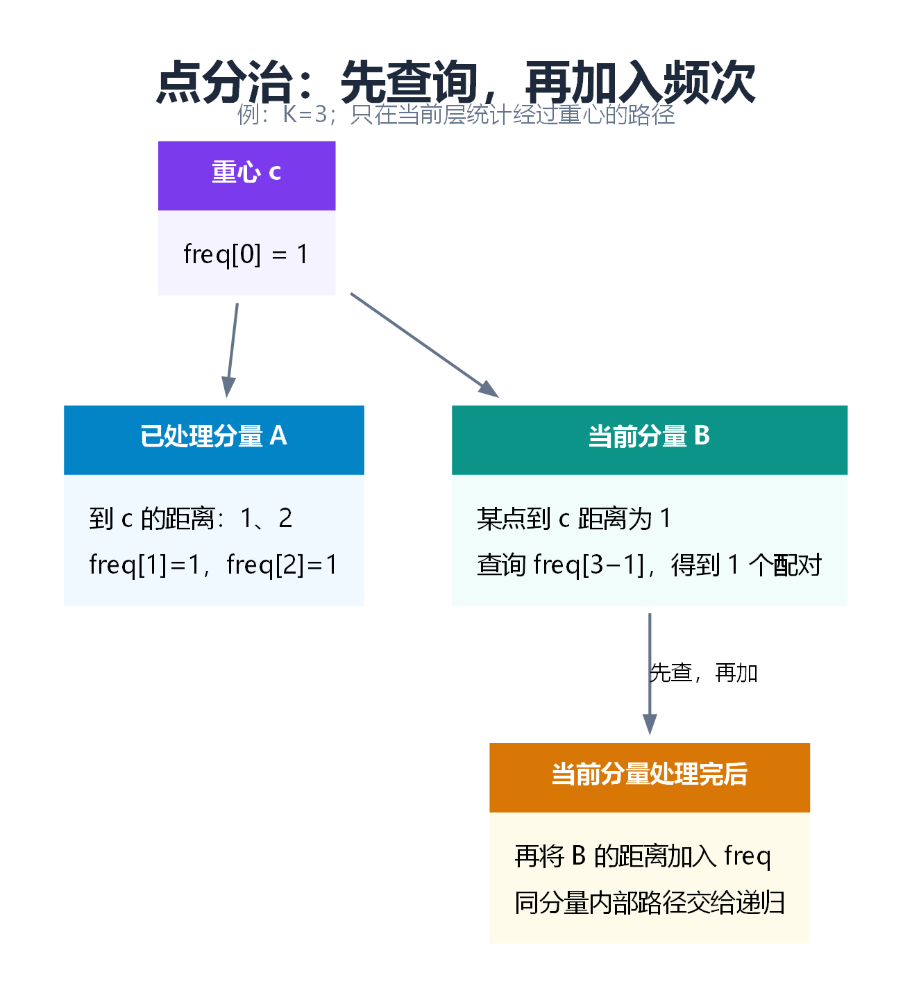

统计经过 c 的路径时，设已处理分量到 c 的距离频次为 `freq`，初始 `freq[0]=1`，代表 c 自己。当前分量中的某点到 c 的距离为 d，就能与之前距离为 `K−d` 的点配对。

**同一个分量必须先全部查询，再把距离加入 freq。** 否则会把同一分量内部的两个点也按“经过 c”计入，但它们之间的真实路径可能不经过 c，既会算错，也会在递归中重复计数。

例如 K=3，当前分支有个点离重心 1 步，它应该找之前分支里离重心 2 步的点。这样两边的路径确实在重心接上，长度才是 `1+2`。如果点在同一分支，两段路可能提前汇合，这个加法就不成立。每次删重心后，剩下的每块至多为原来的一半，同一层合起来只需处理 `O(n)` 个点，因此整个过程为 `O(n log n)`（频次表操作按常数成本计）。附录实现针对无权树，K 按边数算；K≤0 时不统计结点与自己配对，返回 0。

### 14.3 树形 DP：让子树返回足够的信息

假设结点上写着可获得的收益，相邻的父子不能同时选。一棵小树的根值为 9，两个叶子值为 3 和 5。如果选根，能拿 9；如果不选根，两片叶子可以都拿，总共是 8。为什么不能只告诉上一层“这棵子树最好能拿 9”？如果上一级也选了，这个根就必须放弃，它的子树最多只能交出 8。只报一个 9，父结点就可能把不能同时选的两个值加在一起。

**树形动态规划**（树形 DP）就是先约定每棵子树要交给父亲什么信息，再从叶子往上算。在这题里，给父亲两个答案：

```text
skip[u]：不选 u 时，u 子树的最优收益
 take[u]：选择 u 时，u 子树的最优收益

skip[u] = max(skip[left], take[left]) + max(skip[right], take[right])
 take[u] = value[u] + skip[left] + skip[right]
```

父亲只需这两个数，不必知道子树里具体选了哪些结点。每个结点处理一次，时间 `O(n)`，递归空间 `O(h)`。若还要输出选取方案，需要额外保存或回溯选择。

### 14.4 换根 DP：不用为每个根重新遍历

求“每个结点到其他所有结点的距离之和”，对每个根各跑一次 DFS 会达到 `O(n²)`。

先任选根，计算子树大小 size 和该根的距离总和。再考虑把根从 u 移到相邻孩子 v：v 子树内有 `size[v]` 个结点，每个距离减少 1；外面有 `n−size[v]` 个结点，每个距离增加 1。

```text
answer[v] = answer[u] − size[v] + (n − size[v])
          = answer[u] + n − 2 × size[v]
```

在三点链 `A—B—C` 上验算：从 A 出发，距离和为 `0+1+2=3`。把起点移到 B，B、C 都近了一步，A 远了一步，结果是 `3−2+1=2`，也就是 `1+0+1`。从任意根出发，先遍历一次算好子树大小和根的答案，再遍历一次把答案传给孩子，就能在 `O(n)` 时间内算出每个起点的结果。附录 `distanceSums()` 用遍历顺序数组正反扫描，无须让递归栈随树高增长。

### 14.5 选读：怎样统计每棵子树里有几种颜色？

假设每个结点都有一种颜色，要给**每个结点**回答“我的子树里有几种颜色”。针对一个根，扫一遍后代就够了。但在一条 n 个点的链上，从每个点都重新扫，会反复数同一批结点，总共要看 `n+(n−1)+…+1` 次。

树上启发式合并（**DSU on Tree**）利用了第 13 节的重孩子：它是子树最大的孩子。先逐个算轻孩子的答案，每算完一支就清掉这一支的颜色计数；重孩子放在最后算，保留它的计数表。现在再把各个轻子树和当前结点的颜色加入同一张表，就得到了当前整棵子树的答案。比如重孩子留下“红 2、蓝 1”，轻孩子有蓝、绿各一个，父结点是红色。合起来是“红 3、蓝 2、绿 1”，所以答案是 3 种，不是两个孩子的种数直接相加。

为何值得保留最大的那一支？一个结点只有在它所在的分支是轻子树时，才需要随整支重新加入。沿根到该点的路径最多经过 `O(log n)` 条轻边。颜色映射为整数编号、用数组在常数时间增减计数时，总时间是 `O(n log n)`；清理时也只撤销那一支加入的计数，不能每次清空一张长为 n 的表。这里的 DSU on Tree 是复用子树统计的技巧，第 11 节的并查集则回答两个元素是否属于同一集合。

<a id="chapter-15"></a>

## 15. 经典题：先定义返回值，再写递归

### 15.1 深度、计数与完全二叉树

最大深度：空结点返回 0，否则返回 `1+max(left,right)`。

最小深度不能直接写 `1+min(left,right)`：如果只有右孩子，左侧 0 不是一条合法的根到叶子路径。必须先处理单孩子情况，沿存在的子树继续走。

普通结点数可以后序累加。完全二叉树则可利用局部满树：分别沿最左链和最右链计算高度；高度相同时，在**已知完全**的前提下该子树为满树，直接用 `2^h−1`。高度不同则递归。合适实现最坏 `O(log² n)`；不能把此判断用于任意二叉树，也需防止位移与计数溢出。

### 15.2 重建与序列化

结点值互异时，前序第一个是根，在中序中找到根即可分出左右子树。用哈希表查根的位置，避免每层重复线性查找；对应实现期望 `O(n)` 时间、`O(n)` 空间，哈希退化另论。

前序＋后序一般不能唯一确定：根只有一个孩子时，仅凭两种遍历无法判断它是左孩子还是右孩子。

序列化若只存前序数值，同样可能丢失形状。本文用 `#` 表示空孩子：`1 2 # # #` 能明确表示根 1 只有左孩子 2。反序列化按同一规则递归读取，并检查缺失或多余 token。

附录的字符串拼接版序列化便于阅读，但在高度退化的树上可能因反复拼接而有 `O(n²)` 的字符复制开销；若用于大数据，改成写入同一个输出流或缓冲区，可把生成成本控制为与输出长度同阶。

### 15.3 路径总和与最大路径和

根到叶子路径总和：走到结点时减去当前值；只有在叶子处剩余恰好匹配，才算成功。走到中途和为目标并不一定满足“根到叶子”的题意。

最大路径和则允许路径从一个孩子出发，经过父亲，再到另一个孩子。假设结点 8 的左右两边各能贡献 3 和 6，在 8 处拐弯的路径可以拿到 `3+8+6=17`。但是再往 8 的父亲延伸时，两条分支只能带走一条，否则整条路线就会叉成三头。所以递归要分清两个量：

- 向父亲返回的最大收益：只能选一条向下分支，否则会出现分叉，不再是一条路径。
- 在当前结点作为拐点的完整候选：可以同时使用左右两条分支。

因此 `gain = value + max(0,leftGain,rightGain)`，完整候选为 `value + max(0,leftGain) + max(0,rightGain)`。全局答案初始为负无穷，才能处理所有值都为负的树。

### 15.4 直径、翻转、对称与验证

无权树直径是最长简单路径的边数。任选一点 BFS 找最远点 a，再从 a BFS 找最远点 b，距离即直径。本文实现限定无权树，不能未经分析套到允许负权的模型。

翻转二叉树：每个结点交换左右孩子。判断对称：比较左子树的左边与右子树的右边、左子树的右边与右子树的左边，值与空结构都必须对应。

验证 AVL 平衡可让递归返回高度，遇到不平衡返回 -1。若在每个结点分别重新计算左右高度，最坏会重复遍历成 `O(n²)`；把高度作为返回值即可降为 `O(n)`。

| 题型 | 子问题返回什么 | 关键陷阱 |
| --- | --- | --- |
| 最大／最小深度 | 合法路径的高度 | 最小深度不能把空孩子当叶子 |
| 验证 BST | 范围约束下是否合法 | 限制整棵子树，注意整数边界 |
| 验证平衡 | 高度，或失衡标记 | 避免在每层重复算高度 |
| 最大路径和 | 可向父亲延伸的一条收益 | 完整答案可以转弯，返回值不能分叉 |
| LCA | 找到的目标或交会点 | 目标是否存在；比较结点身份 |
| 重建 | 当前区间构造出的根 | 重复值、边界与输入不一致 |
| 序列化 | 值和结构信息 | 空孩子标记不能省 |

<a id="chapter-16"></a>

## 16. 选型、运行方法与验证范围

### 16.1 面试中怎样说明选型？

假设面试官问：“我要不断插入数字，还要随时拿出最小的，选搜索树还是堆？”可以这样回答：

> 我会先问，除了取最小值，还要不要查某个数、找前驱，或者按大小遍历。如果只关心下一个最小值，我选小顶堆。每个父亲都不大于孩子，所以根一定是最小值。取走根以后，只要沿一条路下沉就能恢复规则，代价是 `O(log n)`。如果还要频繁查任意键或按顺序输出，我会选平衡搜索树，因为它额外保存了左右子树的大小关系。

| 需求 | 优先考虑 | 原因 |
| --- | --- | --- |
| 动态有序集合、前驱后继 | 平衡 BST 或标准有序容器 | 保留整体键顺序 |
| 反复取最大／最小 | 二叉堆 | 堆顶直接可取，更新沿一条路径 |
| Top K | 大小为 K 的堆 | 无需维护全部数据的完整顺序 |
| 页式索引与范围扫描 | B+ 树 | 多路导航与叶子顺序访问 |
| 精确字符串／前缀检索 | Trie | 共用字符前缀 |
| 多模式文本匹配 | AC 自动机 | fail 复用已读后缀信息 |
| 动态合并集合 | DSU | 不需维护排序或实际路径 |
| 静态低维最近邻 | KD-Tree | 可用空间切分剪枝，需关注数据分布 |
| 区间和与加法更新 | BIT 或线段树 | 按操作复杂度选择 |
| 静态 RMQ | ST 表 | 预处理换取常数查询 |
| 多次祖先查询 | 倍增 LCA | 可复用祖先跳表 |
| 树上路径更新查询 | HLD＋线段树 | 路径转换成少量数组区间 |
| 所有根的同类答案 | 换根 DP | 利用相邻根之间的递推 |
| 大量路径计数 | 点分治 | 按路径是否经过重心分类 |

### 16.2 源码文件与边界

| 文件 | 内容 |
| --- | --- |
| `tree_basics.hpp` | BST 增删查、遍历、验证、重建、序列化、LCA、最大路径和、打家劫舍 |
| `balanced.hpp` | AVL、LLRB、Treap、Splay 的集合增删查及不变量验证 |
| `interval.hpp` | BIT、双 BIT、区间加与区间和线段树、静态 RMQ |
| `tree_algorithms.hpp` | 倍增 LCA、HLD、距离和换根 DP、直径、点分治 |
| `special_trees.hpp` | 堆、DSU、Trie、AC、哈夫曼、KD-Tree、B/B+ 树插入与查找 |
| `interview.hpp` | 经典题补充与 Morris 完整示例 |
| `demo.cpp` | 基础调用示例：有序集合、区间操作、LCA、HLD、AC |
| `test.cpp` | 完整入口与固定种子对照测试 |

这些代码是可运行的教学实现，约定如下：

- 一般树算法的输入必须是**非空、连通、无环**的邻接表，结点编号为 `[0,n)`，每条无向边双向加入。它们不会替调用者验证任意图是否为树。
- 数组接口要求下标合法。BIT、线段树和 ST 表使用 `[l,r)`；B+ 树范围查询特意采用闭区间 `[lo,hi]`，接口旁有注释。
- `long long` 用于和与点对计数，但仍要求结果、差分乘积等不溢出其范围；浮点 KD-Tree 要求坐标有限，且距离平方可表示。
- 递归算法面对很长的链可能栈溢出。大规模或不可信输入应改成显式栈，或选择迭代实现；平衡树测试通过不等于一般二叉树递归也能承受任意深度。
- 结点池示例删除后不复用存储槽，内存随历史创建量增长；适合观察算法，不是长时间运行服务的内存回收方案。
- 没有并发访问、磁盘持久化或强异常安全保证。LLRB、B+ 树、AC、KD 等各实现范围在对应章节明确说明。

### 16.3 编译运行

在本目录下，Linux、macOS 或具有 C++17 编译器的环境可运行：

```bash
g++ -std=c++17 -O2 -Wall -Wextra -Wpedantic src/test.cpp -o tree_tests
./tree_tests
```

Windows 的 MSYS2 UCRT64 终端同样支持以上命令。若在 PowerShell 调用 MinGW，须确保其 `bin` 在 PATH 中；中文临时路径导致旧工具链生成临时文件失败时，可在 `src` 中使用以下形式，让中间文件保存在当前目录：

```powershell
g++ -save-temps=obj -std=c++17 -O2 -Wall -Wextra -Wpedantic test.cpp -o test.exe
.\test.exe
```

先运行简短调用示例，可以看到接口如何使用：

```bash
g++ -std=c++17 -O2 -Wall -Wextra -Wpedantic src/demo.cpp -o tree_demo
./tree_demo
```

预期输出：

```text
contains 20: 1
array sum: 20
LCA(3,4): 1
path sum(3,2): 10
matches in ushers: 3
```

测试不是性能基准，不据此比较哪种树“最快”。四种平衡树用 `std::set` 校验操作结果，并逐步检查高度、颜色、黑高、堆序或父指针。区间结构与直接求和比较；LCA、HLD、换根、直径和点分治与 BFS 路径枚举比较；KD 最近邻与逐点扫描比较。

实际验证环境：Windows／MSYS2 UCRT64，GCC 16.1.0，C++17，`-O2 -Wall -Wextra -Wpedantic`。编译无警告，测试输出如下。未在 Linux/macOS 上执行，也未进行性能基准或并发测试。

```text
interview algorithms and Morris restoration: passed
binary tree: passed
AVL: passed
LLRB: passed
Treap: passed
Splay: passed
interval structures: passed
LCA, HLD, reroot, diameter, centroid: passed
heap, DSU, Trie, AC, Huffman, B/B+, KD: passed
ALL TESTS PASSED
```

<a id="chapter-18"></a>

## 参考与延伸阅读

下面的资料用于核对术语与进一步学习。正文源码为本指南的教学实现，各源码的前提和覆盖范围以本指南为准。

- [Open Data Structures：红黑树](https://opendatastructures.org/ods-cpp/9_Red_Black_Trees.html)：最坏高度、实现思路与多路树联系。
- [Treap](https://cp-algorithms.com/data_structures/treap.html)：随机优先级以及 split/merge 接口。
- [Segment Tree](https://cp-algorithms.com/data_structures/segment_tree.html)：聚合、区间更新与扩展形式。
- [Fenwick Tree](https://cp-algorithms.com/data_structures/fenwick.html)：前缀维护和区间操作推导。
- [Heavy-light decomposition](https://cp-algorithms.com/graph/hld.html)：重链和树路径区间化。
- [Aho–Corasick](https://cp-algorithms.com/string/aho_corasick.html)：后缀链接、转移和多模式匹配。
- [AVL 与红黑树实测比较研究](https://arxiv.org/abs/2406.05162)：性能受实现和数据分布影响，不能用单一口号替代测量。

<a id="source"></a>

## 附录：完整 C++17 源码

按下列文件名保存到同一个目录即可编译 `test.cpp`。这些内容也已随文档保存在 `src/`，无需手动复制。


<details>
<summary>展开八个完整源码文件（与 src/ 目录对应）</summary>

### 附录 A：二叉树基础与 BST

先看 Node 的所有权，再读 insertBST、eraseBST 和 inorder；随后阅读高度、验证、路径与序列化函数。普通 BST 会退化，递归深度也随树高增长。

源文件：[tree_basics.hpp](src/tree_basics.hpp)。

```cpp
#ifndef TREE_BASICS_HPP
#define TREE_BASICS_HPP
#include <algorithm>
#include <climits>
#include <functional>
#include <memory>
#include <queue>
#include <sstream>
#include <stdexcept>
#include <string>
#include <unordered_map>
#include <vector>
namespace study {
struct Node {
    int value;
    std::unique_ptr<Node> left, right;
    explicit Node(int x) : value(x) {}
};
using Tree = std::unique_ptr<Node>;
inline void insertBST(Tree& t, int x) {
    if (!t) t = std::make_unique<Node>(x);
    else if (x < t->value) insertBST(t->left, x);
    else if (x > t->value) insertBST(t->right, x); // 本章集合语义：忽略重复键
}
inline bool contains(const Node* t, int x) {
    while (t && t->value != x) t = x < t->value ? t->left.get() : t->right.get();
    return t != nullptr;
}
inline void eraseBST(Tree& t, int x) {
    if (!t) return;
    if (x < t->value) eraseBST(t->left, x);
    else if (x > t->value) eraseBST(t->right, x);
    else if (!t->left) { Tree old = std::move(t); t = std::move(old->right); }
    else if (!t->right) { Tree old = std::move(t); t = std::move(old->left); }
    else {
        Node* successor = t->right.get();
        while (successor->left) successor = successor->left.get();
        t->value = successor->value;
        eraseBST(t->right, successor->value);
    }
}
inline int height(const Node* t) { // 高度按结点层数：空树 0，叶子 1
    return t ? 1 + std::max(height(t->left.get()), height(t->right.get())) : 0;
}
inline int minDepth(const Node* t) {
    if (!t) return 0;
    if (!t->left) return 1 + minDepth(t->right.get());
    if (!t->right) return 1 + minDepth(t->left.get());
    return 1 + std::min(minDepth(t->left.get()), minDepth(t->right.get()));
}
inline std::vector<int> inorder(const Node* t) {
    std::vector<const Node*> stack;
    std::vector<int> result;
    while (t || !stack.empty()) {
        while (t) { stack.push_back(t); t = t->left.get(); }
        t = stack.back(); stack.pop_back();
        result.push_back(t->value); t = t->right.get();
    }
    return result;
}
inline std::vector<std::vector<int>> levels(const Node* root) {
    std::vector<std::vector<int>> result;
    if (!root) return result;
    std::queue<const Node*> q; q.push(root);
    while (!q.empty()) {
        int width = static_cast<int>(q.size());
        std::vector<int> line;
        while (width--) {
            auto t = q.front(); q.pop(); line.push_back(t->value);
            if (t->left) q.push(t->left.get());
            if (t->right) q.push(t->right.get());
        }
        result.push_back(std::move(line));
    }
    return result;
}
inline bool validBST(const Node* t, long long lo = LLONG_MIN, long long hi = LLONG_MAX) {
    if (!t) return true;
    return lo < t->value && t->value < hi &&
        validBST(t->left.get(), lo, t->value) && validBST(t->right.get(), t->value, hi);
}
inline int balancedHeight(const Node* t) { // -1 表示某处失衡
    if (!t) return 0;
    int l = balancedHeight(t->left.get()), r = balancedHeight(t->right.get());
    if (l < 0 || r < 0 || std::abs(l-r) > 1) return -1;
    return 1 + std::max(l,r);
}
inline void invert(Tree& t) {
    if (!t) return;
    std::swap(t->left,t->right); invert(t->left); invert(t->right);
}
inline bool mirror(const Node* a, const Node* b) {
    if (!a || !b) return a == b;
    return a->value == b->value && mirror(a->left.get(),b->right.get()) &&
        mirror(a->right.get(),b->left.get());
}
inline const Node* lca(const Node* t, const Node* a, const Node* b) {
    // 前提：a、b 都在树内。比较身份（指针），不比较结点值。
    if (!t || t == a || t == b) return t;
    auto l = lca(t->left.get(),a,b), r = lca(t->right.get(),a,b);
    return l && r ? t : (l ? l : r);
}
inline long long maxPathSum(const Node* root) {
    if (!root) throw std::invalid_argument("empty tree has no nonempty path");
    long long best = LLONG_MIN;
    std::function<long long(const Node*)> gain = [&](const Node* t) -> long long {
        if (!t) return 0;
        auto l = std::max(0LL,gain(t->left.get()));
        auto r = std::max(0LL,gain(t->right.get()));
        best = std::max(best,l+r+t->value); // 可转弯的完整路径
        return t->value + std::max(l,r);   // 给父亲只能交付一条分支
    };
    gain(root); return best;
}
inline long long rob(const Node* root) {
    std::function<std::pair<long long,long long>(const Node*)> dp = [&](const Node* t) {
        if (!t) return std::make_pair(0LL,0LL);
        auto [l0,l1] = dp(t->left.get()); auto [r0,r1] = dp(t->right.get());
        return std::make_pair(std::max(l0,l1)+std::max(r0,r1),t->value+l0+r0);
    };
    auto [skip,take] = dp(root); return std::max(skip,take);
}
inline Tree sortedToBST(const std::vector<int>& a, int l, int r) { // [l,r)，严格递增
    if (l == r) return nullptr;
    int m = l+(r-l)/2; Tree t = std::make_unique<Node>(a[m]);
    t->left = sortedToBST(a,l,m); t->right = sortedToBST(a,m+1,r); return t;
}
inline Tree rebuild(const std::vector<int>& pre, const std::vector<int>& in) {
    if (pre.size()!=in.size()) throw std::invalid_argument("size mismatch");
    std::unordered_map<int,int> pos;
    for (int i=0;i<static_cast<int>(in.size());++i)
        if (!pos.emplace(in[i],i).second) throw std::invalid_argument("duplicate key");
    std::size_t next=0;
    std::function<Tree(int,int)> build = [&](int l,int r)->Tree {
        if (l==r) return nullptr;
        if (next==pre.size()) throw std::invalid_argument("invalid preorder");
        int x=pre[next++]; auto it=pos.find(x);
        if (it==pos.end() || it->second<l || it->second>=r) throw std::invalid_argument("invalid traversal");
        Tree t=std::make_unique<Node>(x); int m=it->second;
        t->left=build(l,m); t->right=build(m+1,r); return t;
    };
    return build(0,static_cast<int>(in.size()));
}
inline std::string serialize(const Node* t) {
    if (!t) return "# ";
    return std::to_string(t->value)+" "+serialize(t->left.get())+serialize(t->right.get());
}
inline Tree deserialize(const std::string& text) {
    std::istringstream input(text);
    std::function<Tree()> read = [&]()->Tree {
        std::string token;
        if (!(input>>token)) throw std::invalid_argument("truncated tree");
        if (token=="#") return nullptr;
        std::size_t used=0; int x=std::stoi(token,&used);
        if (used!=token.size()) throw std::invalid_argument("invalid integer");
        Tree t=std::make_unique<Node>(x); t->left=read(); t->right=read(); return t;
    };
    Tree t=read(); std::string extra;
    if (input>>extra) throw std::invalid_argument("trailing tokens");
    return t;
}
} // namespace study
#endif
```

### 附录 B：四种平衡查找树

四个类采用一致的 insert、erase、contains 接口。先读 AVL 的旋转与 fix，再比较 Treap 的 priority；Splay 增加父指针；LLRB 额外维护颜色。validate 用于核对不变量，不属于正常操作的对数复杂度承诺。

源文件：[balanced.hpp](src/balanced.hpp)。

```cpp
#ifndef BALANCED_HPP
#define BALANCED_HPP
#include <algorithm>
#include <cstdint>
#include <random>
#include <stdexcept>
#include <vector>
namespace study {
// 结点池：0 表示空，不复用删除结点；避免教学代码中的裸指针所有权问题。
class AVL {
    struct N { int key=0, l=0, r=0, h=1; };
    std::vector<N> a{{}}; int root=0;
    int h(int p) const { return p ? a[p].h : 0; }
    void pull(int p) { a[p].h=1+std::max(h(a[p].l),h(a[p].r)); }
    int rotateRight(int p) {
        int q=a[p].l; a[p].l=a[q].r; a[q].r=p; pull(p); pull(q); return q;
    }
    int rotateLeft(int p) {
        int q=a[p].r; a[p].r=a[q].l; a[q].l=p; pull(p); pull(q); return q;
    }
    int fix(int p) {
        if (!p) return 0;
        pull(p);
        if (h(a[p].l)-h(a[p].r)>1) {
            int l=a[p].l;
            if (h(a[l].l)<h(a[l].r)) a[p].l=rotateLeft(l);
            return rotateRight(p);
        }
        if (h(a[p].r)-h(a[p].l)>1) {
            int r=a[p].r;
            if (h(a[r].r)<h(a[r].l)) a[p].r=rotateRight(r);
            return rotateLeft(p);
        }
        return p;
    }
    int put(int p,int x) {
        if (!p) { a.push_back({x,0,0,1}); return static_cast<int>(a.size())-1; }
        if (x<a[p].key) a[p].l=put(a[p].l,x);
        else if (x>a[p].key) a[p].r=put(a[p].r,x);
        return fix(p);
    }
    int remove(int p,int x) {
        if (!p) return 0;
        if (x<a[p].key) a[p].l=remove(a[p].l,x);
        else if (x>a[p].key) a[p].r=remove(a[p].r,x);
        else {
            if (!a[p].l || !a[p].r) return a[p].l ? a[p].l : a[p].r;
            int q=a[p].r; while(a[q].l) q=a[q].l;
            a[p].key=a[q].key; a[p].r=remove(a[p].r,a[q].key);
        }
        return fix(p);
    }
    int check(int p,long long lo,long long hi) const {
        if (!p) return 0;
        if (!(lo<a[p].key && a[p].key<hi)) throw std::logic_error("AVL ordering");
        int l=check(a[p].l,lo,a[p].key),r=check(a[p].r,a[p].key,hi);
        if (std::abs(l-r)>1 || a[p].h!=1+std::max(l,r)) throw std::logic_error("AVL height");
        return a[p].h;
    }
public:
    void insert(int x) { root=put(root,x); }
    void erase(int x) { root=remove(root,x); }
    bool contains(int x) const {
        int p=root; while(p && a[p].key!=x) p=x<a[p].key?a[p].l:a[p].r; return p!=0;
    }
    void validate() const { check(root,-(1LL<<60),1LL<<60); }
};

class Treap {
    struct N { int key=0,l=0,r=0; std::uint32_t priority=0; };
    std::vector<N> a{{}}; int root=0; std::mt19937 rng{20261029};
    int rotateRight(int p) { int q=a[p].l; a[p].l=a[q].r; a[q].r=p; return q; }
    int rotateLeft(int p) { int q=a[p].r; a[p].r=a[q].l; a[q].l=p; return q; }
    int put(int p,int x) {
        if (!p) { a.push_back({x,0,0,static_cast<std::uint32_t>(rng())}); return static_cast<int>(a.size())-1; }
        if (x<a[p].key) {
            a[p].l=put(a[p].l,x);
            if (a[a[p].l].priority<a[p].priority) p=rotateRight(p);
        } else if (x>a[p].key) {
            a[p].r=put(a[p].r,x);
            if (a[a[p].r].priority<a[p].priority) p=rotateLeft(p);
        }
        return p;
    }
    int merge(int l,int r) { // 前提：l 中所有键小于 r 中所有键
        if (!l || !r) return l?l:r;
        if (a[l].priority<=a[r].priority) { a[l].r=merge(a[l].r,r); return l; }
        a[r].l=merge(l,a[r].l); return r;
    }
    int remove(int p,int x) {
        if (!p) return 0;
        if (x==a[p].key) return merge(a[p].l,a[p].r);
        if (x<a[p].key) a[p].l=remove(a[p].l,x);
        else a[p].r=remove(a[p].r,x);
        return p;
    }
    void check(int p,long long lo,long long hi) const {
        if (!p) return;
        if (!(lo<a[p].key && a[p].key<hi)) throw std::logic_error("Treap ordering");
        for(int c:{a[p].l,a[p].r}) if(c && a[c].priority<a[p].priority) throw std::logic_error("Treap priority");
        check(a[p].l,lo,a[p].key); check(a[p].r,a[p].key,hi);
    }
public:
    void insert(int x) { root=put(root,x); }
    void erase(int x) { root=remove(root,x); }
    bool contains(int x) const { int p=root; while(p && a[p].key!=x) p=x<a[p].key?a[p].l:a[p].r; return p!=0; }
    void validate() const { check(root,-(1LL<<60),1LL<<60); }
};

class Splay {
    struct N { int key=0,parent=0,ch[2]={0,0}; };
    std::vector<N> a{{}}; int root=0;
    void rotate(int x) {
        int p=a[x].parent,g=a[p].parent,d=(a[p].ch[1]==x),b=a[x].ch[d^1];
        if(g) a[g].ch[a[g].ch[1]==p]=x; else root=x;
        a[x].parent=g; a[x].ch[d^1]=p; a[p].parent=x;
        a[p].ch[d]=b; if(b) a[b].parent=p;
    }
    void splay(int x) {
        while(a[x].parent) {
            int p=a[x].parent,g=a[p].parent;
            if(g) {
                bool same=(a[g].ch[1]==p)==(a[p].ch[1]==x);
                rotate(same?p:x); // zig-zig 或 zig-zag
            }
            rotate(x);
        }
    }
    void check(int p,int parent,long long lo,long long hi) const {
        if(!p) return;
        if(a[p].parent!=parent || !(lo<a[p].key && a[p].key<hi)) throw std::logic_error("Splay invariant");
        check(a[p].ch[0],p,lo,a[p].key); check(a[p].ch[1],p,a[p].key,hi);
    }
public:
    bool contains(int x) { // 查找本身也会改变树形
        int p=root,last=0;
        while(p && a[p].key!=x) { last=p; p=a[p].ch[x>a[p].key]; }
        if(p) splay(p); else if(last) splay(last);
        return p!=0;
    }
    void insert(int x) {
        if(!root) { a.push_back({x,0,{0,0}}); root=static_cast<int>(a.size())-1; return; }
        if(contains(x)) return;
        int p=root;
        while(a[p].ch[x>a[p].key]) p=a[p].ch[x>a[p].key];
        int id=static_cast<int>(a.size()); a.push_back({x,p,{0,0}});
        a[p].ch[x>a[p].key]=id; splay(id);
    }
    void erase(int x) {
        if(!contains(x)) return;
        int l=a[root].ch[0],r=a[root].ch[1];
        if(l) a[l].parent=0;
        if(r) a[r].parent=0;
        root=l;
        if(!l) { root=r; return; }
        int p=l; while(a[p].ch[1]) p=a[p].ch[1];
        splay(p); a[root].ch[1]=r; if(r) a[r].parent=root;
    }
    void validate() const { check(root,0,-(1LL<<60),1LL<<60); }
};

// 左倾红黑树 LLRB：采用额外的“红链接左倾”约束，完整支持集合插入和删除。
// 这是红黑树的一个变体；不要把它的修复顺序与经典父指针版本混用。
class RedBlack {
    struct N { int key=0,l=0,r=0; bool red=false; };
    std::vector<N> a{{}}; int root=0;
    bool red(int p) const { return p && a[p].red; }
    int left(int p) {
        int q=a[p].r; a[p].r=a[q].l; a[q].l=p;
        a[q].red=a[p].red; a[p].red=true; return q;
    }
    int right(int p) {
        int q=a[p].l; a[p].l=a[q].r; a[q].r=p;
        a[q].red=a[p].red; a[p].red=true; return q;
    }
    void flip(int p) {
        a[p].red=!a[p].red;
        if(a[p].l) a[a[p].l].red=!a[a[p].l].red;
        if(a[p].r) a[a[p].r].red=!a[a[p].r].red;
    }
    int fix(int p) {
        if(red(a[p].r)) p=left(p);
        if(red(a[p].l) && red(a[a[p].l].l)) p=right(p);
        if(red(a[p].l) && red(a[p].r)) flip(p);
        return p;
    }
    int moveRedLeft(int p) {
        flip(p);
        if(red(a[a[p].r].l)) {
            a[p].r=right(a[p].r); p=left(p); flip(p);
        }
        return p;
    }
    int moveRedRight(int p) {
        flip(p);
        if(red(a[a[p].l].l)) { p=right(p); flip(p); }
        return p;
    }
    int put(int p,int x) {
        if(!p) { a.push_back({x,0,0,true}); return static_cast<int>(a.size())-1; }
        if(x<a[p].key) a[p].l=put(a[p].l,x);
        else if(x>a[p].key) a[p].r=put(a[p].r,x);
        return fix(p);
    }
    int removeMin(int p) {
        if(!a[p].l) return 0;
        if(!red(a[p].l) && !red(a[a[p].l].l)) p=moveRedLeft(p);
        a[p].l=removeMin(a[p].l); return fix(p);
    }
    int remove(int p,int x) { // 入口已确认 x 存在
        if(x<a[p].key) {
            if(!red(a[p].l) && !red(a[a[p].l].l)) p=moveRedLeft(p);
            a[p].l=remove(a[p].l,x);
        } else {
            if(red(a[p].l)) p=right(p);
            if(x==a[p].key && !a[p].r) return 0;
            if(!red(a[p].r) && !red(a[a[p].r].l)) p=moveRedRight(p);
            if(x==a[p].key) {
                int q=a[p].r; while(a[q].l) q=a[q].l;
                a[p].key=a[q].key; a[p].r=removeMin(a[p].r);
            } else a[p].r=remove(a[p].r,x);
        }
        return fix(p);
    }
    int check(int p,long long lo,long long hi) const {
        if(!p) return 1; // NIL 计为一个黑结点
        if(!(lo<a[p].key && a[p].key<hi)) throw std::logic_error("RB ordering");
        if(red(a[p].r) || (red(p) && (red(a[p].l)||red(a[p].r)))) throw std::logic_error("RB color");
        int l=check(a[p].l,lo,a[p].key),r=check(a[p].r,a[p].key,hi);
        if(l!=r) throw std::logic_error("RB black height");
        return l+(!red(p));
    }
public:
    void insert(int x) { root=put(root,x); a[root].red=false; }
    bool contains(int x) const { int p=root; while(p && a[p].key!=x) p=x<a[p].key?a[p].l:a[p].r; return p!=0; }
    void erase(int x) {
        if(!contains(x)) return;
        if(!red(a[root].l) && !red(a[root].r)) a[root].red=true;
        root=remove(root,x); if(root) a[root].red=false;
    }
    void validate() const {
        if(red(root)) throw std::logic_error("red root");
        check(root,-(1LL<<60),1LL<<60);
    }
};
} // namespace study
#endif
```

### 附录 C：区间数据结构

所有接口按 [l,r) 解释；先读 Fenwick，再通过差分公式理解 RangeFenwick。线段树重点对应 apply、push、pull，ST 表只提供静态最小值查询。

源文件：[interval.hpp](src/interval.hpp)。

```cpp
#ifndef INTERVAL_HPP
#define INTERVAL_HPP
#include <algorithm>
#include <stdexcept>
#include <vector>
namespace study {
class Fenwick {
    std::vector<long long> bit;
public:
    explicit Fenwick(int n):bit(n+1) { if(n<1) throw std::invalid_argument("n must be positive"); }
    // 对外使用 0-based 下标；区间均采用 [l,r)。
    void add(int p,long long delta) {
        for(++p;p<static_cast<int>(bit.size());p+=p&-p) bit[p]+=delta;
    }
    long long prefix(int r) const {
        long long sum=0; for(;r>0;r-=r&-r) sum+=bit[r]; return sum;
    }
    long long sum(int l,int r) const { return prefix(r)-prefix(l); }
};
class RangeFenwick {
    Fenwick b1,b2;
    void change(int p,long long v) { b1.add(p,v); b2.add(p,v*p); }
public:
    explicit RangeFenwick(int n):b1(n),b2(n) {}
    void add(int l,int r,long long v) { change(l,v); change(r,-v); }
    long long prefix(int r) const { return r*b1.prefix(r)-b2.prefix(r); }
    long long sum(int l,int r) const { return prefix(r)-prefix(l); }
};
class LazySegmentTree {
    int n; std::vector<long long> sum,lazy;
    void build(int p,int l,int r,const std::vector<long long>& a) {
        if(r-l==1) { sum[p]=a[l]; return; }
        int m=(l+r)/2; build(p*2,l,m,a); build(p*2+1,m,r,a); pull(p);
    }
    void pull(int p) { sum[p]=sum[p*2]+sum[p*2+1]; }
    void apply(int p,int l,int r,long long delta) { sum[p]+=delta*(r-l); lazy[p]+=delta; }
    void push(int p,int l,int r) {
        if(lazy[p]==0 || r-l==1) return;
        int m=(l+r)/2;
        apply(p*2,l,m,lazy[p]); apply(p*2+1,m,r,lazy[p]); lazy[p]=0;
    }
    void add(int p,int l,int r,int ql,int qr,long long v) {
        if(qr<=l || r<=ql) return;
        if(ql<=l && r<=qr) { apply(p,l,r,v); return; }
        push(p,l,r); int m=(l+r)/2;
        add(p*2,l,m,ql,qr,v); add(p*2+1,m,r,ql,qr,v); pull(p);
    }
    long long query(int p,int l,int r,int ql,int qr) {
        if(qr<=l || r<=ql) return 0;
        if(ql<=l && r<=qr) return sum[p];
        push(p,l,r); int m=(l+r)/2;
        return query(p*2,l,m,ql,qr)+query(p*2+1,m,r,ql,qr);
    }
public:
    explicit LazySegmentTree(const std::vector<long long>& a):n(static_cast<int>(a.size())),sum(4*a.size()),lazy(4*a.size()) {
        if(!n) throw std::invalid_argument("empty array");
        build(1,0,n,a);
    }
    void add(int l,int r,long long v) { add(1,0,n,l,r,v); }
    long long query(int l,int r) { return query(1,0,n,l,r); }
};
class SparseTable {
    std::vector<int> lg;
    std::vector<std::vector<long long>> st;
public:
    explicit SparseTable(const std::vector<long long>& a):lg(a.size()+1) {
        int n=static_cast<int>(a.size());
        if(!n) throw std::invalid_argument("empty array");
        for(int i=2;i<=n;++i) lg[i]=lg[i/2]+1;
        st.assign(lg[n]+1,std::vector<long long>(n)); st[0]=a;
        for(int k=1;k<=lg[n];++k)
            for(int i=0;i+(1<<k)<=n;++i)
                st[k][i]=std::min(st[k-1][i],st[k-1][i+(1<<(k-1))]);
    }
    long long query(int l,int r) const { // 非空区间 [l,r)
        int k=lg[r-l]; return std::min(st[k][l],st[k][r-(1<<k)]);
    }
};
} // namespace study
#endif
```

### 附录 D：树上路径、祖先与分治

Graph 是双向邻接表。LCA 的预处理用 BFS；HLD 的两次 DFS 分别算重孩子和编号。CentroidPairs 是一次性计数对象，count 不应对同一个对象重复调用。

源文件：[tree_algorithms.hpp](src/tree_algorithms.hpp)。

```cpp
#ifndef TREE_ALGORITHMS_HPP
#define TREE_ALGORITHMS_HPP
#include "interval.hpp"
#include <algorithm>
#include <functional>
#include <memory>
#include <queue>
#include <vector>
namespace study {
using Graph=std::vector<std::vector<int>>;
class LCA {
    int log=1; std::vector<int> depth; std::vector<std::vector<int>> up;
public:
    explicit LCA(const Graph& g,int root=0):depth(g.size(),-1) {
        int n=static_cast<int>(g.size()); while((1LL<<log)<=n) ++log;
        up.assign(log,std::vector<int>(n,root));
        std::queue<int> q; q.push(root); depth[root]=0;
        while(!q.empty()) {
            int u=q.front(); q.pop();
            for(int v:g[u]) if(depth[v]<0) {
                depth[v]=depth[u]+1; up[0][v]=u;
                for(int j=1;j<log;++j) up[j][v]=up[j-1][up[j-1][v]];
                q.push(v);
            }
        }
    }
    int query(int u,int v) const {
        if(depth[u]<depth[v]) std::swap(u,v);
        int diff=depth[u]-depth[v];
        for(int j=0;j<log;++j) if(diff&(1LL<<j)) u=up[j][u];
        if(u==v) return u;
        for(int j=log-1;j>=0;--j) if(up[j][u]!=up[j][v]) { u=up[j][u]; v=up[j][v]; }
        return up[0][u];
    }
    int distance(int u,int v) const { return depth[u]+depth[v]-2*depth[query(u,v)]; }
};
class HLD {
    Graph g; std::vector<int> parent,depth,size,heavy,head,pos; int timer=0;
    std::unique_ptr<LazySegmentTree> seg;
    void dfsSize(int u,int p) {
        parent[u]=p; size[u]=1;
        for(int v:g[u]) if(v!=p) {
            depth[v]=depth[u]+1; dfsSize(v,u); size[u]+=size[v];
            if(heavy[u]==-1 || size[v]>size[heavy[u]]) heavy[u]=v;
        }
    }
    void decompose(int u,int top) {
        head[u]=top; pos[u]=timer++;
        if(heavy[u]!=-1) decompose(heavy[u],top);
        for(int v:g[u]) if(v!=parent[u] && v!=heavy[u]) decompose(v,v);
    }
public:
    HLD(const Graph& graph,const std::vector<long long>& values,int root=0):g(graph),parent(g.size()),depth(g.size()),size(g.size()),heavy(g.size(),-1),head(g.size()),pos(g.size()) {
        dfsSize(root,-1); decompose(root,root);
        std::vector<long long> flat(g.size());
        for(int u=0;u<static_cast<int>(g.size());++u) flat[pos[u]]=values[u];
        seg=std::make_unique<LazySegmentTree>(flat);
    }
    void pathAdd(int u,int v,long long x) {
        while(head[u]!=head[v]) {
            if(depth[head[u]]<depth[head[v]]) std::swap(u,v);
            seg->add(pos[head[u]],pos[u]+1,x); u=parent[head[u]];
        }
        if(depth[u]>depth[v]) std::swap(u,v);
        seg->add(pos[u],pos[v]+1,x); // 点权：LCA 也要包含
    }
    long long pathSum(int u,int v) {
        long long answer=0;
        while(head[u]!=head[v]) {
            if(depth[head[u]]<depth[head[v]]) std::swap(u,v);
            answer+=seg->query(pos[head[u]],pos[u]+1); u=parent[head[u]];
        }
        if(depth[u]>depth[v]) std::swap(u,v);
        return answer+seg->query(pos[u],pos[v]+1);
    }
    long long subtreeSum(int u) { return seg->query(pos[u],pos[u]+size[u]); }
};
inline std::vector<long long> distanceSums(const Graph& g,int root=0) {
    int n=static_cast<int>(g.size());
    std::vector<int> parent(n,-1),order{root},size(n,1),depth(n);
    parent[root]=root;
    for(std::size_t i=0;i<order.size();++i) {
        int u=order[i];
        for(int v:g[u]) if(v!=parent[u]) { parent[v]=u; depth[v]=depth[u]+1; order.push_back(v); }
    }
    for(int i=n-1;i>0;--i) size[parent[order[i]]]+=size[order[i]];
    std::vector<long long> ans(n);
    for(int d:depth) ans[root]+=d;
    for(int u:order) if(u!=root) ans[u]=ans[parent[u]]+n-2LL*size[u];
    return ans;
}
inline int diameter(const Graph& g) { // 无权树，长度按边数
    auto farthest=[&](int start) {
        std::vector<int> d(g.size(),-1); std::queue<int> q; q.push(start); d[start]=0; int far=start;
        while(!q.empty()) { int u=q.front(); q.pop(); if(d[u]>d[far]) far=u;
            for(int v:g[u]) if(d[v]<0) { d[v]=d[u]+1; q.push(v); }
        }
        return std::make_pair(far,d[far]);
    };
    return farthest(farthest(0).first).second;
}
class CentroidPairs {
    const Graph& g; int k; std::vector<int> size; std::vector<bool> removed;
    int sizes(int u,int p) {
        size[u]=1;
        for(int v:g[u]) if(v!=p && !removed[v]) size[u]+=sizes(v,u);
        return size[u];
    }
    int centroid(int u,int p,int total) {
        for(int v:g[u]) if(v!=p && !removed[v] && size[v]>total/2) return centroid(v,u,total);
        return u;
    }
    void distances(int u,int p,int d,std::vector<int>& result) {
        if(d>k) return;
        result.push_back(d);
        for(int v:g[u]) if(v!=p && !removed[v]) distances(v,u,d+1,result);
    }
    long long solve(int start) {
        int total=sizes(start,-1),c=centroid(start,-1,total); removed[c]=true;
        std::vector<int> freq(std::min(k,total)+1); freq[0]=1; long long answer=0;
        for(int v:g[c]) if(!removed[v]) {
            std::vector<int> ds; distances(v,c,1,ds);
            for(int d:ds) if(k-d<static_cast<int>(freq.size())) answer+=freq[k-d];
            // 先查询，再加入：避免同一子树内的路径在当前重心重复统计。
            for(int d:ds) ++freq[d];
        }
        for(int v:g[c]) if(!removed[v]) answer+=solve(v);
        return answer;
    }
public:
    CentroidPairs(const Graph& graph,int distance):g(graph),k(distance),size(g.size()),removed(g.size()) {}
    long long count() { // 一次性对象；只统计不同结点组成的无序点对
        if(g.empty() || k<=0 || k>=static_cast<int>(g.size())) return 0;
        return solve(0);
    }
};
} // namespace study
#endif
```

### 附录 E：任务专用结构

按类分别阅读。BTree 和 BPlusTree 的接口只有插入与查询，BPlusTree 另有范围扫描；没有省略一个声称存在的删除函数。KDTree 实现二维最近距离，AC 实现总匹配次数。

源文件：[special_trees.hpp](src/special_trees.hpp)。

```cpp
#ifndef SPECIAL_TREES_HPP
#define SPECIAL_TREES_HPP
#include <algorithm>
#include <array>
#include <cmath>
#include <functional>
#include <limits>
#include <memory>
#include <numeric>
#include <queue>
#include <stdexcept>
#include <string>
#include <vector>
namespace study {
class MinHeap {
    std::vector<int> a;
    void down(int i) {
        int n=static_cast<int>(a.size());
        while(2*i+1<n) {
            int c=2*i+1; if(c+1<n && a[c+1]<a[c]) ++c;
            if(a[i]<=a[c]) break;
            std::swap(a[i],a[c]); i=c;
        }
    }
public:
    explicit MinHeap(std::vector<int> values={}):a(std::move(values)) {
        for(int i=static_cast<int>(a.size())/2-1;i>=0;--i) down(i);
    }
    bool empty() const { return a.empty(); }
    int top() const { if(empty()) throw std::out_of_range("empty heap"); return a[0]; }
    void push(int x) {
        a.push_back(x); int i=static_cast<int>(a.size())-1;
        while(i>0 && a[i]<a[(i-1)/2]) { std::swap(a[i],a[(i-1)/2]); i=(i-1)/2; }
    }
    void pop() {
        if(empty()) throw std::out_of_range("empty heap");
        a[0]=a.back(); a.pop_back(); if(!empty()) down(0);
    }
};
class DSU {
    std::vector<int> parent,size;
public:
    explicit DSU(int n):parent(n),size(n,1) { std::iota(parent.begin(),parent.end(),0); }
    int find(int x) {
        while(x!=parent[x]) { parent[x]=parent[parent[x]]; x=parent[x]; }
        return x;
    }
    bool unite(int x,int y) {
        x=find(x); y=find(y); if(x==y) return false;
        if(size[x]<size[y]) std::swap(x,y);
        parent[y]=x; size[x]+=size[y]; return true;
    }
};
class Trie {
    struct N { std::array<int,26> next{}; int pass=0,end=0; };
    std::vector<N> a{{}};
    static void check(const std::string& s) {
        for(char c:s) if(c<'a'||c>'z') throw std::invalid_argument("lowercase a-z only");
    }
public:
    void insert(const std::string& s) {
        check(s); int p=0; ++a[p].pass;
        for(char c:s) {
            int x=c-'a';
            if(!a[p].next[x]) { int id=static_cast<int>(a.size()); a.push_back({}); a[p].next[x]=id; }
            p=a[p].next[x]; ++a[p].pass;
        }
        ++a[p].end;
    }
    int prefixCount(const std::string& s) const {
        check(s); int p=0;
        for(char c:s) { p=a[p].next[c-'a']; if(!p) return 0; }
        return a[p].pass;
    }
    int count(const std::string& s) const {
        check(s); int p=0;
        for(char c:s) { p=a[p].next[c-'a']; if(!p) return 0; }
        return a[p].end;
    }
    bool erase(const std::string& s) {
        if(!count(s)) return false;
        int p=0; --a[p].pass;
        for(char c:s) { p=a[p].next[c-'a']; --a[p].pass; }
        --a[p].end; return true; // 结点池保留，计数归零表示没有有效单词
    }
};
class AhoCorasick {
    struct N { std::array<int,26> go{}; int fail=0; long long out=0; };
    std::vector<N> a{{}}; bool built=false;
public:
    void insert(const std::string& s) {
        if(built || s.empty()) throw std::invalid_argument("insert nonempty patterns before build");
        for(char c:s) if(c<'a'||c>'z') throw std::invalid_argument("lowercase patterns only");
        int p=0;
        for(char c:s) {
            int x=c-'a';
            if(!a[p].go[x]) { int id=static_cast<int>(a.size()); a.push_back({}); a[p].go[x]=id; }
            p=a[p].go[x];
        }
        ++a[p].out;
    }
    void build() {
        if(built) throw std::logic_error("build once");
        std::queue<int> q;
        for(int x=0;x<26;++x) if(a[0].go[x]) q.push(a[0].go[x]);
        while(!q.empty()) {
            int u=q.front(); q.pop(); a[u].out+=a[a[u].fail].out;
            for(int x=0;x<26;++x) {
                int v=a[u].go[x];
                if(v) { a[v].fail=a[a[u].fail].go[x]; q.push(v); }
                else a[u].go[x]=a[a[u].fail].go[x];
            }
        }
        built=true;
    }
    long long count(const std::string& text) const {
        if(!built) throw std::logic_error("build first");
        long long answer=0; int p=0;
        for(char c:text) {
            if(c<'a'||c>'z') { p=0; continue; } // 非字母视为分隔符
            p=a[p].go[c-'a']; answer+=a[p].out;
        }
        return answer; // 重叠匹配计数，重复插入的模式串按次数计数
    }
};
struct HuffmanResult { long long wpl=0; std::vector<std::string> codes; };
inline HuffmanResult huffman(const std::vector<long long>& weights) {
    struct N { long long w; int l=-1,r=-1,symbol=-1; };
    std::vector<N> a;
    using Item=std::pair<long long,int>;
    std::priority_queue<Item,std::vector<Item>,std::greater<Item>> q;
    for(int i=0;i<static_cast<int>(weights.size());++i) {
        if(weights[i]<0) throw std::invalid_argument("negative weight");
        a.push_back({weights[i],-1,-1,i}); q.push({weights[i],i});
    }
    HuffmanResult result; result.codes.resize(weights.size());
    if(q.empty()) return result;
    while(q.size()>1) {
        auto [w1,l]=q.top(); q.pop(); auto [w2,r]=q.top(); q.pop();
        int id=static_cast<int>(a.size()); a.push_back({w1+w2,l,r,-1});
        result.wpl+=w1+w2; q.push({w1+w2,id});
    }
    std::function<void(int,std::string)> dfs=[&](int u,std::string path) {
        if(a[u].symbol>=0) { result.codes[a[u].symbol]=path.empty()?"0":path; return; }
        dfs(a[u].l,path+'0'); dfs(a[u].r,path+'1');
    };
    dfs(q.top().second,""); return result;
}

// 静态二维 KD-Tree：中位数建树；返回最近点的距离平方。
class KDTree {
public:
    using Point=std::array<double,2>;
private:
    struct N { Point p; int left=-1,right=-1,axis=0; };
    std::vector<N> nodes; int root=-1;
    int build(std::vector<Point>& pts,int l,int r,int depth) {
        if(l==r) return -1;
        int m=(l+r)/2,d=depth%2;
        std::nth_element(pts.begin()+l,pts.begin()+m,pts.begin()+r,[d](const Point& x,const Point& y){ return x[d]<y[d]; });
        int id=static_cast<int>(nodes.size()); nodes.push_back({pts[m],-1,-1,d});
        int left=build(pts,l,m,depth+1),right=build(pts,m+1,r,depth+1);
        nodes[id].left=left; nodes[id].right=right; return id;
    }
    void search(int u,const Point& target,double& best) const {
        if(u<0) return;
        const auto& n=nodes[u];
        double dx=target[0]-n.p[0],dy=target[1]-n.p[1]; best=std::min(best,dx*dx+dy*dy);
        double delta=target[n.axis]-n.p[n.axis];
        int near=delta<0?n.left:n.right,far=delta<0?n.right:n.left;
        search(near,target,best);
        if(delta*delta<best) search(far,target,best);
    }
public:
    explicit KDTree(std::vector<Point> pts) { root=build(pts,0,static_cast<int>(pts.size()),0); }
    double nearestSquared(const Point& q) const {
        double best=std::numeric_limits<double>::infinity(); search(root,q,best); return best;
    }
};

// 最小度数 t=2 的 B 树。此示例覆盖插入、查找和分裂；每个结点最多 3 个键。
class BTree {
    struct N { bool leaf; std::vector<int> keys; std::vector<std::unique_ptr<N>> children; explicit N(bool l):leaf(l) {} };
    std::unique_ptr<N> root=std::make_unique<N>(true);
    void split(N* p,int i) {
        N* y=p->children[i].get(); auto z=std::make_unique<N>(y->leaf);
        int middle=y->keys[1]; z->keys.push_back(y->keys[2]); y->keys.resize(1);
        if(!y->leaf) {
            z->children.push_back(std::move(y->children[2])); z->children.push_back(std::move(y->children[3]));
            y->children.resize(2);
        }
        p->keys.insert(p->keys.begin()+i,middle);
        p->children.insert(p->children.begin()+i+1,std::move(z));
    }
    void put(N* p,int x) {
        int i=static_cast<int>(std::lower_bound(p->keys.begin(),p->keys.end(),x)-p->keys.begin());
        if(p->leaf) { p->keys.insert(p->keys.begin()+i,x); return; }
        if(p->children[i]->keys.size()==3) { split(p,i); if(x>p->keys[i]) ++i; }
        put(p->children[i].get(),x);
    }
public:
    bool contains(int x) const {
        const N* p=root.get();
        while(p) {
            int i=static_cast<int>(std::lower_bound(p->keys.begin(),p->keys.end(),x)-p->keys.begin());
            if(i<static_cast<int>(p->keys.size()) && p->keys[i]==x) return true;
            p=p->leaf?nullptr:p->children[i].get();
        }
        return false;
    }
    void insert(int x) {
        if(contains(x)) return;
        if(root->keys.size()==3) {
            auto p=std::make_unique<N>(false); p->children.push_back(std::move(root)); root=std::move(p); split(root.get(),0);
        }
        put(root.get(),x);
    }
};

// B+ 树：记录简化为整数键；内结点只含分隔键。最多 3 键，叶子形成单链表。
class BPlusTree {
    struct N { bool leaf=true; std::vector<int> keys,children; int next=-1; };
    struct Split { bool happened=false; int separator=0,right=-1; };
    std::vector<N> a{N{}}; int root=0;
    Split put(int p,int x) {
        if(a[p].leaf) {
            auto it=std::lower_bound(a[p].keys.begin(),a[p].keys.end(),x);
            if(it!=a[p].keys.end() && *it==x) return {};
            a[p].keys.insert(it,x);
        } else {
            int i=static_cast<int>(std::upper_bound(a[p].keys.begin(),a[p].keys.end(),x)-a[p].keys.begin());
            Split s=put(a[p].children[i],x);
            if(s.happened) {
                a[p].keys.insert(a[p].keys.begin()+i,s.separator);
                a[p].children.insert(a[p].children.begin()+i+1,s.right);
            }
        }
        if(a[p].keys.size()<=3) return {};
        int q=static_cast<int>(a.size()); N right; right.leaf=a[p].leaf;
        int separator=a[p].keys[2];
        if(a[p].leaf) {
            right.keys.assign(a[p].keys.begin()+2,a[p].keys.end());
            right.next=a[p].next; a[p].next=q; a[p].keys.resize(2);
        } else {
            right.keys.assign(a[p].keys.begin()+3,a[p].keys.end());
            right.children.assign(a[p].children.begin()+3,a[p].children.end());
            a[p].keys.resize(2); a[p].children.resize(3);
        }
        a.push_back(std::move(right)); return {true,separator,q};
    }
    int leafFor(int x) const {
        int p=root;
        while(!a[p].leaf) {
            auto i=std::upper_bound(a[p].keys.begin(),a[p].keys.end(),x)-a[p].keys.begin();
            p=a[p].children[i];
        }
        return p;
    }
public:
    void insert(int x) {
        Split s=put(root,x);
        if(s.happened) {
            N n; n.leaf=false; n.keys={s.separator}; n.children={root,s.right};
            root=static_cast<int>(a.size()); a.push_back(std::move(n));
        }
    }
    bool contains(int x) const { const auto& k=a[leafFor(x)].keys; return std::binary_search(k.begin(),k.end(),x); }
    std::vector<int> range(int lo,int hi) const { // 闭区间 [lo,hi]
        std::vector<int> answer; if(lo>hi) return answer;
        for(int p=leafFor(lo);p!=-1;p=a[p].next) for(int x:a[p].keys) {
            if(x>hi) return answer;
            if(x>=lo) answer.push_back(x);
        }
        return answer;
    }
};
} // namespace study
#endif
```

### 附录 F：经典题与 Morris

本文件依赖 tree_basics.hpp。optional 表示可能不存在的前驱、后继或第 K 小。Morris 使用独立的 RawNode 类型，其指针不拥有结点；调用者确保整个遍历期间结点存活。

源文件：[interview.hpp](src/interview.hpp)。

```cpp
#ifndef INTERVIEW_HPP
#define INTERVIEW_HPP
#include "tree_basics.hpp"
#include <cstdint>
#include <optional>
namespace study {
inline std::vector<int> preorder(const Node* t) {
    if(!t) return {};
    std::vector<int> answer; std::vector<const Node*> stack{t};
    while(!stack.empty()) {
        t=stack.back(); stack.pop_back(); answer.push_back(t->value);
        if(t->right) stack.push_back(t->right.get());
        if(t->left) stack.push_back(t->left.get());
    }
    return answer;
}
inline std::vector<int> postorder(const Node* root) {
    std::vector<int> answer; std::vector<const Node*> stack;
    const Node* current=root; const Node* last=nullptr;
    while(current || !stack.empty()) {
        if(current) { stack.push_back(current); current=current->left.get(); }
        else {
            const Node* t=stack.back();
            if(t->right && last!=t->right.get()) current=t->right.get();
            else { answer.push_back(t->value); last=t; stack.pop_back(); }
        }
    }
    return answer;
}
inline int nodeCount(const Node* t) { return t?1+nodeCount(t->left.get())+nodeCount(t->right.get()):0; }
inline int leafCount(const Node* t) {
    if(!t) return 0;
    if(!t->left && !t->right) return 1;
    return leafCount(t->left.get())+leafCount(t->right.get());
}
inline std::uint64_t completeCount(const Node* t) { // 前提：完全二叉树，总结点数可用 uint64_t 表示
    if(!t) return 0;
    int l=0,r=0;
    for(auto p=t;p;p=p->left.get()) ++l;
    for(auto p=t;p;p=p->right.get()) ++r;
    if(l==r) {
        if(l>=64) throw std::overflow_error("height too large for this shortcut");
        return (std::uint64_t{1}<<l)-1;
    }
    return 1+completeCount(t->left.get())+completeCount(t->right.get());
}
inline bool hasPathSum(const Node* t,long long target) {
    if(!t) return false;
    if(!t->left && !t->right) return target==t->value;
    return hasPathSum(t->left.get(),target-t->value)||hasPathSum(t->right.get(),target-t->value);
}
inline std::vector<std::vector<int>> rootLeafPaths(const Node* root) {
    std::vector<std::vector<int>> answer; std::vector<int> path;
    std::function<void(const Node*)> dfs=[&](const Node* t) {
        if(!t) return;
        path.push_back(t->value);
        if(!t->left && !t->right) answer.push_back(path);
        else { dfs(t->left.get()); dfs(t->right.get()); }
        path.pop_back(); // 恢复现场，避免兄弟路径混在一起
    };
    dfs(root); return answer;
}
inline std::vector<int> rightView(const Node* root) {
    std::vector<int> answer; for(const auto& line:levels(root)) answer.push_back(line.back()); return answer;
}
inline std::vector<std::vector<int>> zigzag(const Node* root) {
    auto lines=levels(root);
    for(std::size_t i=1;i<lines.size();i+=2) std::reverse(lines[i].begin(),lines[i].end());
    return lines;
}
inline std::optional<int> kthSmallest(const Node* t,int k) {
    if(k<=0) return std::nullopt;
    std::vector<const Node*> stack;
    while(t || !stack.empty()) {
        while(t) { stack.push_back(t); t=t->left.get(); }
        t=stack.back(); stack.pop_back();
        if(--k==0) return t->value;
        t=t->right.get();
    }
    return std::nullopt;
}
inline std::optional<int> predecessor(const Node* t,int x) {
    std::optional<int> best;
    while(t) {
        if(t->value<x) { best=t->value; t=t->right.get(); }
        else t=t->left.get();
    }
    return best;
}
inline std::optional<int> successor(const Node* t,int x) {
    std::optional<int> best;
    while(t) {
        if(t->value>x) { best=t->value; t=t->left.get(); }
        else t=t->right.get();
    }
    return best;
}
inline const Node* lcaBST(const Node* t,int x,int y) { // 前提：x、y 均存在
    if(x>y) std::swap(x,y);
    while(t) {
        if(y<t->value) t=t->left.get();
        else if(x>t->value) t=t->right.get();
        else return t;
    }
    return nullptr;
}
struct RawNode { int value; RawNode* left=nullptr; RawNode* right=nullptr; };
template<class Visit> void morrisInorder(RawNode* current,Visit visit) {
    // 非拥有型指针；visit 必须不抛异常，且不得改变或销毁树。
    while(current) {
        if(!current->left) { visit(current->value); current=current->right; }
        else {
            RawNode* predecessor=current->left;
            while(predecessor->right && predecessor->right!=current) predecessor=predecessor->right;
            if(!predecessor->right) { predecessor->right=current; current=current->left; }
            else { predecessor->right=nullptr; visit(current->value); current=current->right; }
        }
    }
}
} // namespace study
#endif
```

### 附录 G：最小调用示例

把前面各模块当作普通头文件使用，观察输入、操作和输出的对应关系。

源文件：[demo.cpp](src/demo.cpp)。

```cpp
#include "balanced.hpp"
#include "interval.hpp"
#include "tree_algorithms.hpp"
#include "special_trees.hpp"
#include <iostream>
int main() {
    study::AVL ordered;
    for(int key : {30,10,20,40}) ordered.insert(key);
    ordered.erase(10);
    std::cout << "contains 20: " << ordered.contains(20) << '\n';

    study::LazySegmentTree segment({2,1,3,4});
    segment.add(1,3,5); // [2,6,8,4]
    std::cout << "array sum: " << segment.query(0,4) << '\n';

    study::Graph graph(5);
    for(auto [u,v] : {std::pair{0,1}, {0,2}, {1,3}, {1,4}}) {
        graph[u].push_back(v);
        graph[v].push_back(u);
    }
    study::LCA lca(graph);
    std::cout << "LCA(3,4): " << lca.query(3,4) << '\n';
    study::HLD paths(graph,{1,2,3,4,5});
    std::cout << "path sum(3,2): " << paths.pathSum(3,2) << '\n';

    study::AhoCorasick ac;
    ac.insert("he"); ac.insert("she"); ac.insert("hers");
    ac.build();
    std::cout << "matches in ushers: " << ac.count("ushers") << '\n';
}
```

### 附录 H：完整对照测试

固定随机种子使结果可复现。保持断言启用，不要加 -DNDEBUG；部分测试在 assert 表达式中执行待验证的操作。

源文件：[test.cpp](src/test.cpp)。

```cpp
#include "tree_basics.hpp"
#include "interview.hpp"
#include "balanced.hpp"
#include "interval.hpp"
#include "tree_algorithms.hpp"
#include "special_trees.hpp"
#include <cassert>
#include <iostream>
#include <random>
#include <set>
using namespace study;
std::mt19937 rng(20261029);
int draw(int n) { return static_cast<int>(rng()%n); }
template<class T> void orderedTest(const char* name) {
    T t; std::set<int> reference;
    for(int i=0;i<5000;++i) {
        int x=draw(301)-150;
        if(draw(2)) { t.insert(x); reference.insert(x); }
        else { t.erase(x); reference.erase(x); }
        t.validate();
        for(int j=0;j<5;++j) { int key=draw(301)-150; assert(t.contains(key)==(reference.count(key)>0)); }
        t.validate();
    }
    for(int x:reference) { t.erase(x); t.validate(); assert(!t.contains(x)); }
    for(int i=0;i<500;++i) { t.insert(i); t.validate(); }
    for(int i=499;i>=0;--i) { t.erase(i); t.validate(); }
    std::cout<<name<<": passed\n";
}
void basicTest() {
    Tree t;
    for(int x:{8,3,10,1,6,14,4,7,13}) insertBST(t,x);
    assert(validBST(t.get()) && contains(t.get(),7));
    assert(inorder(t.get())==std::vector<int>({1,3,4,6,7,8,10,13,14}));
    auto copy=deserialize(serialize(t.get())); assert(inorder(copy.get())==inorder(t.get()));
    assert(height(t.get())==4 && minDepth(t.get())==3);
    assert(lca(t.get(),t->left->left.get(),t->left->right.get())==t->left.get());
    eraseBST(t,8); assert(validBST(t.get()) && !contains(t.get(),8));
    auto r=rebuild({3,9,20,15,7},{9,3,15,20,7});
    assert(levels(r.get())==std::vector<std::vector<int>>({{3},{9,20},{15,7}}));
    assert(maxPathSum(r.get())==47); assert(balancedHeight(r.get())==3);
    Tree neg=std::make_unique<Node>(-8); neg->left=std::make_unique<Node>(-2);
    assert(maxPathSum(neg.get())==-2 && rob(neg.get())==0);
    std::vector<int> a{1,2,3,4,5,6,7}; auto b=sortedToBST(a,0,7); assert(height(b.get())==3);
    bool threw=false; try { deserialize("1 #"); } catch(const std::invalid_argument&) { threw=true; } assert(threw);
    std::cout<<"binary tree: passed\n";
}
void intervalTest() {
    for(int n:{1,2,7,32,65}) {
        std::vector<long long> a(n); for(auto& x:a) x=draw(101)-50;
        SparseTable st(a);
        for(int l=0;l<n;++l) for(int r=l+1;r<=n;++r)
            assert(st.query(l,r)==*std::min_element(a.begin()+l,a.begin()+r));
        LazySegmentTree seg(a); RangeFenwick bit(n); Fenwick single(n);
        for(int i=0;i<n;++i) { bit.add(i,i+1,a[i]); single.add(i,a[i]); }
        for(int step=0;step<1000;++step) {
            int l=draw(n),r=l+1+draw(n-l); long long delta=draw(41)-20;
            if(draw(2)) {
                seg.add(l,r,delta); bit.add(l,r,delta);
                for(int i=l;i<r;++i) { a[i]+=delta; single.add(i,delta); }
            } else {
                long long expected=std::accumulate(a.begin()+l,a.begin()+r,0LL);
                assert(seg.query(l,r)==expected && bit.sum(l,r)==expected && single.sum(l,r)==expected);
            }
        }
    }
    std::cout<<"interval structures: passed\n";
}
std::vector<int> path(const Graph& g,int start,int target) {
    std::vector<int> p(g.size(),-1); std::queue<int> q; q.push(start); p[start]=start;
    while(!q.empty()) { int u=q.front(); q.pop(); for(int v:g[u]) if(p[v]<0) { p[v]=u; q.push(v); } }
    std::vector<int> answer;
    for(int v=target;;v=p[v]) { answer.push_back(v); if(v==start) break; }
    return answer;
}
void graphTest() {
    for(int round=0;round<40;++round) {
        int n=1+draw(30); Graph g(n);
        for(int v=1;v<n;++v) { int p=draw(v); g[v].push_back(p); g[p].push_back(v); }
        std::vector<long long> values(n); for(auto& x:values) x=draw(20)-10;
        LCA lca(g); HLD hld(g,values); auto sums=distanceSums(g);
        int diam=0;
        for(int u=0;u<n;++u) {
            long long sum=0;
            for(int v=0;v<n;++v) {
                int d=static_cast<int>(path(g,u,v).size())-1;
                assert(lca.distance(u,v)==d); sum+=d; diam=std::max(diam,d);
            }
            assert(sum==sums[u]);
        }
        assert(diameter(g)==diam);
        for(int k=0;k<=n;++k) {
            long long brute=0;
            for(int u=0;u<n;++u) for(int v=u+1;v<n;++v)
                if(static_cast<int>(path(g,u,v).size())-1==k) ++brute;
            assert(CentroidPairs(g,k).count()==brute);
        }
        for(int step=0;step<100;++step) {
            int u=draw(n),v=draw(n); auto nodes=path(g,u,v);
            if(draw(2)) { int d=draw(11)-5; hld.pathAdd(u,v,d); for(int x:nodes) values[x]+=d; }
            else { long long sum=0; for(int x:nodes) sum+=values[x]; assert(hld.pathSum(u,v)==sum); }
            assert(hld.subtreeSum(0)==std::accumulate(values.begin(),values.end(),0LL));
        }
    }
    std::cout<<"LCA, HLD, reroot, diameter, centroid: passed\n";
}
void specialTest() {
    std::vector<int> values; for(int i=0;i<500;++i) values.push_back(draw(1000));
    MinHeap heap(values); std::sort(values.begin(),values.end());
    for(int x:values) { assert(heap.top()==x); heap.pop(); } assert(heap.empty());
    for(int x:{5,2,9,1}) heap.push(x);
    for(int x:{1,2,5,9}) { assert(heap.top()==x); heap.pop(); }
    DSU d(5); assert(d.unite(0,1)); assert(d.unite(1,2)); assert(!d.unite(2,0)); assert(d.find(0)!=d.find(3));
    Trie trie; for(const auto& s:{"he","her","hers","he"}) trie.insert(s);
    assert(trie.prefixCount("he")==4 && trie.count("he")==2); assert(trie.erase("he")); assert(trie.count("he")==1);
    AhoCorasick ac; std::vector<std::string> patterns{"he","she","his","hers","he","a","aa"};
    for(const auto& s:patterns) ac.insert(s);
    ac.build();
    for(const std::string text:{"ushers","ahishers","aaaa","nothing"}) {
        long long brute=0;
        for(const auto& s:patterns) for(std::size_t i=0;i+s.size()<=text.size();++i) if(text.compare(i,s.size(),s)==0) ++brute;
        assert(ac.count(text)==brute);
    }
    auto h=huffman({5,9,12,13,16,45}); assert(h.wpl==224);
    for(std::size_t i=0;i<h.codes.size();++i) for(std::size_t j=0;j<h.codes.size();++j)
        if(i!=j) assert(h.codes[j].rfind(h.codes[i],0)!=0);
    assert(huffman({8}).codes[0]=="0" && huffman({}).codes.empty());
    BTree b; BPlusTree bp; std::set<int> keys;
    for(int i=0;i<1000;++i) {
        int x=draw(500)-250; b.insert(x); bp.insert(x); keys.insert(x);
        for(int j=0;j<5;++j) { int q=draw(600)-300; assert(b.contains(q)==(keys.count(q)>0)); assert(bp.contains(q)==(keys.count(q)>0)); }
        int lo=draw(600)-300,hi=lo+draw(100); std::vector<int> expected;
        for(int key:keys) if(lo<=key && key<=hi) expected.push_back(key);
        assert(bp.range(lo,hi)==expected);
    }
    std::vector<KDTree::Point> pts;
    for(int i=0;i<100;++i) pts.push_back({static_cast<double>(draw(100)),static_cast<double>(draw(100))});
    KDTree kd(pts);
    for(int i=0;i<200;++i) {
        KDTree::Point q{static_cast<double>(draw(150)),static_cast<double>(draw(150))};
        double best=std::numeric_limits<double>::infinity();
        for(auto p:pts) best=std::min(best,(p[0]-q[0])*(p[0]-q[0])+(p[1]-q[1])*(p[1]-q[1]));
        assert(kd.nearestSquared(q)==best);
    }
    std::cout<<"heap, DSU, Trie, AC, Huffman, B/B+, KD: passed\n";
}

void interviewTest() {
    auto t=rebuild({8,3,1,6,12,10,14},{1,3,6,8,10,12,14});
    assert(preorder(t.get())==std::vector<int>({8,3,1,6,12,10,14}));
    assert(postorder(t.get())==std::vector<int>({1,6,3,10,14,12,8}));
    assert(nodeCount(t.get())==7 && leafCount(t.get())==4 && completeCount(t.get())==7);
    assert(hasPathSum(t.get(),12) && !hasPathSum(t.get(),8));
    assert(rootLeafPaths(t.get()).size()==4);
    assert(rightView(t.get())==std::vector<int>({8,12,14}));
    assert(zigzag(t.get())[1]==std::vector<int>({12,3}));
    assert(kthSmallest(t.get(),3)==6 && !kthSmallest(t.get(),8));
    assert(predecessor(t.get(),8)==6 && successor(t.get(),8)==10);
    assert(lcaBST(t.get(),1,6)->value==3);
    RawNode left{1},right{3},root{2,&left,&right};
    std::vector<int> order; order.reserve(3);
    morrisInorder(&root,[&](int x) noexcept { order.push_back(x); });
    assert(order==std::vector<int>({1,2,3}));
    assert(left.right==nullptr && root.left==&left && root.right==&right);
    std::cout<<"interview algorithms and Morris restoration: passed\n";
}

int main() {
    interviewTest();
    basicTest(); orderedTest<AVL>("AVL"); orderedTest<RedBlack>("LLRB");
    orderedTest<Treap>("Treap"); orderedTest<Splay>("Splay");
    intervalTest(); graphTest(); specialTest();
    std::cout<<"ALL TESTS PASSED\n";
}
```

</details>

<a id="tree-qa"></a>

## Q&A（常见问题与解答）

**Q1：同样是二叉树，为什么找 6 时有时能跳过一整边，有时不能？**

判断依据是键的排列规则。BST 的根是 8，右子树里所有键都大于 8，所以 6 只能在左边。普通二叉树只区分左、右孩子，没有这个大小保证。小顶堆只保证父亲不大于孩子，也不能靠“6 比根大”判断它在哪一边。

**Q2：每次都进一个孩子，为什么不能直接说查找是对数时间？**

试着依次插入 1、2、3、4、5。普通 BST 会连成一条链，查 5 仍要经过五个结点。一次比较能丢掉多少候选，取决于树的形状；只有当树高被控制在对数级别时，才有相应的最坏查找上界。

**Q3：Splay 的均摊对数和 Treap 的期望对数，分别在说什么？**

Splay 看的是一串操作的总成本，某一步走完整条链也可能符合均摊保证。Treap 看的是随机优先级对树形的影响，即便插入顺序已经确定，不同的随机结果也可能得到不同高度。两者都不承诺每一次查找必定很短。

**Q4：线段树的根已经加了 5，为什么不立刻把所有孩子也改掉？**

如果下一问恰好查整段的和，根里已经有新答案，走到叶子是在做多余的工作。只有查询或修改涉及根的一部分时，才需要先把欠下的更新传给孩子。传完要清掉父结点的标记，否则下一次又会加一遍。

**Q5：DFS 编号能让子树连续，为什么求树上路径还要分段？**

遍历一棵子树期间不会跳出去，所以同一棵子树占连续编号。但从一个分支走到另一个分支的路径，会绕过许多旁支。比如第 2 节的树按前序编号后，1 到 10 的路径包括 1、3、8、12、10，却不含夹在序列中间的 6。树链剖分让同一条重链连续，再用少量这样的区间拼出路径。

<a id="chapter-17"></a>

## 思维导图总结

```text
树数据结构面试指南：从基础原理到可运行的 C++ 实现
├── 共同基础
│   ├── 层次、深度、高度、边数和路径
│   ├── 链表、数组、邻接表、父数组
│   └── DFS、BFS、递归与显式栈
├── 维护有序键
│   ├── BST：大小关系，不保证高度
│   ├── AVL／红黑树：最坏对数
│   ├── Treap：随机化，期望对数
│   └── Splay：伸展，均摊对数
├── 根据任务组织数据
│   ├── 堆：极值与 Top K
│   ├── B／B+ 树：多路导航、页式索引与结点的缓存局部性
│   ├── Trie／AC：前缀与多模式匹配
│   ├── DSU：集合合并
│   ├── KD-Tree：空间查询
│   └── 哈夫曼树：最小带权路径长度
├── 数组区间
│   ├── 线段树：聚合、下传、标记复合
│   ├── BIT：lowbit、前缀、差分
│   ├── ST 表：静态、倍增、幂等
│   └── 可持久化线段树：复制修改路径，前缀版本求区间第 k 小
├── 树上算法
│   ├── LCA：递归、BST、倍增
│   ├── DFS 序和 HLD：子树与路径转区间
│   ├── 重心和点分治：分解路径统计
│   ├── 树形 DP 与换根：状态设计和局部转移
│   ├── LCT：边会变时，动态维护路径
│   └── DSU on Tree：保留重孩子的计数，合并子树颜色
└── 经典题与验证
    ├── 遍历、深度、重建、序列化
    ├── BST 验证、前驱后继、第 K 小
    ├── 路径和、直径、对称与翻转
    └── 不变量检查、边界案例、朴素算法对照
```


[思维导图的 Graphviz 源文件](assets/overview.dot)
