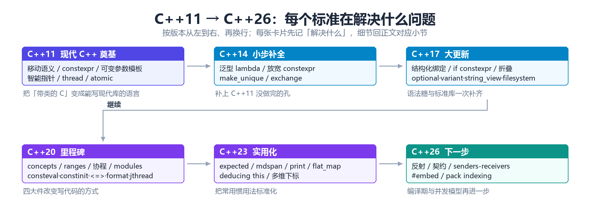
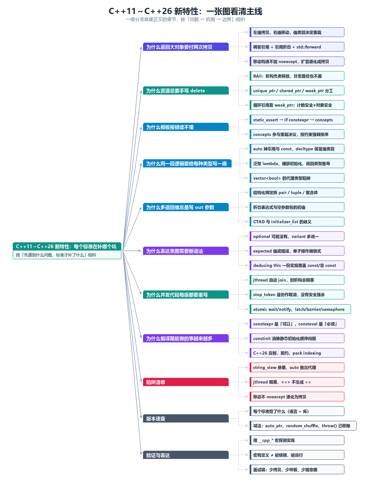

# C++11～C++26 新特性：从「为什么需要」到「怎么写对」

这篇文章回答一个问题：**从 C++11 到 C++26，每个标准到底在解决什么痛点，写代码时又该怎么用、容易在哪里写错。** 它替换掉原来那份只列名词的提纲——名词清单只能帮你"想起来有这回事"，答不出"为什么需要它"，面试官往下追问一层就断了。

**前置知识**：类与对象、拷贝构造/析构、模板基础（函数模板与类模板）、STL 容器与迭代器、线程与互斥量的基本概念。并发细节看 [C++ 并发编程](../C%2B%2B%E5%B9%B6%E5%8F%91%E7%BC%96%E7%A8%8B/README.md)，内存序与无锁结构在那套笔记里讲透，本文只讲"哪个标准加了什么"。

**怎么读**：

- 赶时间：先看[演进主线图](#section-02)、[陷阱清单](#section-10)、[面试表达](#section-13)，再回到对应小节。
- 系统学：按 §3 → §8 顺序读，每节都是"痛点 → 机制 → 可编译示例 → 陷阱"。
- 只想知道"这功能在我机器上有没有"：直接跳到[验证方法](#section-12)，跑那段探测程序。

**目录**（可点击跳转）：

- [从四个痛点说起：C++11 之前有多难](#section-01)
- [演进主线：每个标准各自解决什么](#section-02)
- [C++11：现代 C++ 的奠基](#section-03)
- [C++14：小步补全](#section-04)
- [C++17：一次大更新](#section-05)
- [C++20：四大件](#section-06)
- [C++23：把惯用法标准化](#section-07)
- [C++26：正在到来的下一步](#section-08)
- [减法：被移除与弃用的东西](#section-09)
- [陷阱清单](#section-10)
- [选型表：同一类问题该用哪个工具](#section-11)
- [验证：不靠记忆，靠编译器和宏](#section-12)
- [面试表达](#section-13)
- [深入追问](#section-14)
- [Q&A（常见问题与解答）](#section-15)
- [进一步阅读](#section-16)
- [思维导图总结](#section-17)

**本文示例环境**：Windows + MSYS2 UCRT64，`g++ 16.1.0`，每个例子都给出了完整的 `-std=` 编译命令和实际运行输出。文中凡是写"实测"的，都是本机跑出来的；写"标准规定"的，指 ISO 标准要求；写"实现如此"的，指某个具体库/编译器的行为，换环境可能不同。

<a id="section-01"></a>

## 从四个痛点说起：C++11 之前有多难

新标准不是为了加语法糖而加。每一个特性背后都有一个"不用它就得受着"的具体痛苦。C++11 之前最疼的是这四件事：

**痛点一：临时对象被白白深拷贝。** 函数返回一个大对象，或者往 `vector` 里塞一个临时对象，编译器都要老老实实分配内存、逐字节复制，然后把源对象销毁。明明源对象马上就要死了，它的资源完全可以"过继"给新对象。这就是移动语义要解决的问题：**把"复制资源"换成"偷走资源指针"**。类比是把一箱书交给别人——拷贝是复印一遍再搬走，移动是直接把箱子递过去，但递过去之后原来的箱子就空了（这就是"移动后对象处于有效但未指定状态"）。

**痛点二：`NULL` 是宏，是整数 0。** `void f(int)` 和 `void f(char*)` 同时存在时，`f(NULL)` 会静默调用整数版本；模板推导里 `NULL` 推成 `long`，报错信息完全不提"你想传指针"。`nullptr` 是独立的类型 `std::nullptr_t`，能隐式转成任意指针类型，但**不会**转成整数。

**痛点三：模板报错是几百行噪音。** 模板里对类型的要求写在注释里，编译器只能等你实例化到深处才报错，错误位置指向 `std::vector` 内部第 3000 行。C++20 的 concepts 就是把"注释里的要求"变成编译器能读懂、能在调用点报错的约束。

**痛点四：标准库没有并发。** C++11 之前写多线程得直接调 `pthread` 或 `CreateThread`，锁和条件变量各平台一套，析构时忘记 `join` 直接 `std::terminate`。C++11 把 `thread`、`mutex`、`condition_variable`、`atomic`、`future` 一起塞进标准库，才有了"可移植的并发"。

一句话：**C++11 是把 C++ 从"带类的 C"改造成"能写现代库的语言"的分水岭**，后面 14/17/20/23/26 都是在这条路上继续走。

<a id="section-02"></a>

## 演进主线：每个标准各自解决什么



| 标准 | 定位 | 最该记住的 | 常用编译开关 |
| --- | --- | --- | --- |
| C++11 | 现代 C++ 奠基 | 移动语义、`constexpr`、可变参数模板、智能指针、标准并发库 | `-std=c++11` |
| C++14 | 小步补全 | 泛型 lambda、放宽 `constexpr`、`make_unique` | `-std=c++14` |
| C++17 | 大更新 | 结构化绑定、`if constexpr`、折叠表达式、`optional/variant/string_view`、并行算法 | `-std=c++17` |
| C++20 | 里程碑 | concepts、ranges、协程、modules、`consteval/constinit`、`format`、`jthread` | `-std=c++20` |
| C++23 | 实用化 | `expected`、`mdspan`、`print`、`flat_map`、deducing this、多维下标 | `-std=c++23` |
| C++26 | 下一步 | 反射、契约、senders/receivers | `-std=c++26`（草案/部分实现） |

> 版本口径：这套开关是 GCC/Clang 的写法；MSVC 用 `/std:c++17`、`/std:c++20`、`/std:c++latest` 加 `/Zc:__cplusplus`。C++23 的标准号是 ISO/IEC 14882:2024。**"标准发布了"不等于"你的编译器实现了"**，具体见 §12。

<a id="section-03"></a>

## C++11：现代 C++ 的奠基

### 值类别、移动语义与完美转发

先说结论：**一个表达式是左值还是右值，决定了重载决议选拷贝构造还是移动构造。** 判断依据不是变量名，而是"这个表达式能不能取地址、是不是即将销毁的临时对象"。


规则有三条，都是标准规定：

1. **左值（lvalue）**：有名字、能取地址，比如变量 `x`。绑定到 `T&` 或 `const T&`。
2. **右值（rvalue）**：临时对象、字面量、`std::move(x)` 的结果。绑定到 `T&&` 或 `const T&`。
3. **转发引用**：模板参数写成 `T&&` 且 `T` 需要推导时（`template<class T> void f(T&&)`），它既不是左值引用也不是右值引用，而是"调用者传什么就保留什么"。这靠**引用折叠**实现：`U& &` → `U&`，`U& &&` → `U&`，`U&& &&` → `U&&`。只有传右值时 `T` 才是 `U`，`T&&` 才是 `U&&`。

`std::move` 本身不移动任何东西，它只是一个到右值引用的 `static_cast`；真正搬资源的是随后被选中的移动构造函数。同理 `std::forward<T>` 也只是"按 `T` 的原始值类别转回去"。

下面这个例子把 5 种情形放在一起，能直接看出哪个构造被调用：

```cpp
// 文件名：move.cpp  编译：g++ -std=c++11 -O2 move.cpp -o move
#include <cstdio>
#include <cstring>
#include <utility>
#include <vector>

class Buffer {
public:
    explicit Buffer(std::size_t n) : n_(n), p_(new char[n]()) { std::printf("  构造 n=%zu\n", n_); }
    Buffer(const Buffer& o) : n_(o.n_), p_(new char[o.n_]) {
        std::memcpy(p_, o.p_, n_);
        std::printf("  拷贝 n=%zu（新分配 + memcpy）\n", n_);
    }
    Buffer(Buffer&& o) noexcept : n_(o.n_), p_(o.p_) {
        o.p_ = nullptr; o.n_ = 0;
        std::printf("  移动（只偷指针，不分配）\n");
    }
    Buffer& operator=(const Buffer&) = delete;
    Buffer& operator=(Buffer&&) = delete;
    ~Buffer() { delete[] p_; }
private:
    std::size_t n_;
    char* p_;
};

void sink(Buffer) { std::printf("  sink 收到一个 Buffer\n"); }

template <class T>
void relay(T&& v) {           // T&& 是转发引用，不是右值引用
    sink(std::forward<T>(v)); // 把值类别原样传下去
}

int main() {
    std::printf("1) 直接传临时对象：\n");
    sink(Buffer(16));

    std::printf("2) 传具名对象（左值）：\n");
    Buffer b(32);
    sink(b);

    std::printf("3) std::move(b)：\n");
    sink(std::move(b));

    std::printf("4) 完美转发：先传左值 c，再传右值：\n");
    Buffer c(64);
    relay(c);
    relay(Buffer(128));

    std::printf("5) vector 扩容（移动构造带 noexcept）：\n");
    std::vector<Buffer> v;
    v.push_back(Buffer(256));
    std::printf("  触发扩容：\n");
    v.push_back(Buffer(512));
    std::printf("  完成，size=%zu\n", v.size());
}
```

**编译与运行**（文件保存为 `move.cpp`）：

```bash
g++ -std=c++11 -O2 move.cpp -o move
./move
```

**实测输出**：

```text
1) 直接传临时对象：
  构造 n=16
  sink 收到一个 Buffer
2) 传具名对象（左值）：
  构造 n=32
  拷贝 n=32（新分配 + memcpy）
  sink 收到一个 Buffer
3) std::move(b)：
  移动（只偷指针，不分配）
  sink 收到一个 Buffer
4) 完美转发：先传左值 c，再传右值：
  构造 n=64
  拷贝 n=64（新分配 + memcpy）
  sink 收到一个 Buffer
  构造 n=128
  移动（只偷指针，不分配）
  sink 收到一个 Buffer
5) vector 扩容（移动构造带 noexcept）：
  构造 n=256
  移动（只偷指针，不分配）
  触发扩容：
  构造 n=512
  移动（只偷指针，不分配）
  移动（只偷指针，不分配）
  完成，size=2
```

**读这条输出的三个要点**：

1. **`sink(b)` 打印了"拷贝"，`sink(std::move(b))` 打印了"移动"。** 同一个对象，只是值类别变了，就走不同的构造函数——所以移动语义的本质是"给编译器一个信号：这个对象的资源可以抢"。
2. **`relay(c)` 拷贝，`relay(Buffer(128))` 移动。** 因为 `relay` 的形参是 `T&&`、`T` 需要推导，属于转发引用，`std::forward<T>` 把左值保持成左值、右值保持成右值。**如果把 `std::forward<T>` 换成 `std::move`，左值 `c` 也会被搬空**——这是转发里最常见的错误。
3. **第 5 段里扩容时出现的是"移动"而不是"拷贝"。** 因为 `Buffer` 的移动构造标了 `noexcept`。`vector` 扩容要保证强异常安全：如果移动可能抛异常，搬到一半失败就没法回滚，标准库只能退化成拷贝（`std::move_if_noexcept` 的判断依据就是这个）。**这就是"移动构造/移动赋值一定要加 `noexcept`"的原因**，而不是风格偏好。

**这个示例简化了什么**：只演示构造/移动的调用顺序，没处理移动赋值、自赋值、异常安全，也没有遵守"五法则"（析构、拷贝构造、拷贝赋值、移动构造、移动赋值要么全写、要么用 `=default`）。真实资源类还要考虑：移动后源对象必须处于"可析构、可赋值"的有效状态、`swap` 实现、以及 `std::vector` 之外容器（`deque` 扩容不要求 `noexcept`）的差异。

**边界**：对有 `const` 修饰的对象，`std::move` 得到的是 `const T&&`，匹配不上 `T&&`，会退化成拷贝；对内置类型（`int`）移动就是拷贝，没有收益。

### auto 与 decltype：推导规则与三个坑

`auto` 的推导规则沿用模板实参推导：**顶层 `const` 和引用会被丢掉**。`decltype` 不同，它忠实反映表达式类型，其中 `decltype((x))`（带括号）是"表达式"而非"变量名"，左值表达式会推成引用。

```cpp
// 文件名：auto.cpp  编译：g++ -std=c++14 auto.cpp -o auto
#include <cstdio>
#include <vector>

int main() {
    int n = 7;
    const int cn = 9;
    int& ref = n;

    auto a1 = n;        // int  ：拷贝
    auto a2 = ref;      // int  ：引用被剥掉，得到拷贝
    auto a3 = cn;       // int  ：顶层 const 被丢掉
    auto& a4 = ref;     // int& ：显式写 & 才拿到引用
    const auto& a5 = n; // const int&

    a1 = 100;   // 不影响 n
    a4 = 200;   // 影响 n
    std::printf("auto：a1=%d n=%d a2=%d a3=%d a4=%d a5=%d\n", a1, n, a2, a3, a4, a5);

    // decltype 更「忠实」：保留值类别与顶层 const
    decltype(n)   d1 = 1;    // int
    decltype(cn)  d2 = 2;    // const int
    decltype(ref) d3 = n;    // int&
    d3 = 300;
    std::printf("decltype：d1=%d d2=%d d3=%d n=%d\n", d1, d2, d3, n);

    // 带括号的 decltype((x)) 是「表达式」：左值表达式 -> 引用类型
    decltype((n)) d4 = n;    // int&
    d4 = 400;
    std::printf("decltype((n)) 是引用，n=%d\n", n);

    // 代理对象陷阱：vector<bool> 的 operator[] 返回代理类，不是 bool&
    std::vector<bool> bits(3, false);
    auto b = bits[0];        // auto 推成代理类型，不是 bool！
    std::printf("sizeof(auto)=%zu  sizeof(bool)=%zu\n", sizeof(b), sizeof(bool));
    b = true;                // 通过代理写穿到容器
    std::printf("auto b = bits[0]; b = true 之后 bits[0]=%d（被改到了）\n", (int)bits[0]);
    bool c = bits[1];        // 显式写 bool 拿到的是真拷贝
    c = true;
    std::printf("bool c = bits[1]; c = true 之后 bits[1]=%d（没改到）\n", (int)bits[1]);
    return 0;
}
```

**编译与运行**（`-std=c++14`，这里只用到 C++11/14 的特性）：

```bash
g++ -std=c++14 auto.cpp -o auto
./auto
```

**实测输出**：

```text
auto：a1=100 n=200 a2=7 a3=9 a4=200 a5=200
decltype：d1=1 d2=2 d3=300 n=300
decltype((n)) 是引用，n=400
sizeof(auto)=16  sizeof(bool)=1
auto b = bits[0]; b = true 之后 bits[0]=1（被改到了）
bool c = bits[1]; c = true 之后 bits[1]=0（没改到）
```

**三个坑，全部是"标准这么规定"而非实现差异**：

1. **`auto a2 = ref;` 拿到的是拷贝，不是引用。** 想拿引用必须写 `auto&`；同理 `auto a3 = cn` 丢掉了 `const`，后面想改 `a3` 能改，但改的不是原来的常量。
2. **`decltype((n))` 是 `int&`，而 `decltype(n)` 是 `int`。** 多一层括号就从"变量"变成"表达式"，左值表达式带引用。写泛型返回类型时（`decltype(auto)`）这个区别直接决定返回的是值还是引用。
3. **`vector<bool>` 是特化，`operator[]` 返回代理类而不是 `bool&`。** `auto b = bits[0]` 推出的是代理类型（本例 16 字节，而 `bool` 是 1 字节），所以 `b = true` 真的写穿了容器；而 `bool c = bits[1]` 才是拷贝。**想真正拿值就显式写类型**，否则一旦容器重新分配，手上的代理就悬垂了。

**补充**：`auto` 在 C++14 还能用于函数返回类型推导（`auto f() { return 42; }`），`decltype(auto)` 是 C++14 加的；`auto` 作为函数形参、`auto` 作为模板参数是 C++20 的能力。`auto&&` 是转发引用，配合范围 `for` 写成 `for (auto&& x : c)` 可以同时接住左值和右值元素。

### constexpr 与可变参数模板：C++11 最重要的两条语言特性

这两条容易被忽略，但它们是"零成本抽象"的地基：

- **`constexpr`（C++11）**：标在变量上表示"编译期常量"，标在函数上表示"在实参是常量表达式时可以编译期求值"。C++11 的限制很严：函数体只能有一条 `return`（不能有循环、局部变量）。C++14 放宽，C++20 再大幅放宽（允许 `virtual`、动态分配、`try/catch`、`std::string` 等常量求值）。
- **可变参数模板（C++11）**：`template<class... Ts>`。没有它就没有 `std::tuple`、`std::make_shared`、`emplace_back` 的完美转发构造，也没有今天的 `std::format`。C++17 的折叠表达式让它从"递归展开"变成"一行展开"。

这两条的具体示例放在下面的 C++14 / C++17 / C++20 小节里（`constexpr` 演进、`sum_all` 与 `print_all`），因为它们的能力是跨版本逐步长出来的。

顺便补上 C++11 的 `static_assert`：编译期断言，条件不成立直接编译失败，**在模板里比 `#error` 有用得多**，因为它能看到实例化时的类型。

### C++11 其他语法增强速查

| 特性 | 解决什么 | 注意 |
| --- | --- | --- |
| `enum class` | 普通 `enum` 的枚举值会泄漏到外层作用域、能隐式转 `int` | 强类型枚举不隐式转换，要显式 `static_cast` |
| `using` 别名 | `typedef` 不能带模板参数 | `template<class T> using Vec = std::vector<T>;` 是 C++11 才有的别名模板 |
| `override` / `final` | 虚函数写错签名时编译器不报错，运行时行为不对 | 它们是**上下文关键字**，不是保留字，可以继续当变量名 |
| `=default` / `=delete` | 想禁掉拷贝、或想恢复默认实现 | `=delete` 的删函数参与重载决议，比"声明为 private 不实现"更好 |
| `noexcept` | 异常规格、`vector` 扩容、移动语义的性能判断 | C++11 起 `noexcept` 进入**类型系统**（`noexcept(true)` 与 `noexcept(false)` 是不同类型） |
| `nullptr` | `NULL` 的整数歧义 | `nullptr_t` 可转任意指针，不转整数 |
| `alignas` / `alignof` | 对齐要求与查询 | `alignof` 返回 `size_t`，不要和 `sizeof` 混 |
| 用户定义字面量（UDL） | `100_km` 这种带单位写法 | 自定义后缀必须以 `_` 开头（标准库的后缀不带下划线） |
| 原始字符串 `R"(...)"` | 转义字符太多（正则、JSON、Windows 路径） | 可以自定义定界符 `R"xx(...)xx"` |
| 尾置返回类型 `auto f() -> T` | 返回类型依赖形参 | 泛型 lambda 与 `decltype` 场景常用 |
| 委托构造、类内成员初始化 | 构造函数重复初始化、头文件里不能给默认值 | 类内初始化（NSDMI）会让类型不再聚合（C++11 到 C++14 之间有细节变化） |
| `char16_t` / `char32_t`、`u8"..."` | 统一 Unicode 字面量 | `u8` 字面量在 C++20 之前是 `const char[]`，C++20 起是 `const char8_t[]` |

### C++11 标准库：智能指针与 RAII

智能指针解决的问题很具体：**异常和提前 `return` 会让 `delete` 走不到**。把"释放"绑到对象析构上（RAII），无论从哪条路径离开作用域都会释放。

```cpp
// 文件名：smart.cpp  编译：g++ -std=c++11 smart.cpp -o smart
#include <cstdio>
#include <memory>
#include <string>

struct Node {
    std::string name;
    std::shared_ptr<Node> next;      // 强引用
    std::weak_ptr<Node>   back;      // 弱引用，打破环
    explicit Node(std::string n) : name(std::move(n)) { std::printf("  构造 Node %s\n", name.c_str()); }
    ~Node() { std::printf("  析构 Node %s\n", name.c_str()); }
};

struct FileCloser {                      // 自定义删除器：RAII 管理 C 资源
    void operator()(std::FILE* f) const {
        if (f) { std::fclose(f); std::printf("  已 fclose\n"); }
    }
};

int main() {
    std::printf("1) unique_ptr 只能移动，不能拷贝：\n");
    std::unique_ptr<int> u1(new int(5));
    std::unique_ptr<int> u2 = std::move(u1);
    std::printf("  u1 是否为空：%s  *u2=%d\n", u1 ? "否" : "是", *u2);

    std::printf("2) make_shared 一次分配（控制块与对象同块内存）：\n");
    auto sp = std::make_shared<int>(10);
    std::printf("  use_count=%ld\n", (long)sp.use_count());
    {
        auto sp2 = sp;
        std::printf("  拷贝后 use_count=%ld\n", (long)sp.use_count());
    }
    std::printf("  离开作用域后 use_count=%ld\n", (long)sp.use_count());

    std::printf("3) 循环引用：\n");
    {
        auto a = std::make_shared<Node>("A");
        auto b = std::make_shared<Node>("B");
        a->next = b;          // A 强引用 B
        b->back = a;          // B 弱引用 A（若也写 next 就成环，谁都释放不掉）
        std::printf("  a.use_count=%ld b.use_count=%ld\n",
                    (long)a.use_count(), (long)b.use_count());
    }
    std::printf("  两个 Node 都析构了\n");

    std::printf("4) 自定义删除器：\n");
    {
        std::unique_ptr<std::FILE, FileCloser> fp(std::fopen("smart_probe.txt", "w"));
        if (fp) { std::fputs("x", fp.get()); std::printf("  已写入\n"); }
    }
    std::printf("5) shared_ptr 的线程安全边界：引用计数原子，所指对象不原子\n");
    return 0;
}
```

**编译与运行**：

```bash
g++ -std=c++11 smart.cpp -o smart
./smart
```

**实测输出**：

```text
1) unique_ptr 只能移动，不能拷贝：
  u1 是否为空：是  *u2=5
2) make_shared 一次分配（控制块与对象同块内存）：
  use_count=1
  拷贝后 use_count=2
  离开作用域后 use_count=1
3) 循环引用：
  构造 Node A
  构造 Node B
  a.use_count=1 b.use_count=2
  析构 Node A
  析构 Node B
  两个 Node 都析构了
4) 自定义删除器：
  已写入
  已 fclose
5) shared_ptr 的线程安全边界：引用计数原子，所指对象不原子
```

**四个必答点**：

1. **`unique_ptr` 只能移动不能拷贝**，因为独占所有权；它的大小和裸指针一样（默认删除器是空类，走空基类优化），是"零成本"的。
2. **`make_shared` 只分配一次**（控制块和对象在同一块内存里），比 `shared_ptr<T>(new T)` 少一次分配、也避免"new 成功但控制块分配失败"的泄漏窗口；代价是 `weak_ptr` 还活着时对象内存也没法回收（对象和控制块同生共死）。
3. **循环引用会泄漏**：`A->next = B` 与 `B->next = A` 让两个 `use_count` 都停在 1，离开作用域也不析构。把其中一个方向改成 `weak_ptr` 才能打破环——本例 `b->back` 是 `weak_ptr`，所以 `a.use_count()` 是 1、`b.use_count()` 是 2，两个节点都正常析构了。`weak_ptr` 用之前必须 `lock()` 拿到 `shared_ptr`，否则对象可能已经被释放。
4. **`shared_ptr` 的线程安全有边界**：引用计数的增减是原子的，所以多个线程可以拷贝/销毁同一个 `shared_ptr`；但**它指向的对象不是线程安全的**，多线程读写同一个对象仍要加锁。这是"`shared_ptr` 线程安全"这句话最常被误答的地方。

**这个示例简化了什么**：`Node` 是"父子双向链表"的最小形态，真实场景（图、缓存、观察者）里还要考虑环的检测、`enable_shared_from_this`、以及自定义删除器与分配器。示例没有演示多线程同时拷贝 `shared_ptr`，只说明了语义边界。

### C++11 标准库：并发与常用工具

| 组件 | 头文件 | 说明 |
| --- | --- | --- |
| `std::thread` | `<thread>` | 析构前必须 `join()` 或 `detach()`，否则 `std::terminate` |
| `std::mutex` / `recursive_mutex` / `timed_mutex` | `<mutex>` | 配合 `lock_guard`、`unique_lock` 使用；后者支持延迟加锁与条件变量 |
| `std::condition_variable` | `<condition_variable>` | 必须配谓词循环，处理虚假唤醒；细节见并发笔记第 14、15 篇 |
| `std::atomic` | `<atomic>` | 默认内存序是 `seq_cst`；何时能放松见并发笔记第 31～35 篇 |
| `std::future/promise/async` | `<future>` | 异步取结果；`async` 的启动策略与析构等待有坑 |
| `std::call_once` / `std::once_flag` | `<mutex>` | 线程安全的一次性初始化（局部静态变量在 C++11 起也保证线程安全） |
| `thread_local` | 关键字 | 线程局部存储，生命周期与线程绑定 |
| `std::chrono` | `<chrono>` | `duration` + `time_point` + 时钟；测时长用 `steady_clock`，别用 `system_clock` |
| `unordered_map/set` | `<unordered_map>` 等 | 哈希容器，C++11 才进标准（此前只有 `map/set`） |
| `std::regex`、`<random>` | `<regex>` / `<random>` | 正则与随机数库；`random` 要正确播种，别用 `rand()` |
| `std::to_string` / `stoi` 系列 | `<string>` | 与 `atoi` 的区别是抛出异常、能处理 `std::string` |
| `std::tuple`、`std::array`、`std::forward_list` | `<tuple>` 等 | 定长数组、单向链表、异构元组 |
| `std::function` / `std::bind` | `<functional>` | 类型擦除的可调用对象；C++11 起 lambda 可转 `std::function` |

<a id="section-04"></a>

## C++14：小步补全

C++14 是"把 C++11 没做完的地方补上"，几乎没有新概念，但每一条都很常用：

| 特性 | 说明 | 解决的问题 |
| --- | --- | --- |
| 泛型 lambda | `[](auto x) { return x; }` | C++11 的 lambda 形参必须写死类型，写泛型算法要给每个类型写一遍 |
| lambda 捕获初始化 | `[p = std::move(ptr)]` | C++11 只能按值/引用捕获已有变量，无法捕获"移动后的值"或改名的表达式 |
| 函数返回类型推导 | `auto f() { return 1; }` | 不用写尾置返回类型；`decltype(auto)` 保留引用 |
| 变量模板 | `template<class T> constexpr T pi = T(3.14);` | 常量不再需要包一层 `struct` |
| 放宽的 `constexpr` | 允许局部变量、循环、分支、多语句 | C++11 只能一条 `return`，写不了循环 |
| 二进制字面量 `0b1010`、数位分隔符 `1'000'000` | 可读性 | 位掩码、大数字 |
| `[[deprecated]]` / `[[deprecated("原因")]]` | 弃用警告 | 渐进式迁移接口 |
| `std::make_unique` | C++11 漏掉的对称函数 | 不再需要 `unique_ptr<T>(new T)` |
| `std::exchange` | 赋值并返回旧值，一行实现"取出并重置" | 移动赋值、状态机切换 |
| `std::get<T>(tuple)` | 按类型取元组元素 | 元组元素多了以后按序号取可读性差 |
| `std::shared_timed_mutex` | 支持超时的读写锁 | C++17 又补了不带超时的 `std::shared_mutex` |
| `std::integer_sequence` | 编译期整数序列 | 实现 `apply`、展开参数包 |

一个能体现"放宽 `constexpr`"价值的对比：C++11 里 `sum_to` 这种带循环的函数根本写不成 `constexpr`，只能递归；C++14 起可以循环——这正是下面 `constexpr.cpp` 里 `sum_to` 能编译的原因。

<a id="section-05"></a>

## C++17：一次大更新

C++17 是 C++11 之后最大的一次更新，特点是"**语法糖 + 标准库同时补齐**"，也是面试问得最多的一版。

### 结构化绑定与 CTAD

```cpp
// 文件名：structured.cpp  编译：g++ -std=c++17 structured.cpp -o structured
#include <cstdio>
#include <map>
#include <optional>
#include <string>
#include <string_view>
#include <tuple>
#include <variant>

struct Order { int id; std::string sku; double amount; };

int main() {
    // 1) 结构化绑定：pair / tuple / 数组 / 聚合体都能拆
    std::pair<int, std::string> p{7, "apple"};
    auto [pid, pname] = p;
    auto [tid, price, qty] = std::make_tuple(1, 9.9, 3);
    int arr[2] = {10, 20};
    auto [x, y] = arr;
    Order o{42, "SKU-1", 19.9};
    auto& [oid, sku, amount] = o;      // 引用绑定，改的是原对象
    amount = 29.9;
    std::printf("pair: %d %s | tuple: %d %.1f %d | array: %d %d\n", pid, pname.c_str(), tid, price, qty, x, y);
    std::printf("struct: %d %s %.1f（原对象 amount 已被改）\n", oid, sku.c_str(), o.amount);

    // 2) 遍历 map 时结构化绑定最有用
    std::map<std::string, int> stock{{"apple", 3}, {"pear", 5}};
    for (const auto& [key, value] : stock) std::printf("  %s -> %d\n", key.c_str(), value);

    // 3) CTAD：类模板参数推导，C++17 起可省掉模板实参
    std::pair ctad{1, 2.5};            // pair<int,double>
    std::tuple t{1, std::string("two")};
    std::printf("CTAD pair: %d %.1f\n", ctad.first, ctad.second);

    // 4) optional / variant / string_view
    std::optional<int> maybe = std::nullopt;
    std::printf("optional 有值吗：%s\n", maybe ? "有" : "无");
    maybe = 5;
    std::printf("value_or = %d\n", maybe.value_or(-1));

    std::variant<int, std::string> v = std::string("hello");
    std::printf("variant 当前持有 string：%s\n", std::get<std::string>(v).c_str());
    v = 42;
    std::printf("variant 切到 int：%d\n", std::get<int>(v));

    std::string_view sv = "view 不拷贝字符";
    std::printf("string_view[0..4] = %.*s，size=%zu\n", 4, sv.data(), sv.size());
    return 0;
}
```

**编译与运行**：

```bash
g++ -std=c++17 structured.cpp -o structured
./structured
```

**实测输出**：

```text
pair: 7 apple | tuple: 1 9.9 3 | array: 10 20
struct: 42 SKU-1 29.9（原对象 amount 已被改）
  apple -> 3
  pear -> 5
CTAD pair: 1 2.5
optional 有值吗：无
value_or = 5
variant 当前持有 string：hello
variant 切到 int：42
string_view[0..4] = view，size=20
```

**要点**：

1. **结构化绑定**能拆 `pair`、`tuple`、数组、聚合体（`struct`/`class` 的公开成员）。写 `auto& [key, value]` 是引用绑定，改的是原对象（本例 `amount` 从 19.9 改成 29.9）。它本质是"给成员起别名"，不是拷贝，也不支持"跳过某个成员"。
2. **CTAD**（类模板参数推导）让 `std::pair p{1, 2.5}`、`std::tuple t{1, std::string("two")}`、`std::vector v{1,2,3}` 省掉模板实参。注意它与 `std::initializer_list` 的歧义：`std::vector v{1, 2}` 是**两个元素**，要"两个元素的初值"得写 `std::vector v(1, 2)`。
3. **`optional`/`variant`/`any`/`string_view`** 是 C++17 标准库的四件套：分别表达"可能没有值""多选一""任意类型""不拷贝的字符串视图"。`optional::value()` 在没有值时抛 `bad_optional_access`，`value_or` 不会抛。

**这个示例简化了什么**：`string_view` 这里指向字面量，生命周期没问题；**真实代码里指向临时 `std::string` 就会悬垂**（见 §10 陷阱表）。`variant` 的访问只演示了 `std::get`，`visit` 才是正确姿势（`std::get` 类型不符会抛 `bad_variant_access`）。

### if constexpr 与折叠表达式

`if constexpr` 解决的是"模板实例化到不该走的分支就报错"的问题：普通 `if` 的两个分支都要编译，`if constexpr` 在编译期按条件丢弃另一分支。折叠表达式则把"递归展开参数包"变成一行。

```cpp
// 文件名：variadic.cpp  编译：g++ -std=c++17 variadic.cpp -o variadic
#include <cstdio>
#include <functional>
#include <string>
#include <tuple>
#include <utility>

// C++11：可变参数模板；C++17：折叠表达式把参数「一次性」展开
template <class... Ts>
auto sum_all(Ts... xs) { return (xs + ... + 0); }

template <class... Ts>
void print_all(const Ts&... xs) {
    ((std::printf("%s ", std::to_string(xs).c_str())), ...);  // 逗号折叠
    std::printf("\n");
}

struct Counter {
    int base = 100;
    int add(int a, int b) const { return base + a + b; }
};

int main() {
    std::printf("sum_all(1,2,3,4) = %d\n", sum_all(1, 2, 3, 4));
    std::printf("sum_all()        = %d\n", sum_all());
    print_all(1, 2.5, 3);

    // std::apply：把 tuple 展开成实参列表
    auto args = std::make_tuple(3, 4);
    std::printf("apply(sum_all, (3,4)) = %d\n", std::apply([](int a, int b) { return a + b; }, args));

    // std::invoke：统一调用函数、成员函数指针、数据成员指针、可调用对象
    Counter c;
    std::printf("invoke(&Counter::add, c, 1, 2) = %d\n", std::invoke(&Counter::add, c, 1, 2));
    std::printf("invoke(&Counter::base, c)     = %d\n", std::invoke(&Counter::base, c));
    std::printf("invoke(lambda, 10)            = %d\n", std::invoke([](int x) { return x * x; }, 10));
    return 0;
}
```

**编译与运行**：

```bash
g++ -std=c++17 variadic.cpp -o variadic
./variadic
```

**实测输出**：

```text
sum_all(1,2,3,4) = 10
sum_all()        = 0
1 2.500000 3 
apply(sum_all, (3,4)) = 7
invoke(&Counter::add, c, 1, 2) = 103
invoke(&Counter::base, c)     = 100
invoke(lambda, 10)            = 100
```

**要点**：

1. **折叠表达式有四种形式**：`(xs + ...)`、`(... + xs)`、`(init + ... + xs)`、`(xs + ... + init)`。本例写 `(xs + ... + 0)` 用 `0` 做初值，这样空参数包也能编译并返回 0——**空包是折叠表达式最容易漏的边界**。
2. **逗号折叠 `((f(x)), ...)`** 是"对每个参数执行一次"的惯用法，注意外面那层括号，否则会变成丢弃前几个结果的逗号表达式。
3. **`std::apply`** 把 tuple 展开成实参；**`std::invoke`** 统一了普通函数、成员函数指针、数据成员指针、可调用对象的调用方式，是写泛型代码（如 `std::thread` 的构造、`std::function`）的标准工具。

**这个示例简化了什么**：`sum_all` 返回类型用 `auto`，多个不同类型的实参会按 C++ 的算术转换规则提升（`int + double` → `double`），真实代码要显式规定累加类型；`print_all` 用 `to_string` 只支持有限类型，泛型版本应改用 `std::format` 或 `if constexpr` 分派。

### C++17 其他语言特性

| 特性 | 说明 |
| --- | --- |
| if/switch 初始化语句 | `if (auto it = m.find(k); it != m.end())`，把变量作用域收进条件 |
| `inline` 变量 | 头文件里定义全局变量不再违反 ODR（此前只能用 `static` 或函数内静态） |
| 保证拷贝消除 | `T x = T();` 与返回临时对象**不再要求**有拷贝/移动构造（C++17 前是"允许省略"，之后是"必须省略"） |
| `[[nodiscard]]` / `[[fallthrough]]` / `[[maybe_unused]]` | 忽略返回值告警、switch 贯穿告警、未使用变量告警 |
| 嵌套命名空间 | `namespace a::b::c { }` |
| `template<auto>` | 非类型模板参数用 `auto` 推导，省掉一长串 `decltype` |
| `constexpr` lambda | lambda 可以在常量表达式中使用（C++17 起隐式 `constexpr`） |
| `[[maybe_unused]]` | 消除未使用参数/变量的告警 |

### C++17 标准库

| 组件 | 说明 | 边界 |
| --- | --- | --- |
| `optional` / `variant` / `any` | 可选值、类型安全的联合、任意类型容器 | `any` 有堆分配与 RTTI 成本；`variant` 访问用 `visit` |
| `string_view` | 只读字符串视图，不拷贝 | **不拥有内存，指向临时对象就悬垂**；不保证以 `\0` 结尾 |
| `filesystem` | 路径、目录遍历、文件属性 | 错误处理分抛异常与 `error_code` 两个重载，性能敏感处用后者 |
| `apply` / `invoke` | 展开 tuple、统一调用 | — |
| `byte` | 字节类型，比 `char` 表达意图更清楚 | 做算术要显式转 `unsigned` |
| `clamp` / `gcd` / `lcm` | 常用算法补全 | `clamp(v, lo, hi)` 要求 `lo <= hi`，否则是 UB |
| `pmr`（多态内存资源） | 运行时替换分配器 | 生命周期管理复杂，容器与 `memory_resource` 必须同生共死 |
| `shared_mutex` / `scoped_lock` | 读写锁、多锁一次性死锁避免 | `scoped_lock` 用 `std::lock` 的顺序无关算法，多个互斥量一起锁时优先用它 |
| 并行算法 + `<execution>` | `std::execution::par` 等执行策略 | **执行策略是"允许并行"不是"保证并行"**；异常会 `std::terminate`，且不保证不超额订阅 |
| `reduce` / `transform_reduce` | 并行友好的归约 | 要求满足结合律，浮点求和不保证与串行结果逐位相同 |
| `to_chars` / `from_chars` | 无本地化、无分配的数值转换 | 比 `to_string`/`stoi` 快且不受 locale 影响 |

<a id="section-06"></a>

## C++20：四大件

C++20 常被说成"C++11 之后最大的更新"，因为它一次加了四个改变写法的东西：**concepts、ranges、协程、modules**，再加上 `consteval/constinit`、`<=>`、`format` 这些每天都会用的补丁。

### concepts 与 ranges：把"注释里的要求"变成编译器能检查的约束

C++17 之前写泛型代码只能靠 SFINAE 或 `static_assert`：错误信息长、要求写在注释里、重载决议看不懂。concepts 把"这个模板要求 T 支持什么"写成一条命名约束，不满足时**在调用点报错**，并且能参与重载决议。

ranges 则是"把算法从迭代器对改成范围"，配合视图（view）做惰性管道：`filter`/`transform` 不产生中间容器，只有迭代时才计算。

```cpp
// 文件名：concepts.cpp  编译：g++ -std=c++20 concepts.cpp -o concepts
#include <algorithm>
#include <concepts>
#include <format>
#include <iostream>
#include <ranges>
#include <string>
#include <vector>

// 自定义 concept：要求类型能比大小，并且可迭代出 int
template <class T>
concept IntRange = std::ranges::range<T> &&
                   std::same_as<std::ranges::range_value_t<T>, int>;

// 约束写法一：requires 子句
template <class T>
    requires std::integral<T>
T twice(T x) { return x + x; }

// 约束写法二：缩写的函数模板（abbreviated template）
std::string describe(std::integral auto x) { return std::format("整数 {}", x); }

// 满足 IntRange 才有这个重载
void dump(const IntRange auto& r) {
    std::cout << "  int 序列：";
    for (int v : r) std::cout << v << ' ';
    std::cout << '\n';
}

struct Version {
    int major, minor;
    auto operator<=>(const Version&) const = default;   // C++20 三向比较，编译器补全 < <= > >=
};

int main() {
    std::cout << "twice(21) = " << twice(21) << '\n';
    std::cout << describe(7) << '\n';

    std::vector<int> v{5, 3, 8, 1, 9, 2};
    dump(v);

    // ranges：惰性视图 + 管道
    auto pipeline = v | std::views::filter([](int x) { return x % 2 == 1; })
                      | std::views::transform([](int x) { return x * x; })
                      | std::views::take(2);
    std::cout << "奇数平方取前两个：";
    for (int x : pipeline) std::cout << x << ' ';
    std::cout << '\n';

    std::ranges::sort(v);
    std::cout << "ranges::sort 之后：";
    for (int x : v) std::cout << x << ' ';
    std::cout << '\n';

    Version a{1, 9}, b{2, 0};
    std::cout << std::format("1.9 < 2.0 ? {}\n", a < b);
    return 0;
}
```

**编译与运行**：

```bash
g++ -std=c++20 concepts.cpp -o concepts
./concepts
```

**实测输出**：

```text
twice(21) = 42
整数 7
  int 序列：5 3 8 1 9 2 
奇数平方取前两个：25 9 
ranges::sort 之后：1 2 3 5 8 9 
1.9 < 2.0 ? true
```

**要点**：

1. **`concept` 是一组布尔约束的命名**，本例 `IntRange` 要求"是 range，且元素类型恰好是 `int`"。`requires` 有两种用法：`requires std::integral<T>` 是"约束子句"，`requires(T t) { t.foo(); }` 是"requires 表达式"（检查表达式是否合法）。
2. **缩写函数模板** `void f(std::integral auto x)` 等价于 `template<class T> requires std::integral<T> void f(T)`，写起来短，但报错信息同样清晰。
3. **ranges 是惰性的**：`v | views::filter(...) | views::transform(...)` 只是构造了一个视图对象，遍历时才逐个计算。所以**视图不能比它引用的容器活得更久**——`auto view = make_vector() | views::take(3);` 里的容器已经销毁，view 悬垂。
4. **`operator<=>` 加 `= default`** 让编译器按成员声明顺序生成比较，并自动补全 `<`、`<=`、`>`、`>=`。注意 `<=>` 不会自动生成 `==`，需要另写 `= default` 的 `==`（本例只用了 `<=>`，`a < b` 由它合成）。

**这个示例简化了什么**：`dump` 只接受 `int` 序列，真实代码里通常会写成"元素可打印"的约束并用 `std::format`；`views::take(2)` 之后管道结束，没有演示 `views::join`、`views::split`、以及 view 与临时容器混用时最容易出的悬垂。`std::format` 的格式串在编译期检查，本例是常量串所以没问题，运行期拼接要用 `std::vformat`。

### constexpr 家族：constexpr / consteval / constinit

这三个关键字经常被混着用，其实分工很清楚：

| 关键字 | 含义 | 典型用途 |
| --- | --- | --- |
| `constexpr` | "**可以**在编译期求值"（也允许运行期求值） | 常量、能在两种场景下复用的函数 |
| `consteval` | "**必须**在编译期求值"，运行期调用直接编译失败 | 生成查表数据、编译期校验 |
| `constinit` | "**静态初始化**必须在编译期完成"（不要求 `const`） | 消除静态初始化顺序问题 |

```cpp
// 文件名：constexpr.cpp  编译：g++ -std=c++20 constexpr.cpp -o constexpr
#include <cstdio>
#include <type_traits>

// C++11：constexpr 函数体只能有一条 return
constexpr int square(int x) { return x * x; }

// C++14：放宽为允许局部变量、循环、分支
constexpr int sum_to(int n) {
    int s = 0;
    for (int i = 1; i <= n; ++i) s += i;
    return s;
}

// C++20：consteval 强制「只在编译期求值」
consteval int must_be_compile_time(int x) { return x * 2; }

// C++20：is_constant_evaluated 区分两种求值场景
constexpr int f(int x) {
    if (std::is_constant_evaluated()) return x * 100;  // 编译期走这里
    return x + 1;                                      // 运行期走这里
}

// C++20：constinit 保证静态初始化在编译期完成（避免静态初始化顺序问题）
constinit int g_start = sum_to(10);

int main() {
    static_assert(square(5) == 25, "编译期就要算出来");
    static_assert(sum_to(100) == 5050);

    int runtime_n = 4;
    std::printf("square(5)      = %d（编译期常量）\n", square(5));
    std::printf("sum_to(100)    = %d（编译期常量）\n", sum_to(100));
    std::printf("must_be_compile_time(21) = %d\n", must_be_compile_time(21));
    constexpr int compile_time = f(3);   // 常量上下文：走 is_constant_evaluated 的编译期分支
    int runtime = f(runtime_n);          // 运行期调用：走另一分支
    std::printf("f(3) 在常量上下文 = %d\n", compile_time);
    std::printf("f(runtime_n) 在运行期 = %d\n", runtime);
    std::printf("constinit g_start = %d\n", g_start);
    return 0;
}
```

**编译与运行**：

```bash
g++ -std=c++20 constexpr.cpp -o constexpr
./constexpr
```

**实测输出**：

```text
square(5)      = 25（编译期常量）
sum_to(100)    = 5050（编译期常量）
must_be_compile_time(21) = 42
f(3) 在常量上下文 = 300
f(runtime_n) 在运行期 = 5
constinit g_start = 55
```

**最值得记的一点**：`f(3)` 在 `main` 里直接调用时打印的是 **4**，而不是 300——因为"实参是字面量"不等于"这次调用在常量求值上下文中"。只有 `constexpr int compile_time = f(3);` 或 `static_assert(f(3) == 300)` 这种**要求常量表达式**的位置，`std::is_constant_evaluated()` 才返回 `true`。这个区别是"constexpr 函数在编译期和运行期行为可以不同"的根源，也是它容易写出两种结果的地方。

**其他边界**：`consteval` 函数不能取运行期参数的地址、不能调用非 constexpr 函数；`constinit` 只约束初始化发生在编译期，变量本身仍然可以在运行期被修改（本例 `g_start` 不是 `const`）。C++20 的 `constexpr` 允许 `new/delete`（但每次常量求值必须配平）、`try/catch`、`virtual`、以及 `std::string`/`std::vector` 的部分操作，限制仍比运行期多。

### 并发：jthread、stop_token 与 atomic 等待

C++20 给并发补了三样东西，都在解决 C++11 遗留的"必须自己写样板"的问题：

- `std::jthread`：析构时自动 `request_stop()` + `join()`，**再也不会忘记 join 导致 `std::terminate`**；
- `std::stop_token`：协作式取消的标准接口，线程自己检查"要不要退出"，而不是被强杀；
- `std::atomic` 的 `wait`/`notify_one`/`notify_all`：等一个原子值变化，不需要额外配一个条件变量和互斥量。

```cpp
// 文件名：threads.cpp  编译：g++ -std=c++20 threads.cpp -o threads -pthread
#include <atomic>
#include <cstdio>
#include <latch>
#include <thread>
#include <vector>

int main() {
    // 1) C++20 jthread：析构时自动 request_stop + join，不需要手写 join 收尾
    std::atomic<int> total{0};
    std::latch start{1};                     // 让所有线程同时起跑，结果可复现
    {
        std::vector<std::jthread> pool;
        for (int t = 0; t < 4; ++t) {
            pool.emplace_back([&total, &start] {
                start.wait();
                for (int i = 0; i < 1000; ++i) total.fetch_add(1, std::memory_order_relaxed);
            });
        }
        start.count_down();                  // 发令
    }                                        // 离开作用域：jthread 自动 join
    std::printf("1) 4 个线程各加 1000 次，total = %d（无锁原子累加）\n", total.load());

    // 2) stop_token：协作式取消，线程自己决定何时退出
    std::atomic<bool> saw_stop{false};
    int loops = 0;
    {
        std::jthread worker([&saw_stop, &loops](std::stop_token st) {
            while (!st.stop_requested()) { ++loops; }
            saw_stop.store(true);
        });
        while (loops < 100000) { std::this_thread::yield(); }
        worker.request_stop();               // 请求停止，不是强杀
    }
    std::printf("2) stop_token：线程收到停止请求并自行退出 = %s\n", saw_stop.load() ? "是" : "否");

    // 3) atomic 的 wait / notify（C++20）：不用条件变量也能等待「值变了」
    std::atomic<int> flag{0};
    std::thread producer([&flag] {
        flag.store(1);
        flag.notify_one();                   // 唤醒等待者
    });
    flag.wait(0);                            // 等到 flag != 0 才继续
    producer.join();
    std::printf("3) atomic::wait 等到 flag = %d\n", flag.load());
    return 0;
}
```

**编译与运行**（MSYS2 下通常不必显式加 `-pthread`，Linux 上必须加）：

```bash
g++ -std=c++20 threads.cpp -o threads -pthread
./threads
```

**实测输出**：

```text
1) 4 个线程各加 1000 次，total = 4000（无锁原子累加）
2) stop_token：线程收到停止请求并自行退出 = 是
3) atomic::wait 等到 flag = 1
```

**要点**：

1. **`jthread` 的析构会阻塞**：它先 `request_stop()` 再 `join()`，如果线程正在做一个长任务且不检查 `stop_token`，析构就会卡住。这是"自动 join"的代价，不是免费午餐。
2. **`stop_token` 是协作式的**：`request_stop()` 只设置标志并回调，线程必须自己检查 `st.stop_requested()` 并及时退出。**C++ 没有安全的强制终止线程**（`pthread_cancel` 的坑：锁没释放、资源泄漏），所以标准只提供协作取消。
3. **`atomic::wait(0)` 的语义是"值仍等于 0 就睡，直到被 notify 或值变了"**，唤醒后要重新检查（可能有虚假唤醒）。它比"互斥量 + 条件变量"轻，但只适用于"等一个原子量变化"这种简单场景。
4. **`std::latch` 是一次性计数门闩**，`std::barrier` 可以重复使用（分阶段），`std::counting_semaphore` 是计数信号量。三者都在 `<latch>`/`<barrier>`/`<semaphore>` 里，C++20 才标准化。

**这个示例简化了什么**：累加用 `memory_order_relaxed` 是因为这里只关心最终总数、不需要与其它内存操作建立顺序；真实代码里如果 `total` 还要保护别的数据，就必须用更强的内存序。示例也没有演示异常从线程里逃逸的处理（`jthread` 里抛异常依然会 `std::terminate`）。

### C++20 其他语言特性

| 特性 | 说明 | 注意 |
| --- | --- | --- |
| modules | `import std;` 替代 `#include`，编译更快、宏不泄漏 | 编译器支持参差，构建系统集成麻烦；头文件与模块可以混用 |
| 协程 | `co_await`/`co_yield`/`co_return`，函数变成可挂起的状态机 | **标准只给语言机制，不给运行时**；`std::generator`（C++23）才提供现成生成器 |
| 三向比较 `<=>` | 一次声明拿到六种比较 | 与 `==` 不联动；返回类型 `strong_ordering`/`weak_ordering`/`partial_ordering` 语义不同 |
| 指定初始化 | `Point{.x = 1, .y = 2}` | 必须按声明顺序、不能与继承混用、不能跳过中间成员 |
| `char8_t` | UTF-8 字符类型，`u8"..."` 的字面量类型 | 与 `char` 不通用，需要显式转换 |
| 模板 lambda | `[]<class T>(T x){}` | 泛型 lambda 的形参类型无法显式指定时的补充 |
| `using enum` | `using enum Color;` 后可直接写 `Red` | 会引入命名冲突，慎用在头文件 |
| `[[no_unique_address]]` | 空成员不占空间（类似空基类优化） | 对"无状态分配器/删除器"有用 |
| `[[likely]]` / `[[unlikely]]` | 分支提示 | 只是提示，编译器可以不采纳；乱标可能更慢 |

### C++20 标准库

| 组件 | 说明 |
| --- | --- |
| `std::format` | 类型安全的格式化，格式串在**编译期**检查（C++20 要求常量表达式）；运行期拼接用 `std::vformat` |
| `std::span` | 连续内存的视图（指针 + 长度），替代 `(T*, size)` 参数 |
| `std::source_location` | 取文件名/行号/函数名，替代 `__FILE__` 宏 |
| `std::bit_cast` | 同大小、可平凡复制类型之间的位转换，替代 `memcpy` 双关 |
| `std::numbers` | 数学常量（`pi`、`e`、`sqrt2`...） |
| `std::erase` / `std::erase_if` | 容器删除元素的统一写法，替代 erase-remove 惯用法 |
| `std::ssize` | 有符号长度，避免 `-Wsign-compare` |
| `std::string::starts_with` / `ends_with` | 前后缀判断 |
| `std::atomic_ref` | 对**非原子对象**做原子操作（要求对齐、生命周期由使用者保证） |
| `std::osyncstream` | 多线程安全输出，避免 `std::cout` 交错 |
| `std::bind_front` | 绑定前几个参数，比 `std::bind` 简单可读 |
| `std::to_array` | 从 C 数组构造 `std::array` |
| `std::construct_at` / `std::destroy_at` | constexpr 友好的构造/析构，替代 placement new |

<a id="section-07"></a>

## C++23：把惯用法标准化

C++23 不算大版本，但补的几样东西都很实用：`expected` 让"可预期失败"不用再抛异常，`mdspan` 给多维数组一个视图，`print` 终于有了自己的输出函数，`deducing this` 让 CRTP 和 const/非 const 重载不用再写两遍。

```cpp
// 文件名：modern23.cpp  编译：g++ -std=c++23 modern23.cpp -o modern23
// 说明：C++23 的 std::print/println 在本机 MinGW（GCC 16.1.0）能编译但链接失败
//       （缺 std::__open_terminal），所以示例改用 std::format + std::puts 输出。
#include <cstdio>
#include <expected>
#include <ranges>
#include <format>
#include <string>
#include <utility>
#include <vector>

enum class Err { DivByZero };

std::expected<int, Err> safe_div(int a, int b) {
    if (b == 0) return std::unexpected(Err::DivByZero);
    return a / b;
}

enum class Color : unsigned char { Red = 1, Green = 2 };

struct Widget {
    int x = 0;
    // C++23：显式对象参数（deducing this）。一个模板同时覆盖 const 与 非 const。
    template <class Self>
    auto&& get(this Self&& self) { return std::forward<Self>(self).x; }

    // C++23：静态 operator()。这里用普通静态成员函数演示同一类「不需要对象」的调用。
    static int scale(int v) { return v * 10; }
};

int main() {
    auto ok = safe_div(10, 2);
    auto bad = safe_div(1, 0);
    std::puts(std::format("10/2 -> {}", ok.value()).c_str());
    std::puts(std::format("1/0 有值吗：{}，错误码 {}", bad.has_value(), (int)bad.error()).c_str());

    // C++23 单子操作：链式处理，不用写 if
    auto chained = safe_div(9, 3).transform([](int v) { return v + 1; });
    std::puts(std::format("9/3 再 +1 = {}", chained.value_or(-1)).c_str());

    // std::to_underlying：枚举取底层值，替代 static_cast
    std::puts(std::format("Color::Green 底层值 = {}",
                          (int)std::to_underlying(Color::Green)).c_str());

    // string::contains（C++23）
    std::string s = "order-42-created";
    std::puts(std::format("contains(\"42\") = {}", s.contains("42")).c_str());

    // ranges::to（C++23）：范围直接构造容器
    std::vector<int> src{1, 2, 3, 4, 5};
    auto doubled = src | std::views::transform([](int v) { return v * 2; }) | std::ranges::to<std::vector>();
    std::puts(std::format("ranges::to 之后 size={}，末元素={}", doubled.size(), doubled.back()).c_str());

    std::puts(std::format("Widget::scale(4) = {}", Widget::scale(4)).c_str());
    Widget w{5};
    std::puts(std::format("deducing this 读取 x = {}", w.get()).c_str());
    const Widget cw{9};
    std::puts(std::format("const 对象也能调用同一个模板：{}", cw.get()).c_str());
    return 0;
}
```

**编译与运行**：

```bash
g++ -std=c++23 modern23.cpp -o modern23
./modern23
```

**实测输出**：

```text
10/2 -> 5
1/0 有值吗：false，错误码 0
9/3 再 +1 = 4
Color::Green 底层值 = 2
contains("42") = true
ranges::to 之后 size=5，末元素=10
Widget::scale(4) = 40
deducing this 读取 x = 5
const 对象也能调用同一个模板：9
```

**关于 `std::print` 的实测记录（重要）**：本机 `g++ 16.1.0` 用 `-std=c++23` 编译 `std::println` 能过，但链接时报

```text
undefined reference to `std::__open_terminal(_iobuf*)'
undefined reference to `std::__write_to_terminal(void*, std::span<char, ...>)'
```

也就是说 **MinGW 的 libstdc++ 还没有实现这个函数的终端后端**。所以上面的示例改用 `std::format` + `std::puts`。这件事本身就是一节教材：`<version>` 里 `__cpp_lib_print` 有定义，只说明头文件声明了接口，**不代表能链接、能运行**（详见 §12 的验证方法）。

**C++23 语言特性**：

| 特性 | 说明 |
| --- | --- |
| 显式对象参数（deducing this） | `void f(this Self&& self)`，一个模板覆盖 const/非 const/左值/右值，替代 CRTP 与四份重载 |
| 静态 `operator()` / `operator[]` | 允许 `static` 成员函数形式的调用运算符，无对象也能调用 |
| 多维下标 | `m[i, j, k]`，由 `operator[]` 接受多个参数实现（P2128） |
| `if consteval` | 在函数体内判断"这次是否常量求值"，比 `std::is_constant_evaluated()` 更直观 |
| `size_t` 字面量后缀 | `10uz`、`10z`，省掉 `static_cast<std::size_t>` |
| `[[assume]]` | 告诉编译器"这个条件为真"，用于优化；条件不成立是 UB，慎用 |
| `#elifdef` / `#elifndef` | 预处理器的补全 |
| `auto(x)` | 显式"decay 拷贝"：`auto(x)` 得到去掉引用/const 的副本 |

**C++23 标准库**：

| 组件 | 说明 |
| --- | --- |
| `std::expected<T, E>` | 有值或错误码，替代"返回 bool + 出参"和"用异常表达可预期失败" |
| `std::mdspan` | 多维数组视图（布局、步长可定制） |
| `std::flat_map` / `flat_set` | 基于有序数组的关联容器，缓存友好、插入代价高 |
| `std::stacktrace` | 标准化的调用栈获取 |
| `std::generator` | 协程生成器，`co_yield` 出值 |
| `std::print` / `println` | 基于 `format` 的直接输出（本机 MinGW 链接失败，见上） |
| `std::to_underlying` | 枚举转底层类型，替代 `static_cast` |
| `std::byteswap` | 字节序翻转 |
| `std::move_only_function` | 只能移动的可调用对象包装，弥补 `std::function` 要求可拷贝 |
| `optional` 单子操作 | `and_then` / `or_else` / `transform`，链式处理不写 `if` |
| `string::contains` | 子串判断 |
| `ranges::to` | 把视图直接物化成容器：`std::ranges::to<std::vector>()` |

<a id="section-08"></a>

## C++26：正在到来的下一步

C++26 按计划在 2026 年完成，下面这几项是已经进入标准（或标准草案）的重点。**本文不做实现承诺**：编译器支持仍在补齐，写代码前用 §12 的方法实测。

| 特性 | 解决什么 | 影响 |
| --- | --- | --- |
| 反射（P2996） | 编译期读取类型/成员信息，替代大量宏与手写代码生成 | 序列化、ORM、绑定、测试框架会大幅简化 |
| 契约（P2900） | `pre`/`post`/`contract_assert`，把前置/后置条件写进函数签名 | 取代散落的 `assert` 与注释；违约行为可配置 |
| senders/receivers（P2300，`std::execution`） | 统一的异步模型与调度抽象 | 协程之外的异步组合方式；与现有 executor 生态整合 |
| `#embed`（P1967） | 把二进制文件直接嵌进程序 | 替代 `xxd -i` 之类的代码生成 |
| pack indexing（P2662） | 直接按下标取参数包中的元素 `Ts...[0]` | 模板元编程少一层递归 |
| `std::hive` | 元素地址稳定、支持 O(1) 插入删除的容器 | 游戏/网络对象池的标准化方案 |

**注意**：C++26 的"完成"指标准文本定稿，与"你的工具链支持"是两件事。`-std=c++26` 在 GCC/Clang 里目前对应草案实现，MSVC 用 `/std:c++latest`。写进项目前先查[cppreference 的编译器支持表](https://en.cppreference.com/w/cpp/compiler_support)。

<a id="section-09"></a>

## 减法：被移除与弃用的东西

新特性是加法，但"哪些旧写法被删了"同样是考点。这些不是"不推荐"，而是**在新的标准里直接编译不过**：

| 被移除/弃用 | 版本 | 为什么 | 替代 |
| --- | --- | --- | --- |
| `std::auto_ptr` | C++17 移除 | 拷贝即转移所有权，放进容器会静默变成空指针 | `std::unique_ptr` |
| `std::random_shuffle` | C++17 移除 | 依赖 `rand()`，不同实现结果不同、不可复现 | `std::shuffle` + `<random>` 引擎 |
| `std::bind1st` / `bind2nd` | C++17 移除 | 只能配一元/二元函数对象 | lambda 或 `std::bind` |
| 动态异常规格 `throw(int)` | C++17 移除 | 运行期检查、影响优化、实践中几乎没人正确使用 | `noexcept` |
| `register` 关键字 | C++17 移除 | 编译器早就自己决定寄存器分配 | 直接删掉 |
| `std::iterator` 基类 | C++17 弃用 | 容易误用、没必要 | 直接写五个 `typedef` |
| `std::codecvt` 系列 | C++17 弃用 | 实现质量参差、语义不清 | 第三方库（ICU、utf8cpp） |
| `std::uncaught_exception` | C++17 弃用 | 无法区分"正在栈展开"的细节 | `std::uncaught_exceptions()` |
| `std::strstream` | 长期弃用 | 缓冲区管理容易出错 | `std::stringstream` |
| 裸 `new`/`delete` 的裸指针所有权 | 经验而非标准 | 异常路径漏 delete | 智能指针 / 容器 |

> 区分：前六条是**标准规定**（移除后编译报错）；最后一条是**工程经验**，标准从未禁止裸 `new`。

<a id="section-10"></a>

## 陷阱清单

这一节是最该反复看的部分。每条都给出"现象 → 原因 → 正确做法"。

| 现象 | 原因 | 正确做法 |
| --- | --- | --- |
| 函数返回 `string_view`，调用方拿到乱码/崩溃 | 视图指向的临时 `std::string` 已销毁 | 返回 `std::string`，或明确要求调用方保证生命周期 |
| `std::move(x)` 之后 `x` 的数据还在 | 移动构造没实现，走了拷贝；或 `x` 是 `const` | 检查类型是否有移动构造；`const` 对象无法被移动 |
| 移动构造没加 `noexcept`，`vector` 扩容特别慢 | 强异常安全要求，可能抛异常的移动会退化成拷贝 | 移动构造/移动赋值一律 `noexcept` |
| `auto x = vec[0]` 之后 `x = ...` 改到了容器 | `vector<bool>` 的 `operator[]` 返回代理对象，`auto` 推成代理类型 | 显式写 `bool x`，或用 `auto&&` 并清楚它是引用 |
| `auto` 拿不到引用/`const` | `auto` 推导丢引用与顶层 `const` | 需要引用写 `auto&`，需要常量写 `const auto&` |
| 结构化绑定在 lambda 里捕获不到 | C++17 不允许捕获结构化绑定，C++20 才放开 | 升到 C++20，或先赋给普通变量 |
| `std::vector v{1, 2}` 只有两个元素，不是"两个初值" | `initializer_list` 构造优先 | 要"n 个相同值"用 `std::vector v(n, value)` |
| `optional::value()` 抛异常才发现没值 | `value()` 在无值时抛 `bad_optional_access` | 用 `has_value()` 判断或 `value_or()` 兜底 |
| `variant` 用 `std::get<T>` 抛 `bad_variant_access` | 当前不是该类型 | 用 `std::visit` 让编译器强制处理所有分支 |
| ranges 视图在容器销毁后访问崩溃 | 视图不拥有数据，只是惰性引用 | 视图的生命周期必须短于被引用的容器 |
| `shared_ptr` 多线程仍崩溃 | 引用计数原子，但**所指对象**不是线程安全的 | 保护共享对象的读写；`weak_ptr::lock()` 后仍需确认 |
| `jthread` 析构卡住 | 析构会 `request_stop()` + `join()`，线程不检查 `stop_token` 就不退出 | 线程必须定期检查 `st.stop_requested()` |
| `std::print` 编译过、链接失败 | 头文件声明了但实现未完成（本例 MinGW） | 用 `std::format` + `fputs`；或换工具链 |
| `constexpr` 函数在运行期给出不同结果 | `std::is_constant_evaluated()` 只在常量求值上下文为真 | 明确区分两种求值路径，必要时用 `consteval` 强制 |
| `<=>` 有了，`==` 还是报错 | `<=>` 不自动生成 `==` | 另写 `bool operator==(const T&) const = default;` |
| `std::atomic` 默认 `seq_cst`，性能不如预期 | 默认内存序最强 | 确认不需要顺序后再放松，并写清理由 |

<a id="section-11"></a>

## 选型表：同一类问题该用哪个工具

| 需求 | 候选 | 怎么选 |
| --- | --- | --- |
| 独占所有权 | `unique_ptr` / 裸指针 | 默认 `unique_ptr`；只有"不拥有"时才用裸指针或引用 |
| 共享所有权 | `shared_ptr` | 确实需要共享生命周期才用；否则 `unique_ptr` 更轻 |
| 观察但不拥有 | `weak_ptr` / 裸指针 / 引用 | 需要"可能已被释放"的检测用 `weak_ptr`；其余用引用 |
| 可能没有值 | `optional` | 没有错误原因时用它；有原因用 `expected` 或返回码 |
| 多选一 | `variant` | 类型集合编译期已知；运行期任意类型用 `any` |
| 可预期失败 | `expected` / 错误码 / 异常 | 失败常见且需就地处理用 `expected`；真正异常用异常 |
| 字符串参数 | `string_view` / `const string&` | 只读不存、调用期有效用 `string_view`；要保存则 `std::string` |
| 连续内存视图 | `span` / `mdspan` | 一维用 `span`，多维用 `mdspan`（C++23） |
| 可调用对象 | 模板参数 / `function` / `move_only_function` | 热路径用模板（无类型擦除）；需要存起来且可拷贝用 `function`；只能移动用 `move_only_function` |
| 线程 | `thread` / `jthread` / `async` / 协程 | 默认 `jthread`（自动 join）；需要结果用 `future`；大量 IO 用协程 |

<a id="section-12"></a>

## 验证：不靠记忆，靠编译器和宏

"这个特性我的编译器支持吗"这类问题，查表会过时，最可靠的办法是**让编译器自己回答**。C++ 标准给每个特性定义了 feature-test macro（`__cpp_xxx`），库特性还有 `__cpp_lib_xxx`，`<version>` 头文件会把它们都暴露出来。

```cpp
// 文件名：probe.cpp  编译并运行：g++ -std=c++23 probe.cpp -o probe && ./probe
// 用途：不靠记忆，直接问编译器「这个标准下有哪些特性可用」。
#include <cstdio>
#include <version>   // 库特性的 __cpp_lib_* 宏要靠它

int main() {
    std::printf("__cplusplus            = %ld\n", (long)__cplusplus);
#ifdef __cpp_constexpr
    std::printf("__cpp_constexpr        = %ld\n", (long)__cpp_constexpr);
#endif
#ifdef __cpp_variadic_templates
    std::printf("__cpp_variadic_templates = %ld\n", (long)__cpp_variadic_templates);
#endif
#ifdef __cpp_rvalue_references
    std::printf("__cpp_rvalue_references  = %ld\n", (long)__cpp_rvalue_references);
#endif
#ifdef __cpp_variable_templates
    std::printf("__cpp_variable_templates = %ld\n", (long)__cpp_variable_templates);
#endif
#ifdef __cpp_if_constexpr
    std::printf("__cpp_if_constexpr     = %ld\n", (long)__cpp_if_constexpr);
#endif
#ifdef __cpp_structured_bindings
    std::printf("__cpp_structured_bindings = %ld\n", (long)__cpp_structured_bindings);
#endif
#ifdef __cpp_inline_variables
    std::printf("__cpp_inline_variables = %ld\n", (long)__cpp_inline_variables);
#endif
#ifdef __cpp_concepts
    std::printf("__cpp_concepts         = %ld\n", (long)__cpp_concepts);
#endif
#ifdef __cpp_consteval
    std::printf("__cpp_consteval        = %ld\n", (long)__cpp_consteval);
#endif
#ifdef __cpp_lib_format
    std::printf("__cpp_lib_format       = %ld\n", (long)__cpp_lib_format);
#endif
#ifdef __cpp_lib_jthread
    std::printf("__cpp_lib_jthread      = %ld\n", (long)__cpp_lib_jthread);
#endif
#ifdef __cpp_lib_expected
    std::printf("__cpp_lib_expected     = %ld\n", (long)__cpp_lib_expected);
#endif
#ifdef __cpp_lib_print
    std::printf("__cpp_lib_print        = %ld\n", (long)__cpp_lib_print);
#endif
#ifdef __cpp_lib_ranges_to_container
    std::printf("__cpp_lib_ranges_to_container = %ld\n", (long)__cpp_lib_ranges_to_container);
#endif
    return 0;
}
```

**编译并运行**（换 `-std=` 就能看出每个标准下的差异）：

```bash
g++ -std=c++23 probe.cpp -o probe
./probe
```

**实测结果**（本机 `g++ 16.1.0`，只列关键几行）：

| 宏 | `-std=c++11` | `-std=c++17` | `-std=c++20` | `-std=c++23` |
| --- | --- | --- | --- | --- |
| `__cplusplus` | 201103 | 201703 | 202002 | 202302 |
| `__cpp_constexpr` | 200704 | 201603 | 202002 | 202211 |
| `__cpp_if_constexpr` | — | 201606 | 201606 | 201606 |
| `__cpp_structured_bindings` | — | 201606 | 201606 | 201606 |
| `__cpp_concepts` | — | — | 202002 | 202002 |
| `__cpp_consteval` | — | — | 202211 | 202211 |
| `__cpp_lib_format` | — | — | 202304 | 202304 |
| `__cpp_lib_jthread` | — | — | 201911 | 201911 |
| `__cpp_lib_expected` | — | — | — | 202211 |
| `__cpp_lib_print` | — | — | — | 202406 |

三条使用经验：

1. **`__cplusplus` 在 MSVC 上默认是 199711**，必须加 `/Zc:__cplusplus` 才是真实值。这也是很多库用 `_MSVC_LANG` 判断的原因。
2. **宏有定义 ≠ 能用**。本例 `__cpp_lib_print = 202406` 存在，但链接失败——宏只表示"头文件声明了这个接口"。**要验证真正可用，必须编译并运行**，不能只看宏。
3. **查官方支持表做交叉验证**：[cppreference 编译器支持](https://en.cppreference.com/w/cpp/compiler_support)、[GCC 的 C++ 状态页](https://gcc.gnu.org/projects/cxx-status.html)、[Clang 的特性支持](https://clang.llvm.org/cxx_status.html)、[MSVC 的新特性表](https://learn.microsoft.com/en-us/cpp/overview/visual-cpp-language-conformance)。三处对照，再以本机实测为准。

<a id="section-13"></a>

## 面试表达

**口头版（约 200 字）**：

> 我用三个词概括 C++11 之后的演进：**少拷贝、少样板、少踩坑**。C++11 解决"深拷贝浪费"和"没有标准并发"，给了移动语义、`constexpr`、可变参数模板和整套并发库；C++14、17 把语法糖补齐，结构化绑定、`if constexpr`、`string_view` 让代码短了一截；C++20 是第二个分水岭，concepts 把模板要求变成可检查的约束，ranges 把算法变成管道，`consteval`、`format`、`jthread` 直接改写了日常写法。代价是**新特性都有边界**：`string_view` 不拥有内存、`jthread` 析构会阻塞、`std::move` 只是转换、移动构造不标 `noexcept` 会让 `vector` 退化成拷贝。所以我判断"能不能用某特性"时，先看三件事：编译器和标准是否支持、失败路径是否清楚、以及它会不会把生命周期问题藏起来。

<a id="section-14"></a>

## 深入追问

**Q1：为什么移动构造要标 `noexcept`？**
`vector` 扩容要保证强异常安全：如果移动到一半抛异常，已搬走的元素无法回滚，容器就处于不一致状态。标准库因此用 `std::move_if_noexcept`：只有当移动构造 `noexcept`（或类型不可拷贝）时才真正移动，否则退化为拷贝。这是**标准库的异常安全契约**逼出来的要求，不是风格偏好。

**Q2：`std::move` 到底做了什么？**
它只是一个 `static_cast<T&&>`，把表达式变成右值，从而让重载决议选中移动构造。它不修改对象、不释放资源。"移动后对象仍可析构、可重新赋值，但值未指定"——所以不要读它的内容，也不要假设它为空。

**Q3：concepts 与 SFINAE 的区别是什么？**
SFINAE 靠"替换失败不是错误"来排除重载，错误信息在实例化深处、无法命名约束；concept 是**可命名的布尔约束**，能出现在重载决议里，不满足时在调用点报"约束不满足"，并且支持 `requires` 表达式检查表达式合法性。能力上 concept 更早失败、更好读，但也不是万能：它对模板实现内部的错误无能为力。

**Q4：为什么 ranges 的视图是惰性的？这对性能意味着什么？**
惰性意味着"不创建中间容器"，`filter | transform | take` 只遍历一次、只算需要的前几个元素，省掉多次分配与拷贝。代价是**生命周期依赖**：视图只引用不拥有，容器销毁或重新分配后视图就悬垂；另外调试时单步跟踪会看到"每次迭代才计算"，与命令式写法不同。

**Q5：`expected` 和异常怎么选？**
异常适合"不该发生、发生了就中断当前流程"的错误（越界、内存不足）；`expected` 适合"常见、需要就地处理"的失败（解析失败、业务校验）。`expected` 不打断控制流、没有栈展开成本，但会把错误处理写到调用点；异常相反。注意 `expected` 不能替代异常处理不可恢复错误。

**Q6：C++20 协程为什么"只有机制没有运行时"？**
标准只规定了编译器如何把含 `co_await` 的函数改写成状态机，以及 `promise_type` 的接口约定；调度、分配、唤醒策略都由库实现（`std::generator`、asio、cppcoro 等）。所以同一个协程既能做生成器也能做异步任务——但"谁负责调度、帧在哪分配、什么时候销毁"必须由库决定，这也是协程代码容易出生命周期问题的原因。

<a id="section-15"></a>

## Q&A（常见问题与解答）

**C++11 的 `constexpr` 和 C++20 的有什么区别？**
C++11 只允许函数体有一条 `return`（可递归），C++14 放宽到循环、局部变量、多语句，C++20 进一步允许 `virtual`、动态分配、`try/catch`、以及部分 `std::string`/`std::vector` 操作。读代码时看到"能写在 constexpr 函数里的东西变多了"，就是这条演进。

**`nullptr` 比 `NULL` 好在哪？**
`NULL` 通常是 `0` 或 `0L`，在重载决议里会选中整数版本，模板推导会推成整数类型；`nullptr` 是 `std::nullptr_t`，能隐式转成任意指针类型，不能转整数，也不会引起这种歧义。

**结构化绑定能让 `map` 的 key 可写吗？**
不能。`map` 的键是 `const`，`auto& [k, v]` 里的 `k` 是 `const` 引用；`v` 可写。如果写成 `auto [k, v] = *it;`，拿到的是拷贝，改它不影响容器。

**`std::function` 为什么有性能问题？**
它做类型擦除：可能堆分配（捕获较大的 lambda）、每次调用是一次间接跳转（无法内联）。热路径用模板参数接收可调用对象，需要存储或跨接口传递时才用 `std::function`（或 C++23 的 `move_only_function`）。

**`vector<bool>` 为什么被称为"失败的实验"？**
它是唯一一个特化过的标准容器：按位存储，`operator[]` 返回代理而不是 `bool&`，因此 `&v[0]` 非法、不能与 C 接口互通、`auto` 会推出代理类型。省了内存，破坏了容器语义。

**`inline` 变量与 `static` 变量在头文件里有什么区别？**
`static` 让每个编译单元各有一份副本（地址不同、修改互不影响，容易出 bug）；C++17 的 `inline` 变量全程序只有一份，且允许定义在头文件里。想表达"全局唯一"就用 `inline`。

**为什么 `std::format` 的格式串必须是常量表达式？**
因为它在编译期检查格式串与实参类型的匹配，这是 C++20 的设计目标之一。运行期拼接要用 `std::vformat`，代价是失去编译期检查。

**`std::span` 和 `std::string_view` 有什么区别？**
两者都是"引用 + 长度"的视图，都不拥有内存。`span` 面向任意连续内存（可写、可多维 `mdspan`），`string_view` 面向字符并提供字符串接口（`substr`、`starts_with`）。传参时用它们替代 `(T*, size)` 与 `const std::string&` 能减少拷贝。

<a id="section-16"></a>

## 进一步阅读

- **标准文本与参考**：[cppreference（C++11）](https://en.cppreference.com/w/cpp/11)、[C++14](https://en.cppreference.com/w/cpp/14)、[C++17](https://en.cppreference.com/w/cpp/17)、[C++20](https://en.cppreference.com/w/cpp/20)、[C++23](https://en.cppreference.com/w/cpp/23)、[C++26](https://en.cppreference.com/w/cpp/26)；[特性测试宏总表](https://en.cppreference.com/w/cpp/feature_test)。
- **提案原文**：`<=>`（P0515）、concepts（P0898）、ranges（P0896）、`consteval`（P1073）、`constinit`（P1143）、`std::format`（P0645）、`jthread`（P0660）、`expected`（P0323）、`print`（P2093）、deducing this（P0847）、多维下标（P2128）、反射（P2996）、契约（P2900）、senders（P2300）。在 [wg21.link](https://wg21.link) 后加编号即可打开原文。
- **编译器支持**：[GCC C++ 状态](https://gcc.gnu.org/projects/cxx-status.html)、[Clang C++ 状态](https://clang.llvm.org/cxx_status.html)、[MSVC 语言符合性](https://learn.microsoft.com/en-us/cpp/overview/visual-cpp-language-conformance)、[cppreference 编译器支持](https://en.cppreference.com/w/cpp/compiler_support)。
- **书籍**：Stroustrup《C++ 程序设计语言（第 4 版）》覆盖 C++11；《Effective Modern C++》讲 C++11/14 的实践陷阱；《C++17 - The Complete Guide》《C++20 - The Complete Guide》（Josuttis）按特性逐条讲。
- **规范与风格**：[C++ Core Guidelines](https://isocpp.github.io/CppCoreGuidelines/)（ES.23 用 `{}` 初始化、C.35 虚析构、F.6 不抛异常…）。
- **配套笔记**：并发与内存序见 [C++ 并发编程](../C%2B%2B%E5%B9%B6%E5%8F%91%E7%BC%96%E7%A8%8B/README.md)；容器与算法复杂度见 [C++ 数据结构与算法](../C%2B%2B%E6%95%B0%E6%8D%AE%E7%BB%93%E6%9E%84%E4%B8%8E%E7%AE%97%E6%B3%95/%E6%A0%91/README.md)。

<a id="section-17"></a>

## 思维导图总结

```text
C++11～C++26 新特性
├── 起点：C++11 前的四个痛点
│   ├── 临时对象深拷贝浪费 → 移动语义
│   ├── NULL 是整数 0 → nullptr
│   ├── 模板报错不可读 → concepts
│   └── 没有标准并发库 → thread/mutex/atomic
├── 演进主线
│   ├── 11 奠基、14 补全、17 大更新
│   └── 20 四大件、23 实用化、26 反射与契约
├── C++11
│   ├── 值类别 → 移动语义 → 完美转发（引用折叠）
│   ├── auto/decltype 推导规则与代理陷阱
│   ├── constexpr、可变参数模板、static_assert
│   └── 智能指针 RAII 与标准并发库
├── C++14 / C++17
│   ├── 泛型 lambda、放宽 constexpr、make_unique
│   ├── 结构化绑定、if constexpr、折叠表达式、CTAD
│   └── optional/variant/string_view/filesystem、并行算法
├── C++20
│   ├── concepts 与 ranges（惰性视图）
│   ├── consteval/constinit、<=>、designated init
│   └── format、span、jthread、latch/barrier/semaphore
├── C++23 / C++26
│   ├── expected、mdspan、print、flat_map、ranges::to
│   ├── deducing this、多维下标、static operator()
│   └── 反射、契约、senders-receivers
└── 减法、陷阱与验证
    ├── auto_ptr/random_shuffle/throw() 已移除
    ├── string_view 悬垂、移动不 noexcept、代理类型
    └── 用 __cpp_* 宏 + 编译运行实测确认支持
```



**配图维护**：三张图的 DOT 源文件分别是 `content-evolution.dot`、`content-move.dot`、`content-mindmap.dot`，按仓库规范写成（`rankdir=LR`、`PingFang SC`、200 DPI、卡片式节点、语义配色）。**本次生成时本机没有安装 Graphviz**，PNG 是用 Pillow 按与 DOT 相同的节点与连线数据绘制的；在装有 Graphviz 的机器上执行下面命令即可渲染成标准 Graphviz 样式，渲染前请确认 PingFang SC 已安装（Windows 上会回退到系统中文字体）：

```bash
for source in content-evolution.dot content-move.dot content-mindmap.dot; do
    dot -Tpng -Gdpi=200 "$source" -o "${source%.dot}.png"
done
```
