# 23 种设计模式的 C++ 实战：先看问题，再理解结构与取舍

本文介绍 GoF 的 23 种经典设计模式，使用 **C++17** 编写示例。每种模式先用独立小节说明“解决什么问题”：从具体场景、原写法的麻烦、模式带来的改变和解决边界四方面展开，再结合类比、职责图、UML、完整代码及优缺点理解。23 份程序互相独立，每份都有自己的 main，方便单独编译、调试和改动。

学习重点是识别“什么正在变化，谁不应该被迫跟着变化”，而不是在项目里凑齐 23 个名字。一个普通函数已经能清楚解决的问题，就不必为了模式额外创建五个类。

## 目录

- [先理解为什么需要模式](#start)
- [C++ 写法与所有权](#cpp-basics)
- [编译和运行方式](#run)
- [UML 类图阅读方法](#uml-guide)
- [按遇到的问题查找模式](#problem-index)

**创建型**

- [01｜工厂方法（Factory Method）](#pattern-01)
- [02｜抽象工厂（Abstract Factory）](#pattern-02)
- [03｜生成器（建造者）（Builder）](#pattern-03)
- [04｜原型（Prototype）](#pattern-04)
- [05｜单例（Singleton）](#pattern-05)

**结构型**

- [06｜适配器（Adapter）](#pattern-06)
- [07｜桥接（Bridge）](#pattern-07)
- [08｜组合（Composite）](#pattern-08)
- [09｜装饰器（Decorator）](#pattern-09)
- [10｜外观（Facade）](#pattern-10)
- [11｜享元（Flyweight）](#pattern-11)
- [12｜代理（Proxy）](#pattern-12)

**行为型**

- [13｜责任链（Chain of Responsibility）](#pattern-13)
- [14｜命令（Command）](#pattern-14)
- [15｜解释器（Interpreter）](#pattern-15)
- [16｜迭代器（Iterator）](#pattern-16)
- [17｜中介者（Mediator）](#pattern-17)
- [18｜备忘录（Memento）](#pattern-18)
- [19｜观察者（Observer）](#pattern-19)
- [20｜状态（State）](#pattern-20)
- [21｜策略（Strategy）](#pattern-21)
- [22｜模板方法（Template Method）](#pattern-22)
- [23｜访问者（Visitor）](#pattern-23)

**对比、应用与复习**

- [容易混淆的模式对比](#compare)
- [在网店中逐步应用](#apply)
- [Q&A](#faq)
- [延伸阅读与验证范围](#references)
- [思维导图总结](#mindmap)

## 开始之前：为什么会需要设计模式

假设你写了一个网店。最初只有一种商品、一种通知方式，代码很直接。后来需求变成“支持邮件和短信”“部分订单要加急”“商品可以组成礼包”“发通知前还要记录日志”。如果每次都往一个大函数里加条件，修改一点就可能影响别的功能。

设计模式可以理解为经过反复使用的“分工方法”：哪些职责放在一起，哪些职责分开，谁通过什么接口联系谁。它描述的是对象之间的关系与变化方式，不是一段复制进去就自动提高性能的代码。

比如“普通/紧急通知”和“邮件/短信渠道”是两个变化方向；“订单从未付款到已发货”则是对象生命周期的变化。前者适合考虑桥接，后者适合考虑状态。**先问变化来自哪里，再选分工方法。**

| 类别 | 先回答的问题 | 数量 |
|---|---|---:|
| 创建型 | 对象由谁创建，怎样得到合适的对象？ | 5 |
| 结构型 | 对象怎样连接、包装、共享或组成整体？ | 7 |
| 行为型 | 谁执行什么，怎样替换算法、传递事件或协调状态？ | 11 |

简单工厂、RAII、依赖注入、PImpl 等也很重要，但不属于这里的 GoF 23 项清单。一个系统可以同时体现多种模式，类别也不是禁止组合的规则。

**建议路线。** 刚开始先读策略、适配器、外观、观察者和工厂方法，理解“用接口隔离变化”的共同思路；随后读组合、装饰器、命令和状态。访问者、享元、解释器等，应带着具体问题再深入。目录仍按 5/7/11 分类，便于复习。

## 先读懂示例里的 C++ 写法

把接口想成岗位说明书：Formatter 规定“能把文本变成某种格式”，具体类决定怎样完成。调用者根据说明书办事，减少对具体员工的依赖。

| 写法 | 白话解释 | 注意事项 |
|---|---|---|
| virtual 函数 | 经基类指针或引用调用时，可以运行实际对象的实现 | 不意味着所有成员都需要 virtual |
| = 0 | 纯虚函数，要求具体类提供实现 | 含未实现纯虚函数的类不能直接实例化 |
| override | 明确声明正在重写基类虚函数 | 签名不匹配时让编译器报错 |
| virtual ~Base() | 允许经该基类指针正确析构派生对象 | 本文需要多态删除的接口都提供虚析构 |
| `unique_ptr<T>` | 一个拥有者负责对象生命期 | 通过 move 转移所有权，不随意复制 |
| `shared_ptr<T>` | 多个拥有者共同保持对象存活 | 有引用计数成本，不能代替所有引用 |
| `weak_ptr<T>` | 不延长对象生命期的观察引用 | 用 lock 尝试取得仍有效的 shared_ptr |
| T& | 借用已经存在的对象，不拥有它 | 被借对象在使用期间必须仍然存活 |
| std::move(x) | 允许后续操作把 x 当作可移动的值使用 | 它本身不执行搬运，移动行为由被调用操作决定 |

适配器借用旧打印机，命令借用音响，所以代码先创建被借用对象，再创建使用者。装饰器和组合树则拥有内部对象，适合使用 unique_ptr。订阅关系不该让退出的界面永远活着，因此观察者示例使用 weak_ptr。

本文主要使用运行时多态，以便把角色关系讲清楚。现代 C++ 也可以用值类型、模板、函数对象、lambda、std::variant 表达部分变化。**模式的意图比是否出现继承更重要。**

## 怎样运行：每次只编译一个例子

需要支持 C++17 的编译器。Linux Bash 中先检查是否能找到 g++：

~~~bash
command -v g++
~~~

有路径时，再执行 g++ --version 查看版本。没有路径，先判断是没安装还是 PATH 没配置。Debian/Ubuntu 的常见安装方式是 sudo apt update 后执行 sudo apt install g++；其他发行版按自己的包管理器安装。安装和“成功编译 C++17 程序”是两个步骤。

解压资料包，进入能看到 examples/ 的目录，以工厂方法为例：

~~~bash
g++ -std=c++17 -Wall -Wextra -Wpedantic -O2 -g -pthread \
  examples/01_factory_method.cpp -o demo
./demo
~~~

Windows 使用 MinGW g++ 时，将输出命名为 demo.exe，再运行 .\demo.exe。Microsoft 编译器 cl 使用另一套选项，不能直接套用以上参数。实际验证环境记录在“验证说明.md”，不把未运行的平台写成已验证。

每个程序都带 assert 自检，并给出完整预期输出。验证时不要加入 -DNDEBUG，否则 assert 检查会被关闭。不要把 23 个 cpp 一起链接，因为它们各有自己的 main，会产生多个入口定义。

资料包还附 run_all.py，执行 python3 run_all.py（Windows 可用 python run_all.py）会逐个编译、运行并比较输出。它需要 Python 3.8+ 和 g++，不下载依赖。编译器路径特殊时可以用 --compiler 指定。

例子用小整数“分”表示金额，并使用假设备与简单格式化展示对象协作，不是完整计费系统、设备驱动或序列化库。每节会说明省略了哪些生产问题。角色关系图是职责示意，不是精确 UML，箭头旁的文字说明关系含义。

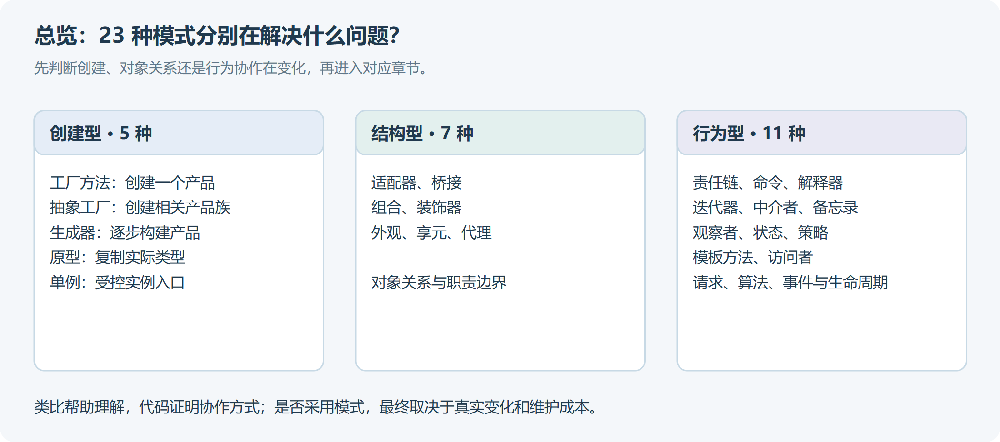

*图：先按创建、结构、行为定位问题，再进入对应模式。*

## 读 UML 类图：先认框，再认线

每节保留原来的职责示意图，再增加一张 **UML 类图**。前者帮助理解“谁做什么”，后者对应示例中的类、关键成员和类型关系。类图表示静态结构，不负责表示每一步调用的时间顺序。

类框分三层：**类名、属性、操作（成员函数）**。图中只摘录关键成员，省略部分类型、参数、析构函数和 override 等语法；完整声明以源码为准。«interface» 表示按纯接口角色使用的 C++ 抽象类，不是 C++ 关键字；«abstract» 表示抽象类。{static} 表示类级操作。

| 图中记号 | 怎么读 | 注意什么 |
|---|---|---|
| +、-、# | public、private、protected | 对应成员可见性 |
| 实线 + 空心三角 | 继承（泛化） | 三角形指向基类 |
| 虚线 + 空心三角 | 实现接口 | 三角形指向接口；这里是对 C++ 纯接口角色的建模约定 |
| 实线 + 实心菱形 | 组合 | **菱形在拥有者一端**，表示组成对象的生命周期归属 |
| 实线 + 普通箭头 | 可导航关联 | 保存指针、引用或其他联系，不自动表示独占所有权 |
| 虚线 + 普通箭头 | 依赖 | 通过参数、局部变量或创建操作等临时使用另一类型 |
| 1、0..1、0..*（正文解读中） | 一个、零或一个、零到多个 | 数量写在每张图后的解读里，避免连线过密 |

**常见误区：看到指针就画组合。** 独占组成对象的 unique_ptr 常适合画组合，引用成员通常只是借用。shared_ptr 的共享所有权也不等于 UML 的独占组合。函数里临时创建过一个对象，更不代表它是类的长期组成部分。

例如：适配器借用旧打印机，外部必须保证打印机存活；文件夹独占子节点，销毁文件夹时子节点随之销毁。两者都能访问另一对象，生命周期责任却不同。

连线编号对应图下方的关系清单，按编号逐条读即可。类图保持蓝灰配色，可在 HTML 中点击放大。符号依据 [OMG UML 2.5.1 规范](https://www.omg.org/spec/UML/2.5.1/About-UML)，并结合教程代码作适度简化。

## 按遇到的问题查找模式

先识别代码中反复出现的麻烦，再选择是否引入模式。下表是定位入口；只有一种小变化、也没有重复修改时，直接写清楚通常更合适。

| 当你遇到这些问题 | 可先阅读 | 改变放在哪里 |
|---|---|---|
| 公共流程稳定，具体产品的创建方式需要扩展 | [01 工厂方法](#pattern-01) | 创建操作 |
| 需要成套切换多个相关产品 | [02 抽象工厂](#pattern-02) | 同一产品族的工厂 |
| 对象配置项多，构造参数难读或容易混淆 | [03 生成器（建造者）](#pattern-03) | 对象构建步骤 |
| 只知道基类接口，却需要复制对象的实际类型 | [04 原型](#pattern-04) | 对象自身的复制操作 |
| 确有受控单实例与统一访问入口的需求 | [05 单例](#pattern-05) | 受控实例入口 |
| 现有功能可复用，但接口与客户要求不一致 | [06 适配器](#pattern-06) | 接口转换层 |
| 两个独立变化维度造成组合子类不断增加 | [07 桥接](#pattern-07) | 两个独立维度 |
| 树中叶子与容器需要通过统一接口处理 | [08 组合](#pattern-08) | 树节点的共同接口 |
| 需要按需叠加职责，避免枚举所有功能组合 | [09 装饰器](#pattern-09) | 可叠加的包装层 |
| 常用操作需要客户协调多个复杂子系统 | [10 外观](#pattern-10) | 子系统的常用入口 |
| 大量小对象包含占比明显的重复且稳定状态 | [11 享元](#pattern-11) | 共享内部状态的池 |
| 保持客户接口，同时控制真实对象的访问或创建时机 | [12 代理](#pattern-12) | 真实对象的访问入口 |
| 请求需要依次寻找合适处理者，发送者不应写死选择过程 | [13 责任链](#pattern-13) | 候选处理者链 |
| 请求需要独立保存、统一调用或附带撤销信息 | [14 命令](#pattern-14) | 请求对象 |
| 需要用简单语法组合规则并解释执行 | [15 解释器](#pattern-15) | 表达式树节点 |
| 想统一遍历协议、隐藏存储，并让遍历各自维护位置 | [16 迭代器](#pattern-16) | 独立遍历对象 |
| 多个对象互相调用过密，协作规则难以定位 | [17 中介者](#pattern-17) | 协作中介者 |
| 要保存与恢复状态，又不想暴露对象内部表示 | [18 备忘录](#pattern-18) | 受封装的状态快照 |
| 对象变化需要通知多个可增减的订阅者 | [19 观察者](#pattern-19) | 订阅和通知接口 |
| 同一操作随当前状态改变，状态判断散落在多处 | [20 状态](#pattern-20) | 当前状态对象 |
| 同一任务有多种算法，需要独立扩展或运行时替换 | [21 策略](#pattern-21) | 可替换算法对象 |
| 处理步骤顺序稳定，少数步骤需要不同实现 | [22 模板方法](#pattern-22) | 可定制的流程步骤 |
| 元素类型稳定，却经常需要新增跨类型操作 | [23 访问者](#pattern-23) | 独立操作访问者 |

**不要把“能用”当成“必须用”。** 这些模式解决的是特定的变化与职责分配问题，通常要付出额外接口、对象或间接调用的成本；可先阅读各节的问题分析，再比较优点和缺点。

## 01｜工厂方法（Factory Method）

### 该模式解决什么问题？

**先看具体场景。** 导出报告支持文本和 JSON。流程相同，只有创建哪种格式化器会变化。如果流程到处判断具体类型，每加一种格式就要改流程。

**不用它时，麻烦在哪里？** 每个导出流程都自己选择并创建 TextFormatter 或 JsonFormatter，新增一种格式就容易在多处修改同样的选择逻辑。真正麻烦的是：稳定的导出流程被具体产品的创建方式牵着走。

**它怎样解决？** 把“创建哪种格式化器”留给可重写的 create，把“取得格式化器并导出”保留在 Exporter::run。新增格式时添加具体产品和对应创建者，让经 Exporter 接口使用的流程继续复用；程序入口仍需选择或配置创建者。

**它不负责什么？** 它隔离的是产品创建变化，不负责自动发现插件、缓存产品，也不把 JSON 转义自动做正确。若只是一个地方选择两种固定格式，普通工厂函数可能足够。

> **识别信号：** 公共流程稳定，具体产品的创建方式需要扩展。

**用一个类比建立直觉。** 同一条饮料生产线先取杯子再灌装；不同分厂决定用纸杯还是玻璃杯，灌装流程继续复用。

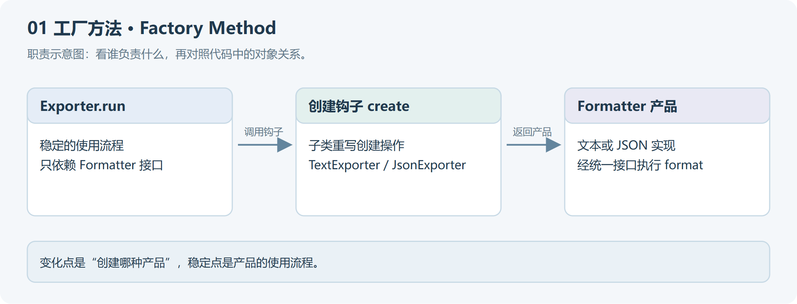

*图示表达职责与调用意图，不是精确 UML；再对照下面的角色说明阅读。*

**再看底层分工。** Product 是 Formatter，具体产品是 TextFormatter 与 JsonFormatter；Creator 是 Exporter，具体创建者是 TextExporter 与 JsonExporter。Exporter::run 调用可被重写的 create，再使用统一的产品接口。变化点落在创建操作上，使用流程保持稳定。

**沿着示例走一遍。** main 创建两个导出器。run 不知道具体产品类，却得到不同格式。关键是创建操作由子类重写，不是任何带 switch 的创建函数都叫工厂方法。

### UML 类图

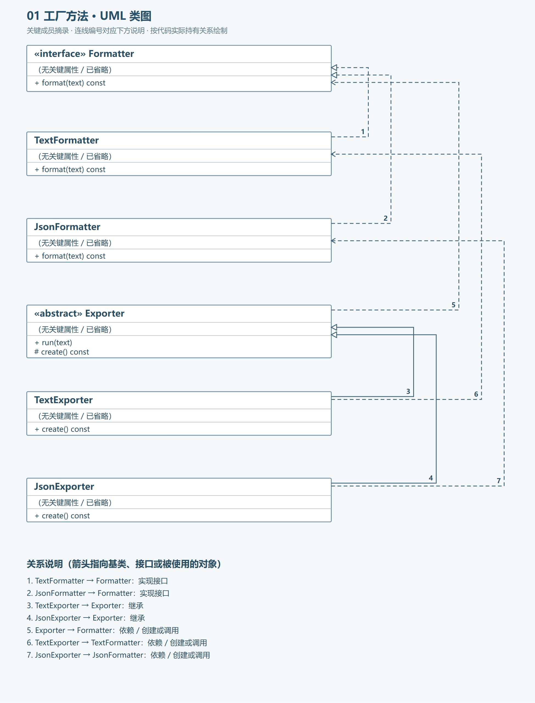

**对照代码读图。** Exporter::run 中的产品是局部变量，使用完即销毁，所以画创建和使用依赖，不画 Exporter 长期持有产品的组合。

### 完整 C++17 示例

源文件：[examples/01_factory_method.cpp](examples/01_factory_method.cpp)。本节代码与配套文件一致。

~~~cpp
#include <cassert>
#include <iostream>
#include <memory>
#include <string>

struct Formatter {
    virtual ~Formatter() = default;
    virtual std::string format(const std::string& text) const = 0;
};
struct TextFormatter final : Formatter {
    std::string format(const std::string& text) const override { return text; }
};
struct JsonFormatter final : Formatter {
    std::string format(const std::string& text) const override {
        // 教学输入固定为 hello；通用 JSON 需要正确转义或使用序列化库。
        return "{\"text\":\"" + text + "\"}";
    }
};
class Exporter {
protected:
    virtual std::unique_ptr<Formatter> create() const = 0;
public:
    virtual ~Exporter() = default;
    std::string run(const std::string& text) const {
        auto formatter = create();
        return formatter->format(text);
    }
};
struct TextExporter final : Exporter {
    std::unique_ptr<Formatter> create() const override {
        return std::make_unique<TextFormatter>();
    }
};
struct JsonExporter final : Exporter {
    std::unique_ptr<Formatter> create() const override {
        return std::make_unique<JsonFormatter>();
    }
};
int main() {
    TextExporter text;
    JsonExporter json;
    assert(text.run("hello") == "hello");
    assert(json.run("hello") == "{\"text\":\"hello\"}");
    std::cout << "text=" << text.run("hello") << '\n';
    std::cout << "json=" << json.run("hello") << '\n';
}
~~~

### 编译与预期输出

在资料根目录的 Linux Bash 中运行：

~~~bash
g++ -std=c++17 -Wall -Wextra -Wpedantic -O2 -g -pthread examples/01_factory_method.cpp -o pattern01
./pattern01
~~~

输出：

~~~text
text=hello
json={"text":"hello"}
~~~

### 优点

- 导出流程只依赖 Formatter 接口，增加格式时可以复用原有 run 流程。
- 创建职责有明确扩展点，测试时可以替换创建者返回的产品。

### 缺点

- 每种产品往往伴随一个创建者子类，类型数量增加。
- 扩展主要依赖继承；如果只是按配置选择几个固定类型，普通创建函数更直接。

### 适用场景与边界

**什么时候值得用？** 适用于可复用流程或框架需要让扩展者决定具体产品，例如导出、存储驱动创建。

**代价与边界。** 每增加一种产品，往往还要增加具体创建者。只有几个固定选项时，普通函数可能更清楚；该模式不自动解决插件发现或对象池管理。

**和相似模式怎么区分？** 简单工厂在一个函数中按参数选类型；工厂方法通过可重写的创建操作扩展；抽象工厂则提供一族相关产品。

## 02｜抽象工厂（Abstract Factory）

### 该模式解决什么问题？

**先看具体场景。** 界面有按钮和复选框，并支持明暗主题。希望一次切换整套主题，避免深色按钮配浅色复选框。

**不用它时，麻烦在哪里？** 如果界面各处分别创建按钮、复选框，主题切换时需要逐处修改，还可能遗漏某个控件，形成深色按钮搭配浅色复选框。问题不只是创建一个对象，而是让一组相关对象配套。

**它怎样解决？** render 只从一个 ThemeFactory 取得 Button 和 Checkbox。传入 DarkFactory 或 LightFactory 就切换这条创建路径上的整套产品，界面不必逐个指定具体控件类。

**它不负责什么？** 它帮助保持同一工厂返回的产品配套，但不能禁止调用者绕过工厂混用。新增“主题”通常方便，新增“滑块”这种产品类别则要扩展全部工厂接口与实现。

> **识别信号：** 需要成套切换多个相关产品。

**用一个类比建立直觉。** 购买一套家具时，让同一家风格供应商提供桌椅，比自己分别挑选更容易保持一致。

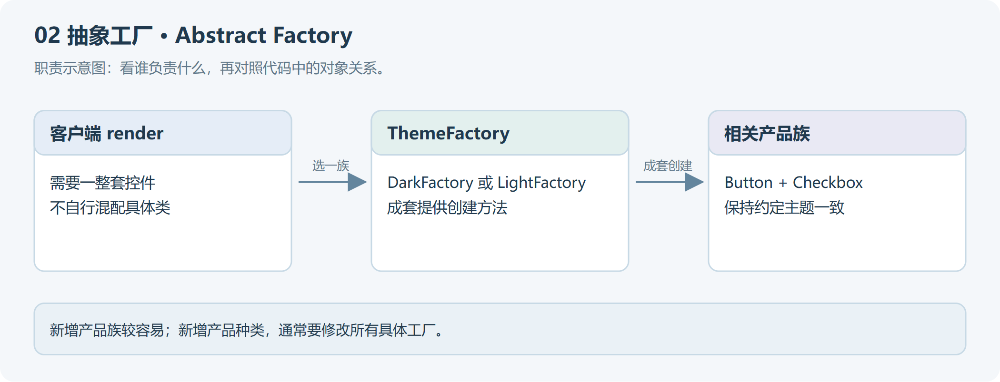

*图示表达职责与调用意图，不是精确 UML；再对照下面的角色说明阅读。*

**再看底层分工。** ThemeFactory 同时创建 Button 和 Checkbox，两者属于不同产品等级结构。DarkFactory 与 LightFactory 各实现一族产品。客户端依赖工厂接口及产品接口，不知道每个具体类的构造方式。

**沿着示例走一遍。** render 只接收 ThemeFactory。传入 DarkFactory 得到深色控件组合，换成 LightFactory 就换整套，不需要自行拼装具体产品类型。

### UML 类图

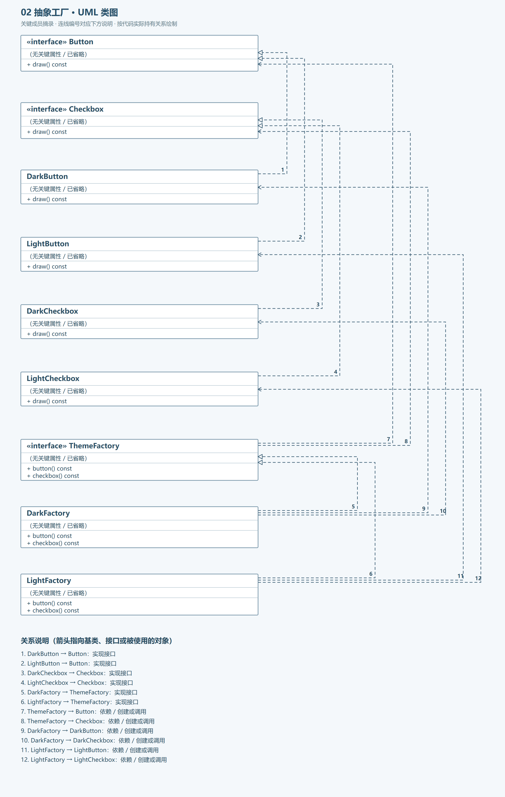

**对照代码读图。** 工厂返回独立产品，调用方接管返回对象的所有权；工厂不保存这些产品，因此使用依赖。

### 完整 C++17 示例

源文件：[examples/02_abstract_factory.cpp](examples/02_abstract_factory.cpp)。本节代码与配套文件一致。

~~~cpp
#include <cassert>
#include <iostream>
#include <memory>
#include <string>

struct Button { virtual ~Button() = default; virtual std::string draw() const = 0; };
struct Checkbox { virtual ~Checkbox() = default; virtual std::string draw() const = 0; };
struct DarkButton final : Button { std::string draw() const override { return "dark button"; } };
struct LightButton final : Button { std::string draw() const override { return "light button"; } };
struct DarkCheckbox final : Checkbox { std::string draw() const override { return "dark checkbox"; } };
struct LightCheckbox final : Checkbox { std::string draw() const override { return "light checkbox"; } };
struct ThemeFactory {
    virtual ~ThemeFactory() = default;
    virtual std::unique_ptr<Button> button() const = 0;
    virtual std::unique_ptr<Checkbox> checkbox() const = 0;
};
struct DarkFactory final : ThemeFactory {
    std::unique_ptr<Button> button() const override { return std::make_unique<DarkButton>(); }
    std::unique_ptr<Checkbox> checkbox() const override { return std::make_unique<DarkCheckbox>(); }
};
struct LightFactory final : ThemeFactory {
    std::unique_ptr<Button> button() const override { return std::make_unique<LightButton>(); }
    std::unique_ptr<Checkbox> checkbox() const override { return std::make_unique<LightCheckbox>(); }
};
std::string render(const ThemeFactory& factory) {
    auto button = factory.button();
    auto checkbox = factory.checkbox();
    return button->draw() + " + " + checkbox->draw();
}
int main() {
    DarkFactory dark;
    LightFactory light;
    assert(render(dark) == "dark button + dark checkbox");
    assert(render(light) == "light button + light checkbox");
    std::cout << render(dark) << '\n' << render(light) << '\n';
}
~~~

### 编译与预期输出

在资料根目录的 Linux Bash 中运行：

~~~bash
g++ -std=c++17 -Wall -Wextra -Wpedantic -O2 -g -pthread examples/02_abstract_factory.cpp -o pattern02
./pattern02
~~~

输出：

~~~text
dark button + dark checkbox
light button + light checkbox
~~~

### 优点

- 同一个工厂提供风格一致的按钮和复选框，减少混用产品族的风险。
- 界面使用者依赖抽象工厂和抽象产品，替换整套主题较方便。

### 缺点

- 增加新的产品类别，例如滑块，需要修改工厂接口和每个具体工厂。
- 如果只有一种产品，成套接口可能增加理解和维护成本。

### 适用场景与边界

**什么时候值得用？** 适用于相关对象需要成套使用：跨平台 UI、同一协议版本的编码器与解码器、同一个数据库后端的组件。

**代价与边界。** 增加新产品族比较容易；增加全新产品种类，如滑块，则要改工厂接口和全部具体工厂。只能在约定的创建路径上帮助保持一致，不能阻止调用者绕过工厂。

**和相似模式怎么区分？** 工厂方法关注一个产品，抽象工厂关注相关产品族；抽象工厂里的创建操作可以用工厂方法实现。

## 03｜生成器（建造者）（Builder）

### 该模式解决什么问题？

**先看具体场景。** 创建 HTTP 请求需要 URL、超时、方法等选项。构造函数中多个相同类型参数容易写错位置，也看不出某个数字的含义。

**不用它时，麻烦在哪里？** 像 Request(url, method, timeout) 这样的构造调用，参数一多就难读；若多个参数都是整数或字符串，还容易填错位置。可选项增多后，构造函数重载也可能越来越多。

**它怎样解决？** 把必须项 URL 放在 RequestBuilder 构造入口，把可选项写成 timeout(1000)、method("GET") 这样的具名步骤。构造和配置步骤检查输入，build 返回独立 Request；读调用处就能理解每个参数的用途。

**它不负责什么？** 它改善构建过程，不等于返回对象从此不可变，也不自动校验跨多个字段的全部业务约束；有组合约束时需要明确在哪一步检查。仅有两三个直观字段时，直接初始化结构体可能更清楚。

> **识别信号：** 对象配置项多，构造参数难读或容易混淆。

**用一个类比建立直觉。** 点套餐时逐步选主食、饮料，最后确认订单，不必一次报出十个位置固定的参数。

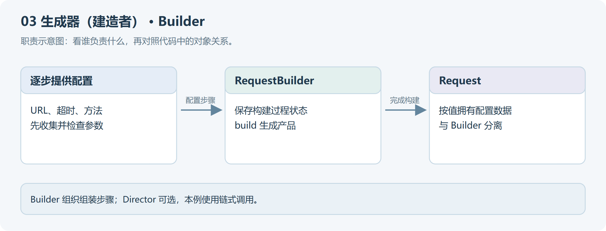

*图示表达职责与调用意图，不是精确 UML；再对照下面的角色说明阅读。*

**再看底层分工。** Builder 保存逐步收集的配置，在 build 时生成 Product。Director 是可选角色，用于复用组装顺序；本例用链式调用表达步骤，没有单独引入它。非法值检查是工程约束，不是模式自动具备的能力。

**沿着示例走一遍。** 构造 Builder 时要求 URL，timeout 和 method 返回自身引用以便连写；build 返回按值拥有数据的 Request。空 URL、非正超时和不支持的方法会被拒绝。

### UML 类图

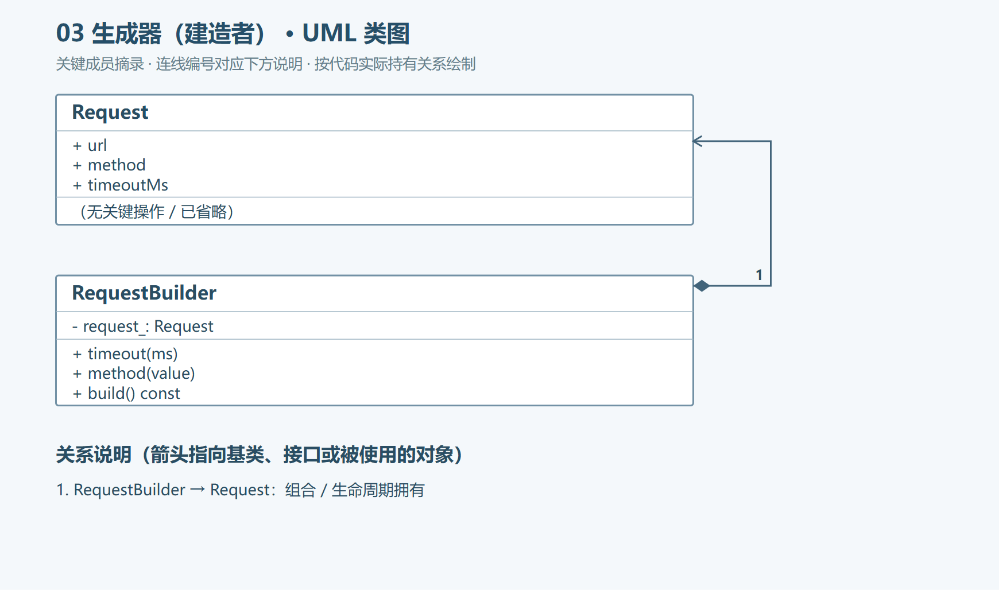

**对照代码读图。** Builder 以值成员保存 1 个 Request，实心菱形在 Builder 端。build 返回独立副本；这个例子不需要额外的 Director。

### 完整 C++17 示例

源文件：[examples/03_builder.cpp](examples/03_builder.cpp)。本节代码与配套文件一致。

~~~cpp
#include <cassert>
#include <iostream>
#include <stdexcept>
#include <string>
#include <utility>

struct Request { std::string url; std::string method; int timeoutMs; };
class RequestBuilder {
    Request request_;
public:
    explicit RequestBuilder(std::string url) : request_{std::move(url), "GET", 3000} {
        if (request_.url.empty()) throw std::invalid_argument("empty URL");
    }
    RequestBuilder& timeout(int milliseconds) {
        if (milliseconds <= 0) throw std::invalid_argument("invalid timeout");
        request_.timeoutMs = milliseconds;
        return *this;
    }
    RequestBuilder& method(std::string value) {
        if (value != "GET" && value != "POST") throw std::invalid_argument("unsupported method");
        request_.method = std::move(value);
        return *this;
    }
    Request build() const { return request_; }
};
int main() {
    auto request = RequestBuilder("/orders").timeout(1000).method("GET").build();
    assert(request.url == "/orders" && request.timeoutMs == 1000);
    std::cout << request.method << ' ' << request.url << " timeout=" << request.timeoutMs << '\n';
    bool rejected = false;
    try { RequestBuilder("/orders").timeout(0); }
    catch (const std::invalid_argument&) { rejected = true; }
    assert(rejected);
    std::cout << "invalid timeout rejected\n";
}
~~~

### 编译与预期输出

在资料根目录的 Linux Bash 中运行：

~~~bash
g++ -std=c++17 -Wall -Wextra -Wpedantic -O2 -g -pthread examples/03_builder.cpp -o pattern03
./pattern03
~~~

输出：

~~~text
GET /orders timeout=1000
invalid timeout rejected
~~~

### 优点

- 把多项配置拆成可读的步骤，调用处容易看出设置了哪些参数。
- 在 Builder 的构造和配置步骤中集中检查参数，避免调用方反复编写相同校验。

### 缺点

- 简单对象也额外引入 Builder，会增加代码量。
- Builder 自身有状态；复用时必须明确哪些设置会保留，不能默认适合多线程共享。

### 适用场景与边界

**什么时候值得用？** 适用于配置项多、有默认值或组装约束的对象，例如请求、查询条件和复杂文档。

**代价与边界。** 多了一层暂存状态。简单对象可直接用构造函数或结构体初始化；并非所有返回自身的 setter 都构成完整的生成器设计。

**和相似模式怎么区分？** 工厂主要选择具体产品类型，生成器主要组织一个产品的构建步骤。C++17 没有语言级命名参数，Builder 能改善可读性，但不是唯一选择。

## 04｜原型（Prototype）

### 该模式解决什么问题？

**先看具体场景。** 手里只有文档基类接口，却想复制实际文档。复制基类可能丢失派生部分；重新判断具体类型再构造又会增加耦合。

**不用它时，麻烦在哪里？** 调用方拿着 Document 引用，却不知道对象究竟是哪种文档，不能直接写出正确的具体构造表达式。如果先判断类型再复制，会把所有派生类型都暴露给调用方；按值复制具体基类还可能发生对象切片。

**它怎样解决？** 让 Document 提供虚函数 clone，由 TextDocument 复制自己的实际内容并返回基类智能指针。调用方不必判断具体类型；对副本追加段落也不会改变本例原件的字符串容器。

**它不负责什么？** 本例 Document 是抽象类，不能直接实例化或按值复制；切片风险是一般多态复制中需要防范的现象。clone 的深浅复制策略必须自己定义，原型也不保证复制一定比重新构造快。

> **识别信号：** 只知道基类接口，却需要复制对象的实际类型。

**用一个类比建立直觉。** 复印一份合同模板，再分别填写；修改副本不应该悄悄改变模板。

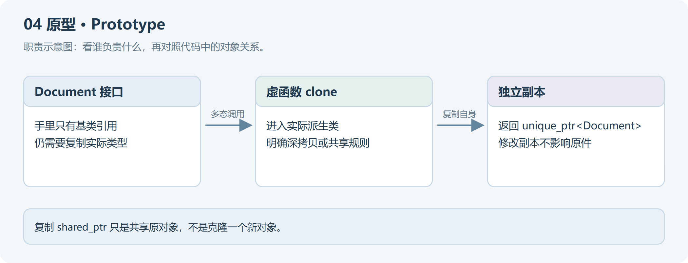

*图示表达职责与调用意图，不是精确 UML；再对照下面的角色说明阅读。*

**再看底层分工。** 多态接口提供 clone，由实际类型负责复制自身。TextDocument::clone 调用自己的复制构造函数；成员 `vector<string>` 按值管理内容，因此副本可以独立修改。`unique_ptr<Document>` 管理多态副本的所有权。

**沿着示例走一遍。** 通过 Document& 调用 clone，得到的仍是 TextDocument；副本追加后有两段，原件仍只有一段，检查的是复制独立性。

### UML 类图

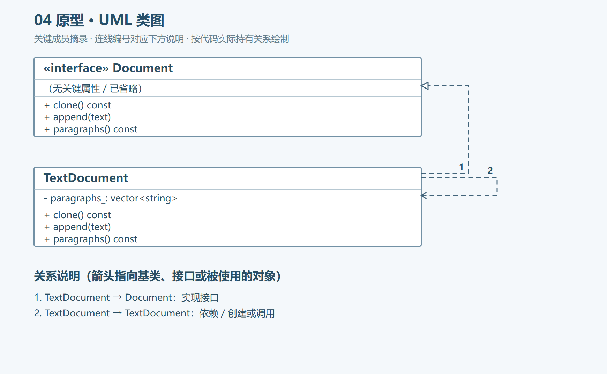

**对照代码读图。** 自依赖表示 clone 创建新的 TextDocument。字符串容器按值复制，不代表所有原型都自动深拷贝外部资源。

### 完整 C++17 示例

源文件：[examples/04_prototype.cpp](examples/04_prototype.cpp)。本节代码与配套文件一致。

~~~cpp
#include <cassert>
#include <cstddef>
#include <iostream>
#include <memory>
#include <string>
#include <utility>
#include <vector>

struct Document {
    virtual ~Document() = default;
    virtual std::unique_ptr<Document> clone() const = 0;
    virtual void append(std::string paragraph) = 0;
    virtual std::size_t paragraphs() const = 0;
};
class TextDocument final : public Document {
    std::vector<std::string> paragraphs_;
public:
    std::unique_ptr<Document> clone() const override {
        return std::make_unique<TextDocument>(*this);
    }
    void append(std::string paragraph) override { paragraphs_.push_back(std::move(paragraph)); }
    std::size_t paragraphs() const override { return paragraphs_.size(); }
};
int main() {
    TextDocument original;
    original.append("template");
    const Document& base = original;
    auto copy = base.clone();
    copy->append("filled by Alice");
    assert(original.paragraphs() == 1 && copy->paragraphs() == 2);
    std::cout << "original=" << original.paragraphs() << " copy=" << copy->paragraphs() << '\n';
}
~~~

### 编译与预期输出

在资料根目录的 Linux Bash 中运行：

~~~bash
g++ -std=c++17 -Wall -Wextra -Wpedantic -O2 -g -pthread examples/04_prototype.cpp -o pattern04
./pattern04
~~~

输出：

~~~text
original=1 copy=2
~~~

### 优点

- 只知道 Document 接口，也能复制出实际的派生类型。
- 复用已有对象的配置，避免把复杂初始化规则再写一遍。

### 缺点

- 每个具体类都要正确实现复制语义，资源句柄和共享对象尤其需要明确如何处理。
- 复制大型对象可能昂贵，不能把 clone 当作廉价操作。

### 适用场景与边界

**什么时候值得用？** 适用于运行时类型未知的多态复制，以及已有复杂配置模板需要复用的场景。

**代价与边界。** 深拷贝还是共享部分资源必须定义清楚。复制大型数据也可能昂贵，原型不保证比构造快。文件句柄、互斥锁、连接等通常不能默认复制。

**和相似模式怎么区分？** 普通值类型可以直接复制；原型补上通过基类接口复制派生对象的能力。复制 shared_ptr 是共享原对象，不是克隆。

## 05｜单例（Singleton）

### 该模式解决什么问题？

**先看具体场景。** 一个进程希望通过统一入口访问同一份统计对象，并限制常规代码自行构造多份实例。

**不用它时，麻烦在哪里？** 不同模块各自创建统计对象，会把计数分散在多份实例里。需求若明确要求常规代码经统一入口使用同一个实例，就需要限制随意构造并管理这个实例的取得方式。

**它怎样解决？** Metrics 将构造函数私有化并禁用复制、移动；instance 返回函数内静态实例的引用。两次取得相同地址，因此 record 和 count 操作针对同一份计数。

**它不负责什么？** 它约束的是实例取得与常规构造，不自动解决所有线程安全问题，也不保证跨进程或跨动态库的全系统唯一。很多项目只需在 main 创建一份对象后传入，无须全局单例。

> **识别信号：** 确有受控单实例与统一访问入口的需求。

**用一个类比建立直觉。** 一座楼共用一个总服务台，但服务台唯一，不代表里面所有办事流程都天然安全。

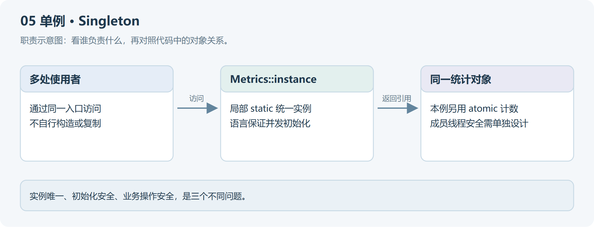

*图示表达职责与调用意图，不是精确 UML；再对照下面的角色说明阅读。*

**再看底层分工。** 私有构造函数限制创建路径，instance 返回函数局部 static，删除复制和移动操作。C++11 起局部静态对象的初始化具有并发初始化保证；本例另外使用 atomic 保护单个计数更新。

**沿着示例走一遍。** 两次 instance 返回相同地址，record 后从另一个引用读取也得到 1。地址相同证明共享实例，atomic 则负责计数更新，二者是不同问题。

### UML 类图

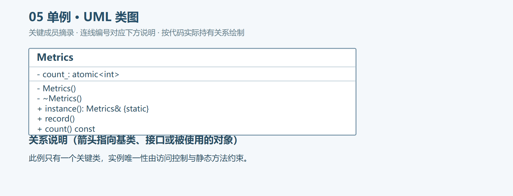

**对照代码读图。** 构造函数私有，复制和移动被禁用。{static} 表示类级方法；图中省略已删除的特殊成员函数。

### 完整 C++17 示例

源文件：[examples/05_singleton.cpp](examples/05_singleton.cpp)。本节代码与配套文件一致。

~~~cpp
#include <atomic>
#include <cassert>
#include <iostream>

class Metrics {
    std::atomic<int> count_{0};
    Metrics() = default;
    ~Metrics() = default;
public:
    Metrics(const Metrics&) = delete;
    Metrics& operator=(const Metrics&) = delete;
    Metrics(Metrics&&) = delete;
    Metrics& operator=(Metrics&&) = delete;
    static Metrics& instance() {
        static Metrics metrics;
        return metrics;
    }
    void record() { ++count_; }
    int count() const { return count_.load(); }
};
int main() {
    auto& first = Metrics::instance();
    auto& second = Metrics::instance();
    first.record();
    assert(&first == &second && second.count() == 1);
    std::cout << std::boolalpha << "same=" << (&first == &second)
              << " count=" << second.count() << '\n';
}
~~~

### 编译与预期输出

在资料根目录的 Linux Bash 中运行：

~~~bash
g++ -std=c++17 -Wall -Wextra -Wpedantic -O2 -g -pthread examples/05_singleton.cpp -o pattern05
./pattern05
~~~

输出：

~~~text
same=true count=1
~~~

### 优点

- 需要统一统计入口时，调用方可以取得同一个 Metrics 实例。
- 函数内局部静态对象按需初始化；原子计数器避免本例的计数数据竞争。

### 缺点

- 全局访问入口容易隐藏依赖，让测试隔离和替换实现变困难。
- 实例唯一不代表所有成员操作都线程安全；退出阶段和跨模块使用仍需设计。

### 适用场景与边界

**什么时候值得用？** 只有确实需要限制实例并统一生命周期时才考虑，例如边界明确的进程级注册设施。普通服务通常更适合由 main 创建后传入。

**代价与边界。** 全局入口会隐藏依赖、干扰测试并带来静态析构顺序问题。初始化安全不代表成员函数或复合操作安全；动态库、跨进程边界也不能仅靠此写法保证全系统唯一。

**和相似模式怎么区分？** 全局可访问不等于必须唯一。通过参数注入依赖可以创建独立测试实例，常比到处调用 instance 更易测试。

## 06｜适配器（Adapter）

### 该模式解决什么问题？

**先看具体场景。** 新系统需要 Printer::print(string)，旧库却只提供 write(const char*)。希望复用旧库，而不让所有新代码都跟着旧接口改。

**不用它时，麻烦在哪里？** 新代码按照 Printer::print 工作，旧库只有 LegacyPrinter::write。若每个调用方都做字符串转换并认识旧库，兼容代码会四处复制，新代码也会被旧接口绑定。

**它怎样解决？** PrinterAdapter 实现 Printer，将 print 调用转换成 write，并在调用期间把字符串转换成旧接口需要的形式。客户只面对 Printer，旧库继续保留原接口。

**它不负责什么？** 它解决接口可兼容映射时的接入问题，不能弥补旧库根本不支持的能力。字符编码、单位、错误含义及指针有效期仍需匹配；本例只在旧调用期间使用字符串地址。

> **识别信号：** 现有功能可复用，但接口与客户要求不一致。

**用一个类比建立直觉。** 电源转换插头让两种插口能连接，转换的是接入方式，不是凭空改变电器的全部能力。

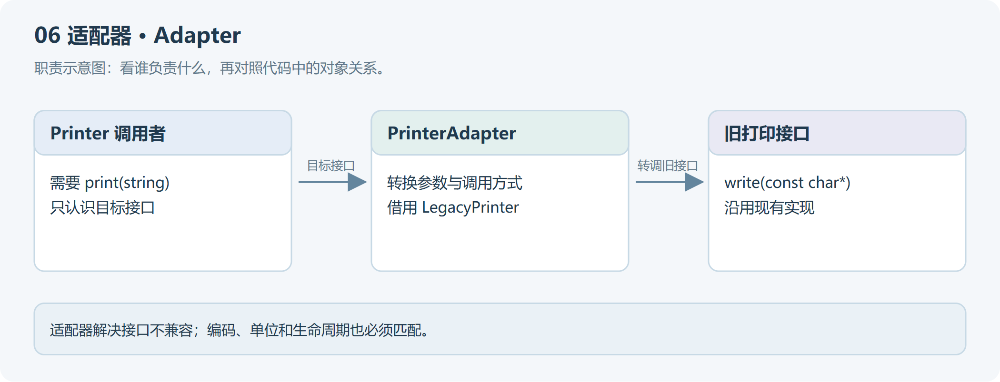

*图示表达职责与调用意图，不是精确 UML；再对照下面的角色说明阅读。*

**再看底层分工。** Printer 是目标接口，LegacyPrinter 是被适配者，PrinterAdapter 实现目标接口并在内部转调旧接口。这是对象适配器，使用组合；持有旧对象的引用，不拥有它。

**沿着示例走一遍。** 调用者只通过 Printer& 打印；适配器把 string 转成调用期间有效的 C 字符串，旧库仍按原接口工作。

### UML 类图

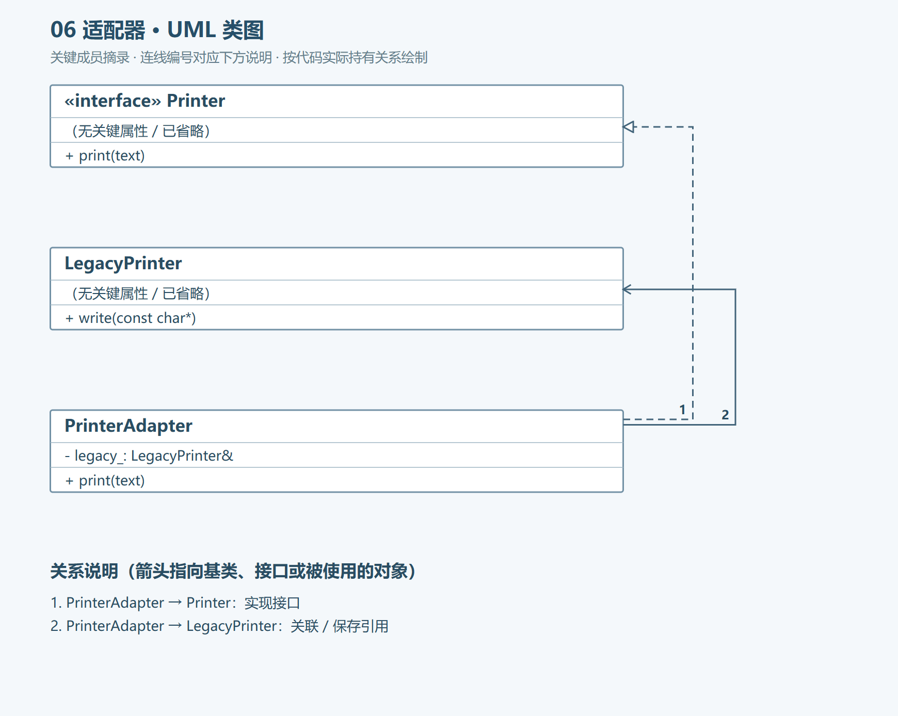

**对照代码读图。** PrinterAdapter 保存引用，关联表示借用 1 个 LegacyPrinter，不负责销毁它。

### 完整 C++17 示例

源文件：[examples/06_adapter.cpp](examples/06_adapter.cpp)。本节代码与配套文件一致。

~~~cpp
#include <cassert>
#include <iostream>
#include <string>

struct Printer {
    virtual ~Printer() = default;
    virtual std::string print(const std::string& text) = 0;
};
class LegacyPrinter {
public:
    std::string write(const char* text) { return std::string("legacy:") + text; }
};
class PrinterAdapter final : public Printer {
    LegacyPrinter& legacy_;  // 借用：legacy 的生命周期必须更长。
public:
    explicit PrinterAdapter(LegacyPrinter& legacy) : legacy_(legacy) {}
    std::string print(const std::string& text) override {
        return legacy_.write(text.c_str());
    }
};
int main() {
    LegacyPrinter legacy;
    PrinterAdapter adapter(legacy);
    Printer& printer = adapter;
    assert(printer.print("hello") == "legacy:hello");
    std::cout << printer.print("hello") << '\n';
}
~~~

### 编译与预期输出

在资料根目录的 Linux Bash 中运行：

~~~bash
g++ -std=c++17 -Wall -Wextra -Wpedantic -O2 -g -pthread examples/06_adapter.cpp -o pattern06
./pattern06
~~~

输出：

~~~text
legacy:hello
~~~

### 优点

- 旧组件不必修改，就能接入新接口。
- 参数转换和兼容细节集中在适配器中，业务代码更清楚。

### 缺点

- 包装层增加间接调用，也可能掩盖新旧接口的语义差异。
- 本例借用 LegacyPrinter，必须保证旧打印机比适配器活得更久。

### 适用场景与边界

**什么时候值得用？** 适用于接入旧模块、第三方 SDK，或统一多个不兼容的数据接口。

**代价与边界。** 只能适配能够明确映射的语义；单位、编码、错误码和生命周期也要匹配，不能只改函数名字。本例旧对象必须比适配器活得更久，旧接口也不能偷偷保存临时字符串指针。

**和相似模式怎么区分？** 适配器解决接口不兼容；装饰器在兼容接口外叠加职责；外观为一组复杂接口提供简化入口。

## 07｜桥接（Bridge）

### 该模式解决什么问题？

**先看具体场景。** 通知既分普通、紧急，又分邮件、短信。如果每种组合都建一个子类，就会产生普通邮件、紧急邮件、普通短信、紧急短信等组合类。

**不用它时，麻烦在哪里？** 若通知的普通、紧急两种形式与邮件、短信两种渠道全部用继承组合，会出现四种类；再增加渠道或通知形式，组合类数量还会继续增长。

**它怎样解决？** 让 Notification 负责通知逻辑并持有 Channel，Email 和 Sms 负责传输，UrgentNotification 只改消息准备步骤。增加渠道主要扩展 Channel 一侧，增加通知形式主要扩展 Notification 一侧，再按需要组合。

**它不负责什么？** 它解决两个相对独立维度的扩展耦合，不是保证任意两类功能都能自由组合。若某种通知只允许特定渠道，仍需业务约束；渠道同步还是异步也需要单独定义。

> **识别信号：** 两个独立变化维度造成组合子类不断增加。

**用一个类比建立直觉。** 遥控器型号和电视品牌分开发展，用一条约定的连接方式组合，不必为每个型号与品牌配对都造一个新遥控器。

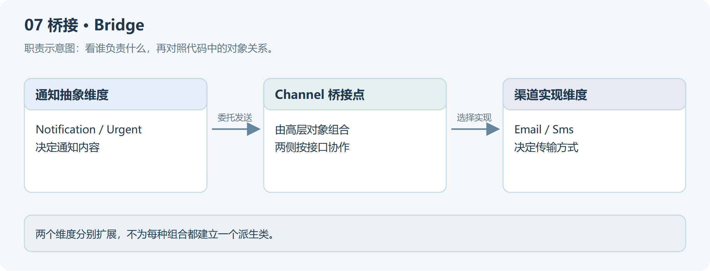

*图示表达职责与调用意图，不是精确 UML；再对照下面的角色说明阅读。*

**再看底层分工。** Notification 代表高层通知抽象，UrgentNotification 扩展内容；Channel 是发送实现接口，Email 与 Sms 实现传输。Notification 组合一个 Channel，把两个独立变化维度拆开。

**沿着示例走一遍。** 普通通知使用 Email；紧急通知使用 Sms。增加新的紧急程度或渠道时，通常不需要重写所有组合类。

### UML 类图

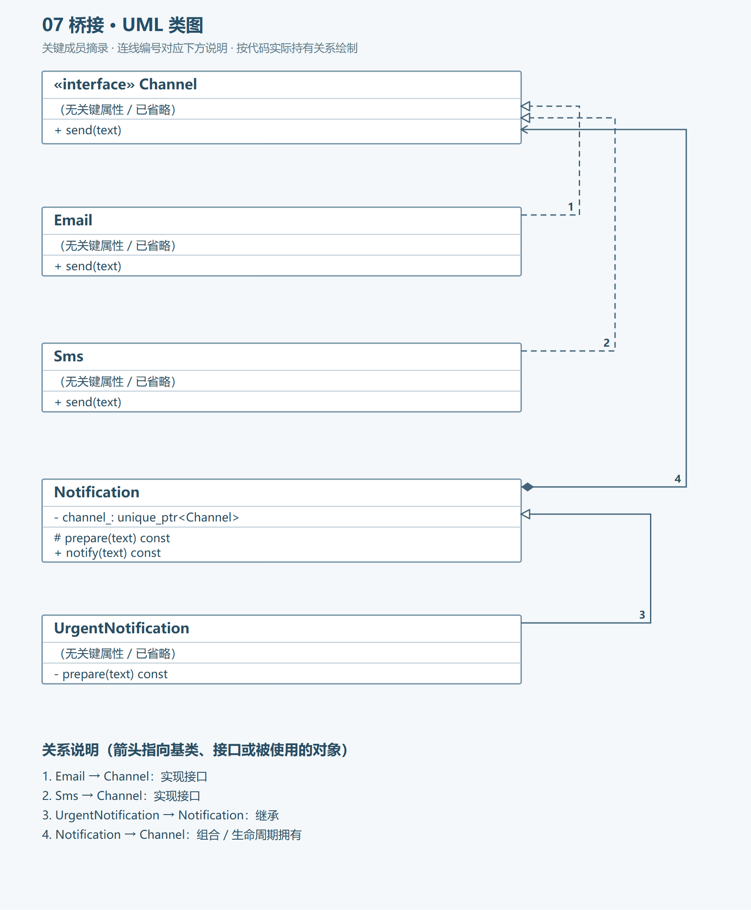

**对照代码读图。** Notification 独占 1 个 Channel；UrgentNotification 继承通知抽象。两个扩展维度分别对应继承和对象组合。

### 完整 C++17 示例

源文件：[examples/07_bridge.cpp](examples/07_bridge.cpp)。本节代码与配套文件一致。

~~~cpp
#include <cassert>
#include <iostream>
#include <memory>
#include <stdexcept>
#include <string>
#include <utility>

struct Channel {
    virtual ~Channel() = default;
    virtual std::string send(const std::string& message) const = 0;
};
struct Email final : Channel {
    std::string send(const std::string& message) const override { return "email:" + message; }
};
struct Sms final : Channel {
    std::string send(const std::string& message) const override { return "sms:" + message; }
};
class Notification {
    std::unique_ptr<Channel> channel_;
protected:
    virtual std::string prepare(const std::string& message) const { return message; }
public:
    explicit Notification(std::unique_ptr<Channel> channel) : channel_(std::move(channel)) {
        if (!channel_) throw std::invalid_argument("null channel");
    }
    virtual ~Notification() = default;
    std::string notify(const std::string& message) const { return channel_->send(prepare(message)); }
};
class UrgentNotification final : public Notification {
    std::string prepare(const std::string& message) const override { return "URGENT:" + message; }
public:
    using Notification::Notification;
};
int main() {
    Notification normal(std::make_unique<Email>());
    UrgentNotification urgent(std::make_unique<Sms>());
    assert(normal.notify("hello") == "email:hello");
    assert(urgent.notify("fire") == "sms:URGENT:fire");
    std::cout << normal.notify("hello") << '\n' << urgent.notify("fire") << '\n';
}
~~~

### 编译与预期输出

在资料根目录的 Linux Bash 中运行：

~~~bash
g++ -std=c++17 -Wall -Wextra -Wpedantic -O2 -g -pthread examples/07_bridge.cpp -o pattern07
./pattern07
~~~

输出：

~~~text
email:hello
sms:URGENT:fire
~~~

### 优点

- 通知种类和发送渠道分别扩展，减少“种类 × 渠道”的组合子类。
- 高层通知逻辑依赖渠道接口，可以独立测试和替换发送实现。

### 缺点

- 需要识别出两个真正独立的变化维度，划分错误会使接口更别扭。
- 多了一层协作；只有一个稳定维度时可能没有足够收益。

### 适用场景与边界

**什么时候值得用？** 适用于两个相对独立的变化维度，例如形状与绘图后端、通知内容与传输方式。

**代价与边界。** 要先证明两个维度值得独立抽象。增加接口、间接调用和对象组装也有成本；若两个维度高度相关，强行拆开反而难理解。

**和相似模式怎么区分？** 桥接通常在设计时主动拆分变化维度；适配器通常用于接合已有不兼容接口。它们可能都有组合关系，但解决的问题不同。

## 08｜组合（Composite）

### 该模式解决什么问题？

**先看具体场景。** 统计目录大小时，目录里既有文件，也有子目录。希望调用者对二者都只调用 bytes，而不自己反复判断具体类型。

**不用它时，麻烦在哪里？** 目录中既有文件又有目录。若客户自己区分类型、取出子目录再递归，类似判断和遍历就会散落在统计大小、展示结构等代码里。

**它怎样解决？** 让 File 和 Folder 都实现 Node::bytes。客户只向根节点请求大小；Folder 负责向自己的子节点继续请求，File 直接给出大小。示例用同一个入口得到整棵树的 60 字节。

**它不负责什么？** 它统一的是树形结构中部分与整体的操作方式，不代表文件和目录拥有所有相同能力。示例不是完整文件系统扫描器；超深树、符号链接、权限和并发修改都需另行处理。

> **识别信号：** 树中叶子与容器需要通过统一接口处理。

**用一个类比建立直觉。** 一个包裹可以装商品，也可以装小包裹。计算总重量时，商品报自己的重量，包裹汇总内部物品。

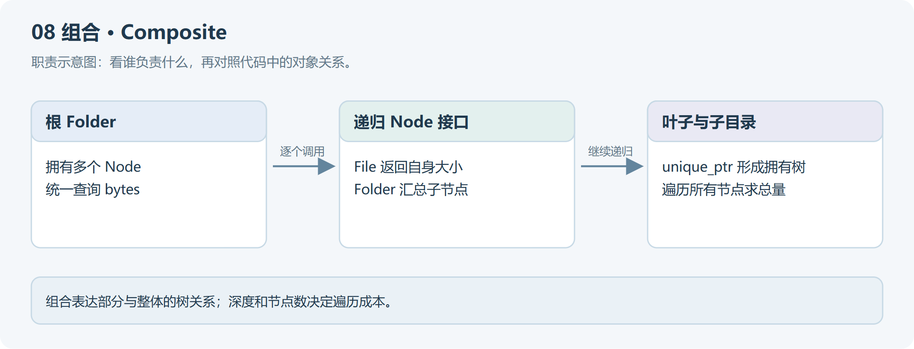

*图示表达职责与调用意图，不是精确 UML；再对照下面的角色说明阅读。*

**再看底层分工。** Node 是组件接口，File 是叶子，Folder 是组合节点。Folder 拥有多个 Node，并递归调用相同接口；这形成部分与整体的树结构。

**沿着示例走一遍。** 根目录含一个 10 字节文件和一个包含 20、30 字节文件的子目录，统一调用 bytes 得到 60。每个子节点由一个 unique_ptr 拥有。

### UML 类图

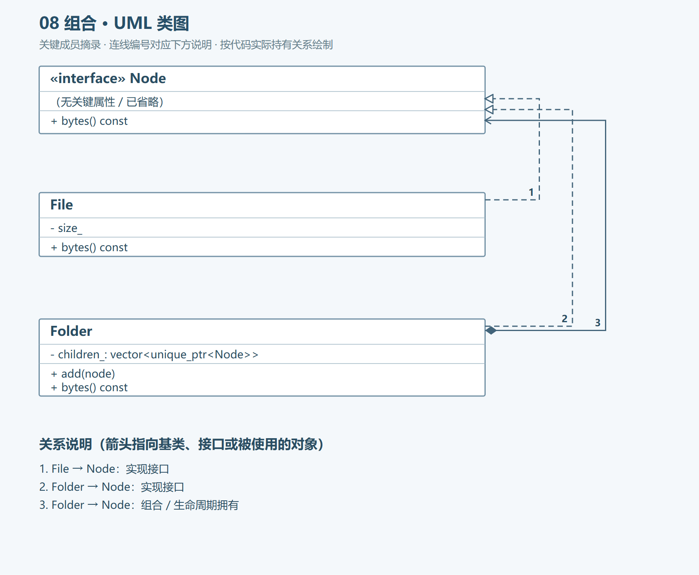

**对照代码读图。** Folder 组合 0..* 个 Node。叶子 File 和组合 Folder 都实现 Node；递归关系指向 Node，而不只是 Folder。

### 完整 C++17 示例

源文件：[examples/08_composite.cpp](examples/08_composite.cpp)。本节代码与配套文件一致。

~~~cpp
#include <cassert>
#include <cstddef>
#include <iostream>
#include <memory>
#include <stdexcept>
#include <utility>
#include <vector>

struct Node {
    virtual ~Node() = default;
    virtual std::size_t bytes() const = 0;
};
class File final : public Node {
    std::size_t size_;
public:
    explicit File(std::size_t size) : size_(size) {}
    std::size_t bytes() const override { return size_; }
};
class Folder final : public Node {
    std::vector<std::unique_ptr<Node>> children_;
public:
    void add(std::unique_ptr<Node> child) {
        if (!child) throw std::invalid_argument("null child");
        children_.push_back(std::move(child));
    }
    std::size_t bytes() const override {
        std::size_t result = 0;
        for (const auto& child : children_) result += child->bytes();
        return result;
    }
};
int main() {
    auto sub = std::make_unique<Folder>();
    sub->add(std::make_unique<File>(20));
    sub->add(std::make_unique<File>(30));
    Folder root;
    root.add(std::make_unique<File>(10));
    root.add(std::move(sub));
    assert(root.bytes() == 60);
    std::cout << "total=" << root.bytes() << '\n';
}
~~~

### 编译与预期输出

在资料根目录的 Linux Bash 中运行：

~~~bash
g++ -std=c++17 -Wall -Wextra -Wpedantic -O2 -g -pthread examples/08_composite.cpp -o pattern08
./pattern08
~~~

输出：

~~~text
total=60
~~~

### 优点

- 文件和文件夹通过 Node 统一处理，客户端不必到处判断是否为目录。
- 递归求大小自然对应树形结构，增加节点类型时可保持遍历入口稳定。

### 缺点

- 统一接口可能不适合所有节点，例如文件并不支持添加子节点。
- 深树可能造成递归栈压力；需要避免错误结构和不明确的所有权。

### 适用场景与边界

**什么时候值得用？** 适用于目录树、菜单树、组织结构和图形场景树等天然具有递归层级的模型。

**代价与边界。** 本例遍历时间为 O(n)，递归调用栈为 O(h)，h 是树高。超深树可能导致栈问题；真实文件系统还有符号链接、权限、并发变化和大小溢出，不能直接拿教学模型扫描磁盘。

**和相似模式怎么区分？** 组合模式是一种树形对象组织方式，不等于一般意义上的“优先使用组合”。本例只让 Folder 提供 add，避免 File 暴露没有意义的加子节点操作。

## 09｜装饰器（Decorator）

### 该模式解决什么问题？

**先看具体场景。** 咖啡可以加奶、加糖，配料可以组合。若每个组合都建一个子类，种类会快速膨胀。

**不用它时，麻烦在哪里？** 若用继承表达原味、加奶、加糖、奶加糖等所有组合，每多一种可选配料，就会增加很多组合类；还很难在运行时按顾客选择组装。

**它怎样解决？** Coffee 提供基础价格，Milk 和 Sugar 各包装一个 Drink，先取得内部价格再增加自己的部分。Sugar(Milk(Coffee)) 无须专用“奶糖咖啡类”，仍通过 Drink::cents 使用。

**它不负责什么？** 它解决可叠加职责的组合问题，不代表包装顺序可随意交换。本例加价恰好可以交换，压缩、加密、鉴权等真实职责未必可以；重复包装是否允许也要规定。

> **识别信号：** 需要按需叠加职责，避免枚举所有功能组合。

**用一个类比建立直觉。** 给同一杯咖啡逐层加配料；每一层仍然表现为一杯可计价的饮料。

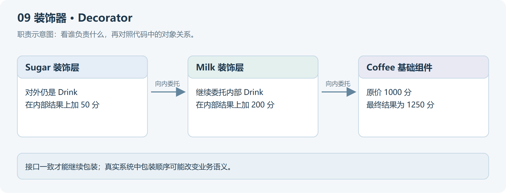

*图示表达职责与调用意图，不是精确 UML；再对照下面的角色说明阅读。*

**再看底层分工。** Drink 是统一接口，Coffee 是基础组件；Decorator 包装另一个 Drink，Milk 与 Sugar 在委托结果上增加费用。每层接口一致，才能继续包装。

**沿着示例走一遍。** Sugar 包着 Milk，Milk 包着 Coffee；计算价格从外向内请求，再把 1000、200、50 分相加，结果为 1250 分。unique_ptr 表示整条包装链的独占所有权。

### UML 类图

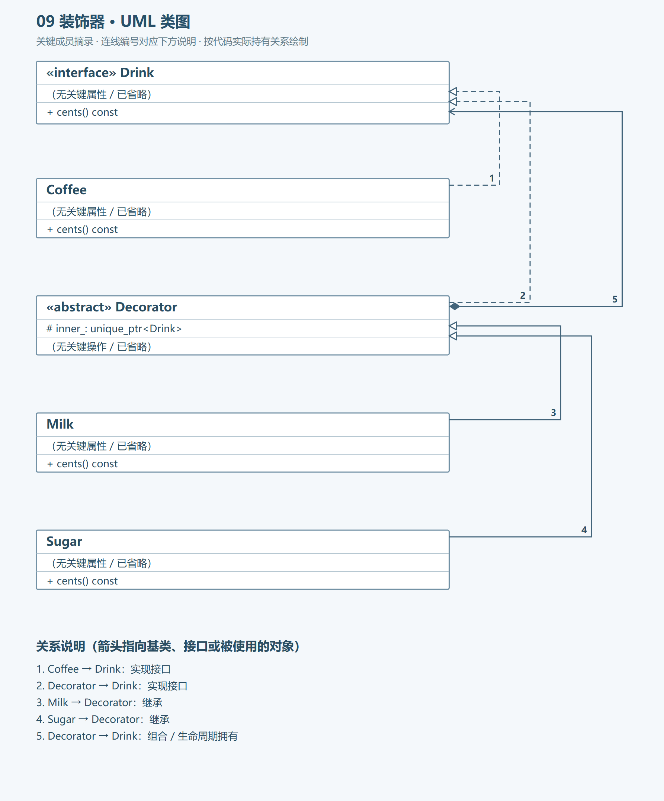

**对照代码读图。** Decorator 独占 1 个内部 Drink。它未实现纯虚 cents，仍是抽象类；Milk 和 Sugar 提供最终实现。

### 完整 C++17 示例

源文件：[examples/09_decorator.cpp](examples/09_decorator.cpp)。本节代码与配套文件一致。

~~~cpp
#include <cassert>
#include <iostream>
#include <memory>
#include <stdexcept>
#include <utility>

struct Drink { virtual ~Drink() = default; virtual int cents() const = 0; };
struct Coffee final : Drink { int cents() const override { return 1000; } };
class Decorator : public Drink {
protected:
    std::unique_ptr<Drink> inner_;
public:
    explicit Decorator(std::unique_ptr<Drink> inner) : inner_(std::move(inner)) {
        if (!inner_) throw std::invalid_argument("null drink");
    }
};
class Milk final : public Decorator {
public:
    using Decorator::Decorator;
    int cents() const override { return inner_->cents() + 200; }
};
class Sugar final : public Decorator {
public:
    using Decorator::Decorator;
    int cents() const override { return inner_->cents() + 50; }
};
int main() {
    std::unique_ptr<Drink> drink = std::make_unique<Coffee>();
    drink = std::make_unique<Milk>(std::move(drink));
    drink = std::make_unique<Sugar>(std::move(drink));
    assert(drink->cents() == 1250);
    std::cout << "price=" << drink->cents() << " cents\n";
}
~~~

### 编译与预期输出

在资料根目录的 Linux Bash 中运行：

~~~bash
g++ -std=c++17 -Wall -Wextra -Wpedantic -O2 -g -pthread examples/09_decorator.cpp -o pattern09
./pattern09
~~~

输出：

~~~text
price=1250 cents
~~~

### 优点

- 运行时逐层组合配料，避免为每种配料组合写子类。
- 装饰前后保持 Drink 接口，客户仍能统一调用 cents。

### 缺点

- 多层包装使结构和调用栈更深，排查结果来源较费力。
- 装饰顺序可能影响结果，需要明确重复包装和组合顺序是否允许。

### 适用场景与边界

**什么时候值得用？** 适用于需要运行时自由叠加的职责，例如流处理、压缩、日志、缓存和校验层。

**代价与边界。** 包装顺序可能影响语义，尤其在缓存、重试与鉴权场景。层数过多会让定位和调试困难；不能假定所有装饰器都可以随意交换顺序。

**和相似模式怎么区分？** 装饰器强调添加职责；代理强调控制访问。两者都可能包装同接口对象，仅看类图很难区分，要看意图。

## 10｜外观（Facade）

### 该模式解决什么问题？

**先看具体场景。** 看电影需要启动投影、音响和播放器。调用者不应该每次都重新学习全部设备的调用顺序。

**不用它时，麻烦在哪里？** 客户每次看电影都要知道投影、音响、播放器有哪些对象、先调用谁。调用顺序重复在多处，一旦常用流程调整，就要逐个修改客户。

**它怎样解决？** HomeTheater::watch 把这组常用设备操作集中到一个入口。客户表达“看这部电影”，外观协调子系统，客户不再逐项编排启动流程。

**它不负责什么？** 它简化的是子系统使用入口，不自动提供事务与失败回滚，也不要求隐藏所有高级接口。外观应围绕清楚的业务范围组织，不能无限吸收所有功能。

> **识别信号：** 常用操作需要客户协调多个复杂子系统。

**用一个类比建立直觉。** 酒店前台提供办理入住的统一入口；客人不必自己协调房务、门卡和登记系统。

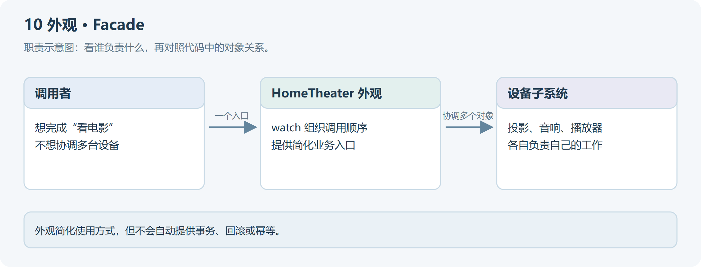

*图示表达职责与调用意图，不是精确 UML；再对照下面的角色说明阅读。*

**再看底层分工。** HomeTheater 为多个子系统提供一个更易用的入口，在 watch 内协调调用。子系统仍有自己的职责，也可以提供给确实需要细粒度控制的使用者。

**沿着示例走一遍。** main 只调用 watch，外观按顺序调用三个组件并返回记录。这个入口隐藏的是调用细节，不是对象创建规则。

### UML 类图

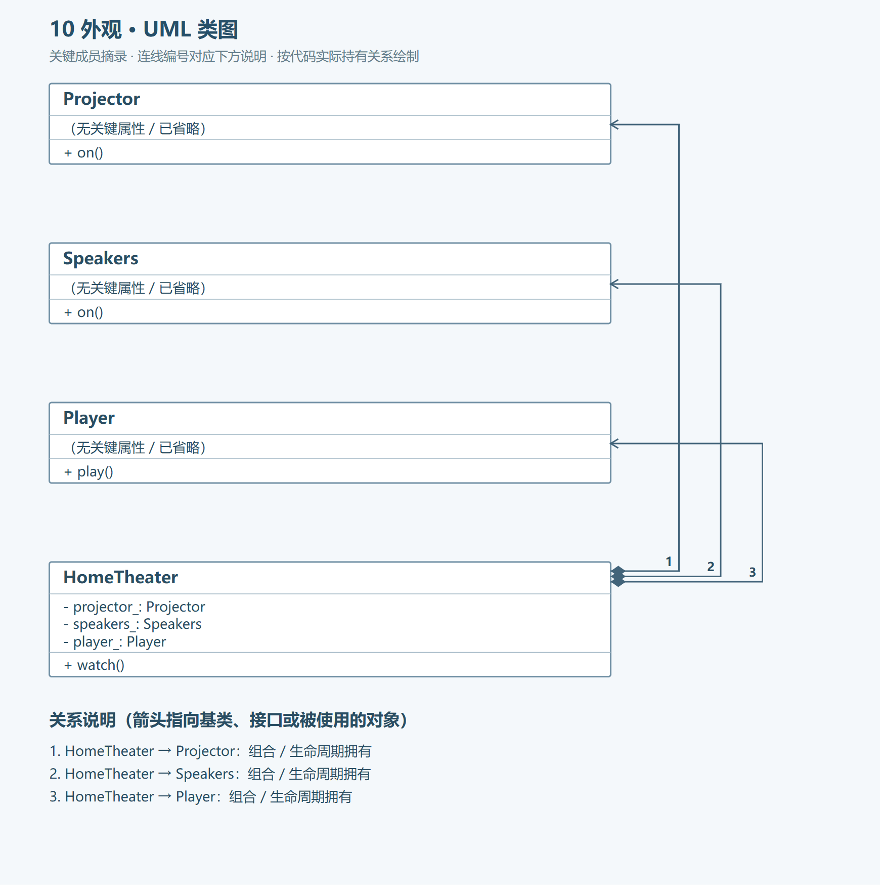

**对照代码读图。** 本例三个子系统均为值成员，各 1 个，因此画组合。外观模式本身不要求拥有子系统；若改为借用，图也应改为关联。

### 完整 C++17 示例

源文件：[examples/10_facade.cpp](examples/10_facade.cpp)。本节代码与配套文件一致。

~~~cpp
#include <cassert>
#include <iostream>
#include <string>

struct Projector { std::string on() const { return "projector"; } };
struct Speakers { std::string on() const { return "speakers"; } };
struct Player { std::string play(const std::string& movie) const { return "play:" + movie; } };
class HomeTheater {
    Projector projector_;
    Speakers speakers_;
    Player player_;
public:
    std::string watch(const std::string& movie) const {
        auto first = projector_.on();
        auto second = speakers_.on();
        auto third = player_.play(movie);
        return first + " -> " + second + " -> " + third;
    }
};
int main() {
    HomeTheater theater;
    auto result = theater.watch("demo");
    assert(result == "projector -> speakers -> play:demo");
    std::cout << result << '\n';
}
~~~

### 编译与预期输出

在资料根目录的 Linux Bash 中运行：

~~~bash
g++ -std=c++17 -Wall -Wextra -Wpedantic -O2 -g -pthread examples/10_facade.cpp -o pattern10
./pattern10
~~~

输出：

~~~text
projector -> speakers -> play:demo
~~~

### 优点

- watch 封装一组操作，调用方不必了解多个子系统及调用顺序。
- 常用组合流程集中维护，更容易保持业务操作一致。

### 缺点

- 所有功能都堆进外观时，它可能膨胀成难以维护的大类。
- 简化入口未必覆盖高级需求，仍需决定是否允许直接访问子系统。

### 适用场景与边界

**什么时候值得用？** 适用于为旧子系统提供简明入口、隔离第三方依赖、组织常用业务流程。

**代价与边界。** 外观容易变成无所不包的“万能类”，要按业务边界拆分。它不自动提供事务、回滚或幂等性，实际设备启动失败时仍需要定义错误恢复策略。

**和相似模式怎么区分？** 适配器让接口兼容；外观让使用变简单。外观通常协调多个对象，不要求与其中一个对象实现相同接口。

## 11｜享元（Flyweight）

### 该模式解决什么问题？

**先看具体场景。** 文档里有大量字符，许多字符使用同一字体和字号。若每个字符都重复保存完整样式，会浪费内存。

**不用它时，麻烦在哪里？** 文档有很多字符，如果每个字符都存一份相同字体与字号，大量重复样式会占用内存。重复部分应该共享，但字符位置又必须各自独立。

**它怎样解决？** StylePool 按字体和字号查找样式，让多个 Glyph 引用同一份 const Style，而 code、x、y 留在各自 Glyph。示例的三个字符只使用两份样式对象。

**它不负责什么？** 它减少重复内部状态，不会消除字符本身的存储，也不保证总内存一定降低。缓存键、引用计数和池本身都有成本；重复率、对象大小与缓存清理策略决定收益。

> **识别信号：** 大量小对象包含占比明显的重复且稳定状态。

**用一个类比建立直觉。** 棋子各有位置，但同种棋子的图案可以共享一份；位置属于每一颗棋子，图案属于可复用部分。

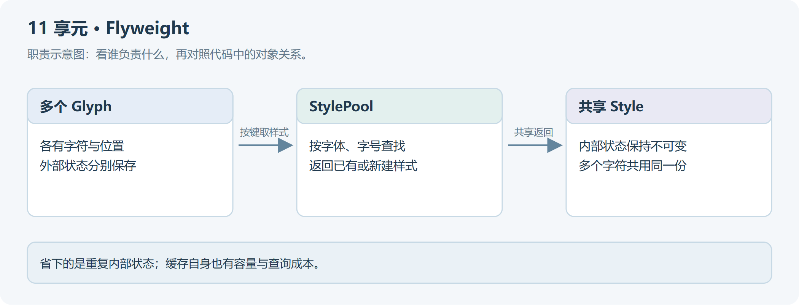

*图示表达职责与调用意图，不是精确 UML；再对照下面的角色说明阅读。*

**再看底层分工。** 把可共享的内部状态 Style 与每个对象不同的外部状态 Glyph::x/y/code 分开。StylePool 按字体、字号查找并复用不可变样式，Glyph 持有 `shared_ptr<const Style>`。

**沿着示例走一遍。** 同样字体和字号的两次 get 返回同一个对象；不同字号返回另一对象。三个字符只使用两份样式，断言比较地址验证共享。

### UML 类图

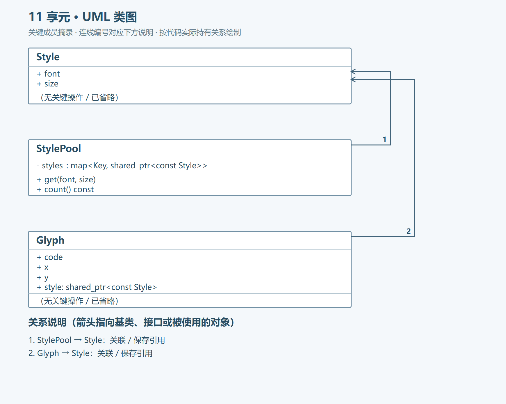

**对照代码读图。** Glyph 引用 1 个 Style，池保存 0..* 个共享样式。shared_ptr 不直接等于 UML 的独占组合；此处用关联，并通过 const 视图限制修改。

### 完整 C++17 示例

源文件：[examples/11_flyweight.cpp](examples/11_flyweight.cpp)。本节代码与配套文件一致。

~~~cpp
#include <cassert>
#include <iostream>
#include <map>
#include <cstddef>
#include <memory>
#include <string>
#include <utility>

struct Style { std::string font; int size; };
class StylePool {
    std::map<std::pair<std::string, int>, std::shared_ptr<const Style>> styles_;
public:
    std::shared_ptr<const Style> get(const std::string& font, int size) {
        auto key = std::make_pair(font, size);
        auto it = styles_.find(key);
        if (it != styles_.end()) return it->second;
        auto style = std::make_shared<const Style>(Style{font, size});
        styles_.emplace(std::move(key), style);
        return style;
    }
    std::size_t count() const { return styles_.size(); }
};
struct Glyph {
    char32_t code;
    int x;
    int y;
    std::shared_ptr<const Style> style;
};
int main() {
    StylePool pool;
    Glyph first{U'A', 0, 0, pool.get("sans", 12)};
    Glyph second{U'B', 10, 0, pool.get("sans", 12)};
    Glyph third{U'C', 20, 0, pool.get("sans", 16)};
    assert(first.style == second.style && first.style != third.style);
    assert(pool.count() == 2);
    std::cout << "glyphs=3 styles=" << pool.count()
              << " shared=" << std::boolalpha << (first.style == second.style) << '\n';
}
~~~

### 编译与预期输出

在资料根目录的 Linux Bash 中运行：

~~~bash
g++ -std=c++17 -Wall -Wextra -Wpedantic -O2 -g -pthread examples/11_flyweight.cpp -o pattern11
./pattern11
~~~

输出：

~~~text
glyphs=3 styles=2 shared=true
~~~

### 优点

- 多个字符共享相同字体样式，减少大量重复内部状态的内存开销。
- 位置留在 Glyph 中，样式共享不妨碍字符拥有不同坐标。

### 缺点

- 必须区分可共享的内部状态和每个使用者独有的外部状态。
- 池的查找、持有和清理有成本；重复程度低时可能得不偿失。

### 适用场景与边界

**什么时候值得用？** 适用于大量细粒度对象、共享部分占比明显且可以保持稳定的场景，例如字形、纹理配置和不可变元数据。

**代价与边界。** 共享工厂自身有查询与引用计数成本，小对象不一定更省。本例强引用缓存会保留所有样式，生产中需要考虑容量和清理；不能共享每个对象会独立变化的位置。

**和相似模式怎么区分？** 享元共享状态相同的对象以节省空间；单例限制某个类型的实例数量。享元可以同时存在大量不同键的共享实例。

## 12｜代理（Proxy）

### 该模式解决什么问题？

**先看具体场景。** 图片文件很大，界面中有些图片可能根本不会被查看。不希望创建图片对象时就立即执行昂贵加载。

**不用它时，麻烦在哪里？** 客户可能创建许多图片入口，但只显示其中一部分。若每个 RealImage 都在构造时加载，就会为未使用的图片支付初始化成本。

**它怎样解决？** LazyImage 保持 Image 接口，只保存文件标识；首次 draw 才创建 RealImage，后续调用复用它。客户仍通过 draw 使用图片，创建时机由代理控制。

**它不负责什么？** 本节采用的是延迟加载代理。代理的更一般用途是控制真实对象访问，权限、远程调用或缓存代理需要各自的规则。本例用加载计数演示时机，没有真正读取或解码大图片，也未处理并发首次加载。

> **识别信号：** 保持客户接口，同时控制真实对象的访问或创建时机。

**用一个类比建立直觉。** 先拿到取货凭证，真正需要时再去仓库取货；对使用者仍提供约定的取货入口。

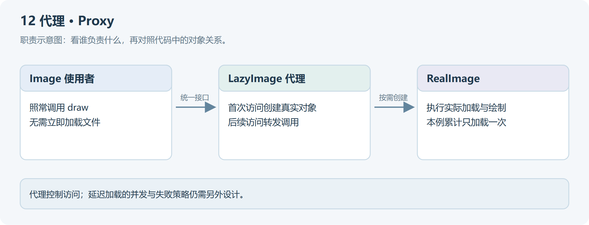

*图示表达职责与调用意图，不是精确 UML；再对照下面的角色说明阅读。*

**再看底层分工。** Image 是共同接口，RealImage 是实际对象，LazyImage 是代理。代理先保存文件名，首次 draw 才创建真实对象，随后转发调用。

**沿着示例走一遍。** 构造代理后加载次数仍为 0；第一次 draw 增加为 1，第二次 draw 复用同一实际对象，计数保持 1。

### UML 类图

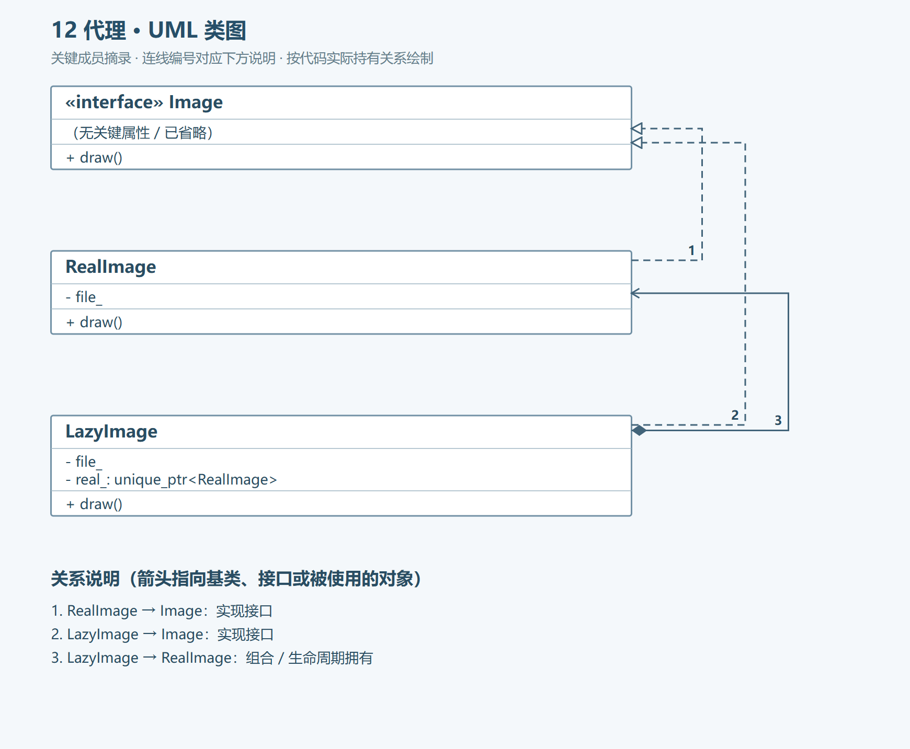

**对照代码读图。** LazyImage 独占 0..1 个 RealImage：首次 draw 前为空，之后才创建。代理与真实对象实现相同接口。

### 完整 C++17 示例

源文件：[examples/12_proxy.cpp](examples/12_proxy.cpp)。本节代码与配套文件一致。

~~~cpp
#include <cassert>
#include <iostream>
#include <memory>
#include <string>
#include <utility>

struct Image { virtual ~Image() = default; virtual std::string draw() = 0; };
class RealImage final : public Image {
    std::string file_;
public:
    inline static int loads = 0;
    explicit RealImage(std::string file) : file_(std::move(file)) { ++loads; }
    std::string draw() override { return file_; }
};
class LazyImage final : public Image {
    std::string file_;
    std::unique_ptr<RealImage> real_;
public:
    explicit LazyImage(std::string file) : file_(std::move(file)) {}
    std::string draw() override {
        if (!real_) real_ = std::make_unique<RealImage>(file_);
        return real_->draw();
    }
};
int main() {
    LazyImage image("photo.png");
    assert(RealImage::loads == 0);
    auto first = image.draw();
    auto second = image.draw();
    assert(first == second && RealImage::loads == 1);
    std::cout << "loads=" << RealImage::loads << " picture=" << first << '\n';
}
~~~

### 编译与预期输出

在资料根目录的 Linux Bash 中运行：

~~~bash
g++ -std=c++17 -Wall -Wextra -Wpedantic -O2 -g -pthread examples/12_proxy.cpp -o pattern12
./pattern12
~~~

输出：

~~~text
loads=1 picture=photo.png
~~~

### 优点

- 使用 Image 的客户可以透明地获得延迟加载行为。
- 真实对象只在首次需要时创建，避免不必要的初始化。

### 缺点

- 首次访问承担加载延迟，错误也可能延后到首次使用才暴露。
- 多个线程同时首次访问时需要另外同步，本例不提供这种保证。

### 适用场景与边界

**什么时候值得用？** 适用于延迟加载、权限检查、访问远程对象或缓存访问结果。每种代理承担的访问控制职责不同。

**代价与边界。** 本例是单线程示范，并发首次加载需要额外同步。远程代理还涉及超时、序列化和失败；缓存代理需要失效规则。相同接口不代表调用成本和失败方式相同。

**和相似模式怎么区分？** 代理控制怎样访问真实对象；装饰器增加可叠加职责；适配器则改变对外接口。不要只根据“内部有一个指针”判断模式。

## 13｜责任链（Chain of Responsibility）

### 该模式解决什么问题？

**先看具体场景。** 报销申请按金额由组长、经理处理，超过所有人的权限就要明确拒绝。调用者不想自己写一串审批人判断。

**不用它时，麻烦在哪里？** 报销发送者若自己判断组长、经理的权限并依次调用，就会同时依赖审批规则、处理者类型和顺序。处理者增加或顺序变化时，发送者容易跟着修改。

**它怎样解决？** 客户将请求交给链入口，Handler 判断自己能否处理，不能则转给 next。示例按顺序把 500 交给组长、5000 交给经理，50000 返回 unhandled。

**它不负责什么？** 它分离请求发送与候选处理者的选择，不保证总有人处理。该示例采用“首个能处理者结束”，与所有节点都继续执行的过滤链不同；链的顺序和兜底结果必须明确。

> **识别信号：** 请求需要依次寻找合适处理者，发送者不应写死选择过程。

**用一个类比建立直觉。** 服务窗口办不了就转给下一个有权限的窗口；最终无人能办，也必须告诉申请人。

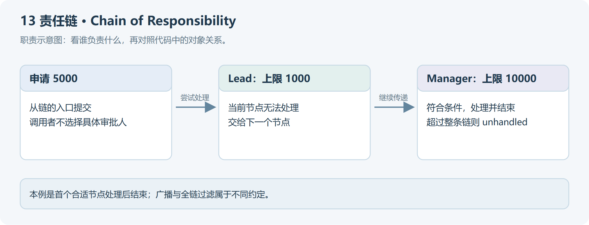

*图示表达职责与调用意图，不是精确 UML；再对照下面的角色说明阅读。*

**再看底层分工。** Handler 保存后继，handle 判断自己能否处理；不能处理就沿链传递。这里采用“首个合适处理者处理后结束”的版本，后继由 unique_ptr 拥有。

**沿着示例走一遍。** 500 交组长，5000 交经理，50000 超过链上权限返回 unhandled；负金额在入口被拒绝。谁能处理与处理顺序都由链的配置决定。

### UML 类图

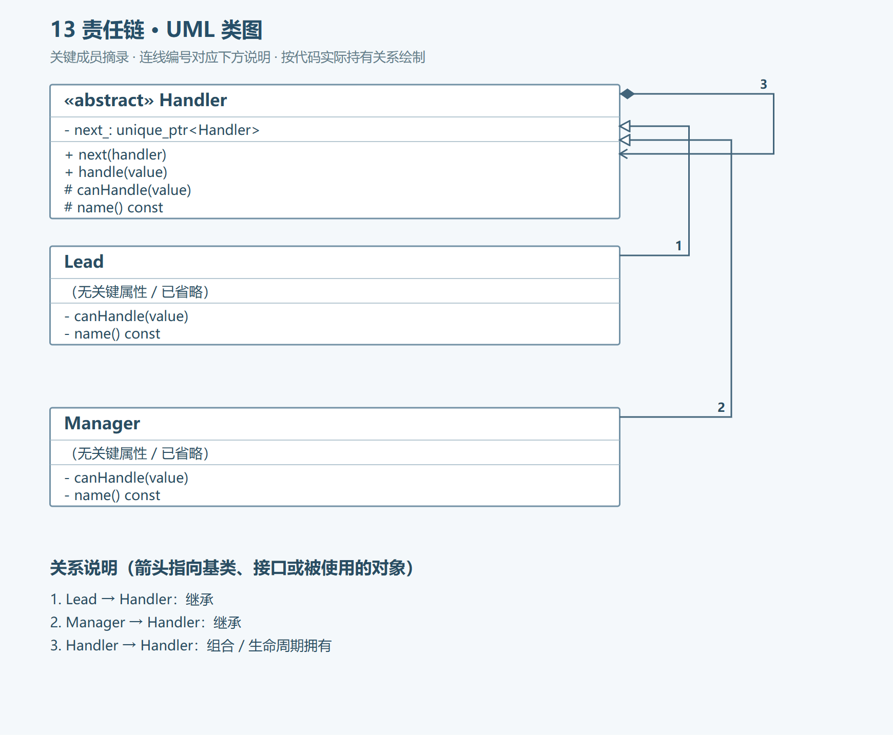

**对照代码读图。** Handler 独占 0..1 个后继 Handler。自组合代表一节链连接下一节，不保证请求一定被处理。

### 完整 C++17 示例

源文件：[examples/13_chain_of_responsibility.cpp](examples/13_chain_of_responsibility.cpp)。本节代码与配套文件一致。

~~~cpp
#include <cassert>
#include <initializer_list>
#include <iostream>
#include <memory>
#include <stdexcept>
#include <string>
#include <utility>

class Handler {
    std::unique_ptr<Handler> next_;
protected:
    virtual bool canHandle(int amount) const = 0;
    virtual std::string name() const = 0;
public:
    virtual ~Handler() = default;
    void next(std::unique_ptr<Handler> handler) { next_ = std::move(handler); }
    std::string handle(int amount) const {
        if (amount < 0) throw std::invalid_argument("negative amount");
        if (canHandle(amount)) return name();
        return next_ ? next_->handle(amount) : "unhandled";
    }
};
class Lead final : public Handler {
    bool canHandle(int amount) const override { return amount <= 1000; }
    std::string name() const override { return "lead"; }
};
class Manager final : public Handler {
    bool canHandle(int amount) const override { return amount <= 10000; }
    std::string name() const override { return "manager"; }
};
int main() {
    Lead lead;
    lead.next(std::make_unique<Manager>());
    assert(lead.handle(500) == "lead");
    assert(lead.handle(5000) == "manager");
    assert(lead.handle(50000) == "unhandled");
    for (int amount : {500, 5000, 50000})
        std::cout << amount << '=' << lead.handle(amount) << '\n';
}
~~~

### 编译与预期输出

在资料根目录的 Linux Bash 中运行：

~~~bash
g++ -std=c++17 -Wall -Wextra -Wpedantic -O2 -g -pthread examples/13_chain_of_responsibility.cpp -o pattern13
./pattern13
~~~

输出：

~~~text
500=lead
5000=manager
50000=unhandled
~~~

### 优点

- 请求发送者只面对链入口，不必逐个认识所有处理者。
- 可以调整顺序或插入处理者，适合按职责分级处理。

### 缺点

- 请求可能走完整条链仍无人处理，需要明确失败结果。
- 链顺序影响行为，链过长时调试和性能分析更困难。

### 适用场景与边界

**什么时候值得用？** 适用于有顺序的路由、审批、过滤与请求处理。要先定义是首个处理者结束，还是所有节点都继续执行。

**代价与边界。** 顺序会影响结果，链过长会增加调用和排查成本；最坏要经过 O(n) 个节点。缺少终点处理可能静默丢失请求；不能把所有责任链都等同于广播。

**和相似模式怎么区分？** 责任链沿后继逐个尝试；观察者通知多个订阅者；装饰器则常按嵌套调用向内传递并处理返回结果。

## 14｜命令（Command）

### 该模式解决什么问题？

**先看具体场景。** 按钮需要发起“设置音量”，还要保存历史以支持撤销。如果按钮直接修改音响内部字段，就会把界面与业务操作绑在一起。

**不用它时，麻烦在哪里？** 如果按钮直接改 Speaker::volume，界面既要认识音响，又要自己记录旧音量才能撤销。随后增加历史记录、排队等能力时，操作逻辑容易散落。

**它怎样解决？** SetVolume 把接收者、目标音量、执行和撤销封装在一起，执行时记住旧值。Remote 只负责执行和保存 Command，撤销时调用历史命令，不必知道如何恢复音量。

**它不负责什么？** 它把请求变成对象，为排队、历史等能力提供结构，但这些能力仍要实际实现。本例只有内存历史和一次次撤销，没有持久化、重做或通用事务；付款、发邮件等副作用不能凭 undo 自动恢复。

> **识别信号：** 请求需要独立保存、统一调用或附带撤销信息。

**用一个类比建立直觉。** 餐厅把点菜写成订单，服务员只负责提交订单；具体做菜由厨房完成。订单还能排队或记录，但不是所有菜都能无损撤销。

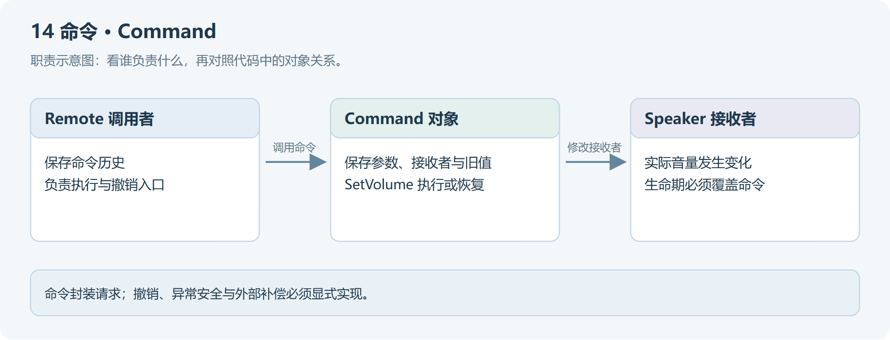

*图示表达职责与调用意图，不是精确 UML；再对照下面的角色说明阅读。*

**再看底层分工。** Command 把请求封装为对象，SetVolume 保存接收者 Speaker、目标值和旧值；Remote 是调用者及历史管理者。请求者依赖命令接口，不直接理解具体操作。

**沿着示例走一遍。** 命令执行前记住音量 10，执行后变为 50；Remote 撤销最后一条命令，将音量恢复为 10。历史为空时 undo 返回 false。

### UML 类图

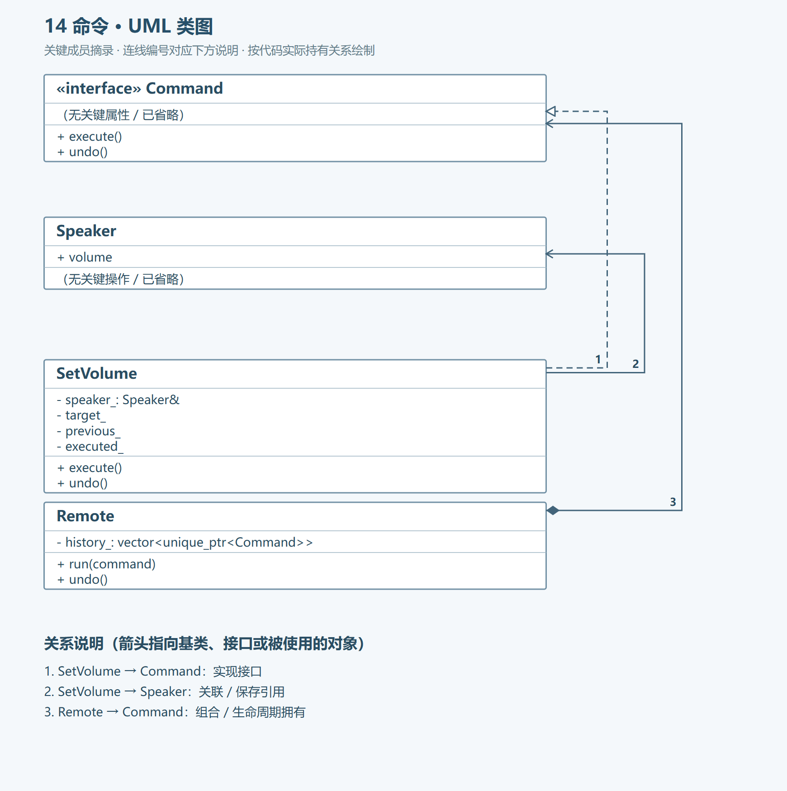

**对照代码读图。** Remote 组合 0..* 个历史 Command，SetVolume 借用 1 个 Speaker。示例的异常处理不等于对任意副作用提供完整事务。

### 完整 C++17 示例

源文件：[examples/14_command.cpp](examples/14_command.cpp)。本节代码与配套文件一致。

~~~cpp
#include <cassert>
#include <iostream>
#include <memory>
#include <stdexcept>
#include <utility>
#include <vector>

struct Speaker { int volume = 10; };
struct Command {
    virtual ~Command() = default;
    virtual void execute() = 0;
    virtual void undo() = 0;
};
class SetVolume final : public Command {
    Speaker& speaker_;
    int target_;
    int previous_ = 0;
    bool executed_ = false;
public:
    SetVolume(Speaker& speaker, int target) : speaker_(speaker), target_(target) {
        if (target < 0 || target > 100) throw std::invalid_argument("volume range");
    }
    void execute() override {
        if (executed_) throw std::logic_error("already executed");
        previous_ = speaker_.volume;
        speaker_.volume = target_;
        executed_ = true;
    }
    void undo() override {
        if (!executed_) throw std::logic_error("not executed");
        speaker_.volume = previous_;
        executed_ = false;
    }
};
class Remote {
    std::vector<std::unique_ptr<Command>> history_;
public:
    void run(std::unique_ptr<Command> command) {
        if (!command) throw std::invalid_argument("null command");
        // 先保存，避免执行成功后才因历史容器分配失败而丢失撤销记录。
        history_.push_back(std::move(command));
        try { history_.back()->execute(); }
        catch (...) { history_.pop_back(); throw; }
    }
    bool undo() {
        if (history_.empty()) return false;
        history_.back()->undo();
        history_.pop_back();
        return true;
    }
};
int main() {
    Speaker speaker;  // 比 Remote 和历史命令更早构造、更晚销毁。
    Remote remote;
    remote.run(std::make_unique<SetVolume>(speaker, 50));
    assert(speaker.volume == 50);
    std::cout << "after execute=" << speaker.volume << '\n';
    bool undone = remote.undo();
    assert(undone && speaker.volume == 10);
    bool empty = remote.undo();
    assert(!empty);
    std::cout << "after undo=" << speaker.volume << '\n';
}
~~~

### 编译与预期输出

在资料根目录的 Linux Bash 中运行：

~~~bash
g++ -std=c++17 -Wall -Wextra -Wpedantic -O2 -g -pthread examples/14_command.cpp -o pattern14
./pattern14
~~~

输出：

~~~text
after execute=50
after undo=10
~~~

### 优点

- 把操作封装成对象，便于保存历史、排队或统一触发。
- 命令保存撤销信息，调用方不必理解音量恢复细节。

### 缺点

- 撤销需要保存状态；不是每个外部副作用都能简单撤销。
- 命令和接收者的生命周期必须协调，本例的 Speaker 不能提前销毁。

### 适用场景与边界

**什么时候值得用？** 适用于撤销重做、任务排队、菜单按钮和宏操作。需要持久化的命令还要设计可序列化的请求数据。

**代价与边界。** 撤销必须显式实现，不是所有副作用都能恢复。发送邮件、付款等需要补偿或业务协议。若 execute 部分修改后抛异常，仍由具体命令负责异常安全，调用者的 catch 不会自动回滚。接收者引用必须保持有效。

**和相似模式怎么区分？** 命令封装“一个请求及执行所需信息”；策略封装可替换算法；备忘录保存状态，常用来帮助命令实现撤销。

## 15｜解释器（Interpreter）

### 该模式解决什么问题？

**先看具体场景。** 系统需要计算小型布尔规则，如“正在下雨，并且没有带伞”。规则需要用结构表达，而不是散落在各处的字符串判断。

**不用它时，麻烦在哪里？** 系统有“下雨并且没带伞”等规则。如果每种规则都写成单独业务分支，规则组合就难复用；若直接用字符串判断，又缺少明确结构。

**它怎样解决？** Expr 表达可求值的规则，Variable 查询上下文，Not 和 And 组合其他表达式。把一条规则表示为表达式树后，各节点按自己的语义递归求值，也可用同类节点组装别的规则。

**它不负责什么？** 它解决已定义语法的表达与解释，不等于把任意字符串自动变成规则。本例手工建树，没有词法或语法分析；复杂语言、性能优化及不可信输入限制通常需要专门工具。

> **识别信号：** 需要用简单语法组合规则并解释执行。

**用一个类比建立直觉。** 把一句规则拆成词与语法结构：变量是词，not 和 and 是连接方式；沿结构逐层理解含义。

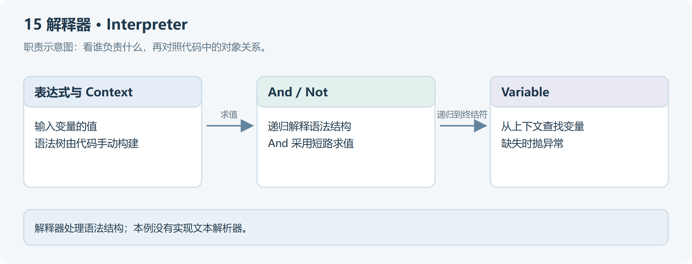

*图示表达职责与调用意图，不是精确 UML；再对照下面的角色说明阅读。*

**再看底层分工。** Expr 是表达式接口，Variable 是终结符表达式，Not 与 And 是非终结符表达式，Context 保存变量值。表达式对象组成语法树，eval 递归计算。

**沿着示例走一遍。** main 手动构造 And(raining, Not(umbrella))；上下文中下雨为真、带伞为假，所以结果为真。变量缺失会抛异常，不悄悄当成 false。

### UML 类图

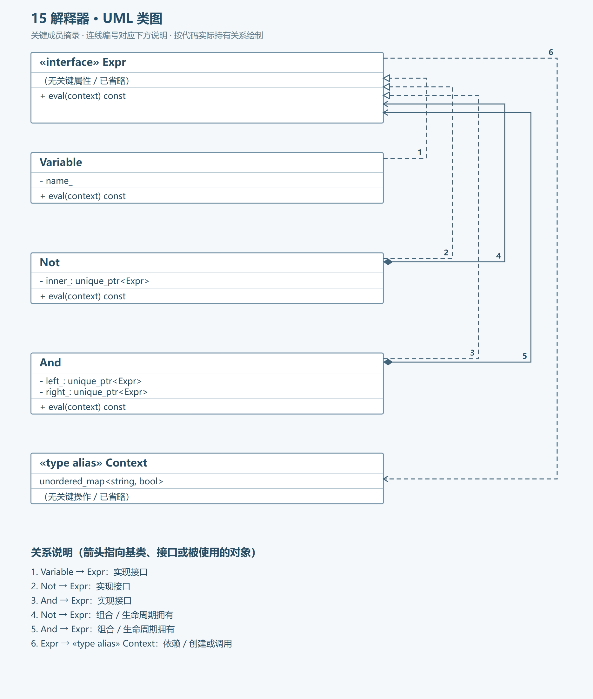

**对照代码读图。** Not 拥有 1 个子表达式，And 拥有 2 个。Context 是类型别名，不是自定义类；示例手工构树，不含文本解析器。

### 完整 C++17 示例

源文件：[examples/15_interpreter.cpp](examples/15_interpreter.cpp)。本节代码与配套文件一致。

~~~cpp
#include <cassert>
#include <iostream>
#include <memory>
#include <stdexcept>
#include <string>
#include <unordered_map>
#include <utility>

using Context = std::unordered_map<std::string, bool>;
struct Expr { virtual ~Expr() = default; virtual bool eval(const Context&) const = 0; };
class Variable final : public Expr {
    std::string name_;
public:
    explicit Variable(std::string name) : name_(std::move(name)) {}
    bool eval(const Context& context) const override { return context.at(name_); }
};
class Not final : public Expr {
    std::unique_ptr<Expr> inner_;
public:
    explicit Not(std::unique_ptr<Expr> inner) : inner_(std::move(inner)) {
        if (!inner_) throw std::invalid_argument("null expression");
    }
    bool eval(const Context& context) const override { return !inner_->eval(context); }
};
class And final : public Expr {
    std::unique_ptr<Expr> left_, right_;
public:
    And(std::unique_ptr<Expr> left, std::unique_ptr<Expr> right)
        : left_(std::move(left)), right_(std::move(right)) {
        if (!left_ || !right_) throw std::invalid_argument("null expression");
    }
    bool eval(const Context& context) const override {
        return left_->eval(context) && right_->eval(context);
    }
};
int main() {
    // 教学 AST 由代码构造，所有子节点必须非空。
    And rule(std::make_unique<Variable>("raining"),
             std::make_unique<Not>(std::make_unique<Variable>("umbrella")));
    Context context{{"raining", true}, {"umbrella", false}};
    assert(rule.eval(context));
    bool rejected = false;
    try { Variable("missing").eval(context); }
    catch (const std::out_of_range&) { rejected = true; }
    assert(rejected);
    std::cout << "take_umbrella=" << std::boolalpha << rule.eval(context)
              << "\nunknown variable rejected\n";
}
~~~

### 编译与预期输出

在资料根目录的 Linux Bash 中运行：

~~~bash
g++ -std=c++17 -Wall -Wextra -Wpedantic -O2 -g -pthread examples/15_interpreter.cpp -o pattern15
./pattern15
~~~

输出：

~~~text
take_umbrella=true
unknown variable rejected
~~~

### 优点

- 规则用语法树表达，每个节点只负责自己的解释逻辑。
- 简单语法增加表达式节点较直观，也便于组合已有规则。

### 缺点

- 复杂语法会产生很多节点类，还需要词法和语法分析等机制。
- 逐节点虚调用通常不适合追求极致吞吐量的解释执行。

### 适用场景与边界

**什么时候值得用？** 适用于语法简单、规则稳定的小型 DSL。示例只解释已经构造好的语法树，不包含从文本读取规则的词法分析和语法分析。

**代价与边界。** 语法复杂时类的数量与维护成本会增加；不可信输入还涉及深度、大小及求值限制。真实语言通常应采用解析器或成熟规则引擎。And 使用短路求值，右侧不一定执行。

**和相似模式怎么区分？** 解释器组织一套语法与求值规则；组合模式组织树形结构。表达式树可以同时体现二者，但任意树都不等于解释器。

## 16｜迭代器（Iterator）

### 该模式解决什么问题？

**先看具体场景。** 调用者想依次读取集合元素，不想知道集合内部用数组、链表还是树存储。

**不用它时，麻烦在哪里？** 客户若直接用数组下标或链表节点指针遍历，就会依赖内部存储。若集合自己只有一个遍历游标，两次遍历还容易相互干扰。

**它怎样解决？** IntBag 用 begin/end 返回各自的 Iterator，每个 Iterator 保存自己的当前位置。范围 for 只使用比较、取值与前进操作，客户不必取得底层 vector。

**它不负责什么？** 它把遍历协议与存储结构分开，不会让迭代器脱离容器独立存活。容器变化仍可能使迭代器失效；示例只覆盖范围 for 的基本使用，不是标准库完整迭代器实现。

> **识别信号：** 想统一遍历协议、隐藏存储，并让遍历各自维护位置。

**用一个类比建立直觉。** 使用电视遥控器的“下一个频道”，不需要知道频道表在设备内部怎样排列。

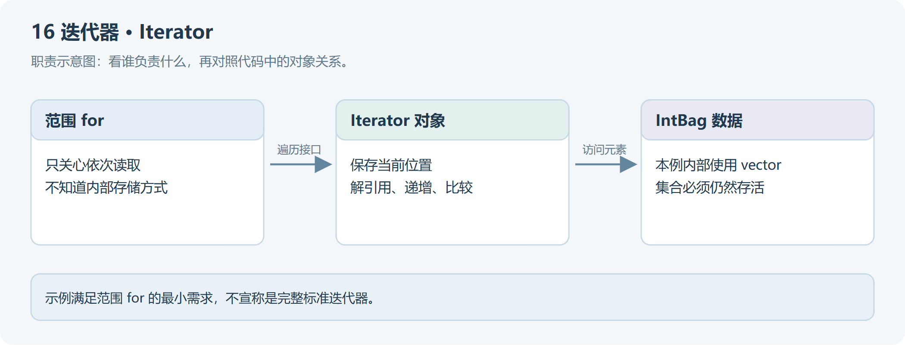

*图示表达职责与调用意图，不是精确 UML；再对照下面的角色说明阅读。*

**再看底层分工。** 把遍历当前位置及推进操作交给独立的迭代器对象。本例 IntBag 对外返回包装后的 Iterator，调用者只使用解引用、递增与比较。

**沿着示例走一遍。** 范围 for 会调用 begin、end，随后比较是否结束、解引用取值并递增。1、2、3 被依次读取，总和为 6。

### UML 类图

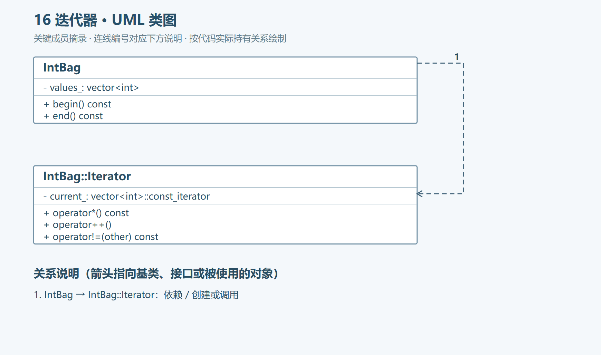

**对照代码读图。** begin/end 按值创建并返回嵌套 Iterator，IntBag 不保存它们，因此是依赖而非组合。Iterator 保存底层 const_iterator，不保存 IntBag 指针。

### 完整 C++17 示例

源文件：[examples/16_iterator.cpp](examples/16_iterator.cpp)。本节代码与配套文件一致。

~~~cpp
#include <cassert>
#include <initializer_list>
#include <iostream>
#include <vector>

class IntBag {
    std::vector<int> values_;
public:
    class Iterator {
        std::vector<int>::const_iterator current_;
    public:
        explicit Iterator(std::vector<int>::const_iterator current) : current_(current) {}
        int operator*() const { return *current_; }
        Iterator& operator++() { ++current_; return *this; }
        bool operator!=(const Iterator& other) const { return current_ != other.current_; }
    };
    IntBag(std::initializer_list<int> values) : values_(values) {}
    Iterator begin() const { return Iterator(values_.begin()); }
    Iterator end() const { return Iterator(values_.end()); }
};
int main() {
    IntBag bag{1, 2, 3};
    int sum = 0;
    for (int value : bag) sum += value;
    assert(sum == 6);
    std::cout << "sum=" << sum << '\n';
}
~~~

### 编译与预期输出

在资料根目录的 Linux Bash 中运行：

~~~bash
g++ -std=c++17 -Wall -Wextra -Wpedantic -O2 -g -pthread examples/16_iterator.cpp -o pattern16
./pattern16
~~~

输出：

~~~text
sum=6
~~~

### 优点

- 遍历位置由迭代器对象保存，多个遍历不必共用全局游标。
- 调用方使用统一遍历操作，不必直接接触存储细节。

### 缺点

- 容器销毁或某些修改会使迭代器失效，必须注意有效期。
- 示例是最小教学接口，未完整实现标准库迭代器概念和所有算法约定。

### 适用场景与边界

**什么时候值得用？** 适用于统一遍历接口、隐藏存储结构，以及让多个遍历过程各自维护位置。

**代价与边界。** 迭代器引用集合中的数据，不能比集合活得更久；容器修改可能使迭代器失效。本例只提供范围 for 所需的最小操作，不宣称满足全部 C++17 标准迭代器要求。

**和相似模式怎么区分？** 标准容器通常已经提供迭代器，无需再封装。本例为了展示角色而包装 vector；生产中优先使用现成的标准接口。不同容器的失效规则不能一概而论。

## 17｜中介者（Mediator）

### 该模式解决什么问题？

**先看具体场景。** 输入框为空时禁用提交按钮，填入内容后启用；点击按钮再读取输入。如果组件彼此直接调用，组件关系会越来越密。

**不用它时，麻烦在哪里？** 输入框要改变按钮是否可用，按钮又要读取输入并提交；如果控件彼此保存引用并直接调用，控件越多，相互关系就越难追踪，也不易复用。

**它怎样解决？** TextField 和 Button 只向 Mediator 报告事件，由 Form 决定输入变化后启用按钮、点击后读取并保存提交内容。控件不再直接认识对方，协调规则有了集中位置。

**它不负责什么？** 它整理的是一组对象间的协作关系，不会消除这些业务规则。规则过多仍需按范围拆分中介者；也不自动解决控件回调、复制和多线程生命周期问题。

> **识别信号：** 多个对象互相调用过密，协作规则难以定位。

**用一个类比建立直觉。** 飞机通过塔台协调，而不是每架飞机分别向所有其他飞机询问跑道情况。

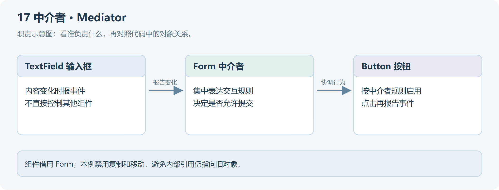

*图示表达职责与调用意图，不是精确 UML；再对照下面的角色说明阅读。*

**再看底层分工。** 组件只向 Mediator 报告事件，Form 作为具体中介者协调 TextField 和 Button。组件不知道对方的具体类型，业务协调规则集中在 Form。

**沿着示例走一遍。** 空表单点击无效，输入 hello 后启用按钮，点击后提交值变成 hello。输入框没有直接保存按钮指针。

### UML 类图

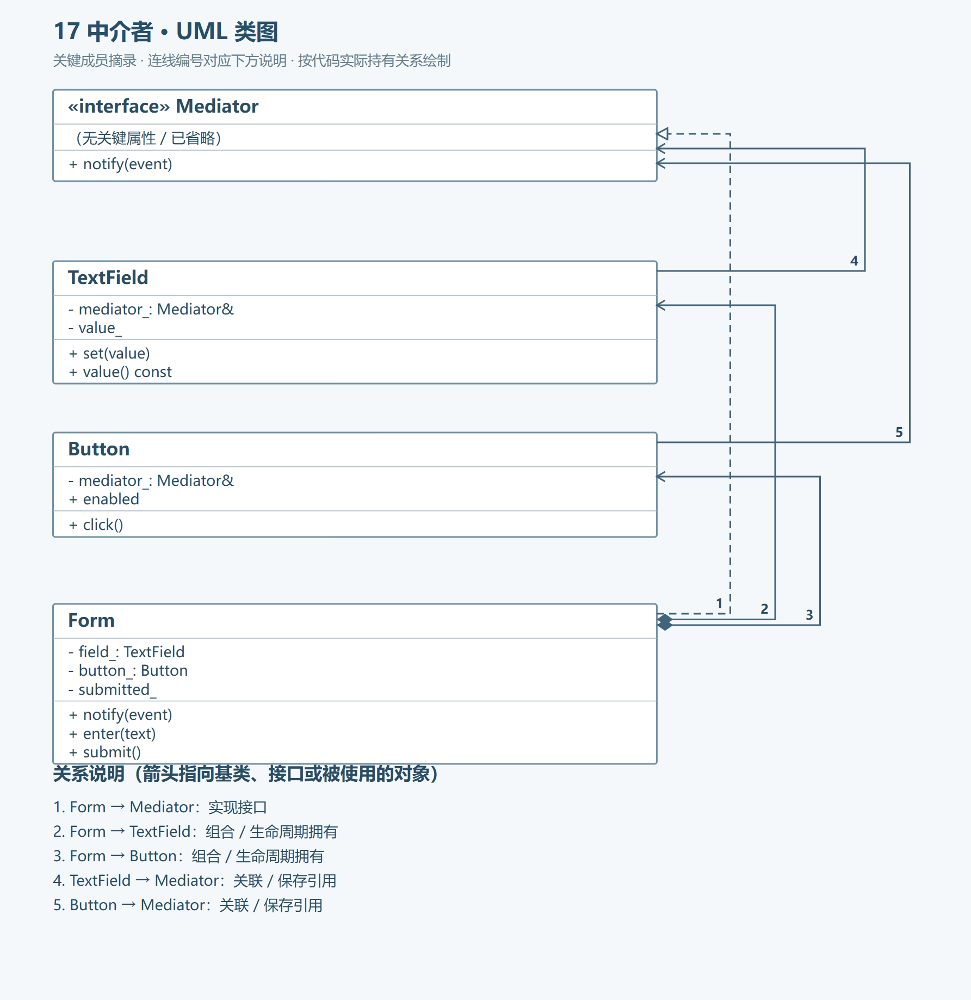

**对照代码读图。** Form 按值拥有文本框和按钮，各 1 个；控件借用 Mediator。示例禁止复制和移动 Form，避免控件引用仍指向原对象。

### 完整 C++17 示例

源文件：[examples/17_mediator.cpp](examples/17_mediator.cpp)。本节代码与配套文件一致。

~~~cpp
#include <cassert>
#include <iostream>
#include <string>
#include <utility>

enum class Event { TextChanged, SubmitClicked };
struct Mediator { virtual ~Mediator() = default; virtual void notify(Event event) = 0; };
class TextField {
    Mediator& mediator_;
    std::string value_;
public:
    explicit TextField(Mediator& mediator) : mediator_(mediator) {}
    void set(std::string text) { value_ = std::move(text); mediator_.notify(Event::TextChanged); }
    const std::string& value() const { return value_; }
};
class Button {
    Mediator& mediator_;
public:
    bool enabled = false;
    explicit Button(Mediator& mediator) : mediator_(mediator) {}
    void click() { if (enabled) mediator_.notify(Event::SubmitClicked); }
};
class Form final : public Mediator {
    TextField field_;
    Button button_;
    std::string submitted_;
public:
    Form() : field_(*this), button_(*this) {}
    Form(const Form&) = delete;
    Form& operator=(const Form&) = delete;
    Form(Form&&) = delete;
    Form& operator=(Form&&) = delete;
    void notify(Event event) override {
        if (event == Event::TextChanged) button_.enabled = !field_.value().empty();
        else if (event == Event::SubmitClicked) submitted_ = field_.value();
    }
    void enter(std::string text) { field_.set(std::move(text)); }
    void submit() { button_.click(); }
    const std::string& submitted() const { return submitted_; }
};
int main() {
    Form form;
    form.submit();
    assert(form.submitted().empty());
    form.enter("hello");
    form.submit();
    assert(form.submitted() == "hello");
    std::cout << "submitted=" << form.submitted() << '\n';
}
~~~

### 编译与预期输出

在资料根目录的 Linux Bash 中运行：

~~~bash
g++ -std=c++17 -Wall -Wextra -Wpedantic -O2 -g -pthread examples/17_mediator.cpp -o pattern17
./pattern17
~~~

输出：

~~~text
submitted=hello
~~~

### 优点

- 控件通过中介者交流，不必让文本框直接依赖按钮逻辑。
- “输入是否允许提交”等规则集中在 Form，较容易查找和修改。

### 缺点

- 交互规则增长时，Form 可能承担过多职责。
- 回调和自引用使复制、移动及生命周期管理更复杂。

### 适用场景与边界

**什么时候值得用？** 适用于复杂界面组件协作、房间内成员协调，以及需要集中表达协作规则的场景。

**代价与边界。** 中介者可能膨胀成巨型控制器；要按业务范围拆分，而不是把所有系统关系塞进一个对象。本例为单线程 UI 模型，组件不可在构造期间回调尚未初始化完成的中介者。

**和相似模式怎么区分？** 中介者集中协调多个对象的互动；观察者描述发布与订阅关系。中介者内部可以用观察者接收事件，二者不互斥。

## 18｜备忘录（Memento）

### 该模式解决什么问题？

**先看具体场景。** 编辑器需要保存与恢复历史状态，但又不希望外部历史管理器直接访问编辑器的内部字段。

**不用它时，麻烦在哪里？** 需要撤销编辑时，外部历史管理者若直接读取和回写 Editor 的内部字段，就会依赖其实现细节。Editor 内部表示一变，历史管理代码也得跟着变。

**它怎样解决？** Editor::save 创建受封装的 Snapshot，外部只负责保存，再交给 restore。保存和恢复内部状态的知识留在 Editor，调用方不必拆解快照。

**它不负责什么？** 它解决快照与封装的矛盾，不负责自动管理所有历史。本例只保存字符串，没有历史栈、容量淘汰或跨版本存档；恢复内存状态也不能自动撤销外部操作。

> **识别信号：** 要保存与恢复状态，又不想暴露对象内部表示。

**用一个类比建立直觉。** 游戏保存一个存档；玩家负责保管存档，恢复规则由游戏自身掌握。

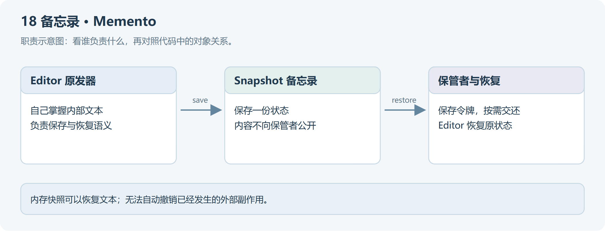

*图示表达职责与调用意图，不是精确 UML；再对照下面的角色说明阅读。*

**再看底层分工。** Editor 是原发器，Snapshot 是备忘录，main 充当保管者。快照保存文本，但字段和构造方式不对保管者公开，只有 Editor 可以创建与读取。

**沿着示例走一遍。** 文本 hello 保存后再追加 world；恢复时传回 Snapshot，文本重新变成 hello。调用者没有自己拆开并修改快照。

### UML 类图

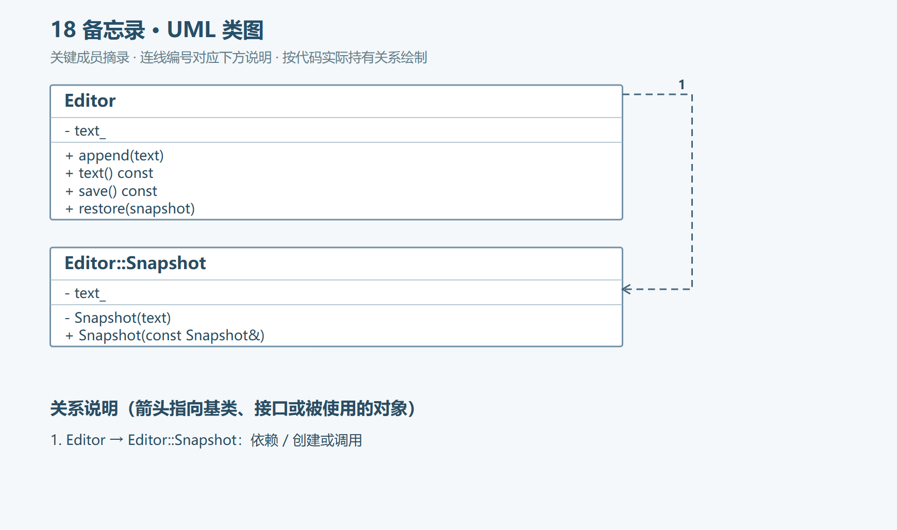

**对照代码读图。** Editor 创建和读取 Snapshot，历史由调用方保存，不画 Editor 对历史的组合。Snapshot 用私有构造及 friend 控制创建。

### 完整 C++17 示例

源文件：[examples/18_memento.cpp](examples/18_memento.cpp)。本节代码与配套文件一致。

~~~cpp
#include <cassert>
#include <iostream>
#include <string>
#include <utility>

class Editor {
    std::string text_;
public:
    class Snapshot {
        friend class Editor;
        std::string text_;
        explicit Snapshot(std::string text) : text_(std::move(text)) {}
    public:
        Snapshot(const Snapshot&) = default;
        Snapshot& operator=(const Snapshot&) = default;
    };
    void append(const std::string& text) { text_ += text; }
    const std::string& text() const { return text_; }
    Snapshot save() const { return Snapshot(text_); }
    void restore(const Snapshot& snapshot) { text_ = snapshot.text_; }
};
int main() {
    Editor editor;
    editor.append("hello");
    auto saved = editor.save();
    editor.append(" world");
    assert(editor.text() == "hello world");
    std::cout << "before restore=" << editor.text() << '\n';
    editor.restore(saved);
    assert(editor.text() == "hello");
    std::cout << "after restore=" << editor.text() << '\n';
}
~~~

### 编译与预期输出

在资料根目录的 Linux Bash 中运行：

~~~bash
g++ -std=c++17 -Wall -Wextra -Wpedantic -O2 -g -pthread examples/18_memento.cpp -o pattern18
./pattern18
~~~

输出：

~~~text
before restore=hello world
after restore=hello
~~~

### 优点

- 调用方保存和恢复状态，不必直接读写 Editor 的私有字段。
- 快照接口把恢复需求和内部表示隔离，适合撤销和检查点。

### 缺点

- 大量完整快照消耗内存，可能需要增量保存或容量限制。
- 快照通常只覆盖本对象，不能自动撤销文件写入或网络请求等副作用。

### 适用场景与边界

**什么时候值得用？** 适用于撤销、保存点和需要保持内部封装的状态恢复。

**代价与边界。** 完整快照可能占用很多内存；可考虑增量记录、结构共享和历史数量限制。恢复内存状态不能自动撤销外部副作用，也不等同于数据库事务或跨版本存档格式。

**和相似模式怎么区分？** 命令记录做过的动作，备忘录记录某个时刻的状态；二者经常组合。直接复制值类型也能实现简单快照，不一定需要复杂层次。

## 19｜观察者（Observer）

### 该模式解决什么问题？

**先看具体场景。** 价格变化后，图表和提醒器都要更新，但价格对象不应该认识每一种界面或提醒实现。

**不用它时，麻烦在哪里？** 价格变化后要同时更新图表和提醒器。若价格源直接调用各种具体界面，每新增一个订阅者，价格源就要增加一种具体依赖。

**它怎样解决？** PriceSource 面向 Observer 订阅列表通知变化，Recorder 自己处理收到的价格。发布方不知道每个订阅者的具体类型，增加实现 Observer 的订阅者不必修改价格源的通知逻辑。

**它不负责什么？** 它解决一对多的变化通知，不等同于可靠消息队列。示例为进程内同步回调，没有跨进程传输、持久化、重试或并发保障；订阅有效期和异常传播仍需约定。

> **识别信号：** 对象变化需要通知多个可增减的订阅者。

**用一个类比建立直觉。** 订阅天气通知：发布者发出更新，当前订阅者分别处理；订阅者退出后不该留下悬空联系地址。

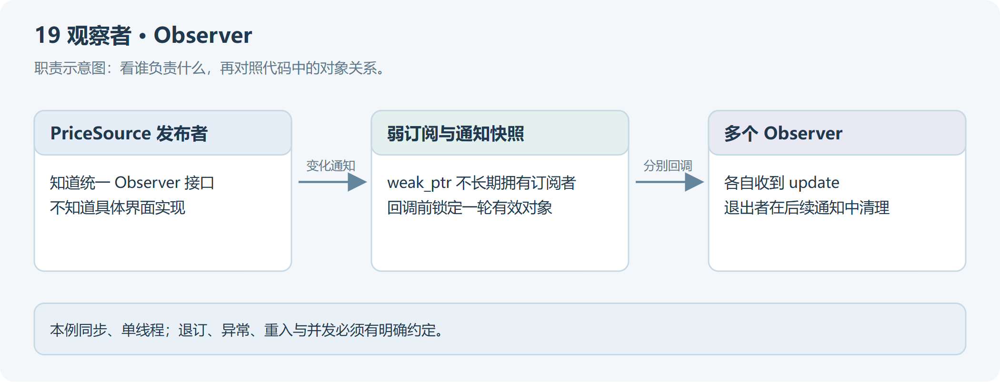

*图示表达职责与调用意图，不是精确 UML；再对照下面的角色说明阅读。*

**再看底层分工。** Subject 保存订阅关系，通过 Observer 接口通知。PriceSource 用 weak_ptr 记录订阅者，外部拥有观察者；通知前锁定为临时 shared_ptr 快照，避免通知过程中订阅变化使遍历失效。

**沿着示例走一遍。** 两个 Recorder 都收到 100；其中一个被释放后，下一次更新自动清理失效订阅，剩下的收到 120。发布者不因此延长观察者的长期生命周期。

### UML 类图

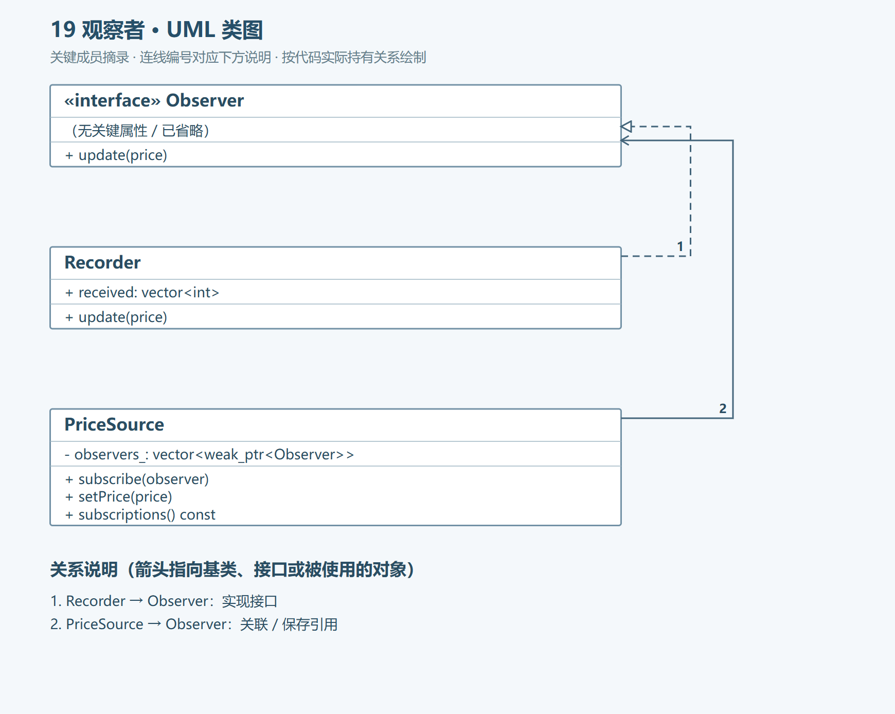

**对照代码读图。** PriceSource 保存 0..* 个 weak_ptr，是非拥有的关联。通知期间临时升级 shared_ptr 保活，不代表永久组合。

### 完整 C++17 示例

源文件：[examples/19_observer.cpp](examples/19_observer.cpp)。本节代码与配套文件一致。

~~~cpp
#include <algorithm>
#include <cassert>
#include <cstddef>
#include <iostream>
#include <memory>
#include <stdexcept>
#include <utility>
#include <vector>

struct Observer { virtual ~Observer() = default; virtual void update(int price) = 0; };
class PriceSource {
    std::vector<std::weak_ptr<Observer>> observers_;
public:
    void subscribe(const std::shared_ptr<Observer>& observer) {
        if (!observer) throw std::invalid_argument("null observer");
        for (const auto& weak : observers_)
            if (weak.lock() == observer) return;  // 不重复订阅。
        observers_.push_back(observer);
    }
    void setPrice(int price) {
        std::vector<std::shared_ptr<Observer>> live;
        for (const auto& weak : observers_)
            if (auto observer = weak.lock()) live.push_back(std::move(observer));
        observers_.erase(std::remove_if(observers_.begin(), observers_.end(),
             { return weak.expired(); }), observers_.end());
        // 先建立快照，再回调，避免回调中新订阅使原容器迭代器失效。
        for (const auto& observer : live) observer->update(price);
    }
    std::size_t subscriptions() const { return observers_.size(); }
};
struct Recorder final : Observer {
    std::vector<int> received;
    void update(int price) override { received.push_back(price); }
};
int main() {
    PriceSource source;
    auto chart = std::make_shared<Recorder>();
    auto alert = std::make_shared<Recorder>();
    source.subscribe(chart);
    source.subscribe(alert);
    source.setPrice(100);
    assert(chart->received.back() == 100 && alert->received.back() == 100);
    alert.reset();
    source.setPrice(120);
    assert(source.subscriptions() == 1 && chart->received.back() == 120);
    std::cout << "remaining=" << source.subscriptions()
              << " latest=" << chart->received.back() << '\n';
}
~~~

### 编译与预期输出

在资料根目录的 Linux Bash 中运行：

~~~bash
g++ -std=c++17 -Wall -Wextra -Wpedantic -O2 -g -pthread examples/19_observer.cpp -o pattern19
./pattern19
~~~

输出：

~~~text
remaining=1 latest=120
~~~

### 优点

- 价格源不用认识订阅者的具体类型，可以通知多个不同观察者。
- 订阅方可独立增加，弱引用避免价格源长期阻止观察者释放。

### 缺点

- 通知顺序、回调重入、异常处理和退订语义都需要明确约定。
- 慢回调会拖慢同步通知；本例也不是线程安全事件总线。

### 适用场景与边界

**什么时候值得用？** 适用于事件通知、界面更新和进程内发布订阅。通知可以同步也可以异步，本例明确采用同步调用。

**代价与边界。** 必须定义退订、回调异常、重入与线程安全规则。本例不支持跨线程同步，回调异常向调用者传播；回调中的递归更新可能导致嵌套通知。快照中的对象会活到这轮通知结束。

**和相似模式怎么区分？** 观察者通常通知多个订阅者，不等于责任链的逐个审批。使用消息队列实现跨进程发布订阅，还需要解决持久化、交付和重试等额外问题。

## 20｜状态（State）

### 该模式解决什么问题？

**先看具体场景。** 订单的付款与发货行为取决于当前阶段：未付款不能发货，已付款才能发货，已发货不能再次付款。

**不用它时，麻烦在哪里？** 若 pay 和 ship 各自写一大段状态判断，同一阶段的规则会分散在多个函数。阶段增加后，容易某处允许发货、另一处却仍把订单视为未付款。

**它怎样解决？** Order 把阶段相关行为交给当前 State。Unpaid 允许付款但拒绝发货，Paid 允许发货，迁移返回新状态后由 Order 接管。每个阶段的行为集中在对应状态类型中。

**它不负责什么？** 它组织的是状态相关行为及迁移，不自动保证业务规则完整，也不处理并发付款、持久化、幂等或跨服务一致性。简单状态机用枚举和转换表也可能更容易审查。

> **识别信号：** 同一操作随当前状态改变，状态判断散落在多处。

**用一个类比建立直觉。** 自动售货机在未投币、已投币和出货阶段对同一个按钮有不同反应，阶段之间有合法转换。

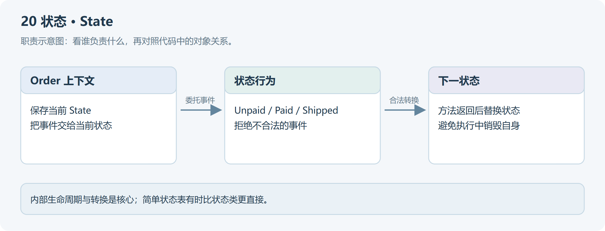

*图示表达职责与调用意图，不是精确 UML；再对照下面的角色说明阅读。*

**再看底层分工。** Order 是上下文，State 是状态接口，Unpaid、Paid、Shipped 实现各状态行为。事件委托给当前状态，状态方法返回后，由上下文替换状态对象。

**沿着示例走一遍。** 先尝试发货会抛非法转换异常；pay 将 Unpaid 换为 Paid，ship 再换为 Shipped。旧状态在方法返回以后才被销毁，避免在自身方法中删除自己。

### UML 类图

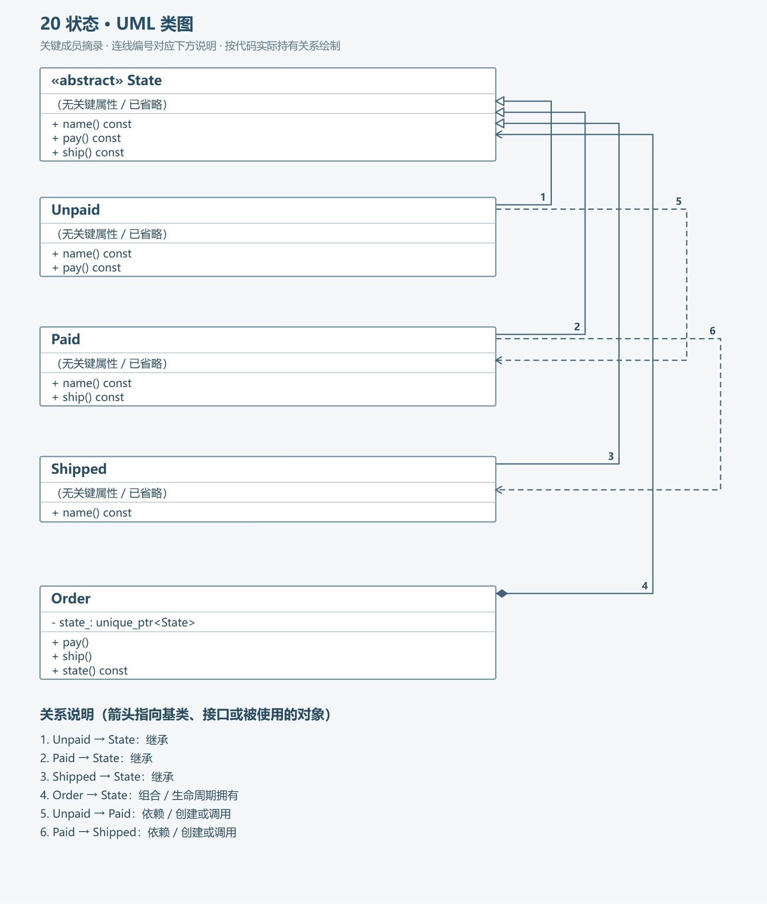

**对照代码读图。** Order 独占 1 个 State。State 有部分默认实现，因此用抽象类继承实线；迁移先返回新状态，再由 Order 替换旧对象。

### 完整 C++17 示例

源文件：[examples/20_state.cpp](examples/20_state.cpp)。本节代码与配套文件一致。

~~~cpp
#include <cassert>
#include <iostream>
#include <memory>
#include <stdexcept>
#include <string>
#include <utility>

struct State {
    virtual ~State() = default;
    virtual std::string name() const = 0;
    virtual std::unique_ptr<State> pay() const { throw std::logic_error("cannot pay"); }
    virtual std::unique_ptr<State> ship() const { throw std::logic_error("cannot ship"); }
};
struct Unpaid final : State {
    std::string name() const override { return "unpaid"; }
    std::unique_ptr<State> pay() const override;
};
struct Paid final : State {
    std::string name() const override { return "paid"; }
    std::unique_ptr<State> ship() const override;
};
struct Shipped final : State {
    std::string name() const override { return "shipped"; }
};
std::unique_ptr<State> Unpaid::pay() const { return std::make_unique<Paid>(); }
std::unique_ptr<State> Paid::ship() const { return std::make_unique<Shipped>(); }
class Order {
    std::unique_ptr<State> state_ = std::make_unique<Unpaid>();
public:
    void pay() {
        auto next = state_->pay();  // 当前方法先返回，再替换和销毁旧状态。
        state_ = std::move(next);
    }
    void ship() {
        auto next = state_->ship();
        state_ = std::move(next);
    }
    std::string state() const { return state_->name(); }
};
int main() {
    Order order;
    bool rejected = false;
    try { order.ship(); } catch (const std::logic_error&) { rejected = true; }
    assert(rejected && order.state() == "unpaid");
    order.pay();
    order.ship();
    assert(order.state() == "shipped");
    std::cout << "illegal transition rejected\nstate=" << order.state() << '\n';
}
~~~

### 编译与预期输出

在资料根目录的 Linux Bash 中运行：

~~~bash
g++ -std=c++17 -Wall -Wextra -Wpedantic -O2 -g -pthread examples/20_state.cpp -o pattern20
./pattern20
~~~

输出：

~~~text
illegal transition rejected
state=shipped
~~~

### 优点

- 把各阶段行为放进不同状态类，减少散落的状态判断。
- 非法操作由状态接口拒绝，合法迁移位置较集中。

### 缺点

- 状态多时类和迁移关系都增多，需要检查完整性与可达性。
- 状态若直接知道彼此，修改迁移规则会波及多个类。

### 适用场景与边界

**什么时候值得用？** 适用于状态数增加、事件行为差异明显且转换规则需要集中表达的状态机。

**代价与边界。** 每个状态增加一个类会带来数量成本。简单有限状态机用 enum 加转换表可能更清楚。状态模式不自动提供并发保护、数据库持久化、幂等或分布式一致性。

**和相似模式怎么区分？** 状态变化通常表达对象内部生命周期与合法转换；策略通常由使用者选择一种算法。二者结构类似，但业务意图不同。

## 21｜策略（Strategy）

### 该模式解决什么问题？

**先看具体场景。** 运费计算有普通与加急两种算法，结算流程希望切换算法而不在每次计算时重复判断运输方式。

**不用它时，麻烦在哪里？** 普通和加急运费若都写进 Calculator::cost，每增加一种算法就要修改计算器；算法还难以单独替换和测试。

**它怎样解决？** Shipping 提供统一 cost 接口，Standard 和 Express 各实现一种算法。Calculator 调用当前策略，外部用 setStrategy 切换，同样距离得到对应算法的结果。

**它不负责什么？** 它隔离的是可替换算法，不负责判断哪种策略最适合当前订单；选择仍在调用方或配置层。固定且简单的分支，用函数或函数对象可能比一组类更合适。

> **识别信号：** 同一任务有多种算法，需要独立扩展或运行时替换。

**用一个类比建立直觉。** 导航时选步行或驾车路线，目的地不变，选择的计算规则不同。

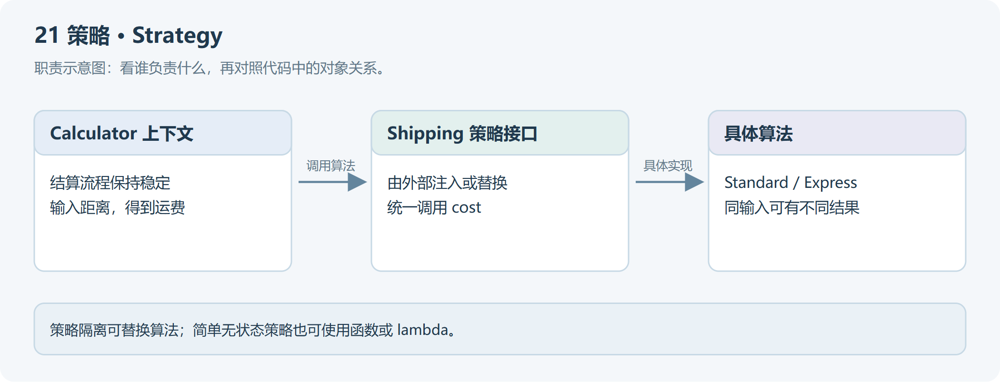

*图示表达职责与调用意图，不是精确 UML；再对照下面的角色说明阅读。*

**再看底层分工。** Shipping 是策略接口，Standard 与 Express 是具体算法，Calculator 是持有策略的上下文。通过构造或 setStrategy 注入算法，计算流程只调用接口。

**沿着示例走一遍。** 同样 3 公里的输入，普通算法得到 300 分；换加急算法得到 1100 分。变化的是算法对象，不是 Calculator::cost 的流程。

### UML 类图

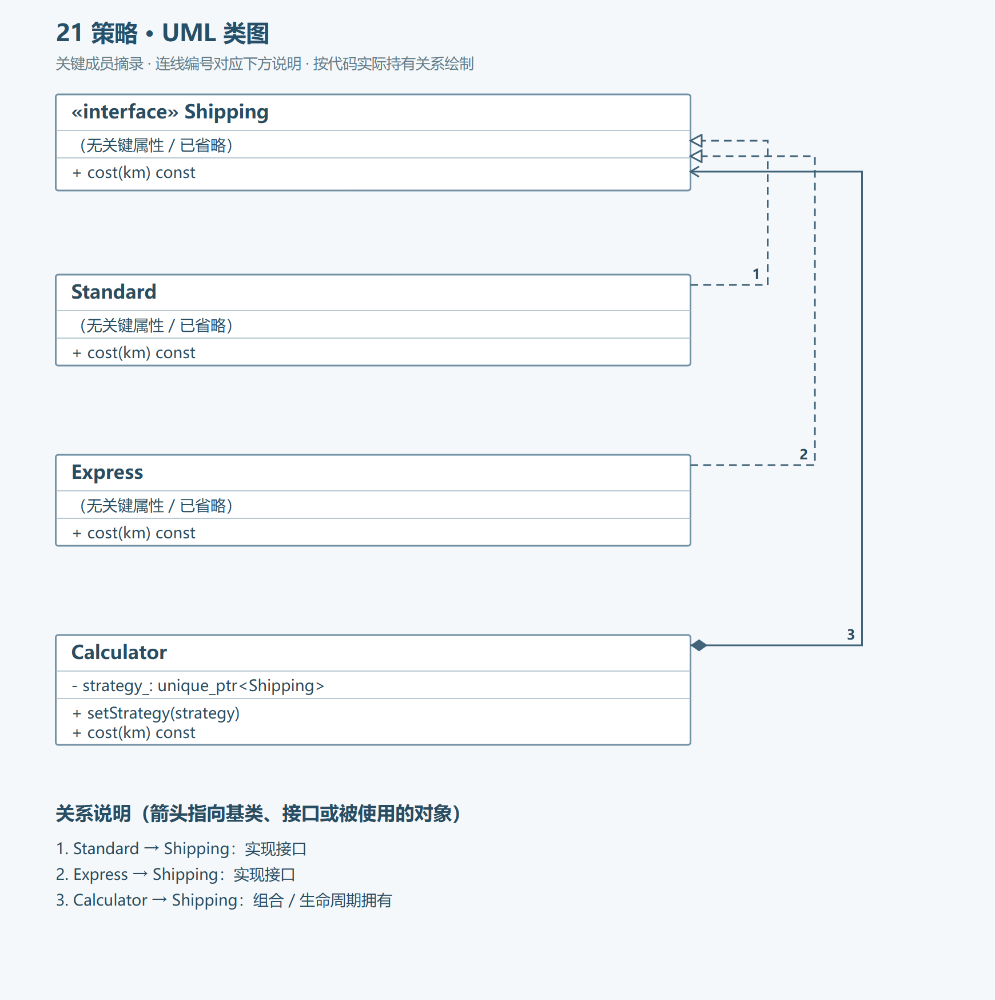

**对照代码读图。** Calculator 独占 1 个 Shipping，策略由外部选择和注入；不同于状态按业务阶段决定允许行为的目的。

### 完整 C++17 示例

源文件：[examples/21_strategy.cpp](examples/21_strategy.cpp)。本节代码与配套文件一致。

~~~cpp
#include <cassert>
#include <iostream>
#include <memory>
#include <stdexcept>
#include <utility>

struct Shipping { virtual ~Shipping() = default; virtual int cost(int kilometers) const = 0; };
struct Standard final : Shipping {
    int cost(int kilometers) const override { return kilometers * 100; }
};
struct Express final : Shipping {
    int cost(int kilometers) const override { return kilometers * 200 + 500; }
};
class Calculator {
    std::unique_ptr<Shipping> strategy_;
public:
    explicit Calculator(std::unique_ptr<Shipping> strategy) { setStrategy(std::move(strategy)); }
    void setStrategy(std::unique_ptr<Shipping> strategy) {
        if (!strategy) throw std::invalid_argument("null strategy");
        strategy_ = std::move(strategy);
    }
    int cost(int kilometers) const {
        if (kilometers < 0 || kilometers > 10000) throw std::invalid_argument("distance range");
        return strategy_->cost(kilometers);
    }
};
int main() {
    Calculator calculator(std::make_unique<Standard>());
    int ordinary = calculator.cost(3);
    calculator.setStrategy(std::make_unique<Express>());
    int urgent = calculator.cost(3);
    assert(ordinary == 300 && urgent == 1100);
    std::cout << "standard=" << ordinary << " express=" << urgent << '\n';
}
~~~

### 编译与预期输出

在资料根目录的 Linux Bash 中运行：

~~~bash
g++ -std=c++17 -Wall -Wextra -Wpedantic -O2 -g -pthread examples/21_strategy.cpp -o pattern21
./pattern21
~~~

输出：

~~~text
standard=300 express=1100
~~~

### 优点

- 运费算法可以替换，计算器不必包含所有算法分支。
- 算法可以单独测试，增加算法通常不需要修改已有算法。

### 缺点

- 调用方仍要知道何时选择哪种策略，模式不会自动选择。
- 简单算法用函数或函数对象可能更轻量，类层次未必必要。

### 适用场景与边界

**什么时候值得用？** 适用于经常替换的定价、排序、压缩、校验与路由算法，也方便注入测试替身。

**代价与边界。** 调用者需要知道该选哪一种策略。固定且很少的分支不一定值得建类；策略太细会造成大量转发对象。示例金额和距离使用小整数，真实业务需检查范围、溢出及舍入规则。

**和相似模式怎么区分？** 模板方法通过继承改变算法中的步骤；策略通过组合替换算法。简单无状态策略可以用函数对象、lambda 或模板参数表达。

## 22｜模板方法（Template Method）

### 该模式解决什么问题？

**先看具体场景。** 生成报告总要先加载数据、再格式化、最后加统一边界标记。希望复用流程，但允许子类定制具体步骤。

**不用它时，麻烦在哪里？** 不同报告若各自写完整的“加载→格式化→加边界标记”流程，会重复相同代码，还可能有人漏掉步骤或改变顺序。

**它怎样解决？** Report::generate 固定公共流程，只把 load 和 format 留给子类实现。CsvReport 和 BracketReport 共用同一骨架，结果都保留 BEGIN 与 END，只有中间内容不同。

**它不负责什么？** 它复用的是稳定算法骨架，不是运行时任意重排步骤的工具。generate 非虚只保证通过基类接口调用时的骨架，不能阻止派生类另写同名函数或提供其他入口；需要自由组合步骤时可考虑组合。

> **识别信号：** 处理步骤顺序稳定，少数步骤需要不同实现。

**用一个类比建立直觉。** 泡茶和冲咖啡都要烧水、冲泡、倒杯，但冲泡的具体动作不同；先固定大步骤，再开放局部差异。

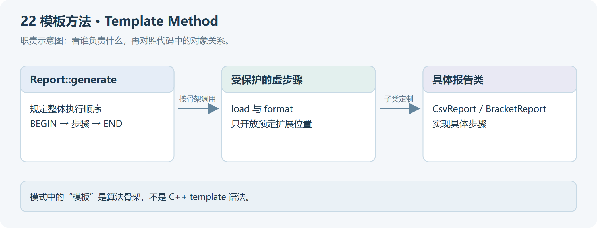

*图示表达职责与调用意图，不是精确 UML；再对照下面的角色说明阅读。*

**再看底层分工。** Report::generate 定义算法骨架，内部调用受保护的虚步骤 load 与 format。CsvReport、BracketReport 只实现这些步骤，使用者通过基类接口执行固定顺序。

**沿着示例走一遍。** 两个报告都保留 BEGIN 与 END，只有中间格式不同。generate 不是虚函数，派生类不能通过覆盖它改变经基类接口调用时的骨架。

### UML 类图

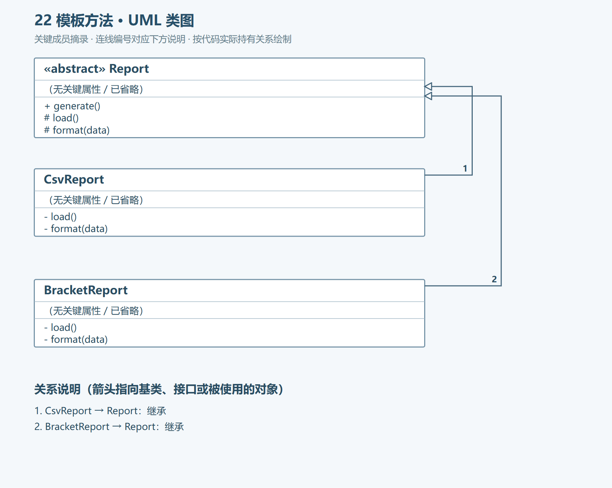

**对照代码读图。** generate 是非虚函数，内部调用可重写步骤。模板方法是设计模式名称，与 C++ template 语法不是一回事。

### 完整 C++17 示例

源文件：[examples/22_template_method.cpp](examples/22_template_method.cpp)。本节代码与配套文件一致。

~~~cpp
#include <cassert>
#include <iostream>
#include <string>

class Report {
protected:
    virtual std::string load() const = 0;
    virtual std::string format(const std::string& data) const = 0;
public:
    virtual ~Report() = default;
    std::string generate() const {
        auto data = load();
        auto body = format(data);
        return "BEGIN|" + body + "|END";
    }
};
class CsvReport final : public Report {
    std::string load() const override { return "data"; }
    std::string format(const std::string& data) const override { return "csv(" + data + ")"; }
};
class BracketReport final : public Report {
    std::string load() const override { return "data"; }
    std::string format(const std::string& data) const override { return "[" + data + "]"; }
};
int main() {
    CsvReport csv;
    BracketReport bracket;
    const Report& first = csv;
    const Report& second = bracket;
    assert(first.generate() == "BEGIN|csv(data)|END");
    assert(second.generate() == "BEGIN|[data]|END");
    std::cout << first.generate() << '\n' << second.generate() << '\n';
}
~~~

### 编译与预期输出

在资料根目录的 Linux Bash 中运行：

~~~bash
g++ -std=c++17 -Wall -Wextra -Wpedantic -O2 -g -pthread examples/22_template_method.cpp -o pattern22
./pattern22
~~~

输出：

~~~text
BEGIN|csv(data)|END
BEGIN|[data]|END
~~~

### 优点

- 公共的加载和格式化流程只写一次，子类专注差异步骤。
- 固定入口让各实现遵守相同执行顺序。

### 缺点

- 依赖继承，子类会受基类流程调整影响。
- 需要运行时自由组合每个步骤时，固定继承结构可能不够灵活。

### 适用场景与边界

**什么时候值得用？** 适用于流程长期稳定、其中少数步骤需要由继承体系扩展的框架和处理管线。

**代价与边界。** 继承使子类受基类流程和约束影响。步骤粒度过细会难以理解；子类也不该绕过前置条件。若算法需要频繁在运行时组合，策略或独立步骤对象可能更合适。

**和相似模式怎么区分？** 这里“模板”是固定流程的意思，不是 C++ 的 template 语法。模板方法强调继承式步骤定制，策略强调组合式算法替换。

## 23｜访问者（Visitor）

### 该模式解决什么问题？

**先看具体场景。** 购物车包含书和水果，希望增加总价统计、说明文本等操作，但不希望每次都把新操作塞进每种商品类。

**不用它时，麻烦在哪里？** 购物车里有书和水果，若总价、说明、导出等每种新操作都写进各商品类，就要反复修改这些类；一个操作的代码也分散在不同元素中。

**它怎样解决？** Item 通过 accept 接收 Visitor。PriceVisitor 集中处理各类元素的价格，DescriptionVisitor 集中生成说明；元素类型不变时，新增操作主要增加访问者实现。

**它不负责什么？** 它适合元素类型相对稳定、操作经常增加的结构。新增元素类型仍会影响 Visitor 接口及各访问者；也不能只写 visit(Item&) 就期待 C++ 重载根据运行时类型自动选择。

> **识别信号：** 元素类型稳定，却经常需要新增跨类型操作。

**用一个类比建立直觉。** 不同检查员访问同一组展品：估价员算价值，讲解员写说明。展品类型稳定，新增检查任务更频繁。

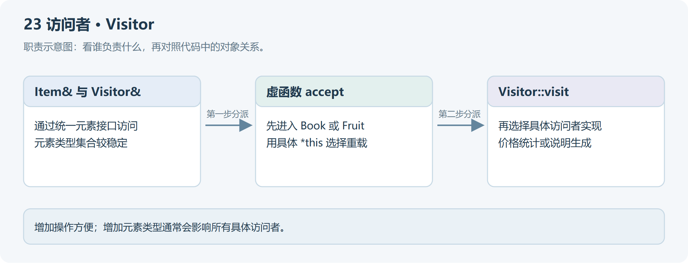

*图示表达职责与调用意图，不是精确 UML；再对照下面的角色说明阅读。*

**再看底层分工。** Item 定义 accept，Book 与 Fruit 在 accept 中调用 visitor.visit(*this)；Visitor 对各具体元素声明 visit 重载，PriceVisitor 和 DescriptionVisitor 实现不同操作。先虚调用 accept 确定元素类型，再虚调用对应 visit 确定操作，实现经典双分派结构。

**沿着示例走一遍。** 同一购物车先交给 PriceVisitor 得到 1500 分，再交给 DescriptionVisitor 得到两种说明。C++ 重载选择本身是编译期行为，不能只写 visit(Item&) 就期待自动选择派生重载。

### UML 类图

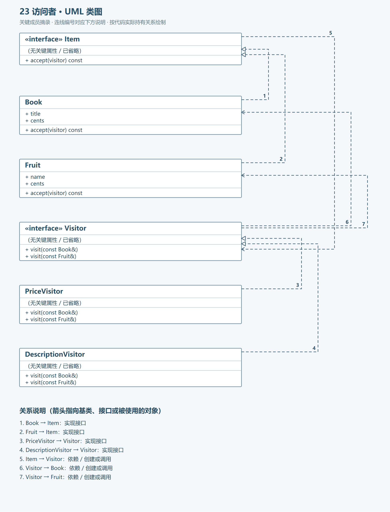

**对照代码读图。** accept 内调用 visitor.visit(*this)，结合虚调用与重载实现双分派。参数引用只在调用期间使用，因此画依赖，不表示长期持有元素。

### 完整 C++17 示例

源文件：[examples/23_visitor.cpp](examples/23_visitor.cpp)。本节代码与配套文件一致。

~~~cpp
#include <cassert>
#include <iostream>
#include <memory>
#include <string>
#include <utility>
#include <vector>

class Book;
class Fruit;
struct Visitor {
    virtual ~Visitor() = default;
    virtual void visit(const Book&) = 0;
    virtual void visit(const Fruit&) = 0;
};
struct Item { virtual ~Item() = default; virtual void accept(Visitor&) const = 0; };
class Book final : public Item {
public:
    std::string title;
    int cents;
    Book(std::string value, int price) : title(std::move(value)), cents(price) {}
    void accept(Visitor& visitor) const override { visitor.visit(*this); }
};
class Fruit final : public Item {
public:
    std::string name;
    int cents;
    Fruit(std::string value, int price) : name(std::move(value)), cents(price) {}
    void accept(Visitor& visitor) const override { visitor.visit(*this); }
};
struct PriceVisitor final : Visitor {
    int total = 0;
    void visit(const Book& book) override { total += book.cents; }
    void visit(const Fruit& fruit) override { total += fruit.cents; }
};
struct DescriptionVisitor final : Visitor {
    std::string text;
    void visit(const Book& book) override { text += "book:" + book.title + " "; }
    void visit(const Fruit& fruit) override { text += "fruit:" + fruit.name; }
};
int main() {
    std::vector<std::unique_ptr<Item>> cart;
    cart.push_back(std::make_unique<Book>("cpp", 1000));
    cart.push_back(std::make_unique<Fruit>("apple", 500));
    PriceVisitor prices;
    DescriptionVisitor descriptions;
    for (const auto& item : cart) { item->accept(prices); item->accept(descriptions); }
    assert(prices.total == 1500 && descriptions.text == "book:cpp fruit:apple");
    std::cout << "total=" << prices.total << '\n' << descriptions.text << '\n';
}
~~~

### 编译与预期输出

在资料根目录的 Linux Bash 中运行：

~~~bash
g++ -std=c++17 -Wall -Wextra -Wpedantic -O2 -g -pthread examples/23_visitor.cpp -o pattern23
./pattern23
~~~

输出：

~~~text
total=1500
book:cpp fruit:apple
~~~

### 优点

- 元素类型稳定时，可以增加操作类，避免把所有操作塞进元素。
- 一种跨类型操作集中在同一个访问者中，方便整体维护。

### 缺点

- 新增元素类型要扩展 Visitor 接口，并修改各访问者。
- 访问者可能要求元素暴露更多数据，增加封装边界上的压力。

### 适用场景与边界

**什么时候值得用？** 适用于元素类型较稳定而操作种类经常增加的结构，例如编译器语法树、文档对象和模型分析。

**代价与边界。** 增加新操作较方便，但增加新元素类型通常要修改 Visitor 接口及所有具体访问者。访问者可能需要暴露元素数据，应通过窄接口读取，而不是无边界破坏封装。

**和相似模式怎么区分？** 策略通常替换一个算法；访问者把作用于多种元素类型的一组操作集中起来。std::variant 加 std::visit 也可处理封闭类型集合，但不能把两者当作无条件等价替换。

## 容易混淆的模式，应该怎样区分

不要只看“有没有一个接口”“有没有包装另一个对象”。许多模式结构相似，区别在于它们想稳定哪一部分、允许哪一部分变化。

| 组合 | 判断问题 | 区别 |
|---|---|---|
| 工厂方法 / 抽象工厂 / 生成器 | 变化的是一个产品、产品族还是构建过程？ | 子类决定产品 / 成套创建 / 分步组装 |
| 原型 / 普通复制 / shared_ptr 复制 | 想得到新对象还是共享原对象？ | 多态克隆 / 值复制 / 共享所有权 |
| 适配器 / 外观 | 是接口接不上，还是入口太复杂？ | 转换接口 / 简化子系统的常用使用方式 |
| 装饰器 / 代理 | 是添加职责，还是控制访问？ | 可叠加扩展 / 延迟、权限、远程访问等控制 |
| 桥接 / 策略 | 是两个维度独立扩展，还是替换一种算法？ | 抽象与实现分开 / 上下文组合算法 |
| 状态 / 策略 | 是生命周期阶段变化，还是调用者选择算法？ | 状态与合法转换 / 可替换行为方案 |
| 命令 / 备忘录 | 是记录操作，还是记录状态？ | 可执行请求 / 可恢复快照 |
| 观察者 / 中介者 | 是发布通知，还是协调互动规则？ | 发布订阅 / 多对象协作的集中协调 |
| 责任链 / 观察者 | 谁会处理这次请求？ | 按规则沿链传递 / 通知一组订阅者 |
| 模板方法 / C++ template | 是固定流程，还是语言泛型？ | 行为模式 / 语言机制；二者可以结合 |

这些边界不是互斥条件。一个远程代理可以外包日志装饰器，创建代理时可以用工厂；命令执行前可以保存备忘录，完成后可以通知观察者。重要的是每层是否有独立职责，以及增加它是否比直接代码更容易理解。

## 放到一个网店里：怎样逐步使用，而不是一次套满

先从最简单的版本开始：一个订单对象，一条普通运费规则，一种通知渠道。此时直接实现就够了。

第一轮变化是“运费算法增加加急和自提”。如果它们经常替换，可以把计算规则提取成策略；结算流程通过注入获得策略。若只是两个固定且不再扩展的分支，清晰的条件判断也合理。

第二轮变化是“未付款、已付款、已发货阶段，对相同操作反应不同”。当判断已经散落在多个方法里，可以用状态类或状态表集中管理合法转换。要先写清业务规则，模式不会替你决定它。

第三轮变化是“通知既分普通和紧急，也支持邮件和短信”。两个维度独立扩展时，用桥接组织通知与渠道。如果只是一个流程配不同发送算法，策略可能就足够，没必要为了名称再加一层。

第四轮变化是“记录每次发送，并在符合条件时重试”。可以用装饰器组合职责，但必须讨论顺序：记录一次业务请求，还是每次实际重试都记录？发送是否幂等？包装不会自动使重试安全。

第五轮变化是“订单完成后刷新界面和发出提醒”。观察者降低发布者对具体订阅者的依赖，但跨进程交付、数据库提交一致性已经是更大的问题，不能只凭该模式保证消息绝不丢失。

这套过程有一个共同点：**先遇到变化，再确定稳定边界，最后选表达它的结构。** 应该能指出哪处重复判断减少了、哪种扩展更局部了；如果只能说“更像教材”，收益还没有得到证明。

~~~text
对象创建正在变化？
  一个产品 → 工厂方法；一族产品 → 抽象工厂
  多步组装 → 生成器；复制实际类型 → 原型

对象关系正在变化？
  接口不兼容 → 适配器；一组操作太复杂 → 外观
  两个扩展维度 → 桥接；树结构 → 组合
  叠加职责 → 装饰器；控制访问 → 代理；共享内部状态 → 享元

协作行为正在变化？
  替换算法 → 策略；阶段与转换 → 状态
  请求要保存或排队 → 命令；状态要恢复 → 备忘录
  一个更新通知多个对象 → 观察者；关系太密 → 中介者
~~~

## 读代码时，可以检查这六件事

1. **变化点真实存在吗？** 猜测未来可能扩展，通常不足以支撑复杂层次。
2. **抽象表达业务能力吗？** 不要把完全不同的语义强行塞进一个接口。
3. **所有权明确吗？** 谁释放对象，借用何时失效，回调会不会访问已销毁对象？
4. **错误有去处吗？** 创建失败、链末无人处理、非法状态转换和回调异常都要定义行为。
5. **复制与并发合理吗？** 内含自引用的中介者不应默认复制；静态初始化安全不等于业务线程安全。
6. **可以验证吗？** 测试原有行为、扩展行为和失败路径，不用类的数量证明设计质量。

## Q&A：常见问题与解答

**问：必须记住 23 张类图才能写项目吗？** 答：不必。先说明要隔离什么变化，再理解常见分工方式。模式名字有助于沟通，不能代替判断。

**问：if、switch 多就一定错了吗？** 答：不是。固定、短小、清楚的判断往往更好。只有它反复扩散、频繁变化并影响多个使用者时，才需要考虑提取接口。

**问：模式都会让程序更快吗？** 答：不是。许多模式主要改善组织与扩展，可能增加分配、虚调用和间接层。享元、代理也只有在共享或延迟确实节省成本时才有收益，需要测量。

**问：所有基类都要有虚析构吗？** 答：本文接口允许经基类指针销毁派生对象，因此使用 public virtual 析构。有意禁止经基类删除的设计可以用 protected non-virtual 析构，不能把任意 public non-virtual 析构用于多态删除。

**问：shared_ptr 能解决全部生命周期问题吗？** 答：不能。强引用环可能导致对象无法释放。先判断是否真的共享所有权；借用可用引用，有过期可能的订阅可考虑 weak_ptr。

**问：单例能不能不加锁？** 答：局部 static 的并发初始化由语言保证，成员状态仍需按访问方式同步。本例单个计数用了 atomic，多个字段的业务不变量不会因此自动受到保护。

**问：装饰器和代理看起来一样，怎么区分？** 答：先说意图：兼容接口外增加职责，还是控制对真实对象的访问？再结合构造时机、生命周期和实际行为解释。

**问：为什么模板方法不用 template？** 答：“模板”指固定算法骨架，与 C++ 泛型语法不是同一概念。可以用普通虚函数实现，也可以结合泛型重新表达。

**问：访问者有 visit 重载，为什么还要 accept？** 答：重载选择依赖表达式的静态类型。虚 accept 先进入实际元素类，再用具体的 *this 类型选择 visit 重载，最后由 Visitor 虚调用选择操作。

**问：为什么每份示例都有 main？** 答：为了独立编译运行。批量脚本分别生成 23 个程序，不把它们一起链接。

**问：可以直接当生产组件使用吗？** 答：这些程序演示最小协作关系，真实组件还要补输入边界、异常安全、线程安全、外部资源和容量控制。请结合每节限制改造。

## 延伸阅读与验证范围

经典来源是 Gamma、Helm、Johnson、Vlissides 的《Design Patterns: Elements of Reusable Object-Oriented Software》。本文按经典 5/7/11 分类，代码独立编写，没有复制该书或第三方教程的示例。

- [C++ Core Guidelines](https://isocpp.github.io/CppCoreGuidelines/CppCoreGuidelines)：生命周期、资源管理与接口设计，重点可读 C.35 的基类析构建议。
- [C++ 工作草案：块作用域声明](https://eel.is/c++draft/stmt.dcl)：局部静态变量初始化规则；该链接跟踪工作草案，本文目标仍为 C++17。
- [C++ 工作草案：unique_ptr](https://eel.is/c++draft/unique.ptr)：独占所有权与相关操作。
- [模式目录及图解扩展阅读](https://refactoring.guru/design-patterns/catalog)：辅助对照模式名称与职责。

实际编译器、参数和 23 份程序的输出见“验证说明.md”及“验证结果.json”。示例测试不能证明全部输入或并发执行均正确。

## 思维导图总结

~~~text
23 种设计模式的 C++ 实战
├── 创建型：把创建的变化放到合适的位置
│   ├── 工厂方法：子类决定产品；抽象工厂：成套产品
│   ├── 生成器：分步组装；原型：多态复制
│   └── 单例：受控入口与实例生命周期
├── 结构型：让对象关系清楚
│   ├── 适配器：接口转换；桥接：两个独立维度
│   ├── 组合：树；装饰器：叠加职责；外观：简化入口
│   └── 享元：共享内部状态；代理：控制访问
├── 行为型：让对象按规则合作
│   ├── 责任链、命令、解释器、迭代器
│   ├── 中介者、备忘录、观察者
│   └── 状态、策略、模板方法、访问者
└── C++ 工程检查
    ├── 所有权与借用、虚析构、复制和移动
    └── 失败路径、异常安全、并发边界、可运行验证
~~~

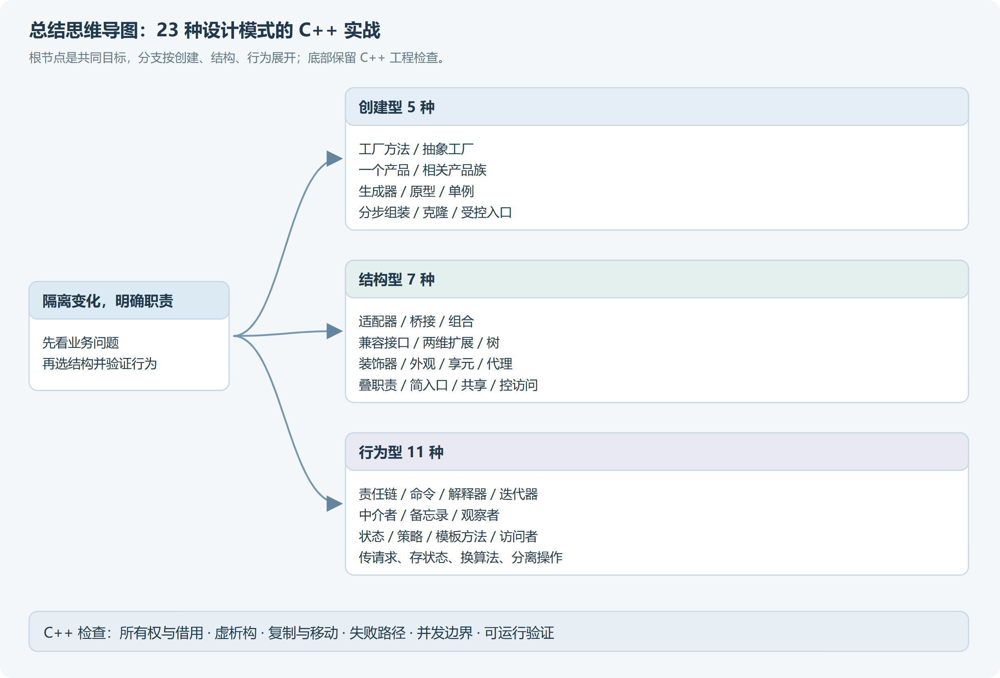

*按创建、结构、行为复习；写代码时再检查所有权、错误与并发边界。*

