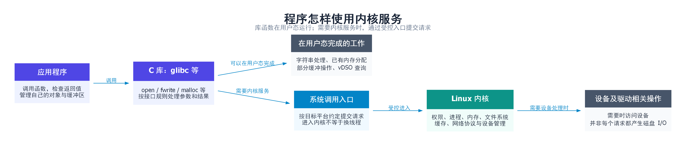
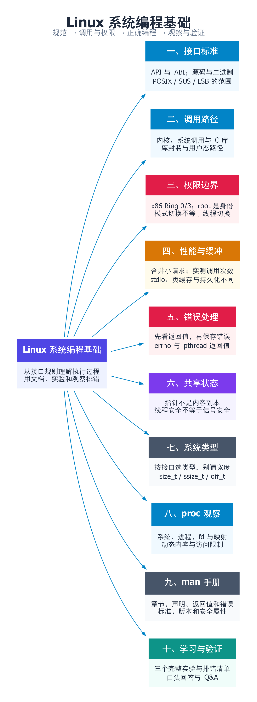

# Linux 系统编程基础：从接口标准到调用、排错与观察

本文解决一个问题：写 Linux 程序时，怎样分清接口由谁提供、调用怎样执行，以及出错后应该检查什么。

前置知识是 C/C++ 的函数、指针、数组和基本编译命令。这里先建立系统编程的共同基础，文件读写细节继续看[文件 I/O 笔记](../二.文件IO/1.文件IO.md)，线程同步继续看[POSIX 线程笔记](../八.POSIX线程/1.POSIX线程.md)。

示例面向 Linux/glibc，使用 C++11。标准规定的接口行为、Linux 的实现细节和实践建议会分别说明；x86 的 Ring 0/3 不能套到所有 CPU 架构。

## 阅读路线

| 想弄明白的问题 | 阅读位置 |
| --- | --- |
| POSIX、SUS、LSB 到底保证什么 | [一、接口标准](#standards) |
| open、glibc 和内核是什么关系 | [二、调用路径](#layers) |
| 用户态为什么不能随意访问内核 | [三、权限边界](#protection) |
| 为什么小块输出常常需要缓冲 | [四、性能与缓冲](#buffering) |
| 失败后怎样读错误码、打印原因 | [五、错误处理](#errors) |
| 返回了一个指针，为什么内容还会被覆盖 | [六、共享状态](#sharing) |
| 为什么要使用 size_t、ssize_t、off_t | [七、系统类型](#types) |
| 怎样观察正在运行的程序 | [八、proc](#proc) |
| 怎样自己读懂一个陌生接口 | [九、man 手册](#manual) |
| 编译运行、排错与面试复述 | [十、学习与验证](#practice)、[Q&A](#qa) |

初次学习先读二、三、五、七、九，建立调用和排错习惯；再做四、六、八的实验。深入复习时，从第一节顺序阅读，重点回答每条规则背后的原因。

<a id="standards"></a>

## 一、换一个系统，程序为什么可能不能用？

### 1.1 先分清“重新编译能用”和“复制程序就能用”

假设同一份文件复制程序要在两种操作系统上运行。两边如果都提供含义一致的 `open()`、`read()`、`write()`，源码就有机会分别编译运行。这里依赖的是 **API（应用编程接口）**：函数怎样声明、参数是什么意思、出错怎样报告。

但把第一台机器编译出的可执行文件直接复制到第二台机器，还需要更多条件：CPU 指令集是否相同，程序需要哪种动态链接器，库里是否有对应符号，参数怎样传递，数据结构怎样布局。这些属于 **ABI（应用二进制接口）**。

可以类比成“双方使用同一份菜谱”和“把一份已经做好的套餐直接送过去”。菜谱相同帮助重新制作；已经做好的程序能否直接使用，还取决于目标环境。类比只用来区分层次，真正要检查的是架构、库和接口约定。

### 1.2 POSIX、SUS 和 LSB 各自关注什么？

| 规范 | 主要解决的问题 | 学习时应该怎样理解 |
| --- | --- | --- |
| POSIX：Portable Operating System Interface | 不同类 Unix 系统的应用接口和工具行为不一致 | 约定头文件、函数、Shell 和工具行为，主要帮助源码移植 |
| SUS：Single UNIX Specification | 统一 UNIX 系统的规范，并与 UNIX 产品认证相联系 | 与 POSIX 共享核心基础规范，不要当作完全独立的另一套 API |
| LSB：Linux Standard Base | 不同 Linux 环境之间的二进制兼容问题 | 在指定架构和规范范围内约定 ABI、库及运行环境 |

POSIX.1-2024 同时是 IEEE Std 1003.1-2024 和 The Open Group Base Specifications Issue 8。SUS Version 5 的核心采用这些基础规范，并包含 X/Open Curses 等内容。这里是标准体系的关系，不表示任意 Linux 系统都已经实现了其中所有接口。是否获得 UNIX 认证也要按具体产品和版本查询，不能从“很像 UNIX”推断。[IEEE 标准说明](https://standards.ieee.org/ieee/9945/12489/) · [SUS 介绍](https://www.unix.org/overview.html)

LSB 讨论的兼容也有范围：应用和运行环境需要满足相应规范，并匹配架构要求。不能推导出“所有 rpm、deb 软件包都能在任意 Linux 发行版互装”，更不能用它解释 x86 程序直接运行在 ARM 上。[Linux Foundation 的 LSB 介绍](https://wiki.linuxfoundation.org/lsb/lsb-introduction)

### 1.3 写代码时怎样落实可移植性？

先确定目标：只支持 Linux，还是需要支持多个 POSIX 系统。然后查看接口手册的 `STANDARDS`、`HISTORY` 和功能测试宏要求。使用 Linux 专用接口并不是错误，但应把平台依赖集中管理，明确替代方案。

即使接口属于 POSIX，也不能忽略可选功能、具体版本和实现限制。例如数据类型宽度不能凭函数名字猜测；头文件中是否暴露某个声明，还可能受功能测试宏影响。标准提供共同规则，不能代替在目标环境编译和验证。

<a id="layers"></a>

## 二、调用 open() 时，是 glibc 在干活，还是内核在干活？

### 2.1 三者不是三套互相替代的方案

把内核想成管理公共资源的服务部门：文件、进程、内存和网络都需要统一管理。系统调用是向这个部门提交请求的受控入口。glibc 则像程序身边的工具箱，既有帮忙提交请求的函数，也有直接在程序内部完成工作的函数。

| 对象 | 负责什么 | 例子 |
| --- | --- | --- |
| Linux 内核 | 管理资源，执行权限检查、调度、内存和文件系统操作 | 管理文件描述符、页表、网络协议栈、设备驱动 |
| 系统调用 | 规定程序怎样请求内核服务 | `read`、`write`、`execve` 等内核接口 |
| glibc | 提供 C 标准库及许多 POSIX 接口，在需要时调用内核 | `strlen`、`printf`、`malloc`、`open`、pthread 接口 |

glibc 是常见的 C 库实现，但 Linux 也可以配合 musl 等其他 C 库。POSIX 是接口规范，glibc 是实现，Linux 内核是另一层实现，三者不能画等号。

### 2.2 一次打开文件的实际过程

程序通常调用 C 库提供的 `open()` 封装函数，而不是自己编写系统调用汇编。大致过程是：

1. 程序传入路径和打开方式，如只读。
2. C 库按目标平台的系统调用约定传递参数，请求内核执行操作。
3. 内核解析路径、检查访问条件、建立打开文件的状态，并把一个文件描述符交给程序。
4. 封装函数将结果转换为接口约定的形式。成功返回文件描述符；失败通常返回 `-1`，并设置当前线程的 `errno`。

文件描述符是进程使用的整数编号，不是文件内容本身。打开文件不等于把整个文件读入内存，也不保证必然发生磁盘读取：路径和文件信息可能已经在内核缓存中。

封装函数和内核调用不一定同名或一一对应。例如现代 glibc 的 `open()` 可通过 `openat` 内核接口实现。不要在笔记里把所有平台的路径固定写成 `open → sys_open`。[系统调用与库封装](https://man7.org/linux/man-pages/man2/syscalls.2.html)



### 2.3 库函数是否每次都会进入内核？

不会。`strlen()` 通常在用户态遍历字符串；`malloc()` 可能从分配器已有的空闲内存中取一块，只有需要扩充等情况才请求内核；`fwrite()` 可能先将数据放进用户态缓冲区。

还有 vDSO：Linux 将特定代码和所需信息映射到用户空间，C 库可以利用它完成部分查询，例如某些时钟读取，减少真正进入内核的次数。能否采用这条路径取决于架构和具体功能。[vDSO 手册](https://man7.org/linux/man-pages/man7/vdso.7.html)

因此，“我调用了一个和系统有关的函数”不等于“这次一定执行了系统调用”。反过来，纯用户态代码访问缺失的内存页，也可能因缺页异常进入内核。

<a id="protection"></a>

## 三、用户态和内核态究竟隔开了什么？

### 3.1 为什么不能让所有程序直接修改页表、操作设备？

如果每个程序都能修改其他程序的内存、随意更换页表或关闭设备中断，一个普通 Bug 就可能破坏整台机器。操作系统因此把高权限的资源管理集中到内核，再让硬件检查访问是否合法。

可以类比成办公区与机房：普通员工能提出服务申请，但不能因为提交了一张申请单，就自己进入机房修改设备。系统调用也是如此：进入内核后执行的是经过安排的内核代码，应用自身没有因此获得任意执行特权指令的权力。

### 3.2 x86 的 Ring 0 与 Ring 3

| 级别 | 常见用途 | 关键区别 |
| --- | --- | --- |
| Ring 0 | x86 Linux 的内核代码 | 可以执行特权操作，仍受机器配置及虚拟化等机制约束 |
| Ring 3 | 普通应用、C 库 | 对受保护内存和特权指令的访问受硬件限制 |
| Ring 1、Ring 2 | x86 提供的中间级别 | 常规 Linux 用户/内核划分主要不使用它们 |

这是 x86 的术语；例如 ARM 使用异常级别等机制。进程之间的内存隔离还依赖各自的地址空间和页表权限，不能只用 Ring 0/3 解释：两个普通进程都在 Ring 3，也不等于能相互读取任意内存。

`root` 则是操作系统权限身份。root 运行的普通应用仍在用户态，只是在请求资源时可能通过更多权限检查；它不等于“这个应用直接运行在 Ring 0”。

### 3.3 进入内核，不等于切换到另一个线程

在 x86-64 Linux 上，系统调用通常通过 `syscall` 指令进入规定的内核入口，内核保存必要现场、处理请求，再返回用户态。不同架构的指令与入口细节不同，不能把所有系统调用都称为传统软件中断。

这里要区分两件事：

- **用户态/内核态切换**：同一个线程从应用代码进入内核处理代码，之后返回。
- **线程调度切换**：当前线程暂停，由另一个线程获得 CPU。

一次系统调用可能很快返回，不发生线程调度切换；也可能因等待输入等原因阻塞，调度器转而运行其他线程。系统调用、硬件中断和异常都可能让 CPU 执行内核代码，因此系统调用也不是进入内核的唯一原因。

### 3.4 隔离解决了什么，又没有保证什么？

访问不允许的地址可能触发硬件异常，由内核进一步处理；无法正常处理的非法访问通常导致 `SIGSEGV`，其默认动作是终止进程。但缺页异常也可能只是需要补上一个有效映射，并非一律意味着程序出错。

**死循环不会因为运行在用户态就自动被终止。** 调度器通常会让其他线程也有机会运行，但这个程序仍可能持续消耗 CPU。程序还可能耗尽内存、占用磁盘或破坏自己有权访问的文件。权限隔离减少影响范围，并不等于绝对安全；资源限制、权限配置和内核本身的正确性仍然重要。

<a id="buffering"></a>

## 四、为什么频繁的小块 I/O 常常需要缓冲？

### 4.1 每写一个字节都请求一次服务，会多做什么工作？

假设要输出一万字节。每次 `write()` 一个字节，就要反复进入内核、检查参数并执行相应的文件操作。先把字节放进一块内存，再一次写出一批，通常能减少重复工作。

这类似于每买一件物品就跑一次仓库，与先汇总订单再取货。收益来自减少请求次数，不代表数据处理本身没有成本。系统调用成本受 CPU、内核配置、实际操作及负载影响，不能固定宣称“总是几百周期”或“必然快几百倍”。也不能把每次进入内核都描述成“清空全部 CPU 缓存”。

### 4.2 stdio 缓冲和内核缓存是两层

```text
程序中的数据
    ↓ fwrite / fprintf 等
进程中的 stdio 缓冲区
    ↓ 缓冲区需要输出、fflush 或正常关闭等
write 等系统调用
    ↓ 普通文件的常见路径
内核页缓存
    ↓ 回写及文件系统、设备处理
存储设备
```

`write()` 不替调用者提供 stdio 的用户态缓冲，但普通文件写入仍通常使用内核页缓存。因此“直接调用 write”不等于“直接落盘”，也不等于 `O_DIRECT`。

`fflush()` 把 stdio 缓冲中的待输出数据交给底层；它不保证断电后数据仍存在。涉及持久化时，还需要理解 `fsync()` 等接口及文件系统语义，详见[文件 I/O 中的缓冲与持久化](../二.文件IO/1.文件IO.md)。

| stdio 模式 | 直观行为 | 需要注意 |
| --- | --- | --- |
| 全缓冲 | 积攒一批再输出，也可主动刷新 | 一次大写入也可能走直接输出路径；不要假设总是先复制全部数据 |
| 行缓冲 | 遇到换行等条件时输出 | stdout 连接终端时常见，重定向后常变为全缓冲 |
| 无缓冲 | 不按上述方式积攒输出 | Linux/glibc 的 stderr 默认无缓冲，不保证设备立即显示或一次调用只发一次系统调用 |

正常 `exit()` 或从 `main()` 返回会处理标准 I/O 流的刷新；`_exit()`、崩溃或被强制终止不能依赖这种清理。缓冲大小由实现和配置决定，不是标准固定的一页。详细规则见 [stdio 手册](https://man7.org/linux/man-pages/man3/stdio.3.html)。

### 4.3 完整实验：比较输出内容和系统调用次数

保存为 `buffer_demo.cpp`。这个实验将输出送到 `/dev/null`，只观察调用次数，不测磁盘性能。第二个参数指定 `raw` 或 `stdio`；stdio 模式显式设置全缓冲，避免终端与重定向的默认差异。

```cpp
#include <cerrno>
#include <cstdio>
#include <cstring>
#include <unistd.h>

int main(int argc, char* argv[]) {
    if (argc != 2 || (std::strcmp(argv[1], "raw") != 0 &&
                      std::strcmp(argv[1], "stdio") != 0)) {
        std::fprintf(stderr, "usage: %s raw|stdio\n", argv[0]);
        return 1;
    }
    const bool buffered = std::strcmp(argv[1], "stdio") == 0;
    // 静态数组一直存活到进程结束，满足 stdout 使用缓冲区的寿命要求。
    static char output_buffer[4096];
    if (buffered && std::setvbuf(stdout, output_buffer, _IOFBF,
                                sizeof(output_buffer)) != 0) {
        std::fprintf(stderr, "setvbuf failed\n");
        return 1;
    }
    for (int i = 0; i < 10000; ++i) {
        const char ch = 'x';
        if (buffered) {
            if (std::fputc(ch, stdout) == EOF) {
                std::perror("fputc");
                return 1;
            }
        } else {
            ssize_t n;
            do {
                n = ::write(STDOUT_FILENO, &ch, 1);
            } while (n == -1 && errno == EINTR);
            if (n == -1) {
                std::perror("write");
                return 1;
            }
            // 一次只请求一个字节，成功必须写出这个字节。
            if (n != 1) {
                std::fprintf(stderr, "write made no progress\n");
                return 1;
            }
        }
    }
    if (buffered && std::fflush(stdout) == EOF) {
        std::perror("fflush");
        return 1;
    }
    return 0;
}
```

在 Linux 上运行：

```bash
g++ -std=c++11 -Wall -Wextra -Wpedantic buffer_demo.cpp -o buffer_demo
./buffer_demo raw | wc -c
./buffer_demo stdio | wc -c
strace -c -e trace=write,writev ./buffer_demo raw >/dev/null
strace -c -e trace=write,writev ./buffer_demo stdio >/dev/null
```

两次 `wc -c` 都预期得到 `10000`。没有信号打断或错误时，raw 模式发出一万次单字节写入；stdio 模式的写入次数预期明显减少，具体次数以目标环境结果为准。`strace` 本身会增加运行开销，不要把它测出的耗时当作未跟踪时的性能。

实验只处理阻塞 stdout 的单字节输出。真正的多字节写入还需要循环处理“只写出一部分”，非阻塞输出还需处理 `EAGAIN`。不能把这里的一字节分支直接当作通用发送函数。

<a id="errors"></a>

## 五、函数失败后，怎样找到真正的原因？

### 5.1 返回值先回答“失败了吗”，errno 再回答“为什么”

`open()` 失败返回 `-1`；这时再读取 `errno`，可以区分路径不存在、权限不足等原因。`errno` 不是自动清空的操作日志：成功调用不保证把它改成 0，也可能改变它，所以不能先看 `errno != 0` 就断言当前操作失败。

在现代 Linux/glibc 中，每个线程有自己的 `errno`。线程 B 不会直接覆盖线程 A 的副本，但 A 后续调用其他函数仍可能改变自己的值。因此需要在失败后、进行其他可能影响它的操作前保存错误码。[errno 手册](https://man7.org/linux/man-pages/man3/errno.3.html)

| 错误名 | 常见含义 | 常见处理方向 |
| --- | --- | --- |
| `ENOENT` | 路径中某部分不存在 | 检查路径、当前工作目录及链接目标 |
| `EACCES` | 访问权限不足 | 检查文件及父目录权限，不要直接归结为“必须用 root” |
| `EINVAL` | 参数不符合接口要求 | 检查参数组合和对象状态 |
| `ENOMEM` | 无法满足内存或相关资源请求 | 检查资源限制和申请规模 |
| `EINTR` | 操作被信号打断 | 按具体接口规则判断是否重试 |
| `EAGAIN` | 暂时不能完成，含义依接口而定 | 非阻塞 I/O 常需等待就绪，不能一直忙循环 |

使用符号名判断，别把某个平台的数字写死为通用规则。

### 5.2 不是所有函数都用同一种错误约定

| 接口类别 | 怎样判断 | 错误来源 |
| --- | --- | --- |
| `open`、`read` 等 | 检查是否为 `-1` | 失败时的 `errno` |
| `fopen` | 检查是否为 `nullptr` | 失败时的 `errno` |
| `fread` | 返回项数不足时分辨 EOF 和错误 | 使用 `feof`、`ferror`，不能把短读都当错误 |
| 多数 pthread 接口 | 通常成功为 0，失败直接返回错误码 | 返回值本身；还要查接口是否有特殊成功值 |
| `strtol` 等存在有效边界返回值的接口 | 按手册事先清零 errno，并结合返回值等检查 | 如 `ERANGE`，同时检查结束指针 |

例如 pthread 函数返回了错误码 `err`，应解释 `err`，不能直接调用 `perror()` 去读另一份可能无关的 `errno`。`pthread_barrier_wait()` 的特殊返回值也是成功，说明即使同一家族也应读具体约定。

### 5.3 perror 和 strerror 分别做什么？

`perror("open")` 使用**调用时当前线程的 errno**，把前缀和错误说明打印到标准错误输出；适合在失败后直接调用。

`strerror(saved_errno)` 接受你保存下来的错误码，返回说明文字的指针，便于把操作名、路径和错误码放在同一条日志中。返回的文字不归你释放，也不应修改。线程安全和返回值寿命在下一节单独说明。

### 5.4 完整实验：打开文件、区分读失败与文件结束

保存为 `read_probe.cpp`。它只读取文件开头至多 16 字节，演示错误保存、正确类型及资源清理，不是完整文件复制工具。

```cpp
#include <cerrno>
#include <cstdio>
#include <cstring>
#include <fcntl.h>
#include <unistd.h>

static void report(const char* operation, const char* path, int error) {
    // 这是单线程示例；传入已保存的错误码，不依赖报告时的 errno。
    std::fprintf(stderr, "%s [%s]: %s (code=%d)\n",
                 operation, path, std::strerror(error), error);
}

int main(int argc, char* argv[]) {
    if (argc != 2) {
        std::fprintf(stderr, "usage: %s path\n", argv[0]);
        return 1;
    }
    const char* path = argv[1];
    const int fd = ::open(path, O_RDONLY);
    if (fd == -1) {
        const int error = errno;
        report("open", path, error);
        return 1;
    }
    char buffer[16];
    ssize_t n;
    do {
        n = ::read(fd, buffer, sizeof(buffer));
    } while (n == -1 && errno == EINTR);

    if (n == -1) {
        const int read_error = errno;  // 必须在 close 等调用之前保存。
        if (::close(fd) == -1) {
            const int close_error = errno;
            report("close", path, close_error);
        }
        report("read", path, read_error);
        return 1;
    }
    // n 为 0 表示本次读到文件末尾，不应当作为失败报告。
    const bool output_failed = std::printf("read=%zd bytes\n", n) < 0;
    if (::close(fd) == -1) {
        const int error = errno;
        report("close", path, error);
        return 1;
    }
    if (output_failed || std::fflush(stdout) == EOF) return 1;
    return 0;
}
```

```bash
g++ -std=c++11 -Wall -Wextra -Wpedantic read_probe.cpp -o read_probe
printf 'hello\n' > basics-demo.txt
./read_probe basics-demo.txt
./read_probe ''
```

第一次预期输出 `read=6 bytes`；第二次传入空路径，在 Linux 上预期打开失败并报告 `ENOENT` 对应的说明。说明文字受语言环境影响，不必逐字相同。示例在 Linux 上不盲目重试失败的 `close()`，以免文件描述符已释放并被复用后误关另一个对象。

<a id="sharing"></a>

## 六、拿到了返回指针，为什么内容还会变？

### 6.1 指针像白板的位置，不是一张内容复印件

假设一个函数每次都把结果写在同一块静态数组里，然后返回数组地址。第一次得到的指针，只能让你找到那块数组；第二次调用覆盖了数组，旧指针看到的内容也随之改变。

这件事单线程就可能发生，不必等到多线程才出错。下面使用自己写的小函数演示，**不是在声称当前 glibc 的 strerror 就是这种实现**。

保存为 `shared_result.cpp`：

```cpp
#include <cstdio>

static const char* describe(int value) {
    static char buffer[32];  // 所有调用共用这一块可修改存储。
    std::snprintf(buffer, sizeof(buffer), "value=%d", value);
    return buffer;
}

int main() {
    const char* first = describe(1);
    const char* second = describe(2);  // 覆盖第一次留下的文字。
    std::printf("first: %s\nsecond: %s\n", first, second);
}
```

```bash
g++ -std=c++11 -Wall -Wextra -Wpedantic shared_result.cpp -o shared_result
./shared_result
```

预期输出：

```text
first: value=2
second: value=2
```

指针都有效，但第一次的内容没有保留下来。这是“存储仍存在”和“内容仍属于这次调用”的区别。`const char*` 只限制通过这个指针修改字符，不承诺别人不会修改底层数组。

### 6.2 多线程会再增加什么问题？

如果多个线程不加同步地读写这个数组，会出现数据竞争：不同线程访问同一存储位置，至少一个在写，且没有所需同步。C++ 对这种程序不保证行为，不能把后果限定为“偶尔打印另一个线程的文字”。

解决时要选择谁拥有存储，以及多久可以覆盖：

| 做法 | 为什么有效 | 边界 |
| --- | --- | --- |
| 调用者提供自己的缓冲区 | 各自写自己的存储，不争同一数组 | 需要检查容量，并保证缓冲区存活 |
| 返回独立拥有内容的对象 | 调用者保留自己的结果 | 可能发生分配，仍要管理对象共享 |
| 用互斥锁保护共享数组 | 同一时刻只允许一个线程使用 | 不能只锁函数写入，解锁后还让调用者读取会被覆盖的数组 |
| 使用线程局部存储 | 不同线程有不同副本 | 同一线程连续调用仍可能覆盖；线程结束后也可能失效 |

“每个线程有自己的栈”也不是万能保证。如果把局部数组地址传给其他线程，或返回已结束函数的局部数组地址，仍然存在共享或寿命问题。实际加锁方式见[POSIX 线程笔记](../八.POSIX线程/1.POSIX线程.md#mutex)。

### 6.3 strerror 与 strerror_r 不能只记一个旧结论

Linux man-pages 记录：glibc 2.32 起，`strerror()` 是线程安全的；更早的版本不是这一保证。因此不能笼统写“strerror 永远线程不安全”。跨平台代码仍要查看目标实现；不要修改、释放或长期依赖其返回字符串。

`strerror_r()` 在 glibc 中有两种接口：

| 版本 | 返回值 | 结果在哪里 |
| --- | --- | --- |
| XSI/POSIX 形式 | `int`，成功为 0 | 调用者提供的缓冲区 |
| GNU 形式 | `char*` | 使用返回的指针，可能指向传入缓冲区，也可能是其他字符串 |

具体声明受功能测试宏影响。只写 `strerror_r(err, buf, sizeof(buf));` 然后不检查返回值就打印 `buf`，并不是两种形式都通用的写法。需要时先查本机头文件和手册，再选择对应实现。[strerror 手册](https://man7.org/linux/man-pages/man3/strerror.3.html)

### 6.4 线程安全、可重入和信号安全不是同一个词

线程安全关注多个线程同时调用是否符合约定；内部加互斥锁可以帮助做到这一点。可重入关注一次调用未完成时再次进入，是否会破坏中间状态。

信号处理函数可能打断当前线程。如果被打断的函数已经持有内部锁，而信号处理函数又调用它并等待同一把锁，原调用无法恢复释放锁，就可能卡住。因此“线程安全”不自动等于“异步信号安全”，也不能凭函数名带 `_r` 就决定在信号处理函数中调用。[信号安全手册](https://man7.org/linux/man-pages/man7/signal-safety.7.html)；具体信号用法见[信号笔记](../六.信号/1.信号.md)。

<a id="types"></a>

## 七、为什么系统接口不用清一色的 int？

### 7.1 类型名表达接口用途，也避免猜错宽度

文件偏移、内存长度和进程 ID 的用途不同，所需取值范围也不同。使用 `off_t`、`size_t`、`pid_t`，可以跟随接口声明选择类型，避免随手用 `int` 把一个较大的值截断。

但 `typedef` 创建的是类型别名，不是新的强类型。若 `pid_t` 在某平台上是 `int` 的别名，编译器并不会自动阻止你把其他整数赋给它。这个名字主要表达用途，并与平台接口定义保持一致。

| 类型 | 用途 | 关键点 |
| --- | --- | --- |
| `pid_t` | 进程 ID，如 `getpid`、`fork` 的相关结果 | 按接口约定理解负值、零和正值 |
| `size_t` | 大小、长度，如 `sizeof` 的结果 | 无符号，不能表达 `-1` 错误 |
| `ssize_t` | 字节数或负错误标志，如 `read` 返回值 | 先判负，再处理有效字节数 |
| `off_t` | 文件偏移与大小 | 不能假定永远等于某一种基础整数类型 |
| `uid_t`、`gid_t` | 用户、组标识 | 不要凭某台机器的 typedef 写死宽度 |
| `time_t` | POSIX 时间接口中的秒数表示 | 宽度和时间范围需看目标 ABI |

常见 64 位 Linux 使用 LP64 数据模型，但“所有 64 位系统的 long 都是 64 位”并不成立。别名也不会自动修正文件格式、网络协议或不匹配的第三方二进制库。

### 7.2 read 返回 -1，为什么不能存进 size_t？

`read()` 的声明是：

```cpp
// 接口声明，用来说明参数和返回值类型；完整用法见第五节 read_probe.cpp。
ssize_t read(int fd, void* buffer, size_t count);
```

`count` 表示请求的长度，不需要负数；返回值却需要同时表达正字节数、0 和 `-1`。如果把 `-1` 转成无符号的 `size_t`，它会转换为该无符号类型的最大值，之后判断“小于 0”永远不成立。再把这个巨大值当数组有效长度，就可能越界。

第五节因此先保留 `ssize_t n`，确认 `n >= 0` 后才按字节数使用。输出 `size_t` 用 `%zu`，输出 `ssize_t` 用 `%zd`；其他系统整数可在确认范围后转为 `intmax_t`/`uintmax_t` 并使用对应格式，别把 `%d` 当万能格式。

### 7.3 大文件和时间范围不是只改一个 typedef 就够了

某些 32 位 Linux/glibc 构建需要在包含头文件之前设置 `_FILE_OFFSET_BITS=64`，才能使用相应的大文件接口映射。跨库的声明、结构体布局和编译选项也必须一致。时间类型还涉及 2038 年边界和目标系统支持，不是把变量名改成 `time_t` 就自动拥有无限范围。

选型时先查目标接口类型、编译宏和 ABI，再检查转换及格式化；不要通过修改系统头文件来“升级类型”。

<a id="proc"></a>

## 八、怎样通过 /proc 看见程序当前在做什么？

### 8.1 它像文件，但内容来自内核状态

普通文件通常保存长期数据；`/proc` 中的许多条目则把内核中的进程或系统状态以文件接口展示出来。读取时，内核提供相应内容，不是读取一份持续写在磁盘上的状态报告。

所以有些条目用 `ls -l` 看大小为 0，实际却能读出内容。也不能把它理解为“先准备好的一份完整内存快照”：进程可能在读取过程中变化或退出，不同文件之间通常不保证同一时刻的一致性。[proc 手册](https://man7.org/linux/man-pages/man5/proc.5.html)

### 8.2 常见条目各回答什么问题？

| 路径 | 能看到什么 | 注意点 |
| --- | --- | --- |
| `/proc/cpuinfo` | CPU 信息 | 字段与架构有关，不能固定按某台机器解析 |
| `/proc/meminfo` | 内存统计 | 空闲内存和可用内存不是同一概念 |
| `/proc/uptime` | 系统运行时长等 | 不要把两个字段当成同一个指标 |
| `/proc/version` | 内核版本与构建信息 | 不等于 C 库版本 |
| `/proc/loadavg` | 1、5、15 分钟负载平均值等 | Linux 负载涉及可运行任务和不可中断等待任务，不是 CPU 使用百分比 |
| `/proc/PID/status` | 进程状态、身份、内存等 | 字段可能随内核版本变化 |
| `/proc/PID/cmdline` | 进程参数区域的内容 | 参数以 NUL 分隔，且不一定等同于不可修改的启动记录 |
| `/proc/PID/fd/` | 已打开的文件描述符 | 也会出现 pipe、socket、anon_inode 等目标 |
| `/proc/PID/maps` | 虚拟内存映射范围和权限 | 虚拟映射大小不等于实际占用的物理内存 |

`ps`、`top`、`free` 等工具在 Linux 上会利用这些接口，但不能据此认定它们在所有平台、所有版本都只读取同一组文件。

### 8.3 完整观察步骤：查看当前 Shell

在 Linux 的交互式 Shell 中执行以下只读命令：

```bash
# $$ 是当前 Shell 的 PID，保存下来，明确后续观察的是谁。
target_pid=$$
cat /proc/version
head -n 5 /proc/meminfo
cat /proc/loadavg
head -n 12 /proc/$target_pid/status
tr '\0' '\n' < /proc/$target_pid/cmdline
ls -l /proc/$target_pid/fd
head -n 5 /proc/$target_pid/maps
```

输出随机器和 Shell 而不同。交互式终端中，fd 0、1、2 常指向终端；重定向后可能指向普通文件或管道。看到 `socket:[编号]` 不代表有一个同名的普通磁盘文件。

`/proc/self` 指向**访问它的那个进程**。例如 `cat /proc/self/status` 观察的是 cat 自己，不是启动 cat 的 Shell；上面使用明确的 PID，就是为了避免混淆。

访问失败时先检查目标是否已退出、是否有权限，以及 proc 挂载的 `hidepid` 配置和容器的 PID 命名空间。普通用户可能读取其他进程的部分公开信息，也可能受到限制；不能简单概括为“普通用户只能看自己，root 永远看见全部”。部分 `/proc/sys` 条目还可以修改内核参数，学习观察时不要随手向其写入。

<a id="manual"></a>

## 九、面对一个陌生接口，怎样读 man 手册？

### 9.1 名字相同，手册页可能不是同一个

`printf` 可以是命令，也可以是库函数。`man 1 printf` 与 `man 3 printf` 查的是不同对象。括号里的数字，如 `read(2)`，表示手册章节，不是版本号或参数个数。

| 节号 | 常见内容 | 示例 |
| --- | --- | --- |
| 1 | 用户命令 | `ls`、`printf` |
| 2 | 系统调用相关接口 | `open`、`read`、`_exit` |
| 3 | 库函数 | `fopen`、`printf`、`pthread_create` |
| 4 | 设备与特殊文件 | `null`、`random` |
| 5 | 文件格式和文件系统说明 | `passwd`、`fstab`、`proc` |
| 6 | 游戏 | 取决于安装的软件包 |
| 7 | 概念和杂项 | `pthreads`、`signal` |
| 8 | 系统管理命令 | `mount`、`reboot` |

常见分类是 1—8，也可能有第 9 节或其他扩展节号。未指定章节时的查找顺序受配置影响，不应认定永远按 1 到 8 查找。[man 手册](https://man7.org/linux/man-pages/man1/man.1.html)

### 9.2 man 2 也经常描述 C 库提供的调用形式

第二节通常给出应用看到的系统调用封装接口，如 `open()` 包含 `<fcntl.h>`，`read()` 包含 `<unistd.h>`。并不是“第二节必须 include 内核头文件，而第三节才 include 标准头文件”。

`open()` 返回整数文件描述符，`fopen()` 返回 `FILE*` 流对象，这是两个具体接口的区别，不能推广成“系统调用返回整数，库函数返回高级对象”。`strcmp()` 是库函数，也返回整数；`mmap()` 属于系统调用相关接口，却返回地址。

### 9.3 按什么顺序读一页手册？

1. 看 `NAME`，确定功能；看 `SYNOPSIS`，确定头文件、函数声明、链接选项及功能测试宏。
2. 看 `DESCRIPTION`，明确操作对象、资源归属和阻塞条件。
3. 连着看 `RETURN VALUE` 与 `ERRORS`，写出成功、失败、部分完成和特殊返回值的分支。
4. 看 `ATTRIBUTES`、`STANDARDS`、`HISTORY` 和 `NOTES`，确认线程安全、可移植性与版本差异。
5. 最后看 `EXAMPLES`，再回头检查自己的代码是否满足前面的条件。

例如读 `read(2)`，不能只记住声明。还要问：返回 0 是什么？请求 100 字节只返回 20 是否失败？`EINTR` 和 `EAGAIN` 怎样处理？缓冲区由谁分配？这些问题直接决定代码能否正确运行。

```bash
man 2 open
man 3 fopen
man 2 read
man 3 errno
man 3 pthread_create
man 2 _exit
man 3 exit
man -a printf          # 依次显示能找到的同名手册
man -k socket          # 搜索名字或简述，不是搜索所有正文
```

在 less 分页器中，`/关键词` 搜索，`n` 跳到下一处，`q` 退出。没有手册页时，先检查是否安装相关文档包。在线手册可能比本机新，看到新参数还要核对本机内核、C 库和头文件。

<a id="practice"></a>

## 十、怎样把这些概念用于实际学习？

### 10.1 环境与实验验证

Debian/Ubuntu 可安装编译器、跟踪工具和开发手册：

```bash
sudo apt install build-essential strace man-db manpages-dev
uname -r
g++ --version
getconf GNU_LIBC_VERSION
```

其他发行版的包名可能不同；最后一个命令针对 glibc 环境，不适合作为所有 Linux C 库的通用版本查询。

本文有三个完整 C++11 程序，分别保存、编译，不要把多个 `main()` 拼进一个源文件。命令中的输出文件会覆盖同名文件，应在自己的实验目录运行。

| 实验 | 预期观察 | 验证边界 |
| --- | --- | --- |
| `buffer_demo` | 两种模式均输出 10000 字节，stdio 的底层写入更少 | `/dev/null` 实验不代表磁盘吞吐，也不提供持久化保证 |
| `read_probe` | 文件内容为 hello 加换行时读到 6 字节；空路径报错 | 仅读开头，不处理完整文件复制 |
| `shared_result` | 两个指针最终都读到 value=2 | 用单线程展示覆盖，没有运行数据竞争程序 |

验证记录（2026-11-11）：三个程序均在 Windows 的 MSYS2 UCRT64 / GCC 环境中以文中的 C++11 警告选项编译通过，无编译警告。两种输出模式均得到 10000 个 x；读文件得到 6 字节，空路径返回失败；共享缓冲区实验得到两行 value=2。此验证只覆盖这些程序的基本行为，未在 Linux/glibc 上运行，未验证 strace 调用次数或 /proc 命令，也没有进行性能测量。

配图保留 PingFang SC 字体设置；当前生成环境缺少该字体，PNG 使用可用中文字体回退，分辨率为 200 DPI。

### 10.2 排错顺序

| 现象 | 先检查什么 | 为什么 |
| --- | --- | --- |
| 找不到函数声明 | 头文件、功能测试宏、平台支持 | 声明并不是包含任意系统头文件就会出现 |
| 链接时 undefined reference | 链接库、选项、目标库版本 | 能编译声明不表示链接时有实现 |
| 函数成功却打印旧错误 | 是否先判断返回值 | errno 不是自动清空的状态灯 |
| pthread 失败却打印 Success | 是否误用 perror | 错误往往在 pthread 返回值里 |
| 输出重定向后很晚才出现 | stdout 的缓冲模式及刷新时机 | 终端与普通文件的默认行为可能不同 |
| read 失败后长度异常巨大 | 是否用 size_t 接收返回值 | 负错误值被转换成无符号数 |
| 字符串指针仍有效但内容变了 | 返回存储是否被后续调用复用 | 地址有效不代表结果独立保存 |
| /proc 文件消失或无法访问 | 进程寿命、权限、挂载配置、命名空间 | proc 是受控的动态接口 |

### 10.3 面试时怎样用自己的话说明？

> Linux 系统编程先要分清规范、库和内核。POSIX 约定接口行为，glibc 等库提供程序调用的函数，内核负责管理资源。库函数有的在用户态完成工作，有的通过系统调用请求内核；进入内核不代表一定换线程。写程序时，我按接口文档选择类型和错误处理方式，先判断返回值，再读取对应错误码。性能方面，频繁小 I/O 可用缓冲减少请求次数，但缓冲输出不等于持久化。排错时再用 man 确认规则，用 strace 和 /proc 观察实际行为。

<a id="qa"></a>

## Q&A（常见问题与解答）

**Q1：程序用了 POSIX 接口，是否能直接把可执行文件复制到另一个系统？**

不能据此保证。POSIX 主要帮助源码移植，二进制还依赖指令集、链接器、库符号和 ABI。源码重编译也要检查所用接口的版本、可选功能及扩展。

**Q2：系统调用和库函数是否只能二选一？**

不是。程序通常通过库的封装发起系统调用；有些库函数还会在此基础上管理缓冲、对象或错误信息。选择 `read` 或 `fread`，是在选择具体接口的抽象层次，不是在选择“是否使用库”。

**Q3：每调用一次 malloc，是否都请求内核分配内存？**

不一定。分配器可以复用已有空闲内存，需要扩充等情况下才与内核交互。同样，释放小对象也不保证立即把对应内存还给内核。

**Q4：系统调用为什么有额外成本？是不是每次都会换进程？**

进入和退出内核、保存恢复必要状态、检查参数和执行请求都要做工作，但没有发生阻塞或调度时，可以一直由同一个线程执行。成本要结合实际操作测试，不能把模式切换和线程切换混为一谈。

**Q5：root 的程序是否就运行在 Ring 0？**

不是。root 是操作系统身份，Ring 是 x86 的执行权限级别。普通 root 程序仍在用户态，由内核检查其请求是否允许。

**Q6：write 没有 stdio 缓冲，是否意味着数据已经落盘？**

不是。普通文件写入通常还会经过内核页缓存。`fflush` 也只是推进用户态缓冲的输出；持久化需要另外考虑 `fsync`、文件系统和设备语义。

**Q7：每次调用函数前都把 errno 清零是否更保险？**

不需要普遍这样做。像 `open` 有明确的失败返回值，先判断返回值即可。只有文档规定需要借助 errno 区分有效返回与错误的接口，才按规则预先清零并检查。

**Q8：errno 是线程局部的，为什么还要保存？**

其他线程不会直接覆盖它，但本线程接下来执行日志、清理等操作仍可能改变它。保存的是当前失败原因，避免把后面的错误误报成最初的错误。

**Q9：局部缓冲区为什么通常能避免静态缓冲区的问题？**

不同调用各有自己的缓冲区时，不会争用同一块可修改存储。但缓冲区不能提前销毁，也不能未经同步交给别的线程同时修改；局部这个名字不自动保证寿命和访问安全。

**Q10：线程安全的函数能否放到信号处理函数里？**

不能只凭线程安全做决定。内部锁可能在被信号打断前已经持有，再次进入可能死锁；内部状态也可能只更新了一半。应查异步信号安全保证。

**Q11：为什么 read 的长度参数和返回值用不同类型？**

请求长度使用无符号 `size_t`；结果使用有符号 `ssize_t`，因为需要表示失败的 `-1`。确认成功后才能把结果当作有效字节数使用，0 也有文件结束等明确含义。

**Q12：/proc 中的文件大小为 0，是否意味着读不到内容？**

不意味着。许多内容由内核在读取时提供，普通磁盘文件的大小直觉不完全适用。读取多个条目也不保证得到同一时刻的快照。

**Q13：man 2 与 man 3 是否能判断函数的返回值类型和实际系统调用次数？**

不能。章节是文档分类，返回值看具体声明与约定；实际系统调用路径还受库实现影响。需要时通过 strace 观察，但它也看不到作为普通用户态执行的 vDSO 路径。

## 参考与延伸阅读

- [POSIX 基础规范](https://pubs.opengroup.org/onlinepubs/9799919799/)与[SUS 介绍](https://www.unix.org/overview.html)：接口标准与规范关系。
- [Linux Foundation：LSB](https://wiki.linuxfoundation.org/lsb/lsb-introduction)：二进制兼容的目标与范围。
- [syscalls(2)](https://man7.org/linux/man-pages/man2/syscalls.2.html)、[vDSO(7)](https://man7.org/linux/man-pages/man7/vdso.7.html)：库封装和调用路径。
- [stdio(3)](https://man7.org/linux/man-pages/man3/stdio.3.html)、[errno(3)](https://man7.org/linux/man-pages/man3/errno.3.html)：缓冲与错误约定。
- [strerror(3)](https://man7.org/linux/man-pages/man3/strerror.3.html)、[signal-safety(7)](https://man7.org/linux/man-pages/man7/signal-safety.7.html)：版本差异与信号安全。
- [proc(5)](https://man7.org/linux/man-pages/man5/proc.5.html)、[man(1)](https://man7.org/linux/man-pages/man1/man.1.html)：观察和查阅工具。

## 思维导图总结

```text
Linux 系统编程基础
├── 一、接口标准
│   ├── API 帮助源码移植；ABI 约定二进制接口
│   └── POSIX、SUS、LSB 的目标和适用范围
├── 二、调用路径
│   ├── 内核管理资源；系统调用提交请求；库提供函数
│   └── 封装不一定同名；部分库操作和 vDSO 在用户态完成
├── 三、权限边界
│   ├── x86 Ring 0/3；root 不等于内核态
│   └── 模式切换不等于线程切换；隔离不是绝对安全
├── 四、性能与缓冲
│   ├── 合并小请求减少调用；收益依实际负载验证
│   └── stdio 缓冲与内核页缓存；fflush 不等于持久化
├── 五、错误处理
│   ├── 先判断返回值，再保存错误原因
│   └── errno 每线程一份；pthread 多数直接返回错误码
├── 六、共享状态
│   ├── 指针不是副本；存储寿命与内容覆盖分别检查
│   └── 区分线程安全、可重入与异步信号安全
├── 七、系统类型
│   ├── 别名跟随接口，但不创造强类型
│   └── size_t 无符号；ssize_t 保留 -1；注意宽度与 ABI
├── 八、proc 观察
│   ├── 系统状态、进程状态、fd、maps
│   └── 动态内容、访问限制与命名空间
├── 九、man 手册
│   ├── 指定章节；核对声明、返回值和错误
│   └── 检查标准、版本与线程安全属性
└── 十、学习与验证
    ├── 三个完整实验；运行步骤与验证边界
    └── 排错清单、口头回答与 Q&A
```



[思维导图源文件](基础概念-assets/mindmap.dot) · [调用路径图源文件](基础概念-assets/layers.dot)
